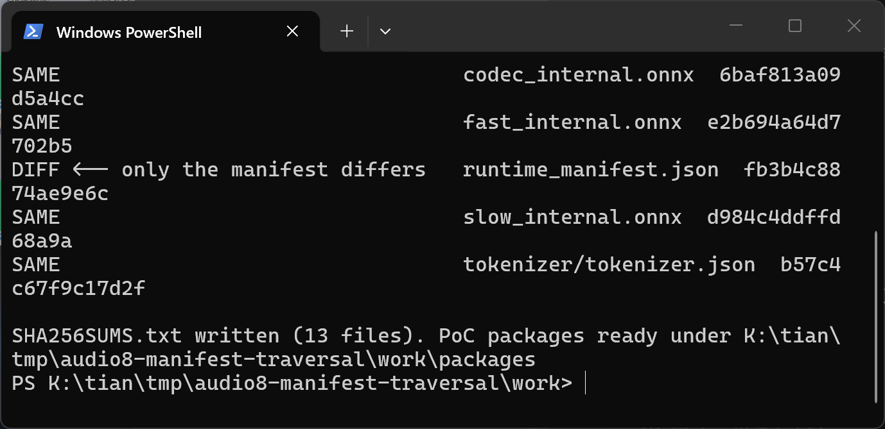
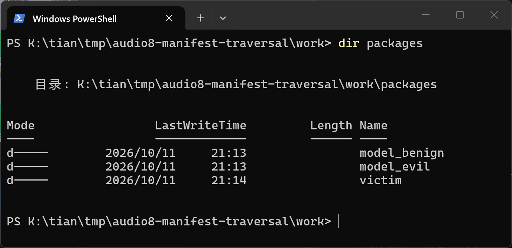
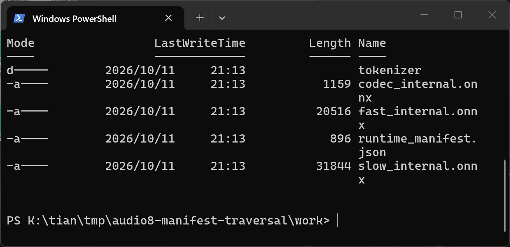
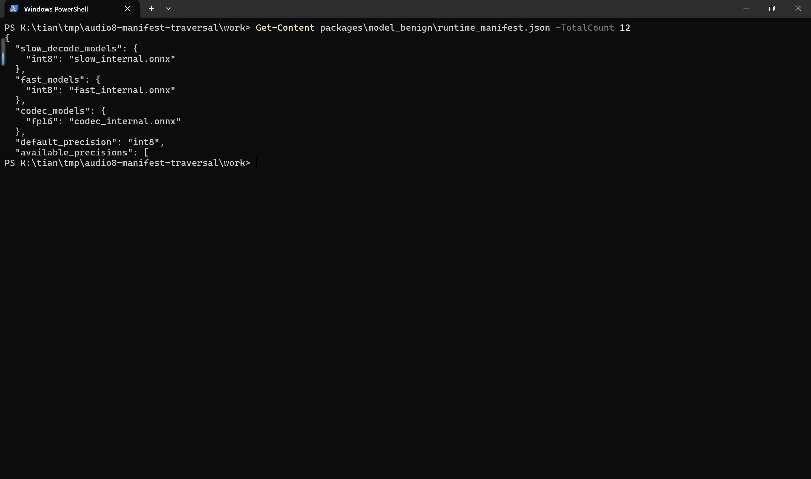
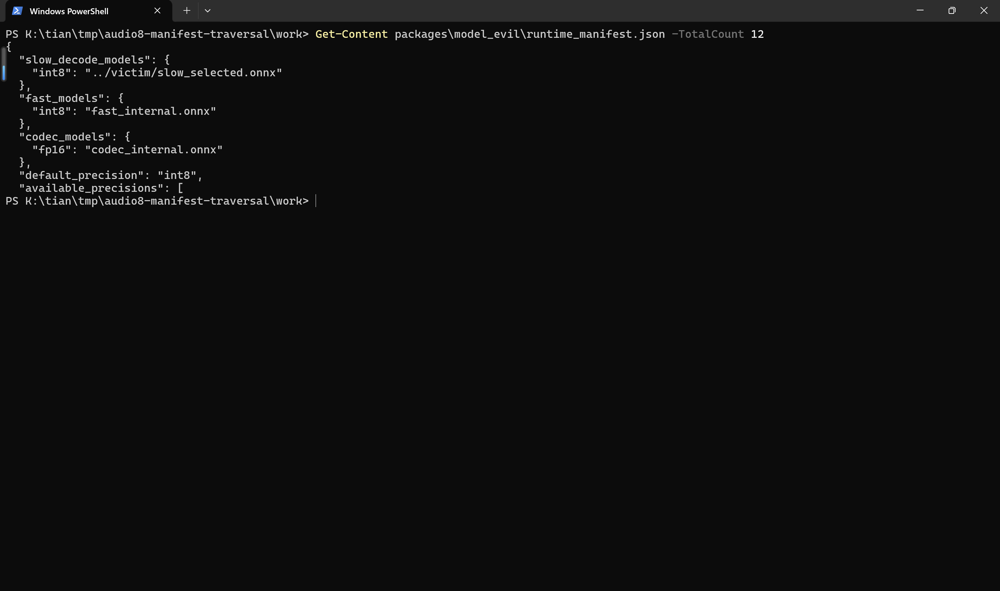
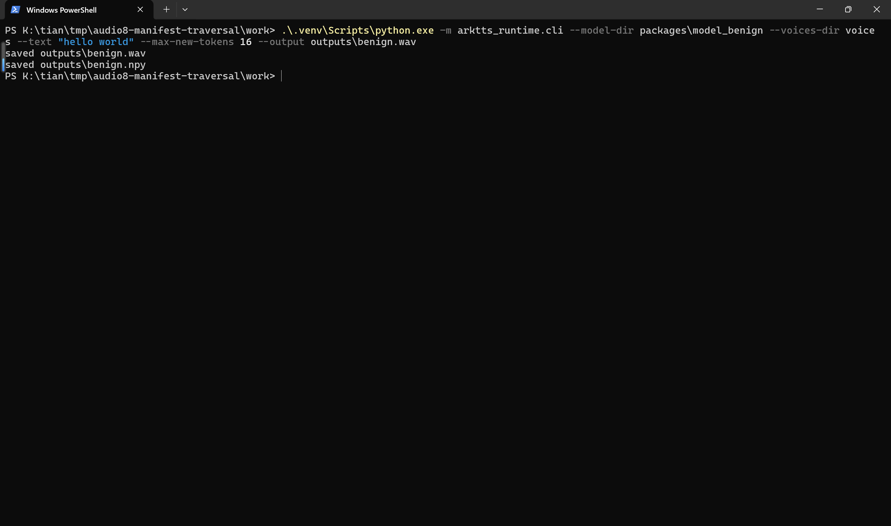
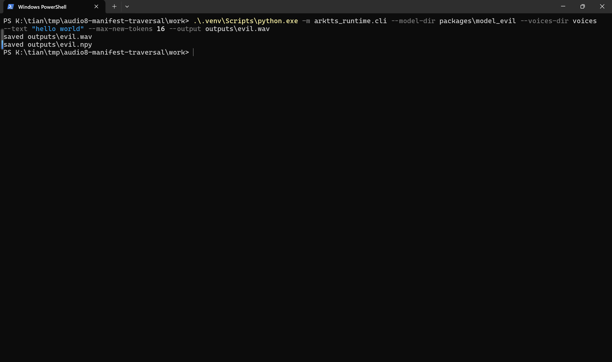
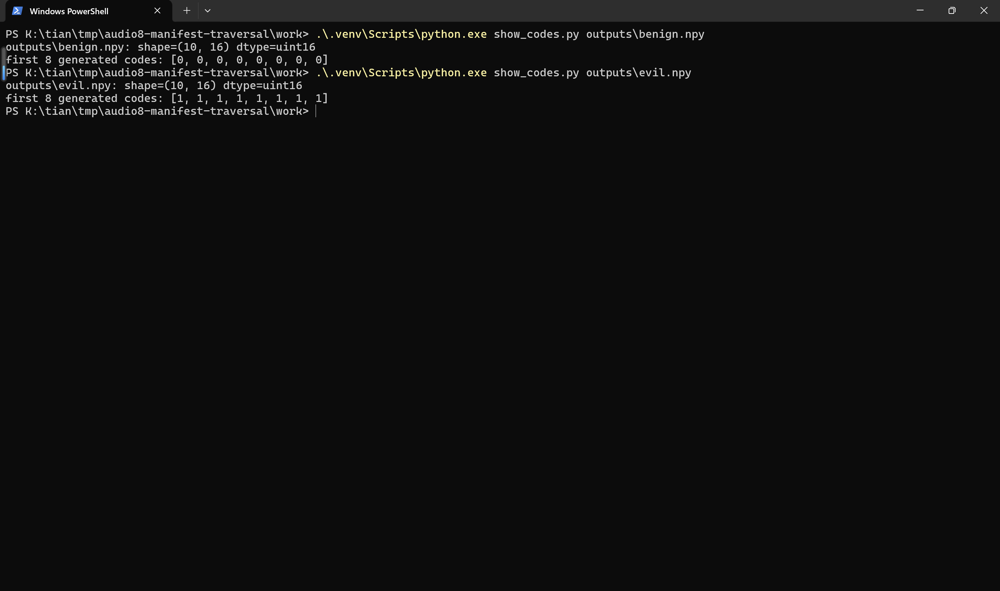
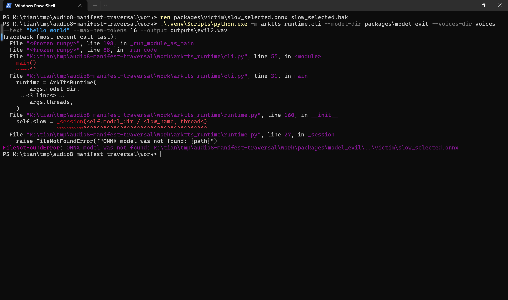

# Audio8_TTS 0.1B ONNX Runtime — Path Traversal in runtime_manifest.json Model Resolution

## Summary
Edge0-AI Audio8_TTS (commit 07e40f5d0b03) is affected by a path traversal (CWE-22) in the ONNX model resolution of its standalone 0.1B INT8 runtime (`onnx_runtime_0_1b_int8/arktts_runtime`). The model file names for the slow AR graph, the fast AR graph, and the codec decoder are read verbatim from the attacker-controlled `runtime_manifest.json` shipped inside a model package and joined to the model directory with `pathlib` without any containment check. A package whose manifest declares `slow_decode_models.int8 = "../victim/slow_selected.onnx"` makes the runtime silently load and execute an ONNX graph from outside the package directory while the package itself looks completely normal. An attacker who publishes such a crafted package (for example as a community model repository that users download and run locally) can substitute the executed speech-synthesis graph, control the generated audio content, and crash the runtime, with no warning, error, or boundary violation reported at any point.

## Affected Product

| Field | Value |
|---|---|
| Vendor | Edge0-AI |
| Product | Audio8_TTS (SOTA-Class TTS at Compact Scale) |
| Affected versions | git commit 07e40f5d0b03 (master, pushed 2026-09-02; latest commit at time of writing). No numbered release contains this component. |
| Component | `onnx_runtime_0_1b_int8/arktts_runtime/runtime.py`, `ArkTtsRuntime.__init__` (manifest-driven path joins) and `_session` (existence check only); consumed via `arktts_runtime/cli.py`, `service.py`, `web_ui.py` |
| Platform | Cross-platform Python runtime (reproduced on Windows 11 x64, PowerShell; same `pathlib` semantics apply to Linux/macOS) |
| Vulnerability type | CWE-22: Path Traversal |

## Root Cause

**Location:** `onnx_runtime_0_1b_int8/arktts_runtime/runtime.py:148-162` (`ArkTtsRuntime.__init__`) and `onnx_runtime_0_1b_int8/arktts_runtime/runtime.py:25-38` (`_session`)

The runtime parses `runtime_manifest.json` from the model directory and uses three manifest-controlled dictionaries — `slow_decode_models`, `fast_models`, and `codec_models` — as file names for the graphs it executes. The names are joined to `self.model_dir` and passed to `_session`, which performs only an `is_file()` existence check before handing the path to `onnxruntime.InferenceSession`. Nothing in either function constrains the resolved path to the model package directory, so `..` segments (or absolute paths) in the manifest escape the package boundary:

```python
slow_name = self.manifest.get("slow_decode_models", {}).get(
    self.precision,
    self.manifest.get("slow_decode_model", f"slow_ar_{self.precision}.onnx"),
)
...
self.slow = _session(self.model_dir / slow_name, threads)   # runtime.py:160 — no containment check
```

```python
def _session(path: Path, threads: int | None = None) -> ort.InferenceSession:
    if not path.is_file():   # existence only — the path may point anywhere on disk
        raise FileNotFoundError(f"ONNX model was not found: {path}")
    ...
    return ort.InferenceSession(str(path), sess_options=options, providers=["CPUExecutionProvider"])
```

The input is attacker-controlled in the realistic deployment path documented in the repository README: model packages are distributed as downloadable exports (`hf download Audio8/audio8-TTS-0.1B-ONNX-INT8 --local-dir model`), and the runtime is then pointed at the downloaded directory with `--model-dir` (or `ARKTTS_MODEL_DIR`) by the CLI, the local HTTP service, and the browser UI. A malicious or compromised model repository therefore reaches every victim that runs the runtime against it. The manifest JSON is parsed with `json.loads` at `runtime.py:137` and its `slow_decode_models` value flows directly into the path join at `runtime.py:160`. The same unchecked pattern applies to `fast_models` (`runtime.py:161`) and `codec_models` (`runtime.py:162`); the 0.6B runtime in `onnx_runtime/arktts_runtime/runtime.py` joins `codec_models` from its manifest in the same way, but the demonstrated reproduction below targets the 0.1B runtime described in this report.

## Proof of Concept

### Prerequisites
- Python 3.13.5 with `numpy`, `onnxruntime`, `tokenizers`, `soundfile` (versions used for the reproduction below: numpy 2.5.4, onnxruntime 1.31.0, tokenizers 0.22.2, soundfile 0.14.0; note onnxruntime 1.31.0 is newer than the `<1.24` pin in the repository's `requirements.txt` — the defect does not depend on the runtime version).
- `onnx` 1.23.2 to build the PoC graphs with the attached generator.
- The pinned repository checkout `Edge0-AI/Audio8_TTS@07e40f5d0b03`; the PoC only imports the unmodified `onnx_runtime_0_1b_int8/arktts_runtime` package from it.
- Victim action required: run the CLI (or service/UI) against a model package obtained from an attacker.

### PoC design
`make_poc.py` (attached) builds two model packages plus an out-of-package payload directory. The two packages are byte-identical — same `slow_internal.onnx`, `fast_internal.onnx`, `codec_internal.onnx`, `tokenizer/tokenizer.json` — except for a single value in `runtime_manifest.json`:

```text
model_benign/runtime_manifest.json -> {"slow_decode_models": {"int8": "slow_internal.onnx"}}
model_evil/runtime_manifest.json   -> {"slow_decode_models": {"int8": "../victim/slow_selected.onnx"}}
```

`packages/victim/slow_selected.onnx` lives outside both packages (a sibling directory) and is the attacker's graph. All graphs are pure standard-ONNX constant nodes (no custom ops, no external data, no program sidecar of any kind) and pass `onnx.checker.check_model`. The stub graphs satisfy the runtime's graph contract (`_validate_contract`) with small static shapes. The benign in-package slow graph emits a 4097-way one-hot logits vector at index 0, which forces the runtime's sampler to produce generated code `0`; the out-of-package victim graph emits its one-hot at index 1, which forces generated code `1`. Whichever graph the runtime actually executed is therefore visible in the first generated code of the saved `codes.npy`, and the two outcomes cannot be confused.

### Steps to Reproduce
1. Generate the packages and the payload: `python make_poc.py`. The generator verifies every graph with `onnx.checker.check_model`, prints the resolved traversal path, and prints a SHA-256 table proving that only `runtime_manifest.json` differs between the two packages.



2. Confirm the layout: `victim/` sits next to both packages, and neither package contains `slow_selected.onnx`.





3. Compare the only differing file of the two packages. Negative control manifest (in-package graph):



Malicious manifest (traversal payload):



4. Run the unmodified upstream CLI on the negative control package:

```powershell
.\.venv\Scripts\python.exe -m arktts_runtime.cli --model-dir packages\model_benign --voices-dir voices --text "hello world" --max-new-tokens 16 --output outputs\benign.wav
```



5. Run the same unmodified CLI on the malicious package. It also completes normally — no error, no warning, no path anomaly is reported to the user:

```powershell
.\.venv\Scripts\python.exe -m arktts_runtime.cli --model-dir packages\model_evil --voices-dir voices --text "hello world" --max-new-tokens 16 --output outputs\evil.wav
```



6. Compare the generated codes. The benign run executed the in-package graph (first code 0); the evil run executed the out-of-package victim graph (first code 1):



7. Prove the escape binding: rename the out-of-package payload away and rerun the malicious package. Only the malicious package breaks, and the error message shows the joined path that reached outside the package:

```text
FileNotFoundError: ONNX model was not found: K:\...\work\packages\model_evil\..\victim\slow_selected.onnx
```



### Expected vs Actual
- Expected: the runtime only ever loads the ONNX graphs contained in the selected model package; a manifest value pointing outside the package should be rejected.
- Actual: the runtime loads and executes `packages/victim/slow_selected.onnx` from outside the package, the generated audio is produced by the attacker's graph (first generated code flips from 0 to 1), and the run looks completely normal to the user.

### Sanitized PoC input
The full discriminator value inside the malicious package's `runtime_manifest.json` (no secrets, IPs, tokens or hosts are involved):

```json
{"slow_decode_models": {"int8": "../victim/slow_selected.onnx"}}
```

Attached files: `poc/make_poc.py` (generator), `poc/show_codes.py` (codes dump helper), `poc/packages/model_benign/` (negative control), `poc/packages/model_evil/` (malicious package), `poc/packages/victim/slow_selected.onnx` (out-of-package graph), `poc/voices/default/` (minimal voice store), `poc/SHA256SUMS.txt` (sample hashes).

## Impact
- Confidentiality: Low — the injected graph only processes tensors the runtime itself feeds it (prompt token ids, voice reference codes), but those private inputs can be transformed into the audible output, which can leak to whoever receives the generated audio. The path traversal also lets a package direct the runtime at arbitrary `.onnx`-readable files on disk outside the package.
- Integrity: High — the executed synthesis graph is silently substituted; the attacker fully controls the generated audio content while the user believes a trusted voice model is running. This is directly relevant for a voice-cloning product.
- Availability: High — a crafted graph with oversized constant tensors aborts or OOMs the runtime process at session construction; repeated via the HTTP service, this kills every synthesis request.
- Scope: model substitution / out-of-package file load executed with the privileges of the runtime process; no memory corruption involved.

## Remediation
Contain every manifest-supplied model path to the resolved model directory before constructing the session, for all three dictionaries (`slow_decode_models`, `fast_models`, `codec_models`) and for the optional registration manifest as well. For example, after joining, resolve the path and require `resolved.is_relative_to(self.model_dir)` (Python 3.9+: `os.path.commonpath`), rejecting absolute paths and any remaining `..` segments with a loud error. Additionally, publish per-file checksums with model exports and verify them after download so that a tampered `runtime_manifest.json` is rejected even when the traversal check cannot apply. No vendor fix exists as of commit 07e40f5d0b03; until a fixed release is available, only run model packages from trusted sources.

## References
- Source repository: https://github.com/Edge0-AI/Audio8_TTS
- Vulnerable file at pinned commit: https://github.com/Edge0-AI/Audio8_TTS/blob/07e40f5d0b03/onnx_runtime_0_1b_int8/arktts_runtime/runtime.py
- Upstream report: [pending publication]
- CWE: https://cwe.mitre.org/data/definitions/22.html
- Vendor advisory: [none]

