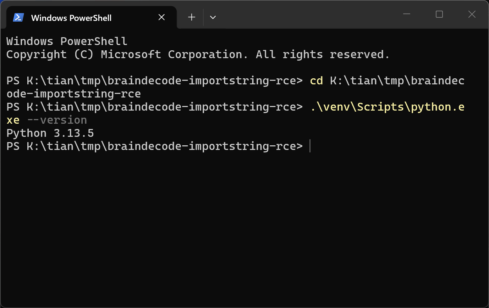
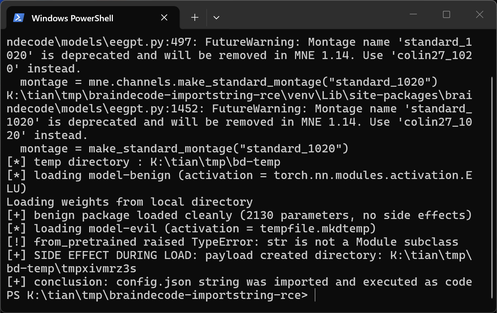

# Braindecode 1.8.1 — Unsafe Reflection in from_pretrained Config Import String Resolution

## Summary

Braindecode 1.8.1 (and every release since the type-string round-trip feature landed in 1.4.0, through current master at commit `adaa63a8ac7510d0976ee134f6a9ff8e916ef37d`) is affected by an unsafe-reflection defect in the model-loading component. The public `EEGModel.from_pretrained` entry point feeds the `config.json` of a model package through `resolve_type_kwargs`, which resolves any string value that contains a dot and belongs to a parameter whose default is a type via `pydantic.ImportString` — i.e. via an unrestricted `import` of the attacker-chosen dotted path. The imported object is stored as a constructor argument, and `EEGNet.__init__` then INVOKES it with no arguments (`self.add_module("elu_1", activation())`), so opening a crafted model directory executes attacker-chosen code: the import-time code of any module installed in the victim environment runs, and any zero-argument callable in that environment is called. The model package needs no Python sidecar — the payload is a single JSON string next to normal weights. A negative control that differs only in this one JSON value loads cleanly with its weights applied.

## Affected Product

| Field | Value |
|---|---|
| Vendor | braindecode project (github.com/braindecode) |
| Product | Braindecode |
| Affected versions | >= 1.4.0, <= 1.8.1, and latest master at commit `adaa63a8ac7510d0976ee134f6a9ff8e916ef37d`. The defective code is present in tags v1.4.0, v1.5.2, v1.6.1, v1.7.0, v1.8.0 and v1.8.1; `resolve_type_kwargs` does not exist in v1.2.0 / v1.3.0 (the `from_config` API that introduced it is documented "versionadded:: 1.4"). The GitHub compare of v1.8.1...`adaa63a8` shows the two commits between them touch only CI, docs, `pyproject.toml` and `braindecode/modules/convolution.py` — `braindecode/models/util.py`, `braindecode/models/base.py` and `braindecode/models/eegnet.py` are byte-identical between the release and the pinned master commit (diff-verified). |
| Component | `braindecode/models/util.py` — `resolve_type_kwargs` (reflective resolution), reached from `EEGModuleMixin._from_pretrained` (`braindecode/models/base.py:775`) and `EEGModuleMixin.from_config` (`braindecode/models/base.py:519`); invocation sink `EEGNet.__init__` (`braindecode/models/eegnet.py:260` and `:301`) |
| Platform | OS-independent, Python >= 3.11 with pydantic >= 2 (verified on Windows 11 x64 build 10.0.26200, Python 3.13.5, CPU-only, torch 2.14.1+cpu, pydantic 2.14.1, huggingface_hub 2.2.0) |
| Vulnerability type | CWE-470: Use of Externally-Controlled Input to Select Classes or Code ('Unsafe Reflection') |

## Root Cause

**Location:** `braindecode/models/util.py:26` (the unrestricted import adapter), `:171-176` (reflection of config values), `braindecode/models/base.py:775` (entry from `_from_pretrained`), `braindecode/models/eegnet.py:260` and `:301` (invocation of the resolved object).

Braindecode saves `type[nn.Module]` constructor parameters to `config.json` as dotted import paths (a normal `save_pretrained` writes `"activation": "torch.nn.modules.activation.ELU"`). On load, `EEGModuleMixin._from_pretrained` hands the whole config — attacker-controlled when the model comes from a hub download or a third party — to `resolve_type_kwargs`:

```python
# braindecode/models/base.py (commit adaa63a8), inside _from_pretrained
model_kwargs.pop("braindecode_version", None)
filename = model_kwargs.pop("filename", None)
resolve_type_kwargs(cls, model_kwargs)      # line 775 — config.json values enter here
```

`resolve_type_kwargs` walks the constructor signature and, for every value that is a string containing a dot and whose parameter default is a type, resolves the raw string through a pydantic `TypeAdapter(ImportString)`:

```python
# braindecode/models/util.py (commit adaa63a8)
_IMPORT_ADAPTER = pydantic.TypeAdapter(pydantic.ImportString)   # line 26 — no namespace limit

def resolve_type_kwargs(cls, kwargs):                            # line 151
    for name, param in inspect.signature(cls.__init__).parameters.items():   # line 171
        val = kwargs.get(name)
        if isinstance(val, str) and "." in val and isinstance(param.default, type):   # line 173
            try:
                kwargs[name] = _IMPORT_ADAPTER.validate_python(val)           # line 175 — arbitrary import
            except pydantic.ValidationError:
                ...
```

pydantic's `ImportString` performs the equivalent of `importlib.import_module(module)` followed by attribute traversal, with no restriction to the `torch.nn` namespace, no allowlist and no `trust_remote_code`-style gate. Two properties make this code execution rather than mere reflection:

1. Importing the referenced module executes its module-level code inside the braindecode process — the target can be any dotted path that resolves against the packages installed in the victim environment; nothing needs to exist inside the model directory.
2. For `EEGNet` the resolved object replaces the `activation` parameter (default `type[nn.Module] = nn.ELU`, `eegnet.py:146`), and the constructor CALLS it with zero arguments while building the network:

```python
# braindecode/models/eegnet.py (commit adaa63a8)
self.add_module("elu_1", activation())        # line 260 — invoked before any type check
...
self.add_module("elu_2", self.activation())   # line 301
```

The call happens before any later validation: when the resolved object is not an `nn.Module`, `nn.Module.add_module` raises `TypeError: str is not a Module subclass` — but the attacker-controlled callable has already run by then. The same resolution is reachable through the public `EEGModel.from_config(config)` API (`base.py:519`), which applies `resolve_type_kwargs` to a caller-supplied dict.

## Proof of Concept

### Prerequisites

- A victim that loads a model package with the public API, e.g. `EEGNet.from_pretrained("downloaded_model_folder")` — the normal way to consume a model saved by `save_pretrained` or fetched from a model hub.
- The model package contains only `config.json`, `model.safetensors`, `pytorch_model.bin` and `README.md` — no Python file, no shared library. The payload is the single JSON string `"activation": "tempfile.mkdtemp"`: importing and CALLING `tempfile.mkdtemp` creates a fresh directory inside the directory reported by `tempfile.gettempdir()`, a harmless and unmistakable witness.
- Verified on Windows 11 x64 (build 10.0.26200), Python 3.13.5 venv, braindecode 1.8.1 (PyPI wheel), torch 2.14.1+cpu, pydantic 2.14.1, huggingface_hub 2.2.0, safetensors 0.8.0, mne 1.13.2. In the captured run `TMPDIR`/`TEMP`/`TMP` were pointed to a neutral local directory (`K:\tian\tmp\bd-temp`) purely to avoid publishing the analyst's personal profile path in screenshots; `tempfile.gettempdir()` faithfully reports that location, and with default environment variables the directory appears in the usual per-user temp folder instead.

### Steps to Reproduce

1. Environment: Python 3.13.5 venv with braindecode 1.8.1.




2. Build the two packages with `poc/make_poc.py` (seeded weights, byte-identical `model.safetensors` and `pytorch_model.bin` in both; hashes in `poc/SHA256SUMS.txt`). The ONLY difference is one line in `config.json`: the benign package keeps the value written by `save_pretrained` (`torch.nn.modules.activation.ELU`), the malicious package carries `tempfile.mkdtemp`.


3. Load both packages with the public API via `poc/run_poc.py`:

```python
from braindecode.models import EEGNet
EEGNet.from_pretrained("model-benign")   # negative control
EEGNet.from_pretrained("model-evil")     # crafted package
```



In the captured run, `model-benign` loads completely ("Loading weights from local directory", 2130 parameters, no side effects). Loading `model-evil` prints `from_pretrained raised TypeError: str is not a Module subclass` and, before that failure, a NEW directory `K:\tian\tmp\bd-temp\tmpxivmrz3s` appears — created by the attacker-chosen `tempfile.mkdtemp` that `resolve_type_kwargs` imported from the config string and `EEGNet.__init__` invoked. A single `from_pretrained` call on the crafted package creates exactly one directory (verified in a separate instrumented run; the final exception comes from `nn.Module.add_module` at `eegnet.py:260` after the payload has already executed).

### Expected vs Actual

- Expected: a dotted string from an untrusted `config.json` is data, not an import target. Only the shipped `torch.nn.*` activation/pooling classes should be resolvable — and anything outside that set refused, or gated behind an explicit opt-in comparable to `trust_remote_code`.
- Actual: the raw string is imported through `pydantic.ImportString` with no namespace restriction, the imported object is assigned to the constructor argument, and `EEGNet.__init__` calls it. Import-time code of the target module executes, and any zero-argument callable in the victim environment runs.

### Sanitized PoC input

```json
{
  "activation": "tempfile.mkdtemp",
  "braindecode_version": "1.8.1"
}
```

(One line of `config.json`; the full file is in `poc/model-evil/config.json`, the negative control in `poc/model-benign/config.json`. Both packages ship byte-identical weights — see `poc/SHA256SUMS.txt`.)

## Impact

- Confidentiality: High (potential) — the import-and-call primitive runs with the victim process's privileges; environments routinely contain importable modules whose import-time or zero-argument-callable surface can be chained toward reading secrets or exfiltration.
- Integrity: High (potential) — the executed code can modify files, model data or the training pipeline.
- Availability: High (potential) — arbitrary import-time/callable behavior includes process termination or resource exhaustion.
- Scope: demonstrated primitive is execution of an attacker-chosen standard-library callable (directory creation) inside the process that loaded the model; every `EEGModuleMixin` subclass whose constructor has a type-defaulted parameter (activation etc., dozens of models ship with the library) reaches the same sink. The demonstration payload is deliberately harmless; no exploit beyond it is provided.


## Remediation

- Treat config-provided type strings as untrusted data: before `validate_python`, check that the resolved target is one of the intended shipped classes (e.g. an allowlist of `torch.nn.*` activations/poolings), or restrict `ImportString` resolution to a fixed parent module with `pydantic.ImportString[torch.nn.Module]`-style typing plus a namespace check on the resulting object's `__module__`.
- Refuse any string outside the allowlist at `braindecode/models/util.py:171-176` instead of warning-and-passing, and do not invoke the value until its type has been validated (`eegnet.py:260`, `:301`).
- Consider deprecating the free-form string form in `from_config`/`_from_pretrained` or gating it behind an explicit opt-in flag.
- Fixed version: [unknown] / [pending].


## References

- Source repository: https://github.com/braindecode/braindecode (commit `adaa63a8ac7510d0976ee134f6a9ff8e916ef37d`, release v1.8.1)
- Upstream report: [pending publication]
- CWE: https://cwe.mitre.org/data/definitions/470.html
- pydantic ImportString: https://docs.pydantic.dev/latest/concepts/types/#import-strings
- Vendor advisory: [none]
