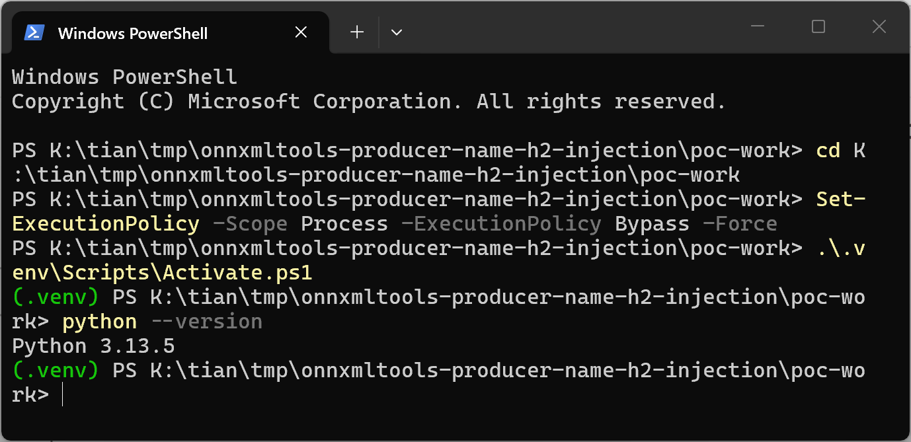
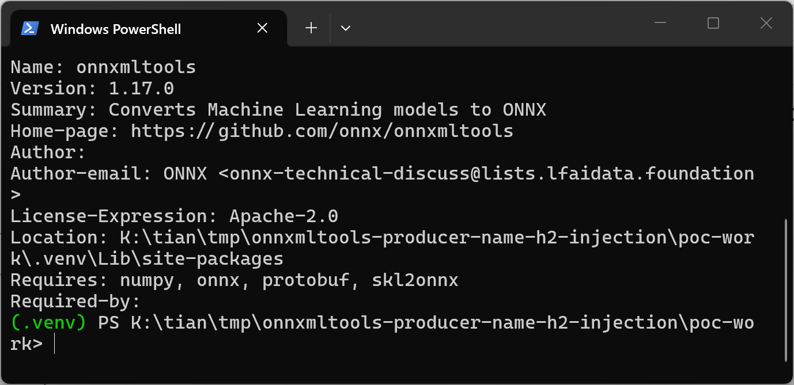
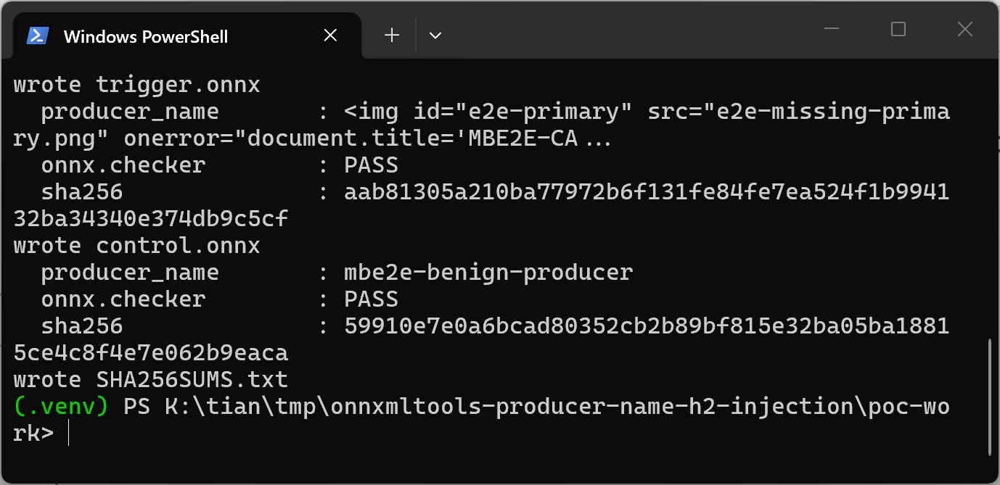
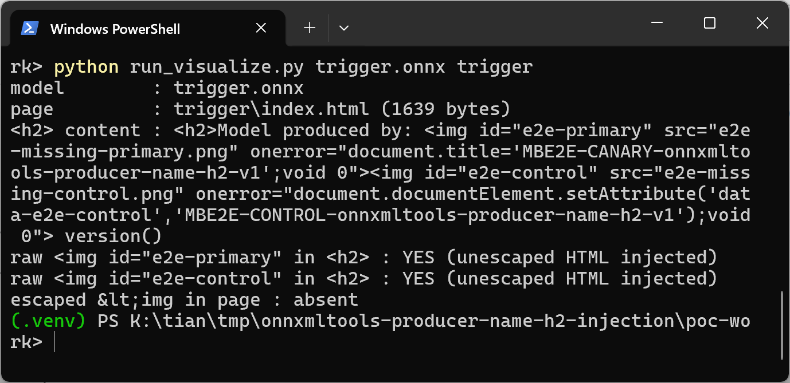
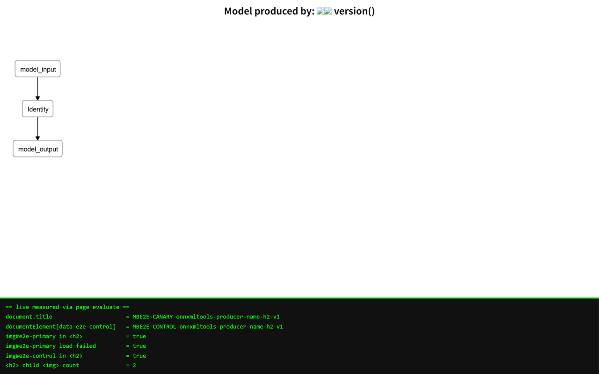
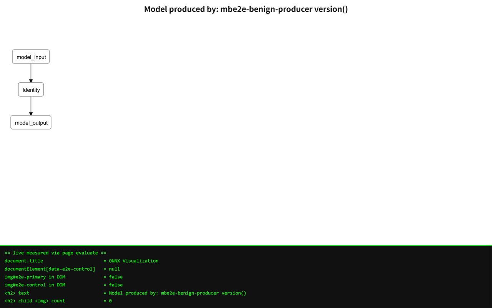
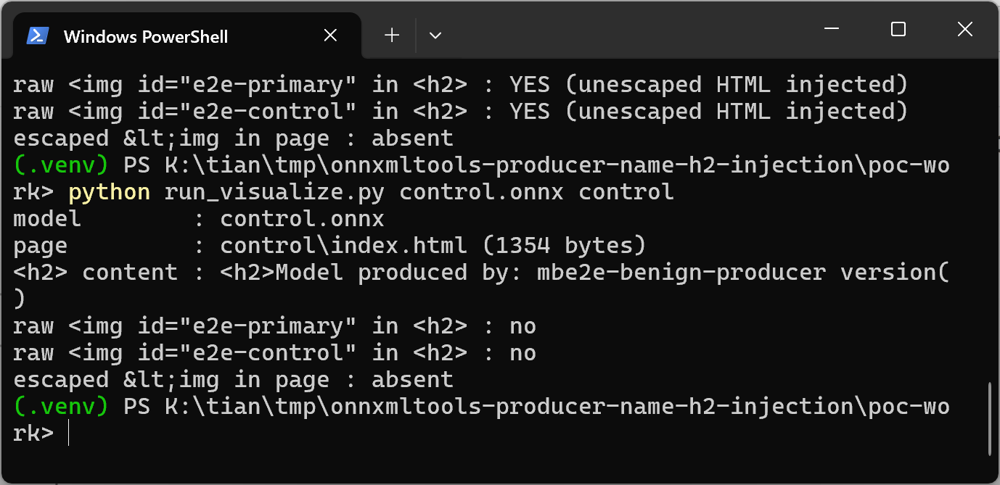
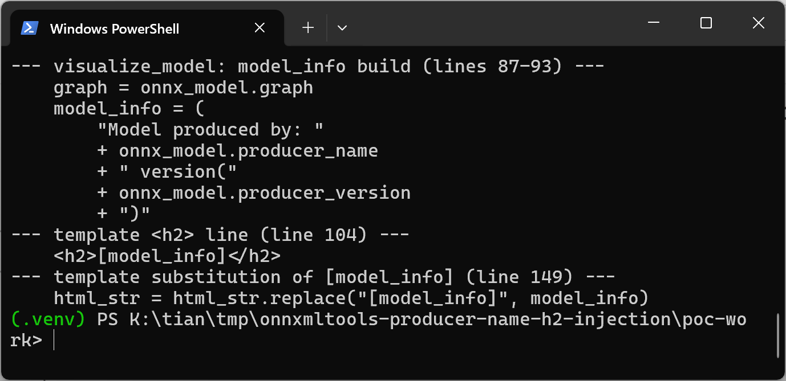
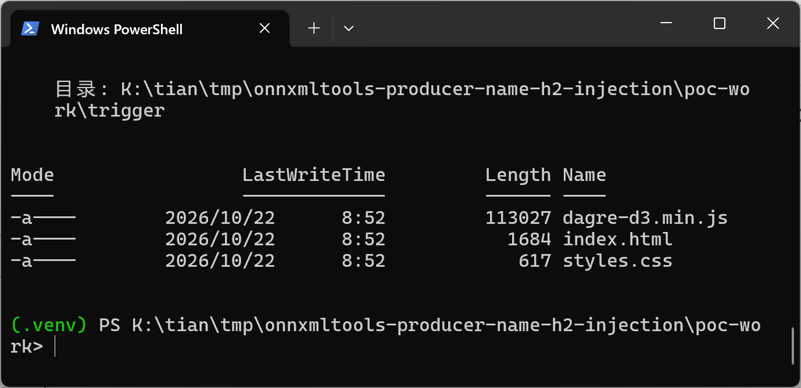

# ONNXMLTools 1.16.0 / master cf608be4 — HTML Injection in Model Visualization via producer_name (onnxmltools/utils/visualize.py)

## Summary

The ONNX project's ONNXMLTools (onnxmltools) is affected by client-side HTML injection (cross-site scripting) in the model visualization module `onnxmltools/utils/visualize.py`. The `visualize_model()` function embeds the model-supplied `ModelProto.producer_name` into the `<h2>` heading of the generated HTML page without any HTML escaping, so a crafted `.onnx` model file whose producer name carries `` elements causes attacker-controlled event handlers to execute when the visualization page is opened in a browser. By default `visualize_model()` even opens the generated page in the victim's browser automatically, so merely running the standard visualize command on an attacker-supplied model fires the payload.

## Affected Product

| Field | Value |
|---|---|
| Vendor | ONNX Project (onnx) |
| Product | onnxmltools |
| Affected versions | Latest release 1.16.0 (verified, identical defective code at the same lines) and master commit cf608be48fe11cbcc7c2efd350ceb497867029f3, in-tree version 1.17.0 (verified); the visualization module has existed since 2018, exact introduction window is [unknown] |
| Component | `onnxmltools/utils/visualize.py` — `visualize_model()`: `model_info` concatenation (lines 87-93), `<h2>[model_info]</h2>` template (line 104), unescaped `str.replace` (line 149) |
| Platform | Any OS running Python (verified on Windows 11 x64, Python 3.13.5); execution happens in any browser that opens the generated HTML |
| Vulnerability type | CWE-79: Cross Site Scripting (HTML injection through the crafted model's producer_name field) |

## Root Cause

**Location:** `onnxmltools/utils/visualize.py:87-93` (`visualize_model`), template at line 104, substitution at line 149

`visualize_model()` builds a heading string from two plain protobuf string fields of the model and splices it into an HTML template with a raw string replace:

```python
graph = onnx_model.graph
model_info = (
    "Model produced by: "
    + onnx_model.producer_name
    + " version("
    + onnx_model.producer_version
    + ")"
)
```

```python
    <h2>[model_info]</h2>
```

```python
    html_str = html_str.replace("[model_info]", model_info)
```

`producer_name` and `producer_version` are ordinary `ModelProto` string fields: they are fully attacker-controlled by anyone who can hand the victim a `.onnx` file, they pass the official `onnx.checker.check_model()` unchanged, and nothing on the path (`load_model()` performs a raw protobuf `ParseFromString`) validates or encodes them. The substitution at line 149 performs no HTML escaping, so markup inside `producer_name` becomes live DOM: an `` with an `onerror` attribute inside the `<h2>` fires its handler as soon as the browser fails to load the referenced resource. After writing the file, `visualize_model()` copies its bundled `dagre-d3.min.js`/`styles.css` next to it and calls `open_new_tab("file://" + os.path.realpath("index.html"))` (line 161), so with the default `open_browser=True` the poisoned page opens in the analyst's default browser automatically. Note the same template pipeline also injects graph node names into the inline `<script>` block (a separate injection reported independently); the `model_info` heading reported here is the HTML-context sink.

## Proof of Concept

### Prerequisites

- Python 3.13.5 (any Python supported by the project) with `onnx`, `numpy`, `protobuf` installed.
- onnxmltools installed from the pinned vulnerable source (`pip install --no-deps ./onnxmltools-cf608be4`, which reports version 1.17.0 from the master tree; release 1.16.0 contains the identical defective code at the same lines).
- A victim who runs the visualization on an attacker-supplied `.onnx` file — the normal usage of the tool on models downloaded from model hubs.

### Steps to Reproduce

1. Generate the two test models with the official ONNX helper API. Both are single-node `Identity` graphs that pass `onnx.checker.check_model()`; graph, opset and `producer_version` are identical, and the only difference is `ModelProto.producer_name`: the trigger model carries two `` elements as its producer name, the control model uses the plain producer name `mbe2e-benign-producer`.







2. Consume the trigger model with the onnxmltools visualization API (`onnxmltools.utils.load_model()` followed by `onnxmltools.utils.visualize_model(model, open_browser=False, dest="index.html")`) and inspect the generated page: the raw markup from the `producer_name` field now sits inside the `<h2>` heading of `trigger/index.html`, unescaped — two `` tags with `onerror` handlers are children of the heading.



3. Open the generated page in a browser. Both `onerror` handlers execute during rendering: `document.title` is rewritten to the canary string and `data-e2e-control` is set on the document element, while the two injected `` elements render as broken-image icons inside the heading (verified in Chromium via automation; the readout bar shows values measured live in the page).



4. Run the same pipeline on the control model and open its page: the heading is inert text, the title stays "ONNX Visualization", and no attribute or injected element appears.



5. Control run through the same consumer on the command line, plus the installed vulnerable code and the artifacts written by `visualize_model()`:







### Expected vs Actual

- Expected: `producer_name` is an arbitrary protobuf string, so the visualization page must render it as inert text (HTML-escaped); no model field may add elements or event handlers to the page.
- Actual: the producer name is substituted raw into the HTML template. The trigger model's producer name becomes two live `` elements inside the heading (title rewrite + attribute set confirmed in a real browser), while the byte-identical model with a normal producer name behaves cleanly — the only difference between the two arms is the `ModelProto.producer_name` string.

### Sanitized PoC input

The trigger sample is a standard single-node Identity model; the whole payload lives in one protobuf string field (`ModelProto.producer_name`):

```text

```

After substitution the generated page contains `<h2>Model produced by:  version()</h2>` — the browser parses the tags as elements, both images fail to load, and both `onerror` handlers execute.

## Impact

- Confidentiality: Low — injected script runs in the visualization page's origin and can exfiltrate anything that origin can read (for a file:// page the content of that page; when the generated page or the same visualization pipeline is hosted by a web service/model viewer, cookies and session data of that origin).
- Integrity: Low — the attacker can rewrite the visible page (the heading itself is attacker-controlled HTML, misleading the analyst reviewing the model) and manipulate the page's DOM.
- Availability: None — the payload does not crash anything; the demonstrated impact excludes denial of service.
- Scope: the model file is the storage medium (stored XSS pattern); `visualize_model()` auto-opens the page in the analyst's default browser by default, so no extra tooling is needed. In deployments that render onnxmltools visualizations from a web origin, this becomes stored XSS in that origin (account/session takeover of the viewing user).

## Remediation

- Treat the heading as text, not markup: HTML-escape the interpolated values (`html.escape(...)` on `producer_name` and `producer_version` before the replace), or build the heading via DOM APIs (`textContent`) instead of string substitution.
- The same template pipeline injects graph node names into the inline `<script>` block — encode those as data too (`json.dumps()` for the `g.setNode` label argument, escape or drop the `class: 'type-<name>'` segment).
- Add a regression test that visualizes a model whose producer name and node names contain markup/quote characters.
- Consider not auto-opening the generated page (`open_new_tab`) by default.


## References

- Source repository: https://github.com/onnx/onnxmltools
- Vulnerable file at pinned commit: https://github.com/onnx/onnxmltools/blob/cf608be48fe11cbcc7c2efd350ceb497867029f3/onnxmltools/utils/visualize.py
- Latest release containing the same code: https://github.com/onnx/onnxmltools/releases/tag/1.16.0
- CWE: https://cwe.mitre.org/data/definitions/79.html
- Upstream report: [pending publication]
- Vendor advisory: [none]
