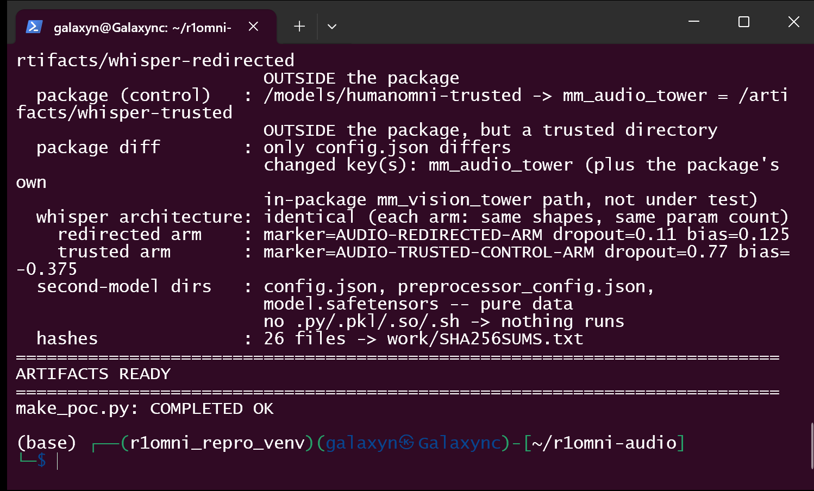
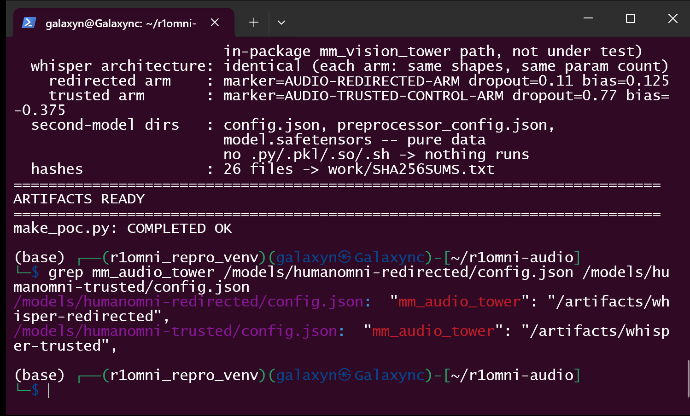
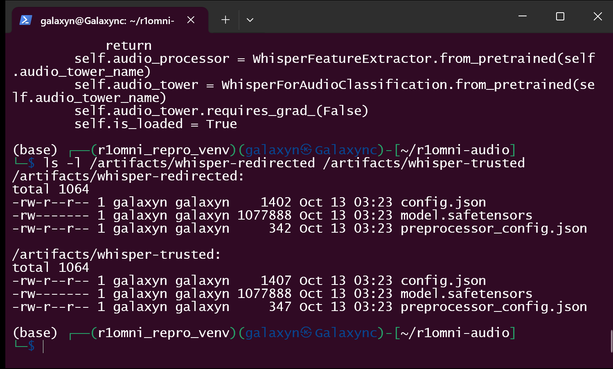
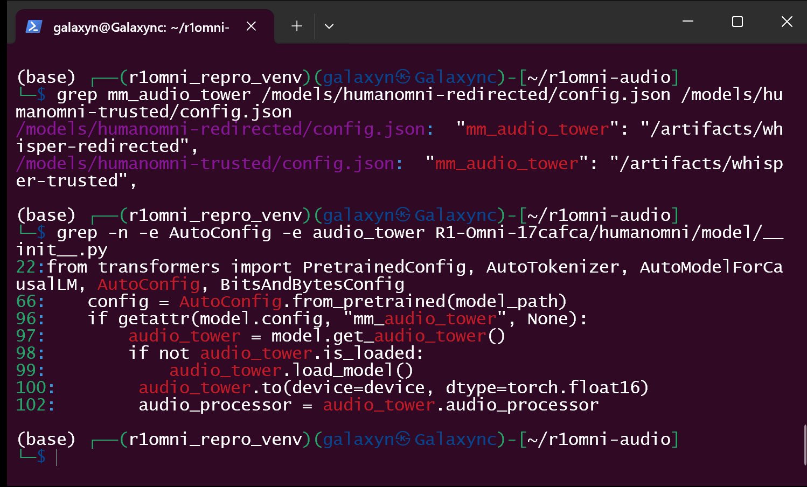
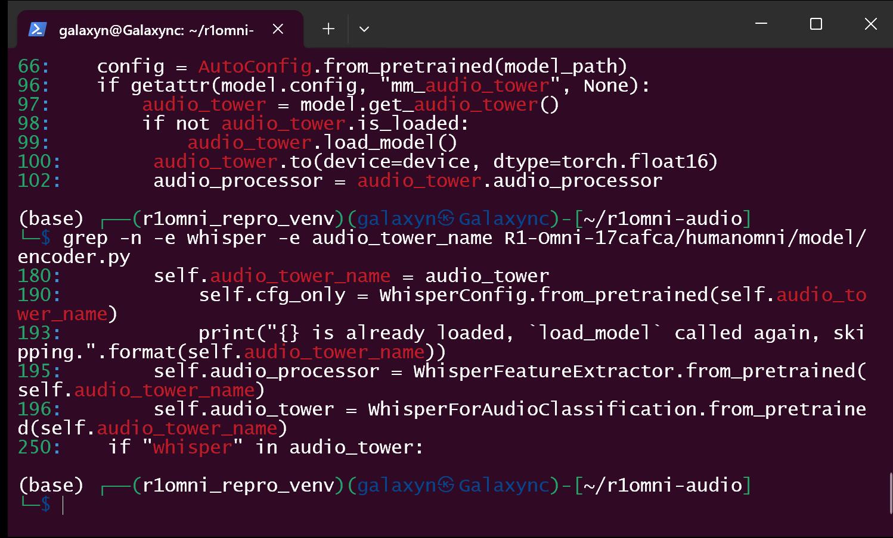
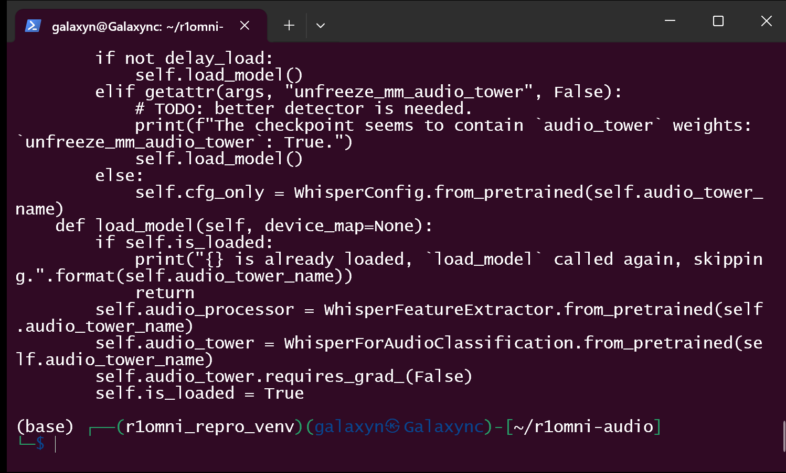
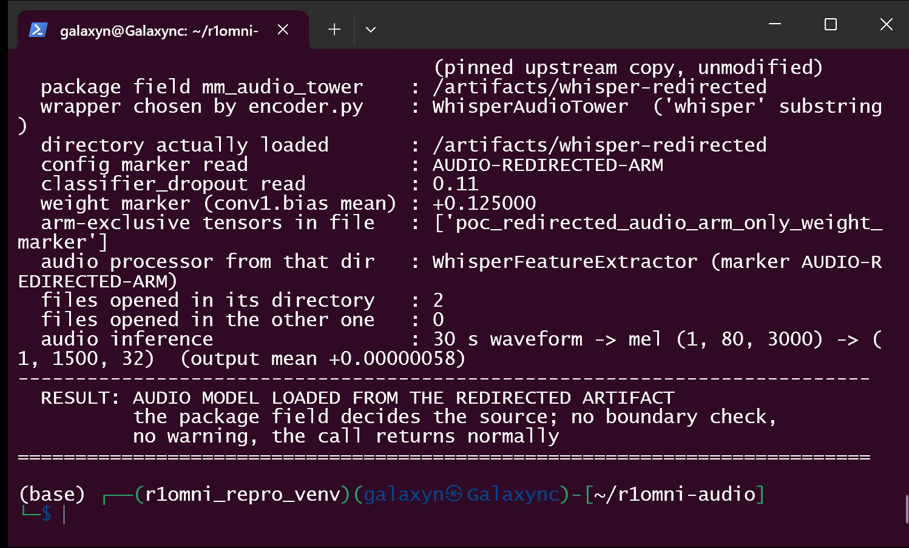
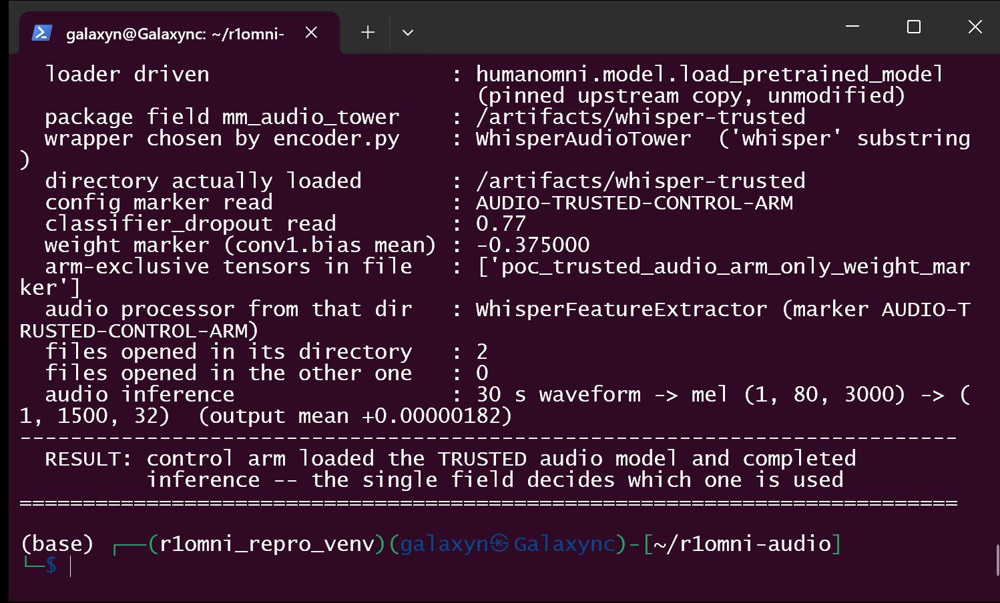
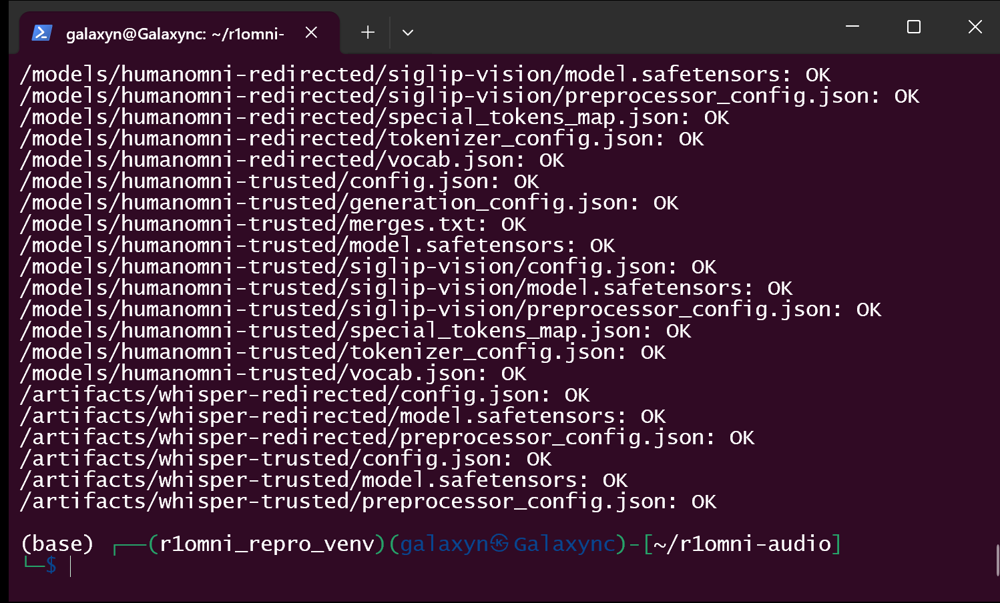
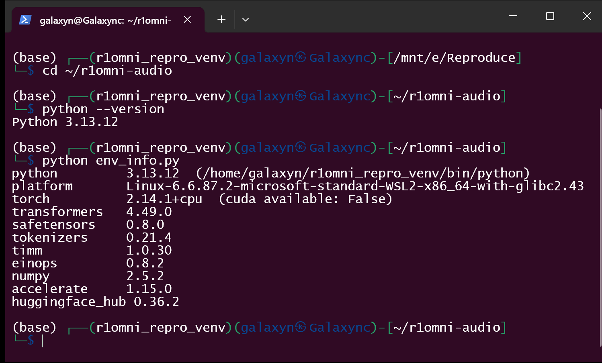

# HumanMLLM R1-Omni (HumanOmni) commit 17cafca — Model-Package-Controlled Audio-Model Load via `config.json mm_audio_tower`

## Summary

HumanMLLM R1-Omni at commit `17cafcae0b0a1c454896f4eb7a1c006bf13e1f4d` (main HEAD,
2025-03-24; the repository has no tags and no releases) is affected by a
**model-package-controlled second-model load on its audio branch**. A HumanOmni
model package's `config.json` carries `mm_audio_tower` — the Whisper audio
encoder the package wants to use. The loader keeps that string as the tower's
name (`humanomni/model/encoder.py:180`), reads it once while the model is being
constructed (`encoder.py:190`, `WhisperConfig.from_pretrained`), and then hands it
unchanged to `WhisperFeatureExtractor.from_pretrained()` and
`WhisperForAudioClassification.from_pretrained()`
(`humanomni/model/encoder.py:195-196`). The only test applied to the value is the
substring check `if "whisper" in audio_tower` (`encoder.py:250`). Nothing verifies
that it resolves inside the model directory the victim chose to load, nothing pins
it, and nothing shows it to the user.

Loading a crafted package therefore makes the process read a **second, data-only
audio artifact chosen by the package** — in the demonstrated case
`/artifacts/whisper-redirected`, a directory outside the package — and then run its
audio inference with **feature extraction, encoder weights and classification head
taken entirely from that artifact**, while the package the user reviewed stays
byte-identical except for that one string. The second artifact needs only data
(`config.json`, `preprocessor_config.json`, `model.safetensors`): no `.py`, no
plugin, no shell script, no pickle. No code executes on either arm; the defect is
an origin/scope-validation failure driven by model data, and the observable harm is
that the victim silently runs an audio pathway the package selected rather than
the one shipped with the model.

## Affected Product

| Field | Value |
|---|---|
| Vendor | HumanMLLM (`https://github.com/HumanMLLM`) |
| Product | R1-Omni (HumanOmni, `https://github.com/HumanMLLM/R1-Omni`) |
| Affected versions | commit `17cafcae0b0a1c454896f4eb7a1c006bf13e1f4d` = `main` HEAD (2025-03-24), and every commit on `main` since `humanomni/model/encoder.py` was introduced by `0b5e6ab13d7f0452dc3153ec300b22a49a735134` (2025-03-12, "integrate_humanomni"). The file is unchanged from `0b5e6ab` to HEAD (`git diff 0b5e6ab HEAD -- humanomni/model/encoder.py` is empty), so no fixed version exists; the repository has no tags and no releases and its last push is 2025-03-24. |
| Component | `humanomni/model/encoder.py` → `WhisperAudioTower` (class at 176-198): field kept at 180, config read at 190, `load_model()` at 191-198 with the two loaders at **195** (`WhisperFeatureExtractor.from_pretrained`) and **196** (`WhisperForAudioClassification.from_pretrained`); tower selection in `build_audio_tower()` at 247-251 (`if "whisper" in audio_tower` at 250). Reached from `humanomni/model/__init__.py:99` (via `humanomni/model/humanomni_arch.py:94-97`, where the config is already read at construction time), which is reached from `humanomni/__init__.py:19`, which is reached from the documented entry point `inference.py:28` (`model_init`). |
| Platform | OS-independent pure-Python path, CPU is sufficient, no GPU required. Demonstrated on a Windows 11 x64 host with a WSL2 Linux guest (glibc 2.43), Python 3.13.12, CPU-only torch. |
| Vulnerability type | CWE-494: Download of Code Without Integrity Check — the second artifact is read from an origin the package chooses, with no integrity or origin validation. Seen from the path angle the same defect is CWE-73 (External Control of File Name or Path); seen from the inclusion angle it is CWE-829 (Inclusion of Functionality from Untrusted Control Sphere). |

## Root Cause

**Location:** `humanomni/model/encoder.py:191-198` (`WhisperAudioTower.load_model`,
the reuse at lines 195-196), with the value stored at `encoder.py:180` and read a
first time at `encoder.py:190`; selection at `encoder.py:247-251`. Commit
`17cafcae0b0a1c454896f4eb7a1c006bf13e1f4d`; sha256 of the file at that commit
`2deb2ca2395a2e1f39c0c22381b30ac5d796f6ba0b3dc34448756ba0803ecbc2`,
git blob sha1 `02a4b5af4b370ceaf6d15dac3bfad759bc1bf9de` (verified against the
pinned source copy used for the reproduction, which byte-matches the clone).

The audio tower keeps the raw package value and gives it to `from_pretrained`
twice — and once more to the config loader:

```python
# humanomni/model/encoder.py:180 — the package value is used verbatim
self.audio_tower_name = audio_tower      # straight from config.json

# humanomni/model/encoder.py:190 — the delay-load path already reads that location
else:
    self.cfg_only = WhisperConfig.from_pretrained(self.audio_tower_name)

# humanomni/model/encoder.py:191-198
def load_model(self, device_map=None):
    if self.is_loaded:
        print("{} is already loaded, `load_model` called again, skipping.".format(self.audio_tower_name))
        return
    self.audio_processor = WhisperFeatureExtractor.from_pretrained(self.audio_tower_name)          # 195
    self.audio_tower = WhisperForAudioClassification.from_pretrained(self.audio_tower_name)        # 196
    self.audio_tower.requires_grad_(False)
    self.is_loaded = True
```

and the tower is selected by a substring test on that same string, with no path
handling at all:

```python
# humanomni/model/encoder.py:247-251 — 'whisper' anywhere in the string is the only test
def build_audio_tower(audio_tower_cfg, **kwargs):
    audio_tower = getattr(audio_tower_cfg, 'mm_audio_tower', getattr(audio_tower_cfg, 'audio_tower', None))
    if "whisper" in audio_tower:            # 250  <-- substring match only
        return WhisperAudioTower(audio_tower, args=audio_tower_cfg, **kwargs)
```

`mm_audio_tower` is attacker-controlled for every realistic delivery of a model
package (community fine-tunes, shared checkpoints, a package downloaded from any
hub or file share). The value is never resolved relative to the model directory,
never compared with what the package ships, never restricted to an allowlist and
never shown for confirmation. Two consequences compose:

1. **Out-of-artifact read.** The package decides which directory (or, when the
   process is not offline, which hub repository) is read for the audio encoder and
   its feature extractor. In the reproduction the value is
   `/artifacts/whisper-redirected`, outside the model package, and the process
   opens files there — twice: once for the config during construction
   (`encoder.py:190`) and once for the processor and weights at load time
   (`encoder.py:195-196`).
2. **Silent substitution of the audio pathway.** The weights that
   `WhisperForAudioClassification.from_pretrained` loads are used for real, and the
   preprocessing is substituted too: `humanomni/model/__init__.py:102` assigns
   `audio_tower.audio_processor` to the processor returned to the caller, so the
   audio pipeline that feeds the model is the second artifact's as well. Which
   mel-feature extraction, which encoder weights and which audio classification
   head the model runs on is decided by one string inside the first-hop package.

The chain is documented usage, not a special API. `inference.py:28` calls
`model_init(model_path)`; `humanomni/__init__.py:19` forwards to
`load_pretrained_model`; `humanomni/model/__init__.py:66` parses the package config
with the ordinary safe JSON path (`AutoConfig.from_pretrained(model_path)`), and
line 99 calls `audio_tower.load_model()`, which is where the second artifact is
read. The main `config.json` is thus parsed safely *before* the second-model read
happens — the defect is not in the parser; it is the loader reusing a
package-supplied string as a load target. `WhisperAudioTower` also reads
`args.mm_vision_select_layer` (`encoder.py:181`), so this path depends on the
vision-side config keys being present, but it does not depend on the vision tower.

## Proof of Concept

### Prerequisites

- Victim: R1-Omni at the pinned commit, installed with the libraries its own README
  pins (`transformers 4.49.0`, `torch`; CPU is enough). Loading a model package
  through `inference.py`/`model_init` is the only user action; no privileges and no
  special configuration are required.
- Attacker: the ability to publish (a) a complete HumanOmni model package and (b) a
  second, data-only Whisper directory placed anywhere the victim's process can read
  — in the reproduction `/artifacts/whisper-redirected`, i.e. outside the package.
- The reproduction is fully offline (`TRANSFORMERS_OFFLINE=1`, mirroring
  `inference.py:8`); no hub, host or credential is involved and neither
  second-model directory contains executable content.
- The pinned upstream copy is used unmodified: `poc/R1-Omni-17cafca/`, 70 files,
  `humanomni/model/encoder.py` sha256 `2deb2ca2…ecbc2` (equal to the clone at
  `17cafca`).

### Steps to Reproduce

1. Build the artifacts (`python make_poc.py`): two complete HumanOmni packages —
   `/models/humanomni-redirected` and `/models/humanomni-trusted` — each carrying
   its own tokenizer, generation config, main weights and an **in-package,
   hash-identical** vision tower, plus the two data-only Whisper directories
   `/artifacts/whisper-redirected` and `/artifacts/whisper-trusted`. Both Whisper
   directories have the same architecture and differ only in plain data markers: a
   config string, a dropout value, a bias value and one arm-exclusive tensor.

   

2. Confirm the single substantive field that separates the two arms — same package
   bytes, one string changed:

   

3. Confirm both Whisper directories are pure data — a data-only second hop cannot
   execute anything:

   

4. Confirm the consumer chain in the pinned source: the package config is parsed
   safely at `humanomni/model/__init__.py:66` and the audio-model load is triggered
   at line 99:

   

5. Confirm the defective selection and the unconstrained loaders — the field is
   stored verbatim, read once for its config and handed to both loaders, and the
   only test is the substring `"whisper"`:

   

6. The same code in context — `sed -n '176,198p'` prints the whole class; the window
   shows the output tail, i.e. the delay-load/config branch and `load_model()` with
   both loader calls (lines 183-198; the class header and the field assignment at
   line 180 are legible in the previous screenshot):

   

7. Victim side, redirected arm — one load of the package through the real upstream
   loader, no extra arguments:

   ```
   python run_repro.py redirected     # drives humanomni.model.load_pretrained_model('/models/humanomni-redirected', ...)
   ```

   

   The tool reports, from the loaded objects and from an audit hook on the file
   opens: wrapper chosen `WhisperAudioTower`; directory actually loaded
   `/artifacts/whisper-redirected`; config marker `AUDIO-REDIRECTED-ARM`;
   `classifier_dropout` 0.11; weight marker (`encoder.conv1.bias` mean)
   `+0.125000`; arm-exclusive tensor `poc_redirected_audio_arm_only_weight_marker`
   present in the weights file that was read; `WhisperFeatureExtractor` from that
   directory (marker `AUDIO-REDIRECTED-ARM`) is the processor returned to the
   caller; 2 files opened in the redirected directory, 0 in the trusted one; audio
   inference `30 s waveform -> mel (1, 80, 3000) -> (1, 1500, 32)`;
   `RESULT: AUDIO MODEL LOADED FROM THE REDIRECTED ARTIFACT`.

8. Control — the same package bytes with only `mm_audio_tower` changed to the
   trusted directory:

   ```
   python run_repro.py trusted        # /models/humanomni-trusted -> /artifacts/whisper-trusted
   ```

   

   The control arm reads only the trusted directory (0 files opened in the
   redirected one), reads the trusted markers instead, completes the same audio
   inference, and returns a different output mean (`+0.00000182` vs `+0.00000058`)
   — the substituted weights are what produced the result. The two packages differ
   in `config.json` only (every other file, including the in-package vision tower,
   is hash-identical); the changed keys are `mm_audio_tower` (the field under test)
   and `mm_vision_tower`, which is each package's own copy of the identical
   in-package vision tower and is not part of this finding.

9. Integrity of the reproduction inputs — all 26 generated files verify:

   

   Environment of the reproduced run:

   

### Expected vs Actual

- Expected: a model package must not be able to choose a second artifact outside
  the directory the user chose to load. A value such as `mm_audio_tower` should
  either resolve inside that directory or be refused / visibly confirmed, and the
  identity of what was loaded should be logged.
- Actual: `mm_audio_tower` is forwarded verbatim into the Whisper config read and
  into two `from_pretrained` calls. On the redirected arm the process reads
  `/artifacts/whisper-redirected` and builds its audio branch from it; the load
  completes normally, the processor handed back to the caller is that directory's
  processor, and the audio encoder forward pass runs on those weights. Nothing in
  the run — no warning, error or prompt — distinguishes the two arms apart from the
  values printed by the PoC itself.

### Sanitized PoC input

```json
{
  "model_type": "HumanOmni_qwen2",
  "architectures": ["HumanOmniQwen2ForCausalLM"],
  "hidden_size": 64,
  "num_hidden_layers": 2,
  "mm_projector_type": "linear",
  "mm_hidden_size": 32,
  "mm_vision_select_layer": -2,
  "mm_vision_tower": "/models/humanomni-redirected/siglip-vision",
  "mm_audio_tower": "/artifacts/whisper-redirected"
}
```

The control package is the same file with `mm_audio_tower` set to
`/artifacts/whisper-trusted`. All paths are local fixtures created by
`poc/make_poc.py`; no real hub, host, credential or personal path is involved.

### Validation boundary (what this PoC does and does not prove)

- **Proven here:** the package's `mm_audio_tower` decides which directory the
  loader reads for the audio encoder and its feature extractor; the process really
  opens files outside the model package (recorded by an audit hook on `open`, and
  the resolved path is taken from the loaded config); the weights, the feature
  extractor and the arm-exclusive tensor that end up in the running model are the
  second directory's; the audio inference runs and its result depends on those
  weights; the control package with the one field changed reads only the trusted
  directory. The run drives upstream code
  (`humanomni.model.load_pretrained_model`) with no patching, stubbing or
  monkey-patching of R1-Omni code.
- **No code execution, by construction:** both second-model directories contain
  only data (`config.json`, `preprocessor_config.json`, `model.safetensors`) — no
  `.py`, no `.pkl`, no `.so`, no shell script. The claim is second-artifact
  origin/scope control over the audio branch, not remote code execution.
- **Not proven:** a fetch from a real hub (the reproduction is offline and uses
  local paths only; the same field accepts a hub repository id whenever
  `TRANSFORMERS_OFFLINE` is not set, but that leg was not exercised); a GPU run;
  training entry points in the same repository; and a full `mm_infer` generation
  (which requires CUDA) — the audio *encoder* forward pass is what was executed.
- **Scale of the stand-ins:** the packages are minimal HumanOmni/Qwen2 stand-ins
  (2 layers, hidden 64, 257 219 parameters) and each Whisper model is a minimal
  `WhisperForAudioClassification` (d_model 32, 2 encoder layers, 80 mel bins,
  1500 source positions — Whisper's native 30 s window). The audio output means
  are therefore tiny and near zero; the claim is which artifact was read and used,
  not output quality.
- **Why a vision tower is present at all:** `humanomni/model/__init__.py:83-86`
  dereferences the vision tower unconditionally before the audio path, so a package
  that only sets `mm_audio_tower` cannot be loaded. Both packages ship an identical
  in-package vision tower; its path appears in the config diff for that reason
  only, and its files are hash-identical across the two arms.
- **Real prerequisite discovered during reproduction:** `humanomni/model/humanomni_arch.py:83-85`
  hardcodes an absolute path to `bert-base-uncased`
  (`/mnt/data/jiaxing.zjx/code/R1-V-Qwen/R1-V/bert-base-uncased`) and the model
  cannot be constructed without it. The reproduction provides a tiny BERT stand-in
  at exactly that path (`poc/setup_fixtures.sh`) so that upstream code runs
  unmodified; this is a fixture, not part of the reported defect.
- **Entry point detail:** `model_init` hardcodes `device="cuda"` but the vulnerable
  read at `humanomni/model/__init__.py:99` happens before the tower is moved to a
  device; the PoC therefore calls the same upstream function with
  `device="cpu"`/`device_map="cpu"` so the run can complete on a CPU-only machine.
- **Environment:** verified in a single environment (Windows 11 host + WSL2 Linux
  guest, CPU-only). No second environment (e.g. container) was cross-checked.
- **Companion finding:** the same defect exists for the vision tower
  (`mm_vision_tower`, `humanomni/model/encoder.py:112` and `:114`) and is reported
  separately; this report covers the audio tower.

## Impact

- Confidentiality: **None** — the demonstrated chain reads a directory the
  attacker names but discloses nothing to the attacker; no victim data leaves the
  process. (The out-of-artifact read is nevertheless a path-existence and
  file-shape oracle for a local attacker, and it can make a private local model
  directory be the one the application runs on; neither was escalated here.)
- Integrity: **High** — the audio branch of the loaded model is whatever the second
  artifact defines: mel feature extraction parameters, encoder weights and the
  audio classification head. The package the user obtained and reviewed stays
  byte-identical apart from one string, and for a model whose purpose is
  audio-visual emotion understanding, the audio-derived predictions are then
  produced from attacker-chosen features.
- Availability: **Low** — the second artifact's size and shape are attacker inputs
  to the loader (a large or extreme Whisper configuration makes the process
  allocate accordingly), but no exhaustion path was demonstrated.
- Scope: no memory corruption and no code execution; a data-driven
  origin/scope-validation failure in a model loader, with the model's audio
  component silently substituted. It composes with anything that loads third-party
  HumanOmni packages (demos, batch inference, evaluation harnesses).

## Attack Vector and Severity (CVSS v3.1)

| Metric | Value | Rationale |
|---|---|---|
| Attack Vector | **Network (N)** | the malicious package is delivered over the network (published and downloaded from a hub or file share) and the same field can name a remote repository as the second origin |
| Attack Complexity | **Low (L)** | standard load path, default configuration, no race and no special conditions; producing a crafted package is the whole requirement |
| Privileges Required | **None (N)** | the attacker needs no account or privilege on the victim side |
| User Interaction | **Required (R)** | the victim must load the crafted model package |
| Scope | **Unchanged (U)** | effects stay inside the victim's own process and user authority |
| Confidentiality | **None (N)** | nothing is disclosed to the attacker by the demonstrated chain |
| Integrity | **High (H)** | the audio encoder, its feature extraction and the classification head the model uses are attacker-chosen while the reviewed package stays byte-identical |
| Availability | **Low (L)** | attacker-chosen model size/shape is a resource input, not a demonstrated outage |

```
Score: 7.1 (High)
Vector: CVSS:3.1/AV:N/AC:L/PR:N/UI:R/S:U/C:N/I:H/A:L
```

Assumptions are stated explicitly. Read as a purely local artifact (the victim
copies a package onto the machine), the same vector with AV:L scores **6.1
(Medium)**. Read as only "the package chose a directory" without the weight and
preprocessing substitution, I:L gives **5.3 (Medium)**. The H choice for Integrity
reflects that the running model's entire audio pathway is defined by the second
artifact.

## Remediation

1. Do not take the second-model location from the package. Resolve
   `mm_audio_tower` relative to the model directory the user loaded (or require the
   caller to pass it explicitly), and refuse values that escape that directory
   (`humanomni/model/encoder.py:247-251`).
2. If a package must be able to name an external location, make it an explicit,
   user-visible decision: print the resolved path before loading, require an opt-in
   flag for values outside the package, and pin the revision when the value is a
   remote repository id (the `from_pretrained` calls at `encoder.py:195-196`, and
   the config read at `encoder.py:190`).
3. Record the resolved directory (and revision) in the load log so an unexpected
   origin is visible to whoever runs inference.
4. Apply the same treatment to the vision-tower readers (`encoder.py:109`, `:112`,
   `:114`) so both towers share one validated resolution step.

Workaround until patched: load third-party HumanOmni packages only with
`mm_audio_tower` pointing inside the package (or rewrite it to a local copy before
loading), and keep the process offline (`TRANSFORMERS_OFFLINE=1`, as
`inference.py:8` already does) so a repository id cannot resolve to a remote
origin.

## Timeline

| Date | Event |
|---|---|
| 2026-10-13 | Vulnerability verified against `17cafcae0b0a1c454896f4eb7a1c006bf13e1f4d` (code audit + working two-arm reproduction + negative control) |
| 2026-10-13 | Report prepared for disclosure to the maintainers |
| [pending] | Reported upstream (channel: see `01-issue.md`) |
| [pending] | Maintainer acknowledged |
| [pending] | Fix released |

## References

- Source repository: https://github.com/HumanMLLM/R1-Omni
- Verified commit: https://github.com/HumanMLLM/R1-Omni/tree/17cafcae0b0a1c454896f4eb7a1c006bf13e1f4d
- Vulnerable file at that commit: https://github.com/HumanMLLM/R1-Omni/blob/17cafcae0b0a1c454896f4eb7a1c006bf13e1f4d/humanomni/model/encoder.py (lines 191-198, loaders at 195-196; selection at 247-251)
- Consumer of the audio path: https://github.com/HumanMLLM/R1-Omni/blob/17cafcae0b0a1c454896f4eb7a1c006bf13e1f4d/humanomni/model/__init__.py (lines 96-103)
- Upstream report: [pending publication]
- CWE: https://cwe.mitre.org/data/definitions/494.html (see also https://cwe.mitre.org/data/definitions/73.html and https://cwe.mitre.org/data/definitions/829.html)
- Vendor advisory: [none]

## Disclaimer

This report is provided for defensive and coordination purposes. It contains no
ready-to-run exploit beyond the minimum reproduction information, and no sensitive
infrastructure details. Do not disclose it publicly before the maintainer has had
a reasonable window to fix the issue.

## Screenshot Checklist

All screenshots are real terminal-window captures (Windows Terminal through WSL2,
1498 × 904 px) taken on 2026-10-13 while the commands were typed and executed one
by one; every visible line is that command's real output. Environment: Windows 11
x64 host, WSL2 Linux guest, venv `~/r1omni_repro_venv` (Python 3.13.12, torch
2.14.1+cpu, transformers 4.49.0), upstream source pinned at `poc/R1-Omni-17cafca/`
(commit `17cafca`, unmodified), fixtures `/models/humanomni-redirected`,
`/models/humanomni-trusted`, `/artifacts/whisper-redirected`,
`/artifacts/whisper-trusted` created by `poc/make_poc.py`, offline
(`TRANSFORMERS_OFFLINE=1`). Cross-checked in a second environment: no.

| File | Content |
|---|---|
| screenshots/01-environment.png | `python --version` and `python env_info.py` — interpreter and library versions of the reproduction venv |
| screenshots/02-make-poc.png | `python make_poc.py` — artifact SUMMARY: both packages, the audio field that differs, the package diff, and the pure-data Whisper directories |
| screenshots/03-audio-field.png | `grep mm_audio_tower` on both package configs — the single substantive field that separates the arms |
| screenshots/04-consumer-chain.png | `grep -n -e AutoConfig -e audio_tower humanomni/model/__init__.py` — line 66 parses the package config, lines 96-103 load the audio tower and return its processor |
| screenshots/05-audio-selection.png | `grep -n -e whisper -e audio_tower_name humanomni/model/encoder.py` — the field at 180, the config read at 190, the two loaders at 195-196 and the substring test at 250 |
| screenshots/06-audio-load-model.png | `sed -n '176,198p' humanomni/model/encoder.py` — the `WhisperAudioTower` class in context |
| screenshots/07-whisper-dirs.png | `ls -l` of both Whisper directories — data only, no program sidecars |
| screenshots/08-redirected-loaded.png | `python run_repro.py redirected` — the redirected directory is resolved and loaded, its markers and exclusive tensor are read, 2 files opened there, 0 in the trusted directory, audio inference runs |
| screenshots/09-trusted-control.png | `python run_repro.py trusted` — same package, one field changed: only the trusted directory is read and the same inference completes with a different result |
| screenshots/10-hashes.png | `sha256sum -c work/SHA256SUMS.txt` — all 26 generated artifacts verify |
