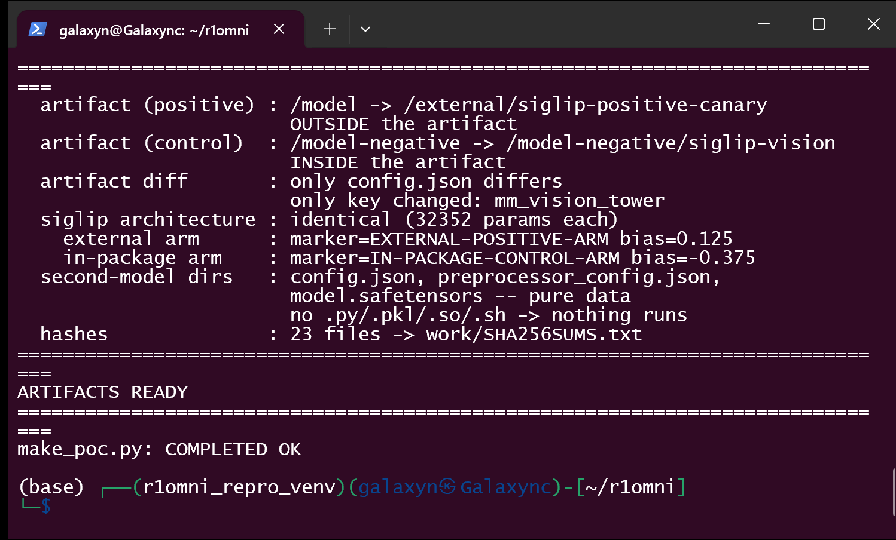
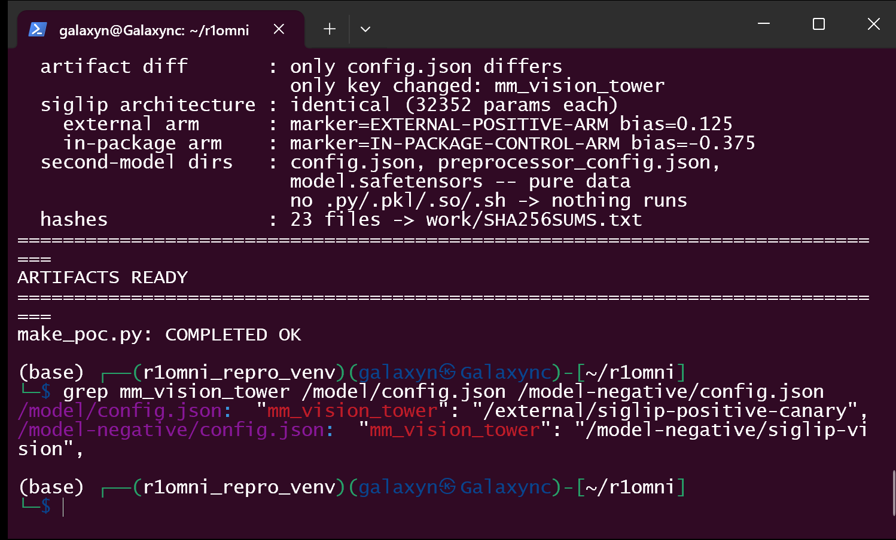
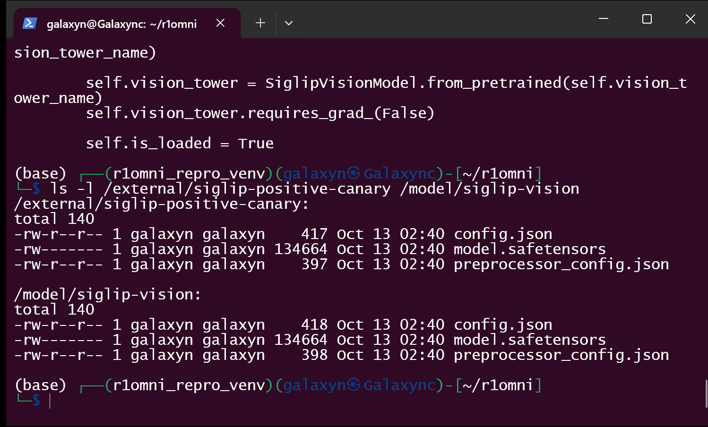
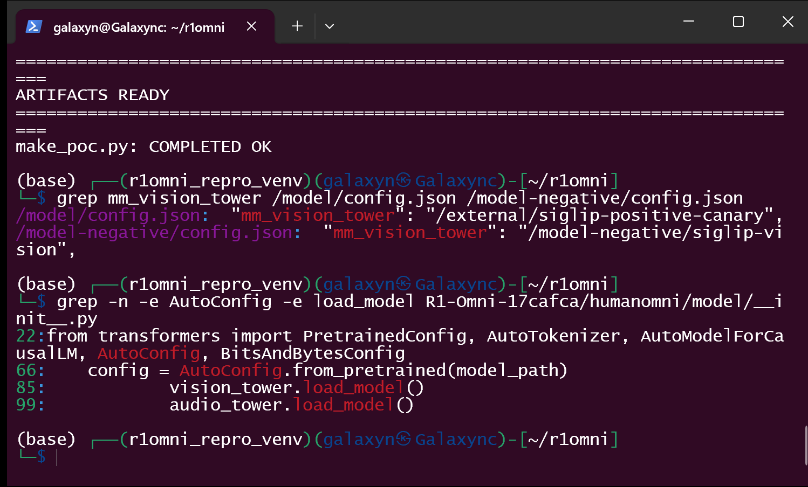
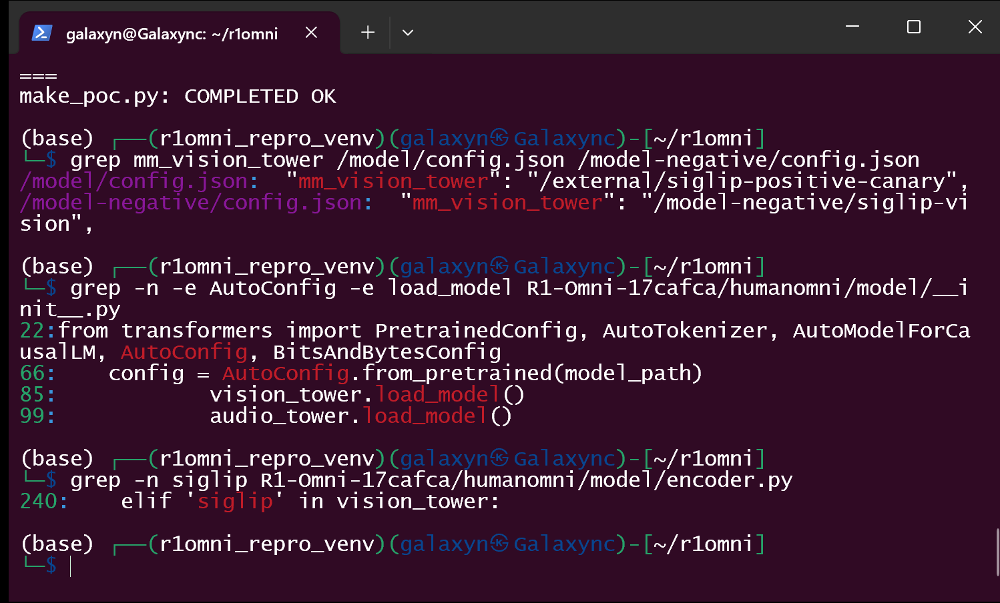
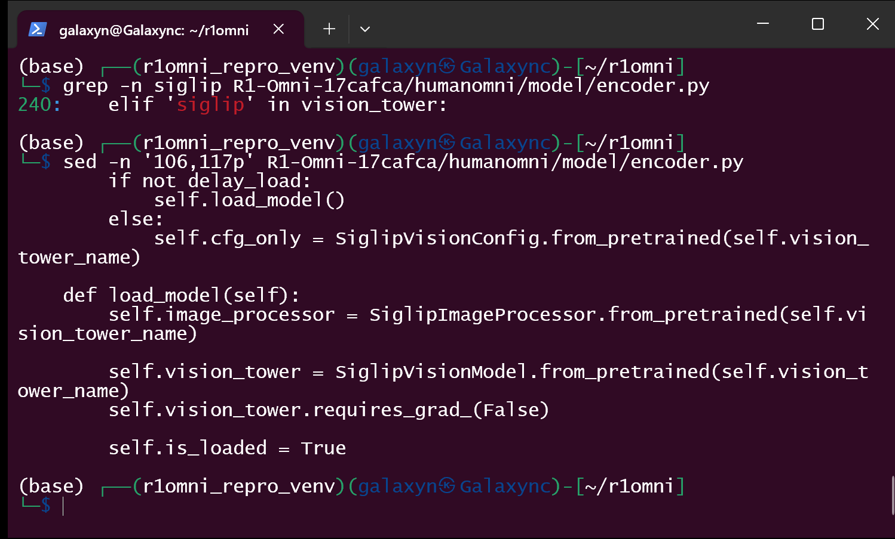
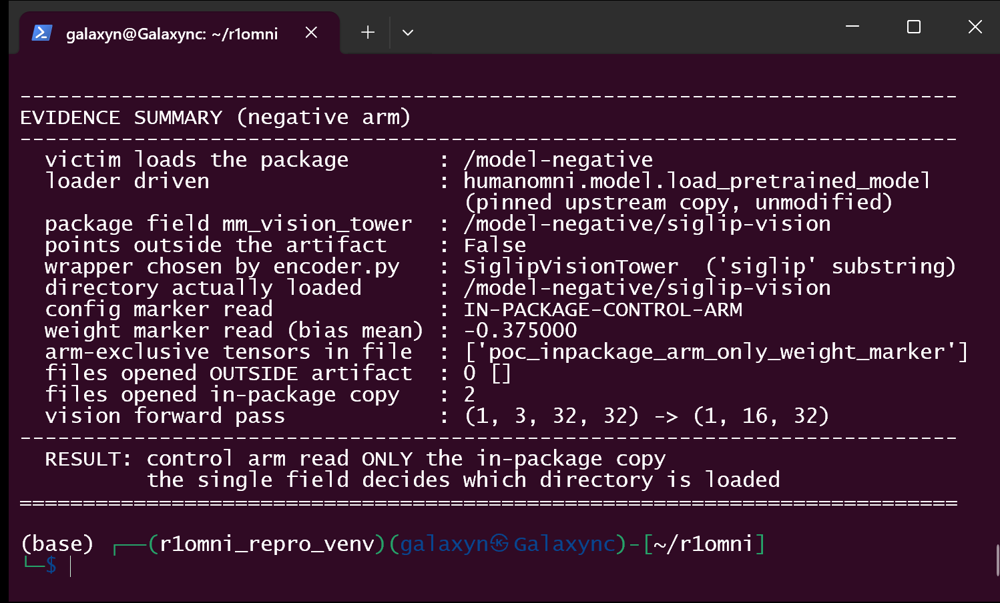
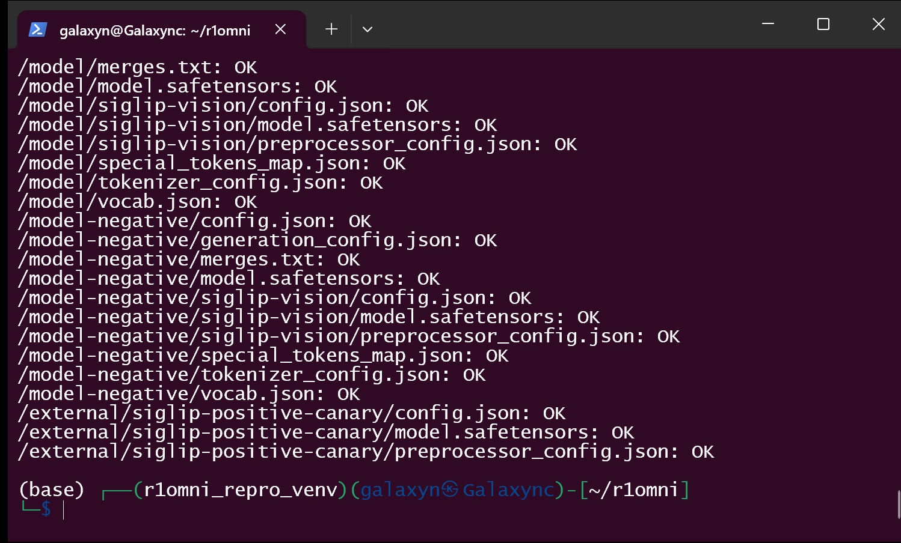
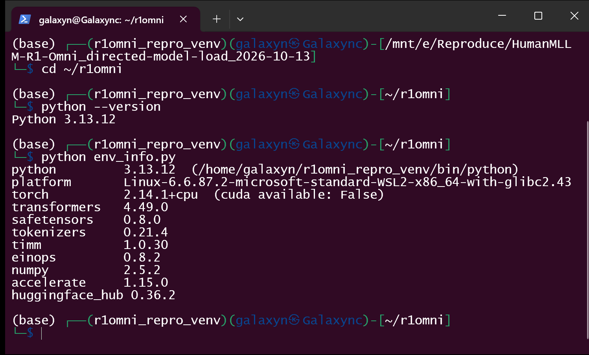

# HumanMLLM R1-Omni (HumanOmni) commit 17cafca — Model-Package-Controlled Second-Model Load via `config.json mm_vision_tower`

## Summary

HumanMLLM R1-Omni at commit `17cafcae0b0a1c454896f4eb7a1c006bf13e1f4d` (main HEAD,
2025-03-24; the repository has no tags and no releases) is affected by a
**model-package-controlled second-model load** in its model loader. A HumanOmni
model package's `config.json` carries `mm_vision_tower` — the vision encoder the
package wants to use. The loader takes that string from the package and hands it,
unmodified and unchecked, to `SiglipImageProcessor.from_pretrained()` and
`SiglipVisionModel.from_pretrained()`
(`humanomni/model/encoder.py:112` and `:114`). Nothing verifies that the value
resolves inside the model directory the victim chose to load, nothing pins it,
and nothing shows it to the user.

Loading a crafted package therefore makes the process read a **second model
artifact chosen by the package** — in the demonstrated case an absolute path
outside the model directory (`/external/siglip-positive-canary`) — and then run
its inference on **weights, preprocessing parameters and feature extraction that
come entirely from that second artifact**, while the package the user reviewed
stays byte-identical except for that one string. The second artifact needs only
data (`config.json`, `preprocessor_config.json`, `model.safetensors`): no `.py`,
no plugin, no shell script, no pickle. No code executes on either arm of the
reproduction; the defect is an origin/scope-validation failure driven by model
data, and the observable harm is that the victim silently runs a vision pathway
the package selected rather than the one shipped with the model.

## Affected Product

| Field | Value |
|---|---|
| Vendor | HumanMLLM (`https://github.com/HumanMLLM`) |
| Product | R1-Omni (HumanOmni, `https://github.com/HumanMLLM/R1-Omni`) |
| Affected versions | commit `17cafcae0b0a1c454896f4eb7a1c006bf13e1f4d` = `main` HEAD (2025-03-24), and every commit on `main` since the file was introduced by `0b5e6ab13d7f0452dc3153ec300b22a49a735134` (2025-03-12, "integrate_humanomni"). `humanomni/model/encoder.py` is unchanged from `0b5e6ab` to HEAD (`git diff 0b5e6ab HEAD -- humanomni/model/encoder.py` is empty). No tags and no releases exist, so no fixed version exists; the repo's last push is 2025-03-24. The stale `origin/master` branch (root commit `0020f5a5`) predates the file. |
| Component | `humanomni/model/encoder.py` → `SiglipVisionTower.load_model()` (lines 111-115, loaders at 112/114); tower selection in `build_vision_tower()` (lines 235-245, `'siglip' in vision_tower` at line 240); reached from `humanomni/model/__init__.py:85` (`vision_tower.load_model()`), which is reached from `humanomni/__init__.py:19` (`load_pretrained_model`), which is reached from the documented entry point `inference.py:28` (`model_init`) |
| Platform | OS-independent pure-Python path, CPU is sufficient, no GPU required. Demonstrated on a Windows 11 x64 host with a WSL2 Linux guest (glibc 2.43), Python 3.13.12, CPU-only torch |
| Vulnerability type | CWE-494: Download of Code Without Integrity Check — the second artifact is read from an origin the package chooses, with no integrity or origin validation. Seen from the path angle the same defect is CWE-73 (External Control of File Name or Path); seen from the inclusion angle it is CWE-829 (Inclusion of Functionality from Untrusted Control Sphere). |

## Root Cause

**Location:** `humanomni/model/encoder.py:111-115` (`SiglipVisionTower.load_model`)
and `humanomni/model/encoder.py:235-245` (`build_vision_tower`), commit
`17cafcae0b0a1c454896f4eb7a1c006bf13e1f4d`; sha256 of the file at that commit
`2deb2ca2395a2e1f39c0c22381b30ac5d796f6ba0b3dc34448756ba0803ecbc2`,
git blob sha1 `02a4b5af4b370ceaf6d15dac3bfad759bc1bf9de` (verified against the
pinned source copy used for the reproduction, which byte-matches the clone).

The wrapper stores the raw package value and gives it to `from_pretrained` twice:

```python
# humanomni/model/encoder.py:103 and 111-115 — the package value is used verbatim
self.vision_tower_name = vision_tower           # line 103: straight from config.json

def load_model(self):
    self.image_processor = SiglipImageProcessor.from_pretrained(self.vision_tower_name)   # 112
    self.vision_tower = SiglipVisionModel.from_pretrained(self.vision_tower_name)         # 114
    self.vision_tower.requires_grad_(False)
```

and the tower is selected by a substring test on that same string, with no path
handling at all:

```python
# humanomni/model/encoder.py:235-245 — 'siglip' anywhere in the string is the only test
def build_vision_tower(vision_tower_cfg, **kwargs):
    vision_tower = getattr(vision_tower_cfg, 'mm_vision_tower', getattr(vision_tower_cfg, 'vision_tower', None))
    if  'clip' in vision_tower:                 # 238
        vision_tower = CLIPVisionTower(vision_tower, args=vision_tower_cfg, **kwargs)
    elif 'siglip' in vision_tower:              # 240  <-- substring match only
        vision_tower = SiglipVisionTower(vision_tower, args=vision_tower_cfg, **kwargs)
    else:
        raise ValueError(f'Unknown vision tower: {vision_tower}')
```

`mm_vision_tower` is attacker-controlled for every realistic delivery of a model
package (community fine-tunes, shared checkpoints, a package downloaded from any
hub or file share). The value is never resolved relative to the model directory,
never compared with what the package ships, never restricted to an allowlist, and
never shown for confirmation. Two consequences compose:

1. **Out-of-artifact read.** The package decides which directory (or, when the
   process is not offline, which hub repository) is read for the vision encoder
   and its preprocessor. In the reproduction the value is an absolute path
   *outside* the model directory that the user downloaded and inspected —
   `/external/siglip-positive-canary` — and the process opens files there.
2. **Silent substitution of the visual pathway.** The weights that
   `SiglipVisionModel.from_pretrained` loads are used for real: the reproduced
   run executes a vision forward pass through the loaded tower and gets features
   back. The preprocessing is substituted too — `humanomni/model/__init__.py:89`
   assigns `vision_tower.image_processor` to the processor the caller receives,
   so the image/video pipeline that feeds the model is the second artifact's as
   well. Which weights and which preprocessing the model runs on is therefore
   decided by one string inside the first-hop package.

The chain is the documented usage, not a special API. `inference.py:28` calls
`model_init(model_path)`; `humanomni/__init__.py:19` forwards to
`load_pretrained_model`; `humanomni/model/__init__.py:66` parses the package
config with the ordinary safe JSON path (`AutoConfig.from_pretrained(model_path)`)
and line 85 calls `vision_tower.load_model()`, which is where the second artifact
is read. The main `config.json` is thus parsed safely *before* the second-model
read happens — the defect is not in the parser; it is the loader reusing a
package-supplied string as a load target.

Two neighbouring details observed while reproducing, both unfixed:
`SiglipVisionConfig.from_pretrained(self.vision_tower_name)`
(`encoder.py:109`) reads the second location once more, already during model
construction with `delay_load=True`, i.e. before any weights are loaded; and the
identical pattern exists for the audio tower (`WhisperFeatureExtractor` /
`WhisperForAudioClassification` at `encoder.py:195-196`, reached from
`encoder.py:247-251`). The audio path was not exercised in this report.

## Proof of Concept

### Prerequisites

- Victim: R1-Omni at the pinned commit, installed with the libraries its own
  README pins (`transformers 4.49.0`, `torch`; CPU is enough). Loading a model
  package through `inference.py`/`model_init` is the only user action; no
  privileges and no special configuration are required.
- Attacker: the ability to publish (a) a HumanOmni model package and (b) a
  second, data-only SigLIP directory placed anywhere the victim's process can
  read — in the reproduction `/external/siglip-positive-canary`, i.e. outside the
  package.
- The reproduction is fully offline (`TRANSFORMERS_OFFLINE=1`, mirroring
  `inference.py:8`); no hub, host or credential is involved and the second
  artifact contains no executable content.
- The pinned upstream copy is used unmodified: `poc/R1-Omni-17cafca/`, 70 files,
  `humanomni/model/encoder.py` sha256 `2deb2ca2…ecbc2` (equal to the clone at
  `17cafca`).

### Steps to Reproduce

1. Build the artifacts (`python make_poc.py`): the main package `/model` (a
   minimal HumanOmni/Qwen2 stand-in with a real Qwen2 tokenizer), the byte-level
   control package `/model-negative`, the data-only SigLIP directory outside any
   package `/external/siglip-positive-canary`, and an in-package copy
   `/model/siglip-vision`. Both SigLIP directories have the same architecture
   (32 352 parameters each) and differ only in plain data markers: a config field,
   a bias value and one arm-exclusive tensor.

   

2. Confirm the single field that separates the two arms — same package bytes, one
   string changed:

   

3. Confirm both second-model directories are pure data — a data-only second hop
   cannot execute anything:

   

4. Confirm the consumer chain in the pinned source: the package config is parsed
   safely at `humanomni/model/__init__.py:66` and the second-model load is
   triggered at line 85:

   

5. Confirm the defective selection — the only test on the attacker string is the
   substring `'siglip'`:

   

6. Confirm the defective load — the package value is passed to `from_pretrained`
   unmodified:

   

7. Victim side, positive arm — one load of the package through the real upstream
   loader, no extra arguments:

   ```
   python run_repro.py positive      # drives humanomni.model.load_pretrained_model('/model', ...)
   ```

   

   The tool reports, from the loaded objects and from an audit hook on the file
   opens: wrapper chosen `SiglipVisionTower`; directory actually loaded
   `/external/siglip-positive-canary`; config marker `EXTERNAL-POSITIVE-ARM`;
   weight marker (`patch_embedding.bias` mean) `+0.125000`; arm-exclusive tensor
   `poc_external_arm_only_weight_marker` present in the weights file that was
   read; 2 files opened outside the artifact, 0 in the copy shipped inside it;
   forward pass `(1, 3, 32, 32) -> (1, 16, 32)`; `RESULT: EXTERNAL SECOND MODEL
   LOADED`.

8. Control — the same package bytes with only `mm_vision_tower` changed to a path
   *inside* the artifact:

   ```
   python run_repro.py negative      # /model-negative -> /model-negative/siglip-vision
   ```

   

   The control arm loads the in-package copy only: 0 files opened outside the
   artifact, the in-package markers read instead, a different weight value, and
   no external directory touched. The two arms differ in that single field (the
   artifact diff in step 1 shows every other file byte-identical, and the two
   `config.json` files differ only in the key `mm_vision_tower`).

9. Integrity of the reproduction inputs — all 23 generated files verify:

   

   Environment of the reproduced run:

   

### Expected vs Actual

- Expected: a model package must not be able to choose a second artifact outside
  the directory the user chose to load. A value such as `mm_vision_tower` should
  either resolve inside that directory or be refused / visibly confirmed, and the
  identity of what was loaded should be logged.
- Actual: `mm_vision_tower` is forwarded verbatim into two `from_pretrained`
  calls and, on the positive arm, the process reads `/external/siglip-positive-canary`
  and builds its vision pathway from it. The load returns normally, the processor
  handed back to the caller is the external artifact's processor, and the vision
  forward pass runs on the external weights. No warning, no error and no prompt
  distinguish the two arms apart from the values printed by the PoC itself.

### Sanitized PoC input

```json
{
  "model_type": "HumanOmni_qwen2",
  "architectures": ["HumanOmniQwen2ForCausalLM"],
  "hidden_size": 64,
  "num_hidden_layers": 2,
  "mm_projector_type": "linear",
  "mm_hidden_size": 32,
  "mm_vision_select_layer": -2,
  "mm_vision_select_feature": "patch",
  "mm_vision_tower": "/external/siglip-positive-canary"
}
```

The control package is the same file with `mm_vision_tower` set to
`/model-negative/siglip-vision`. All paths are local fixtures created by
`poc/make_poc.py`; no real hub, host, credential or personal path is involved.

### Validation boundary (what this PoC does and does not prove)

- **Proven here:** the package's `mm_vision_tower` decides which directory the
  loader reads for the vision encoder and its preprocessor; the process really
  opens files outside the model directory (recorded by an audit hook on `open`
  and by the resolved path taken from the loaded config); the weights, the
  preprocessing configuration and the arm-exclusive tensor that end up in the
  running model are the external artifact's; the vision forward pass executes;
  the load returns successfully. The same package with the one field pointing
  inside the artifact reads only the in-package copy. The run drives upstream
  code (`humanomni.model.load_pretrained_model`) with no patching, stubbing or
  monkey-patching of R1-Omni code.
- **No code execution, by construction:** the second artifact is data only
  (`config.json`, `preprocessor_config.json`, `model.safetensors`) — no `.py`,
  no `.pkl`, no `.so`, no shell script. The claim is second-artifact origin/scope
  control over the vision pathway, not remote code execution.
- **Not proven:** a fetch from a real hub (the reproduction is offline and uses
  local paths only; the same field accepts a hub repository id whenever
  `TRANSFORMERS_OFFLINE` is not set, which is the library path a downstream
  caller may take, but that leg was not exercised); a GPU run; the audio-tower
  twin of the defect; and the training entry points in the same repository.
- **Scale of the stand-ins:** the main package is a minimal HumanOmni/Qwen2
  stand-in (2 layers, hidden 64, 257 219 parameters) and the second artifact is a
  minimal SigLIP (2 layers, hidden 32, image 32×32, 32 352 parameters) so the run
  fits on CPU in seconds. The claim is about which artifact is read and used, not
  about output quality; the shapes and the loader are the upstream ones.
- **Real prerequisite discovered during reproduction:** `humanomni/model/humanomni_arch.py:83-85`
  hardcodes an absolute path to `bert-base-uncased`
  (`/mnt/data/jiaxing.zjx/code/R1-V-Qwen/R1-V/bert-base-uncased`) and the model
  cannot be constructed without it. The reproduction provides a tiny BERT
  stand-in at exactly that path (`poc/setup_fixtures.sh`) so that upstream code
  runs unmodified; this is a fixture, not part of the reported defect.
- **Entry point detail:** `model_init` hardcodes `device="cuda"` but the
  vulnerable read at `humanomni/model/__init__.py:85` happens before the tower is
  moved to a device; the PoC therefore calls the same upstream function with
  `device="cpu"`/`device_map="cpu"` so that the run can complete on a CPU-only
  machine.
- **Environment:** verified in a single environment (Windows 11 host + WSL2 Linux
  guest, CPU-only). No second environment (e.g. container) was cross-checked.

## Impact

- Confidentiality: **None** — the demonstrated chain reads a directory the
  attacker names but discloses nothing to the attacker; no victim data leaves the
  process. (The out-of-artifact read is nevertheless a path-existence and
  file-shape oracle for a local attacker, and it can make a private local model
  directory be the one the application runs on; neither was escalated here.)
- Integrity: **High** — the visual pathway of the loaded model is whatever the
  second artifact defines: encoder weights, preprocessing parameters and feature
  extraction. The package the user actually obtained and reviewed stays
  byte-identical apart from one string, and the resulting model silently answers
  from attacker-chosen visual features.
- Availability: **Low** — the second artifact's size and shape are attacker
  inputs to the loader (a large or extreme SigLIP configuration makes the process
  allocate accordingly), but no exhaustion path was demonstrated.
- Scope: no memory corruption and no code execution; a data-driven
  origin/scope-validation failure in a model loader, with the model's vision
  component silently substituted. It composes with anything that loads
  third-party HumanOmni packages (demos, batch inference, evaluation harnesses)
  and with the audio tower's identical pattern.

## Attack Vector and Severity (CVSS v3.1)

| Metric | Value | Rationale |
|---|---|---|
| Attack Vector | **Network (N)** | the malicious package is delivered over the network (published and downloaded from a hub or file share) and the same field can name a remote repository as the second origin |
| Attack Complexity | **Low (L)** | standard load path, default configuration, no race and no special conditions; producing a crafted package is the whole requirement |
| Privileges Required | **None (N)** | the attacker needs no account or privilege on the victim side |
| User Interaction | **Required (R)** | the victim must load the crafted model package |
| Scope | **Unchanged (U)** | effects stay inside the victim's own process and user authority |
| Confidentiality | **None (N)** | nothing is disclosed to the attacker by the demonstrated chain |
| Integrity | **High (H)** | the vision encoder, its preprocessing and the features the model uses are attacker-chosen while the reviewed package stays byte-identical |
| Availability | **Low (L)** | attacker-chosen model size/shape is a resource input, not a demonstrated outage |

```
Score: 7.1 (High)
Vector: CVSS:3.1/AV:N/AC:L/PR:N/UI:R/S:U/C:N/I:H/A:L
```

Assumptions are stated explicitly. Read as a purely local artifact (the victim
copies a package onto the machine), the same vector with AV:L scores **6.1
(Medium)**. Read as only "the package chose a directory" without the weight
substitution, I:L gives **5.3 (Medium)**. The H choice for Integrity reflects that
the running model's entire visual pathway is defined by the second artifact.

## Remediation

1. Do not take the second-model location from the package. Resolve
   `mm_vision_tower` relative to the model directory the user loaded (or require
   the caller to pass it explicitly), and refuse values that escape that
   directory (`humanomni/model/encoder.py:236-241`).
2. If a package must be able to name an external location, make it an explicit,
   user-visible decision: print the resolved path before loading, require an
   opt-in flag for values outside the package, and pin the revision when the
   value is a remote repository id (the `from_pretrained` calls at
   `humanomni/model/encoder.py:112` and `:114`).
3. Record the resolved directory (and revision) in the load log so an unexpected
   origin is visible to whoever runs inference.
4. Apply the same treatment to the two confusable readers: `SiglipVisionConfig.from_pretrained`
   at `encoder.py:109` and the audio tower at `encoder.py:190`/`:195-196`
   (`WhisperConfig`, `WhisperFeatureExtractor`, `WhisperForAudioClassification`).

Workaround until patched: load third-party HumanOmni packages only with
`mm_vision_tower` pointing inside the package (or rewrite it to a local copy
before loading), and keep the process offline (`TRANSFORMERS_OFFLINE=1`, as
`inference.py:8` already does) so a repository id cannot resolve to a remote
origin.

## Timeline

| Date | Event |
|---|---|
| 2026-10-13 | Vulnerability verified against `17cafcae0b0a1c454896f4eb7a1c006bf13e1f4d` (code audit + working two-arm reproduction + negative control) |
| 2026-10-13 | Report prepared for disclosure to the maintainers |
| [pending] | Reported upstream (channel: see `01-issue.md`) |
| [pending] | Maintainer acknowledged |
| [pending] | Fix released |

## References

- Source repository: https://github.com/HumanMLLM/R1-Omni
- Verified commit: https://github.com/HumanMLLM/R1-Omni/tree/17cafcae0b0a1c454896f4eb7a1c006bf13e1f4d
- Vulnerable file at that commit: https://github.com/HumanMLLM/R1-Omni/blob/17cafcae0b0a1c454896f4eb7a1c006bf13e1f4d/humanomni/model/encoder.py (lines 111-115, 235-245)
- Second reader on the same path: https://github.com/HumanMLLM/R1-Omni/blob/17cafcae0b0a1c454896f4eb7a1c006bf13e1f4d/humanomni/model/__init__.py (lines 66, 85)
- Upstream report: [pending publication]
- CWE: https://cwe.mitre.org/data/definitions/494.html (see also https://cwe.mitre.org/data/definitions/73.html and https://cwe.mitre.org/data/definitions/829.html)
- Vendor advisory: [none]

## Disclaimer

This report is provided for defensive and coordination purposes. It contains no
ready-to-run exploit beyond the minimum reproduction information, and no sensitive
infrastructure details. Do not disclose it publicly before the maintainer has had
a reasonable window to fix the issue.

## Screenshot Checklist

All screenshots are real terminal-window captures (Windows Terminal through WSL2,
1498 × 904 px) taken on 2026-10-13 while the commands were typed and executed one
by one; every visible line is that command's real output. Environment: Windows 11
x64 host, WSL2 Linux guest, venv `~/r1omni_repro_venv` (Python 3.13.12, torch
2.14.1+cpu, transformers 4.49.0), upstream source pinned at
`poc/R1-Omni-17cafca/` (commit `17cafca`, unmodified), fixtures `/model`,
`/model-negative`, `/external/siglip-positive-canary` created by `poc/make_poc.py`,
offline (`TRANSFORMERS_OFFLINE=1`). Cross-checked in a second environment: no.

| File | Content |
|---|---|
| screenshots/01-environment.png | `python --version` and `python env_info.py` — interpreter and library versions of the reproduction venv |
| screenshots/02-make-poc.png | `python make_poc.py` — artifact SUMMARY: both arms, the one differing field, the artifact diff, and the pure-data second-model directories |
| screenshots/03-config-field.png | `grep mm_vision_tower` on both package configs — the single field that separates the arms |
| screenshots/04-consumer-chain.png | `grep -n -e AutoConfig -e load_model humanomni/model/__init__.py` — line 66 parses the package config, line 85 triggers the second-model load |
| screenshots/05-vuln-selection.png | `grep -n siglip humanomni/model/encoder.py` — the substring test at line 240 is the only selection logic |
| screenshots/06-vuln-load-model.png | `sed -n '106,117p' humanomni/model/encoder.py` — the unconstrained `from_pretrained(self.vision_tower_name)` calls (lines 112 and 114) |
| screenshots/07-second-model-dirs.png | `ls -l` of the external directory and the in-package copy — data only, no program sidecars |
| screenshots/08-positive-external-loaded.png | `python run_repro.py positive` — external directory resolved and loaded, markers and exclusive tensor read from it, 2 files opened outside the artifact, load and forward pass OK |
| screenshots/09-negative-control.png | `python run_repro.py negative` — same package with one field changed to an in-package path: only the in-package copy is read |
| screenshots/10-hashes.png | `sha256sum -c work/SHA256SUMS.txt` — all 23 generated artifacts verify |
