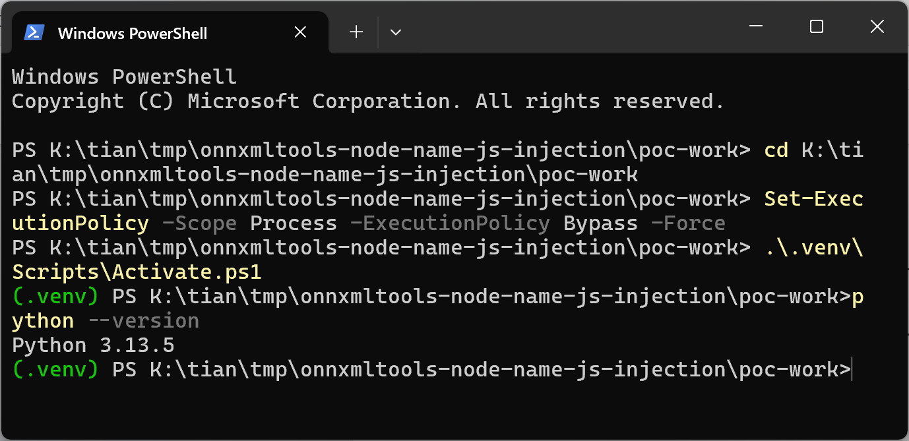
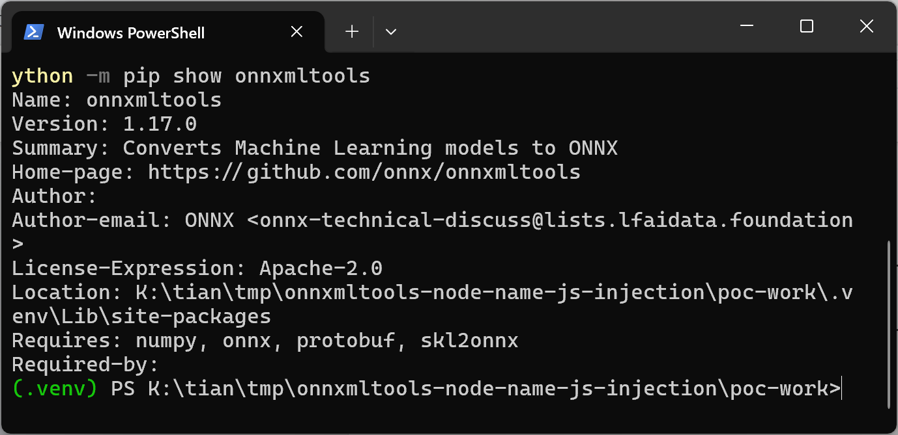
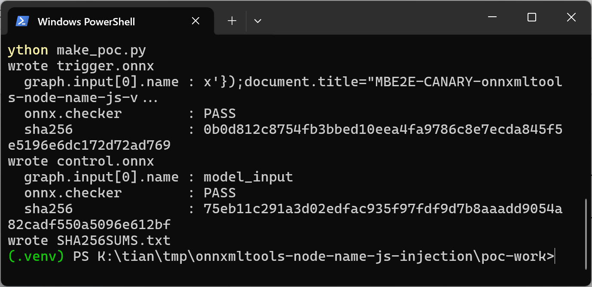
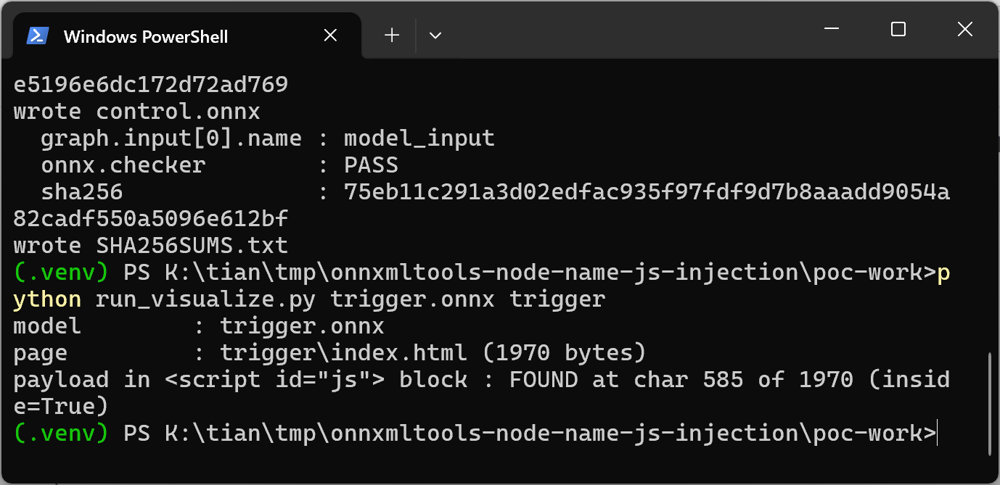
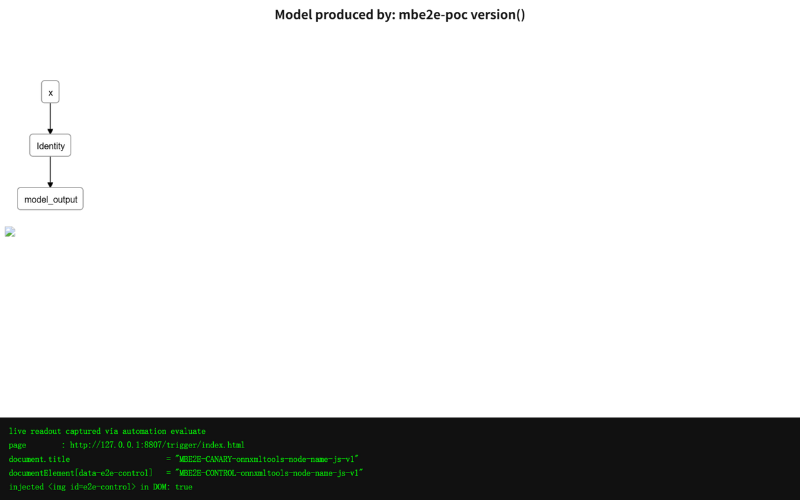
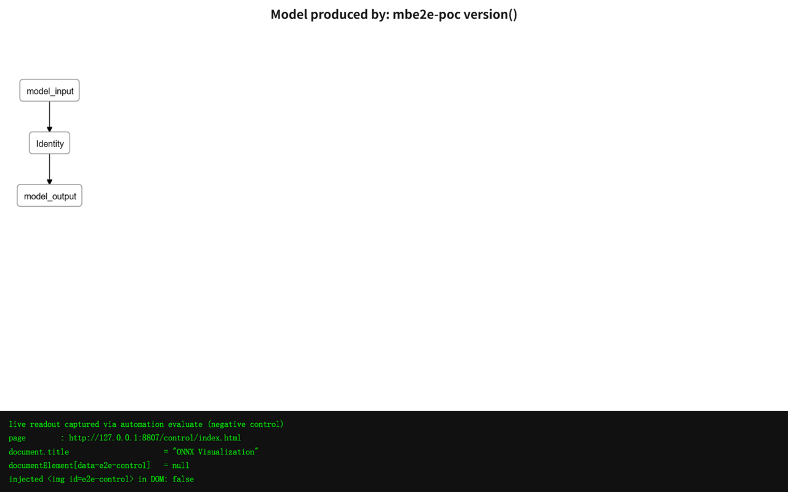
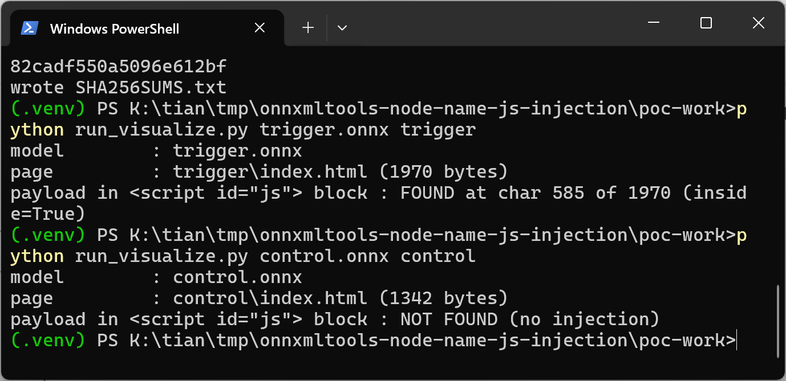
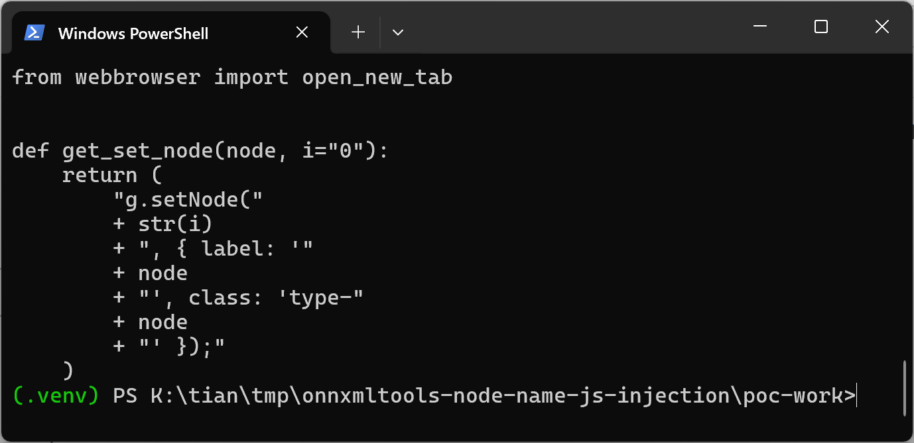
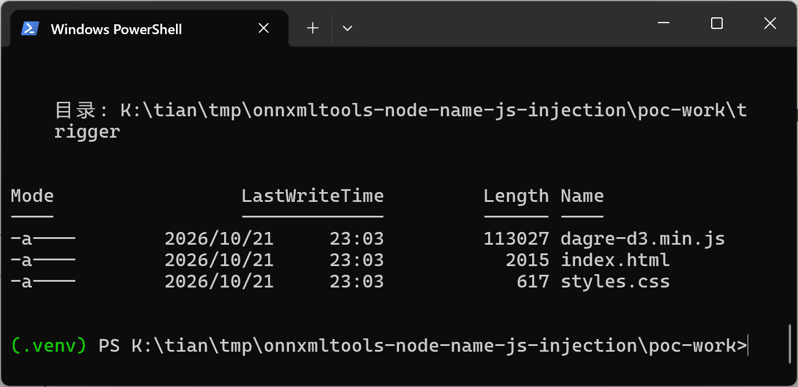

# ONNXMLTools 1.16.0 / master cf608be4 — JavaScript Injection in Model Visualization (onnxmltools/utils/visualize.py)

## Summary

The ONNX project's ONNXMLTools (onnxmltools) is affected by a client-side JavaScript injection (cross-site scripting) in the model visualization module `onnxmltools/utils/visualize.py`. The `visualize_model()` function embeds model-supplied graph input and output names into an inline `<script>` block of the generated HTML page without any escaping, so a crafted `.onnx` model file causes attacker-controlled JavaScript to execute when the visualization page is opened in a browser. By default `visualize_model()` even opens the generated page in the victim's browser automatically, so merely running the standard visualize command on an attacker-supplied model executes the payload.

## Affected Product

| Field | Value |
|---|---|
| Vendor | ONNX Project (onnx) |
| Product | onnxmltools |
| Affected versions | Latest release 1.16.0 (verified) and master commit cf608be48fe11cbcc7c2efd350ceb497867029f3, in-tree version 1.17.0 (verified); the visualization module has existed since 2018, exact introduction window of the defective form is [unknown] |
| Component | `onnxmltools/utils/visualize.py` — `get_set_node()` (lines 9-18), `get_nodes()` (lines 25-34), `visualize_model()` (lines 71-161) |
| Platform | Any OS running Python (verified on Windows 11 x64, Python 3.13.5); execution happens in any browser that opens the generated HTML |
| Vulnerability type | CWE-79: Cross Site Scripting (client-side JavaScript injection through a crafted model file) |

## Root Cause

**Location:** `onnxmltools/utils/visualize.py:9-18` (`get_set_node`), consumed by `get_nodes` (`onnxmltools/utils/visualize.py:25-34`) and `visualize_model` (`onnxmltools/utils/visualize.py:71-161`)

`visualize_model()` builds a self-contained HTML visualization page that contains an inline `<script id="js">` block driving a dagre-d3 graph. `get_nodes()` collects the labels to draw: the ONNX op type for each node, but for the graph's inputs and outputs it takes the plain protobuf string fields `node.name` (`graph.input[i].name` / `graph.output[i].name`). These strings are attacker-controlled: they are ordinary fields of the `.onnx` protobuf, accepted unchanged by the official `onnx.checker`, and they are never HTML- or JavaScript-escaped. `get_set_node()` concatenates each label directly into a JavaScript statement:

```python
def get_set_node(node, i="0"):
    return (
        "g.setNode("
        + str(i)
        + ", { label: '"
        + node
        + "', class: 'type-"
        + node
        + "' });"
    )
```

`visualize_model()` joins the statements and injects them into the page with a plain string replace (`html_str.replace("[nodes_html]", "\n".join(get_nodes_builder(get_nodes(graph))))`, line 141-143), then writes `index.html`. A graph input name containing a single quote and a parenthesis (for example `x'});<arbitrary JavaScript>;//`) closes the string literal and the `g.setNode(...)` call, and the remainder executes as top-level JavaScript inside the page. After writing the file, `visualize_model()` copies its bundled `dagre-d3.min.js`/`styles.css` next to it and calls `open_new_tab("file://" + os.path.realpath("index.html"))` (line 161), so the poisoned page opens in the analyst's default browser automatically with the default `open_browser=True`. `load_model()` (`onnxmltools/utils/main.py:9-23`) performs a raw protobuf `ParseFromString` with no name validation anywhere on the path.

## Proof of Concept

### Prerequisites

- Python 3.13.5 (any Python supported by the project) with `onnx`, `numpy`, `protobuf` installed.
- onnxmltools installed from the pinned vulnerable source (`pip install --no-deps ./onnxmltools-cf608be4`, which reports version 1.17.0 from the master tree; release 1.16.0 contains identical code at the same lines).
- A victim who runs the visualization on an attacker-supplied `.onnx` file — the normal usage of the tool on models downloaded from model hubs.

### Steps to Reproduce

1. Generate the two test models with the official ONNX helper API. Both are single-node `Identity` graphs that pass `onnx.checker.check_model()`; they differ only in `graph.input[0].name`: the trigger model carries a name that closes the JavaScript string literal in `get_set_node()`, the control model uses the plain name `model_input`.







2. Consume the trigger model with the onnxmltools visualization API (`onnxmltools.utils.load_model()` followed by `onnxmltools.utils.visualize_model(model, open_browser=False, dest="index.html")`) and inspect the generated page: the entire payload from the protobuf name field now sits inside the `<script id="js">` block of `trigger/index.html`, syntactically breaking out of the `g.setNode(...)` call.



3. Open the generated page in a browser. The injected JavaScript executes: it rewrites `document.title` to the canary string, injects an `` element whose `onerror` handler sets `data-e2e-control` on the document element, proving arbitrary attacker-controlled code runs in the page (verified in Chromium via automation; the in-page readout shows the live measured values).



4. Run the same pipeline on the control model: the generated page contains no payload, the title stays "ONNX Visualization", and no attribute or injected element appears.



5. Control run through the same consumer on the command line, plus the installed vulnerable code and the artifacts written by `visualize_model()`:







### Expected vs Actual

- Expected: model names are arbitrary protobuf strings, so the visualization page must render them as inert text (escaped/encoded); no model field may change the page's script behavior.
- Actual: the graph input name is concatenated raw into the inline JavaScript. The trigger model's name executes as page JavaScript (title rewrite + DOM injection confirmed), while the byte-identical model with a normal name behaves cleanly — the only difference between the two arms is the `graph.input[0].name` string.

### Sanitized PoC input

The trigger sample is a standard single-node Identity model; the whole payload lives in one protobuf string field (`graph.input[0].name`, which is also the Identity node's input tensor name):

```text
x'});document.title="MBE2E-CANARY-onnxmltools-node-name-js-v1";const d=document.createElement("div");d.innerHTML=``;document.body.appendChild(d);void 0;//
```

After concatenation the generated page contains the line `g.setNode(1, { label: 'x'});document.title=...;void 0;//', class: ...` — the string literal and the call are closed after `'x'`, the following statements execute, and the trailing `//` comments out the leftover template text.

## Impact

- Confidentiality: Low — injected JavaScript runs in the visualization page's origin and can exfiltrate anything that origin can read (for a file:// page the content of that page; when the generated page or the same visualization pipeline is hosted by a web service/model viewer, cookies and session data of that origin).
- Integrity: Low — the attacker can rewrite the visible page (misleading the analyst reviewing the model) and manipulate the page's DOM.
- Availability: None — the payload does not crash anything; it could trivially be extended to deny service, but the demonstrated impact excludes that.
- Scope: the model file is the storage medium (stored XSS pattern); `visualize_model()` auto-opens the page in the analyst's default browser by default, so no extra tooling is needed. In deployments that render onnxmltools visualizations from a web origin, this becomes classic stored XSS in that origin (account/session takeover of the viewing user).

## Remediation

- Treat every model-derived string as data: build the page via DOM/JSON encoding instead of string concatenation — e.g. `json.dumps()` for the label text passed into `g.setNode`, and drop or separately encode the `class: 'type-<name>'` segment, whose value is equally attacker-controlled.
- Alternatively escape `<`, `>`, `'`, `"`, `\`, newline and `</script` sequences before embedding any name into the HTML/JS template, and HTML-escape `producer_name`/`producer_version` used in `model_info`.
- Consider not auto-opening the generated page (`open_new_tab`) by default, and add a regression test with a quote-bearing model name.


## References

- Source repository: https://github.com/onnx/onnxmltools
- Vulnerable file at pinned commit: https://github.com/onnx/onnxmltools/blob/cf608be48fe11cbcc7c2efd350ceb497867029f3/onnxmltools/utils/visualize.py
- Latest release containing the same code: https://github.com/onnx/onnxmltools/releases/tag/1.16.0
- CWE: https://cwe.mitre.org/data/definitions/79.html
- Upstream report: [pending publication]
- Vendor advisory: [none]

