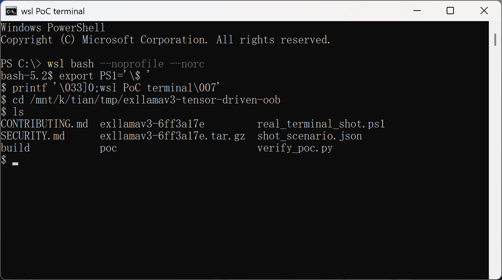
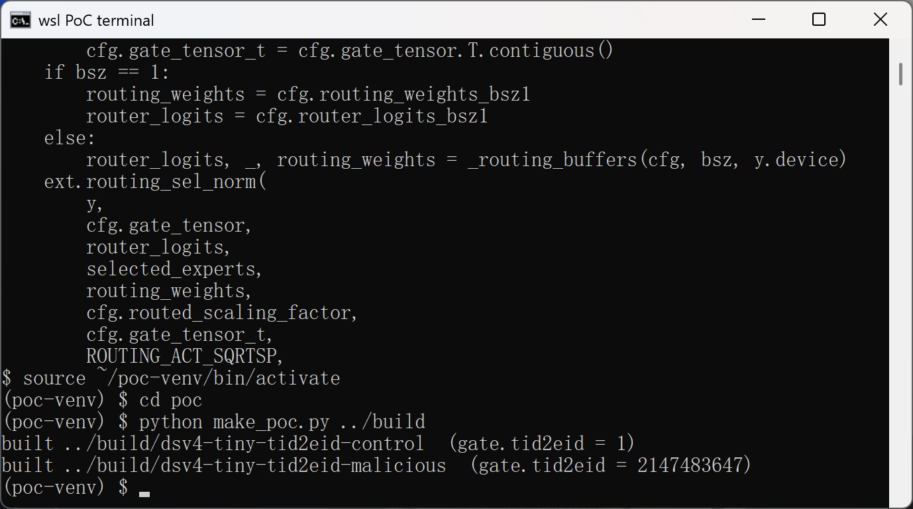
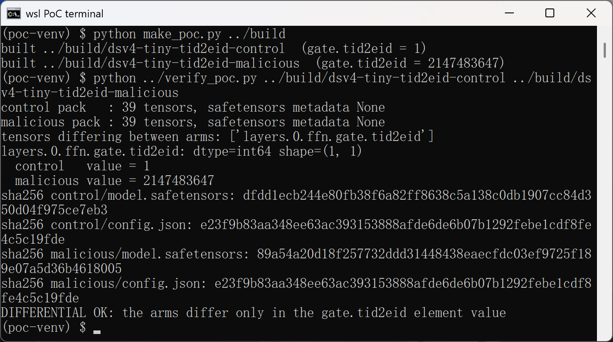
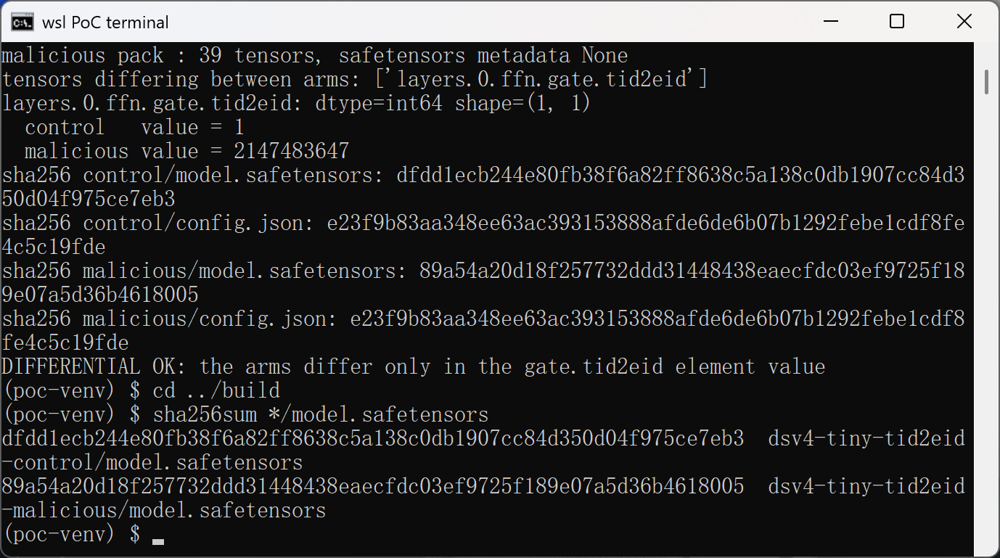
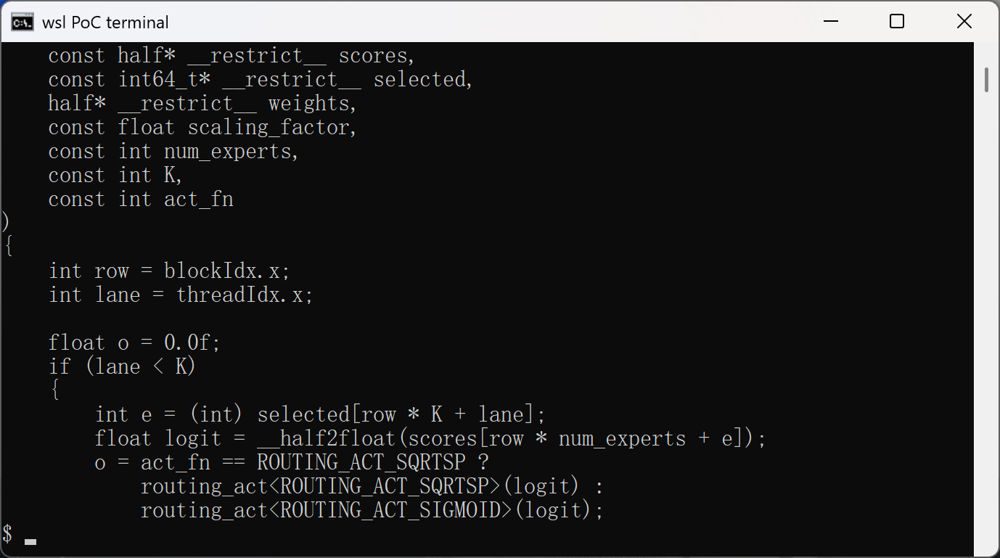
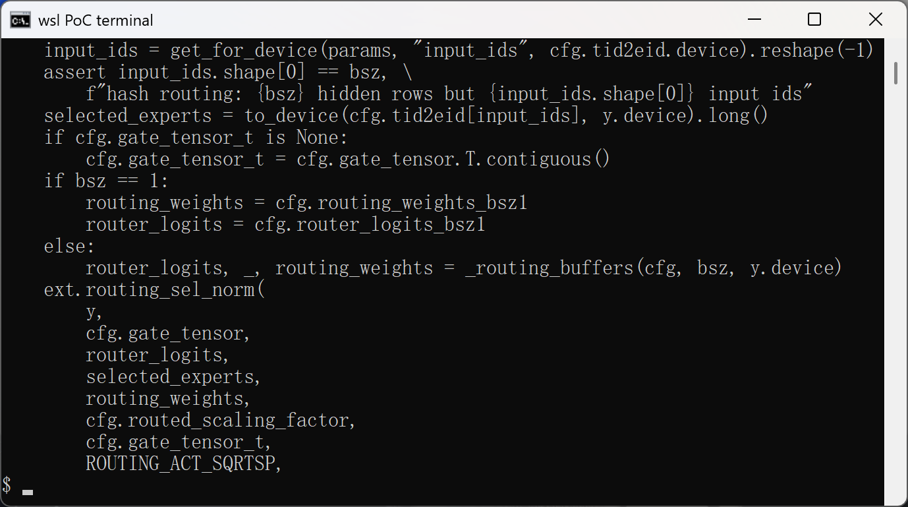

# Out-of-Bounds Read in Hash-MoE Routing CUDA Kernel via Unvalidated gate.tid2eid Expert Index

## Summary
turboderp-org exllamav3 (verified at commit 6ff3a17ea7f3, version 1.4.8, and still present on master as of 2026-10-14, post-1.6.1) is affected by an out-of-bounds read in the hash-MoE routing CUDA kernel `routing_sel_norm_kernel`. The DeepSeek-V4 hash-MoE bootstrap reads the frozen `gate.tid2eid` tensor from the model checkpoint and uses its values, without any range validation, as expert indices to gather elements from the per-layer `scores` buffer inside a CUDA kernel. A model package whose `gate.tid2eid` element holds an out-of-range value (e.g. 2147483647) causes each routing launch to read 2 bytes at `scores + e * 2` bytes, far outside the allocation. The defect is reachable by loading a crafted model directory: no code execution in the model package is needed, the pack consists of plain config and weight tensors only.

## Affected Product

| Field | Value |
|---|---|
| Vendor | turboderp-org |
| Product | exllamav3 |
| Affected versions | commit 6ff3a17ea7f3 (version 1.4.8); still present on master at 2026-10-14 (after release 1.6.1); intermediate releases not individually checked |
| Component | `exllamav3/exllamav3_ext/routing.cu` `routing_sel_norm_kernel` (lines 1133-1134 at the pinned commit; lines 1105-1106 on current master), fed by `exllamav3/modules/block_sparse_mlp.py` `routing_sqrtsp_hash` (line 302 at the pinned commit; `exllamav3/modules/block_sparse_mlp_routing.py` line 387 on current master) |
| Platform | NVIDIA CUDA (the routing path is implemented exclusively as CUDA kernels; there is no CPU routing fallback) |
| Vulnerability type | CWE-125: Out-of-bounds Read |

## Root Cause

**Location:** `exllamav3/exllamav3_ext/routing.cu:1133-1134` at commit 6ff3a17ea7f3 (`routing_sel_norm_kernel`)

The DeepSeek-V4 hash-MoE bootstrap derives the selected experts directly from a checkpoint tensor: `block_sparse_mlp.py:302` performs `selected_experts = to_device(cfg.tid2eid[input_ids], y.device).long()` and passes the result to `ext.routing_sel_norm(...)`. Every value in `gate.tid2eid` therefore reaches the CUDA kernel as a row of the `selected` argument. The kernel gathers the router score with this model-controlled index and never validates it against `num_experts`; the only check on the routing shape anywhere in the call chain is `TORCH_CHECK(K <= 32, ...)` on the number of experts per token, not on the expert ids themselves:

```c
if (lane < K)
{
    int e = (int) selected[row * K + lane];                              // attacker-controlled, unvalidated
    float logit = __half2float(scores[row * num_experts + e]);           // 2-byte read at scores + e*2 bytes
    o = act_fn == ROUTING_ACT_SQRTSP ?
        routing_act<ROUTING_ACT_SQRTSP>(logit) :
        routing_act<ROUTING_ACT_SIGMOID>(logit);
}
```

The tensor is loaded by the safetensors loader (`stc.get_tensor` with no shape or value constraints) and only its dtype feeds a `TORCH_CHECK_DTYPE(selected, kLong)` in the wrapper, so any I64 tensor of shape `[rows, 1]` is accepted. Because the value is cast to a signed 32-bit int, both large positive and negative values produce far out-of-bounds addresses. With a minimal DeepSeek-V4 configuration (`n_routed_experts = 4`, `num_experts_per_tok = 1`) and a `[1, 1]` `gate.tid2eid`, the `scores` buffer holds exactly four fp16 elements (8 bytes), and the value 2147483647 makes the kernel read 2 bytes at an offset of about 4 GiB from the buffer base.

## Proof of Concept

### Prerequisites
- A machine with an NVIDIA GPU and a CUDA toolchain that can build the exllamav3 extension; `compute-sanitizer` from the CUDA toolkit for the memory-error evidence.
- exllamav3 at commit 6ff3a17ea7f3 (the analysis anchor) with its Python dependencies; the victim action is `Config.from_directory()` + `Model.load()` + one forward step on a model directory.
- The two PoC model packs attached to this report (`dsv4-tiny-tid2eid-control.zip`, `dsv4-tiny-tid2eid-malicious.zip`), produced by `make_poc.py`. Both packs contain only `config.json` and `model.safetensors` (no code); they are byte-identical except for the single I64 element of `layers.0.ffn.gate.tid2eid`, which is 1 (a legal expert id) in the control pack and 2147483647 in the malicious pack. SHA-256 of the two `model.safetensors`: control `dfdd1ecb244e80fb38f6a82ff8638c5a138c0db1907cc84d350d04f975ce7eb3`, malicious `89a54a20d18f257732ddd31448438eaecfdc03ef9725f189e07a5d36b4618005`.

### Steps to Reproduce
1. Unpack both PoC packs and generate fresh copies if desired: `python3 make_poc.py build` regenerates the two packs deterministically (the differential is exactly the `gate.tid2eid` element value, as verified by the differential check in step 2).





2. Verify the packs are valid safetensors and differ only in the trigger tensor: `python3 verify_poc.py build/dsv4-tiny-tid2eid-control build/dsv4-tiny-tid2eid-malicious` reports 39 tensors per pack, `layers.0.ffn.gate.tid2eid: dtype=int64 shape=(1, 1)`, control value 1, malicious value 2147483647.





3. Confirm the defect in the pinned source: `sed -n '1116,1137p' exllamav3/exllamav3_ext/routing.cu` shows the unchecked gather in `routing_sel_norm_kernel`, and `sed -n '298,318p' exllamav3/modules/block_sparse_mlp.py` shows the unvalidated `tid2eid` lookup feeding `ext.routing_sel_norm`.





4. On the CUDA machine, load the control pack with the attached `run_poc.py` under compute-sanitizer and observe a clean run: `compute-sanitizer --tool memcheck python3 run_poc.py build/dsv4-tiny-tid2eid-control` completes the forward pass with no reported errors.


5. Run the same command against the malicious pack: `compute-sanitizer --tool memcheck python3 run_poc.py build/dsv4-tiny-tid2eid-malicious`. The sanitizer reports an invalid 2-byte global read inside `routing_sel_norm_kernel` at `routing.cu:1134` during the first hash-MoE layer's routing, at address `scores + 2147483647 * 2` bytes, while the same program without the sanitizer typically continues with a corrupted logit.


Note on evidence collection: steps 1-3 were executed for this report on WSL2 Ubuntu 24.04 (no NVIDIA GPU on the capture machine, so no CUDA compilation or runtime step was possible there); the two compute-sanitizer captures require an NVIDIA GPU machine and are left as placeholders pending capture.

### Expected vs Actual
- Expected: expert indices read from a checkpoint tensor are validated against `n_routed_experts` before being used as memory indices (at load time or before the kernel launch); a pack with `gate.tid2eid = 2147483647` is rejected or clamped.
- Actual: the value is used as-is inside the CUDA kernel as an element index into the 4-element `scores` buffer; the control pack runs clean while the malicious pack performs a 2-byte invalid global read per routed token.

### Sanitized PoC input
```text
model pack (no code, plain tensors + config.json):
  layers.0.ffn.gate.tid2eid : dtype=I64, shape=[1, 1]
    control   pack value: 1                (sha256 dfdd1ecb244e80fb38f6a82ff8638c5a138c0db1907cc84d350d04f975ce7eb3)
    malicious pack value: 2147483647       (sha256 89a54a20d18f257732ddd31448438eaecfdc03ef9725f189e07a5d36b4618005)
  all other 38 tensors and config.json are byte-identical between the two packs
  minimal DeepSeek-V4 config: n_routed_experts=4, num_experts_per_tok=1, num_hash_layers=1, 1 sliding layer
```

## Impact
- Confidentiality: Low — the out-of-bounds value flows through sqrt-softplus activation and weight normalization into the model's routing weights, so adjacent GPU memory influences (and is indirectly, coarsely reflected in) the model's outputs; direct exfiltration of specific adjacent memory content is not demonstrated.
- Integrity: Low — the routing weights for tokens whose id maps to an out-of-range expert become attacker-influenced garbage, corrupting the loaded model's behavior for those tokens.
- Availability: High — the read at `scores + e * 2` with an arbitrary 32-bit offset typically lands outside any mapped GPU allocation; an illegal address fault corrupts the CUDA context and terminates the inference process.
- Scope: memory safety — a model-file-controlled 32-bit index is used as a pointer offset inside a CUDA kernel with no bounds check.


## Remediation
Validate the expert ids at the boundary where checkpoint data becomes a memory index, at either or both of: (1) load time — after `stc.get_tensor` of `gate.tid2eid` in `BlockSparseMLP.load`, reject or refuse tensors whose values fall outside `[0, num_experts)`; (2) the routing bootstrap — clamp or range-check the `tid2eid` lookup result in `routing_sqrtsp_hash` before handing `selected_experts` to `ext.routing_sel_norm`. A kernel-side guard in `routing_sel_norm_kernel` (mask lanes whose `e` is out of range and surface a device-side error) would additionally protect every other producer of `selected`.


## References
- Source repository: https://github.com/turboderp-org/exllamav3
- Analyzed commit: https://github.com/turboderp-org/exllamav3/tree/6ff3a17ea7f3
- Vulnerable kernel (pinned commit): https://github.com/turboderp-org/exllamav3/blob/6ff3a17ea7f3/exllamav3/exllamav3_ext/routing.cu#L1116-L1137
- Hash-MoE bootstrap (pinned commit): https://github.com/turboderp-org/exllamav3/blob/6ff3a17ea7f3/exllamav3/modules/block_sparse_mlp.py#L290-L318
- CWE: https://cwe.mitre.org/data/definitions/125.html
- Vendor advisory: [none]
