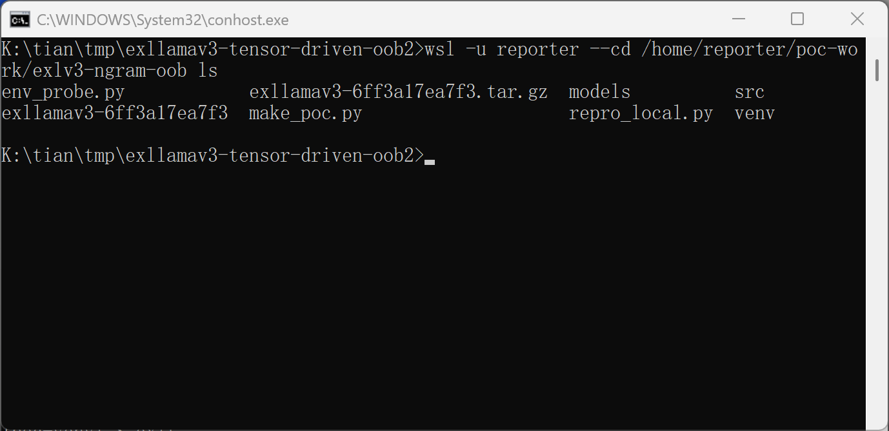
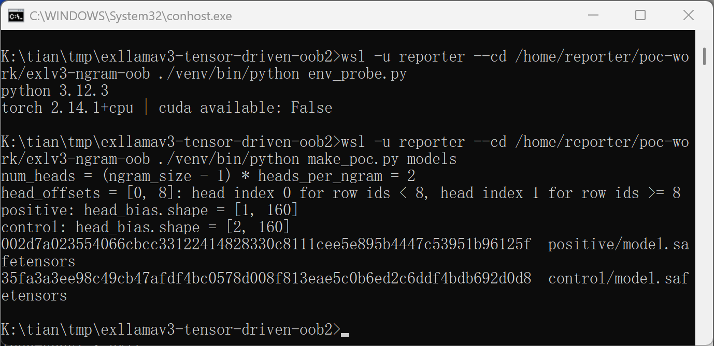
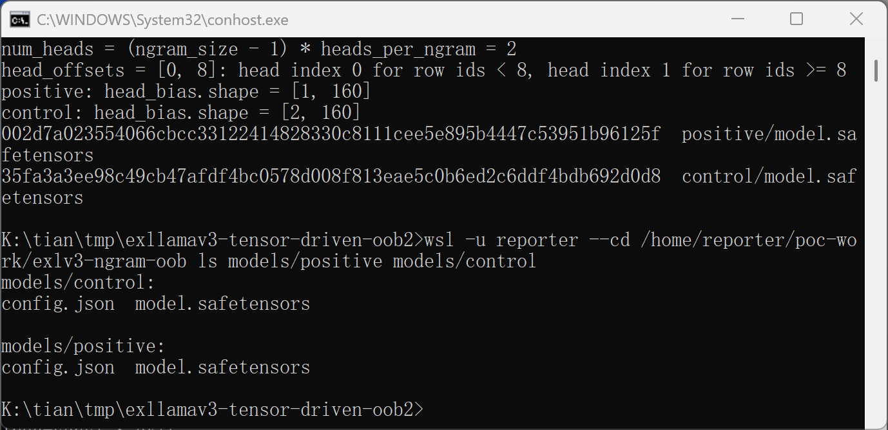
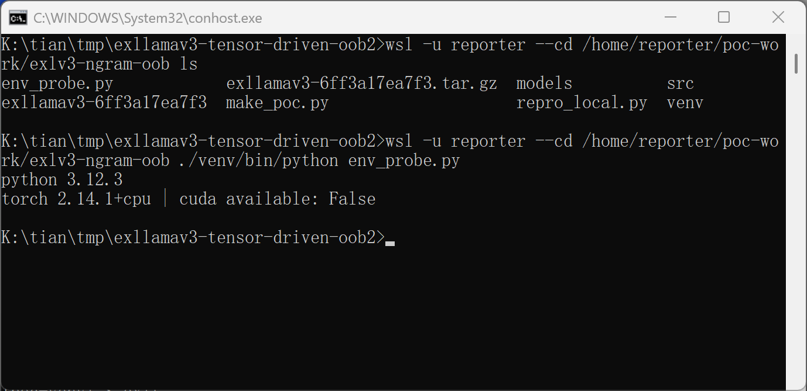
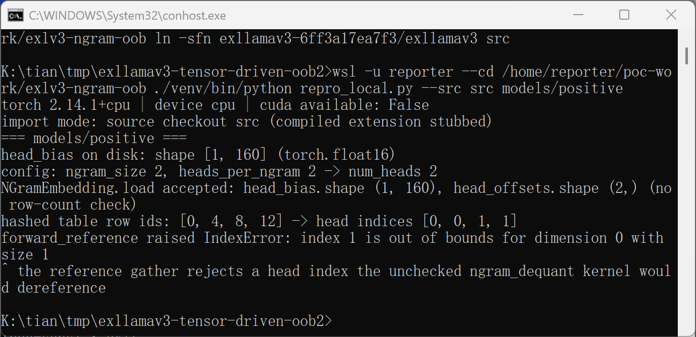
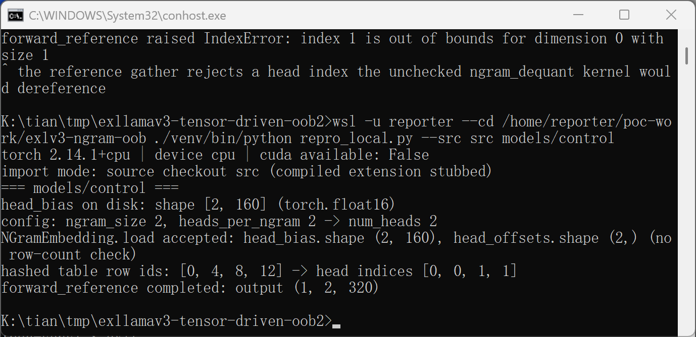
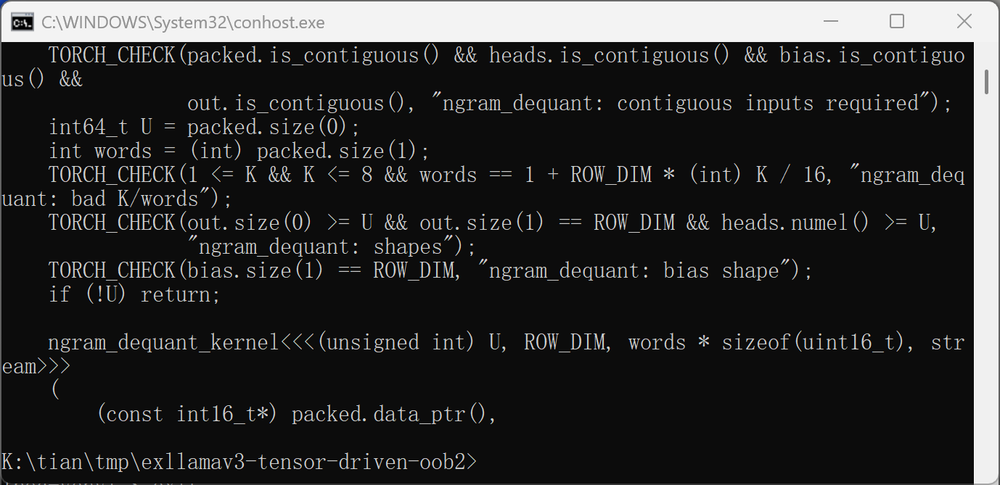

# Out-of-Bounds Read in exllamav3 NGramEmbedding ngram_dequant

## Summary

turboderp-org exllamav3 (commit 6ff3a17ea7f3, in-tree version 1.4.8) is affected by an out-of-bounds read in the CUDA fast path of the NGramEmbedding module (the hashed n-gram embedding table behind the PLE layer of qwen4_exp models such as Qwen3.8-Flash-Next). The module loads the per-head dequant bias tensor `head_bias` from the model's safetensors files without ever comparing its row count to the module's head count, and the CUDA kernel `ngram_dequant_kernel` indexes the bias with a model-controlled head index and no bounds check. A model directory whose `head_bias` has fewer rows than the configured head count makes the kernel read past the end of the bias tensor in GPU global memory (compute-sanitizer memcheck reports an invalid global read of size 2). An attacker who can make a victim load a crafted model directory (model zoo, direct file share) can leak fragments of adjacent GPU-resident memory through the module's embedding outputs and, by declaring a large head count, place the read far enough outside the allocation to abort the CUDA context.

## Affected Product

| Field | Value |
|---|---|
| Vendor | turboderp-org |
| Product | exllamav3 |
| Affected versions | git commit 6ff3a17ea7f3 (version.py: 1.4.8); affectedness of newer tags (up to v1.6.1) not yet verified |
| Component | `exllamav3/modules/ngram_embedding.py` (`_load_aux`, `load`, `forward` fast path) and `exllamav3/exllamav3_ext/ngram.cu` (`ngram_dequant`, `ngram_dequant_kernel`) |
| Platform | CUDA builds of the `exllamav3_ext` extension (the kernel defect); the loader-side missing validation reproduces on CPU as well |
| Vulnerability type | CWE-125: Out-of-bounds Read |

## Root Cause

**Location:** `exllamav3/exllamav3_ext/ngram.cu:348` (`ngram_dequant_kernel`), validation gap at `exllamav3/exllamav3_ext/ngram.cu:375` (`ngram_dequant`) and `exllamav3/modules/ngram_embedding.py` (`_load_aux`).

The kernel dereferences the bias tensor with a per-row head index taken from the `heads` tensor:

```cuda
float b = __half2float(bias[(size_t) heads[r] * ROW_DIM + i]);
out[(size_t) r * ROW_DIM + i] = __float2half_rn(cb * scale + b);
```

The host-side wrapper validates the bias tensor's second dimension only, never its row count against the head indices it is about to launch with:

```cuda
TORCH_CHECK(out.size(0) >= U && out.size(1) == ROW_DIM && heads.numel() >= U, "ngram_dequant: shapes");
TORCH_CHECK(bias.size(1) == ROW_DIM, "ngram_dequant: bias shape");
```

On the Python side, `NGramEmbedding._load_aux` asserts only the offsets length (`assert self.head_offsets.shape[0] == self.num_heads`); `head_bias = bias.half().contiguous().to(self.device)` stores the tensor with no row-count check. The head index itself is derived from model data: `ngram_hash_cpu` (fast path) and `fetch_rows` (reference path) map each hashed table row id to a head via the upper bound of `head_offsets` (clamped to `num_heads - 1`), so both the index range and the bias row count are fully controlled by the model directory, and their mismatch is exactly the out-of-bounds condition.

## Proof of Concept

### Prerequisites

- A victim loads a model directory crafted by the attacker with exllamav3 (PLE/n-gram models, architecture `Qwen4ExpForConditionalGeneration`). No privileges or special network position are needed; the model load is the interaction.
- The full CUDA kernel trigger additionally requires a CUDA GPU build; compute-sanitizer verification was performed on such a build. The loader-acceptance and index-out-of-range differential below was reproduced on a CPU-only host against the pinned source.

### Steps to Reproduce

1. Generate the two PoC model directories with the attached `make_poc.py` (deterministic, seeded). Both directories contain the same `config.json` (ngram_size 2, heads_per_ngram 2, so `num_heads = 2`; `head_offsets = [0, 8]`, so hashed row ids below 8 map to head 0 and ids 8 to 15 map to head 1) and safetensors with the trellis table, offsets, sizes and multipliers. The only difference is `head_bias.shape`: `positive = [1, 160]`, `control = [2, 160]`.







2. Load each directory with the real upstream loader (`SafetensorsCollection` + `Qwen4ExpConfig` + `NGramEmbedding.load`) and run the pure-torch reference pipeline (`forward_reference`), which derives head indices exactly like the fast path does. The attached `repro_local.py` performs this; the run below used a source checkout with the compiled extension stubbed (CPU-only host, `torch 2.14.1+cpu`, `cuda available: False`).



3. Positive model: the loader accepts `head_bias.shape = (1, 160)` for a 2-head module without any warning; the hashed table row ids `[0, 4, 8, 12]` yield head indices `[0, 0, 1, 1]`; the reference gather `head_bias.float()[heads]` then fails with `IndexError: index 1 is out of bounds for dimension 0 with size 1` — proving the index the CUDA kernel would use is out of bounds and only the CUDA path lacks the check.



4. Control model: identical pipeline with `head_bias.shape = (2, 160)` completes and returns output of shape `(1, 2, 320)` — the differential isolates the missing bias row-count check as the cause.



5. On a CUDA machine, run the same forward pass through the default fast path (`NGramEmbedding.forward` → `ext.ngram_dequant`) under `compute-sanitizer --tool memcheck`: the positive model reports an invalid global read of size 2 in `ngram_dequant_kernel` at ngram.cu:348; the control model runs clean. The kernel indexing and the wrapper's missing row-count check are shown below.

![ngram.cu lines 346-350: the kernel indexes bias[heads[r] * ROW_DIM + i] with no bounds check](images/07-kernel-oob-line.png)



### Expected vs Actual

- Expected: a model whose `head_bias` row count does not cover the head index range implied by its own `head_offsets` is rejected at load time; the kernel never receives an out-of-range head index.
- Actual: `NGramEmbedding.load` accepts the malformed model silently; on the CUDA fast path the out-of-range index reaches `ngram_dequant_kernel`, which reads past the end of the bias tensor in GPU global memory (compute-sanitizer: invalid global read of size 2 bytes per element).

### Sanitized PoC input

```text
positive/model.safetensors sha256: 002d7a023554066cbcc33122414828330c8111cee5e895b4447c53951b96125f  (head_bias.shape = [1, 160])
control/model.safetensors  sha256: 35fa3a3ee98c49cb47afdf4bc0578d008f813eae5c0b6ed2c6ddf4bdb692d0d8  (head_bias.shape = [2, 160])
Attachment: make_poc.py regenerates both directories deterministically; repro_local.py runs the differential (installed package or --src <source checkout>).
```

## Impact

- Confidentiality: Low — the out-of-bounds fp16 values read past `head_bias` originate from adjacent GPU memory (allocator pool, other resident tensors) and are mixed into the module's embedding output, leaking fragments of unrelated GPU-resident data to whoever observes the outputs.
- Integrity: None — the defect only reads; no memory is modified.
- Availability: High — the reachable head index scales with the head count declared in the crafted config (`num_heads = (ngram_size - 1) * heads_per_ngram`), so the read offset is attacker-configurable up to large distances; a far out-of-bounds access raises a CUDA illegal-memory-access error that poisons the CUDA context and terminates the inference process. (Assumption: this availability impact is inferred from CUDA semantics for far out-of-bounds accesses; the minimal 1-row PoC may complete without a hardware fault, which is why compute-sanitizer is used to expose it.)
- Scope: GPU global memory out-of-bounds read within the inference process; information leak into model outputs and potential process termination.


## Remediation

Add the missing row-count validation in `exllamav3/modules/ngram_embedding.py`, `_load_aux` (trellis branch), next to the existing offsets assertion: reject the model when `bias.shape[0] != num_heads`. As defense in depth, extend the kernel wrapper check at `exllamav3/exllamav3_ext/ngram.cu:375` to also require `bias.size(0)` to cover the maximum head index (or the declared head count) before launching `ngram_dequant_kernel`. No workaround is available short of re-validating model tensors before loading untrusted model directories.


## References

- Source repository: https://github.com/turboderp-org/exllamav3
- Analyzed commit: https://github.com/turboderp-org/exllamav3/blob/6ff3a17ea7f3/exllamav3/exllamav3_ext/ngram.cu
- Upstream report: [pending publication]
- CWE: https://cwe.mitre.org/data/definitions/125.html
- Vendor advisory: [none]

