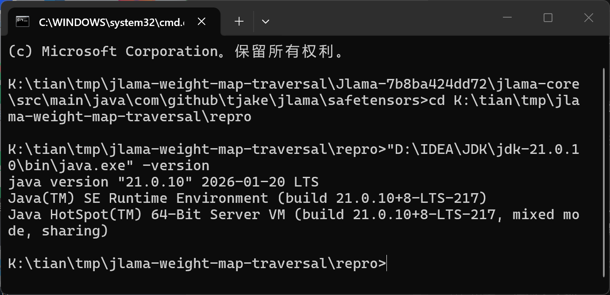
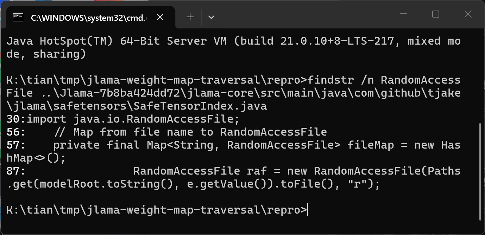
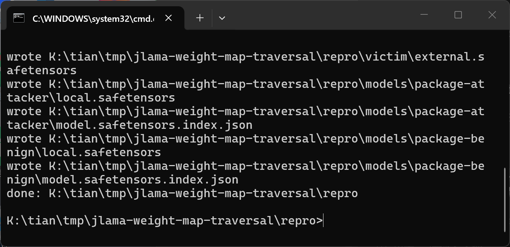
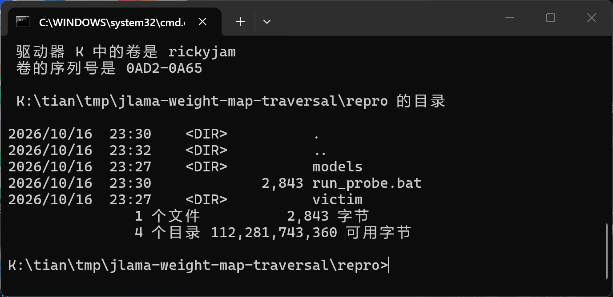
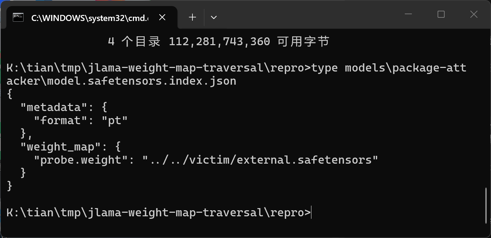
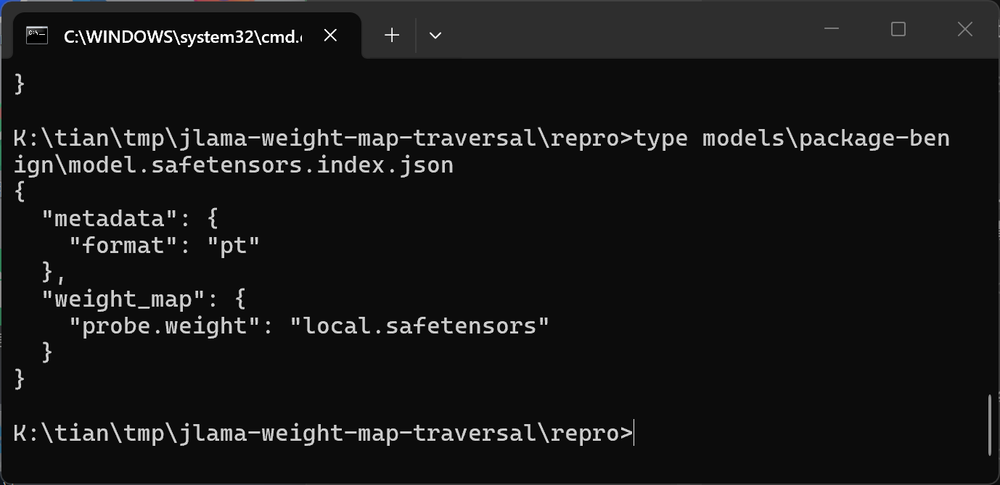
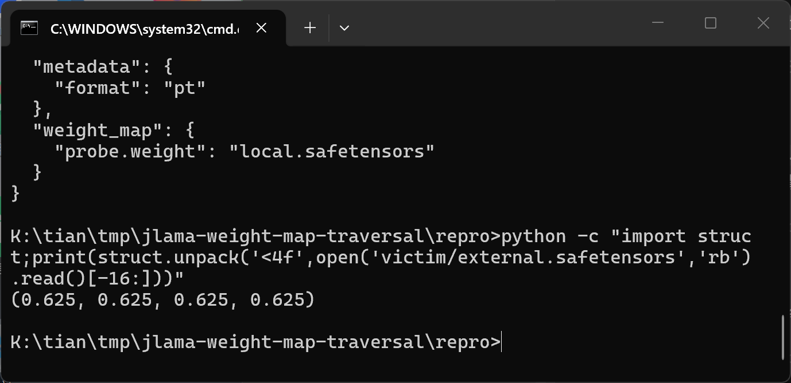
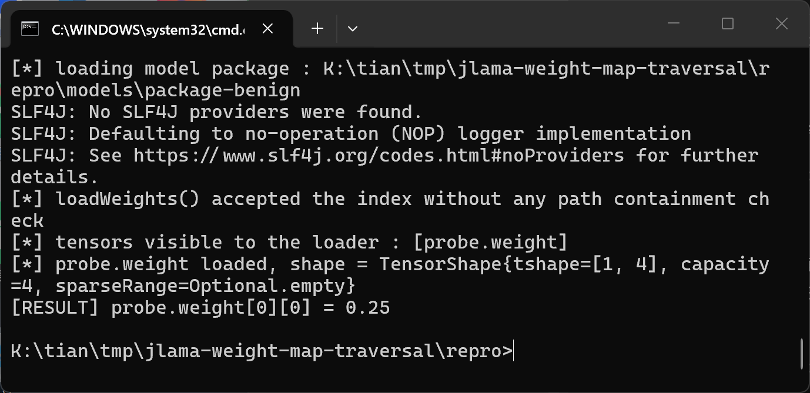

# Jlama 0.9.0-beta — Path Traversal in SafeTensorIndex Weight Map Loader

## Summary

Jlama (tjake/Jlama) 0.9.0-beta, git commit 7b8ba424dd72, is affected by a path traversal in the safetensors weight index loader of the `jlama-core` module. When a model package is loaded through the public API `SafeTensorSupport.loadWeights(File)`, the values of the `weight_map` object inside `model.safetensors.index.json` are used directly as path fragments relative to the package directory without any containment validation. An attacker who distributes a model package containing an index entry such as `"probe.weight": "../../victim/external.safetensors"` makes Jlama open and memory-map shards located outside the package directory, and the tensors of the loaded model are then read from that out-of-package file. A differential experiment shows the attacker package resolving `probe.weight` to `0.625` (the value stored only in the external shard) while a byte-identical benign package that references its own in-package shard resolves to `0.25`.

## Affected Product

| Field | Value |
|---|---|
| Vendor | tjake (T Jake Luciani) |
| Product | Jlama |
| Affected versions | git commit 7b8ba424dd72 on `main` (Maven revision `0.9.0-beta`); earlier released versions not verified [unknown] |
| Component | `jlama-core/src/main/java/com/github/tjake/jlama/safetensors/SafeTensorIndex.java`, static method `loadWeights(SafeTensorIndex, Path)`; public entry point `SafeTensorSupport.loadWeights(File)` (`SafeTensorSupport.java:119`) |
| Platform | Platform-independent Java (java.nio / NIO mapping); verified on Windows 11 x64 (build 26200), Oracle JDK 21.0.10, Maven 3.9.15 |
| Vulnerability type | CWE-22: Path Traversal |

## Root Cause

**Location:** `jlama-core/src/main/java/com/github/tjake/jlama/safetensors/SafeTensorIndex.java:87` (`SafeTensorIndex.loadWeights`)

`SafeTensorSupport.loadWeights(File baseDir)` is the public loading entry for local model packages. It detects `model.safetensors.index.json` and hands the directory to `SafeTensorIndex.loadWithWeights`, which deserializes the index JSON with Jackson into a `Map<String, String> weightFileMap` (tensor name → file value). `loadWeights` then iterates the map and, for every value that has not been opened yet, constructs the file path by plain string concatenation of the model root and the attacker-controlled value:

```java
static void loadWeights(SafeTensorIndex index, Path modelRoot) throws IOException {
    for (Map.Entry<String, String> e : index.weightFileMap.entrySet()) {
        // Only load the file if it's not already loaded
        if (!index.fileMap.containsKey(e.getValue())) {
            RandomAccessFile raf = new RandomAccessFile(Paths.get(modelRoot.toString(), e.getValue()).toFile(), "r");
            index.fileMap.put(e.getValue(), raf);
```

There is no normalization and no check that the resolved path stays inside `modelRoot`: `Paths.get(modelRoot.toString(), e.getValue())` simply concatenates the two fragments, and the `..` segments are resolved by the operating system when `RandomAccessFile` opens the file. The mapped shard is subsequently parsed as safetensors (`SafeTensorSupport.readTensorInfoMap`) and its tensors are exposed through `SafeTensorIndex.load(...)`, so every weight the model uses can silently come from any location the process can read. The `weight_map` values are data controlled by whoever produces the model package — no code sidecar, script, or configuration is required, which makes the index file look as inert as a plain manifest.

## Proof of Concept

### Prerequisites

- JDK 21+ (the project compiles with `--enable-preview`), Maven 3.9.x, Python 3 to run the sample generator.
- A victim that loads an untrusted model package directory with Jlama's public API `SafeTensorSupport.loadWeights(File)` — this is the standard local-model loading path (`SafeTensorIndex.loadWithWeights` for indexed packages).
- The `..` count in the payload must match the package depth: in this layout the packages sit two directory levels below the shared root, next to the `victim/` directory.

### Steps to Reproduce

1. Pin the source at commit 7b8ba424dd72 and build the core module: `mvn -pl jlama-core -am package -DskipTests` (verified with Maven 3.9.15 on JDK 21.0.10).



2. Confirm the unchecked sink in the pinned source: the `weight_map` value flows into `RandomAccessFile(Paths.get(modelRoot.toString(), e.getValue()))` at `SafeTensorIndex.java:87`.



3. Generate the samples with `make_poc.py` (attached in `poc/`). It creates `victim/external.safetensors` (a valid F32 safetensors shard holding `probe.weight = 0.625`) plus two packages under `models/`: both contain the same in-package `local.safetensors` with `probe.weight = 0.25`; the only difference is the `weight_map` value in `model.safetensors.index.json` (`../../victim/external.safetensors` for the attacker package, `local.safetensors` for the benign control).



4. Show the resulting layout: the packages under `models/` and the external shard under `victim/` live in sibling subtrees.



5. Inspect the two index files — they differ only in the `weight_map` entry.





6. Dump the raw float values of the external shard to prove that `0.625` exists only outside the packages.



7. Load the attacker package through the public API and read `probe.weight` (`WeightLoader.load("probe.weight")` via the small `Probe.java` driver): Jlama resolves the traversal, memory-maps the out-of-package shard, and the tensor value `0.625` — which exists nowhere inside the package — is returned.

![attacker package: loadWeights succeeds and probe.weight[0][0] = 0.625, loaded from outside the package](images/jlama-weight-map-traversal-08-attacker-loads-external-0625.png)

8. Load the benign control package the same way: the value is the in-package `0.25`, confirming the differential is caused solely by the `weight_map` value.



### Expected vs Actual

- Expected: `weight_map` values are treated as shard names confined to the package directory, so the attacker package either fails to load or resolves `probe.weight` from its own `local.safetensors` (`0.25`).
- Actual: Jlama opens `../../victim/external.safetensors` outside the package without any warning and returns `0.625`; only the benign control returns `0.25`.

### Sanitized PoC input

```json
{
  "metadata": {"format": "pt"},
  "weight_map": {
    "probe.weight": "../../victim/external.safetensors"
  }
}
```

```json
{
  "metadata": {"format": "pt"},
  "weight_map": {
    "probe.weight": "local.safetensors"
  }
}
```

Both files are complete, self-contained reproduction inputs: the packages contain no executable sidecar, only the index JSON above plus standard safetensors shards (see `poc/SHA256SUMS.txt`; the two packages' in-package shards are byte-identical, hash `879408fa...`).

## Impact

- Confidentiality: Low — the external file must parse as a safetensors shard (8-byte little-endian header length followed by a JSON header), so arbitrary system files fail to load; however, any safetensors-format file reachable by the process can be mapped into the model, and applications that surface tensor values or model outputs can leak its bytes.
- Integrity: High — the attacker fully controls the tensor data the model actually uses while the package's in-package shard still shows the honest values, enabling stealthy weight substitution and model behavior manipulation with a data-only package and no integrity boundary between the package and the rest of the filesystem.
- Availability: None — a missing or unparsable external file only aborts that load with an exception; no persistent denial of service.
- Scope: no memory corruption; the defect lets package data reach files outside the package directory (path traversal on load), crossing the trust boundary that model packages are usually assumed to have.

## Remediation

Validate every `weight_map` value in `SafeTensorIndex.loadWeights` (SafeTensorIndex.java:87) before opening it: resolve the value against `modelRoot`, normalize it, and reject it unless the result is still located inside `modelRoot` — for example `Path resolved = modelRoot.resolve(value).normalize(); if (!resolved.startsWith(modelRoot)) throw new IOException("weight_map entry escapes the model directory: " + value);` — and reject absolute paths in the same check. Apply the same guard to any other consumer of index-supplied file names.


## References

- Source repository: https://github.com/tjake/Jlama
- Pinned commit: https://github.com/tjake/Jlama/commit/7b8ba424dd72
- Vulnerable file: https://github.com/tjake/Jlama/blob/7b8ba424dd72/jlama-core/src/main/java/com/github/tjake/jlama/safetensors/SafeTensorIndex.java
- Upstream report: [pending publication]
- CWE: https://cwe.mitre.org/data/definitions/22.html
- Vendor advisory: [none]


