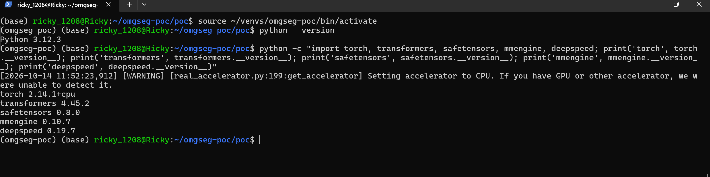
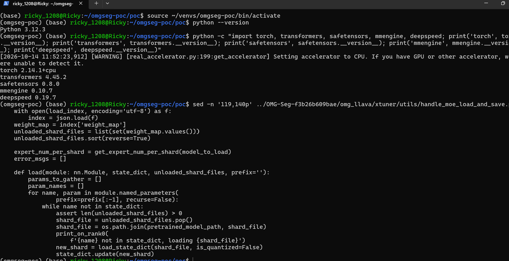
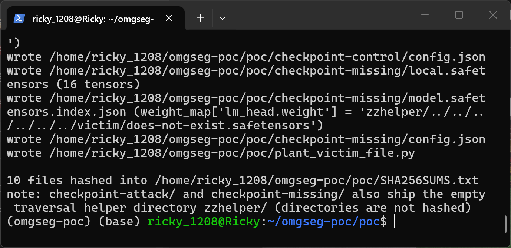
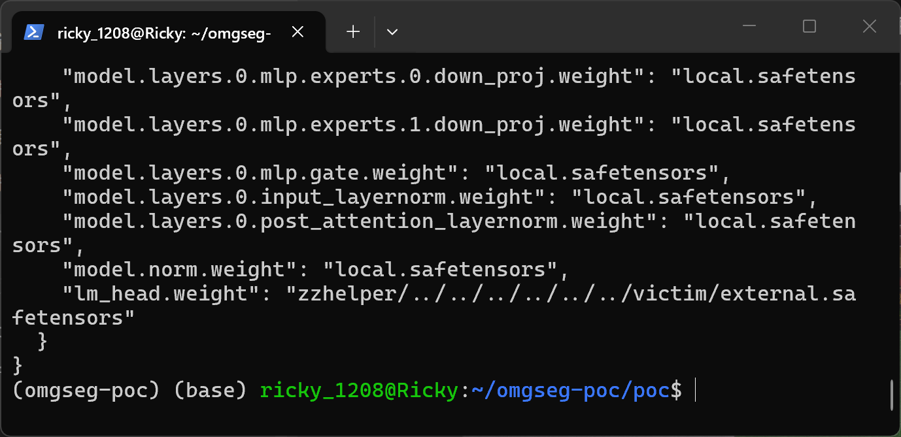
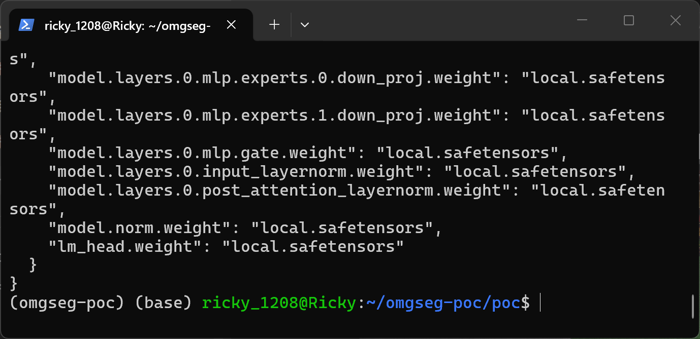
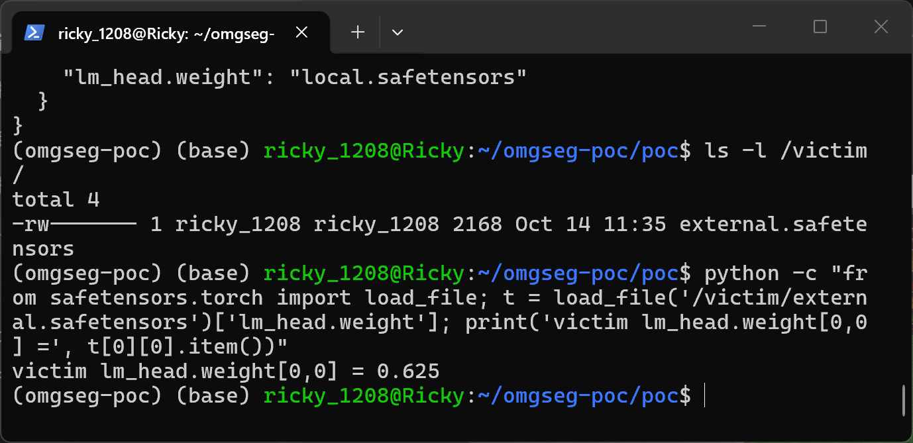
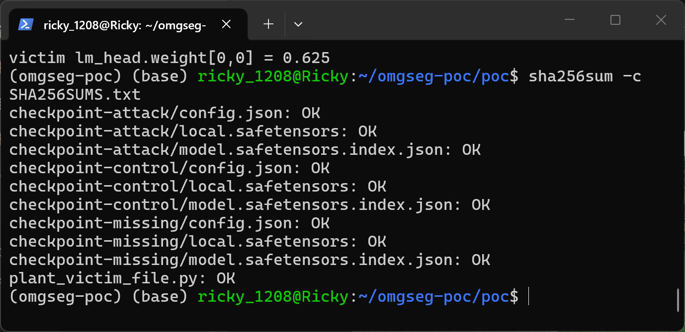
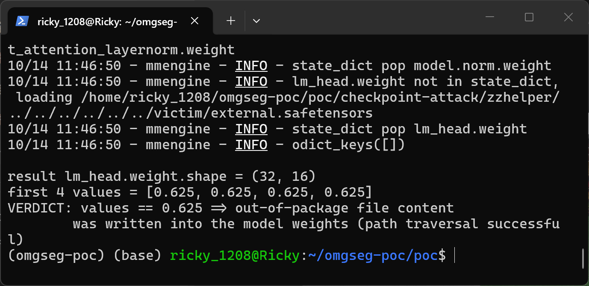
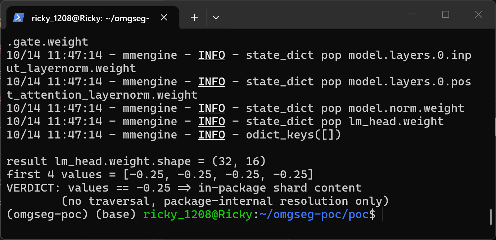
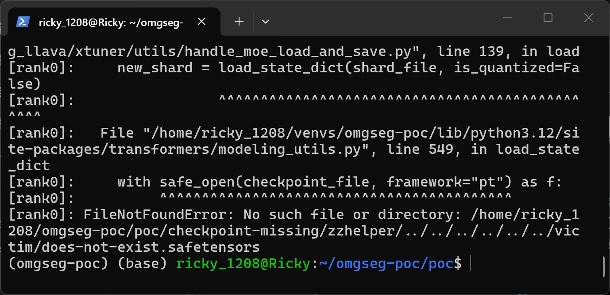

# OMG-Seg (omg_llava) commit f3b26b609bae — Path Traversal in the DeepseekV2 MoE Shard Checkpoint Loader

## Summary
lxtGH OMG-Seg (open-source unified segmentation model toolbox; the affected code lives in the `omg_llava` subtree with its vendored `xtuner` fork) at commit `f3b26b609bae` is affected by a path traversal in the DeepseekV2 MoE shard checkpoint loader `load_state_dict_into_model()`. When a checkpoint carries `model.safetensors.index.json` and the model is built with `moe_implementation='shard'`, `DeepseekV2ForCausalLM.from_pretrained()` routes the load through this loader, which joins every raw `weight_map` value from the index JSON onto the checkpoint directory with `os.path.join` and feeds the result to `transformers.modeling_utils.load_state_dict` without any validation. A `weight_map` value containing `..` segments (or an absolute path) resolves outside the checkpoint package, so a crafted model package makes the loader open safetensors files at attacker-chosen locations on the machine and write their tensor values into the model weights through the normal expert-merge path — silently, and with no indication in the returned model.

## Affected Product

| Field | Value |
|---|---|
| Vendor | lxtGH (GitHub owner); project OMG-Seg / OMG-LLaVA |
| Product | OMG-Seg, `omg_llava` subtree (vendored `xtuner` fork) |
| Affected versions | commit `f3b26b609bae919760cd3ccf09c36179bb8624a0` (2026-09-08), which is the repository HEAD at reporting time (2026-10-14); no tags, no releases, no fixed commit at reporting time |
| Component | `omg_llava/xtuner/utils/handle_moe_load_and_save.py`, function `load_state_dict_into_model()` (lines 100-169); index parsing and unvalidated join at lines 119-136, out-of-package file read at line 139; reached via the `moe_implementation='shard'` branch of `DeepseekV2PreTrainedModel.from_pretrained` and the `_load_pretrained_model` override in `omg_llava/xtuner/model/transformers_models/deepseek_v2/modeling_deepseek.py:1367-1452` |
| Platform | Platform-independent Python `os.path` semantics; verified on WSL2 Ubuntu 24.04.3 LTS with CPython 3.12.3 |
| Vulnerability type | CWE-22: Path Traversal |

## Root Cause

**Location:** `omg_llava/xtuner/utils/handle_moe_load_and_save.py:119-140` (`load_state_dict_into_model`, inner `load`), with the defective join at line 136.

The loader reads the sharded-index JSON, takes the raw `weight_map` values as the only shard source, and pops them lazily whenever a parameter name is still missing from the accumulated state dict:

```python
with open(load_index, encoding='utf-8') as f:      # line 119
    index = json.load(f)
weight_map = index['weight_map']                   # line 121: attacker-controlled
unloaded_shard_files = list(set(weight_map.values()))
unloaded_shard_files.sort(reverse=True)
...
        while name not in state_dict:              # line 133
            assert len(unloaded_shard_files) > 0
            shard_file = unloaded_shard_files.pop()
            shard_file = os.path.join(pretrained_model_path, shard_file)  # line 136: no validation
            print_on_rank0(f'{name} not in state_dict, loading {shard_file}')
            new_shard = load_state_dict(shard_file, is_quantized=False)   # line 139: opens the joined path
            state_dict.update(new_shard)
            _merge_experts_weight(state_dict, ...)                        # lines 141+: values reach the model
```

There is no rejection of `..` segments, no rejection of absolute paths, and no resolved-path containment check — neither in this function nor in the transformers release this override is compatible with (for local checkpoint folders, `get_checkpoint_shard_files()` in transformers 4.45.2 merely joins the raw values and performs no existence or containment validation). `os.path.join` keeps `..` segments unresolved, and an absolute right-hand operand would discard the directory prefix entirely, so any escaping `weight_map` value points the join outside the package. The `weight_map` values are fully attacker-controlled whenever the checkpoint comes from an untrusted source (a model-hub download, a mirror, or any archive shared as a "model package"), so tensors are read from any path the victim's process can open and written into the expert-merged model weights. The entry chain is the documented MoE shard path of the vendored DeepseekV2 model: `DeepseekV2ForCausalLM.from_pretrained(model_dir, moe_implementation='shard')` monkey-patches `_load_pretrained_model` (`modeling_deepseek.py:1442-1452`), and the patched method derives the checkpoint folder and calls `load_state_dict_into_model(model, folder)` (`modeling_deepseek.py:1395-1396`).

## Proof of Concept

### Prerequisites
- Python 3.12 with `torch`, `transformers==4.45.2`, `safetensors`, `mmengine`, `deepspeed`, `accelerate` importable. transformers 4.45.2 is the release whose `PreTrainedModel._load_pretrained_model` call signature the vendored override matches exactly (the `omg_llava` requirements pin 4.36.0, which predates the vendored override's `gguf_path`/`hf_quantizer` parameters; 4.46+ passes a `weights_only` keyword the override does not accept). `deepspeed` is a hard import of the vulnerable module; on the single-process PoC path it is never used beyond the import.
- OMG-Seg source pinned at commit `f3b26b609bae` as a sibling directory of the PoC folder (or pointed to via the `OMG_SEG_REPO` environment variable).
- A victim-side file in safetensors format outside any model package, here planted at `/victim/external.safetensors` (single tensor `lm_head.weight`, shape (32, 16), filled with the marker value 0.625) using the attached `plant_victim_file.py`; on Linux the parent directory `/victim` is created once by root and handed to the unprivileged user, the file itself is written unprivileged.
- The attached samples: `checkpoint-attack` (`weight_map` points `lm_head.weight` at `zzhelper/../../…/victim/external.safetensors`), `checkpoint-control` (identical except the field is the plain in-package name `local.safetensors`) and `checkpoint-missing` (points at `…/victim/does-not-exist.safetensors`). All packages carry the same mini-MoE `config.json` (1 decoder layer, 2 routed experts, `expert_in_one_shard=2`, `moe_implementation='shard'`) and the same index structure; the only index difference is that one string. The attack and missing packages ship an empty `zzhelper/` directory — a real in-package directory that makes the `..` segments resolve on the filesystem — and their in-package shard `local.safetensors` simply omits exactly the tensor that the index places outside, as any legitimate sharded index would.
- Note on the model: the samples are generated from a real instance of the vendored `DeepseekV2ForCausalLM` (built by `make_poc.py` through the pinned repository code, with expert tensors rewritten into the per-expert checkpoint format that `_merge_experts_weight()` folds back), so the end-to-end run exercises the genuine loader, merge and `from_pretrained` chain of the pinned commit.

### Steps to Reproduce

Environment used for the captured session (WSL2 Ubuntu 24.04.3 LTS, Python 3.12.3, torch 2.14.1+cpu, transformers 4.45.2, safetensors 0.8.0, mmengine 0.10.7, deepspeed 0.19.7, source pinned at commit `f3b26b609bae`):



The two unvalidated reads in the pinned source: line 121 takes the raw `weight_map` values, line 136 joins each onto the checkpoint directory and line 139 opens the joined path:



1. Generate the samples with the attached `make_poc.py`. It builds the mini DeepseekV2 MoE model through the pinned repository code, verifies that the per-expert payload round-trips through the repository's own `_merge_experts_weight()` into exactly the model's tensors, and writes the three checkpoint packages, the victim-file planter and `SHA256SUMS.txt`.







2. Confirm the victim-side file exists outside any model package (planted by `python plant_victim_file.py`) and verify sample integrity.





3. Run the real loader on the attack package: `python run_poc.py checkpoint-attack`. The loader's own rank-0 trace shows `lm_head.weight not in state_dict, loading <checkpoint-dir>/zzhelper/../../../../../../victim/external.safetensors`, and after `from_pretrained` returns, the model's `lm_head.weight` reads 0.625 — the out-of-package file's marker value.



4. Run the control package, which differs only in that one index string. The loader resolves the shard inside the package and `lm_head.weight` reads the in-package -0.25.



5. Run the missing-shard package. `load_state_dict` raises `FileNotFoundError: No such file or directory: <checkpoint-dir>/zzhelper/../../../../../../victim/does-not-exist.safetensors` with `handle_moe_load_and_save.py:139` in the traceback, which turns the defect into a limited filesystem oracle (missing vs parseable-safetensors vs valid-and-loaded are three distinguishable outcomes).



### Expected vs Actual
- Expected: shard names from an untrusted `model.safetensors.index.json` are rejected unless they resolve inside the checkpoint directory; an escaping or absolute value is never opened, and model weights are only ever sourced from files inside the package.
- Actual: the escaping `weight_map` value is joined onto the checkpoint directory unvalidated (`os.path.join` keeps `..` segments; an absolute value discards the prefix). The loader opens the out-of-package file, writes its tensor values into the expert-merged model weights, and returns the model with no warning; a nonexistent target produces a `FileNotFoundError` that echoes the attacker-chosen traversal path.

### Sanitized PoC input
```json
{"metadata": {"total_size": 2048}, "weight_map": {"lm_head.weight": "zzhelper/../../../../../../victim/external.safetensors", "model.embed_tokens.weight": "local.safetensors"}}
```

## Impact
- Confidentiality: Low — no direct readback to the attacker at the sink; an out-of-package file's values are embedded into model parameters, which enables indirect exfiltration if the poisoned model is later checkpointed or published, and the distinguishable error outcomes leak limited filesystem structure (which paths exist and parse as safetensors).
- Integrity: High — attacker-chosen tensor values silently replace the weights of a DeepseekV2 MoE language model at initialization through the documented `moe_implementation='shard'` path; the substitution is invisible in the returned model, so a backdoored or deliberately degraded model can be delivered through a shared checkpoint package whose in-package shard passes inspection.
- Availability: None — a missing or unparseable shard raises a normal exception; no crash or resource exhaustion.
- Scope: local file read and model-weight injection outside the checkpoint package boundary.


## Remediation
Validate every shard filename taken from the index before joining, at `omg_llava/xtuner/utils/handle_moe_load_and_save.py:136`: reject absolute paths and `..` segments after separator normalization, and verify containment on the resolved path, e.g. `shard = Path(pretrained_model_path) / value; if not shard.resolve().is_relative_to(Path(pretrained_model_path).resolve()): raise ValueError(f'illegal shard path {value!r}')`. Add a regression test with an escaping `weight_map` value. Interim workaround: only load MoE shard checkpoints whose `model.safetensors.index.json` shard names have been manually checked, and process untrusted packages in an isolated environment. No fixed release exists at reporting time; re-verify after the maintainer publishes a patch.


## References
- Source repository: https://github.com/lxtGH/OMG-Seg
- Affected commit: https://github.com/lxtGH/OMG-Seg/blob/f3b26b609bae919760cd3ccf09c36179bb8624a0/omg_llava/xtuner/utils/handle_moe_load_and_save.py#L119-L140
- Entry chain: https://github.com/lxtGH/OMG-Seg/blob/f3b26b609bae919760cd3ccf09c36179bb8624a0/omg_llava/xtuner/model/transformers_models/deepseek_v2/modeling_deepseek.py#L1367-L1452
- CWE: https://cwe.mitre.org/data/definitions/22.html
- Upstream report: [pending publication]
- Vendor advisory: [none]

