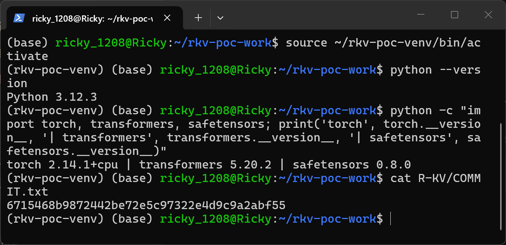
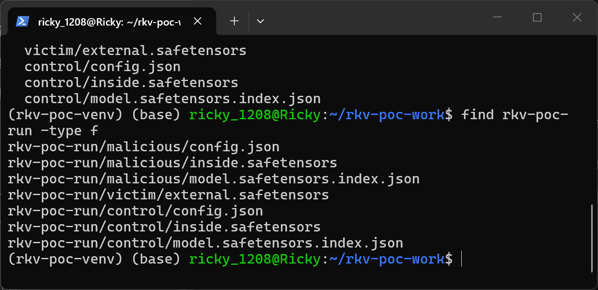
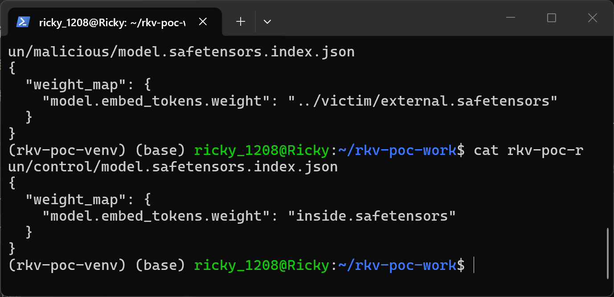
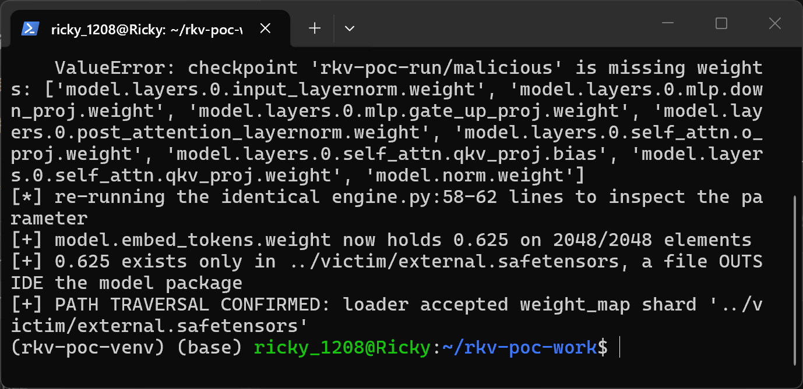
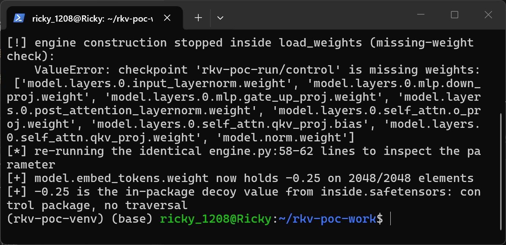

# R-KV (Zefan-Cai) commit 6715468b — Path Traversal in the FlashInfer Safetensors Weight Loader

## Summary

Zefan-Cai R-KV (NeurIPS 2025 KV-cache compression for reasoning models), commit 6715468b9872442be72e5c97322e4d9c9a2abf55, is affected by a path traversal (CWE-22) in the FlashInfer integration's safetensors weight loader. When a victim loads a model package through the README-documented entry point `FlashInferEngine(model_path)`, the loader reads shard file names verbatim from the attacker-controlled `model.safetensors.index.json` `weight_map` and joins them onto the model directory without any containment check, so a crafted package can source any named model parameter from an arbitrary file outside the package (relative `../` paths, or absolute paths via `os.path.join` semantics). An attacker who publishes such a package to a model hub can therefore make a victim silently run model weights that differ from the package contents that the victim (or an automated scanner) can inspect and hash.

## Affected Product

| Field | Value |
|---|---|
| Vendor | Zefan-Cai (R-KV project) |
| Product | R-KV — FlashInfer integration (`FlashInfer/rkv`) |
| Affected versions | git commit 6715468b9872442be72e5c97322e4d9c9a2abf55 (main branch, dated 2026-07-20); no versioned release [unknown] |
| Component | `FlashInfer/rkv/loader.py`, functions `_shard_files()` and `load_weights()` |
| Platform | OS-independent (pure Python; reproduction below on Linux/WSL Ubuntu 24.04, Python 3.12.3) |
| Vulnerability type | CWE-22: Path Traversal |

## Root Cause

**Location:** `FlashInfer/rkv/loader.py:19-31` (`_shard_files`, reached from `load_weights`), called by `FlashInferEngine.__init__` at `FlashInfer/rkv/engine.py:62`.

`_shard_files` parses the checkpoint index JSON and builds shard paths by joining the raw `weight_map` values onto `model_path` with no validation of any kind — no rejection of absolute paths, no path-separator check, no resolved-path containment check:

```python
def _shard_files(model_path: str) -> list[str]:
    index_path = os.path.join(model_path, "model.safetensors.index.json")
    if os.path.exists(index_path):
        with open(index_path) as f:
            weight_map = json.load(f)["weight_map"]
        return sorted({os.path.join(model_path, shard) for shard in weight_map.values()})
```

The `weight_map` values are fully attacker-controlled whenever the model package being loaded is attacker-controlled (the standard supply-chain scenario for a research engine whose README instructs users to point `FlashInferEngine` at a downloaded HF repo directory). `load_weights` then opens each joined path with `safetensors.safe_open` and copies tensor values straight into the model's parameters:

```python
for file in _shard_files(model_path):
    with safe_open(file, framework="pt", device="cpu") as f:
        for name in f.keys():
            param = params.get(name)
            if param is not None:
                tensor = f.get_tensor(name)
                ...
                param.copy_(tensor)
```

Two consequences: (1) a relative value such as `../victim/external.safetensors` escapes the model directory, so a tensor is loaded from a file that is not part of the package; (2) because `os.path.join("/a/b", "/c/d") == "/c/d"`, an absolute `weight_map` value discards the model directory entirely and reads any file on the host that contains a same-named, same-shaped tensor. The only validation in the loop is a shape equality check between the external tensor and the model parameter, which the attacker satisfies trivially by shaping their external file accordingly.

## Proof of Concept

### Prerequisites

- Python 3 with `torch` (CPU build is sufficient), `transformers`, `safetensors`; no GPU and no flashinfer install are needed because `load_weights` runs before any flashinfer kernel call. `poc_driver.py` registers a disclosed stub package named `flashinfer` (import-time only; every stub raises `NotImplementedError` if called) solely to satisfy the top-level imports of `engine.py`/`models.py` on a CUDA-less host; all repository code on the executed path runs unmodified from the pinned checkout.
- A victim-style flow: the user loads a model package directory with the README-documented call `FlashInferEngine(model_path)` — here against two minimal Qwen2 packages generated by `make_poc.py`.

The two generated packages `malicious/` and `control/` have byte-identical `config.json` and byte-identical in-package `inside.safetensors` (tensor `model.embed_tokens.weight` filled with `-0.25`, shape `[64, 32]`). They differ in exactly one field: the `weight_map` value in `model.safetensors.index.json` — `../victim/external.safetensors` (malicious) vs `inside.safetensors` (control). The external file `victim/external.safetensors` lives outside both packages and holds the same tensor name and shape filled with `0.625`.

### Steps to Reproduce

1. Set up the workspace: a pinned checkout of the repository (`R-KV-6715468b/`), the two attachment scripts, and a Python virtualenv with CPU torch. Environment and pinned commit:



2. Generate the malicious and control packages and show the layout — `victim/external.safetensors` sits outside both model packages:



3. Show that the two index files differ only in the `weight_map` shard value:



4. Load the malicious package through the documented entry point. The engine constructor runs `AutoConfig.from_pretrained(model_path)` → `CausalLM(...)` → `load_weights(model, model_path)` (engine.py:58-62); loading stops at the loader's missing-weight completeness check (the minimal package deliberately carries only `model.embed_tokens.weight`), and the parameter inspection shows the embedding now holds `0.625` — the value from the file outside the package:



5. Load the control package the same way: identical ValueError stop, but the embedding holds the in-package value `-0.25`, proving the difference is caused solely by the traversing `weight_map` entry:



### Expected vs Actual

- Expected: every tensor of a model package is loaded from safetensors files inside that package; a shard reference pointing outside the model directory (or at an absolute path) is rejected.
- Actual: the loader happily opens `../victim/external.safetensors` (one directory above the package) and copies its `0.625` values into `model.embed_tokens.weight`, while the package's own `inside.safetensors` still contains the benign `-0.25` values that any package-level inspection would see. Both runs stop at the same missing-weight completeness check (`ValueError: checkpoint ... is missing weights: [...]`), i.e. the traversal happens inside the loader's normal operation, not in an error path.

### Sanitized PoC input

The entire attack is this single index file inside the model package:

```json
{
  "weight_map": {
    "model.embed_tokens.weight": "../victim/external.safetensors"
  }
}
```

Attachments: `make_poc.py` (deterministically generates both packages and the external file), `poc_driver.py` (drives the documented entry point and inspects the loaded parameter), `SHA256SUMS.txt` (hashes of both scripts and all generated files; note that `malicious/config.json` and `control/config.json` hash identically, as do the two `inside.safetensors` — only the index files differ).

## Impact

- Confidentiality: Low — no file content is returned to the attacker directly; external file contents only influence model parameter values, which at most permits a coarse covert channel through model behavior. Treated as Low as a stated assumption.
- Integrity: High — the model the victim runs is silently poisoned with weights from outside the audited package: package-level scanning, hash pinning of the safetensors shards, or weight-inspection review all see the benign in-package tensors while the engine actually runs different values sourced from an arbitrary attacker-chosen path (relative traversal or absolute path).
- Availability: None — loading still terminates in the loader's own completeness/shape checks in the demonstrated scenario; no additional availability impact beyond what any broken model package causes.
- Scope: model-weight integrity of the loading process; no memory corruption, no code execution, no file write.


## Remediation

Resolve and contain every shard reference in `_shard_files` before opening, e.g.:

```python
base = Path(model_path).resolve()
shard_path = (base / shard).resolve()
if shard_path.parent != base and not shard_path.is_relative_to(base):
    raise ValueError(f"weight_map entry escapes model directory: {shard!r}")
```

Reject absolute `weight_map` values outright, and reject entries containing path separators other than a plain file name (the HuggingFace sharded-checkpoint convention uses bare shard file names), which also fixes the `os.path.join` absolute-path override behavior.


## References

- Source repository: https://github.com/Zefan-Cai/R-KV
- Pinned commit: https://github.com/Zefan-Cai/R-KV/tree/6715468b9872442be72e5c97322e4d9c9a2abf55
- Vulnerable file: https://github.com/Zefan-Cai/R-KV/blob/6715468b9872442be72e5c97322e4d9c9a2abf55/FlashInfer/rkv/loader.py
- Upstream report: [pending publication]
- CWE: https://cwe.mitre.org/data/definitions/22.html
- Vendor advisory: [none]

