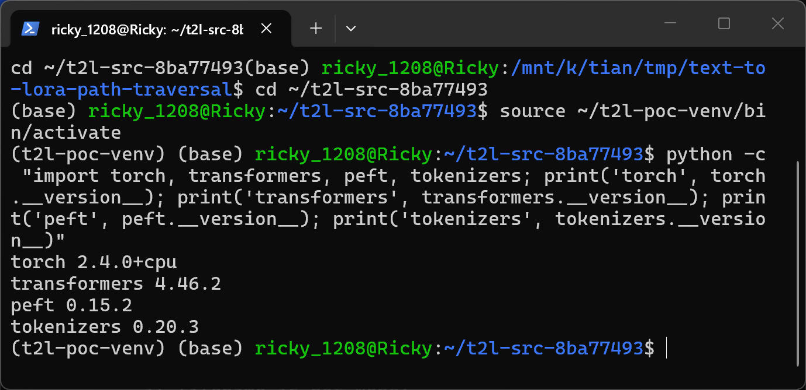
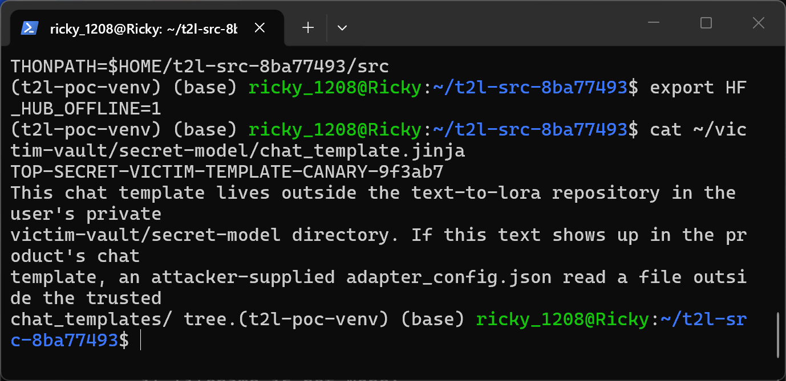
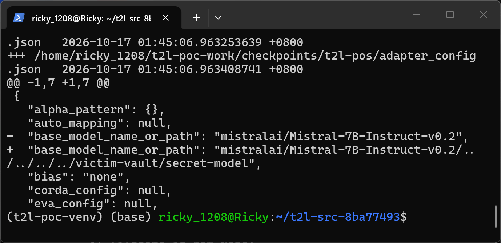
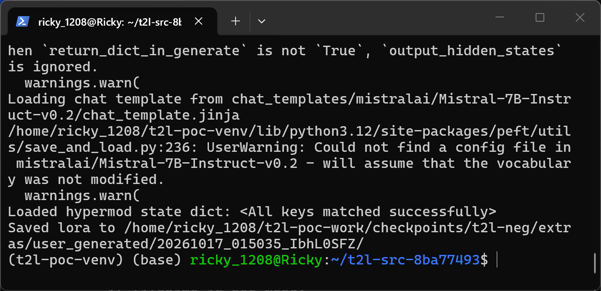
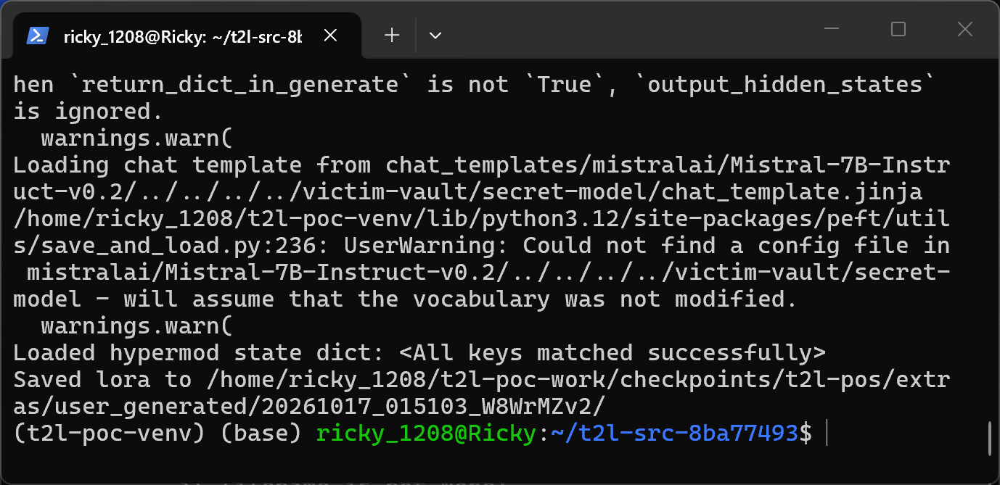
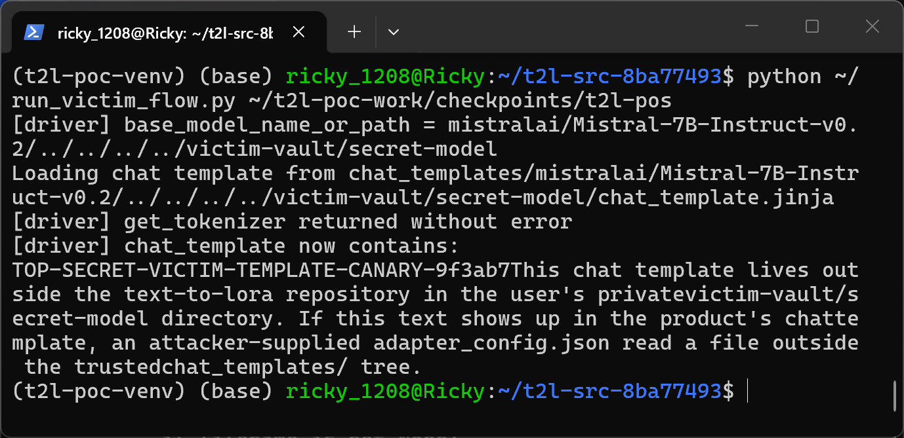

# Path Traversal in text-to-LoRA Checkpoint Loading

## Summary

SakanaAI text-to-LoRA 0.0.1 (git commit 8ba77493eb8c, still present on the main branch as of 2026-10-16) is affected by a path traversal (CWE-22) in the LoRA checkpoint loading component. When a victim loads a third-party text-to-LoRA checkpoint (a directory containing `args.yaml`, `hypermod.pt` and a PEFT `adapter_config.json`), the PEFT adapter field `base_model_name_or_path` is used without validation to build the chat-template path `chat_templates/{base_model_name_or_path}/chat_template.jinja`. Multi-level `../` sequences in that field escape the repository's trusted `chat_templates/` tree and make the product read an attacker-chosen file outside the repository; the file content is then assigned to the tokenizer's `chat_template` and applied to every subsequently formatted conversation.

## Affected Product

| Field | Value |
|---|---|
| Vendor | SakanaAI |
| Product | text-to-LoRA (text_to_lora / hyper_llm_modulator) |
| Affected versions | 0.0.1, git commit 8ba77493eb8c; vulnerable code unchanged on main as of 2026-10-16 |
| Component | `src/hyper_llm_modulator/utils/model_loading.py`, `get_tokenizer()` (lines 42-72) |
| Platform | OS-independent (Python); reproduction on Ubuntu 24.04 (WSL2), Python 3.12 |
| Vulnerability type | CWE-22: Path Traversal |

## Root Cause

**Location:** `src/hyper_llm_modulator/utils/model_loading.py:46-66` (`get_tokenizer`)

`get_tokenizer()` is reached through the documented entry points `scripts/generate_lora.py` (README-documented CLI for generating a LoRA from a checkpoint directory) and `webui/app.py`. Both call `load_hypermod_checkpoint()` (`src/hyper_llm_modulator/hyper_modulator.py:949`), which parses `args.yaml` with `yaml.safe_load`, parses `adapter_config.json` with the official PEFT loader `PeftConfig.from_json_file`, and then calls `get_model_and_tokenizer(..., peft_config=peft_config)` (`hyper_modulator.py:963`). Inside `get_tokenizer()`, the adapter-controlled field replaces the model path with no validation of any kind:

```python
def get_tokenizer(model_path, tokenizer_kwargs=None, peft_config=None, train=False):
    padding_side = "left" if not train else "right"
    if peft_config:
        model_path = peft_config.base_model_name_or_path   # line 47: attacker-controlled override

    tokenizer = AutoTokenizer.from_pretrained(model_path, ...)  # line 52

    template_path = f"chat_templates/{model_path}/chat_template.jinja"  # line 59: traversal
    assert os.path.exists(template_path), (...)
    print(f"Loading chat template from {template_path}")
    chat_template = open(template_path).read()  # line 66: reads the traversed target
    chat_template = chat_template.replace("    ", "").replace("\n", "")
    tokenizer.chat_template = chat_template  # content is absorbed into the product state
```

`base_model_name_or_path` is a plain JSON string in `adapter_config.json` inside the checkpoint directory, i.e. part of the untrusted artifact. The repository intends chat templates to come exclusively from its bundled `chat_templates/` tree — the assertion message itself says "Please use the templates provided" — but because `model_path` may contain `/` and `..` sequences, the constructed path resolves anywhere on the filesystem. The existence check at line 60 does not constrain the path to the trusted tree; it only confirms the traversed target exists, after which line 66 reads it.

Reachability note: line 52 loads the tokenizer from the same traversed path first, so the read target must be a directory that also contains Hugging Face tokenizer files. That is the standard layout of every modern HF model snapshot directory (tokenizer files and `chat_template.jinja` side by side), so any locally stored model directory matches the prerequisite.

## Proof of Concept

### Prerequisites

- Victim runs `scripts/generate_lora.py` (documented CLI) or the bundled web UI against a checkpoint directory obtained from an attacker (a directory with `args.yaml`, `hypermod.pt`, `adapter_config.json`).
- Two directories on the same relative chain exist outside the repository, simulating locally stored model/template directories of the kind found on ML workstations: a tokenizer-bearing directory at the `/home` level (`/home/victim-vault/secret-model/`, created once via root and chowned to the user) and the victim directory `~/victim-vault/secret-model/` whose `chat_template.jinja` contains the canary text `TOP-SECRET-VICTIM-TEMPLATE-CANARY-9f3ab7`. Both are required because `get_tokenizer()` loads the tokenizer from the raw field value (resolved from the current working directory) and reads the template from `chat_templates/<field>/chat_template.jinja`; the added `chat_templates/` prefix makes the two resolutions land one directory level apart.
- Reproduction environment: WSL2 Ubuntu 24.04, Python 3.12.3, venv with the pinned dependency set from the repository's `uv.lock` (torch 2.4.0 CPU build, transformers 4.46.2, tokenizers 0.20.3, peft 0.15.2, accelerate 1.6.0, numpy 1.26.4).



### Reproduction environment note

The reproduction machine has no CUDA device. The pinned stack (transformers 4.46.2) cannot satisfy the unconditional `attn_implementation="flash_attention_2"` request that `get_model()` (`model_loading.py:94`) hard-codes, and the CUDA-only `flash_attn` package cannot be installed, so on this hardware `scripts/generate_lora.py` aborts with an ImportError inside `get_model()` before the tokenizer stage is reached — an environment limitation, not a security boundary: on the product's documented GPU deployment the documented CLI reaches the identical vulnerable code unchanged. The steps below therefore drive the unmodified product functions `get_model_and_tokenizer()` (the exact callee of `load_hypermod_checkpoint()`, passing its own supported `use_flash_attn=False` parameter) and `get_tokenizer()` — the function that contains the complete defect (lines 46-66). The driver script is shipped in `poc/` and is a line-by-line fusion of `scripts/generate_lora.py`'s main body and `load_hypermod_checkpoint()`'s body; every product file executed is unmodified.

### Steps to Reproduce

1. Build the PoC artifacts with the supplied `poc/make_poc.py`: it creates a tiny local base model (offline stand-in for the 2B download), the two directory levels described above, and two checkpoints that are byte-identical except for one JSON field (`hypermod.pt` is a single build byte-copied into both).



The two `adapter_config.json` files differ only in `base_model_name_or_path`: the negative control uses the in-tree anchor `mistralai/Mistral-7B-Instruct-v0.2`, the malicious one appends traversal segments `mistralai/Mistral-7B-Instruct-v0.2/../../../../victim-vault/secret-model` so that `chat_templates/<field>/chat_template.jinja` resolves to the victim's file while the raw field resolves to the tokenizer-bearing `/home`-level directory. All intermediate path components are directories that exist on the machine, so the path resolves without creating anything inside the repository.



2. Run the LoRA-generation flow with the negative control checkpoint. Generation completes normally: the tokenizer loads from the locally cached model directory and the chat template is read from the bundled `chat_templates/mistralai/Mistral-7B-Instruct-v0.2/chat_template.jinja`; the run ends with `Saved lora to ...`.



3. Run the same flow with the malicious checkpoint.



The product prints `Loading chat template from chat_templates/mistralai/Mistral-7B-Instruct-v0.2/../../../../victim-vault/secret-model/chat_template.jinja`, the existence check passes, `open(...).read()` reads the victim's file, and the run continues to completion (`Saved lora to ...`).

4. Observe that the content of the victim's file was absorbed into the product's tokenizer state: driving the same `get_tokenizer()` function with the malicious `PeftConfig` shows the canary text has become the active chat template (whitespace-stripped by the product's own post-processing at `model_loading.py:67`).



### Expected vs Actual

- Expected: a checkpoint's chat template may only be resolved inside the bundled `chat_templates/` tree ("Please use the templates provided"); a `base_model_name_or_path` containing `../` should be rejected.
- Actual: the field is concatenated into the template path verbatim; a multi-level `../` traversal makes the product load the tokenizer from and read `chat_template.jinja` out of an arbitrary attacker-chosen directory outside the repository, and the file content becomes the active chat template of the run.

### Sanitized PoC input

```json
{
    "base_model_name_or_path": "mistralai/Mistral-7B-Instruct-v0.2/../../../../victim-vault/secret-model",
    "peft_type": "LORA",
    "task_type": "CAUSAL_LM",
    "r": 4,
    "lora_alpha": 8,
    "target_modules": ["q_proj", "v_proj"]
}
```

## Impact

- Confidentiality: Low — a file named `chat_template.jinja` in an attacker-chosen local directory (in practice: another locally stored model's chat template) is read out of the trusted tree and absorbed into the tokenizer; in web UI / evaluation flows that template is applied to subsequent conversations, so its content can shape model input and leak into outputs.
- Integrity: Low — the attacker-selected file replaces the trusted chat template for the whole run, altering how every conversation is formatted downstream.
- Availability: None — the traversal itself does not crash or exhaust the service.
- Scope: local out-of-tree file read (no code execution; `AutoTokenizer.from_pretrained` is called without `trust_remote_code`, so tokenizer loading stays data-only).


## Remediation

Reject traversal in `get_tokenizer()` at `src/hyper_llm_modulator/utils/model_loading.py:47`: after the `peft_config` override, validate that `model_path` contains no `/`, `\` or `..` segments (or normalize with `os.path.normpath`/`pathlib.PurePath` and require the result to stay inside the repository's `chat_templates/` allowlist), before it is used at lines 52 and 59. As a workaround, only run checkpoints whose `adapter_config.json` has a `base_model_name_or_path` without path separators.


## References

- Source repository: https://github.com/SakanaAI/text-to-lora
- Pinned commit analyzed: https://github.com/SakanaAI/text-to-lora/commit/8ba77493eb8c
- Upstream report: `[pending publication]`
- CWE: https://cwe.mitre.org/data/definitions/22.html
- Vendor advisory: `[none]`

