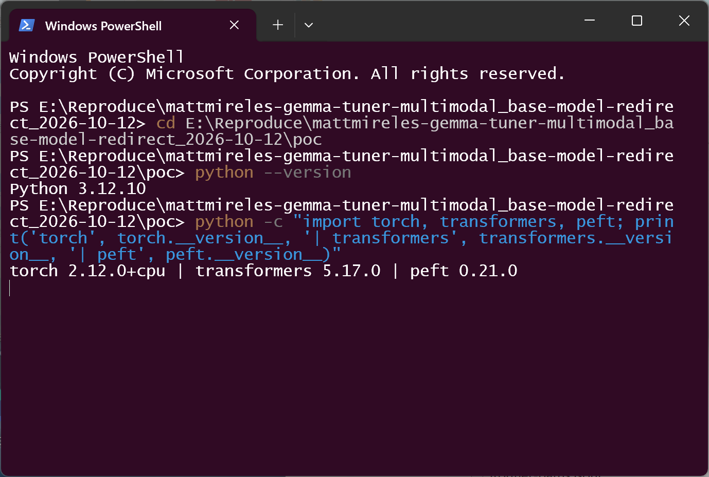
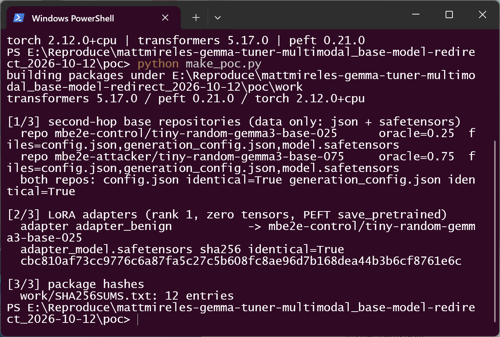
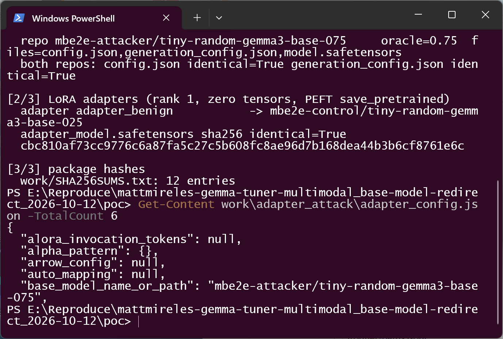
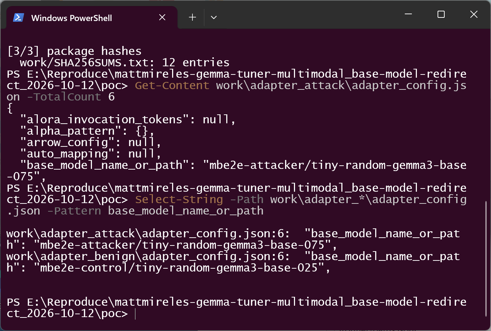
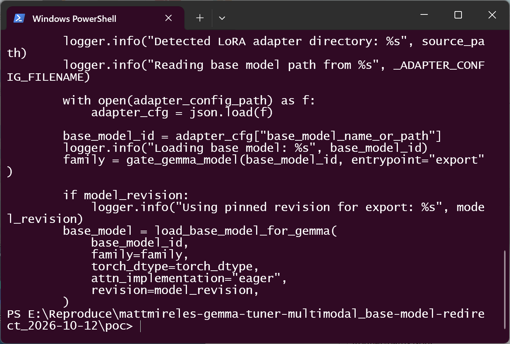
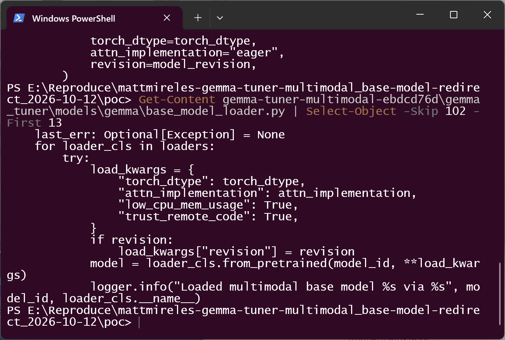
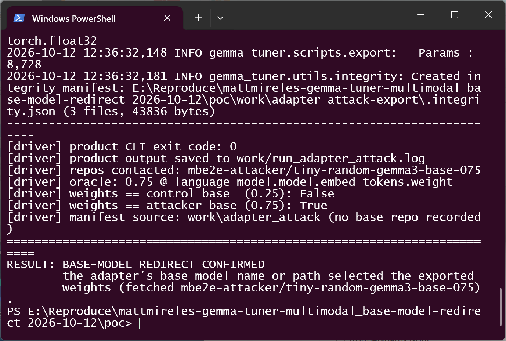
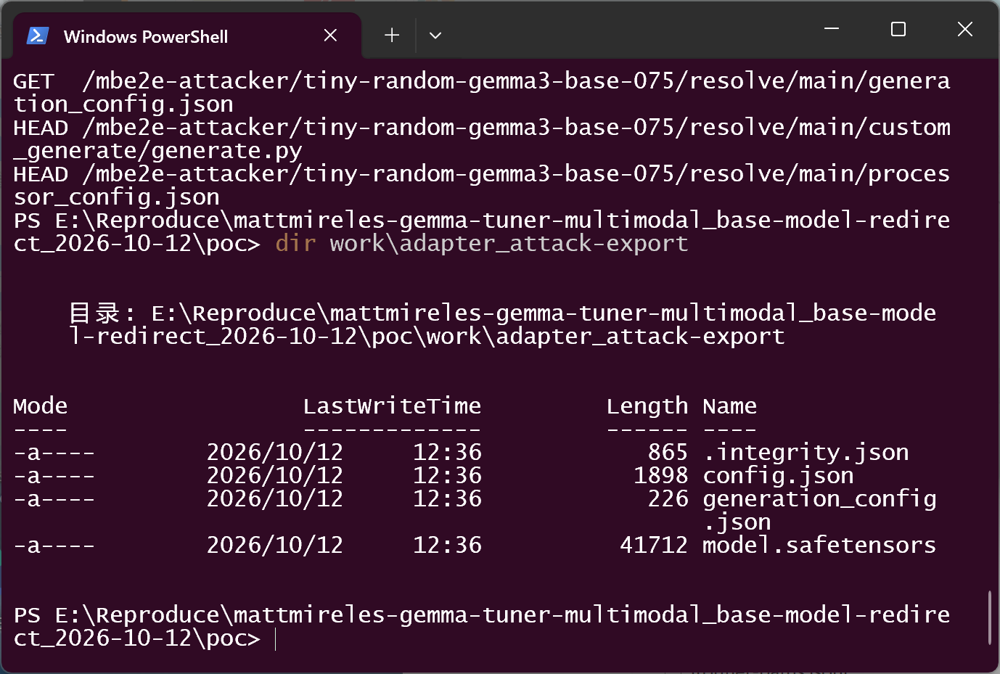
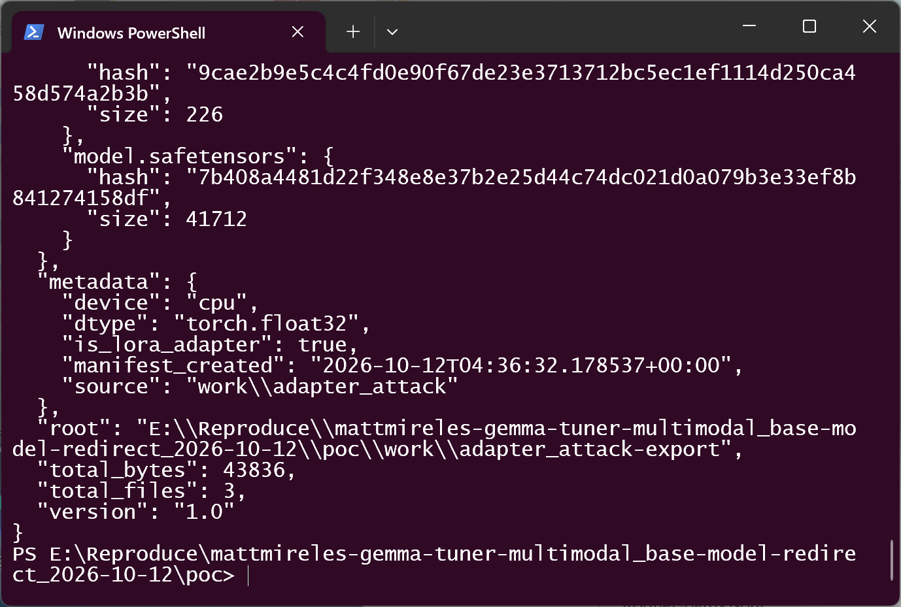

# mattmireles gemma-tuner-multimodal (commit ebdcd76d) — LoRA-Adapter-Controlled Base-Model Repository Redirection in the Export CLI

## Summary

mattmireles/gemma-tuner-multimodal is affected in its released tags as well as
at the commit audited here (commit ebdcd76db84067a0ed928ec077045376c446b908,
2026-09-06). The project ships a CLI (`gemma-macos-tuner`) whose `export`
command merges a LoRA adapter into its base model. When the source directory is
a LoRA adapter, `gemma_tuner/scripts/export.py:84` takes
`base_model_name_or_path` **verbatim out of the adapter package** and hands it
to `load_base_model_for_gemma()`, which resolves it as a Hugging Face
repository id and downloads the base model from it
(`gemma_tuner/models/gemma/base_model_loader.py:114`,
`loader_cls.from_pretrained(model_id, ...)`, `trust_remote_code=True`).

Nothing constrains the origin of that second repository: the only check on the
value is a substring family gate (`family.py:36-48`, the id must contain
`gemma-3n`, `gemma-4`, `gemma4`, or `tiny-random` + `gemma`), and the revision
is unpinned unless the user passes `--revision`. An attacker who publishes a
LoRA adapter package — the normal way adapters are distributed — therefore
chooses which repository the victim's machine downloads the base weights from,
and the base weights silently become part of the artifact the victim exports
and deploys.

The demonstration below uses two **data-only** base repositories (only
`config.json`, `generation_config.json`, `model.safetensors`; no `.py`, no
`auto_map`, no sidecar) that are byte-identical except for one embedding scalar
used as a measurement oracle. Running the real `gemma-macos-tuner export`
command on an adapter that points at the attacker repository fetches that
repository and produces an export carrying its weights (oracle 0.75); the
benign control adapter, byte-identical except for the pointer, fetches only the
intended repository (oracle 0.25). No code executes and no third-party
infrastructure is contacted.

## Affected Product

| Field | Value |
|---|---|
| Vendor | mattmireles |
| Product | gemma-tuner-multimodal (`gemma-macos-tuner` CLI; `gemma_tuner` package) |
| Affected versions | All released tags — `1.0` (`07a6f9a9ae4437a4b10c8dac1fbb79b57dc6cb70`, 2026-04-07) and `v1.1` (`99fa803594826d5722df7b42ecb7a6f5f480531c`, 2026-04-08) — and later commits up to `ebdcd76db84067a0ed928ec077045376c446b908` (2026-09-06). The defect is identical in the tagged releases: the same logic sits at `export.py:82-86` and `base_model_loader.py:98-103` there (verified against both tags). No fix exists at report time |
| Component | `gemma_tuner/scripts/export.py:76-96` (adapter branch: reads and trusts `base_model_name_or_path`), `gemma_tuner/models/gemma/base_model_loader.py:103-115` (loader loop), reached from the documented entry point `gemma-macos-tuner export <run-dir-or-profile>` (`cli_typer.py:450-466` → `core/ops.py:267-299`) |
| Platform | OS-independent (Python). Reproduced on Windows 11 x64, Python 3.12.10, torch 2.12.0+cpu, transformers 5.17.0, peft 0.21.0, accelerate 1.15.0, safetensors 0.8.0, huggingface_hub 1.33.0 |
| Vulnerability type | CWE-494: Download of Code Without Integrity Check (origin-validation failure; see also CWE-345 Insufficient Verification of Data Authenticity and CWE-346 Origin Validation Error. The fetched artifact in the demonstrated chain is model data — configuration and weights — not code) |

## Root Cause

**Location:** `gemma_tuner/scripts/export.py:84` and
`gemma_tuner/models/gemma/base_model_loader.py:114`, commit
`ebdcd76db84067a0ed928ec077045376c446b908` (the released tags `1.0` and `v1.1`
contain the same logic at `export.py:82-86` and `base_model_loader.py:98-103`).

`export_model_dir()` detects a LoRA adapter by the presence of
`adapter_config.json` and treats the standard PEFT field `base_model_name_or_path`
as a trusted instruction about where the base model lives:

```python
# gemma_tuner/scripts/export.py:76-96 (commit ebdcd76d)
if adapter_config_path.exists():
    logger.info("Detected LoRA adapter directory: %s", source_path)
    logger.info("Reading base model path from %s", _ADAPTER_CONFIG_FILENAME)
    with open(adapter_config_path) as f:
        adapter_cfg = json.load(f)

    base_model_id = adapter_cfg["base_model_name_or_path"]   # attacker-controlled
    logger.info("Loading base model: %s", base_model_id)
    family = gate_gemma_model(base_model_id, entrypoint="export")
    ...
    base_model = load_base_model_for_gemma(
        base_model_id,
        family=family,
        torch_dtype=torch_dtype,
        attn_implementation="eager",
        revision=model_revision,
    )
```

The value is then passed to the family-aware loader, which forwards it to
`transformers` as a repository id:

```python
# gemma_tuner/models/gemma/base_model_loader.py:103-115 (commit ebdcd76d)
last_err: Optional[Exception] = None
for loader_cls in loaders:
    try:
        load_kwargs = {
            "torch_dtype": torch_dtype,
            "attn_implementation": attn_implementation,
            "low_cpu_mem_usage": True,
            "trust_remote_code": True,
        }
        if revision:
            load_kwargs["revision"] = revision
        model = loader_cls.from_pretrained(model_id, **load_kwargs)
        logger.info("Loaded multimodal base model %s via %s", model_id, loader_cls.__name__)
        return model
```

Missing checks, in order of relevance:

1. **No origin constraint.** `base_model_name_or_path` is used as-is. Any
   repository id (or local path) the adapter names is fetched; the only gate is
   `gemma_tuner/models/gemma/family.py:36-48`, a case-insensitive **substring**
   test on the same attacker-controlled string (`"gemma-3n"`, `"gemma-4"`,
   `"gemma4"`, or `"tiny-random"` + `"gemma"`). It constrains spelling, not
   provenance: any attacker can name their repository accordingly.
2. **No revision pinning by default.** `revision` is `None` unless the user
   passes `--revision`, so the attacker repository is fetched at its current
   `main` and can be changed after the adapter was reviewed.
3. **The processor is taken from the same pointer.**
   `export.py:110` sets `processor_source = base_model_id` and `export.py:135`
   calls `AutoProcessor.from_pretrained(processor_source, ...)`; the tokenizer
   fetch therefore addresses the attacker repository as well (with a data-only
   repository it raises and is swallowed by the broad handler at
   `export.py:156-158`, so the export still completes).
4. **The export records no provenance for the base.** `export.py:167-177`
   writes `.integrity.json` with `metadata.source` = the *adapter* path, dtype,
   device and `is_lora_adapter` only; the base repository that supplied the
   merged weights is not recorded (verified below), so the resulting artifact
   cannot be audited for which base it contains. The repository's own README
   states the manifest is "integrity only, not signing/authenticity".

Consequence: the LoRA adapter — the artifact users download from third parties
in order to *add* a small delta to a known base — becomes the selector of the
base model itself, including its origin, contents and revision. Because the
adapter's own tensors in the demonstration are all zero, the exported model is
exactly the base the pointer named.

## Proof of Concept

### Prerequisites

- The victim obtains a LoRA adapter package (the normal distribution unit for
  adapters) and runs the documented export command on it:
  `gemma-macos-tuner export <adapter-dir>`. No privileges, no configuration
  change and no other user action are required.
- The attacker controls a second repository (here served by a localhost mock of
  the Hugging Face HTTP API so the reproduction is offline and network-bounded;
  `huggingface_hub` is pointed at it with `HF_ENDPOINT`, so the real download
  code path runs unchanged).
- The pinned source copy `poc/gemma-tuner-multimodal-ebdcd76d/` (commit
  ebdcd76d, unmodified) is driven by `poc/run_repro.py`, which invokes the
  product's own CLI through `gemma_tuner.cli_typer` after calling the project's
  own `core/logging.py:init_logging('INFO')` so the loader's log lines are
  visible. No product code is patched.

### Steps to Reproduce

1. Environment used for the run (versions of the product's own dependency
   stack):



2. Build the packages with `poc/make_poc.py`: two data-only Gemma base
   repositories and two PEFT adapters. Both repositories contain exactly
   `config.json`, `generation_config.json`, `model.safetensors`; their
   `config.json` / `generation_config.json` are identical, and the only
   difference inside `model.safetensors` is one embedding scalar
   (`embed_tokens.weight[0,0]`) — 0.25 in `mbe2e-control/tiny-random-gemma3-base-025`
   and 0.75 in `mbe2e-attacker/tiny-random-gemma3-base-075`. Hashes of every
   file land in `poc/work/SHA256SUMS.txt`.



3. The malicious adapter package. `base_model_name_or_path` is the only
   attacker-controlled value; everything else is an ordinary PEFT
   `save_pretrained()` output (rank 1, `target_modules=["q_proj"]`, all-zero
   LoRA tensors):



4. The two adapters differ only in that one string. The benign adapter is a
   byte-identical copy of the malicious one (same `adapter_model.safetensors`,
   SHA-256 `cbc810af73cc9776c6a87fa5c27c5b608fc8ae96d7b168dea44b3b6cf8761e6c`),
   repointed at the intended repository:



5. The defective code in the pinned copy — the adapter field becomes the base
   model id and is passed to the loader:



6. The loader that consumes it. The call is made with
   `trust_remote_code=True`, and no allowlist, origin check or revision pin is
   applied to `model_id`:



7. Run the product's export command on the malicious adapter
   (`python run_repro.py adapter_attack` → `gemma-macos-tuner export
   work\adapter_attack`). The export succeeds (exit code 0), the only
   repository contacted is the attacker's, and the exported weights are the
   0.75 base — byte-identical to the attacker repository and not to the control
   repository:



8. The product's own log lines for that run (the loader statements are the
   product's, not the harness's):


9. The mock-hub request log for the same run: `config.json`, the weights
   (`model.safetensors`, 41712 bytes), `generation_config.json`, the
   processor/tokenizer probes, and — because the loader passes
   `trust_remote_code=True` — a probe for `custom_generate/generate.py`, all
   addressed to the attacker repository. Every one of them 404s or is served
   from the attacker repository; nothing else is contacted:


10. The artifact the victim ends up with — written to
    `<adapter-dir>-export` (`export.py:127-129`) and intended to be
    "self-contained, deployment-ready":



11. The provenance gap: the export's own integrity manifest names the adapter
    as `source` and records nothing about the base repository whose weights
    were merged in:



12. Negative control — the benign adapter (byte-identical weights, pointer
    `mbe2e-control/tiny-random-gemma3-base-025`) exports the 0.25 base, and the
    attacker repository is never contacted:


### Expected vs Actual

- Expected: the base model a LoRA adapter is merged into should be a trust
  decision of the user (or at least be reported and recorded). A repository id
  taken from the adapter package should not silently select a remote origin,
  and the exported artifact should record which base it was built from.
- Actual: `base_model_name_or_path` is forwarded verbatim to
  `from_pretrained()`; running the documented export command contacts the
  repository the adapter names, merges its weights into the exported model, and
  the accompanying integrity manifest records only the adapter.

### Sanitized PoC input

```json
{
  "base_model_name_or_path": "mbe2e-attacker/tiny-random-gemma3-base-075",
  "peft_type": "LORA",
  "r": 1,
  "lora_alpha": 1,
  "target_modules": ["q_proj"],
  "task_type": "CAUSAL_LM"
}
```

(elided fields are identical to the benign adapter's `adapter_config.json`; the
complete files, the two second-hop repositories and the hashes are produced by
`poc/make_poc.py` under `poc/work/`). Both second-hop repositories contain only
model data; the "attacker" repository is a local directory served over
`127.0.0.1`, not a real third-party repository.

### Honest validation boundary

- Demonstrated: repository-identity redirection driven purely by model data,
  and substitution of the weights that end up in the exported artifact (proved
  by tensor equality with the attacker repository's weights and inequality with
  the control's). The data-only repositories contain no `auto_map` and no
  `.py` file, and the run's request log shows the code probe
  (`custom_generate/generate.py`) returning 404, so **no code executed**. The
  loader nonetheless passes `trust_remote_code=True`
  (`base_model_loader.py:110`) and does probe the attacker repository for code
  artifacts; a repository that additionally carried remote-code entries would
  be treated as code-trusted by the same call. That escalation is *not*
  demonstrated here and is not claimed.
- The `AutoProcessor` leg (`export.py:110,135`) is exercised but non-fatal with
  a data-only repository: the run logs
  `Could not save processor to export dir (non-fatal): string indices must be
  integers, not 'str'` and completes without a processor.
- Environment boundary: the reproduction ran on Windows 11 x64 with a CPU
  torch build, while the product targets Apple Silicon. The export path driven
  here is platform-independent Python (device selection falls back to CPU,
  `utils/device.py:get_device`); no MPS-specific code is involved.
- The `--revision` option does exist (`cli_typer.py:452`); it is optional and
  was not used, matching default user behaviour. If a user always pins a
  revision, the redirect still happens but to a frozen snapshot of the
  attacker's repository.

## Impact

- Confidentiality: None — no victim data is read or exfiltrated by the
  demonstrated chain. The attacker's server does learn the victim's IP address
  and the timing of the export (fetch metadata), which is traffic observation,
  not data disclosure.
- Integrity: High — the weights of the artifact the victim exports (and by
  design deploys or redistributes) are chosen by the adapter package rather
  than by the user. In the demonstrated case the substitution is exact and
  complete: every tensor of the exported model equals the attacker
  repository's base. The exported `.integrity.json` cannot detect this, because
  it hashes the artifact against itself and does not record the base origin.
- Availability: Low — the attacker chooses the repository that will be
  downloaded and merged, so an oversized or malformed base (resource
  exhaustion during download/merge, or a load failure that aborts the export)
  is available to them; not demonstrated here.
- Scope: model-supply-chain integrity on the machine that runs the export. If
  the exported model is shipped onward (the README advertises the export tree
  as "deployment-ready"), the affected population extends beyond the single
  victim who ran the command.

## Attack Vector and Severity (CVSS v3.1)

| Metric | Value | Rationale |
|---|---|---|
| Attack Vector | **Network (N)** | the adapter package and the redirected base-model fetch both travel over the network (Hugging Face Hub) |
| Attack Complexity | **Low (L)** | the only precondition is publishing a second repository, which is entirely under the attacker's control; no race, no special configuration |
| Privileges Required | **None (N)** | publishing a model package grants no privileges over the victim |
| User Interaction | **Required (R)** | the victim must run `gemma-macos-tuner export` on the crafted adapter package |
| Scope | **Unchanged (U)** | the effect stays inside the victim's own process and user domain |
| Confidentiality | **None (N)** | no victim data is read or exfiltrated |
| Integrity | **High (H)** | the exported model's weights are silently those of an attacker-chosen repository |
| Availability | **Low (L)** | attacker-chosen base size/shape is a resource input (assumption, not demonstrated) |

```
Score: 7.1 (High)
Vector: CVSS:3.1/AV:N/AC:L/PR:N/UI:R/S:U/C:N/I:H/A:L
```

Assumptions, stated explicitly: `I:H` reflects that the attacker fully
determines the base weights merged into the exported artifact; scoring only the
redirected-fetch primitive (I:L) yields 5.3 (Medium). `A:L` follows from the
attacker's control of the second-hop repository's contents; with `A:N` the same
vector scores 6.4 (Medium). If an automated pipeline exports downloaded adapters
without a human in the loop, `UI:R` becomes `N` and the score rises
accordingly.

## Remediation

1. Do not treat `base_model_name_or_path` as an instruction to contact an
   arbitrary origin. Require the base model to be supplied explicitly by the
   user (CLI option / profile) or validated against an allowlist of trusted
   base repositories, and fail closed otherwise — the adapter's field should at
   most be *compared* with the user's choice, not used to choose it.
2. When a non-default repository must be accepted, print it and require
   explicit confirmation, and pin it to a revision by default so the fetched
   weights cannot change after review.
3. Record the resolved base repository (and revision) in the export's
   `.integrity.json` metadata so the produced artifact is auditable. Hashes of
   the artifact itself cannot detect a substituted base.
4. Reconsider `trust_remote_code=True` for second-hop fetches
   (`base_model_loader.py:110`): a base repository selected by an adapter
   package should not also be treated as a code-trusting origin.

## Timeline

| Date | Event |
|---|---|
| 2026-10-12 | Vulnerability identified and verified against commit ebdcd76db84067a0ed928ec077045376c446b908 and against the released tags `v1.1` (`99fa8035`) and `1.0` (`07a6f9a9`), which carry the same defective branch |
| 2026-10-12 | Report prepared; upstream notification [pending] |
| [pending] | Maintainer acknowledged |
| [pending] | Fix released |

## References

- Source repository: https://github.com/mattmireles/gemma-tuner-multimodal
- Pinned commit: https://github.com/mattmireles/gemma-tuner-multimodal/tree/ebdcd76db84067a0ed928ec077045376c446b908
- Released tags carrying the same defect: https://github.com/mattmireles/gemma-tuner-multimodal/tree/v1.1 and https://github.com/mattmireles/gemma-tuner-multimodal/tree/1.0
- Upstream report: [pending publication]
- CWE: https://cwe.mitre.org/data/definitions/494.html (see also https://cwe.mitre.org/data/definitions/345.html and https://cwe.mitre.org/data/definitions/346.html)
- Vendor advisory: [none]
- PEFT `base_model_name_or_path` (the field consumed here): https://huggingface.co/docs/peft/package_reference/lora

## Disclaimer

This report is provided for defensive and coordination purposes. It contains no
ready-to-run exploit beyond the minimum reproduction information, and no
sensitive infrastructure details. The "attacker" repository in the
reproduction is a localhost mock carrying model data only; do not point the
reproduction at repositories you do not control. Do not disclose this report
publicly before the maintainer has had a reasonable window to fix the issue.

## Screenshot Checklist

All screenshots are real terminal windows captured while the commands above
were executed in this exact order on the host described below (driver:
`poc/real_terminal_shot.ps1`, scenario: `poc/shot_scenario.json`).

| File | Content | Collection environment |
|---|---|---|
| screenshots/01-environment.png | `python --version` and the dependency versions (Python 3.12.10, torch 2.12.0+cpu, transformers 5.17.0, peft 0.21.0) | Windows 11 x64, Windows PowerShell (conhost), real terminal window, 2026-10-12, captured by `poc/real_terminal_shot.ps1` |
| screenshots/02-make-poc.png | `make_poc.py`: both data-only repositories (oracle 0.25/0.75, three files each), both adapters, identical adapter weight hashes, `work/SHA256SUMS.txt` (12 entries) | same session, 2026-10-12 |
| screenshots/03-adapter-config-attack.png | head of the malicious `adapter_config.json` with `base_model_name_or_path = mbe2e-attacker/tiny-random-gemma3-base-075` | same |
| screenshots/04-adapter-config-diff.png | `Select-String` over both adapters: identical except the pointer line | same |
| screenshots/05-export-py-vulnerable.png | `export.py` lines 76-96 from the pinned copy | same |
| screenshots/06-base-model-loader.png | `base_model_loader.py` lines 103-115 from the pinned copy | same |
| screenshots/07-redirect-confirmed.png | positive run: exit code 0, attacker repository contacted, oracle 0.75, weights equal to the attacker base and not the control, `RESULT: BASE-MODEL REDIRECT CONFIRMED` | same |
| screenshots/08-product-log-redirect.png | the product's own log lines for that run (`Loading base model: mbe2e-attacker/...`, `Loaded multimodal base model ... via AutoModelForMultimodalLM`) | same |
| screenshots/09-attacker-repo-requests.png | `work/hub_requests.log` (first 12 lines): config, weights, generation config, code probe and processor probes all addressed to the attacker repository | same |
| screenshots/10-exported-artifact.png | `work\adapter_attack-export` listing: `.integrity.json`, `config.json`, `generation_config.json`, `model.safetensors` | same |
| screenshots/11-integrity-manifest.png | the export's `.integrity.json`: `metadata.source` is the adapter only; no base repository recorded | same |
| screenshots/12-negative-control.png | negative control: only the intended repository contacted, oracle 0.25, `RESULT: no redirect` | same |

Cross-check note: the reproduction is offline by construction — the Hugging
Face endpoint is a localhost mock (`poc/mock_hub.py`) so that the *repository
identity* the product chooses is observable; no third-party repository or
service was contacted at any point.
